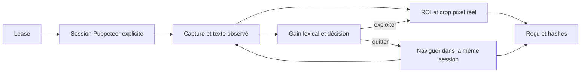

# Foraging web, fovéation et navigation active

- **Statut** : intégration expérimentale; parcours bout en bout validé sur un
  serveur local contrôlé, pas sur un jeu de tâches web réel ni GAIA.
- **Dernière revue** : 2026-10-15.
- **Décision d'architecture** : [ADR 0182](../../adr/0182-navigation-web-et-vision-foveale.md).

## État des capacités

| Capacité | Chemin actuel | Limites à conserver |
| --- | --- | --- |
| `genos_browser_act` | `open_browser_session` crée une session Puppeteer explicite. Navigation et interaction capturent l'état et une image après chaque action. | Chromium doit être installé et démarrable. Les URL non HTTP(S), les identifiants dans l'URL et les hôtes locaux/privés sont bloqués, sauf hôte de test explicitement autorisé par configuration. Le mode historique sans session navigateur reste une simulation basée sur HTML/fetch. |
| `genos_foveal_crop` | `fovealVisionService` lit une image et écrit les pixels de la ROI avec Sharp; le hash porte sur l'image produite. | Les ROIs proposées restent heuristiques. Le zoom est une consigne de sélection; le crop conserve la résolution source et n'invente ni DPI ni détail. |
| `genos_optimal_foraging` | `forage_step` évalue les gains lexicaux observés dans la session réelle, quitte le patch en naviguant vers le prochain lien observé ou l'URL fournie, et fovéate la capture pendant l'exploitation. Le reçu lie le texte observé par digest et conserve l'origine ainsi que le chemin de la page. `navigation_scope` peut limiter la navigation à une liste d'origines HTTP(S). | Le gain lexical est un indicateur de nouveauté, pas de pertinence ou de vérité. La portée est déclarée par l'appelant de l'étape et n'est pas une autorisation de mission authentifiée. Sans session navigateur réelle, l'ancien chemin de test accepte encore un historique fourni par l'appelant. |
| `genos_computer_use` | Contrôle du bureau distinct. | Aucune session ou capture n'est partagée automatiquement avec le navigateur Puppeteer. |

Les leases `WEB_FORAGING` et `FOVEAL_PERCEPTION` restent séparées. Une lease
autorise l'appel, mais ne valide pas la qualité de l'observation ni la décision.
Les retours réussis du navigateur, du foraging et de la fovéation sont maintenant
convertis en observations canoniques du sensorium puis en épisodes autobiographiques
si leur gain d'information dépasse le seuil de saillance. Cette mémorisation ne
certifie ni le contenu observé ni la qualité de la décision.

## Vérification et GAIA

Les tests `test:scout`, `test:foveal` et `test:foraging` couvrent les services
locaux et leurs données de test. `node backend/tests/test_browser_runtime.js`
exerce Puppeteer contre un serveur local autorisé explicitement, avec capture,
clic et observation suivante. `node
backend/tests/test_foraging_browser_runtime.js` enchaîne observation réelle,
crop Sharp, décision de foraging et navigation suivante sur ce serveur. Le
benchmark `web-foraging-linked-runbook-facts/v1` exige les deux réponses
attendues sur deux pages liées (2/2) et vérifie aussi la présence de trois termes
de la cible; ces mesures concernent uniquement le serveur local contrôlé, pas la
pertinence générale sur des sites externes. Ces tests ne valident pas l'accès à
des sites externes. Le test GAIA dépend d'un checkout et d'un harnais externes;
aucun score GAIA de GenOS n'est établi.

Pour GAIA, conserver le modèle et sa version, les données, la commande, la
durée, le scorer et le fichier de résultats provenant de l'exécution effective.

`node backend/tests/test_foraging_scope.js` vérifie sans réseau ni navigateur
qu'une cible hors des origines déclarées est refusée avant l'appel de navigation;
le reçu conserve l'origine/chemin observé, la portée demandée et le digest du
texte. Cette preuve contrôlée ne valide ni l'isolation des redirections d'un
navigateur réel ni l'authenticité de la portée fournie par l'appelant.

Depuis le 2026-10-15, `forage_step` via MCP exige aussi `mission_id` et un
`source_attestation` Ed25519. L'hôte épingle les producteurs dans
`GENOS_FORAGING_TRUST_JSON`, un objet JSON `{ "producer-id": "<clé publique PEM>" }`.
La signature couvre les claims canoniques de
`foragingSourceAttestation.attestationClaims`: schéma versionné, producteur,
mission revendiquée, portée normalisée, origine et chemin, digest SHA-256 du
texte observé et digest du HTML fourni (ou `null` si aucun HTML n'est fourni).
Le reçu conserve la signature et le digest recalculé du reçu.

`node backend/tests/test_foraging_source_attestation.js` exerce source inconnue,
rejeu sur une autre mission, HTML modifié et digest du texte incorrect avec un
HTML synthétique local. Aucun site externe n'est contacté. L'identifiant de
mission reste fourni par l'appelant MCP et n'est pas encore comparé à une
autorité de mission authentifiée du dispatcher. La signature prouve l'identité
du producteur configuré et les claims qu'il a signés; elle ne prouve ni
l'attestation matérielle du navigateur ni la véracité de la page observée.
Chromium n'étant pas disponible ici, ces tests sont simulés et ne vérifient pas
le runtime navigateur réel.
