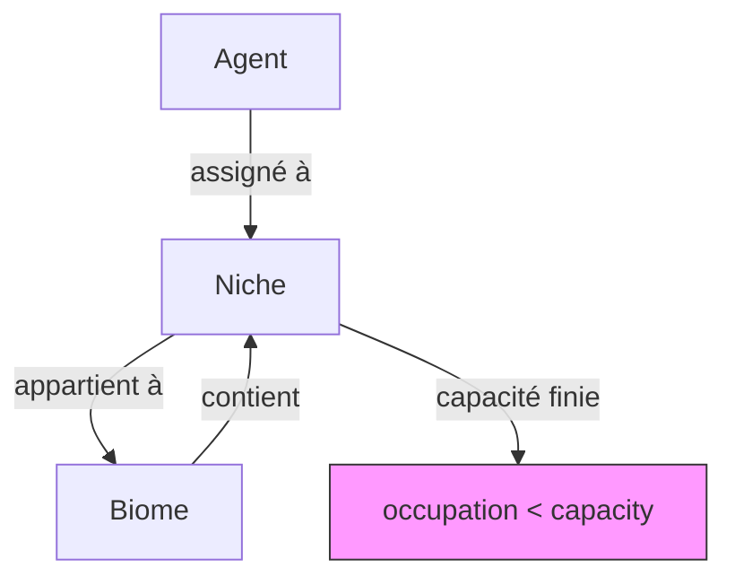

# Écosystème agentique

- **Statut** : Implémenté — module Rust `crates/genos-biology/src/agentic_ecosystem.rs`
- **Portée** : `crates/genos-biology/src/agentic_ecosystem.rs`, topologies `biome`, `biocenose`, `holobionte`, `rhizome`, `metapopulation`
- **Dernière revue** : 2026-10-18

## 1. Définition du domaine

Un écosystème agentique est un regroupement d'agents organisés en niches et en biomes, où chaque agent occupe une niche avec une capacité limitée. Le vocabulaire biologique (niche, biome, occupation) sert à organiser des invariants de allocation et d'isolation, pas à modéliser un milieu naturel.

## 2. Modèle logique

Entités :

| Entité | Champs | Rôle |
|--------|--------|------|
| `AgentRef` | id (UUID), role, niche_id (optionnel) | référence légère vers un agent |
| `Niche` | id, capacity, occupancy | emplacement avec capacité finie |
| `Biome` | id, name, productivité | regroupement de niches |

Règle d'assignation : un agent peut être assigné à une niche uniquement si celle-ci a de l'espace (`occupancy < capacity`) et si l'agent n'est pas déjà assigné.

## 3. Analogies biologiques et limites réelles

Le terme emprunte à l'écologie la notion de niche (position d'une espèce dans un environnement) et de biome (ensemble d'écosystèmes). Chez GenOS, il n'y a pas de milieu physique, pas de flux d'énergie réel : seule une structure de données d'assignation agent → niche avec contrôle de capacité.

## 4. Cas d'usage et objectifs métier

| Cas | Mécanisme | Contrôle indispensable |
|-----|-----------|------------------------|
| Répartir des agents spécialisés par domaine | `assign_niche(agent_id, niche_id)` | vérification de capacité |
| Isoler des charges de travail incompatibles | niches distinctes par biome | tests d'assignation et de saturation |
| Mesurer l'occupation d'un environnement | `mean_niche_occupancy()` | rapport d'occupation |

## 5. Exemples concrets

```rust
use genos_biology::{AgenticEcosystem, AgentRef, Niche};
use uuid::Uuid;

let mut eco = AgenticEcosystem::new();
let agent_id = Uuid::new_v4();
eco.add_agent(AgentRef {
    id: agent_id,
    role: "worker".to_string(),
    niche_id: None,
});
eco.add_niche(Niche::new("debug", 2));

assert!(eco.assign_niche(agent_id, "debug").is_ok());
assert_eq!(eco.unassigned_count(), 0);
assert_eq!(eco.mean_niche_occupancy(), 1.0);
```

## 6. Schéma



## 7. Architecture technique

- Fichier : `crates/genos-biology/src/agentic_ecosystem.rs`
- Types publics : `AgentRef`, `Niche`, `Biome`, `AgenticEcosystem`
- Fonctions publiques : `new()`, `add_agent()`, `add_niche()`, `add_biome()`, `assign_niche(agent_id, niche_id)`, `unassigned_count()`, `mean_niche_occupancy()`
- Serde : `Clone, Debug, Serialize, Deserialize`

## 8. Processus d'exécution et de validation

Tests unitaires inclus dans le module :
- `assign_niche_succeeds_when_space_available`
- `assign_niche_fails_at_full_capacity`
- `assign_niche_fails_for_unknown_agent`
- `mean_occupancy_is_zero_for_empty`

Lancement : `cargo test -p genos-biology` (101 tests passés pour l'ensemble du crate).

## 9. Comparaison avec le marché

Les orchestrateurs d'agents gèrent généralement des files d'attente ou des pools de workers sans notion de capacité par niche. GenOS modélise explicitement la capacité et l'occupation de niches, sans prétendre simuler une écologie réelle.

## 10. Limites, garde-fous, non-objectifs

- Ce n'est pas une simulation écologique : pas de flux d'énergie, pas de prédateur/proie, pas de dynamique de population réelle.
- L'assignation à une niche n'affecte pas automatiquement le routage des missions ni les budgets.
- Les biomes sont des étiquettes de regroupement sans comportement propre.
