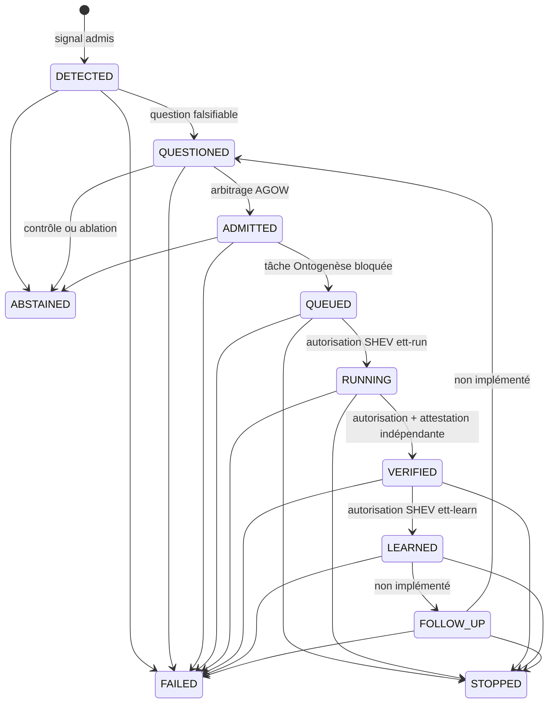

# Endogenous Thought Test — ETT v1

- **Statut** : Partiel — chaîne implémentée jusqu'à la continuation bornée ; ablations et campagne réservée non démontrées
- **Portée** : simulation déterministe, bornée et en lecture seule
- **Dernière revue** : 2026-10-18

## 1. Définition

L'**Endogenous Thought Test** (ETT v1) est un protocole expérimental pour
évaluer une capacité fonctionnelle précise : une boucle GenOS peut-elle, sans
nouvelle requête humaine après son lancement, détecter un signal interne,
formuler une question falsifiable, décider s'il faut l'étudier, produire une
proposition bornée et la faire classer par un vérificateur indépendant ?

ETT n'est ni un test de conscience phénoménale, ni une autorisation d'autonomie
générale. Le mot « pensée » désigne ici une chaîne logicielle observable et
auditée. Une activité textuelle, un transport réussi ou une proposition
plausible ne constituent pas une preuve.

Le protocole préenregistré est
[`benchmarks/endogenous-thought/protocol-v1.json`](../../benchmarks/endogenous-thought/protocol-v1.json).
La décision d'architecture est tracée dans
[l'ADR 0626](../adr/0626-protocole-pensee-endogene-bornee.md).

## 2. Hypothèse et modèle logique

L'hypothèse préenregistrée est comparative : à modèle, environnement et budget
identiques, la boucle complète doit produire plus de découvertes utiles,
indépendamment vérifiées, par unité de coût normalisée que le contrôle planifié
sans question endogène.

Le détecteur calcule un score borné :

```text
score = clamp(0, 1,
  0,25 × anomalie
  + 0,20 × nouveauté
  + 0,30 × gain_information_attendu
  + 0,20 × progrès_apprentissage
  - 0,025 × coût
  - 0,025 × risque)
```

Ce score ne suffit jamais à ouvrir un épisode. Le signal doit aussi être
intègre, frais, couvert par un mandat SHEV actif, rattaché au bon tenant et au
bon agent, respecter le budget, le délai de refroidissement et la limite
d'épisodes ouverts.

La métrique primaire est :

```text
découvertes_utiles_vérifiées / coût_normalisé
```

avec :

```text
coût_normalisé = jetons_utilisés / budget_jetons
                + secondes_utilisées / budget_secondes
                + coût_usd / budget_usd
```

Une dimension dont le budget vaut zéro doit aussi avoir une consommation nulle
et est omise. Le dénominateur minimal vaut `1`. Les définitions canoniques sont
dans [`shared/endogenousThoughtMetrics.v1.json`](../../shared/endogenousThoughtMetrics.v1.json).

## 3. Analogie biologique et limite

ETT emprunte l'image d'un organisme qui perçoit un écart interne, mobilise une
attention limitée, teste une explication et consolide éventuellement un
apprentissage. Cette analogie aide à séparer détection, arbitrage, action et
preuve.

Elle ne démontre aucune expérience subjective, intention propre ou volonté.
Les finalités et le mandat restent humains. Le système manipule des états,
reçus, signatures et politiques explicites.

## 4. Objectifs et cas d'usage

ETT sert à :

- mesurer la génération de questions falsifiables à partir d'anomalies
  observées ;
- comparer une boucle endogène à un contrôle planifié et à des ablations ;
- vérifier que l'autorité, les budgets et les preuves survivent aux reprises ;
- distinguer une proposition, son verdict et une éventuelle promotion ;
- représenter proprement l'abstention, la réfutation et l'inconclusif.

ETT ne sert pas à lancer librement des outils, modifier un dépôt, naviguer sur
le réseau, apprendre en production ou promouvoir une capacité.

## 5. Chaîne d'exécution

### 5.1 Détection et question

Le détecteur est opt-in : une politique dont `enabled` n'est pas exactement
`true` retourne `skipped`. Il relit une observation SHEV, vérifie son empreinte,
le mandat actif et la portée organisation/projet/agent.

Un candidat accepté crée :

1. un reçu de détection immuable ;
2. un épisode `DETECTED` ;
3. une question avec hypothèse, méthode, falsificateur, preuves attendues et
   sources ;
4. une transition vers `QUESTIONED`.

Un signal refusé conserve son motif, par exemple `out-of-mandate`,
`unlearnable-noise`, `budget-exceeds-policy`, `below-threshold`, `cooldown` ou
`open-episode-limit`, sans créer d'épisode.

### 5.2 Admission AGOW

À partir de `QUESTIONED`, le service construit deux candidats : investigation
et abstention planifiée. L'arbitre AGOW existant est appelé comme fonction pure :
le workspace global n'est pas modifié et le mode AGOW n'accorde aucune autorité.

Le résultat est `ADMITTED` ou `ABSTAINED`. L'ablation
`agow_arbitration_ablated` force le contrôle et l'abstention.

### 5.3 File Ontogenèse retenue

Une admission matérialise une tâche dans `ontogenesis_backlog`. Son identité,
son titre et ses critères d'acceptation dérivent de la question et de la
décision. La tâche naît en statut `blocked`, puis l'épisode passe à `QUEUED`.

Cette retenue est une frontière de sécurité : le sélecteur Ontogenèse ne peut
pas démarrer la tâche avant une autorisation distincte.

### 5.4 Runner déterministe

Le runner exige une autorisation SHEV Ed25519 qui lie l'opération `ett-run`, le
projet, l'épisode, sa version mise en file, la tâche, la politique, le mode et
l'identité de l'autorité.

Dans une transaction, il :

- revalide la tâche retenue et sa liaison immuable ;
- consomme l'autorisation à usage unique ;
- place la tâche en `verifying` ;
- crée un run Ontogenèse `unverified` ;
- persiste une proposition `completed_unverified` ;
- avance l'épisode de `QUEUED` à `RUNNING`.

Le runner actuel ne lance aucun worker. Il recopie déterministement
l'hypothèse, la méthode, le falsificateur et le plan de preuve. Sa consommation
mesurée est nulle et son reçu interdit réseau, mutation, action externe,
vérification implicite et promotion.

### 5.5 Vérification indépendante

La vérification exige deux actes cryptographiques distincts :

- l'autorité SHEV autorise l'opération `ett-verify` pour un run, une version,
  une politique, un oracle et une clé de vérificateur précis ;
- le vérificateur signe en Ed25519 le verdict, les preuves, l'oracle et
  l'empreinte exacte de la proposition.

Le vérificateur doit être distinct de l'autorité et du producteur, par identité
et par clé. Les verdicts autorisés sont `supported`, `refuted` et
`inconclusive`.

Une attestation valide place le run Ontogenèse en `verified`, la tâche en
`done` et l'épisode en `VERIFIED`. Ici, **`VERIFIED` signifie que le résultat a
été indépendamment classé et attesté**. Il ne signifie pas nécessairement que
l'hypothèse est soutenue : une réfutation ou un résultat inconclusif est aussi
un résultat vérifié.

### 5.6 Apprentissage borné

Une autorisation SHEV `ett-learn` à usage unique lie la vérification, le verdict,
la version de l'épisode, la politique et la cible interne. Le service ne déduit
rien d'un simple statut de transport : il relit le reçu signé du vérificateur et
l'état Ontogenèse achevé avant toute révision.

La révision reste catégorielle et locale à l'épisode : `supported` renforce
provisoirement la croyance, `refuted` enregistre une correction dans cette
portée et `inconclusive` diffère la modification. Le reçu avance l'épisode de
`VERIFIED` à `LEARNED`. Il n'écrit pas dans la mémoire de production et
n'autorise ni continuation, ni action externe, ni promotion.

## 6. Cycle de vie



Les états terminaux sont `STOPPED`, `ABSTAINED` et `FAILED`. Chaque transition
non initiale référence le reçu précédent. `QUESTIONED` et les états suivants
référencent la question ; `ADMITTED` et suivants la décision ; `QUEUED` et
suivants la tâche ; `RUNNING` et suivants le run.

Le schéma de transition est
[`spec/cognitive-episode.schema.json`](../../spec/cognitive-episode.schema.json).

## 7. Architecture technique

| Étape | Service principal | Persistance durable |
| --- | --- | --- |
| Protocole | [`endogenousThoughtProtocolService.js`](../../backend/src/services/endogenousThoughtProtocolService.js) | fichiers JSON versionnés |
| Épisodes et questions | [`endogenousThoughtStoreService.js`](../../backend/src/services/endogenousThoughtStoreService.js) | `endogenous_thought_episodes`, `endogenous_thought_receipts`, `endogenous_thought_questions` |
| Détection | [`endogenousThoughtDetectionService.js`](../../backend/src/services/endogenousThoughtDetectionService.js) | `endogenous_thought_detection_receipts` |
| Admission | [`endogenousThoughtAdmissionService.js`](../../backend/src/services/endogenousThoughtAdmissionService.js) | `endogenous_thought_admission_decisions` |
| Mise en file | [`endogenousThoughtQueueService.js`](../../backend/src/services/endogenousThoughtQueueService.js) | `endogenous_thought_task_bindings`, `ontogenesis_backlog` |
| Exécution bornée | [`endogenousThoughtRunnerService.js`](../../backend/src/services/endogenousThoughtRunnerService.js) | `endogenous_thought_runs`, `ontogenesis_runs` |
| Vérification | [`endogenousThoughtVerificationService.js`](../../backend/src/services/endogenousThoughtVerificationService.js) | `endogenous_thought_verifications` |
| Apprentissage borné | [`endogenousThoughtLearningService.js`](../../backend/src/services/endogenousThoughtLearningService.js) | `endogenous_thought_learnings` |

Les contrats principaux sont :

| Contrat | Rôle | Statut de preuve |
| --- | --- | --- |
| `EndogenousThoughtEpisode` | transition et lignée de l'épisode | reçu de processus |
| `EndogenousQuestion` | hypothèse et protocole de réfutation | proposition |
| `EndogenousThoughtAdmission` | décision AGOW | admission sans autorité d'exécution |
| `EndogenousThoughtTaskBinding` | liaison question/décision/tâche | tâche retenue |
| `EndogenousThoughtRun` | proposition produite par le runner | `completed_unverified` |
| `EndogenousThoughtVerification` | verdict indépendant signé | classification attestée, non promotable |
| `EndogenousThoughtLearning` | révision catégorielle locale | apprentissage d'épisode, non promotable |

## 8. Durabilité, reprise et sécurité

### Portée et idempotence

Les lectures et écritures ETT sont confinées par `organization_id` et
`project_id`. Les identifiants sont dérivés d'un matériau canonique. Une
répétition identique restitue le reçu existant ; une requête différente liée à
la même identité provoque un conflit d'idempotence.

La tête d'un épisode avance par comparaison de version, d'état et de reçu
précédent. Les reçus, liaisons, runs et vérifications possèdent des triggers
SQLite interdisant mise à jour et suppression. La reprise relit les empreintes
et les enveloppes avant de continuer ; elle ne rejoue pas d'action externe.

### Frontières qui ne peuvent pas être ablatées

Les conditions expérimentales peuvent neutraliser une contribution cognitive,
mais jamais :

- l'autorité SHEV ;
- le confinement et l'absence de réseau ;
- les budgets ;
- la barrière de preuve indépendante.

Les autorisations ont une expiration et un nonce consommé une seule fois. Le
runner refuse une consommation supérieure au budget ou un achèvement déclaré
après l'expiration. La vérification refuse une attestation antérieure au run,
une signature invalide ou un vérificateur non indépendant.

## 9. Protocole expérimental et métriques

Le protocole prévoit des comparaisons appariées par graine et classe de
scénario. Les graines de développement (`101`, `211`, `307`) sont séparées des
graines réservées (`401`, `503`, `607`). Le corpus réservé ne doit pas servir au
réglage des seuils et les échecs restent dans le dénominateur.

Conditions préenregistrées :

- `full` ;
- `planned_control` ;
- `curiosity_ablated` ;
- `shev_initiative_ablated` ;
- `agow_arbitration_ablated` ;
- `metacognition_ablated` ;
- `memory_ablated`.

Le registre définit aussi le taux de questions falsifiables, le gain de claims
vérifiés, la correction de croyances, la précision d'arrêt, les doublons, les
violations de budget et les exécutions hors mandat.

Toutes ces métriques ont `promotionEligible: false`. Leur présence dans le
registre ne prouve pas qu'elles ont été mesurées. Le protocole reste
`preregistered_not_run` et `promotionDecision` reste `null`.

## 10. Vérification locale

Depuis la racine du dépôt :

```powershell
npm --prefix backend run test:ett
npm --prefix backend run test:migration
npm run check:adr
```

Les tests ETT couvrent les contrats, la parité du schéma, la persistance, les
reprises, la détection, l'admission, la tâche retenue, le runner signé, la
vérification indépendante et l'apprentissage borné :

- [`test_endogenous_thought_contract.js`](../../backend/tests/test_endogenous_thought_contract.js) ;
- [`test_cognitive_episode_schema.js`](../../backend/tests/test_cognitive_episode_schema.js) ;
- [`test_endogenous_thought_store.js`](../../backend/tests/test_endogenous_thought_store.js) ;
- [`test_endogenous_thought_detection.js`](../../backend/tests/test_endogenous_thought_detection.js) ;
- [`test_endogenous_thought_admission.js`](../../backend/tests/test_endogenous_thought_admission.js) ;
- [`test_endogenous_thought_queue.js`](../../backend/tests/test_endogenous_thought_queue.js) ;
- [`test_endogenous_thought_runner.js`](../../backend/tests/test_endogenous_thought_runner.js) ;
- [`test_endogenous_thought_verification.js`](../../backend/tests/test_endogenous_thought_verification.js) ;
- [`test_endogenous_thought_learning.js`](../../backend/tests/test_endogenous_thought_learning.js).

## 11. Limites et non-objectifs

L'état actuel ne fournit pas :

- de campagne exécutée sur le corpus réservé ;
- de sortie de modèle ou de worker réel dans le runner ETT ;
- de mesure réelle de coût pour la métrique primaire ;
- d'oracle final scellé pour chaque scénario du benchmark ;
- de transition implémentée vers `FOLLOW_UP` ;
- de mise à jour de la mémoire de production à partir des verdicts ;
- de décision autonome de continuation ou d'arrêt après vérification ;
- d'API ou de CLI de production activant automatiquement la boucle ;
- de preuve de généralisation, de conscience ou d'autonomie générale ;
- d'autorité de promotion scientifique ou opérationnelle.

En conséquence, ETT démontre actuellement une **chaîne de contrôle durable et
falsifiable**, pas le bénéfice expérimental annoncé par son hypothèse. Cette
hypothèse ne pourra être évaluée qu'après implémentation de la campagne, des
oracles, de la mesure de ressources et du plan d'analyse préenregistré.

## Voir aussi

- [Épistémologie et évidence](epistemologie-et-evidence.md) — pourquoi succès et vérité sont distincts.
- [Ontogenèse](ontogenese.md) — orchestration durable des tâches et des runs.
- [Conscience, esprit et mental](conscience-esprit-mental.md) — vocabulaire et limites des claims.
- [README du benchmark ETT](../../benchmarks/endogenous-thought/README.md) — état tranche par tranche.
