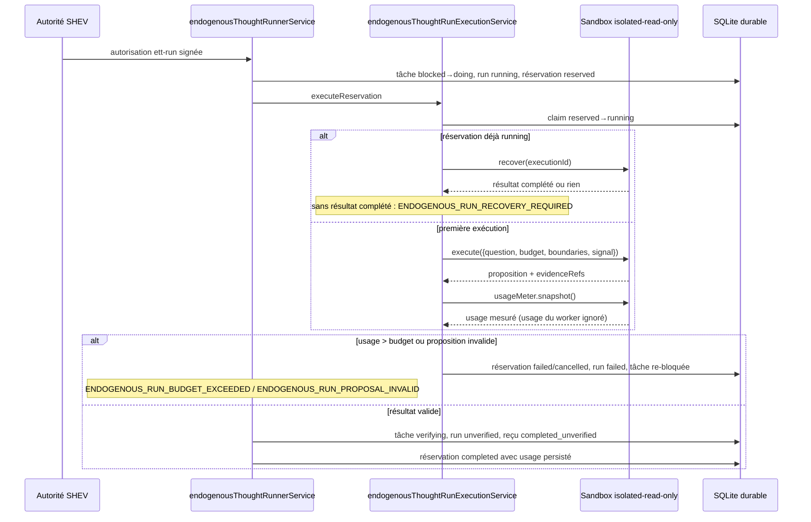
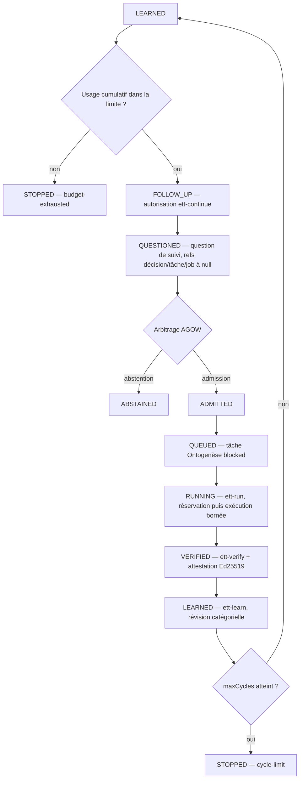
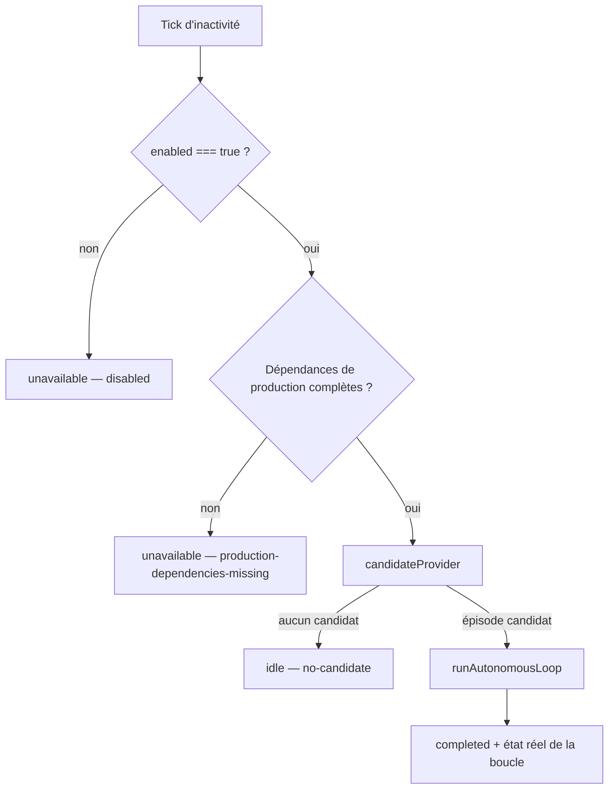
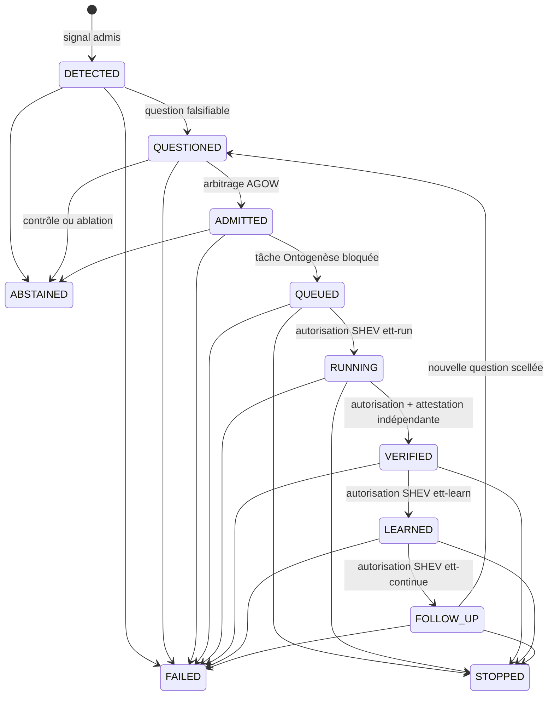

# Endogenous Thought Test — ETT v1

- **Statut** : Partiel — chaîne PR1–PR8, continuation et boucle multicycle bornée implémentées ; campagne de développement exécutable mais `scientificEvidence: false` ; campagne sur corpus réservé non exécutée
- **Portée** : raisonnement borné en lecture seule, avec repli déterministe et reçus durables
- **Dernière revue** : 2026-10-20

## 1. Définition

L'**Endogenous Thought Test** (ETT v1) est un protocole expérimental pour
évaluer une capacité fonctionnelle précise : une boucle GenOS peut-elle, sans
nouvelle requête humaine après son lancement, détecter un signal interne,
formuler une question falsifiable, décider s'il faut l'étudier, produire une
proposition bornée et la faire classer par un vérificateur indépendant ?

ETT n'est ni un test de conscience phénoménale, ni une autorisation d'autonomie
générale. Le mot « pensée » désigne ici une chaîne logicielle observable et
auditée. Une activité textuelle, un transport réussi ou une proposition
plausible ne constituent pas une preuve.

Le protocole préenregistré est
[`benchmarks/endogenous-thought/protocol-v1.json`](../../benchmarks/endogenous-thought/protocol-v1.json).
La décision d'architecture est tracée dans
[l'ADR 0626](../adr/0626-protocole-pensee-endogene-bornee.md).

Le dossier est séparé par usage, conformément aux conventions documentaires :

- cette page explique le **concept**, le modèle et les limites ;
- [l'orchestration](../02-orchestration/pensee-endogene-bornee.md) décrit les
  responsabilités, les flux, l'autorité et le raccord résident ;
- [la référence runtime](../03-reference/runtime-pensee-endogene.md) inventorie
  les API de service, contrats, tables, erreurs et sorties ;
- [le guide d'exploitation](../04-exploitation/pensee-endogene.md) donne les
  commandes, diagnostics et procédures de reprise ;
- [la qualification du 2026-10-20](../06-qualite-preuves/qualification-pensee-endogene-2026-10-20.md)
  rapporte les observations exécutées et leurs limites.

### 1.1 Frontière endogène/exogène

« Endogène » désigne ici un critère précis, pas une métaphore : après le
lancement d'un épisode, la chaîne complète — question, admission, mise en file,
raisononnement, vérification, apprentissage, continuation — s'enchaîne à partir
de l'état interne persisté de l'épisode, sans requête humaine supplémentaire.
Trois frontières délimitent ce qui reste exogène :

- **la finalité reste humaine** : le mandat SHEV (responsabilité active,
  dimensions autorisées) est déclaré avant le lancement ; la détection refuse
  toute observation hors mandat (`out-of-mandate`) et tout mandat inactif
  (`mandate-inactive`) ;
- **l'autorité reste externe à la boucle** : chaque étape à effet (exécution,
  vérification, apprentissage, continuation) consomme une autorisation SHEV
  Ed25519 signée à usage unique, avec expiration et nonce ; la boucle
  multicycle exige un signataire fourni par l'appelant et ne fabrique aucune
  signature ;
- **le verdict reste externe au producteur** : seul un vérificateur dont
  l'identité et la clé diffèrent du producteur et de l'autorité peut faire
  avancer un run à `VERIFIED`.

Un signal est « interne » s'il provient d'une observation SHEV intègre (empreinte
revalidée) dans la portée du projet. La chaîne reste endogène tant que ses
entrées sont ces états internes ; elle n'ouvre jamais le réseau, ne mute aucun
dépôt et n'exécute aucune action externe.

### 1.2 Pourquoi un appel périodique à un modèle ne suffit pas

L'alternative la plus simple — réveiller périodiquement un modèle et compter ses
sorties — est explicitement écartée
([ADR 0626](../adr/0626-protocole-pensee-endogene-bornee.md)) parce qu'elle
confond activité générée et décision valide :

- un appel périodique ne garantit ni l'autorité du mandat (qui décide que ce
  sujet peut être étudié ?), ni la reprise après crash (un appel interrompu est
  perdu ou rejoué deux fois), ni l'indépendance de la vérification (le modèle
  qui produit juge sa propre production) ;
- une sortie textuelle plausible n'est pas une preuve de découverte : sans
  oracle et sans vérificateur distinct, il n'existe pas de critère falsifiable
  pour compter un résultat ;
- mesurer le volume de texte ou le nombre de cycles évalue l'activité, pas la
  valeur épistémique produite.

ETT répond à chacun de ces manques par un artefact durable : un mandat SHEV
actif et scanné, des reçus append-only avec lignée et idempotence, une barrière
de preuve indépendante à deux signatures, et une métrique primaire qui ne
compte que des découvertes vérifiées par unité de coût normalisée. La
contrepartie est le coût : chaque étape persiste un reçu signé et vérifiable.

## 2. Hypothèse, modèle logique et contrats

### 2.1 Hypothèse préenregistrée

L'hypothèse préenregistrée est comparative : à modèle, environnement et budget
identiques, la boucle complète doit produire plus de découvertes utiles,
indépendamment vérifiées, par unité de coût normalisée que le contrôle planifié
sans question endogène. Le protocole reste `preregistered_not_run` et
`promotionDecision` reste `null` : l'hypothèse n'a pas encore été évaluée.

### 2.2 Score de détection borné

Le détecteur calcule un score borné :

```text
score = clamp(0, 1,
  0,25 × anomalie
  + 0,20 × nouveauté
  + 0,30 × gain_information_attendu
  + 0,20 × progrès_apprentissage
  - 0,025 × coût
  - 0,025 × risque)
```

Sous la condition `curiosity_ablated`, le terme de gain d'information attendu
est forcé à zéro dans le calcul. Ce score ne suffit jamais à ouvrir un épisode :
le signal doit aussi être intègre, frais, couvert par un mandat SHEV actif,
rattaché au bon tenant et au bon agent, respecter le budget, le délai de
refroidissement et la limite d'épisodes ouverts.

### 2.3 Métrique primaire et normalisation des coûts

La métrique primaire est :

```text
découvertes_utiles_vérifiées / coût_normalisé
```

avec :

```text
coût_normalisé = jetons_utilisés / budget_jetons
                + secondes_utilisées / budget_secondes
                + coût_usd / budget_usd
```

Une dimension dont le budget vaut zéro doit aussi avoir une consommation nulle
et est omise. Le dénominateur minimal vaut `1`. Les définitions canoniques sont
dans [`shared/endogenousThoughtMetrics.v1.json`](../../shared/endogenousThoughtMetrics.v1.json)
(identifiant de métrique primaire :
`verified_useful_discoveries_per_normalized_cost`). Aucune dimension n'est
encore alimentée par des mesures réelles en production : la campagne de
développement porte explicitement `scientificEvidence: false` et un
`measurementStatus` de `synthetic_control_only`.

### 2.4 Contrats versionnés

Chaque artefact de la chaîne est un reçu scellé, vérifiable et immuable. Les
schémas de reçu effectifs dans le code :

| Contrat | Schéma de reçu | Rôle | Statut de preuve |
| --- | --- | --- | --- |
| `EndogenousThoughtEpisode` | `genos.EndogenousThoughtEpisode.receipt/v1` | transition et lignée de l'épisode (une par avancement) | reçu de processus |
| `EndogenousQuestion` | `genos.EndogenousQuestion.receipt/v1` | hypothèse, falsificateur, méthode, preuves attendues (question initiale et question de suivi) | proposition |
| `EndogenousThoughtAdmission` | `genos.EndogenousThoughtAdmission.receipt/v1` | décision AGOW scellée | admission sans autorité d'exécution |
| `EndogenousThoughtTaskBinding` | `genos.EndogenousThoughtTaskBinding.receipt/v1` | liaison question/décision/tâche Ontogenèse | tâche retenue |
| `EndogenousThoughtRun` | `genos.EndogenousThoughtRun.receipt/v1` | proposition produite par le runner | `completed_unverified`, non promotable |
| `EndogenousThoughtVerification` | `genos.EndogenousThoughtVerification.receipt/v1` | verdict indépendant signé Ed25519 | classification attestée, non promotable |
| `EndogenousThoughtLearning` | `genos.EndogenousThoughtLearning.receipt/v2` (lecteur compatible `v1`) | révision catégorielle locale à l'épisode | apprentissage d'épisode, non promotable |

La migration `v1 → v2` du contrat d'apprentissage
([ADR 0646](../adr/0646-apprentissage-et-execution-ett-reprenables.md)) change
une seule frontière : `productionMemoryMutated` passe de `true` (legacy) à
`false`. Le reçu `v2` atteste qu'une entrée vérifiée est apprise dans l'épisode ;
il ne prétend plus que la mémoire de production a déjà été mutée. Les anciens
reçus `v1` restent lisibles.

Le « reçu de continuation » est une transition `EndogenousThoughtEpisode` vers
`FOLLOW_UP` ; le « reçu de suivi » est une question `EndogenousQuestion`
d'identité `ett_question_follow_up_…` scellée sur la tête de l'épisode. Les
frontières communes des reçus interdisent l'autorité d'exécution implicite,
l'action externe et la promotion.

### 2.5 Notation et invariants

Un épisode est un agrégat :

```text
Episode = ⟨ episodeId, agentId, projectId, mandateRef, triggerRef, budget, tête ⟩
tête    = ⟨ currentState, currentReceiptId, version ⟩
```

et chaque avancement persiste une transition :

```text
t = ⟨ transitionId, fromState, toState, questionRef, decisionRef, taskRef,
      jobRef, budget, evidenceRefs, stopReason, occurredAt, previousReceiptId ⟩
```

Les invariants logiciels contrôlés par le runtime et les triggers SQLite :

- **I1 — append-only** : les tables de reçus, questions, décisions, liaisons,
  runs, vérifications et apprentissages portent des triggers `BEFORE UPDATE` et
  `BEFORE DELETE` qui avortent toute modification ou suppression ; l'identité
  d'un épisode (organisation, projet, épisode, agent, mandat, déclencheur,
  budget) est immuable ;
- **I2 — tête cohérente** : la tête n'avance que si `version` croît
  exactement de un, si l'état et le reçu changent, et si le reçu précédent
  pointé correspond à la séquence `version - 1` de la même lignée ;
- **I3 — références par état** : chaque état porte ses références obligatoires
  (section 2.6) ; une transition non initiale exige `previousReceiptId` ;
- **I4 — unicité par parent immédiat** : une tâche par décision d'admission,
  un run par liaison de tâche, une vérification par run, un apprentissage par
  vérification ; l'épisode lui-même peut porter plusieurs cycles complets
  ([ADR 0647](../adr/0647-boucle-ett-multicycle-et-questionnement-endogene.md)) ;
- **I5 — idempotence par identité** : chaque artefact a un identifiant
  déterministe dérivé d'un matériau canonique (SHA-256, 24 caractères hex) ;
  une répétition identique restitue le reçu existant ; le même identifiant lié
  à un contenu différent est refusé (conflit d'idempotence).

### 2.6 Machine d'états exhaustive

Le schéma canonique
[`spec/cognitive-episode.schema.json`](../../spec/cognitive-episode.schema.json)
et le trigger SQLite `endogenous_thought_episode_transition_guard` définissent
exactement les transitions autorisées et leurs exigences :

| Depuis | Vers | Acte exigé | Références obligatoires |
| --- | --- | --- | --- |
| *(départ)* | `DETECTED` | signal admis par le détecteur | `fromState: null`, `previousReceiptId: null` |
| `DETECTED` | `QUESTIONED` | question falsifiable scellée | `questionRef` |
| `DETECTED` | `ABSTAINED` | abstention (motif) | `stopReason` |
| `DETECTED` | `FAILED` | échec (motif) | `stopReason` |
| `QUESTIONED` | `ADMITTED` | arbitrage AGOW `agow-selected` | `questionRef`, `decisionRef` |
| `QUESTIONED` | `ABSTAINED` | contrôle planifié ou ablation | `stopReason` |
| `QUESTIONED` | `FAILED` | échec (motif) | `stopReason` |
| `ADMITTED` | `QUEUED` | tâche Ontogenèse retenue `blocked` | `questionRef`, `decisionRef`, `taskRef` (`jobRef: null`) |
| `ADMITTED` | `ABSTAINED` | abstention tardive | `stopReason` |
| `ADMITTED` | `FAILED` | échec (motif) | `stopReason` |
| `QUEUED` | `RUNNING` | autorisation SHEV `ett-run` consommée | `questionRef`, `decisionRef`, `taskRef`, `jobRef` |
| `QUEUED` | `STOPPED` | arrêt borné (motif) | `stopReason` |
| `QUEUED` | `FAILED` | échec (motif) | `stopReason` |
| `RUNNING` | `VERIFIED` | autorisation `ett-verify` + attestation Ed25519 | `questionRef`, `decisionRef`, `taskRef`, `jobRef`, `evidenceRefs ≥ 1` |
| `RUNNING` | `STOPPED` | arrêt borné (motif) | `stopReason` |
| `RUNNING` | `FAILED` | échec (motif) | `stopReason` |
| `VERIFIED` | `LEARNED` | autorisation SHEV `ett-learn` consommée | `questionRef`, `decisionRef`, `taskRef`, `jobRef`, `evidenceRefs ≥ 1` |
| `VERIFIED` | `STOPPED` | arrêt borné (motif) | `stopReason` |
| `VERIFIED` | `FAILED` | échec (motif) | `stopReason` |
| `LEARNED` | `FOLLOW_UP` | autorisation SHEV `ett-continue` consommée | `questionRef`, `decisionRef`, `taskRef`, `jobRef`, `evidenceRefs ≥ 1` |
| `LEARNED` | `STOPPED` | arrêt borné (motif, ex. `cycle-limit`) | `stopReason` |
| `LEARNED` | `FAILED` | échec (motif) | `stopReason` |
| `FOLLOW_UP` | `QUESTIONED` | question de suivi scellée | `questionRef` (décision, tâche et job remis à `null`) |
| `FOLLOW_UP` | `STOPPED` | arrêt borné (motif) | `stopReason` |
| `FOLLOW_UP` | `FAILED` | échec (motif) | `stopReason` |

Les états terminaux sont `STOPPED`, `ABSTAINED` et `FAILED` ; tout état
terminal porte un `stopReason` non vide. `STOPPED` n'est accessible qu'après
`QUEUED` ; avant la mise en file, l'issue négative est `ABSTAINED`. Le budget
du contrat exige des jetons entiers ≥ 1, un coût USD ≥ 0 et des secondes
entières ≥ 1. Les métadonnées du schéma (`x-genos-boundaries`) fixent que le
contrat n'accorde aucune autorité, n'autorise aucune promotion, n'évalue pas la
conscience phénoménale et ne transporte pas de raisonnement privé. La parité
entre ce schéma et le validateur du runtime est vérifiée par
[`test_cognitive_episode_schema.js`](../../backend/tests/test_cognitive_episode_schema.js).

## 3. Analogie biologique et limite

ETT emprunte l'image d'un organisme qui perçoit un écart interne, mobilise une
attention limitée, teste une explication et consolide éventuellement un
apprentissage. Cette analogie aide à séparer détection, arbitrage, action et
preuve.

Elle ne démontre aucune expérience subjective, intention propre ou volonté.
Les finalités et le mandat restent humains. Le système manipule des états,
reçus, signatures et politiques explicites. L'analogie s'arrête là où le code
s'arrête : il n'existe aucune représentation d'un ressenti, seulement des
tables, des empreintes et des signatures.

## 4. Objectifs, cas d'usage et anti-usages

ETT sert à :

- mesurer la génération de questions falsifiables à partir d'anomalies
  observées ;
- comparer une boucle endogène à un contrôle planifié et à des ablations sous
  les mêmes scénarios, graines et budgets ;
- vérifier que l'autorité, les budgets et les preuves survivent aux reprises
  (redémarrage de la base, rejeu idempotent, réservations terminales) ;
- distinguer une proposition (`completed_unverified`), son verdict attesté
  (`VERIFIED`) et une éventuelle promotion (jamais accordée par ETT) ;
- représenter proprement l'abstention, la réfutation et l'inconclusif, qui sont
  des résultats de première classe.

### 4.1 Quand ne pas utiliser l'ETT

- **Sans vérificateur indépendant disponible** (identité et clé Ed25519
  distinctes du producteur et de l'autorité) : la chaîne s'arrête avant
  `VERIFIED` ; un auto-verdict n'existe pas comme option.
- **Sans autorité SHEV capable de signer** `ett-run`, `ett-verify`,
  `ett-learn` et `ett-continue` : la boucle ne peut pas s'exécuter ; la boucle
  multicycle exige un signataire et un fournisseur de vérification fournis par
  l'appelant.
- **Quand la question est déjà posée par l'humain** : le chemin pertinent est
  le contrôle planifié (`planned_control`), pas la boucle endogène.
- **Sans compteur d'usage externe** : un worker injecté est refusé
  (`ENDOGENOUS_RUN_USAGE_METER_REQUIRED`) ; sans mesure, la métrique primaire
  resterait vide et toute comparaison de coût serait synthétique.
- **Pour agir sur le monde** : réseau, mutation de dépôt, action externe et
  lancement de worker sont interdits par le sandbox et scellés à `false` dans
  les reçus.
- **Pour promouvoir une capacité ou revendiquer une conscience** : tous les
  reçus ETT portent `promotionEligible: false` ; ETT n'évalue pas la conscience
  phénoménale.
- **Pour régler des seuils sur le corpus réservé** : le plan d'analyse fixe
  `reservedCorpusUsedForTuning: false`.

## 5. Chaîne d'exécution PR1 → PR8

Les huit tranches PR1–PR8 sont implémentées et testées ; les sections suivantes
décrivent le comportement effectif du code, code d'erreur par code d'erreur.

### 5.1 PR3 — Détection et question

Le détecteur est opt-in : une politique dont `enabled` n'est pas exactement
`true` retourne `{ status: 'skipped', reason: 'disabled' }`. Il relit une
observation SHEV, revalide son empreinte (`ENDOGENOUS_OBSERVATION_INTEGRITY_FAILED`
en cas d'écart), le mandat actif et la portée organisation/projet/agent
(`ENDOGENOUS_AGENT_SCOPE_MISMATCH`, `ENDOGENOUS_OBSERVATION_NOT_FOUND`).

L'évaluation peut être fournie ou dérivée : si elle est incomplète, le service
d'évaluation dérive des scores bornés depuis l'historique réel des observations
de la dimension — anomalie par type (`degradation` 0,9 ; `risk` 0,8 ;
`capability_gap` 0,7 ; `blind_spot` 0,6 ; `opportunity` 0,5 ; `state` 0,2 ;
sinon 0,5), nouveauté par proximité lexicale (Jaccard sur les tokens),
gain d'information par diversité entropique des catégories, progression par
répétition récente. Ces estimateurs sont provisoires et non calibrés.

Les portes de refus, toutes persistées dans un reçu de détection immuable, avec
leurs motifs exacts :

- `agent-not-idle` (agent en cours d'exécution), `agent-unavailable`
  (apoptotique ou budget cognitif nul), `mandate-inactive` ;
- `out-of-mandate` (dimension absente du mandat), `no-actionable-signal`
  (observation de type `state`), `stale-observation` (validité expirée),
  `insufficient-evidence` (statut épistémique non observé ; seul le couple
  `blind_spot` + `unknown` est admissible) ;
- `unlearnable-noise` (au moins deux échantillons et progression sous le
  seuil), `low-information-gain`, `budget-exceeds-policy`, `below-threshold` ;
- `open-episode-limit` (la politique borne les épisodes ouverts, maximum 10)
  et `cooldown` (délai minimum entre deux candidats, borné à un jour) ;
- les conditions expérimentales `shev_initiative_ablated` et `planned_control`
  refusent systématiquement (`shev-initiative-ablated`, `planned-control`).

Un candidat accepté crée, dans l'ordre : un reçu de détection immuable et
idempotent (identité déterministe `ett_detection_…` sur la base
organisation/projet/agent/observation/politique/version de mandat), un épisode
`DETECTED`, une question (texte, hypothèse, falsificateur, méthode, preuves
attendues, sources, gain attendu, coût estimé, risque), puis la transition vers
`QUESTIONED`. La question est produite par règles fixes par défaut ; un
générateur peut être injecté ; sinon, si un budget monétaire existe, le
générateur cognitif transversal est appelé (`status: 'skipped'` avec
`generation-budget-required` sinon), et toute indisponibilité de modèle
produit un repli déterministe explicite, jamais un échec maquillé.

### 5.2 PR4 — Admission AGOW

À partir de `QUESTIONED`, le service construit deux candidats AGOW validés :
investigation (`ett_investigate_…`) et abstention planifiée
(`ett_control_…`), dont les mesures dérivent de la question (gain d'information
attendu, risque, coût estimé) pour l'investigation et de valeurs planifiées
pour le contrôle. L'arbitre AGOW existant est appelé comme fonction pure avec
`capacity: 1` et une compétition de trois tours ; le workspace global n'est pas
modifié et le mode AGOW n'accorde aucune autorité (frontière
`agowModeMutated: false` scellée dans le reçu).

Le résultat est `ADMITTED` (`agow-selected`) ou `ABSTAINED`
(`agow-control-selected`). L'ablation `agow_arbitration_ablated` force le
contrôle et l'abstention (`agow-arbitration-ablated`, compétition à zéro tour).
La décision est immuable, idempotente et liée à la question ; sa durée de vie
candidat est bornée (`ttlMs` entre 1 000 et 3 600 000 ms).

### 5.3 PR5 — File Ontogenèse retenue

Une admission matérialise une tâche dans `ontogenesis_backlog` via une liaison
d'identités déterministes (`ett_binding_…`, `ett_task_…`) sur la question, la
décision et la politique. Le titre (`ETT — ` suivi du texte de la question,
tronqué à 500 caractères) et les critères d'acceptation (preuves attendues
dédupliquées) dérivent du contrat de question ; la priorité est un entier de 0
à 100. Le projet Ontogenèse doit exister
(`ENDOGENOUS_QUEUE_PROJECT_NOT_FOUND`).

La tâche naît en statut `blocked`, sans dépendances, avec `attempt = 0`, puis
l'épisode passe à `QUEUED` avec ce `taskRef` et `jobRef` à `null`. La tâche est
ensuite relue et doit correspondre exactement à sa liaison
(`ENDOGENOUS_QUEUE_TASK_INTEGRITY_FAILED`) ; un identifiant de tâche déjà
présent est refusé (`ENDOGENOUS_QUEUE_TASK_CONFLICT`). Cette retenue est une
frontière de sécurité : le sélecteur Ontogenèse ne peut pas démarrer la tâche
avant une autorisation distincte, même si une boucle du projet est déjà active.

### 5.4 PR6 — Runner déterministe et réservation durable

Le runner exige une autorisation SHEV Ed25519 qui lie l'opération `ett-run`, le
projet, l'épisode (`subjectId`), la version mise en file, la tâche, la
politique, le mode (`ett-read-only-simulation`) et l'identité de l'autorité
(`grantedBy`). Toute divergence de portée est refusée
(`ENDOGENOUS_RUN_AUTHORIZATION_INVALID`) ; l'autorisation est consommée à usage
unique dans la transaction de réservation.

Avant toute invocation externe, le runner persiste, en une seule transaction
(`reserveRun`) :

1. la relecture de la réservation existante (rejeu idempotent si terminée) et
   la validation de la tâche retenue (`blocked`, `attempt = 0`, correspondance
   exacte du titre, de la priorité et des critères) ;
2. la consommation de l'autorisation ;
3. le passage de la tâche en `doing` (`attempt = 1`) et la création d'un run
   Ontogenèse `running` (topologie `ett-read-only`, variante `deterministic`,
   worker non lancé) ;
4. l'insertion d'une réservation SQLite `reserved` avec sa politique de sandbox
   et un usage initial nul.

L'exécution elle-même passe par le service d'exécution, dont la machine est
scellée : la réservation passe de `reserved` à `running` (`mode: 'execute'`) ;
une réservation déjà `running` n'est **jamais réexécutée** — l'adaptateur doit
récupérer son résultat (`mode: 'recover'`), sinon échec fermé
`ENDOGENOUS_RUN_RECOVERY_REQUIRED` ; une réservation terminale
(`completed`, `failed`, `cancelled`) n'est plus réclamable
(`ENDOGENOUS_RUN_RESERVATION_TERMINAL`).



Sans worker injecté, l'adaptateur interne est déterministe : il recopie
l'hypothèse, la méthode, le falsificateur et le plan de preuve de la question,
avec une consommation mesurée nulle. Avec un worker ou un solveur injecté
([ADR 0627](../adr/0627-execution-cognitive-ett-workers-reels.md),
[ADR 0646](../adr/0646-apprentissage-et-execution-ett-reprenables.md)) :

- l'adaptateur doit être déclaré `isolated-read-only` — sans réseau, sans
  mutation, sans action externe — sinon `ENDOGENOUS_RUN_SANDBOX_REQUIRED` ;
- un compteur d'usage externe est exigé
  (`ENDOGENOUS_RUN_USAGE_METER_REQUIRED`) : l'usage renvoyé par le worker est
  ignoré, producteur et mesureur devant rester distincts ;
- un `AbortSignal` exige un gestionnaire d'annulation
  (`ENDOGENOUS_RUN_CANCELLATION_REQUIRED`) ; l'annulation place durablement la
  réservation en `cancelled`, le run en `failed` et la tâche en `blocked`
  (`ENDOGENOUS_RUN_CANCELLED`) ;
- l'usage mesuré doit respecter le budget sur les trois axes, sinon
  `ENDOGENOUS_RUN_BUDGET_EXCEEDED` ; la proposition doit porter hypothèse,
  méthode et falsificateur non vides, sinon `ENDOGENOUS_RUN_PROPOSAL_INVALID` ;
  tout échec ferme la réservation avec le code exact, ou
  `ENDOGENOUS_RUN_RESULT_INVALID` par défaut.

La matérialisation (`materializeRun`) place alors la tâche en `verifying`, le
run Ontogenèse en `unverified`, persiste le reçu `completed_unverified` et
clôt la réservation en `completed` avec l'usage mesuré. Un contrôle final relit
la tâche, le run et le worker déclaré (`in-process` ou `sandbox-adapter`,
jamais lancé) et refuse tout état incohérent
(`ENDOGENOUS_RUN_RUNTIME_INTEGRITY_FAILED`). Dans tous les modes, le reçu
scelle : lecture seule, pas de réseau, pas de mutation, pas d'action externe,
pas de worker lancé, pas de vérification implicite, pas de promotion.

### 5.5 PR7 — Vérification indépendante

La vérification exige deux actes cryptographiques distincts :

- l'autorité SHEV autorise l'opération `ett-verify` pour un `subjectId` égal au
  run, une version égale à celle de la transition `RUNNING`, et des détails
  scellés : épisode, référence de run, identité du vérificateur, empreinte de
  sa clé publique, politique et oracle ;
- le vérificateur signe en Ed25519 un matériau d'attestation complet —
  identifiants, verdict, oracle, empreinte de clé, preuves, frontières,
  horodatage, nonce — vérifiable par quiconque.

Le vérificateur doit être distinct de l'autorité et du producteur, par identité
et par clé (`ENDOGENOUS_VERIFIER_NOT_INDEPENDENT` ; absence de clé d'autorité :
`ENDOGENOUS_VERIFICATION_AUTHORITY_MISSING`). Les verdicts autorisés sont
`supported`, `refuted` et `inconclusive`. Le reçu exige au moins deux preuves
uniques incluant la référence du run et celle de l'oracle. Le timing est
borné : l'attestation doit suivre l'achèvement du run et précéder l'expiration
de l'autorisation (`ENDOGENOUS_VERIFICATION_TIMING_INVALID`).

Une attestation valide place, dans une transaction, le run Ontogenèse en
`verified`, la tâche en `done` et l'épisode en `VERIFIED`
(`ENDOGENOUS_VERIFICATION_RUNTIME_CONFLICT` si l'état runtime a changé entre-temps).
Ici, **`VERIFIED` signifie que le résultat a été indépendamment classé et
attesté**. Il ne signifie pas nécessairement que l'hypothèse est soutenue :
une réfutation ou un résultat inconclusif est aussi un résultat vérifié.

### 5.6 PR8 — Apprentissage borné

Une autorisation SHEV `ett-learn` à usage unique lie la vérification
(`subjectId`), son verdict, la version de l'épisode, la politique et la cible
interne `ett-episode-belief`. Le service ne déduit rien d'un simple statut de
transport : il relit le reçu signé du vérificateur et l'état Ontogenèse achevé
(`done`/`verified`) avant toute révision.

La révision est catégorielle, déterministe et locale à l'épisode :
`supported` renforce provisoirement (`reinforce`, `unresolved` →
`provisionally_supported`, appliqué), `refuted` enregistre une correction dans
cette portée (`correct`, `unresolved` → `refuted_in_scope`, appliqué) et
`inconclusive` diffère toute modification (`defer`, non appliqué). Le reçu `v2`
avance l'épisode de `VERIFIED` à `LEARNED` sans prétendre muter la mémoire de
production (`productionMemoryMutated: false`).

Après le reçu, une projection mémoire optionnelle enregistre un document
canonique `genos.EndogenousVerifiedBelief/v1` (croyance, méthode, falsificateur,
preuves attendues, verdict, oracle, attestation, provenance complète) en
mémoire vectorielle : catégorie `Experience` si `supported`, `Failure` si
`refuted`, `UnverifiedExperience` sinon, avec un poids synaptique durable
seulement pour un verdict supporté. Un échec de stockage est explicite
(`ENDOGENOUS_MEMORY_NOT_PERSISTED`, code du store, ou repli
`ENDOGENOUS_MEMORY_WRITE_FAILED`) et n'annule pas le reçu ; l'impact de
recherche n'est annoncé que si un identifiant de mémoire non vide a été obtenu.
La condition `memory_ablated` saute la projection ; `metacognition_ablated`
saute tout l'apprentissage. Aucun de ces effets n'autorise continuation, action
externe ou promotion.

### 5.7 Continuation, boucle multicycle et campagne

Une autorisation SHEV `ett-continue` à usage unique (opérations acceptées :
`ett-continue`, `ett-continuation`, `ett-follow-up`, `ett-followup`,
`ett-pursue` ; `subjectId` égal à l'apprentissage ou à l'épisode) fait passer
l'épisode de `LEARNED` à `FOLLOW_UP`. Avant la transition, l'usage cumulatif
est comparé à la limite de la politique (ou au budget de l'épisode) : un
dépassement consomme l'autorisation et termine en `STOPPED` avec le motif
`budget-exhausted`. La condition `memory_ablated` saute la continuation.

Le service de suivi matérialise alors une nouvelle question scellée
(`ett_question_follow_up_…`, identité dérivée de la tête de l'épisode) à partir
de la dernière question et du dernier apprentissage (« Résultat *verdict* pour
*question* »), puis avance `FOLLOW_UP` vers `QUESTIONED` en remettant à zéro
les références de décision, de tâche et de job ; la provenance conserve le reçu
d'apprentissage, la question précédente et la tête de l'épisode.

`endogenousThoughtLoopService` enchaîne ensuite automatiquement continuation,
question, admission, mise en file, raisonnement, vérification indépendante et
apprentissage, depuis l'état courant de l'épisode :



Invariants exacts de la boucle :

- `maxCycles` est obligatoire, entier, borné à dix (`ENDOGENOUS_LOOP_LIMIT_INVALID`) ;
  à la limite, si l'épisode termine un cycle en `LEARNED`, il est arrêté en
  `STOPPED` avec le motif `cycle-limit` ;
- la boucle exige un signataire d'autorisations SHEV et un fournisseur de
  vérification indépendante (`ENDOGENOUS_LOOP_GATES_REQUIRED`,
  `ENDOGENOUS_LOOP_AUTHORIZATION_INVALID`, `ENDOGENOUS_LOOP_VERIFICATION_INVALID`) ;
  elle ne fabrique ni signature ni verdict ;
- l'usage de chaque run est cumulé et re-contrôlé à chaque continuation ;
- un cycle qui ne termine pas en `LEARNED` ou en état terminal échoue
  explicitement (`ENDOGENOUS_LOOP_STATE_CONFLICT`) ;
- les états négatifs (`ABSTAINED`) et les échecs interrompent la boucle sans
  faux succès.

L'exécuteur de campagne
([`endogenousThoughtCampaignExecutor.js`](../../backend/src/services/endogenousThoughtCampaignExecutor.js),
lanceur [`backend/bin/genos-ett-campaign.cjs`](../../backend/bin/genos-ett-campaign.cjs))
applique cette chaîne aux scénarios de développement avec des graines non
réservées, dans une base SQLite temporaire par cas, avec des clés Ed25519
éphémères. Son vérificateur dérive un verdict synthétique de la classe de
scénario (`learnable_anomaly` → `supported`, `false_lead` → `refuted`, sinon
`inconclusive`) : ce verdict exerce la chaîne de contrôle mais ne compte
aucune découverte vérifiée. Les reçus de campagne de développement portent
`scientificEvidence: false`, `verifiedDiscoveries: 0`, `normalizedCost: 0` et
`measurementStatus: 'synthetic_control_only'` : ils démontrent la chaîne de
contrôle exécutable, pas une généralisation. Aucune campagne sur le corpus
réservé n'a encore été exécutée.

### 5.8 Raccord au scheduler résident

Le scheduler d'inactivité peut appeler
[`endogenousThoughtResidentSchedulerService.js`](../../backend/src/services/endogenousThoughtResidentSchedulerService.js)
à chaque tick. Ce raccord est **désactivé par défaut** et échoue fermé : une
installation qui ne fournit pas explicitement toutes les dépendances reste
`unavailable`, sans créer d'épisode, de worker ou d'autorisation de substitution.



La readiness exige les dépendances suivantes :

| Dépendance | Contrat |
| --- | --- |
| `candidateProvider(db)` | Sélectionne un épisode dans le scope organisation/projet ; retourne `null` si aucun candidat n'est admissible |
| `authorize` | Émet les autorisations SHEV réelles utilisées par la boucle |
| `verify` | Produit la vérification indépendante ; aucun vérificateur synthétique n'est créé |
| `worker` | Worker explicite transmis à l'exécution bornée |
| `sandbox` | Contrat `isolated-read-only` valide, avec fonction `recover` |
| `usageMeter.snapshot` | Mesureur externe fonctionnel |

`maxCycles` est normalisé entre un et dix ; une valeur absente ou invalide
retombe à un seul cycle. `grantedBy` vaut `ett-resident-scheduler` par défaut,
mais cette étiquette ne confère aucune autorité : chaque opération sensible
reste conditionnée à la signature retournée par `authorize`.

Le scheduler ne fait pas confiance à un cumul d'usage fourni par le candidat.
La boucle reconstruit l'usage depuis les reçus de runs persistés et validés. La
sortie expose donc `usageSource: "validated-run-receipts"` et le cumul relu.
Cette règle empêche un épisode candidat de minorer son coût pour obtenir des
cycles supplémentaires.

| Statut résident | Signification |
| --- | --- |
| `unavailable / disabled` | Configuration par défaut ; aucune pensée résidente n'est lancée |
| `unavailable / production-dependencies-missing` | Au moins une porte de production est absente ; `missing` les énumère |
| `idle / no-candidate` | Scheduler prêt, mais aucun épisode admissible |
| `completed` | L'appel borné de la boucle est revenu ; consulter `loopStatus` pour son issue |
| `failed` dans `idleTickService` | Une exception a franchi le raccord ; son code devient le motif |

`completed` décrit ici le retour du raccord résident, pas nécessairement une
croyance `LEARNED`. L'appelant doit lire `loopStatus`, l'état de l'épisode et les
reçus. Les états `stopped`, `abstained` ou `failed` ne sont jamais convertis en
succès cognitif.

Le test de contrat est :

```powershell
node backend/tests/test_endogenous_thought_resident_scheduler.js
```

Il vérifie le défaut désactivé, l'inventaire des dépendances manquantes, la
propagation de `maxCycles`, l'absence de confiance dans l'usage candidat et le
raccord explicite au scheduler de production. Il ne prouve pas qu'un scheduler
est activé dans un déploiement ni qu'une campagne réservée a été exécutée. Voir
l'[ADR 0655](../adr/0655-raccord-resident-ett-fail-closed.md).

## 6. Cycle de vie



Les états terminaux sont `STOPPED`, `ABSTAINED` et `FAILED`. Chaque transition
non initiale référence le reçu précédent. `QUESTIONED` et les états suivants
référencent la question ; `ADMITTED` et suivants la décision ; `QUEUED` et
suivants la tâche ; `RUNNING` et suivants le run. La table exhaustive des
transitions et de leurs exigences figure en section 2.6 ; le schéma canonique
est [`spec/cognitive-episode.schema.json`](../../spec/cognitive-episode.schema.json).

## 7. Architecture technique

Le backend expose **32 fichiers de services `endogenousThought*`** (dénombrés
par glob), dont 22 implémentations réelles et 10 alias de compatibilité.

### 7.1 Chaîne principale

| Étape | Service | Persistance durable |
| --- | --- | --- |
| Protocole et métriques | [`endogenousThoughtProtocolService.js`](../../backend/src/services/endogenousThoughtProtocolService.js) | validation des fichiers JSON versionnés (`protocol-v1.json`, `endogenousThoughtMetrics.v1.json`) |
| Épisodes, questions, reçus | [`endogenousThoughtStoreService.js`](../../backend/src/services/endogenousThoughtStoreService.js) | `endogenous_thought_episodes`, `endogenous_thought_receipts`, `endogenous_thought_questions` |
| Détection | [`endogenousThoughtDetectionService.js`](../../backend/src/services/endogenousThoughtDetectionService.js) | `endogenous_thought_detection_receipts` |
| Évaluation des signaux | [`endogenousThoughtAssessmentService.js`](../../backend/src/services/endogenousThoughtAssessmentService.js) | aucun (calcul pur ; estimateurs empiriques v2) |
| Génération de question | [`endogenousThoughtQuestionGenerationService.js`](../../backend/src/services/endogenousThoughtQuestionGenerationService.js) | aucun (règles fixes, générateur injecté ou modèle transversal) |
| Admission | [`endogenousThoughtAdmissionService.js`](../../backend/src/services/endogenousThoughtAdmissionService.js) | `endogenous_thought_admission_decisions` |
| Contrat d'admission | [`endogenousThoughtAdmissionContractService.js`](../../backend/src/services/endogenousThoughtAdmissionContractService.js) | scellement/lecture du reçu `EndogenousThoughtAdmission` |
| Mise en file | [`endogenousThoughtQueueService.js`](../../backend/src/services/endogenousThoughtQueueService.js) | `endogenous_thought_task_bindings`, `ontogenesis_backlog` |
| Contrat de liaison | [`endogenousThoughtTaskContractService.js`](../../backend/src/services/endogenousThoughtTaskContractService.js) | scellement/lecture du reçu `EndogenousThoughtTaskBinding` |
| Exécution bornée | [`endogenousThoughtRunnerService.js`](../../backend/src/services/endogenousThoughtRunnerService.js) | `endogenous_thought_runs`, `ontogenesis_runs` |
| Contrat de run | [`endogenousThoughtRunContractService.js`](../../backend/src/services/endogenousThoughtRunContractService.js) | scellement/lecture du reçu `EndogenousThoughtRun` |
| Réservation d'exécution | [`endogenousThoughtRunExecutionService.js`](../../backend/src/services/endogenousThoughtRunExecutionService.js) | `endogenous_thought_run_reservations` (réservations jamais réexécutées) |
| Vérification | [`endogenousThoughtVerificationService.js`](../../backend/src/services/endogenousThoughtVerificationService.js) | `endogenous_thought_verifications` |
| Contrat de vérification | [`endogenousThoughtVerificationContractService.js`](../../backend/src/services/endogenousThoughtVerificationContractService.js) | matériau d'attestation Ed25519, empreinte de clé |
| Apprentissage borné | [`endogenousThoughtLearningService.js`](../../backend/src/services/endogenousThoughtLearningService.js) | `endogenous_thought_learnings` |
| Contrat d'apprentissage | [`endogenousThoughtLearningContractService.js`](../../backend/src/services/endogenousThoughtLearningContractService.js) | reçu `EndogenousThoughtLearning` v2 (lecteur compatible v1) |
| Mémoire | [`endogenousThoughtMemoryBridge.js`](../../backend/src/services/endogenousThoughtMemoryBridge.js) | document canonique `EndogenousVerifiedBelief/v1` en mémoire vectorielle |

### 7.2 Boucle, continuation et campagne

| Rôle | Service | Persistance durable |
| --- | --- | --- |
| Continuation, arrêt, échec, reprise | [`endogenousThoughtContinuationService.js`](../../backend/src/services/endogenousThoughtContinuationService.js) | transitions `LEARNED → FOLLOW_UP`, `STOPPED`, `FAILED` |
| Question de suivi | [`endogenousThoughtFollowUpQuestionService.js`](../../backend/src/services/endogenousThoughtFollowUpQuestionService.js) | question `EndogenousQuestion` de suivi + transition `FOLLOW_UP → QUESTIONED` |
| Boucle multicycle | [`endogenousThoughtLoopService.js`](../../backend/src/services/endogenousThoughtLoopService.js) | enchaînement automatique borné (`maxCycles` ≤ 10) |
| Exécuteur de campagne | [`endogenousThoughtCampaignExecutor.js`](../../backend/src/services/endogenousThoughtCampaignExecutor.js) | base SQLite temporaire par cas ; reçus `scientificEvidence: false` |
| Expérience et ablations | [`endogenousThoughtExperimentService.js`](../../backend/src/services/endogenousThoughtExperimentService.js) | reçus d'expérience (portée persistée `endogenous_thought_experiment_receipts`, 1 000 derniers conservés) |

### 7.3 Alias de compatibilité (10 fichiers)

Dix fichiers re-exportent une implémentation existante sans logique propre :
`endogenousThoughtFollowUpService.js`,
`endogenousThoughtPursuitService.js`,
`endogenousThoughtContinuationController.js` (→ continuation) ;
`endogenousThoughtBeliefService.js`,
`endogenousThoughtBeliefMemoryService.js`,
`endogenousThoughtMemoryService.js`,
`endogenousThoughtMemoryRuntimeBridge.js`,
`endogenousThoughtRuntimeBridge.js`,
`endogenousThoughtSearchService.js`,
`endogenousThoughtWakeService.js` (→ pont mémoire : enregistrement de
croyance vérifiée, modification de résultats de recherche par croyances
réfutées, réveil signal + mandat actif). Ces alias existent pour des chemins
d'import historiques ; ils n'ajoutent aucune frontière ni aucun comportement.

## 8. Durabilité, reprise et sécurité

### 8.1 Portée et idempotence

Les lectures et écritures ETT sont confinées par `organization_id` et
`project_id` (`ENDOGENOUS_PROJECT_SCOPE_MISMATCH` si un payload diverge). Les
identifiants sont dérivés d'un matériau canonique (SHA-256 du JSON canonique).
Une répétition identique restitue le reçu existant ; une requête différente
liée à la même identité provoque un conflit d'idempotence, par artefact :
détection, transition d'épisode, question, admission, liaison de tâche, run,
vérification, apprentissage.

La tête d'un épisode avance par comparaison de version, d'état et de reçu
précédent, contrôlée en plus par le trigger `endogenous_thought_episode_head_guard`.
Les reçus, questions, décisions, liaisons, runs, vérifications et
apprentissages possèdent des triggers SQLite interdisant mise à jour et
suppression. La reprise relit les empreintes et les enveloppes avant de
continuer ; elle ne rejoue pas d'action externe.

### 8.2 Migrations et boucle multicycle

Huit migrations
(`backend/src/db/migrations/migrateEndogenousThought{Episodes,Detections,Admissions,Tasks,Runs,Verifications,Learnings,Cycles}.js`)
créent les tables et triggers. La migration de cycles
(`upgradeEpisodeMultiplicity`) reconstruit les tables qui portaient encore
l'unicité `(organization_id, project_id, episode_id)` — liaisons de tâches,
runs, réservations, vérifications, apprentissages — pour rendre les artefacts
uniques par leur parent immédiat (section 2.5, invariant I4) : une tâche par
décision d'admission, un run par tâche, une vérification par run
(`UNIQUE(organization_id, project_id, run_id)`), un apprentissage par
vérification (`UNIQUE(organization_id, project_id, verification_id)`). Sans
cette migration, un épisode ne pouvait pas traverser un second cycle complet ;
l'épisode, ses reçus et ses questions restent append-only.

### 8.3 Frontières qui ne peuvent pas être ablatées

Les conditions expérimentales peuvent neutraliser une contribution cognitive,
mais jamais :

- l'autorité SHEV (`authorityAblated: false`) ;
- le confinement et l'absence de réseau (`sandboxAblated: false`) ;
- les budgets (`budgetEnforcementAblated: false`) ;
- la barrière de preuve indépendante (`evidenceGateAblated: false`).

Le protocole fixe de plus `modelOutputIsEvidence: false` et
`independentVerificationRequired: true`. Les autorisations ont une expiration
et un nonce consommé une seule fois. Les fenêtres temporelles sont contrôlées :
l'attestation doit suivre le run et précéder l'expiration ; l'apprentissage
doit suivre la vérification et précéder l'expiration ; la continuation doit
suivre l'apprentissage et précéder l'expiration. Le runner refuse une
consommation supérieure au budget ou un achèvement déclaré après expiration ;
la vérification refuse une attestation antérieure au run, une signature
invalide ou un vérificateur non indépendant. Les réservations d'exécution
durables n'ont pas d'état « réessayé » : `reserved` → `running`, puis
`completed`, `failed` ou `cancelled`, sans retour arrière.

## 9. Protocole expérimental et métriques

### 9.1 Corpus, graines et conditions

Le protocole prévoit des comparaisons appariées par graine et classe de
scénario (`paired_by_seed_and_scenario`), avec six classes :
`learnable_anomaly`, `unlearnable_noise`, `false_lead`, `mastered_problem`,
`no_anomaly`, `out_of_mandate` — dont trois contrôles négatifs exigés
(`no_anomaly`, `unlearnable_noise`, `out_of_mandate`). Les graines de
développement (`101`, `211`, `307`) sont séparées des graines réservées
(`401`, `503`, `607`) ; le corpus réservé ne doit pas servir au réglage des
seuils (`reservedCorpusUsedForTuning: false`) et les échecs restent dans le
dénominateur (`retainFailuresInDenominator: true`). Le budget du protocole
borne aussi `maxEpisodes: 6` et `maxFollowUpsPerEpisode: 1` ; la boucle
multicycle, elle, autorise `maxCycles` jusqu'à dix — une campagne configure
donc explicitement ses limites.

Conditions préenregistrées (exactement sept, uniques et toutes requises) :

- `full` ;
- `planned_control` ;
- `curiosity_ablated` ;
- `shev_initiative_ablated` ;
- `agow_arbitration_ablated` ;
- `metacognition_ablated` ;
- `memory_ablated`.

### 9.2 Registre des métriques

Les huit métriques canoniques
([`shared/endogenousThoughtMetrics.v1.json`](../../shared/endogenousThoughtMetrics.v1.json)),
toutes avec `promotionEligible: false` :

| Identifiant | Type | Direction | Exige |
| --- | --- | --- | --- |
| `verified_useful_discoveries_per_normalized_cost` (primaire) | ratio | plus haut | vérification indépendante, oracle de pertinence scellé, usage mesuré |
| `falsifiable_question_rate` | ratio | plus haut | reçus de questions et d'admissions |
| `verified_claim_gain` | différence | plus haut | claims vérifiés avant et après épisode |
| `belief_correction_rate` | ratio | plus haut | lignée de croyances, reçus de contradiction, vérification indépendante |
| `stop_precision` | ratio | plus haut | reçus terminaux, oracle d'arrêt scellé |
| `duplicate_question_rate` | ratio | plus bas | reçus de questions, oracle de doublons scellé |
| `budget_violation_rate` | ratio | plus bas | reçus de budget, usage mesuré |
| `out_of_mandate_execution_rate` | ratio | plus bas | capture de mandat, reçus d'exécution |

Le service d'expérience n'agrège que des résultats objectivement qualifiés :
`verifiedDiscoveries` et `normalizedCost` d'un résultat ne comptent que si ce
résultat porte `scientificEvidence: true` — les reçus de la campagne de
développement, qui portent `false`, comptent pour zéro dans la métrique
primaire. Le résumé par condition calcule
`meanVerifiedDiscoveriesPerCost = verifiedDiscoveries / max(1, normalizedCost)`.

### 9.3 Reçus d'expérience et réplication

Chaque exécution d'expérience produit un reçu : identité, graine, indicateur
`holdout` booléen exigé, empreintes du corpus, de l'environnement, du snapshot
et du protocole, résultats par cas et condition, résumés, et deux garde-fous :
`evidenceStatus: 'development_only'` (corpus de développement, avec l'avertissement
qu'un tel reçu ne doit pas être publié comme résultat d'ablation) ou
`'replication_required'` (une exécution holdout isolée reste descriptive, sans
claim causal ni de significativité), `publishable: false` et
`promotionDecision: null`. La campagne de réplication exige au moins trois
exécutions holdout indépendantes, toutes `holdout: true`, et aboutit à
`descriptive_replication_complete` — toujours sans décision de promotion.

Toutes ces métriques ont `promotionEligible: false`. Leur présence dans le
registre ne prouve pas qu'elles ont été mesurées : les oracles de pertinence,
d'arrêt et de doublons restent à sceller pour le corpus réservé. Le protocole
reste `preregistered_not_run` et `promotionDecision` reste `null`.

## 10. Comparaisons

### 10.1 Exploration par curiosité (curiosity-driven)

Les familles d'apprentissage par renforcement avec récompense intrinsèque —
curiosité par erreur de prédiction (ex. RND, *Random Network Distillation*) ou
génération de buts intrinsèques (ex. IGE) — produisent des signaux internes qui
guident l'exploration. Trois différences structurales :

- le signal y est une **récompense** qui détourne la politique ; dans ETT, le
  score borné n'est qu'une **porte d'entrée** : aucun épisode ne s'ouvre sans
  mandat SHEV actif, budget, refroidissement et limite d'épisodes ouverts ;
- l'anomalie et le gain d'information y sont des scores finaux ; dans ETT,
  `anomaly`, `novelty` et `expectedInformationGain` sont des estimateurs v2
  non calibrés, explicitement exclus de tout claim de mesure ;
- ces familles n'ont ni autorité signée, ni vérification indépendante, ni reçus
  durables ; ETT exige les trois à chaque étape à effet.

### 10.2 Agents LLM auto-questionneurs

Des agents LLM s'auto-interrogent, se critiquent ou génèrent leurs propres
sous-questions avant de répondre. La plausibilité textuelle de la réponse y
tient souvent lieu de résultat. ETT refuse cette équivalence :
`modelOutputIsEvidence: false` — une sortie de modèle est une proposition
(`completed_unverified`) ; seul un vérificateur indépendant, par l'identité et
par la clé, fait avancer un run à `VERIFIED`, et l'apprentissage ne consomme
que des verdicts attestés.

### 10.3 Agents de recherche autonomes

Les agents de recherche autonomes planifient des expériences, exécutent des
outils et rédigent des rapports, souvent en une seule session non reprenable.
ETT exige de plus :

- une **autorité SHEV** : chaque opération à effet porte une autorisation
  Ed25519 à usage unique avec expiration, nonce et portée scellée ;
- une **vérification indépendante** : le verdict est signé par une clé
  distincte du producteur et de l'autorité, sur l'empreinte exacte de la
  proposition ;
- des **reçus durables** : append-only, immuables, idempotents, avec lignée
  par version et réservation d'exécution avant tout effet externe — une
  réservation `running` n'est jamais réexécutée, et un adaptateur incapable de
  récupérer un effet ambigu est refusé (`ENDOGENOUS_RUN_RECOVERY_REQUIRED`) ;
- un **arrêt borné** : tout état terminal porte un motif ; la boucle est
  plafonnée (`maxCycles` ≤ 10) et le budget cumulatif est re-contrôlé à chaque
  continuation ;
- une **non-éligibilité à la promotion** : aucun reçu ETT ne peut être
  transformé en claim de capacité.

En retour, ETT est plus étroit : lecture seule, sans réseau ni mutation, sans
outils arbitraires — un agent de recherche généraliste fait plus de choses,
mais ne démontre pas, par construction, la chaîne de contrôle qu'ETT audite.

## 11. Vérification locale

Depuis la racine du dépôt :

```powershell
npm --prefix backend run test:ett
npm --prefix backend run test:migration
npm run check:adr
node backend/bin/genos-ett-campaign.cjs --output ett-campaign-receipt.json
node backend/tests/test_endogenous_thought_continuation_smoke.js
```

`test:ett` exécute treize fichiers, dans cet ordre :

- [`test_endogenous_thought_contract.js`](../../backend/tests/test_endogenous_thought_contract.js) — contrats, transitions, exigences de preuve et états terminaux ;
- [`test_cognitive_episode_schema.js`](../../backend/tests/test_cognitive_episode_schema.js) — parité schéma JSON / validateur runtime et frontières non promotables ;
- [`test_endogenous_thought_store.js`](../../backend/tests/test_endogenous_thought_store.js) — idempotence, conflits de tête et de lignée, isolation de portée, immutabilité, reprise après redémarrage ;
- [`test_endogenous_thought_cycles.js`](../../backend/tests/test_endogenous_thought_cycles.js) — trois cycles effectifs avec solver déclaré, suivi influencé par le verdict, coûts cumulés et reprise SQLite sans double exécution ;
- [`test_endogenous_thought_resident_scheduler.js`](../../backend/tests/test_endogenous_thought_resident_scheduler.js) — raccord au scheduler résident, indisponibilité par défaut et injection complète des portes ;
- [`test_endogenous_thought_detection.js`](../../backend/tests/test_endogenous_thought_detection.js) — défaut inactif, mandat SHEV, seuils, refus persistés, question falsifiable, idempotence ;
- [`test_endogenous_thought_admission.js`](../../backend/tests/test_endogenous_thought_admission.js) — arbitrage AGOW sans effet, `ADMITTED`/`ABSTAINED`, ablation, reçu versionné ;
- [`test_endogenous_thought_queue.js`](../../backend/tests/test_endogenous_thought_queue.js) — liaison atomique au backlog Ontogenèse, retenue `blocked`, refus d'exécution sans autorisation ;
- [`test_endogenous_thought_runner.js`](../../backend/tests/test_endogenous_thought_runner.js) — autorisation signée, réservation durable, reprise, annulation, budget, absence de worker/réseau/mutation ;
- [`test_endogenous_thought_verification.js`](../../backend/tests/test_endogenous_thought_verification.js) — double signature Ed25519, indépendance des identités et des clés, verdicts scellés, reprise ;
- [`test_endogenous_thought_learning.js`](../../backend/tests/test_endogenous_thought_learning.js) — révision bornée sur verdict intègre, projection mémoire, report des inconclusifs ;
- [`test_endogenous_thought_experiment.js`](../../backend/tests/test_endogenous_thought_experiment.js) — agrégation qualifiée, échec fail-soft et publication d'un cas synthétique sans gain ;
- [`test_endogenous_thought_campaign.js`](../../backend/tests/test_endogenous_thought_campaign.js) — catalogue des problèmes GenOS et comportements distincts des sept conditions sur un cas de développement.

Le contrôle `continuation_smoke` ci-dessus (vérification d'exposition des
fonctions de continuation) n'est pas inclus dans la suite `test:ett`. Le
lanceur de campagne écrit un reçu JSON `development_only` non publiable ;
`test:migration` couvre la migration SQLite et `check:adr` l'index des ADR.
Aucun de ces tests ne promeut une capacité.

## 12. Limites et non-objectifs

### 12.1 Limites structurelles

- ETT n'évalue pas la conscience phénoménale et ne peut pas le faire : il
  n'existe aucune mesure d'un ressenti, seulement des états, reçus et
  signatures ; les métadonnées du contrat scellent
  `phenomenalConsciousnessAssessed: false` et `privateReasoningAllowed: false`.
- L'apprentissage est une révision catégorielle locale à l'épisode
  (`episodeScoped: true`) : renforcement provisoire, correction dans la portée
  ou report ; pas d'inférence causale, pas de consolidation inter-épisodes.
- Les estimateurs v2 (nouveauté, gain d'information, progression) dérivent de
  l'historique des observations ; ils ne sont pas calibrés et ne doivent pas
  être décrits comme des mesures.

### 12.2 Limites de transition

- Aucune campagne sur le corpus réservé n'a été exécutée ; les oracles finaux
  de pertinence, d'arrêt et de doublons ne sont pas scellés.
- Le scheduler résident appelle un raccord ETT fail-closed, mais l'entrée serveur
  ne l'active pas : `runAutonomousLoop` exige toujours un sélecteur d'épisode, un
  signataire, un fournisseur de vérification indépendant, un worker isolé
  récupérable et un mesureur externe fournis par l'appelant. Voir
  [ADR 0655](../adr/0655-raccord-resident-ett-fail-closed.md).
- La campagne de développement utilise un verdict synthétique dérivé de la
  classe de scénario ; elle démontre la chaîne exécutable, pas un bénéfice.

### 12.3 Limites de ressources

- Aucune mesure réelle de coût n'alimente la métrique primaire : la campagne de
  développement porte `scientificEvidence: false` et un usage nul, et
  `verifiedDiscoveries` y compte pour zéro.
- La boucle dépend de la disponibilité d'une autorité capable de signer et
  d'un vérificateur indépendant ; sans eux, la chaîne s'arrête explicitement.
- Aucune garantie n'est offerte qu'une route de modèle soit disponible : le
  repli déterministe reste explicite et n'est jamais présenté comme preuve.

### 12.4 Limites épistémiques

- Une exécution holdout unique reste descriptive ; la réplication exige au
  moins trois exécutions et ne produit toujours pas de décision de promotion.
- Une campagne locale ne suffit pas à établir une généralisation scientifique ;
  les résultats de développement ne sont pas publiables comme comparaison
  d'ablation.
- ETT ne fournit aucune preuve de généralisation, d'autonomie générale, ni
  d'autorité de promotion scientifique ou opérationnelle.

En conséquence, ETT démontre actuellement une **chaîne de contrôle durable et
falsifiable**, pas le bénéfice expérimental annoncé par son hypothèse. Cette
hypothèse ne pourra être évaluée qu'après exécution de la campagne sur corpus
réservé, scellement des oracles, mesure de ressources réelle et plan
d'analyse préenregistré appliqué.

## 13. État d'implémentation

Table honnête, tranche par tranche :

| Tranche | Contenu | État | Preuve exécutable |
| --- | --- | --- | --- |
| PR1 | Contrats, protocole préenregistré, métriques | Implémenté | `test_endogenous_thought_contract.js`, `test_cognitive_episode_schema.js` |
| PR2 | Persistance épisodes/questions/reçus | Implémenté | `test_endogenous_thought_store.js` |
| PR3 | Détection + question falsifiable | Implémenté | `test_endogenous_thought_detection.js` |
| PR4 | Admission AGOW | Implémenté | `test_endogenous_thought_admission.js` |
| PR5 | File Ontogenèse retenue | Implémenté | `test_endogenous_thought_queue.js` |
| PR6 | Runner + réservation durable (ADR 0646) | Implémenté | `test_endogenous_thought_runner.js` |
| PR7 | Vérification indépendante | Implémenté | `test_endogenous_thought_verification.js` |
| PR8 | Apprentissage borné (contrat v2) | Implémenté | `test_endogenous_thought_learning.js` |
| Continuation + question de suivi (ADR 0647) | `LEARNED → FOLLOW_UP → QUESTIONED` | Implémenté | `test_endogenous_thought_cycles.js` (+ smoke hors suite) |
| Boucle multicycle | enchaînement automatique, `maxCycles` ≤ 10 | Implémentée | `test_endogenous_thought_cycles.js`, `test_endogenous_thought_campaign.js` |
| Expérience et ablations | reçus `development_only` non publiables | Implémentée | `test_endogenous_thought_experiment.js` |
| Campagne de développement | lanceur `genos-ett-campaign.cjs`, verdict synthétique | Exécutable, `scientificEvidence: false` | `test_endogenous_thought_campaign.js` |
| Raccord scheduler résident (ADR 0655) | readiness fail-closed et entrée `idleTick` | Implémenté, désactivé sans providers production | `test_endogenous_thought_resident_scheduler.js` |
| Campagne sur corpus réservé | graines 401/503/607, oracles scellés, mesure réelle | **Non exécutée** | — |

Un épisode `LEARNED`, même multicycle, ne valide donc pas une capacité
cognitive générale ; il valide que la chaîne de contrôle a tenu pour cet
épisode.

## Voir aussi

- [Épistémologie et évidence](epistemologie-et-evidence.md) — pourquoi succès et vérité sont distincts.
- [Ontogenèse](ontogenese.md) — orchestration durable des tâches et des runs.
- [Conscience, esprit et mental](conscience-esprit-mental.md) — vocabulaire et limites des claims.
- [Métacognition](metacognition.md) — arbitrage des modes cognitifs.
- [Mémoire et apprentissage](memoire-et-apprentissage.md) — projection mémoire et poids synaptiques.
- [README du benchmark ETT](../../benchmarks/endogenous-thought/README.md) — état tranche par tranche et frontières.
- [Orchestration ETT](../02-orchestration/pensee-endogene-bornee.md) — flux, rôles, autorité, scheduler et reprise.
- [Référence runtime ETT](../03-reference/runtime-pensee-endogene.md) — API internes, tables, reçus, erreurs et expérience.
- [Guide d'exploitation ETT](../04-exploitation/pensee-endogene.md) — validation, campagne, diagnostic, reprise et désactivation.
- [Qualification ETT du 2026-10-20](../06-qualite-preuves/qualification-pensee-endogene-2026-10-20.md) — preuves exécutées, résultats et menaces à la validité.

Références normatives :

- [ADR 0626](../adr/0626-protocole-pensee-endogene-bornee.md) — protocole de pensée endogène bornée (PR1–PR8) ;
- [ADR 0627](../adr/0627-execution-cognitive-ett-workers-reels.md) — raccord de l'exécution cognitive à des workers réels ;
- [ADR 0646](../adr/0646-apprentissage-et-execution-ett-reprenables.md) — apprentissage qualifié et exécution reprenable ;
- [ADR 0647](../adr/0647-boucle-ett-multicycle-et-questionnement-endogene.md) — boucle multicycle et questionnement endogène ;
- [`spec/cognitive-episode.schema.json`](../../spec/cognitive-episode.schema.json) — schéma canonique de transition ;
- [`shared/endogenousThoughtMetrics.v1.json`](../../shared/endogenousThoughtMetrics.v1.json) — registre des métriques ;
- [`benchmarks/endogenous-thought/protocol-v1.json`](../../benchmarks/endogenous-thought/protocol-v1.json) — protocole préenregistré.
