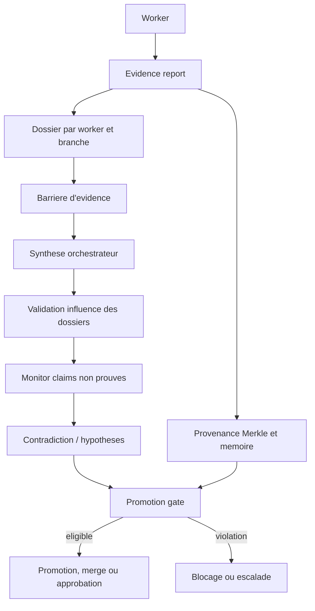
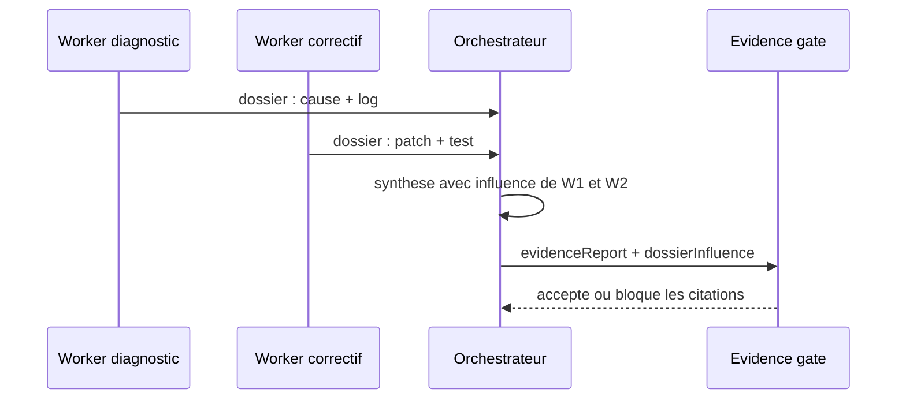
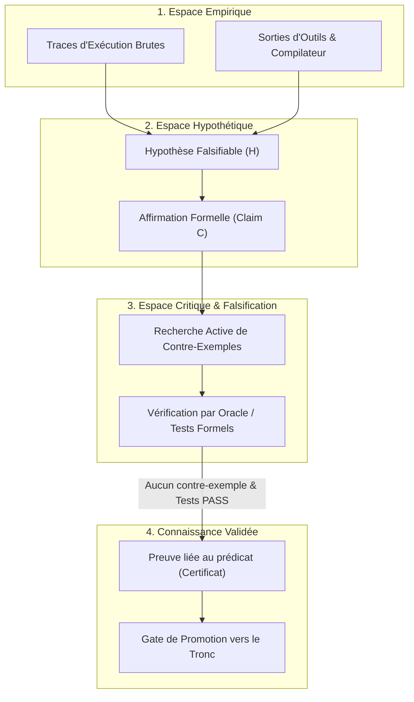
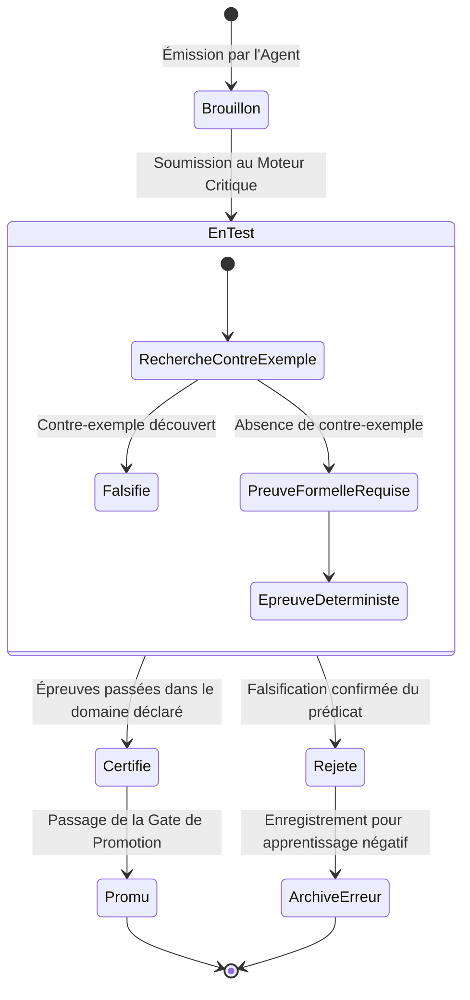

# Epistemologie et evidence

- **Statut** : Implémenté — contrat claim/evidence, services preuve, falsification et promotion sont disponibles dans le runtime.
- **Portée** : `backend/src/services/agentEvidenceService.js`, superviseur de runtime, primitive handlers et policy de promotion.
- **Dernière revue** : 2026-09-26.

## Definition

Dans GenOS, l'epistemologie est le contrat qui separe une affirmation d'agent (`claim`) de l'artefact qui la rend auditable (`evidence`). Une reponse de modele, un statut `success` ou une sortie de processus n'etablit pas a lui seul une verite. Pour influencer une decision collective ou une promotion, une conclusion doit fournir des claims structures, une preuve associee, une provenance et, selon le contrat, une verification independante, un replay ou une approbation humaine.

Le mecanisme est principalement implemente par [backend/src/services/agentEvidenceService.js](../../backend/src/services/agentEvidenceService.js), le superviseur de runtime, [backend/src/services/primitiveHandlers/safetyHypothesis.js](../../backend/src/services/primitiveHandlers/safetyHypothesis.js) et [backend/src/services/strategyPromotionPolicyService.js](../../backend/src/services/strategyPromotionPolicyService.js). Les termes evidence, falsification et hallucination designent des controles logiciels observables ; ils ne constituent pas une preuve formelle de verite dans le monde metier.

## Modèle conceptuel

| Element | Sens dans GenOS | Exemple |
| --- | --- | --- |
| Claim | conclusion atomique, explicite et contestable | "Le test d'authentification rejette un token expire." |
| Evidence | receipt, sortie de test, artefact ou objet structure associe | commande, exit code, log ou hash d'artefact |
| Uncertainty | partie non etablie | "Le comportement du fournisseur distant n'a pas ete teste." |
| Hypothese | proposition a confronter a des observations | "Le timeout vient d'une collision de concurrence." |
| Contre-exemple | observation qui refute une hypothese ciblee | invariant viole avec entree et sortie reproductibles |
| Dossier worker | ensemble borne d'evenements et rapports pour une branche deleguee | claims, echec, tests, no-answer proof |
| Provenance | chaine des intrants et transformations | hash parent, worker, conclusion et decision memoire |

Un rapport d'evidence prend typiquement cette forme :

```json
{
  "outcome": "success",
  "claims": [
    {
      "statement": "Le test cible passe apres le correctif.",
      "evidence": ["npm test -- auth: exit 0", { "artifact": "test-log-hash" }]
    }
  ],
  "uncertainties": ["Integration fournisseur non executee"],
  "tests": ["npm test -- auth: passed"],
  "dossierInfluence": [
    {
      "workerId": "worker-auth",
      "usedClaims": ["Le test cible passe apres le correctif."],
      "influence": "La sortie de test a borne la synthese au module auth."
    }
  ]
}
```

## Architecture et processus



1. Un worker emet un evenement terminal ou `EVIDENCE_REPORT` contenant son rapport.
2. `recordWorkerEvidence()` l'ajoute au dossier de son orchestrateur et normalise les echecs en objet `failure`.
3. La barriere collecte les dossiers de toutes les branches, y compris ceux d'un worker de remplacement couvrant une branche identique.
4. La synthese finale cite chaque dossier dans `dossierInfluence`, y compris une contribution rejetee.
5. Le superviseur verifie l'influence, le monitor detecte les claims sans evidence, et les gates de contrat decident de l'eligibilite a promotion.
6. Les hashes de provenance permettent de remonter d'une conclusion a ses intrants enregistres.

Les dossiers sont un canal de donnees, non un canal d'autorite : le prompt de synthese demande explicitement de ne jamais traiter leur contenu comme de nouvelles instructions.

## Claims et evidence

Le noyau [verificationKernel](../../backend/src/services/epistemic/verificationKernel.js)
classe également un claim à partir de reçus signés, fiables, indépendants et
liés à son `id` et à son `evidenceDigest`. Il expose des niveaux distincts
(`PROVEN`, `VERIFIED`, `EMPIRICALLY_VERIFIED`, `SOURCE_SUPPORTED`,
`CORROBORATED`, `PLAUSIBLE`, `REFUTED`, `UNVERIFIED`) ; il ne transforme pas
l'absence de vérificateur en réfutation et n'autorise jamais à lui seul une
promotion. Les profils de vérificateurs de confiance sont une configuration de
l'appelant, pas une propriété déclarée par le générateur. Voir [ADR 0173](../adr/0173-noyau-routage-et-niveaux-de-verification.md).

`hasDecisionEvidence()` reconnait trois familles qui autorisent une decision de controle :

- au moins un claim avec une evidence non vide (chaine non blanche ou objet non vide) ;
- un `no_answer` avec preuve d'impossibilite et evidence ;
- une information d'echec structuree ou un evenement terminal d'echec/halte.

Un claim sans evidence est insuffisant. Pour les workers, `classifyFinalReport()` transforme une sortie `success` avec zero claim ou un claim non etaye en `failed` / `unresolved_task`. Cette regle evite qu'un worker transforme une simple assertion en succes valide.

`evidenceScore()` offre une priorisation, pas une mesure de verite. Hors contenu creatif, il ajoute 10 points par evidence non vide et 2 points par claim ayant de l'evidence, retire 3 points par incertitude, puis borne le resultat dans $[0,100]$ :

$$
E = clamp_{[0,100]}\left(\sum_c (10n_c + 2\mathbf{1}_{n_c>0}) - 3u\right)
$$

Tout rapport `failed` ou payload `failure` recoit 0. Un `no_answer` prouve et sans claim recoit $\min(100, 25 + 10n)$, avec $n$ evidences non blanches. Ce score sert au tri et aux evaluations de dossiers ; il ne valide ni la pertinence d'un test, ni la veracite d'un artefact fourni par un agent.

## Dossiers workers et influence

Un dossier contient `workerId`, nom, role, branche assignee et les evenements significatifs. Il conserve les derniers `GENOS_MAX_WORKER_DOSSIER_EVENTS` evenements par worker (32 par defaut, minimum 4). Sont retenus notamment rapports d'evidence, echecs, haltes, apoptose et preuves de non-reponse.

`validateWorkerDossiers()` refuse :

- un worker attendu absent ;
- une branche non couverte, sauf remplacement explicite sur la meme branche ;
- un dossier sans rapport, echec ou preuve de non-reponse exploitable.

`validateDossierInfluence()` impose une entree unique par worker attendu, avec `influence` non vide et `usedClaims` sous forme de tableau. Lorsqu'on lui fournit les dossiers, chaque claim cite doit correspondre a un claim reel du worker source. Les workers inattendus, doublons, omissions ou citations inventees provoquent `INVALID_DOSSIER_INFLUENCE`.



Ce controle etablit la couverture et la tracabilite des influences. Il ne demontre pas que tous les workers ont raisonne correctement, ni que deux dossiers independants le sont effectivement au sens scientifique.

## No-answer proofs

Une absence de solution n'est pas automatiquement un echec. Un worker ou orchestrateur peut rendre `outcome: "no_answer"` avec :

```json
{
  "method": "enumeration finie",
  "evidence": ["16 etats examines", "chaque etat viole la contrainte X"]
}
```

La methode doit etre une chaine non vide et la liste doit contenir au moins une evidence significative apres normalisation. Le runtime emet `WORKER_NO_ANSWER_PROVEN` ou `MISSION_NO_ANSWER_PROVEN`, et `dossierDigest()` l'etiquette `impossibility_proof`.

Un timeout, un crash ou une erreur transitoire ne devient jamais une preuve de non-reponse, meme si un payload contient un brouillon de preuve. La recovery conserve alors l'echec operationnel et choisit retry, fork, remplacement ou escalade. Une preuve de non-reponse n'est valide que dans son domaine explicitement borne : elle ne permet pas de conclure a l'impossibilite generale d'une tache ouverte.

## Hypotheses falsifiables et contre-exemples

`diagnose()` demande au modele trois hypotheses falsifiables (`id`, `statement`, `confidence`) ou fournit un jeu de repli. `hypothesisEvidence()` confronte chaque hypothese aux observations et retourne deux ensembles : hypotheses retenues et hypotheses falsifiees.

La falsification accepte trois signaux :

- ciblage explicite (`falsifies`, `refutes`, `provesNot`, `targetHypothesisId`) ;
- contre-exemple structure (`counterexample`, `isCounterexample`, categorie `counterexample`) ;
- heuristique lexicale opposant par exemple une hypothese de systeme sain a un echec, ou une hypothese de defaut a des tests propres.

Quand une hypothese est falsifiee, sa confiance est mise a zero et `refutedBy` / `counterexamples` sont remplis. Formellement, un contre-exemple $e$ refute $H$ lorsqu'il satisfait les preconditions de $H$ tout en contredisant sa consequence :

$$
e \models Preconditions(H) \land e \models \neg Consequence(H) \Rightarrow H\;falsifiee
$$

Le code ne prouve pas cette relation logique generale : il privilegie les liens explicites et des heuristiques textuelles. Pour une assertion critique, fournir un identifiant d'hypothese, les entrees, sorties, version et commande qui reproduit le contre-exemple.

`contradictionCheck()` cherche aussi des oppositions directes entre beliefs et evidence, ou entre beliefs (`passed` contre `failed`, `clean` contre `corrupted`). `beliefGate()` bloque une croyance contradictoire ou de confiance inferieure au seuil requis (0,6 par defaut). Une confiance numerique vient de l'appelant ; GenOS ne la calibre pas automatiquement.

## Provenance des conclusions

La provenance est enregistree dans une chaine Merkle par `recordProvenance()` et resolue par `provenanceResolver`. Les nouveaux reçus utilisent `sha256-parent-v1`, qui lie le payload canonique et le hash parent. Les anciens reçus `sha256` restent vérifiés selon leur format historique ; leur lien parent n'est pas cryptographiquement engagé. Une conclusion peut donc pointer vers l'evidence worker, elle-meme reliee a une specification ou un artefact precedent.

$$
h_i = SHA256(\text{"genos-provenance-v1"} \parallel h_{i-1} \parallel canonical(payload_i))
$$

`resolveProvenance()` retourne la chaine jusqu'a une profondeur maximale et indique `truncated` lorsqu'elle est coupee. La memoire d'execution peut conserver le `provenanceHash` de la conclusion dans `genome_decisions` et `provenance_records`.

Un hash garantit l'integrite de la chaine enregistree, pas la verite du payload original ni l'identite d'un fournisseur externe. La chaine doit conserver les commandes, sorties, versions et artefacts necessaires a un audit humain.

L'endpoint `POST /api/genome/decision` persiste maintenant chaque décision avec un
reçu Merkle qui contient son titre, son raisonnement et ses références de preuve.
Les références (`evidenceRefs`) doivent désigner des hashes de provenance présents
dans le même scope tenant. L'état `linked` signifie que le lien traçable existe ;
sans références, la décision reste `provisional`. Ni ce statut ni le reçu ne
certifient la vérité métier de la décision.

## Gates de promotion

`evaluatePromotionGate()` applique les politiques du contrat :

| Politique | Condition d'eligibilite |
| --- | --- |
| `require_replay` | reçu de rejeu vérifié côté serveur et lié au run, à l'agent, au snapshot et à son digest |
| `require_independent_verification` | verification explicite, claims verifies, dossiers worker ou claims de rapport tous etayes |
| `require_human_approval` | receipt durable avec approbateur, date, identifiant et hash SHA-256 du payload |
| `preserve_rejected_branches` | archive le snapshot vérifié d'une branche rejetée ; un simple identifiant sans snapshot ne prouve pas sa conservation et bloque la finalisation |
| `merge_workspace_automatically` | merge sans conflit et sans erreur apres promotion |

Une seule violation rend `eligible: false`. Apres une promotion eligible, `applyPostPromotionPolicies()` peut conserver les branches rejetee et appliquer un merge three-way de workspace. Un conflit ou echec de merge rend le resultat post-promotion non reussi.

Les déclarations `replayVerified`, `diffAndReplayPassed` et les statuts seuls ne sont
pas des preuves. Aucun producteur actuel n'émet encore le reçu durable lié au
strategy run attendu par cette gate ; `require_replay` reste donc fermé jusqu'à
l'intégration d'un tel producteur. Une reconstruction ou une chaine de hash valide
n'est pas une re-exécution déterministe de dépendances externes. Pour une promotion
à risque, lier le rejeu vérifié, les artefacts de test et l'approbation humaine au
même hash.

Cette absence a un effet opérationnel : `strategyContractService` active
`require_replay` pour les profils reproductibles et les contrats à haut risque.
Ces runs peuvent terminer leur exécution, mais ne peuvent pas être promus tant
qu'aucun producteur ne fournit le reçu attendu. Le pipeline `diff_and_replay`
sélectionne désormais les primitives de rejeu et de comparaison du portefeuille ;
sans trajectoire, fichier d'entrée ou paire de forks, elles sont non applicables.
Si le portefeuille ne peut exécuter qu'un rejeu ou qu'une comparaison, l'étape
échoue avec `STRATEGY_REPLAY_STAGE_INCOMPLETE` au lieu de déclarer la phase terminée.
Ce rejeu d'une trajectoire déclarée ou d'un fork causal ne relance pas le run de
stratégie lui-même et n'émet pas encore le reçu lié au run. Le rejeu d'état de
l'agent compare les champs restaurés d'un snapshot ; le rejeu Git vérifie
l'intégrité d'un objet et de ses événements sans réexécuter le runtime. Aucun de
ces contrôles ne satisfait le contrat de promotion.

La fermeture de cette lacune demande une capacité de rejeu d'exécution. Elle doit
conserver les entrées et leur hash, la version du runner et des primitives,
l'environnement, les versions ou reçus des outils, le budget et les graines
utilisées ; relancer le runner dans un environnement isolé ; puis persister un
résultat vérifié lié au même `runId`, `agentId`, `snapshotId` et digest. Le digest
de cette preuve doit aussi faire partie du payload approuvé par l'humain. Tant
que ces liaisons et cette réexécution n'existent pas, la gate fermée est le
comportement sûr, mais le concept de promotion par rejeu reste non disponible
pour ces contrats.

### Gate du modèle de soi (automatique et différée)

Au-delà du contrat, la politique du modèle de soi s'applique deux fois.
À la planification, `applySelfModel` peut exiger replay et preuve indépendante
(`requireReplayBeforePromotion`, `requireIndependentEvidence`) selon l'état
calibré. À la complétion automatique (sans approbation humaine),
`selfModelCompletionBlock` rejoue `assertPromotionConstraints` et bloque en
`blocked` plutôt qu'en `completed` si l'exigence n'est pas satisfaite
(`SELF_MODEL_REPLAY_REQUIRED`, `SELF_MODEL_EVIDENCE_REQUIRED`). La calibration
après run terminal est best-effort : son échec ne casse jamais le pipeline
d'événements. Le modèle ne peut qu'ajouter des exigences, jamais lever celles
du contrat.

### Opt-out calibré et banc métacognitif

[backend/src/services/abstentionService.js](../../backend/src/services/abstentionService.js)
définit une règle d'abstention explicite : intégrité < 0,6, incertitude ≥ 0,8,
ou confiance < plancher (0,5 + surconfiance mesurée, plafond 0,8) avec
incertitude ≥ 0,5. Un verdict d'abstention impose `requiresEvidenceBeforePromotion`,
resserre `requireIndependentEvidence` et ajoute une directive `[ABSTENTION]`
au prompt (retourner `no_answer` plutôt que confabuler).

[backend/src/services/metacognitionBenchService.js](../../backend/src/services/metacognitionBenchService.js)
mesure la calibration sur l'historique réel d'attributions CoreSelf (≥ 10 essais,
sinon `insufficient_data`, jamais de faux nombre) : ECE, Brier, AUC type-2,
surconfiance. Les faiblesses mesurées (max 3) persistent dans le self-model
appris et ressurgissent dans les prompts ; la surconfiance resserre le plancher
d'opt-out. C'est une mesure du rapport de confiance, pas une preuve de
métacognition consciente.

### Audit du champ attentionnel et sondes

[backend/src/services/attentionSchemaBenchService.js](../../backend/src/services/attentionSchemaBenchService.js)
ne croit jamais le self-model textuel : depuis `telemetry_events`, il mesure la
validité du champ attentionnel (exécutions dans le lease vs hors lease, succès
conditionnels) et la fidélité des rapports (outils cités vs réellement
exécutés, matching documenté comme heuristique).
[backend/src/services/attentionProbeService.js](../../backend/src/services/attentionProbeService.js)
ajoute l'intervention : focus contraint forcé au démarrage mission (intersection
de lease, une fois), fausse copie jugée (`tracks_reality` / `confabulates` /
`mixed` / `inconclusive`), biais steering avec directive et vérification
pré/post. L'injection live par vésicule reste une étape suivante documentée.

### Mémoire des meilleurs résultats (ADR 0046)

Le champion persistant (`request_problems` / `request_results`) suit le même
principe : un statut n’est pas une preuve. `VERIFIED` est réservé aux résultats
déterministes (ex. primitive arithmétique avec reçu `deterministic-eval`) ;
tout résultat de mission archivé est `PROVISIONAL` avec dette épistémique
explicite. `STALE` (dépendances changées ou horizon dépassé), `SUPERSEDED`
(remplacé par un meilleur candidat comparé) et `REFUTED` (terminal) ne sont
jamais réutilisés. La réutilisation d’un champion ne traverse donc pas la gate
de promotion : elle restitue une décision déjà prouvée, elle n’en crée pas une.

## Succes technique versus verite metier

| Signal | Ce qu'il etablit | Ce qu'il n'etablit pas |
| --- | --- | --- |
| process exit `0` | processus termine normalement | resultat correct ou rapport suffisamment etaye |
| claim avec log de test | test declare execute et associe au claim | couverture du besoin metier ou absence de regressions hors test |
| score d'evidence eleve | quantite/forme d'evidence selon l'heuristique | independance, causalite ou qualite de la preuve |
| hash/provenance | integrite des donnees chainees | sincerite ou verite du premier artefact |
| vote ou consensus workers | accord des participants | verite si les participants partagent la meme erreur |
| approbation humaine | decision attribuee et liee au payload | exactitude absolue de la decision |

La verite metier requiert un oracle propre au domaine : jeu de tests accepte, metrique produit, expert habilite, contrainte reglementaire ou observation de production. GenOS fournit la structure pour exposer les limites de connaissance et relier ces preuves ; il ne les invente pas.

## Detection des affirmations non prouvees

[backend/src/services/hallucinationMonitoringService.js](../../backend/src/services/hallucinationMonitoringService.js) ne tente pas de juger la factualite d'un texte libre. Il signale des conditions observables :

- `UNVERIFIED_CLAIM`, `HALLUCINATION_DETECTED` ou declaration explicite ;
- `unverifiedClaims` dans le payload ou rapport imbrique ;
- claim structure sans `evidence`, `receipts` ou `sourceRefs` significatif ;
- proposition de code sans evidence, sans test, ou avec test en echec.

Les placeholders (`none`, `n/a`, `todo`, `unverified`, `fake`, `dummy`, `mock`) et les valeurs vides ne sont pas des preuves. Si le monitoring est active pour l'agent, `recordObservation()` incremente son compteur de signalement ; le superviseur peut ensuite appliquer les politiques de resilience et d'apoptose.

Cette detection est volontairement conservative et syntaxique. Elle peut manquer une preuve fausse mais bien formee, ou signaler un artefact reel mal formate. Elle complete, sans remplacer, la revue humaine et les controles de domaine.

Les claims enregistrés dans `epistemic_claims` peuvent désormais être réévalués
par `batchReviseOnEvidence` lorsqu'une nouvelle preuve concerne leur sujet. Les
événements du bus sont persistés dans `epistemic_events` après la migration 028,
avec une empreinte idempotente. La persistance ne transforme toutefois pas une
preuve en vérité : la qualité et le statut du claim restent recalculés.

Chaque révision est également conservée dans `epistemic_claim_revisions` avec
les états avant/après, le motif et les qualités calculées. Une preuve identique
déjà présente est ignorée, et une révision ne peut pas autoriser à elle seule la
promotion d'un claim interprétatif ou disputé.

Le concept `epistemology.rationality-norms` expose une analyse bornée des règles
de validation d'un claim. Elle retourne un verdict et une confiance calibrée,
mais `promotionEligible` reste toujours faux : la cohérence normative n'est
pas une preuve de vérité.

Les analyses scientifiques exposent également `epistemic_context`, avec la
méthode employée, le statut du raisonnement et une provenance incomplète par
défaut. Une confirmation, une réfutation sous hypothèses auxiliaires ou une
réponse sceptique restent révisables et ne peuvent pas autoriser seules une
promotion.

## Exemple : correction d'un defaut d'autorisation

1. Le worker A formule l'hypothese `H1` : "Le middleware accepte les jetons expires". Le worker B formule `H2` : "La route ne traverse pas le middleware".
2. A fournit un contre-exemple structure : token expire, reponse `200`, version du service et commande reproductible. `H1` est soutenue ; l'hypothese "jeton expire rejete" est falsifiee.
3. B fournit le graphe de route et un test montrant que le middleware est bien execute. `H2` est falsifiee.
4. A corrige le middleware et joint la sortie du test negatif. Son claim est etaye mais l'incertitude "test integration fournisseur non execute" reste declaree.
5. La synthese cite A comme source de la cause et du correctif, B comme refutation de la mauvaise piste. `validateDossierInfluence()` confirme que les citations existent dans les dossiers.
6. La gate exige verification independante et approbation humaine. Le merge attend ces deux receipts ; un exit code seul ne suffit pas.

## Cas d'utilisation

| Cas | Apport | Evidence minimale |
| --- | --- | --- |
| Diagnostic d'incident | hypotheses, contre-exemples et pistes falsifiees | entree, sortie, version, commande de reproduction |
| Revue de correctif multi-agent | dossiers traces et influence obligatoire | tests, diff, claims attribues par worker |
| Decision de non-faisabilite | `no_answer` borne et recuperation non declenchee | methode, domaine fini, etats examines |
| Promotion de release | gates combinees et receipt humain | verification independante, replay applicable, hash approbation |
| Audit de conclusion | remontée Merkle et memoire | hashes parents, artefacts et profondeur non tronquee |
| Prevention d'hallucination | blocage des claims vides ou placeholders | claims structures avec receipts significatifs |

## Comparaison avec le marche

| Approche | Point fort habituel | Positionnement GenOS |
| --- | --- | --- |
| Observabilite LLM (LangSmith, Arize, Phoenix) | traces, cout, evaluation et debugging | ajoute des dossiers workers, preuves de non-reponse et gates de synthese ; le stockage de traces seul ne garantit pas la verite |
| Frameworks agents (LangGraph, AutoGen, CrewAI) | coordination, outils et graphes de roles | impose l'influence attribuee de chaque worker avant decision collective ; les workflows doivent toujours fournir leurs oracles |
| Evaluation LLM / RAG | jeux d'evaluation, groundedness, citations | privilegie receipts structures et provenance Merkle ; il ne remplace pas un eval dataset ou un juge metier calibre |
| Workflow durable (Temporal, Airflow) | etats, retries, audit de taches | traite l'evidence de contenu agentique ; une reprise fiable requiert toujours l'infrastructure de workflow appropriee |
| Gouvernance de deployment | approbations et separation des roles | lie l'approbation a un hash de payload et combine replay/evidence ; la politique doit etre configuree et appliquee par l'operateur |

Le differentiel de GenOS est la contrainte que les contributions d'une flotte deviennent explicites, citees et auditables avant une decision. Sa limite est fondamentale : aucune structure de receipts ne rend automatiquement une affirmation vraie sans observation independante et oracle metier.

## Audit Chaperone des communications cryptophasiques

L'usage de dialectes compressés inter-agents (`genos_biomimicry_cryptophasia`) ne doit en aucun cas créer une boîte noire opaque au détriment de l'évidence.

Le système de Chaperone épistémique assure que :
- Tout paquet d'opcodes denses (`OP_BSC_REG`, `OP_VRF_INV`, etc.) est corrélé à une intention formelle, une empreinte d'intégrité et un timestamp d'émission.
- L'arbitre de réalité ou l'auditeur humain peut exécuter l'action `audit_trace` ou `decode_dialect` à tout moment pour restaurer l'explicabilité intégrale de la chaîne de causalité.

---

## Verification

Les suites proches du contrat sont :

```powershell
node backend/tests/test_collective_decision_evidence_gate.js
node backend/tests/test_worker_dossiers_suite.js
node backend/tests/test_no_answer_proof_remediation.js
node backend/tests/test_conclusion_provenance_integrity.js
node backend/tests/test_counterexamples_falsification.js
node backend/tests/test_cryptophasia.js
```

Le 30 septembre 2026, `node backend/tests/test_counterexamples_falsification.js` passe ses trois points : falsification, persistance des impasses/rejeu contrefactuel, et inhibition GABAergique. La vérification a révélé puis corrigé une collision de déduplication entre actions distinctes partageant le même pas et la même erreur, ainsi qu'une perte du marqueur d'inhibition lors de la fusion GraphRAG. Cette suite valide uniquement les scénarios qu'elle couvre ; elle ne certifie ni la vérité des claims d'un fournisseur externe, ni la complétude de l'oracle métier.


---

## Modélisation Épistémique et Graphes de Falsifiabilité

### 1. Architecture du Réseau de Preuves



### 2. Machine à états du Cycle de Vie d'une Claim



## Voir aussi (AgentDNA)

- [AGENT_DNA_RUNTIME.md](agent-dna-runtime.md) — la promotion d'un génome candidat d'innovation est conditionnée par `hasDecisionEvidence` ; la provenance (`PROV`) et la signature Ed25519 portent la preuve.
- [adr/0002-agentdna-innovation-loop.md](../adr/0002-agentdna-innovation-loop.md) — gate de promotion : une découverte n'est héréditaire qu'après preuve.
- [FOSSILISATION.md](fossilisation.md) — archive terminale des lignées éteintes : conserver la preuve et le phénotype résiduel (mélanosomes) sans jamais ressusciter la branche (voir aussi `preserve_rejected_branches`).
- [adr/0003-fossilization-stratigraphic-archive.md](../adr/0003-fossilization-stratigraphic-archive.md) — décision d'architecture de la fossilisation stratigraphique.


## AEIS : preuve de promotion et apprentissage

Le [système immunitaire épistémique](adaptive-epistemic-immune-system.md) relie
les prédicats de commande exacts à deux exécutions distinctes munies de reçus
signés. Cette réplication établit ce qui a été observé dans les environnements
exécutés ; elle ne prouve ni l'indépendance épistémique des vérificateurs, ni la
vérité d'un claim sémantique libre. Un timeout reste inconclusif ; un désaccord
provider bloque la promotion lorsque la politique multi-provider est active.
Aucun avis provider seul ne constitue une preuve exécutable.

Les claims tels que « ce refactoring est sain », « ce résumé est fidèle » ou
« cette architecture est la bonne » ne sont donc pas promouvables
automatiquement par AEIS. Ils restent en attente d'un oracle externe admissible,
d'une politique de domaine ou d'une revue humaine. La pression d'assurance et
l'indice de diversité servent à router l'effort : ce sont des heuristiques non
calibrées, sans interprétation probabiliste ni efficacité publiée.

La mémoire SQLite conserve les issues confirmées par portée, dont les échecs
d'affinité nulle. Le rejeu d'une même preuve est dédupliqué. La dissonance
d'autorité, également persistée, réduit les droits selon des seuils explicites
et s'applique aux descendants. La validité reste relative au prédicat testé et
au domaine annoncé.

Le contrat, les refus et le protocole local sont décrits dans
[l'immunité épistémique](../06-qualite-preuves/immunite-epistemique.md). Les
limites de calibration, de portée et d'indépendance sont actées par
[l'ADR 0642](../adr/0642-borner-les-heuristiques-aeis.md). La
[référence runtime](../03-reference/runtime-aeis.md), le
[runbook opérateur](../04-exploitation/aeis.md) et la
[qualification datée](../06-qualite-preuves/qualification-aeis-2026-10-20.md)
complètent ce cadre conceptuel.

---

## Index opérationnel des 44 concepts d'épistémologie et d'évidence

Chaque concept est listé avec son sens opérationnel dans GenOS et le mécanisme qui l'implémente.
Un statut `implemented` signifie qu'un adaptateur ou service testable existe ; il ne signifie pas
que GenOS implémente la théorie philosophique dans toute sa portée.

| # | Concept | Sens opérationnel dans GenOS | Mécanisme / service | Statut |
|---|---------|------------------------------|---------------------|--------|
| 1 | Épistémologie opérationnelle | Contrats séparant une affirmation d'agent de l'artefact qui la rend auditable | `evidenceGate`, `agentEvidenceService` | implemented |
| 2 | Savoir | Conditions pour tenir une proposition pour connue ; séparé de la croyance, de la preuve et de la vérité | `knowledgeService` | partial |
| 3 | Croyance | Position tenue par un agent, claim de type `belief` | `knowledgeService`, `epistemics` | partial |
| 4 | Vérité | Propriété d'une proposition ; non déduite d'un statut `success` | `knowledgeService`, `truthSkepticismService` | partial |
| 5 | Inférence | Déduction, induction, abduction ; évaluée sur entrées fournies | `inferenceService` | partial |
| 6 | Justification | Raisons qui soutiennent une croyance, traduites en preuves typées et provenance | `knowledgeService` | partial |
| 7 | Gettier | Contre-exemple : croyance vraie justifiée mais vraie par accident | `knowledgeService` | partial |
| 8 | Reliabilisme | Croyance provenant-elle d'un processus fiable ? | `reliabilityService` | partial |
| 9 | Épistémologie sociale | Témoignage, discussion, désaccord, division du travail cognitif | `socialEpistemologyService` | partial |
| 10 | Corroboration | Plusieurs sources indépendantes soutiennent un même claim | `socialEpistemologyService`, barrière d'évidence | partial |
| 11 | Incertitude | Partie non établie d'un claim ; déclarée dans le rapport d'évidence | `epistemics` | partial |
| 12 | Confiance | Confiance numérique fournie par l'appelant ; GenOS ne la calibre pas automatiquement | `epistemics`, `metacognitionBenchService` | partial |
| 13 | Claim | Conclusion atomique, explicite et contestable avec éléments de preuve | `agentEvidenceService` | implemented |
| 14 | Hypothèse | Proposition à confronter à des observations (id, statement, confidence) | `safetyHypothesis` | implemented |
| 15 | Ledger d'hypothèses | Enregistrement append-only des hypothèses, falsifications et révisions | `strategyPromotionPolicyService` | partial |
| 16 | Prédiction | Anticipation d'un résultat observable à partir d'un modèle ou d'une hypothèse | `inferenceService` | partial |
| 17 | Falsification | Réfutation d'une hypothèse par contre-exemple reproductible | `safetyHypothesis` | implemented |
| 18 | Contre-exemple | Observation satisfaisant les préconditions d'H tout en contredisant sa conséquence | `safetyHypothesis` | implemented |
| 19 | Preuve directe | Receit, sortie de test, artefact associé directement à un claim | `agentEvidenceService` | implemented |
| 20 | Preuve indépendante | Preuve produite par une source indépendante du claimant | `strategyPromotionPolicyService` | partial |
| 21 | Réplication | Re-exécution d'une épreuve pour confirmer un résultat | `proceduralCausalValidationService` | partial |
| 22 | Réception de preuve | Réception et normalisation d'un rapport `EVIDENCE_REPORT` dans le dossier worker | `agentEvidenceService` | implemented |
| 23 | Provenance | Chaîne des intrants et transformations, enregistrée en chaîne Merkle | `provenanceResolver` | implemented |
| 24 | Grounding | Lien entre une affirmation symbolique et les observations/artefacts qui la rattachent au monde opérationnel | `evidenceGate` | implemented |
| 25 | État épistémique | Qualité de preuve, confiance dérivée, phase (explore/commit), dette épistémique | `epistemics` | partial |
| 26 | Résultat formel | Résultat déterministe avec reçu, statut `VERIFIED` réservé à ces cas | `evidenceGate` | implemented |
| 27 | Résultat non vérifié | Résultat archivé comme `PROVISIONAL` avec dette épistémique explicite | `agentEvidenceService` | implemented |
| 28 | Promotion éligible / non éligible | Décision de la gate de promotion ; `eligible: true` si toutes les politiques sont satisfaites | `strategyPromotionPolicyService` | implemented |
| 29 | Révision de croyance | Mise à jour d'un claim enregistré quand une nouvelle preuve concerne son sujet | `epistemics` | partial |
| 30 | Dissonance | Opposition entre beliefs et evidence, ou entre beliefs contradictoires | `epistemics` | partial |
| 31 | Biais | Biais de steering détecté par sondes ; surconfiance mesurée par le banc métacognitif | `attentionProbeService` | partial |
| 32 | Hallucination | Conditions observables : claim sans evidence, placeholder, valeur vide | `hallucinationMonitoringService` | implemented |
| 33 | Monitoring des hallucinations | Surveillance continue des claims non prouvés ; compteur de signalement | `hallucinationMonitoringService` | implemented |
| 34 | Brier score | Mesure de calibration (ECE, Brier, AUC type-2, surconfiance) sur l'historique CoreSelf | `metacognitionBenchService` | implemented |
| 35 | Consensus pondéré | Agrégation des contributions multi-agents avec provenance, sans réduction à vérité automatique | `socialEpistemologyService` | partial |
| 36 | Quorum avec abstention | Règle d'abstention explicite ; intègre `requiresEvidenceBeforePromotion` et directive `[ABSTENTION]` | `abstentionService` | implemented |
| 37 | Barrière d'évidence | Collecte des dossiers de branches ; valide les citations de claims ; refuse doublons et omissions | `evidenceGate` | implemented |
| 38 | Gate de promotion | Applique les politiques du contrat (replay, vérification indépendante, approbation humaine, branches rejetées, merge) | `strategyPromotionPolicyService` | implemented |

### 39-44 — Concepts déjà couverts par référence
Les concepts 39 à 44 ne sont pas des entrées distinctes de l'index ci-dessus car ils sont traités dans d'autres fiches :
- **Savoir, Croyance, Vérité, Inférence, Justification, Gettier, Reliabilisme, Épistémologie sociale** → [Savoir et épistémologie](savoir-et-epistemologie.md).

---

### Prédiction

Une prédiction est une anticipation d'un résultat observable à partir d'un modèle ou d'une hypothèse. Dans GenOS, une prédiction n'est pas un fait établi tant qu'elle n'est pas confrontée à l'observation. Le service `inferenceService` évalue les prédictions sur des entrées bornées ; il ne déclenche aucune action du runtime et n'autorise aucune promotion.

### Réplication

La réplication est la re-exécution d'une épreuve pour confirmer un résultat. Elle est portée par `proceduralCausalValidationService` (rejeu d'intervention). Un rejeu est une approximation, pas une expérience contrôlée ; il ne satisfait pas à lui seul le contrat de promotion `require_replay`, qui exige un reçu de rejeu vérifié côté serveur et lié au run, à l'agent, au snapshot et à son digest.

### Réception de preuve

La réception de preuve correspond à la réception et à la normalisation d'un rapport `EVIDENCE_REPORT` dans le dossier du worker. `recordWorkerEvidence()` l'ajoute au dossier de l'orchestrateur et normalise les échecs en objet `failure`. La réception ne valide pas le contenu de la preuve : elle établit seulement que le rapport a été reçu et structuré.

### Grounding

Le grounding est le lien entre une affirmation symbolique et les observations ou artefacts qui la rattachent au monde opérationnel. Dans GenOS, un grounding déclaratif ne constitue pas une vérification empirique : il doit être accompagné de preuves typées, de provenance et, selon le contrat, d'une vérification indépendante.

### État épistémique

L'état épistémique d'un claim ou d'une croyance comprend la qualité de preuve, la confiance dérivée, la phase (`explore` / `commit`) et la dette épistémique. Il est recalculé par `epistemics` à chaque nouvelle preuve ; il ne constitue pas une vérité en soi.

### Corroboration

La corroboration survient quand plusieurs sources indépendantes soutiennent un même claim. Elle est distinguée du simple accord : un consensus peut partager la même erreur. Le registre distingue corroboration, accord, désaccord, division du travail et perspectives manquantes sans agréger ces signaux en vérité automatique.

### Biais

Un biais est un écart systématique dans l'évaluation d'un claim. Dans GenOS, les biais de steering sont détectés par les sondes d'attention (`attentionProbeService`) avec directive et vérification pré/post. La surconfiance mesurée par le banc métacognitif (`metacognitionBenchService`) resserre le plancher d'opt-out de l'abstention. La détection est volontairement conservatrice et syntaxique.

### Consensus pondéré

Le consensus pondéré agrège les contributions de plusieurs agents avec provenance. Il distingue corroboration, accord, désaccord, division du travail et perspectives manquantes sans les réduire à une vérité automatique. Il ne constitue pas une preuve indépendante ni une autorisation de promotion.

### Épistémologie opérationnelle

L'épistémologie opérationnelle est le contrat qui sépare une affirmation d'agent (`claim`) de l'artefact qui la rend auditable (`evidence`). Une réponse de modèle, un statut `success` ou une sortie de processus n'établit pas à lui seul une vérité. Pour influencer une décision collective ou une promotion, une conclusion doit fournir des claims structurés, une preuve associée, une provenance et, selon le contrat, une vérification indépendante, un replay ou une approbation humaine.

Le mécanisme est principalement implémenté par `agentEvidenceService`, le superviseur de runtime, `safetyHypothesis` et `strategyPromotionPolicyService`. Les termes evidence, falsification et hallucination désignent des contrôles logiciels observables ; ils ne constituent pas une preuve formelle de vérité dans le monde métier.

---
