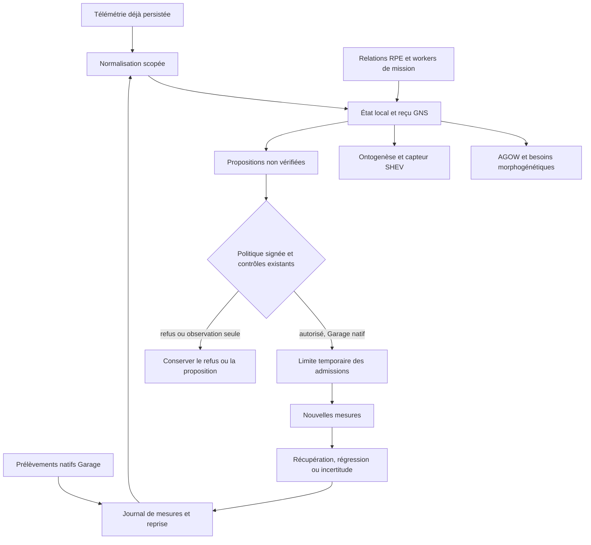

# GNS — Système nerveux opérationnel de GenOS

- **Statut** : Partiel — perception, régulation locale, propagation, six raccordements et régulateur du Garage implémentés ; bénéfice métier et robustesse de production non qualifiés.
- **Portée** : composant transversal du runtime Node.js, des agents et des huit topologies.
- **Dernière revue** : 2026-11-02.

GNS transforme des observations d'exécution en états opérationnels, en demandes
d'attention et en propositions d'action traçables. Son régulateur du Garage peut
aussi limiter temporairement de nouvelles admissions, sous politique signée,
puis observer ce qui se produit après l'intervention.

Son dossier distingue cinq niveaux de lecture :

| Lecture | Document |
| --- | --- |
| Comprendre le domaine et les choix | Cette fiche |
| Suivre la boucle et les raccordements | [Cycle de régulation](../02-orchestration/gns-regulation-operationnelle.md) |
| Vérifier les champs, états et limites | [Référence runtime](../03-reference/runtime-gns.md) |
| Installer et diagnostiquer | [Exploitation GNS](../04-exploitation/systeme-nerveux-operationnel.md), [régulateur du Garage](../04-exploitation/regulation-gns-du-garage.md) |
| Examiner les preuves et leurs limites | [Qualification datée](../06-qualite-preuves/qualification-gns-2026-11-02.md) |

## 1. Définition du domaine

Une organisation d'agents possède plusieurs états distincts : exécution en
cours, pression sur les ressources, visibilité de ses capteurs, qualité des
preuves et résultat métier. Un événement `AGENT_COMPLETED` renseigne une fin
d'exécution. Il ne démontre ni une pression basse, ni une réparation, ni une
réponse correcte.

GNS maintient cette séparation. Il reçoit des observations scopées, produit un
état par agent, propage des demandes de surveillance dans un graphe borné et
conserve les reçus de ses décisions locales. Les consommateurs relisent ces
états depuis le stockage réel ; ils ne transforment pas une déclaration de santé
fournie dans un prompt en autorité.

GNS n'est pas une neuvième topologie. Les huit topologies organisent le travail ;
la morphogenèse construit et transforme leur organisation ; GNS observe les
conditions dans lesquelles cette organisation fonctionne.

## 2. Modèle logique et mathématique

### 2.1 Observation, état et proposition

Pour un agent et un scope organisation/projet, le runtime projette :

\[
(S_{t-1}, O_t, G_t) \longmapsto (S_t, R_t, P_t)
\]

`O` est l'observation minimale, `S` l'état local, `G` le graphe scellé avec le
signal, `R` le reçu et `P` l'ensemble des propositions. L'état contient notamment
mode, pression, couverture, dates de mesure, priming et historique de récupération.
Cette notation décrit une transition logicielle ; elle n'établit pas la justesse
d'un diagnostic causal.

Les modes sont `UNKNOWN`, `ALERT`, `RECOVERY` et `REST`. L'absence ou l'expiration
d'une mesure conserve son caractère inconnu. Trois mesures de pression au plus
égale à 0,4 sont nécessaires pour établir `REST`. Le seuil d'alerte générique
commence à 0,8 et peut être abaissé par un priming temporaire plafonné à 0,2.
Ces constantes sont des heuristiques de logiciel, pas des constantes biologiques.

### 2.2 Pression mesurée du Garage

Le capteur natif mesure capacité `C`, occupation `n`, nombre de requêtes prêtes
en attente et âge de la plus ancienne, dans une transaction SQLite :

\[
p = \min(1, n/C), \qquad C \geq 1,\ n \geq 0.
\]

Les comptes bruts sont conservés. Le plafonnement du ratio ne prouve pas que
l'occupation respecte la capacité. Cette pression n'est ni un taux CPU/RAM, ni
un coût tokens, ni une estimation de qualité du travail.

### 2.3 Prévision bornée

Trois mesures successives croissantes et de capacité identique permettent une
extrapolation linéaire :

\[
\widehat p(t+H)=\min\left(1,
p_{\mathrm{dernier}}+
\frac{p_{\mathrm{dernier}}-p_{\mathrm{premier}}}
{t_{\mathrm{dernier}}-t_{\mathrm{premier}}}H\right).
\]

La fenêtre doit rester fraîche et couvrir au moins une seconde. L'horizon signé
est borné à 1–10 secondes. Le résultat porte `PREDICTED_UNVERIFIED` : ce n'est
pas une mesure réalisée, une probabilité calibrée ou une preuve de surcharge.
La prévision devient indisponible au terme de son horizon dans le contexte
consommateur. Son usage d'action est désactivé par défaut.

### 2.4 Graphe et fraîcheur

Une onde d'alerte suit un graphe dirigé. Son amplitude est multipliée par 0,6 à
chaque saut ; cycles, profondeur et nombre de livraisons sont bornés. Le graphe
normalisé est conservé dans le signal et son hash dans le reçu.

Un signal ancien de plus de 30 secondes ou antérieur à l'état courant devient
historique. Le contrat générique tolère jusqu'à 60 secondes d'avance lors de
l'admission d'un horodatage ; cette tolérance n'est pas une synchronisation
d'horloges. L'autorisation du régulateur du Garage exige un prélèvement natif
non futur et frais. Voir les limites exactes dans la référence runtime.

## 3. Analogies biologiques et limites réelles

| Notion | Traduction logicielle | Limite de l'analogie |
| --- | --- | --- |
| Nociception | erreurs d'agents, de runtime ou d'outils | aucun ressenti ou diagnostic médical |
| Interoception | pression et couverture d'observation | aucun accès général à un état interne caché |
| Proprioception | fins d'exécution et transitions constatées | une fin ne vaut pas réussite |
| Réflexe périphérique | proposition locale, puis effet borné si autorisé | aucun droit implicite d'arrêter un agent |
| Propagation végétale | onde bornée vers des voisins persistés | aucun réseau biologique ou bus distribué démontré |
| Habituation et réfractaire | limitation temporaire des propositions répétitives non urgentes | les observations restent durables ; les urgences ne sont pas masquées |
| Priming | biais d'alerte borné et décroissant | aucune permission ou compétence apprise |

Le runtime Node complète les modules neurobiologiques Rust. Leur présence dans
le même dépôt ne signifie pas que leurs états ou modèles sont fusionnés.

## 4. Cas d'usage et objectifs métier

- Présenter une dégradation opérationnelle à AGOW avant son arbitrage.
- Donner à la morphogenèse des besoins sourcés de réévaluation ou de réallocation.
- Conserver un historique avant/après pour les adaptations ontogénétiques.
- Fournir à SHEV des incidents et des mesures de repos dans la dimension enrôlée.
- Propager des demandes de surveillance par les relations RPE et les dépendances
  réellement incarnées d'une mission.
- Réguler les nouvelles admissions du Garage avec une limite temporaire, puis
  relâcher cette limite après observation ou régression.

Ces cas sont des comportements implémentés. La réduction des échecs métier,
l'accélération générale des missions et une amélioration causale des LLM restent
des objectifs à mesurer séparément.

## 5. Exemples concrets

### 5.1 Occupation qui augmente

Un Garage de cinq places passe d'une à deux puis trois occupations. Sa pression
mesurée vaut 0,2, 0,4 puis 0,6. Une prévision peut annoncer un dépassement du
seuil dans son horizon. AGOW et la morphogenèse peuvent lire cette prévision
comme information non vérifiée. Une action prédictive exige en plus une
politique signée avec `predictiveHold: true` et une demande réellement en file.

### 5.2 Pression au-dessus du seuil signé

Avec quatre workers actifs et un seuil signé de 0,8, le régulateur peut conserver
un plafond temporaire de quatre admissions simultanées. Les workers actifs
continuent. Si l'un termine, une place peut être remplie sous ce plafond ; le
système ne bloque pas tout nouveau travail pendant la durée entière du bail.

### 5.3 Une récupération observée

Après intervention, trois nouvelles mesures fraîches montrent une pression au
plus égale à 0,4, à capacité constante et sans aggravation du nombre de demandes
en attente. Le journal peut conclure `RECOVERY_OBSERVED`. Il conserve
`causalAttribution: NOT_ESTABLISHED` et `businessSuccess: NOT_EVALUATED`.
La baisse peut avoir une autre cause, notamment la fin naturelle de travaux.

## 6. Schéma du système

## 7. Architecture technique

Le code principal se trouve dans
[`backend/src/services/nervous/`](../../backend/src/services/nervous/).

| Couche | Responsabilité |
| --- | --- |
| `contract`, `physiology`, `propagation` | enveloppe minimale, états, temps et limites |
| `runtime`, `store`, `schema` | projection transactionnelle, reçus et propositions |
| `runtimeBridge`, `graphContext`, adaptateurs RPE/topologies | relecture de la source et graphe par événement |
| `consumerContext`, adaptateurs AGOW/morphogenèse/ontogenèse/SHEV | lecture scopée et raccordements runtime |
| `garageSensor`, `regulationJournal`, `regulationForecast` | mesure native, reprise, prévision et calibration proposée |
| `regulationPolicy`, `admissionControl`, `regulationRuntime`, `regulationVerification` | autorité, point d'admission, ordonnanceur et suivi |

La base source conserve politiques et limites d'admission. Le sidecar conserve
signaux, états, reçus, effets, prélèvements et épisodes. Il n'existe pas de
transaction distribuée entre ces deux bases : les fenêtres de crash sont
traitées par rapprochement des faits persistés et conservation de l'incertitude.

## 8. Processus d'exécution et de validation

1. Résoudre les identités et le scope depuis les enregistrements de confiance.
2. Relire la télémétrie persistée ou prélever les compteurs natifs du Garage.
3. Normaliser et persister ; préserver l'heure de mesure et le graphe de ce signal.
4. Projeter état, reçu et propositions dans une transaction GNS.
5. Rendre les observations aux composants raccordés sans leur attribuer une autorité nouvelle.
6. Pour le seul régulateur du Garage, vérifier mesure native, signature, version,
   échéances, autorité agent/mission, Cedar et circuit breaker avant l'effet.
7. Appliquer la limite au point de réservation normal et suivre les mesures suivantes.
8. Garder des verdicts différents pour exécution, récupération observée,
   régression, refus et incertitude.

L'exécution requiert `GENOS_NERVOUS_ENABLED=1`, puis
`GENOS_NERVOUS_REGULATION=guarded` et un enrôlement signé pour les effets du
Garage. La configuration du code ne remplace pas cette activation opérateur.

## 9. Positionnement et comparaison fonctionnelle

| Composant ou catégorie | Question traitée | Relation avec GNS |
| --- | --- | --- |
| Journalisation et observabilité passive | Que s'est-il passé ? | source possible ; GNS ajoute état, temps et propositions |
| Garage Fabric | Quel travail peut être admis sous les plafonds et leases ? | point d'application d'une limite temporaire GNS |
| Trinity | Quelle hypothèse ou solution résiste à une comparaison expérimentale ? | peut fournir une méthode de qualification ; GNS ne remplace pas son jury |
| Morphogenèse | Quelle organisation construire ou transformer ? | consomme des besoins GNS, puis garde ses propres gates |
| AGOW | Quelle information ou action mérite l'attention ? | arbitre des candidats interoceptifs sourcés |
| SHEV et ontogenèse | Quelle responsabilité réparer et suivre dans le temps ? | consomment incidents et historique opérationnels |
| GNS | Quelle pression est observée, à qui la signaler, quelle réponse bornée est autorisée ? | régulation transversale |

Cette comparaison porte sur les responsabilités logicielles. Elle n'attribue
aucun avantage mesuré face à un produit externe ou à une autre topologie.

## 10. Limites, garde-fous et non-objectifs

- Aucun cerveau simulé, ressenti, conscience ou diagnostic causal universel.
- Aucun droit automatique de promotion, de mutation de workspace ou d'arrêt distant.
- Le graphe automatique couvre les workers incarnés et leurs dépendances,
  pas tous les mondes internes, états CRDT ou liens conceptuels d'une topologie.
- Les événements peuvent être perdus avant persistance ou purgés avant rattrapage.
- Les capacités de stockage, de graphe et de lecture sont bornées ; leur saturation
  est un refus explicite, sans purge automatique fournissant une garantie zéro perte.
- Les horloges, sources et droits amont demeurent des hypothèses de confiance.
- Les identifiants et corrélations conservés ne constituent pas une anonymisation.
- La calibration ne signe pas sa propre politique. Le priming ne lui donne aucun pouvoir.
- Le banc synthétique connu termine autant de travaux avec et sans GNS et mesure
  un surcoût de prélèvement. Un bénéfice général de production reste à démontrer.

Les contrats détaillés et le dossier de preuve prévalent sur une interprétation
biologique ou sur une lecture de ce document comme annonce de maturité générale.
