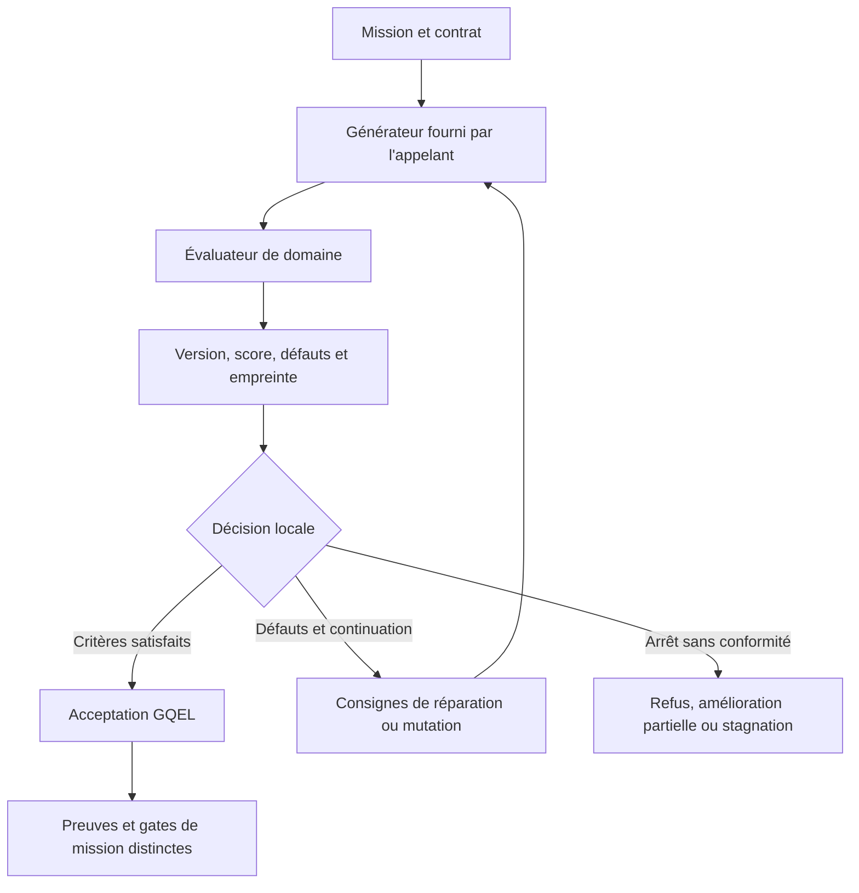

# GQEL — Élévation contrôlée de la qualité d'un livrable

- **Statut** : Partiel ; boucle Node.js et évaluateurs heuristiques implémentés, amplification sur des missions LLM réelles non qualifiée par le benchmark GQEL.
- **Portée** : évaluation, réparation guidée, comparaison de versions et refus local d'un livrable ; aucune nouvelle topologie.
- **Dernière revue** : 2026-11-02

**GQEL** signifie *GenOS Quality Elevation Loop*. Ce protocole cherche à améliorer
un livrable par des réparations ciblées : produire, évaluer, expliciter les défauts,
réviser et comparer. Son objectif est un gain mesurable avec un générateur donné.
Le runtime ne garantit ni ce gain ni la conservation du même modèle par le générateur.

Le dossier comprend un [guide d'intégration](../02-orchestration/gqel.md), une
[référence technique](../03-reference/gqel-boucle-elevation-qualite.md), un
[runbook](../04-exploitation/gqel.md) et un
[état des preuves](../06-qualite-preuves/qualification-gqel-2026-11-02.md).
L'[ADR 0770](../adr/0770-gqel-boucle-elevation-qualite.md) porte l'intention architecturale.

## 1. Définition du domaine

Une réponse présente n'est pas nécessairement conforme au brief. GQEL déplace
l'attention vers le livrable : quels défauts sont observés, quelle version les
corrige et quel critère permet d'arrêter ? Il rend ces informations explicites
plutôt que de demander seulement « améliore ta réponse ».

Le contrat courant contient un domaine, une mission, une politique et un seuil.
Il ne compile pas automatiquement les critères métier du brief en vérificateurs.
Les domaines spécialisés actuels couvrent des marqueurs de scénario dramatique
et du code JavaScript ; le domaine générique contrôle surtout la longueur.

## 2. Modèle logique et mesure du gain

Pour une version `Vi`, l'évaluateur retourne un score `s(Vi)`, des défauts `D(Vi)`
et un booléen `passed`. La boucle accepte localement la dernière version lorsque :

```text
passed(Vi) = true ET s(Vi) >= contract.threshold
demonstratedGain = s(bestVersion) - s(V1)
isImproved = demonstratedGain > 0
```

Un gain positif et une acceptation sont deux propriétés distinctes. Une première
version déjà conforme peut donner `promoted: true` avec un gain nul. Une version
améliorée peut rester sous le seuil et être refusée.

`bestVersion` est un index conservé par la session : il est mis à jour si le score
augmente et si aucun défaut nouveau n'apparaît par rapport à la version précédente.
Cette règle locale ne démontre pas une absence générale de régression par rapport
à toutes les versions antérieures. Le détail figure dans la référence technique.

## 3. Analogie biologique et limites

L'analogie utile est celle d'une boucle de contrôle : mesure d'un écart, correction
et nouvelle mesure. La conservation d'une version de référence évoque une mémoire
des acquis. Ces images ne prouvent ni apprentissage du modèle, ni adaptation
biologique, ni diagnostic causal expérimental.

Dans l'implémentation actuelle, le « diagnostic » reformule les défauts émis par
les règles d'évaluation. Il ne teste pas des causes concurrentes par intervention.

## 4. Cas d'usage et objectifs

| Situation | Apport de GQEL | Vérification complémentaire |
| --- | --- | --- |
| Scénario incomplet | Signaler des rubriques ou marqueurs dramaturgiques absents | Lecture éditoriale de la cohérence et de la qualité artistique |
| Module JavaScript | Repérer syntaxe invalide, certains motifs risqués, exports et indices de tests | Exécution de tests indépendants sur l'artefact exact |
| Worker soumis à un seuil | Refuser un artefact qui échoue au contrat de qualité configuré | Preuves du worker, oracle et clôture de mission |
| Révisions répétitives | Signaler le contenu inchangé ou les mêmes défauts | Décision de l'appelant sur coût, arrêt et changement de méthode |

## 5. Exemple concret

Un générateur renvoie d'abord une fonction JavaScript sans export ni indice de test.
L'évaluateur lui attribue 75/100. Avec la politique `balanced`, le seuil de boucle
est 80 : une réparation est demandée même si l'évaluateur logiciel accepte son
propre seuil par défaut de 75.

Une seconde réponse ajoute un export et une assertion textuelle ; son score peut
atteindre 100. Cela démontre le fonctionnement des règles de score, pas la
correction de l'algorithme : l'évaluateur ne lance pas cette assertion. L'exemple
exécutable du guide d'intégration utilise volontairement des réponses prédéfinies.

## 6. Cycle et place dans GenOS



| Mécanisme | Question traitée | Objet principal |
| --- | --- | --- |
| [Trinity](../02-orchestration/topologies/trinity.md) | Quelle hypothèse ou méthode résiste à une comparaison de mondes ? | Expérience comparative et preuves |
| [Morphogenèse](../02-orchestration/topologies/morphogenese.md) | Quelle organisation construire ou transformer ? | Graphe d'organisations et transitions |
| **GQEL** | Quels défauts du livrable corriger avant son acceptation locale ? | Versions du livrable et évaluations |
| [GQWF](gqwf.md) | Quels contenus et vues de workspace conserver ou matérialiser ? | Racines, vues et baux |
| [AEIS](adaptive-epistemic-immune-system.md) | Les preuves autorisent-elles la promotion ? | Contrats de preuve et reçus vérifiés |

Ces responsabilités sont complémentaires. Leur proximité conceptuelle n'atteste
pas un raccord automatique entre chaque runtime et `executeElevationLoop`.

## 7. Architecture technique

Le code se trouve sous
[`backend/src/services/qualityElevation/`](../../backend/src/services/qualityElevation/).
Le service principal compile le contrat, enregistre les versions et pilote la
boucle. Le registre sélectionne un évaluateur ; les services de comparaison et
de stagnation calculent les différences et les consignes de continuation.

Deux raccords doivent être distingués :

- le validateur d'artefact worker appelle `enforceQualityContract` lorsque
  `worker.workerContract.qualityElevation` existe ; il effectue un contrôle,
  sans lancer lui-même une boucle de réparation ;
- A-Team peut émettre une `repairObligation` pour des critères d'acceptation non
  vérifiés ; ce mécanisme ne constitue pas un branchement automatique à GQEL.

Les sessions GQEL sont des objets JavaScript mutables. Les empreintes de contenu
ne les transforment pas en journal durable, signé ou append-only.

## 8. Processus d'exécution et de validation

L'appelant choisit explicitement le domaine, fournit le générateur et contrôle
ses ressources. Chaque réponse est évaluée puis ajoutée à la session. La boucle
teste d'abord la conformité, ensuite la stagnation, puis le plafond d'itérations.
Une continuation construit un prompt contenant les défauts et au plus 4 000
caractères de la dernière réponse.

Pour valider un résultat, examiner séparément le statut local, la version
effectivement retournée, ses défauts, le gain et les preuves externes. Les
paramètres `critiques`, `requireDoubleBlind`, `criteria` et `budgetMaxTokens`
ne déclenchent pas les contrôles correspondants dans la boucle actuelle.

## 9. Comparaison de méthodes

Une génération unique fournit une baseline. Une révision libre fournit une
seconde réponse sans nécessairement expliciter ce qui doit changer. GQEL ajoute
une grille de défauts, un historique et une décision locale reproductible pour
un contenu donné.

Comparer ces méthodes exige cependant des générations réelles, des budgets
comparables et un évaluateur externe. Les deux fixtures du benchmark actuel
ne permettent pas de conclure à une supériorité sur des outils du marché.

## 10. Limites, garde-fous et non-objectifs

- Aucun changement des poids du LLM ni garantie d'amélioration à modèle constant.
- Aucun juge sémantique indépendant ou double aveugle exécuté par la boucle actuelle.
- Aucun audit exhaustif de sécurité, preuve fonctionnelle ou mesure artistique
  déductible des seuls scores heuristiques.
- Aucun budget de tokens consommé ou délai maximal imposé par GQEL ; le plafond
  d'itérations peut être dépassé lorsque la branche de stagnation demande une mutation.
- Aucune persistance ou reprise transactionnelle native de session.
- `promoted` est un verdict local : il n'autorise ni publication, ni fusion,
  ni contournement des preuves, leases ou gates de mission.

La [qualification datée](../06-qualite-preuves/qualification-gqel-2026-11-02.md)
sépare les mécanismes observables des campagnes qui restent à réaliser.
