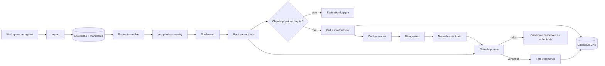
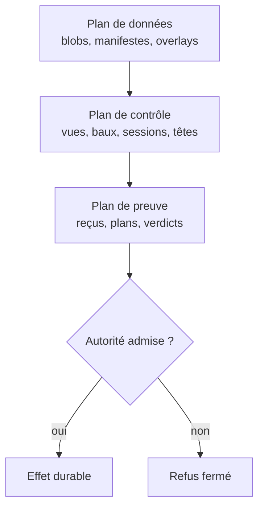

# GQWF — système de fichiers logique adressé par contenu

- **Statut** : partiel, opt-in ; noyau backend et parcours orchestrés qualifiables, sans remplacement global des snapshots v1.
- **Portée** : modèle logique, invariants, cycle de vie, architecture et limites de GQWF v2.
- **Dernière revue** : 2026-10-20.

GQWF représente un workspace par une racine
immuable adressée par contenu, puis isole chaque tentative dans une vue privée.
Un chemin physique n'est créé que lorsqu'un outil en a besoin. Le résultat est
réingéré comme une nouvelle racine candidate ; il ne devient jamais la vérité
courante sans une promotion vérifiée.

Cette séparation répond à une règle centrale de GenOS : **une exécution réussie
n'est pas une preuve suffisante pour publier son état**.

## 1. Définition et périmètre

GQWF fournit six objets principaux :

| Objet | Rôle | Identité |
| --- | --- | --- |
| Blob | octets d'un fichier | SHA-256 des octets |
| Racine | manifeste trié d'une projection complète | SHA-256 du manifeste canonique |
| Vue | base immuable et overlay privé | identifiant UUID + version monotone |
| Tête | nom mutable pointant vers une racine | workspace, nom, génération |
| Bail | matérialisation physique temporaire | identifiant UUID et marqueur de propriété |
| Catalogue | sauvegarde CAS des racines, têtes et baux | hash du catalogue + révision append-only |

Le système couvre les fichiers ordinaires admis par les limites de snapshots.
Il ne cherche pas à reproduire un système de fichiers POSIX complet, ni à
capturer les processus, descripteurs ouverts, sockets, secrets ou états noyau.

## 2. Pourquoi une couche logique

Une orchestration contrefactuelle crée plusieurs mondes à partir d'un même état.
Copier immédiatement tout le workspace pour chaque monde augmente la latence,
l'espace disque et le coût de reprise. GQWF déplace ce coût :

1. la racine commune est importée une fois ;
2. chaque monde reçoit une vue logique vide ;
3. les écritures alimentent son overlay privé ;
4. un dossier réel n'apparaît qu'à la frontière d'un outil physique ;
5. la sortie devient une candidate, jamais une publication implicite.

La déduplication découle de l'identité des blobs. Elle ne prouve ni la qualité
du contenu, ni l'absence de conflit sémantique entre deux candidats.

## 3. Invariants

Soit `H(x) = SHA-256(x)`. Pour chaque blob `b`, le chemin CAS et les octets
doivent vérifier `path(b) = H(b)`. Une racine `R` est le hash du manifeste
canonique de ses fichiers triés par chemin.

Les invariants exécutés sont les suivants :

- une racine et ses blobs sont immuables ;
- une vue référence exactement une racine de base ;
- toute mutation de vue exige `expectedVersion` ;
- le scellement produit une racine déterministe ;
- une tête avance par comparaison de hash et de génération ;
- une promotion exige un verdict lié au workspace, à la tête, à l'ancienne
  racine, à la génération et à la candidate ;
- un bail ne peut être supprimé que dans le répertoire géré portant son marqueur ;
- une collecte exige l'inventaire exact observé en prévisualisation ;
- une réparation exige un plan stable, une autorisation liée et une source
  répliquée attestée ;
- le catalogue publié forme une chaîne de révisions liée par hash.

Une violation ferme l'opération. GQWF ne transforme pas une incohérence en
succès dégradé.

## 4. Analogie biologique et limites

La racine joue le rôle d'un patrimoine stable ; la vue, celui d'une expression
locale ; l'overlay, celui des variations acquises ; la promotion, celui d'une
transmission gouvernée. L'analogie aide à séparer héritage, expression et
sélection.

Elle s'arrête là : un hash n'est pas un génome biologique, une vue n'est pas une
cellule, et une tête ne mesure aucune adaptation. Les métaphores ne remplacent
ni les tests ni le verdict de promotion.

## 5. Cas d'usage

GQWF est adapté à :

- plusieurs workers partant d'une base commune ;
- l'exécution différée d'une mission qui n'a pas encore besoin d'un `cwd` ;
- la capture d'une candidate reproductible ;
- la comparaison et le merge à trois racines ;
- la promotion explicite d'un résultat Trinity ou worker ;
- la réplication et la réparation de blobs entre workspaces d'un même tenant ;
- la restauration opt-in des fichiers d'un organisme.

Il n'est pas le bon contrat pour un outil qui dépend d'attributs non capturés,
d'écritures concurrentes non coordonnées ou d'une publication immédiate sans
preuve.

## 6. Exemple de cycle

```text
importBase → racine A
createView(A) → vue V, version 0
writeFile(V, expectedVersion=0) → version 1
sealView(V, expectedVersion=1) → racine B
materializeRoot(B) → bail L, chemin temporaire
outil physique → modifications dans L/root
ingestLease(L) → racine candidate C
vérification indépendante
publishCandidate(expected=A, candidate=C) → tête génération + 1
releaseLease(L)
```

Si la version de vue, la génération de tête ou le plan observé a changé, le
cycle s'arrête et doit être recalculé depuis l'état courant.

## 7. Architecture



Le backend Node porte l'autorité actuelle. SQLite indexe les objets et les
cycles d'exécution ; le CAS sous `.genos/gqwf/` porte les blobs, manifestes et
catalogues adressés. Les reçus durables décrivent matérialisation, collecte,
scrub, réplication, réparation et réparation des métadonnées.

## 8. Cycle de vie et récupération

Une vue passe de sa base à une suite d'overlays versionnés, puis à une racine
scellée. Un bail suit `preparing → open → ingested → releasing → released`, avec
`quarantined` lorsque la preuve de propriété du dossier manque. La reprise peut
terminer les préparations et libérations interrompues, mais ne doit pas effacer
un dossier ambigu.

Chaque mutation cataloguée stage une nouvelle révision CAS puis publie sa ref.
La maintenance peut republier une ref perdue après crash, vérifier la chaîne et
ne conserver que les 64 refs les plus récentes. Elle ne supprime pas les objets
CAS historiques. La réparation des métadonnées reconstruit racines, têtes et
baux depuis un catalogue autorisé.

## 9. Comparaison

### 9.1 Ce que « copy-on-write » signifie ici

GQWF fournit toujours un **COW logique** : plusieurs vues partagent une racine
immuable et n'enregistrent que leurs changements. Il ne fournit un **COW
physique** que lorsque le reçu du bail prouve la sélection de
`native-reflink-v1` ou `linux-overlayfs-v1`. Avec `portable-copy-v1`, le modèle
logique reste identique, mais la matérialisation copie les octets.

Cette distinction interdit deux raccourcis : une vue virtuelle ne prouve pas
que le disque utilise des extents partagés, et `auto` ne promet aucun backend
avant sa sonde et la persistance du reçu.

### 9.2 Avantages repris des systèmes voisins

| Source d'inspiration | Avantage repris par GQWF | Ce qui reste propre au rival |
| --- | --- | --- |
| Btrfs/ZFS | racines immuables, clones potentiellement COW, scrub et réparation explicites | transactions et checksums au niveau bloc, snapshots de volume, réplication native et garanties du filesystem |
| OverlayFS | lower immuable, upper privé et capture d'une vue Linux | sémantique VFS complète, whiteouts et comportement noyau hors du manifeste GQWF |
| Git worktree | objets partagés, répertoires de travail isolés et références mutables contrôlées | index Git, branches, commits, historique et merge sémantique Git |
| Nix | objets adressés par contenu, résultats immuables et séparation construction/promotion | dérivations, fermeture complète des dépendances, sandbox hermétique et reproductibilité de build |
| Snapshot v1 GenOS | capture portable d'un état de fichiers | le snapshot physique reste le chemin par défaut et couvre ses propres raccords historiques |
| Copie complète | chemin immédiatement compatible avec les outils ordinaires | aucun partage physique ; coût proportionnel aux octets matérialisés |

GQWF ne cherche donc pas à « battre » chaque système sur son terrain. Il réunit
leurs propriétés utiles au niveau de l'orchestration GenOS : identité de
contenu, isolation des tentatives, sélection locale d'un mécanisme physique et
promotion gouvernée par des preuves.

### 9.3 Propriétés que GQWF refuse d'inventer

- un reçu de reflink ne transforme pas le CAS en filesystem transactionnel ;
- un montage OverlayFS n'est pas une sauvegarde et son état noyau n'est pas un
  objet CAS ;
- une tête GQWF n'est ni une branche Git ni un journal de commits ;
- un hash de racine ne prouve pas une construction hermétique à la Nix ;
- un scrub applicatif ne remplace pas les contrôles d'intégrité du support ;
- une déduplication de blobs n'établit ni causalité ni qualité de la candidate.

## 10. Modèle formel minimal

Pour un workspace `w`, on note `B_w` l'ensemble des blobs accessibles,
`R_w` ses racines, `V_w` ses vues, `H_w` ses têtes et `L_w` ses baux.

Une racine est un manifeste canonique :

```text
R = H({ policy, files: sort(path, hash, size, mode) })
```

Une vue `v = (R_base, O, n)` contient un overlay `O` et une version `n`.
Une mutation n'est admise que si `expectedVersion = n`, puis produit
`(R_base, O', n + 1)`. Le scellement applique les tombstones et remplacements
de `O` à `R_base`, puis recalcule une racine. Il ne modifie jamais la base.

Une tête `h = (name, R, g)` ne passe à `(name, R', g + 1)` que si :

```text
expectedRoot = R
expectedGeneration = g
verdict(workspace, name, R, g, R') = accepté
```

Le point de linéarisation d'une vue est l'incrément conditionnel de sa version ;
celui d'une tête est sa mise à jour conditionnelle dans la transaction de
publication. Deux writers peuvent calculer en parallèle, mais un seul gagne
avec une version ou génération donnée.

## 11. Plans d'autorité, de données et de preuve



Le plan de données établit l'identité des octets. Le plan de contrôle établit
quel acteur peut travailler sur quelle projection. Le plan de preuve établit
si une opération sensible peut être appliquée. Aucun plan ne remplace les deux
autres : connaître un hash ne confère pas une autorité, et posséder un bail ne
constitue pas un verdict de promotion.

| Effet | Autorité requise | Liaison contrôlée |
| --- | --- | --- |
| publier une candidate | vérificateur de promotion | workspace, tête, ancienne racine, génération, candidate |
| promouvoir un worker | vérificateur worker | worker, vue, tête et candidate |
| répliquer | autorisateur de réplication | source, cible, racine et plan |
| réparer des blobs | autorisateur de réparation | réplication attestée, inventaires et plan |
| reconstruire SQLite | autorisateur de métadonnées | workspace, catalogue, révision et plan |
| collecter | inventaire relu sans dérive | ensemble exact des objets observés |

## 12. Domaines de panne et durabilité

| Domaine | État autoritatif | Reprise prévue | Limite |
| --- | --- | --- | --- |
| blob ou manifeste | objet CAS vérifié | réplication/réparation attestée | pas de correction sans source valide |
| vue/overlay | SQLite | conflit de version, abandon ou reconstruction applicative | absent du catalogue de métadonnées |
| bail physique | SQLite + marqueur privé | réconciliation `preparing`/`releasing` | ambiguïté mise en quarantaine |
| tête | SQLite + catalogue CAS | réparation de métadonnées sous plan | verdict original non recréé |
| session/rollout/reçu | SQLite | logique propre au parcours appelant | pas reconstruit par le catalogue v1 |
| ref de catalogue | fichier append-only | republication de la ref stageée | fork ou ref future bloque l'opération |

Le catalogue CAS complète SQLite ; il ne le remplace pas. La fenêtre de crash
« objet écrit, état SQLite stageé, ref non publiée » est réconciliable. Une
divergence où le filesystem annonce une révision future ou deux refs de même
révision est traitée comme une corruption, pas comme un choix automatique.

## 13. Modèle de coût

Pour `N` fichiers totalisant `S` octets et un delta de `Δ` octets :

- ouvrir une vue est essentiellement une opération de métadonnées ;
- écrire le delta coûte les nouveaux blobs et les lignes d'overlay ;
- sceller relit/projette le manifeste et vérifie les blobs accessibles ;
- une matérialisation portable coûte approximativement `O(S)` en lecture,
  écriture et espace temporaire ;
- un reflink ou OverlayFS peut rapprocher l'ouverture physique d'un coût de
  métadonnées, mais la capture finale et le hashage restent liés aux octets
  observés ;
- scrub, inventaire de GC et réplication sont bornés par la taille du store ou
  de la racine parcourue.

Ces relations sont un modèle de complexité, pas un benchmark. Les constantes,
la fragmentation, le cache et le support doivent être mesurés sur la plateforme
cible.

## 14. Maturité, limites et non-objectifs

Le noyau, les vues, les baux, la collecte, le scrub, la réplication, la
réparation et le catalogue CAS sont implémentés. Le routage reste opt-in par
`executionPolicy.gqwfV2`; les snapshots physiques v1 coexistent donc avec GQWF.

Les limites structurantes sont :

- le catalogue CAS ne reconstruit pas encore les vues, overlays, sessions
  d'exécution, décisions de rollout ni tous les reçus ;
- SQLite reste nécessaire comme index transactionnel et projection runtime ;
- `linux-overlayfs-v1` dépend de Linux et de capacités noyau ;
- Windows utilise typiquement le reflink natif s'il est réellement disponible,
  sinon la copie portable ;
- `auto` sélectionne une capacité observée, sans garantie universelle de COW ;
- la collecte des objets de catalogue historiques n'est pas implémentée ;
- aucune candidate n'est promue par sa seule réussite de transport ou de test.

### 14.1 Matrice de maturité

| Capacité | Niveau actuel | Condition de promotion |
| --- | --- | --- |
| CAS de blobs et racines | implémenté, qualifié localement | campagne propre multi-OS et coupures réelles |
| vues logiques versionnées | implémenté, qualifié localement | charge concurrente et longévité |
| copie portable | implémentée | mesures de capacité et pression disque |
| reflink natif | implémenté, dépendant de la sonde | preuve sur filesystems supportés |
| OverlayFS | implémenté, Linux seulement | campagne Linux avec montage réel |
| promotion sous preuve | implémentée sur parcours raccordés | porte globale et vérificateurs réels |
| catalogue CAS | racines/têtes/baux seulement | étendre ou exclure durablement les projections restantes |
| sauvegarde/restauration complète | non fournie | contrat distinct incluant SQLite et reçus |
| herméticité à la Nix | non fournie | dérivations et fermeture des dépendances, si retenues |

### 14.2 Quand ne pas utiliser GQWF

Conserver le workspace physique ou un mécanisme spécialisé lorsque le workload
exige des liens spéciaux, des attributs POSIX non projetés, un historique Git
natif, une image de volume atomique, une construction hermétique ou des writers
externes qui ne passent pas par les versions et baux GQWF.

Pour les contrats exacts, voir la [référence runtime](../03-reference/runtime-gqwf.md).
Pour l'exploitation et la reprise, voir le [runbook](../04-exploitation/gqwf.md).
La portée des preuves locales est consignée dans la [qualification datée](../06-qualite-preuves/qualification-gqwf-2026-10-20.md).
Le raccord d'orchestration détaillé reste décrit dans [GQWF v2](../02-orchestration/gqwf-v2.md).
