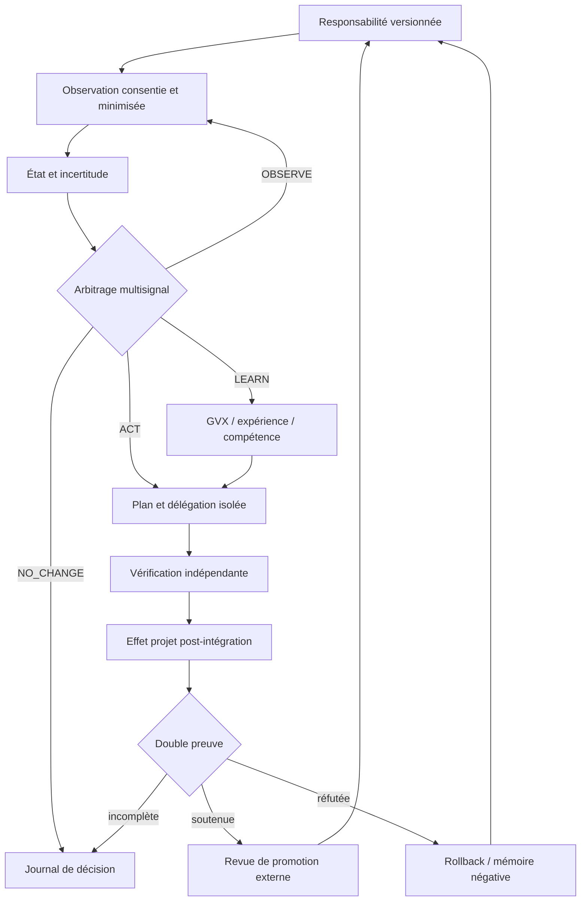

# Ontogenèse dirigée par responsabilité

- **Statut** : architecture intégrée documentée ; briques locales implémentées, boucle longitudinale complète non qualifiée
- **Portée** : responsabilité persistante, observation, initiative, action, apprentissage, preuve et réversibilité
- **Dernière revue** : 2026-10-20
- **Décisions liées** : [ADR 0680](../adr/0680-admission-endogene-shev-attestee-et-bornee.md), [ADR 0692](../adr/0692-responsabilite-ambiante-et-oublie-revocable.md), [ADR 0696](../adr/0696-responsabilite-trajectoire-double-preuve.md)

## 1. Définition

L’**ontogenèse dirigée par responsabilité** désigne une boucle où GenOS reste lié à
une trajectoire externe — dépôt, produit, interface, service ou compétence — au-delà
d’une mission ponctuelle. La responsabilité ne donne pas un droit permanent d’agir.
Elle crée un devoir borné de :

1. conserver un objectif et un mandat vérifiables ;
2. observer sous consentement des signaux minimisés ;
3. distinguer un écart réel d’un bruit ou d’une donnée périmée ;
4. proposer `ACT`, `OBSERVE`, `LEARN` ou `NO_CHANGE` ;
5. exécuter seulement sous budget, lease et autorité explicites ;
6. vérifier séparément l’effet projet et l’apprentissage agent ;
7. réviser ou retirer la responsabilité quand les preuves l’exigent.

Ce concept relie les surfaces SHEV, Ontogenèse, GVX, modèle du monde et
Morphogenèse. Il ne constitue pas un nouvel exécuteur et n’élève aucune preuve
synthétique au rang d’effet réel.

## 2. Problème traité

Une autonomie centrée sur la tâche peut réussir une livraison sans savoir si elle a
amélioré la trajectoire du projet. À l’inverse, une boucle de surveillance peut
détecter un problème sans posséder le mandat, les compétences ou les preuves pour
intervenir. GenOS sépare donc quatre questions :

| Question | Contrat principal | Réponse attendue |
| --- | --- | --- |
| De quoi l’agent est-il responsable ? | responsabilité versionnée | portée, objectif, propriétaire, expiration |
| Que sait-il réellement ? | observation et provenance | fraîcheur, source, consentement, incertitude |
| Que devrait-il proposer ? | arbitrage multisignal | mode et justification auditable |
| Qu’est-ce qui a effectivement changé ? | double preuve | effet projet et apprentissage agent |

Le succès de transport, la fermeture d’une mission, un score de simulation ou une
auto-évaluation positive ne répondent pas à la dernière question.

## 3. Modèle formel

Pour une responsabilité `r` au temps `t`, on note :

- `P_t` : état observé du projet ;
- `T_r` : trajectoire externe attendue par le mandat ;
- `G_t = distance(P_t, T_r)` : écart normalisé ;
- `U_t` : incertitude de l’observation ;
- `F_t` : fraîcheur de l’observation ;
- `L_t` : potentiel d’apprentissage ;
- `B_t` : budget restant ;
- `A_t` : autorité effective ;
- `D_t ∈ {ACT, OBSERVE, LEARN, NO_CHANGE}` : décision.

La politique implémentée choisit d’abord l’observation lorsque la donnée est trop
ancienne ou trop incertaine, puis l’action si l’écart dépasse le seuil, puis
l’apprentissage si son potentiel est suffisant. Le mode candidat n’est retenu que
si son budget et ses permissions sont disponibles :

```text
candidate(P_t) =
  OBSERVE    si F_t est périmée ou U_t >= u_max
  ACT        si G_t >= g_min
  LEARN      si L_t >= l_min
  NO_CHANGE  sinon

D_t = candidate(P_t) si authorized(A_t) ∧ affordable(B_t)
      NO_CHANGE       sinon
```

La préférence pour `OBSERVE` interdit à une donnée incertaine de déclencher une
écriture simplement parce que l’écart apparent est élevé.

### 3.1 Double preuve causale

Une trajectoire n’est promouvable que lorsque deux propositions distinctes sont
soutenues :

```text
ProjectEffect(r, ΔP, e_p) = supported
AgentLearning(r, ΔA, e_a) = supported
independent(e_p, e_a) = true
```

`ProjectEffect` atteste un changement externe lié à l’objectif ; `AgentLearning`
atteste une révision interne réutilisable. Les références et vérificateurs doivent
être distincts. Une seule preuve soutenue produit au mieux `INCONCLUSIVE`, jamais
une promotion.

### 3.2 Invariant de non-substitution

Les classes de preuve ne sont pas interchangeables :

```text
simulation ≠ observation réelle
acceptation ≠ effet utilisateur
effet projet ≠ apprentissage agent
test local ≠ qualification longitudinale
autorisation ≠ exécution
```

Cet invariant est le centre épistémique de la boucle.

## 4. Biomimétismes

### 4.1 Homéorhèse

L’homéostasie maintient une valeur autour d’un point. L’homéorhèse protège une
trajectoire malgré les perturbations. GenOS l’emploie pour préférer la continuité
du projet à l’optimisation d’un signal instantané.

### 4.2 Allostasie bornée

Le système peut anticiper un besoin futur par modèle prédictif, mais seulement si
la valeur d’information attendue justifie le coût. La prospective reste une preuve
contrefactuelle et ne compte jamais comme effet réel.

### 4.3 Développement et plasticité

Une expérience peut devenir compétence, puis être réutilisée dans un autre contexte.
Cette plasticité exige lignée, holdout scellé, rétention et absence de régression.
Elle ne signifie pas que le runtime se réécrit librement.

### 4.4 Immunité et apoptose

Les gates refusent les preuves auto-produites, les leases obsolètes, la dérive de
mandat et les modifications constitutionnelles. Une lignée ou une mission peut être
interrompue, rejetée ou restaurée plutôt que poursuivie à tout prix.

### 4.5 Mémoire écologique

Les responsabilités, résultats, prédictions et échecs forment une mémoire distribuée
du projet. L’analogie écologique s’arrête au modèle d’organisation : SQLite, SHA-256,
signatures et worktrees sont des mécanismes logiciels explicites.

## 5. Architecture conceptuelle



### 5.1 Plans de contrôle

| Plan | Responsabilité | Autorité refusée |
| --- | --- | --- |
| SHEV | capteurs, responsabilité, initiative, effet, récupération | ne promeut pas une mutation GVX |
| Ontogenèse | cycle résident, backlog, délégation et reprise | ne transforme pas une suggestion en mandat |
| GVX | lacune, expérience, compétence, rétention | ne produit pas seul une preuve d’effet projet |
| Modèle du monde | prédiction préenregistrée, erreur, mémoire, prospective | ne compte pas une simulation comme observation |
| Morphogenèse | choisit une organisation sous contraintes | ne contourne ni lease ni gate de preuve |
| Studio | contrat produit, jury, acceptation, effet post-livraison | ne déploie pas une initiative consultative |

### 5.2 Unité de responsabilité

Une responsabilité utile doit porter au minimum :

- un identifiant stable et un propriétaire ;
- une portée organisation/projet/entité ;
- un objectif externe et ses métriques ;
- un mandat et une référence d’autorité ;
- des domaines bornés ;
- une politique de fraîcheur, budget et interruption ;
- une lignée de versions ;
- une politique de révocation et d’oubli.

## 6. Processus nominal

### Phase A — établir la responsabilité

Le propriétaire définit la trajectoire, les domaines, les permissions et les critères
de fin. Une révision concurrente ou divergente échoue ; la responsabilité n’est pas
déduite d’un simple accès au dépôt.

### Phase B — observer

Les capteurs produisent des observations signées ou référencées. La collecte est
minimisée, limitée par le consentement et révoquée lorsque le mandat expire. Une
observation périmée impose `OBSERVE`, pas `ACT`.

### Phase C — arbitrer

Les signaux de besoin projet, écart de trajectoire, risque, opportunité, incertitude,
progrès d’apprentissage et coût sont évalués. Le budget et l’autorité sont des
barrières non compensables. `NO_CHANGE` est une décision positive et auditée.

### Phase D — expérimenter ou agir

Une action risquée est d’abord matérialisée dans une capsule ou un monde isolé. Les
checkpoints `scope`, `execute_isolated`, `independent_verify` et
`post_integration_effect` structurent la délégation asynchrone. Un fencing token
invalide les travailleurs obsolètes.

### Phase E — apprendre

Une erreur prédiction-observation peut créer un épisode et réviser une règle
sémantique. Une expérience récurrente peut devenir compétence versionnée, mais son
adoption reste soumise à un holdout, à une mesure de rétention et à une revue externe.

### Phase F — clôturer

La clôture distingue `ACCEPT`, `NO_CHANGE` et `HUMAN_REVIEW`. Une acceptation exige
une vérification indépendante et un effet post-intégration. La responsabilité est
ensuite maintenue, amendée, suspendue ou retirée selon les preuves.

## 7. Propriétés de sûreté

1. **Autorité locale** — chaque opération est bornée par une permission et une portée.
2. **Fermeture par défaut** — donnée absente, lease expiré ou digest divergent bloque.
3. **Indépendance** — producteur, évaluateur, vérificateur et autorisateur sont séparés
   dans les flux à risque.
4. **Idempotence** — un identifiant rejoué avec le même contenu est accepté ; un contenu
   divergent sous la même identité est refusé.
5. **Réversibilité** — base revision, snapshot ou référence de rollback précède l’action.
6. **Provenance** — chaque signal et chaque verdict conserve ses références sources.
7. **Abstention** — l’absence de candidat admissible produit `NO_CHANGE`.
8. **Non-promotion locale** — les services d’analyse exposent explicitement
   `promotionAllowed: false` ou un équivalent.

## 8. Observabilité et falsification

Les indicateurs recommandés sont des propriétés vérifiables, pas des scores de
marketing :

| Indicateur | Question falsifiable | Échec révélateur |
| --- | --- | --- |
| âge de l’observation | la décision repose-t-elle sur un état encore valide ? | action sur donnée périmée |
| taux de `NO_CHANGE` | le système sait-il s’abstenir ? | action quasi systématique |
| refus d’autorité | les permissions sont-elles réellement non compensables ? | score élevé malgré refus |
| taux de reprise | les leases et checkpoints permettent-ils une relève sûre ? | double écriture ou perte de curseur |
| effet projet | l’objectif externe a-t-il évolué dans le sens attendu ? | simple test interne vert |
| apprentissage retenu | le gain survit-il hors contexte source ? | oubli ou surapprentissage |
| divergence prédictive | la confiance diminue-t-elle après erreurs répétées ? | prospective toujours utilisée |
| rollback vérifié | la restauration correspond-elle à la révision annoncée ? | rollback décoratif |

## 9. Positionnement et sources

Les travaux sur les agents mettent en évidence plusieurs briques complémentaires :
les workflows générateur-évaluateur et orchestrateur-workers chez
[Anthropic](https://www.anthropic.com/engineering/building-effective-agents), les
lignées auto-modifiantes évaluées par benchmark dans la
[Darwin Gödel Machine](https://arxiv.org/abs/2505.22954), la co-évolution agent/modèle
du monde de [WebEvolver](https://arxiv.org/abs/2504.21024), et la mémoire prédictive
révisée au déploiement de [WorldEvolver](https://arxiv.org/abs/2606.30639).

GenOS ne revendique pas de dépasser empiriquement ces systèmes. Sa différence de
conception est d’assembler ces idées sous une responsabilité externe persistante et
d’exiger simultanément l’effet projet, l’apprentissage agent et une autorité séparée.
Cette intégration est aujourd’hui une architecture testée par composants, pas une
preuve longitudinale publique.

## 10. Limites et non-objectifs

- aucune campagne publique ne démontre encore une amélioration durable en production ;
- les politiques de poids et seuils sont configurées, pas apprises scientifiquement ;
- plusieurs services sont des noyaux déterministes qui consomment des observations
  produites ailleurs ;
- la preuve cryptographique lie des contenus et des identités, mais ne garantit pas la
  vérité du monde observé ;
- une responsabilité active ne vaut ni consentement illimité ni droit d’écriture ;
- le système ne prétend ni à une conscience, ni à une intention phénoménale ;
- les analogies biologiques guident l’architecture, elles ne certifient pas sa sûreté.

## Inventaire d’implémentation

| Capacité | Implémentation | Preuve locale |
| --- | --- | --- |
| responsabilité ambiante | `backend/src/services/ambientAgency/` | `test_ambient_*.js` |
| arbitrage de trajectoire | `trajectoryStewardshipPolicyService.js` | `test_trajectory_stewardship_policy.js` |
| double preuve | `trajectoryStewardshipOutcomeService.js` | `test_trajectory_stewardship_outcome.js` |
| initiative SHEV | `shev/initiativeService.js`, `initiativeAdmissionService.js` | `test_shev_endogenous_initiative.js` |
| délégation asynchrone | `ontogenesis/asyncDelegation*Service.js` | `test_ontogenesis_async_delegation.js` |
| sélection de buts | `gvxGoalSelector.js` | `test_gvx_goal_selector.js` |
| responsabilité de compétence | `gvxSkillStewardship.js` | `test_gvx_skill_stewardship.js` |
| modèle du monde | `predictiveTimescale/` | `test_predictive_timescales.js`, `test_predictive_distribution.js` |
| stewardship spécialisé | `shev/*StewardshipService.js` | suites coding, website, product et experience |
| évolution gouvernée | `governedEvolution/`, `aide2/` | suites governed-evolution et AIDE² |

## Voir aussi

- [Responsabilité de trajectoire](../02-orchestration/responsabilite-trajectoire.md)
- [Évolution contrefactuelle gouvernée](../02-orchestration/evolution-contrefactuelle-gouvernee.md)
- [Contrats de stewardship V3](../03-reference/contrats-stewardship-v3.md)
- [Runbook longitudinal](../04-exploitation/runbook-stewardship-longitudinal.md)
- [Matrice de qualification](../06-qualite-preuves/matrice-qualification-stewardship-v3-2026-10-20.md)
