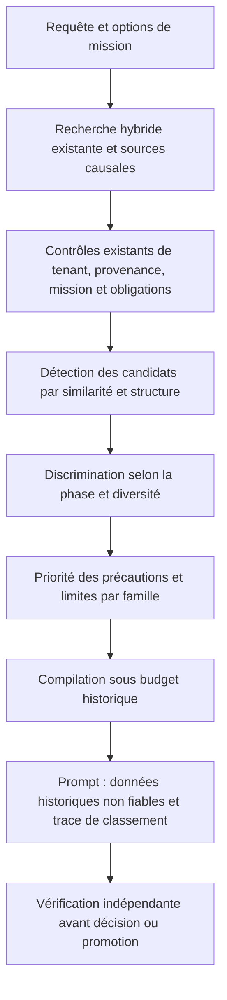

# Rappel mémoire situationnel en deux étapes

- **Statut** : Implémenté pour le contexte mémoire historique des prompts Node.js ; gains sur missions réelles non qualifiés.
- **Portée** : `agentMemoryPrompt`, `memory/situationFeatures`, `memory/situationalRecallService`, `memory/memoryContextCompiler`.
- **Dernière revue** : 2026-10-23.

## 1. Objectif

Le rappel cherche des expériences transférables malgré un changement de vocabulaire,
puis les classe selon la phase de travail. Une contention de transactions SQLite et
des écritures simultanées dans un fichier peuvent partager des contraintes de
coordination et d'état partagé. Un timeout HTTP peut avoir une autre origine malgré
un symptôme commun.

Le classement propose des pistes historiques. Il ne conclut pas que deux incidents
ont la même cause et ne donne aucune autorité supplémentaire aux souvenirs.

## 2. Recherches de Doris Tsao : résultats et inspiration

Deux résultats expérimentaux motivent la conception :

1. **Représentation distribuée de l'identité faciale.** Le Chang et Doris Y. Tsao
   décrivent en 2017 des réponses neuronales correspondant à des projections sur
   des axes d'un espace de visages paramétré par 50 dimensions. L'activité d'une
   population permet de décoder des visages dans les conditions de l'expérience.
   GenOS reprend l'idée d'une comparaison par caractéristiques combinées.
2. **Passage de la détection à la discrimination.** Yuelin Shi et ses coauteurs,
   dont Doris Y. Tsao, montrent en 2026 que des populations de neurones du cortex
   inférotemporal de macaques passent d'un code général favorisant la détection
   des visages à un code spécialisé favorisant leur discrimination. La transition
   collective dure moins de 20 ms, après une première réponse au stimulus.
   GenOS reprend l'idée d'une sélection large suivie de critères plus spécifiques.

Sources primaires :

- Chang, L. et Tsao, D. Y. (2017), *The Code for Facial Identity in the Primate Brain*,
  **Cell**, 169, 1013–1028.e14. [DOI](https://doi.org/10.1016/j.cell.2017.05.011),
  [texte intégral](https://pmc.ncbi.nlm.nih.gov/articles/PMC8088389/).
- Shi, Y., Bi, D., Hesse, J. K., Lanfranchi, F. F., Chen, S. et Tsao, D. Y. (2026),
  *Rapid concerted switching of the neural code in the inferotemporal cortex*,
  **Nature**, 653, 146–155. [DOI](https://doi.org/10.1038/s41586-026-10267-3),
  [notice PubMed](https://pubmed.ncbi.nlm.nih.gov/41882367/).

**La transposition est une décision d'ingénierie.** Ces travaux concernent la vision
chez le macaque. Ils ne démontrent ni l'efficacité d'un routeur mémoire d'agents,
ni la validité de nos dimensions lexicales, ni une équivalence neurone/agent.
Les « environ 200 neurones » de l'étude de 2017 ne constituent pas une recette de
dimensionnement pour GenOS ou une preuve de lecture générale des pensées.

## 3. Représentation des situations

Le service extrait huit dimensions binaires à partir du titre, du résumé, du
contenu, des tags et, pour les épisodes, des entrées/actions et observations :

| Dimension logicielle | Exemples de signaux lexicaux |
| --- | --- |
| `coordination` | concurrence, parallel, contention, mutex, serialization |
| `sharedState` | partagé, SQLite, transaction, fichier, state |
| `externalDependency` | HTTP, réseau, fournisseur, socket |
| `resourcePressure` | saturation, pool, quota, budget, mémoire |
| `authority` | permission, autorisation, lease, tenant |
| `isolation` | sandbox, worktree, capsule, confinement |
| `recovery` | rollback, retry, reprise, snapshot |
| `verification` | preuve, evidence, oracle, test, reproductibilité |

Les accents sont normalisés ; les expressions couvrent un vocabulaire français et
anglais borné, sans modèle supplémentaire. Ce sont des heuristiques textuelles,
sans analyse causale ou compréhension automatique des négations. Une dimension
absente du texte reste inconnue ; elle ne décrit pas une absence réelle du risque.

## 4. Classement et phases

Pour les ensembles de dimensions de la requête Q et du souvenir M, la similarité
structurelle est `S = |Q ∩ M| / |Q ∪ M|`, ou zéro si Q est vide.

La première étape classe les candidats par `D = (R + S) / 2`, où R est le score
de similarité existant ramené dans [0, 1]. Elle examine au plus 2 048 entrées déjà
filtrées, déduplique les identifiants et conserve 64 candidats par famille.
Elle ne lance pas une seconde requête et n'accède à aucun nouveau tenant.

La deuxième étape utilise `B = wR × R + wS × S + wF × F + wT × T` :

| Phase | wR | wS | wF | wT | Diversité |
| --- | ---: | ---: | ---: | ---: | ---: |
| `exploration` | 0,45 | 0,45 | 0,05 | 0,05 | 0,15 |
| `diagnosis` | 0,30 | 0,55 | 0,05 | 0,10 | 0 |
| `verification` | 0,20 | 0,45 | 0,05 | 0,30 | 0 |

F est une décroissance exponentielle sur 30 jours. Une date absente, invalide ou
future donne zéro. T vaut 0,5 pour la présence d'une référence historique non vide,
plus 0,5 pour celle d'un hash de provenance. **T mesure la possibilité d'inspection,
jamais l'authenticité, la qualité ou l'indépendance d'une preuve.**

En exploration, une sélection gloutonne retranche jusqu'à 0,15 selon la plus forte
similarité structurelle avec les souvenirs déjà choisis. Elle encourage plusieurs
profils de situation. Le score retourné est borné dans [0, 1] ; les égalités gardent
l'ordre initial. Les poids sont fixes et versionnés, pas appris.

`recallPhase` explicite prévaut. À défaut, une heuristique cherche d'abord des
termes de vérification, puis de diagnostic, et choisit sinon `exploration`.
Une valeur explicite inconnue suit cette même inférence. Il s'agit du texte de la
requête actuelle, sans automate persistant de transition de mission.

## 5. Architecture et processus d'exécution



- [situationFeatures.js](../../backend/src/services/memory/situationFeatures.js)
  décrit les dimensions et l'inférence de phase.
- [situationalRecallService.js](../../backend/src/services/memory/situationalRecallService.js)
  est un classeur pur : aucune écriture de mémoire, aucun appel réseau ou de modèle.
- [agentMemoryPrompt.js](../../backend/src/services/agentMemoryPrompt.js) appelle
  le classeur après les filtres de portée et d'obligations, avant les limites de
  quatre expériences, trois pièges, deux golden paths et quatre épisodes.
- [memoryContextCompiler.js](../../backend/src/services/memory/memoryContextCompiler.js)
  respecte `recallScore` pour ne pas annuler le classement lors de la compilation.
- [missionLease.js](../../backend/src/services/agentRuntimeAdapter/missionLease.js)
  et [agent-runtime-session.cjs](../../backend/bin/agent-runtime-session.cjs)
  transmettent les options de phase et de retour au classement précédent.

Chaque entrée classée conserve ses champs originaux, dont `similarityScore`,
`evidenceRefs`, `counterexampleRefs`, `provenance` et `provenanceIntegrity`.
Elle reçoit `recallScore` et une trace `recall` : version `situational-recall-v1`,
phase, rang, dimensions communes, critères, pénalité de diversité et indication
`ranking-only`. Cette trace est rendue dans le prompt et consomme son budget.

La priorité des précautions historiques est conservée. Les expériences non
vérifiées, les signaux d'ignorance et les souvenirs explicitement inhibés ne sont
pas retenus par le classeur. Les épisodes restent soumis au seuil de récompense
existant avant classement. Les vésicules suivent leur chemin existant séparé.

## 6. Utilisation et retour au comportement précédent

Le rappel situationnel est actif par défaut dans `formatCognitiveMemoryPrompt`
et `retrieveAgentMemories`. Exemple d'appel interne :

```javascript
await memory.formatCognitiveMemoryPrompt(agentId, task, {
  organizationId,
  projectId,
  missionScope: { missionId },
  recallPhase: 'diagnosis',
  historicalMemoryTokenBudget: 1200,
  peekVesicles: true
});
```

Les missions empruntant les adaptateurs indiqués peuvent porter `recallPhase` et
`situationalRecall`. `situationalRecall: false` désactive le nouveau classement,
en conservant les exclusions de sécurité ; il n'accorde pas de nouvelle portée.
Pour une comparaison reproductible, les appels internes au classeur et à la
façade mémoire acceptent `referenceTime` (date ISO ou millisecondes).

Le budget historique reste plafonné à 2 000 tokens estimés. Un budget nul exclut
les souvenirs historiques ; une entrée trop volumineuse est omise plutôt que de
supprimer ses références. La mémoire ne devient jamais une preuve indépendante.

## 7. Vérification et qualification des gains

```bash
npm --prefix backend run test:memory-recall
```

Les tests couvrent le transfert structurel entre technologies, le changement de
classement selon la phase, la diversité, la stabilité à temps fixé, les bornes,
les dates invalides, la préservation des références et l'absence d'élévation
d'autorité. Le test runtime utilise une base SQLite temporaire et le chemin réel
de recherche/compilation ; il vérifie les exclusions de projet, mission,
non-vérification et inhibition, ainsi qu'un budget historique nul.

Le [rapport de qualification locale](../06-qualite-preuves/qualification-rappel-memoire-situationnel-2026-10-23.md)
consigne les commandes exécutées, les résultats observés et les limites de la validation globale.

Ces cas déterministes établissent le comportement logiciel. Pour mesurer le gain
opérationnel, comparer le classement activé/désactivé sur les mêmes missions,
modèles, mémoires et budgets, avec temps de référence fixé. Réserver des familles
de missions hors de l'ajustement des poids. Mesurer la pertinence du rappel,
les souvenirs trompeurs, les erreurs répétées, les tokens, la latence et les
résultats validés par des vérificateurs indépendants. Rapporter aussi les pertes
de couverture dues aux bornes et au coût des traces.

## 8. Limites et alternatives

Le mécanisme complète la recherche hybride ; il n'est pas un remplacement des
embeddings ni une nouvelle topologie multi-agent. Il n'élargit pas le corpus
ramené par la recherche existante : un souvenir absent des candidats ne peut pas
être retrouvé par le classeur. Il n'interprète pas automatiquement les versions
logicielles, les incompatibilités d'environnement ou la causalité d'un incident.

Les références auto-déclarées peuvent influencer le rang, jamais les droits,
la vérification ou la promotion. Un classement élevé est une suggestion à
examiner. Aucun gain chiffré sur projets réels n'est revendiqué.

Un reranker appris ou un appel LLM pourrait traiter un contexte plus riche, au
prix d'une dépendance, d'un budget et d'une qualification supplémentaires. La
version actuelle choisit une politique locale, explicable et bornée.

Voir [ADR 0733](../adr/0733-rappel-memoire-situationnel-inspire-tsao.md),
[mémoire et apprentissage](memoire-et-apprentissage.md) et
[épistémologie et evidence](epistemologie-et-evidence.md).
