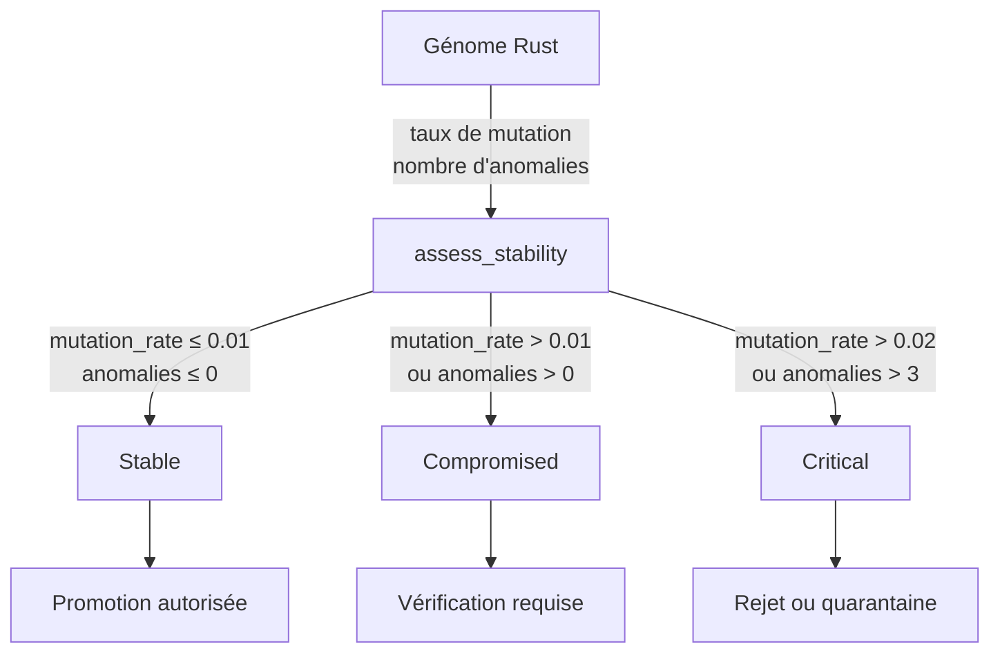

# Stabilité génomique

- **Statut** : Implémenté — module Rust `crates/genos-biology/src/genome_stability.rs`
- **Portée** : `crates/genos-biology/src/genome_stability.rs`, `crates/genos-genome/src/genome.rs`
- **Dernière revue** : 2026-10-18

## 1. Définition du domaine

La stabilité génomique est la capacité d'un génome à conserver son intégrité structurelle et fonctionnelle malgré les mutations et les anomalies. Dans GenOS, ce terme désigne un **contrat de calcul** : un génome est considéré stable si son taux de mutation et son nombre d'anomalies restent en dessous de seuils définis. Ce n'est pas une mesure physiologique ni une garantie de correction sémantique des instructions d'un agent.

## 2. Modèle logique

Un rapport de stabilité est calculé à partir de trois entrées :

- `genome_id` : identifiant du génome évalué
- `mutation_rate` : taux de mutation observé (fraction de nucléotides altérés)
- `anomaly_count` : nombre d'anomalies détectées (gènes verrouillés de manière incohérente, plasmides corrompus, etc.)

Seuils par défaut :

| Seuil | Valeur | Signification |
|-------|--------|---------------|
| `MAX_MUTATION_RATE` | 0.01 (1 %) | au-delà, le génome est compromis |
| `MAX_ANOMALY_COUNT` | 0 | toute anomalie rend le génome compromis |

Niveaus de stabilité :

| Niveau | Condition | Interprétation |
|--------|-----------|----------------|
| `Stable` | mutation_rate ≤ 0.01 ∧ anomaly_count ≤ 0 | génome intègre |
| `Compromised` | mutation_rate > 0.01 ou anomaly_count > 0, mais pas critique | dégradation détectée |
| `Critical` | mutation_rate > 0.02 ou anomaly_count > 0 | dégradation sévère |

Le niveau `Critical` est atteint quand le taux de mutation dépasse le double du seuil ou quand le nombre d'anomalies dépasse trois fois le seuil (soit > 0 avec le défaut de 0).

## 3. Analogies biologiques et limites réelles

Le terme emprunte à la biologie la notion de maintien de l'intégrité de l'ADN (réparation des brins, contrôle des points de contrôle mitotique). Chez GenOS, il n'y a pas de molécule, pas de réparation enzymatique réelle : seul un contrôle logiciel de seuils sur des données sérialisées. Une dégradation génomique détectée ne provoque pas automatiquement l'apoptose de l'agent ; elle expose un statut que le consommateur (orchestrateur, homeostasis) peut exploiter.

## 4. Cas d'usage et objectifs métier

| Cas | Mécanisme | Contrôle indispensable |
|-----|-----------|------------------------|
| Auditer l'intégrité d'un génome avant promotion | `assess_stability()` | test unitaire sur le rapport |
| Refuser un croisement sur un génome compromis | vérification du niveau `Stable` | décision explicite de l'orchestrateur |
| Détecter une dérive de mutation après reproduction | comparaison des rapports avant/après | reproductibilité du seed RNG |

## 5. Exemples concrets

```rust
use genos_biology::{assess_stability, StabilityLevel};
use uuid::Uuid;

let genome_id = Uuid::new_v4();
let report = assess_stability(genome_id, 0.001, 0);
assert_eq!(report.level, StabilityLevel::Stable);

let report = assess_stability(genome_id, 0.015, 0);
assert_eq!(report.level, StabilityLevel::Compromised);

let report = assess_stability(genome_id, 0.001, 5);
assert_eq!(report.level, StabilityLevel::Critical);
```

## 6. Schéma



## 7. Architecture technique

- Fichier : `crates/genos-biology/src/genome_stability.rs`
- Types publics : `StabilityLevel`, `GenomeStabilityReport`
- Fonctions publiques : `assess_stability(genome_id, mutation_rate, anomaly_count)`, `mutation_rate_ok(rate)`, `anomaly_count_ok(count)`
- Constantes : `MAX_MUTATION_RATE: f64 = 0.01`, `MAX_ANOMALY_COUNT: u32 = 0`
- Serde : `Clone, Debug, Serialize, Deserialize` pour persistance

## 8. Processus d'exécution et de validation

Tests unitaires inclus dans le module :
- `stable_genome_is_assessed_stable`
- `high_mutation_rate_is_compromised`
- `many_anomalies_are_critical`
- `boundary_rates_respect_thresholds`

Lancement : `cargo test -p genos-biology` (101 tests passés pour l'ensemble du crate).

## 9. Comparaison avec le marché

Les registres de génomes d'agents classiques versionnent le contenu mais n'évaluent pas systématiquement un taux de mutation ou un nombre d'anomalies avec seuils de stabilité. GenOS ajoute ce contrat d'intégrité sans prétendre remplacer une validation fonctionnelle des instructions.

## 10. Limites, garde-fous, non-objectifs

- Ce n'est pas une mesure de la correction sémantique des instructions d'un agent.
- Un génome `Stable` peut contenir des instructions erronées ou dangereuses.
- Les seuils sont des constantes logicielles, pas des mesures biologiques.
- Aucun lien automatique avec l'apoptose : le consommateur décide de la conséquence.
