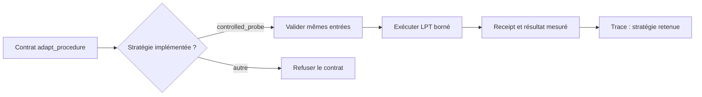

# Adaptation des workers déterministes

Le `adaptive_worker` natif accepte actuellement la stratégie `controlled_probe`.
Chaque essai exécute la procédure LPT enregistrée sur le même problème; il mesure
le résultat et produit un reçu. Répéter cette sonde ne constitue pas un changement
de stratégie.

Le runtime refuse donc les stratégies déclarées mais non exécutées, dont
`causal_bisection`. La trace marque chaque sonde comme `retained` et précise que
la stratégie est restée inchangée. Un changement ne pourra être annoncé qu'après
l'enregistrement d'une implémentation distincte, de ses mesures et de ses reçus.

Cette procédure démontre seulement une ou plusieurs exécutions déterministes LPT
bornées. Elle ne démontre ni une recherche de stratégie, ni une bissection
causale, ni une amélioration adaptative.

## Régression de qualification

`backend/tests/test_gqwf_trinity_mission_qualification.js` construit ses essais
avec `controlled_probe` et le même problème LPT. Il vérifie aussi que l'admission
refuse une stratégie non implémentée, une modification du problème entre deux
essais et une procédure autre que LPT, avec `WORKER_ADAPTATION_INVALID`. Ces
contrôles couvrent l'admission du worker; ils ne remplacent pas l'oracle indépendant
ni la clôture de mission exigés par la barrière de preuves.
