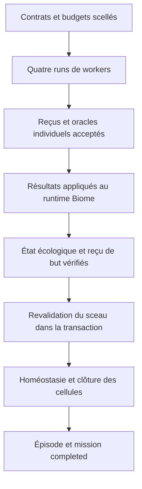

# Retour d’expérience — de l’échec à la validation de Babel-Gödel

- **Type** : rapport d’expérience et protocole de vérification.
- **Statut** : parcours exécuté et qualifié dans le périmètre décrit.
- **Dates** : échec initial du 4 novembre 2026 ; corrections, relances et validation du 5 novembre 2026.
- **Dernière revue documentaire** : 2026-11-05.
- **Workspace de l’expérience** : `D:\genos-babel-goedel`.

> **Résultat de référence : N = 10805, mission `completed`, oracle indépendant
> accepté, quatre runs terminés, cinq cellules clôturées et 232 génomes
> cognitifs importés dans la base active.** Deux spécialistes ont réellement
> appelé `ollama://llama3.1:8b`. Les deux autres workers sont des scouts
> déterministes. Ces résultats ne constituent ni une mesure de compétence
> générale, ni la preuve d’une création automatique de nouveaux génomes.

Ce document conserve le chemin du bilan initial pour préserver sa provenance.
Il remplace la juxtaposition ambiguë d’un ancien tableau d’échec et d’une
conclusion de succès par un récit où chaque observation est rattachée à sa
tentative. Les identifiants des missions échouées restent distincts de celui
de la mission qualifiée.

## 1. Question expérimentale et critères de réussite

La question n’était pas seulement de faire annoncer un entier à un modèle.
Il fallait exécuter Babel-Gödel par le chemin Biome réel, puis démontrer que
la réponse, l’usage fournisseur, les budgets, l’ADN et les transitions de
clôture appartiennent aux mêmes workers, runs, mission et workspace.

| Critère | Preuve requise |
|---|---|
| Réponse arithmétique | Candidat structuré lié aux prémisses scellées et recalculé indépendamment |
| Exécution réelle | Runs persistés et tentatives fournisseur mesurées pour les spécialistes |
| Budget | Allocations présentes, bornées et évaluées dans les reçus |
| Contrat d’artefact | `dossier` pour les spécialistes ; `scout_observation` pour les scouts |
| Oracle individuel | Deux stratégies natives distinctes, avec attestation et acceptation persistées |
| Clôture écologique | État, journal, fitness, adaptations et reçu de but cohérents |
| Cycle de vie | Mission et épisode `completed`, cinq cellules `completed_execution` |
| ADN | Catalogue réellement importé et sélections signées liées aux spécialistes |
| Persistance | Relecture dans un nouveau processus, après la fin de l’exécution |

Un transport réussi, un JSON contenant `verified: true`, une phrase de succès
ou un agent affiché `completed` ne satisfont pas seuls ces critères.

## 2. Problème mathématique et portée de la preuve

L’énoncé historique est conservé dans la mission
`mission_bbdd0399-d215-44b8-a858-f358b6e3f5bf`. Il fournit la relation
`N = (A × B) + C^D − E` et les valeurs suivantes.

| Prémisse fournie | Valeur | Interprétation dans l’énoncé historique |
|---|---:|---|
| A | 8 | Quatre couleurs multipliées par deux ATP nets |
| B | 20 | Quatre murs multipliés par cinq étagères |
| C | 22 | Port SSH retenu par l’énoncé |
| D | 3 | Nombre de générations de fermions retenu |
| E | 3 | Nombre de consonnes retenu pour le mot « port » |

```text
N = (8 × 20) + 22³ − 3
  = 160 + 10648 − 3
  = 10805
```

L’oracle démontre cette conséquence arithmétique des prémisses fournies.
Il ne vérifie pas indépendamment leur vérité scientifique, littéraire ou
linguistique, ni l’interprétation de chaque expression de l’énoncé.

L’énoncé contient déjà le résultat attendu `10805`, et les scouts cherchent
notamment ce littéral. L’expérience n’est donc pas un test aveugle de résolution
mathématique, de découverte d’une réponse inconnue ou de généralisation du LLM.

## 3. Environnement, configuration et acteurs

Le contrôle est lancé depuis le checkout Windows de GenOS, avec une base
opérationnelle située sur la machine dans `D:\GenOS\data\operational\genos.db`.
Le workspace est rattaché à `ws-babel-goedel`, dans le périmètre
`org-babel` / `project-babel`. Ces chemins décrivent l’installation utilisée ;
ils ne sont pas des chemins portables pour une autre installation.

La configuration locale active `GENOS_AGENT_DNA=1`. Les secrets nécessaires
aux signatures et au ledger restent locaux. Aucun secret, fichier `.env`,
fichier SQLite ou journal brut n’est ajouté à la documentation versionnée.

| Rôle Biome | Type de worker | Méthode | Exécution |
|---|---|---|---|
| `environment_mapper` | `scout_cell` | `scan_literal` | Déterministe, sans appel LLM |
| `resource_steward` | `specialist` | `prompt_defined` | Appel réel à `ollama://llama3.1:8b` |
| `population_specialist` | `specialist` | `prompt_defined` | Appel réel à `ollama://llama3.1:8b` |
| `ecosystem_observer` | `scout_cell` | `scan_literal` | Déterministe, sans appel LLM |

Les scouts parcourent le texte historique scellé avec les termes `Babel` et
`10805`. Ils ne sont ni deux modèles supplémentaires ni les deux stratégies
de l’oracle arithmétique.

Le lanceur utilise `mode: "biome"`, `strategy: "biome"`, `variant: "resource"`,
`executor: "local"`, `awaitWorkers: true` et `background: false`. La route locale
est explicite, sans fallback ni revue parallèle configurés.

## 4. Échec initial et erreurs d’interprétation

Le premier bilan annonçait un résultat correct fourni par Ollama, mais une
clôture GenOS en erreur :

```text
biome dispatch did not complete every required worker with valid evidence
```

Il mentionnait des budgets absents du contexte enfant, des artefacts rejetés,
un oracle collectif manquant et une table `agent_genomes` vide. Les premières
corrections et ce bilan sont conservés dans les commits `024c25e35` et
`da562edcd`. Ils ne constituent pas la validation finale.

| Observation ou hypothèse initiale | Rectification issue de l’expérience |
|---|---|
| `runtime_pid: null` signifierait aucune exécution | Les quatre runs qualifiés sont `completed` avec ce champ toujours nul. Le chemin local utilise `runInProcess`. |
| Un worker `idle` serait inachevé | Le garage peut remettre un agent disponible après la fin de son run. Il faut lire le reçu du run dispatché. |
| Une phrase « résultat obtenu » prouverait l’équation | Elle doit être remplacée par un candidat structuré et des recalculs indépendants. |
| `succeeded` dans l’enveloppe suffirait | Une tentative a produit ce verdict sans clôturer la mission persistée. |
| Un succès créerait automatiquement des génomes | L’activation, l’import du catalogue et les incarnations signées sont des étapes distinctes. |
| Toute affirmation « correcte » serait une correction de code | Une affirmation mathématique ne doit pas déclencher abusivement le contrat de preuve de modification logicielle. |

L’absence de PID distinct n’est donc pas réparée en inventant un PID. Le
champ renseigne le suivi de certains processus ; les preuves d’exécution
sont les runs et leurs reçus. Les processus natifs d’oracle possèdent leur
propre identité de processus, indépendante de ce champ de la table `agents`.

## 5. Corrections structurelles et frontières conservées

### 5.1 Propagation des budgets et composition complète

La sélection du budget accepte les formes `executionBudget` et
`execution_budget`, conserve les allocations des membres et refuse les
valeurs invalides ou supérieures au parent. Une allocation uniquement fournie
par `executionBudgetTokens` doit aussi survivre en l’absence de budget parent.

Les vagues de lancement conservent tous les membres nécessaires ; une limite
de capacité ne doit pas transformer silencieusement une composition de quatre
workers en un sous-ensemble que la clôture considérerait complet.

Les sources concernées incluent
[workerLaunchPayload.cjs](../../backend/bin/workerLaunchPayload.cjs),
[directWorkerBudgetScope.cjs](../../backend/bin/directWorkerBudgetScope.cjs),
[biomeDispatchBudget.cjs](../../backend/src/services/topology/biomeDispatchBudget.cjs)
et [workerLauncher.cjs](../../backend/src/services/topology/workerLauncher.cjs).

### 5.2 Artefacts et raccord écologique

Un appliqueur qui retourne seulement `applied: true` ne prouve ni l’exécution
du worker ni l’accomplissement du but écologique. Le raccord définitif relit
les bindings et reçus natifs avant de les transmettre au runtime Biome.

La distinction entre revendication de code et résultat mathématique conserve
les exigences de preuve sur les véritables corrections logicielles. Le
spécialiste doit également satisfaire sa spécialisation et son contrat
d’artefact ; ajouter une valeur `N` ne dispense pas de ces contrôles.

Voir [l’appliqueur Biome](../../backend/src/services/topology/topologyResultAppliers/biome.cjs),
[son lecteur de preuves](../../backend/src/services/topology/topologyResultAppliers/biomeWorkerEvidence.cjs)
et [la détection des revendications de code](../../backend/src/services/agents/workerArtifactCodeProof.js).

### 5.3 Identité de run, de cellule et de mission

Le dispatch conserve la session topologique, le worker, le run et le périmètre
de mission. L’épisode et les cellules sont créés dans le tenant réel. La
barrière de complétion lit l’exécution exactement dispatchée, plutôt qu’un
état de disponibilité mutable de l’agent.

Les contrôles généraux ont aussi révélé une incohérence Trinity : les workers
d’une comparaison doivent être scellés sous la mission de comparaison. Le
budget racine ne peut être réutilisé que si la filiation native de cette
comparaison est démontrée. Le graphe de vérité doit lire les preuves de cette
mission, sans les réétiqueter comme preuves de la mission racine.

Voir [le service de complétion](../../backend/src/services/biologicalWorkerCompletionService.js),
[le pont de cellules](../../backend/src/services/workerCellThreadRuntime.js)
et [l’ADR Trinity](../adr/2026-11-05-identites-mission-trinity.md).

## 6. Chronologie des cinq relances conservées

Les lignes suivantes proviennent des enveloppes archivées et des lignes de
mission/run relues en base. L’ordre est expérimental ; il ne faut pas agréger
les coûts ou les verdicts de ces cinq essais comme s’ils appartenaient au
dernier run.

| Tentative : suffixe de `mission_babel_qualified_` | Observation | Conséquence |
|---|---|---|
| `97b9c614-17d4-463a-bdaf-58cc18aaa65c` | Quatre runs terminés et reçus individuels vérifiés, mais spécialistes projetés `idle` ; clôture `partial`, mission `failed` | Lire le run exact, pas la disponibilité de l’agent |
| `8f70dcab-4e9b-40da-92ee-ba3d6e2250b4` | Enveloppe `success: true`, contrat `succeeded`, mais mission persistée encore `active`, sans clôture complète du cycle de vie | Exiger la transition persistante et l’homéostasie |
| `54cc0395-2758-41e3-9fd1-711055f431a3` | Clôture et cycle de vie réussis avec une implémentation intermédiaire du vérificateur | Succès historique distinct de la qualification de l’implémentation finale |
| `a15958a5-8009-4aea-b3e6-8cc12a94b967` | Run `strategy_run_1793838037303_b57c9bbf` bloqué par `ORACLE_BUDGET_EXPIRED` ; mission `failed` | Conserver le refus et le plafond de vérification |
| `b2e9f089-379e-49f5-a02b-c8ccaa1a44ba` | Réponse, reçus, oracle, ADN et transitions persistantes vérifiés | Mission de référence, `completed` |

La deuxième tentative reste un témoin de l’écart entre verdict retourné et
état persistant. Sa ligne historique `active` ne devient pas, par ce rapport,
une mission terminée. La validation finale porte sur le cinquième identifiant.

La première tentative montre aussi qu’un `independent_oracle_missing`
collectif peut suivre une phase écologique non franchie, alors que des
oracles individuels ont accepté les résultats des workers. Les deux niveaux
ne doivent pas être confondus.

L’expiration du quatrième essai a coïncidé avec de lourdes validations en
parallèle. La relance après la fin de la suite Rust a réussi avec les mêmes
bornes. Aucun profilage contrôlé n’a isolé la contribution du CPU, des E/S
ou des verrous : attribuer précisément la cause à l’un de ces facteurs
dépasserait les observations disponibles.

## 7. Protocole de l’oracle arithmétique

Le domaine ajouté est `product_power_difference`. Le contrat utilise
`methodId: "prompt_defined"`, un évaluateur de version 1 et les cinq prémisses
dans `parameters.premises`.

```json
{
  "A": 8,
  "B": 20,
  "C": 22,
  "D": 3,
  "E": 3,
  "N": 10805
}
```

Le candidat est encodé dans l’unique `claims[0].statement` du rapport. Il ne
s’agit pas d’une instruction à exécuter. Les clés et les entiers sont validés,
les prémisses sont bornées et leur identité avec le contrat scellé est exigée.

| Stratégie | Calcul indépendant |
|---|---|
| `equation_bigint_power` | Produits, exponentiation et soustraction en `BigInt` |
| `equation_repeated_addition` | Produits reconstruits par additions répétées et puissance par itération |

Chaque stratégie s’exécute dans un processus natif distinct. Les contrôles
portent aussi sur le rapport source, le contrat de méthode et les preuves
d’artefact. Un candidat modifié après génération, une prémisse étrangère,
un résultat faux ou une simple déclaration de réussite sont refusés.

Le sujet sémantique exige des tentatives modèle `completed`, avec
`provider_called = 1`, `token_usage_source = "provider"` et des compteurs
d’entrée/sortie positifs. Une fixture arbitraire ou une réponse non mesurée
ne remplace donc pas l’appel modèle réel dans cette qualification.

Le manifeste de confiance inclut les sources de l’oracle et la règle de
temps des observations. Leur modification change le digest du vérificateur.
La réussite intermédiaire du troisième essai ne qualifie pas automatiquement
une implémentation modifiée : une nouvelle exécution a été nécessaire.

Cette indépendance est une séparation des processus et des stratégies de
recalcul par rapport à la génération du candidat. Les stratégies partagent
le dépôt et le runtime Node ; ce n’est pas une contre-expertise extérieure
institutionnelle, ni une preuve formelle générale de tout le logiciel.

Sources : [contrat](../../backend/src/services/productPowerDifference/contract.js),
[sujet](../../backend/src/services/epistemic/oracleProductPowerSubject.js),
[recalculs](../../backend/src/services/epistemic/oracleProductPowerChecks.js)
et [ADR de l’oracle](../adr/2026-11-05-oracle-arithmetique-et-perimetre-trinity.md).

## 8. Budgets et consommation de la mission de référence

La demande porte `executionBudget: {tokens: 60000, costUsd: 1,
latencyMs: 300000, events: 200}`. L’allocation de tokens et de dollars est
répartie entre les quatre membres ; la borne temporelle et celle des
événements sont transmises. Les scouts déterministes reçoivent ensuite
une limite de zéro token modèle.

| Worker | Tokens modèle autorisés | Plafond USD | Temps du worker | Vérification native |
|---|---:|---:|---:|---|
| `environment_mapper` | 0 | 0,25 | 300 000 ms | 2 exécutions, 30 000 ms |
| `resource_steward` | 15 000 | 0,25 | 300 000 ms | 2 exécutions, 30 000 ms |
| `population_specialist` | 15 000 | 0,25 | 300 000 ms | 2 exécutions, 30 000 ms |
| `ecosystem_observer` | 0 | 0,25 | 300 000 ms | 2 exécutions, 30 000 ms |

Les tokens inutilisés des scouts ne sont pas ici une allocation de 30 000
tokens pour chaque spécialiste. Le zéro déterministe est un budget présent,
pas une valeur `undefined`.

| Spécialiste | Tokens d’entrée mesurés | Tokens de sortie mesurés | Total |
|---|---:|---:|---:|
| `resource_steward` | 2 430 | 141 | 2 571 |
| `population_specialist` | 3 350 | 191 | 3 541 |
| **Mission de référence : appels modèle** | **5 780** | **332** | **6 112** |

Ces compteurs sont ceux des deux tentatives fournisseur de la dernière
mission. Ils n’incluent pas les essais précédents. Un plafond USD n’est
pas une facture ; l’expérience ne mesure pas un coût énergétique ou une
consommation matérielle nuls de l’inférence locale ou des oracles.

## 9. ADN : import, incarnation et persistance réellement observés

`GENOS_AGENT_DNA=1` permet l’import du catalogue. Le correctif d’import assure
la reprise après une tentative sans ADN ou avec un catalogue vide, ainsi que
l’utilisation de plusieurs bases dans un même processus.

Le compteur observé est **232 lignes au total dans `agent_genomes` de la base
active**. Ce ne sont ni 232 nouveaux génomes produits par Babel-Gödel, ni
232 workers exécutés pour cette mission.

| Spécialiste | Génome sélectionné | Hash du contenu revalidé |
|---|---|---|
| `resource_steward` | `WorkspaceSnapshotter` | `a067a0d1dc018ace079ce770b3c64e39a84027899298d8e8a8faaaf5b40351ca` |
| `population_specialist` | `CapsuleLifecycle` | `3d5643f0bb5de821d27567f5be25f1cca242f3a371389c5aad9e1745604979d7` |

La qualification relit les incarnations signées, vérifie leurs sources et
leurs hashes via `workerDnaIncarnation.validateSource`, puis recharge le
génome persistant dans le tenant du binding. Les bindings biologiques des
quatre runs sont également conservés.

Le nom d’un génome du catalogue ne démontre pas une spécialisation mathématique
apprise. Aucun résultat de cette expérience ne prouve une synthèse de nouveaux
génomes cognitifs, une amélioration héritée ou une innovation autonome.

## 10. Clôture écologique, homéostasie et cycle de vie

Le raccord écologique accepte les résultats des workers après relecture de
leurs preuves. L’adaptateur vérifie ensuite la session, les appartenances,
la structure des niches/populations, les programmes des organismes, les
phases, la fitness, les adaptations et le journal d’événements.



L’état final observé comporte une session à la révision 2, au tick 2, avec
`stopCondition: "goal_achieved"`. Les cinq invariants retournés sont vrais :

- `biome_mission_run_scope` ;
- `biome_ecosystem_organisms_programs` ;
- `biome_adaptation_and_fitness` ;
- `biome_terminal_goal_verification` ;
- `biome_event_journal_integrity`.

Le reçu collectif lie le producteur, la mission, la session, le tick, les
références de preuve, les mesures et l’état terminal. Il complète les oracles
individuels ; il ne remplace pas leurs vérifications sémantiques.

La finalisation relit le sceau d’état dans la transaction de clôture. Elle
évalue l’homéostasie sur les preuves d’exécution réelles, puis utilise les
services de transition existants pour terminer les quatre cellules workers,
la cellule racine, l’épisode et la mission. Un refus d’homéostasie reste fatal.

Les sources principales sont
[biomeAdapter.js](../../backend/src/services/topologyCompletionAdapters/biomeAdapter.js),
[biomeStateReader.js](../../backend/src/services/topologyCompletionAdapters/biomeStateReader.js)
et [biomeLifecycle.js](../../backend/src/services/topologyCompletionAdapters/biomeLifecycle.js).

La « morphogenèse » qualifiée ici désigne ce parcours logiciel borné de
composition, d’exécution et de clôture écologique avec ses invariants.
Elle ne démontre pas une évolution cognitive générale ou un avantage de
performance par rapport à une résolution directe de l’équation.

## 11. Identifiants et reçus de la qualification finale

| Objet | Identifiant |
|---|---|
| Mission | `mission_babel_qualified_b2e9f089-379e-49f5-a02b-c8ccaa1a44ba` |
| Session | `biome-3fd9d40e-ce5c-4156-80b0-e2325fd30d3e` |
| Épisode | `episode_9908dedf3d93ad95597c742b4712b276` |
| Thread racine | `thread_1a1415561a51a0432b6e142877179834` |
| Run du mapper | `strategy_run_1793838327308_10983d8e` |
| Run du resource steward | `strategy_run_1793838327555_ad16ec11` |
| Run du population specialist | `strategy_run_1793838358997_864e8944` |
| Run de l’observer | `strategy_run_1793838357230_3add8dbf` |

| Preuve | Empreinte |
|---|---|
| Acceptation arithmétique resource steward | `983d483e4117ddbd763517c2fbe882042b69791abf3032076b0dc3b709533cd9` |
| Acceptation arithmétique population specialist | `588c727652703c773b637340c6bd036364e3e038e127da7ac7c88a3e612129c5` |
| Vérificateur collectif | `sha256:b4af0181fc1711d53452a3eadef5e2900f349a7a1d6422d9e18f3ac0528d2ff9` |
| Reçu d’oracle collectif | `sha256:014ad4b8ff65dcb5bb6a7426a254459af13dab90e300289497e59457aad5cf91` |
| Reçu d’homéostasie | `b92d6fc1a2947d5ace54008b6a93a896e5d6ae8ee65905a1eb46ccdad3b5ed4f` |

Les tentatives modèle correspondantes sont
`9c95600f-4538-4d0b-817b-6a41026768db` et
`7dcce167-572e-463b-a178-1432ec7ae2f6`. Leurs lignes de ledger portent
`status: "completed"`, le modèle demandé et les compteurs fournisseur.

## 12. Relecture persistante et gestion du temps

La qualification initiale finale est observée le 5 novembre à 00:26:39 UTC.
Une relecture à 00:37:38 UTC, puis une autre à **01:24:16 UTC**, confirment
la persistance après la fermeture du processus d’exécution. Les heures ISO
sont en UTC ; l’heure locale de la machine est Europe/Paris, UTC+1 à cette date.

Le lecteur archivé contrôle les bindings, reçus, événements, acceptations
natives, signatures des assemblages et absence de rétractation. Il vérifie
les liens avec l’enveloppe, le sujet et le rapport, ainsi que les dates de
complétion par rapport aux bornes d’autorité et d’attestation.

Pour une observation de run terminé, la fraîcheur se mesure à sa date de
complétion persistée, sous le propriétaire exact du run. Une exécution en
cours garde l’horloge courante ; un autre propriétaire est refusé. Cette
règle permet une inspection historique sans réautoriser une exécution sur
une mission terminée ni prolonger le lease d’origine.

Un fichier `qualification.json` contenant `verified: true` est une projection
du contrôle, pas une preuve autonome suffisante. Le lanceur relit la base et
les preuves natives avant de réécrire ce rapport.

Sources : [lecteur archivé](../../examples/babel-goedel/archived-evidence.cjs)
et [horloge des observations](../../backend/src/services/epistemic/oracleObservationTime.js).

## 13. Régressions rencontrées pendant la validation générale

### 13.1 Allocation uniquement exprimée en tokens

`test_topology_worker_persistence.js` observait 8 000 tokens au lieu des
20 000 explicitement alloués. `selectedBudget` retournait `undefined` quand
seul `executionBudgetTokens` était fourni. La sélection conserve maintenant
cette allocation et le test du payload protège ce cas.

### 13.2 Collision d’un snapshot de fixture

`test_worker_native_lifecycle.js` réutilisait le run `native-run` dans le
workspace courant. Un snapshot d’une invocation précédente était donc encore
présent et son immutabilité provoquait correctement `EEXIST`.

La correction crée un workspace temporaire par invocation, vérifie le
périmètre avant nettoyage et rend le diagnostic du refus visible dans
l’assertion. Deux exécutions consécutives passent. Le runtime n’a pas été
modifié pour écraser l’ancien snapshot.

### 13.3 Calibration narrative utilisée pour un test de code GQEL

Le test qui doit refuser « Tests all pass » sans vérificateur externe
échouait auparavant dans la calibration du faux relecteur. Celui-ci ne
reconnaissait que les exemples narratifs : `bestVersion` restait nul et
le test n’atteignait pas la porte qu’il prétendait vérifier.

La fixture reconnaît désormais les exemples de contrôle du code. Le test
exige une calibration `gqel-code-control-v1` réussie, puis le défaut
`EXECUTION_PROOF_MISSING`. La suite GQEL V2 passe 50 tests ; ses réponses
de modèle sont synthétiques et ne sont pas une évaluation artistique ou LLM.

### 13.4 Reçu global des principes fondateurs périmé

Le test strict refusait le reçu versionné parce que les empreintes du checkout
et d’une preuve de délégation avaient changé. La commande officielle a
réexécuté les onze programmes, avec comparaison des 44 sources avant et
après, puis renouvelé le reçu existant. Aucune assertion de dérive,
de fraîcheur ou de révocation n’a été supprimée.

Le [rapport de requalification](../06-qualite-preuves/requalification-babel-goedel-2026-11-05.md)
décrit exactement le checkout et la modification MCP locale préexistante
alors couverte. Ce reçu conserve `authorizesPromotion: false` et
`universalClaim: false` ; il ne vaut pas autorisation générale de déploiement.

## 14. Résultats de validation et provenance des tests

| Contrôle exécuté pendant la correction | Résultat conservé |
|---|---|
| `python scripts/ci/check_code_quality.py` | 9 260 fichiers source, aucune violation |
| `npm test` complet | Dernière relance terminée avec code zéro |
| `cargo test --workspace` | 1 248 tests passés, aucun échec, 152 groupes de résultats |
| Suite Biome | 31 programmes passés |
| Fin du profil workers, depuis le cycle de vie natif | 22 programmes passés |
| Inventaire et composition | 28 suites passées |
| GQEL V2 | 50 tests synthétiques passés |
| Principes fondateurs | 19 principes, onze programmes, 44 sources stables |

La dernière relance `npm test` s’est terminée le 5 novembre vers 02:40,
heure de Paris. Les tentatives précédentes en échec ont été conservées ;
elles ne sont pas présentées comme des passages réussis.

Ces résultats décrivent le checkout exécuté à cette date, avec ses modifications
locales documentées. Ils ne qualifient pas automatiquement des modifications
ultérieures, même si celles-ci sont présentes dans le même workspace.
La présente révision enrichit la documentation ; elle ne relance pas de
modèles et ne constitue pas une nouvelle campagne de tests du code courant.

## 15. Reproduire la qualification ou relire le résultat

### Préparer l’installation

Utiliser une installation fonctionnelle du dépôt, les dépendances prévues par
`AGENTS.md`, les exécutables natifs nécessaires et Ollama avec `llama3.1:8b`.
Configurer localement l’ADN, les clés de signature et le ledger, sans copier
des secrets dans une commande versionnée.

Le lanceur de cette expérience exige la mission historique, le workspace
`ws-babel-goedel` et son périmètre dans la base sélectionnée. Ce n’est pas un
bootstrap universel d’une base vide. Il crée ou vérifie dans le workspace
`babel-goedel-premises.json` ; un contenu existant différent est refusé.

### Lancer une nouvelle mission bornée

Depuis la racine du dépôt :

```powershell
node examples/babel-goedel/qualify.cjs D:\genos-babel-goedel
```

Cette commande peut effectuer de nouveaux appels modèle. Elle écrit une
nouvelle demande, des journaux et une enveloppe sous un nouvel identifiant,
puis contrôle les preuves et transitions persistées.

### Relire la mission qualifiée, sans nouvel appel modèle

```powershell
node examples/babel-goedel/qualify.cjs --verify-run mission_babel_qualified_b2e9f089-379e-49f5-a02b-c8ccaa1a44ba
```

La relecture nécessite la base, les archives locales, les clés de vérification
appropriées et les sources compatibles. Un changement d’implémentation du
vérificateur, une rétractation ou une preuve modifiée doit rester observable
comme un refus ; il ne faut pas accepter arbitrairement un ancien digest.

### Vérifier les régressions

```powershell
node backend/tests/test_product_power_difference_oracle.cjs
node backend/tests/test_observation_archive_time.cjs
node backend/tests/test_biome_dispatch_completion.js
node backend/tests/test_worker_native_lifecycle.js
node backend/tests/test_gqel_v2.cjs
python scripts/ci/check_code_quality.py
npm test
cargo test --workspace
```

Les tests ciblés couvrent les faux résultats, les prémisses étrangères, les
altérations de rapport, le propriétaire des observations, l’agent remis
`idle`, le run étranger et les transitions de clôture. Pour une autre version
du dépôt, leurs résultats doivent être observés à nouveau.

## 16. Localiser les preuves sans versionner les données opérationnelles

Les archives locales de chaque tentative se trouvent sous :

```text
.genos-agent-worlds/babel-live/<mission-id>/
  request.json
  stdout.log
  stderr.log
  envelope.json
  qualification.json   # présent lorsque la qualification a été écrite
```

Les journaux de validation utiles incluent :

| Journal local | Objet |
|---|---|
| `babel-npm-final.log`, `babel-npm-final2.log` | Échecs successifs avant les corrections de régression |
| `babel-npm-final3.log` | Passage général complet réussi |
| `babel-cargo-final.log` | Résultats Rust complets |
| `babel-quality-final4.log` | Dernier contrôle qualité du travail de correction |
| `babel-native-lifecycle-failure.log` | Diagnostic `EEXIST` de la fixture |
| `babel-native-lifecycle-fixed.log`, `babel-native-lifecycle-repeat.log` | Deux passages après isolation |
| `babel-gqel-failure.log`, `babel-gqel-fixed2.log` | Calibration erronée puis suite GQEL corrigée |
| `babel-inventory-fixed.log` | 28 suites d’inventaire réussies |
| `babel-final-persisted-check.log` | Relecture réussie à 01:24:16 UTC |
| `babel-foundation-sources.json`, `babel-foundation-refresh.log` | Sources comparées et résultat de la requalification officielle |

Ces noms sont relatifs à `.genos-agent-worlds/`. Ces fichiers sont locaux,
ignorés par Git et ne sont pas garantis présents dans un nouveau clone.
Le présent rapport conserve les identifiants, empreintes, commandes et
limites ; il ne remplace pas les lignes de ledger et reçus signés de la base.

Un checkpoint d’agent a été créé avant les travaux de correction :
`snap-61b315ca640e4b50a52490164930c660`. Son entrée locale est conservée dans
`.genos-agent-worlds/codex-sessions/e92e7b513c7409418628e2a357394a9c892df4bdab02ce234bf37297a6fbcb2b/babel-validation-baseline.json`.
Ce checkpoint d’état agent n’est pas une sauvegarde complète du workspace.

La décision GenOS `decision-0a562bc5-0336-474b-80bb-4e29743e0c70` et
l’expérience finale `9c210760-065c-4c04-871b-bf1ff4685619` ont été persistées.
Dix entrées de mémoire ont aussi été compilées. Le connecteur MCP initial
avait retourné `Transport closed` ; ces écritures ont utilisé le serveur
stdio local avec le lease existant. Leur persistance conserve le savoir
déclaré ; elle n’est pas une certification indépendante du code ni une
preuve d’enforcement des hooks de l’agent hôte.

## 17. Commits et décisions associées

| Commit | Contribution documentée |
|---|---|
| `024c25e35` | Premières corrections d’exécution rapportées pour Babel-Gödel |
| `da562edcd` | Premier bilan d’échec |
| `61683addd` | Raccord de la clôture Biome aux reçus natifs vérifiés |
| `ed8a16e5a` | Identités de mission Trinity et corrections des helpers de daemons contrôlés par le gate |
| `975fd8313` | Oracle arithmétique, cycle de vie persistant et lanceur de qualification |
| `1c62d709d` | Isolation du snapshot du test de cycle de vie natif |
| `e9d215fa4` | Requalification du reçu global et provenance du checkout |
| `cbac6e35f` | Calibration code du faux relecteur GQEL |
| `0aad8b7c6` | Bilan des validations générales terminées |
| `d4deb832f` | Séparation explicite de l’échec historique et du résultat validé |

Des commits d’autres travaux sont intercalés dans l’historique, notamment
`c6c471b15` pour les preuves des missions de code, qui contient aussi la
correction du budget exprimé uniquement en tokens. Ce tableau ne leur attribue
pas une origine fictive ni ne prétend que le checkout ne contenait que les
modifications de Babel-Gödel.

Les décisions d’architecture sont détaillées dans
[l’ADR de clôture Biome](../adr/2026-11-05-cloture-biome-depuis-runs-verifies.md),
[l’ADR des identités Trinity](../adr/2026-11-05-identites-mission-trinity.md)
et [l’ADR de l’oracle arithmétique](../adr/2026-11-05-oracle-arithmetique-et-perimetre-trinity.md).

## 18. Enseignements réutilisables et limites

1. Identifier le run avant d’interpréter l’état d’un agent. Disponibilité,
   exécution terminée et acceptation de la preuve sont des états différents.
2. Exiger la clôture persistante de la mission. Une enveloppe `succeeded`
   n’établit pas, à elle seule, les transitions de cellules et d’épisode.
3. Construire un oracle pour le domaine revendiqué. Un validateur d’artefact
   générique ne prouve pas automatiquement une équation.
4. Traiter un budget absent, un budget nul déterministe et un plafond dépassé
   comme trois situations distinctes.
5. Séparer import du catalogue, incarnation signée et création de génomes.
   La persistance observée ne prouve pas une innovation biologique ou cognitive.
6. Garder les refus utiles : snapshot immuable, deadline d’oracle, preuve
   périmée et calibration incorrecte révèlent des contrats à respecter.
7. Donner aux fixtures des workspaces propres et leur faire atteindre la
   porte qu’elles prétendent tester, sans contourner les contrôles en amont.
8. Dater les tableaux et nommer la tentative. Un état ancien laissé en tête
   d’un document peut contredire visuellement un résultat correctement mesuré.

L’expérience qualifie ce parcours précis sur les prémisses historiques.
Elle ne mesure pas l’exhaustivité de l’espace des problèmes, une robustesse
illimitée sous charge, un gain économique ou une supériorité cognitive
générale du système multi-agent. La réutilisation de ses conclusions exige
de conserver ce périmètre et de refaire les contrôles concernés après dérive.
