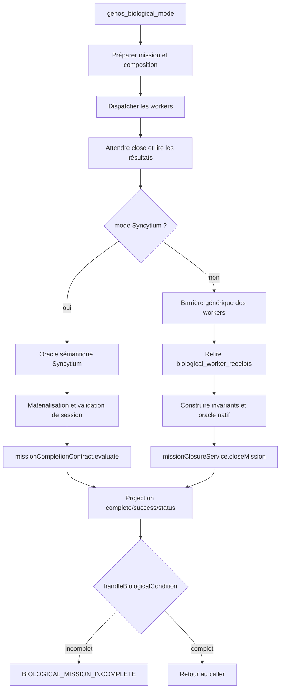
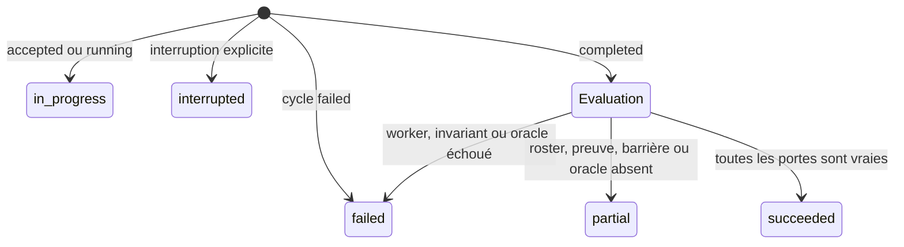

# Clôture des missions biologiques

- **Type** : référence d'architecture d'orchestration
- **Statut** : implémenté sur le chemin `genos_biological_mode`, avec limites explicites
- **Portée** : dispatcher biologique Node, huit modes topologiques, preuves workers et clôture Syncytium
- **Dernière revue** : 2026-10-20

La clôture biologique transforme la fin observable des processus workers en un
verdict technique de mission. Elle ne confond pas quatre événements différents :

1. le dispatch a été accepté ;
2. le processus worker s'est terminé ;
3. le résultat du worker possède une preuve vérifiée ;
4. la mission satisfait sa barrière, ses invariants et son oracle.

Cette séparation est un invariant du runtime. Un transport réussi, un code de
sortie nul ou une chaîne `status: "completed"` ne suffisent jamais à produire
un succès de mission.

Ce document décrit le chemin transversal piloté par
[`biologicalDispatchHandler.cjs`](../../backend/src/services/topology/biologicalDispatchHandler.cjs).
Il ne remplace pas les contrats des runtimes canoniques spécialisés de Trinity,
A-Team, Biome, Biocénose, Rhizome, Holobionte, Syncytium ou Métapopulation.

## 1. Problème résolu

Le dispatcher biologique compose plusieurs topologies derrière une même
interface. Historiquement, leur sortie était envoyée au finaliseur Syncytium.
Ce finaliseur exige une validation sémantique, une session partagée et une
matérialisation qui n'existent pas dans les sept autres modes. Une valeur
`semanticValidation: null` transformait alors mécaniquement leur sortie en
`partial`, même lorsque tous les workers avaient terminé.

La correction sépare désormais :

- la collecte et la barrière communes des workers ;
- la validation propre à Syncytium ;
- la liaison des reçus durables à la mission et au worker ;
- le verdict structurel commun ;
- la gate de clôture qui ajoute invariants et oracle indépendant.

## 2. Architecture du chemin de clôture



Les responsabilités sont distribuées entre cinq services :

| Service | Responsabilité | Autorité qu'il ne possède pas |
| --- | --- | --- |
| `biologicalDispatchHandler.cjs` | ordonner le dispatch, la lecture des résultats et la clôture | décider seul du succès |
| `biologicalMissionCompletionService.js` | choisir l'adaptateur Syncytium ou non-Syncytium et construire l'entrée de clôture | inventer une preuve absente |
| `missionCompletionEvidenceService.js` | relire et rattacher les reçus workers persistés | qualifier les invariants topologiques |
| `missionCompletionContract.js` | vérifier cycle de vie, roster, états, contenu des preuves et validation topologique | décider une promotion |
| `missionClosureService.js` | exiger workers, preuves, invariants et oracle indépendant | exécuter un effet ou un rollback métier |

## 3. Séquence d'exécution réelle

### 3.1 Préparation

`prepareBiologicalContext` détermine le mode, persiste le tick de mission,
construit les enrichissements NCE et compose les membres. Une session est
conservée dans le contexte quand la topologie en crée une.

### 3.2 Dispatch et observation terminale

`dispatchAndCollectResults` lance les workers. Le lanceur attend l'événement
`close` ; un simple `spawn` ne constitue pas une terminaison. Pour les modes
non-Syncytium, les statuts terminaux sont collectés par le service biologique
des workers. Le lecteur de résultats relit ensuite les sorties produites.

Pour Syncytium seulement, `validateSyncytiumResponses` construit l'oracle
sémantique de mission. Les sept autres modes laissent cette variable absente :
ils ne sont plus pénalisés par l'absence d'une structure propre à Syncytium.

### 3.3 Construction de la sortie

La sortie commune est bâtie avant le verdict. Les échecs de dispatch sont
copiés dans `biologicalMode.dispatchFailures`. Rhizome applique ensuite ses
résultats de branches avant la clôture ; cette chronologie est importante car
les branches effectivement observées constituent son roster de clôture.

### 3.4 Évaluation et projection

Le finaliseur ajoute `completionContract`, puis projette :

| Verdict | `complete` | `success` | `status` |
| --- | ---: | ---: | --- |
| `succeeded` | `true` | `true` | `completed` |
| `failed` | `false` | `false` | `failed` |
| `partial` | `false` | `false` | `partial` |

La condition terminale relit encore les échecs de dispatch, les membres ou
branches, `complete` et `status`. Toute divergence déclenche
`BIOLOGICAL_MISSION_INCOMPLETE` au lieu de laisser passer une sortie ambiguë.

## 4. Deux étages de décision

### 4.1 Contrat structurel de complétion

`missionCompletionContract.evaluate` vérifie :

- un état de cycle de vie reconnu ;
- un roster requis non vide et sans doublon ;
- la présence de chaque membre requis ;
- l'absence d'état `failed`, `error`, `cancelled` ou `blocked` ;
- le statut `completed` de chaque membre requis ;
- l'existence et l'intégrité de chaque preuve référencée ;
- la liaison de chaque preuve au `missionId` et au membre ;
- une validation topologique `verified` ;
- une barrière non partielle.

Ce contrat produit `genos.mission-completion/v1`. Il est volontairement
agnostique sur la sémantique des topologies et conserve
`promotionEligible: false`.

### 4.2 Gate commune de clôture

`missionClosureService.closeMission` enveloppe le contrat structurel et ajoute
quatre contrôles explicites :

```json
{
  "closureChecks": {
    "requiredWorkers": true,
    "invariants": true,
    "independentOracle": true,
    "evidence": true
  }
}
```

Un succès de cette gate exige simultanément :

$$
ClosureSuccess = ContractSuccess \land Workers \land Evidence
\land Invariants \land IndependentOracle
$$

Un invariant faux ou un oracle explicitement échoué produit `failed`. Une
pièce absente produit `partial`. Sur ce second étage seulement,
`promotionEligible` devient vrai quand le verdict final est `succeeded`.
Cette éligibilité reste technique : elle ne déclenche aucune promotion et ne
remplace pas une gate métier ou humaine.

## 5. Preuves workers et oracle natif

### 5.1 Relecture durable

Avec une base SQLite, `missionCompletionEvidenceService.collect` ignore les
preuves injectées par l'appelant. Il relit `biological_worker_receipts`, vérifie
le JSON avec le store biologique et reconstruit la référence
`sha256:<payload_hash>`. Le reçu le plus récent trouvé pour chaque membre est
rattaché à ce membre.

Sans base, des objets `{ reference, content }` peuvent être fournis aux tests et
aux adaptateurs en mémoire. Ce mode ne doit jamais être décrit comme une preuve
de persistance durable.

### 5.2 Liaison de contenu

Une preuve worker est admissible lorsque :

$$
Digest(content)=reference \land content.missionId=missionId
\land content.workerId=requiredWorker
\land content.result=(completed, verified)
$$

Les alias `memberId`, `agentId` et les identités de `correlation` sont acceptés
par le contrat. Le hash lie le contenu ; il ne signe pas l'identité externe du
producteur.

### 5.3 Référence d'oracle sémantique

Sur le chemin non-Syncytium, chaque preuve worker doit en plus transporter une
`semanticVerification` de schéma
`genos.native-oracle-receipt-reference/v1`, avec :

- un `hash` d'attestation ;
- un `acceptanceHash` ;
- `budgetAssessment.satisfied: true`.

Le finaliseur construit alors un reçu
`genos.biological-closure-oracle/v1`, calcule son digest et expose un
vérificateur distinct par source native. Si une source manque, si deux
identifiants de vérificateur se confondent ou si le reçu d'oracle ne se lie pas
à la mission, `independent_oracle_missing` maintient la clôture à `partial`.

## 6. Comportement par famille de topologie

| Mode du dispatcher biologique | Source du roster | Validation avant contrat | Étage final |
| --- | --- | --- | --- |
| Trinity | `members` | barrière workers + références d'oracle natives | `closeMission` |
| A-Team | `members` | barrière workers + références d'oracle natives | `closeMission` |
| Biocénose | `members` | barrière workers + références d'oracle natives | `closeMission` |
| Holobionte | `members` | barrière workers + références d'oracle natives | `closeMission` |
| Biome | `members` | barrière workers + références d'oracle natives | `closeMission` |
| Métapopulation | `members` | barrière workers + références d'oracle natives | `closeMission` |
| Rhizome | `branches` après application des résultats | barrière des branches + références d'oracle natives | `closeMission` |
| Syncytium | `members` | oracle sémantique + matérialisation + validation de session | contrat structurel |

Cette matrice décrit uniquement la sortie du dispatcher biologique. Les
runtimes canoniques dédiés conservent leurs propres reçus, invariants et gates.
Par exemple, le runtime Trinity compare et promeut des mondes ; le runtime
A-Team clôt un TeamRun ; le runtime Holobionte applique admission et immunité.
Leur richesse ne doit pas être déduite d'une exécution générique par le mode
biologique.

## 7. Cas particulier Syncytium

Syncytium possède un état partagé autoritatif. Sa clôture conserve donc un
adaptateur spécialisé qui agrège :

1. l'oracle sémantique et sa couverture des workers ;
2. la matérialisation de la version courante ;
3. les invariants de l'état partagé ;
4. l'absence d'opérations hors ligne en attente ;
5. les reçus workers liés à la mission.

`syncytiumReady` indique seulement que les contrôles propres à Syncytium sont
vérifiés. Le verdict final reste dans `completionContract`. Cette voie appelle
actuellement le contrat structurel directement ; elle conserve donc
`promotionEligible: false` et n'emprunte pas l'oracle générique de
`missionClosureService`.

## 8. Barrière générique des sept autres modes

La barrière est complète seulement si :

- `expectedCount` est un entier strictement positif ;
- la sortie amont est `completed` et n'est pas explicitement incomplète ;
- le nombre de candidats correspond au nombre attendu ;
- tous les candidats sont `completed` ;
- `dispatchFailures` est vide.

Cette barrière constitue aujourd'hui l'invariant topologique minimal du chemin
biologique générique. Elle ne prétend pas relire les invariants riches de
chaque runtime spécialisé. La vérification sémantique vient des références
d'oracle natives attachées aux reçus workers ; toute topologie qui exige un
état partagé ou un oracle additionnel doit fournir un adaptateur spécialisé.

## 9. Automate et précédence



La précédence est `failed > partial > succeeded`. Un reçu valide ne masque pas
un worker échoué. Un oracle absent ne transforme pas un échec en résultat
partiel. Un état inconnu reste `partial` avec `execution_state_unknown`.

## 10. Invariants de conception

1. **Pas de succès vide** : un roster requis vide est invalide.
2. **Pas de réduction après coup** : un membre requis manquant reste visible.
3. **Pas de preuve décorative** : chaque référence annoncée doit être résolue et valide.
4. **Pas de transfert de preuve** : mission et membre sont vérifiés dans le contenu.
5. **Pas de fallback vers l'appelant avec SQLite** : la persistance est prioritaire.
6. **Pas de règle Syncytium implicite** : ses invariants restent dans son adaptateur.
7. **Pas de promotion par transport** : acceptation, terminaison et promotion sont distinctes.
8. **Pas de masquage d'échec** : la condition finale relit membres et dispatch.

## 11. Étendre la clôture

Un nouvel adaptateur doit :

1. définir sa source autoritative de roster ;
2. attendre un état terminal réel ;
3. conserver les statuts d'échec sans les normaliser en `completed` ;
4. produire un résultat topologique `verified`, `partial` ou `failed` ;
5. relire les preuves depuis leur persistance autoritative ;
6. construire des invariants explicites ;
7. fournir un oracle indépendant lié à la mission si `closeMission` est utilisé ;
8. appeler une seule fois l'étage de verdict choisi ;
9. dériver tous les champs historiques depuis ce verdict ;
10. ajouter des contre-exemples avant un scénario nominal.

Il ne faut pas ajouter les invariants d'une topologie directement dans
`missionCompletionContract.js`. Ce module reste une algèbre structurelle
commune ; la sémantique appartient aux adaptateurs.

## 12. Observabilité et diagnostic

Une sortie exploitable doit conserver :

- `missionId`, `topology`, `lifecycleState` et `verdict` ;
- `requiredMemberIds`, `completedMemberIds` et `evidenceRefs` ;
- tous les `reasons` ;
- `closureChecks` lorsque `closeMission` est utilisé ;
- `semanticValidation`, `materialization`, `stateValidation` et
  `topologyValidation` pour Syncytium ;
- `members`, ou `branches` pour Rhizome ;
- les échecs de dispatch sans les filtrer.

Le runbook [Clôture des missions : diagnostic et reprise](../04-exploitation/cloture-missions.md)
décrit le triage et les reprises autorisées.

## 13. Validation reproductible

Depuis la racine du dépôt :

```powershell
node backend/tests/test_common_mission_closure.js
node backend/tests/test_syncytium_completion_contract.js
node backend/tests/test_biological_mission_completion.js
node backend/tests/test_syncytium_mission_completion.js
node backend/tests/run_biology_suite.cjs
```

Les scénarios minimaux à conserver sont :

| Scénario | Verdict attendu |
| --- | --- |
| tous les workers terminés, aucune preuve | `partial` |
| preuve altérée ou liée à une autre mission | `partial` |
| worker requis en erreur | `failed` |
| invariant faux | `failed` |
| oracle indépendant absent | `partial` |
| oracle indépendant explicitement échoué | `failed` |
| Rhizome : membres génériques incomplets mais branches finales prouvées | `succeeded` |
| Syncytium : snapshot périmé | `partial` |
| Syncytium : invariant partagé échoué | `failed` |

Ces tests qualifient les contrats locaux. Ils ne certifient ni les fournisseurs
externes, ni la qualité métier, ni une exécution distribuée en production.

## 14. Limites connues

- La barrière générique ne remplace pas les invariants des runtimes spécialisés.
- Le hash de contenu n'est pas une signature du producteur.
- La voie Syncytium et la voie `closeMission` n'ont pas la même sémantique de
  `promotionEligible`; les consommateurs doivent lire `closureChecks` et la
  documentation de leur adaptateur.
- Le contrat n'annule aucun effet externe déjà produit par un worker.
- Une qualification Windows locale ne démontre pas la parité Linux ni une
  mission réelle avec fournisseur.
- Les projections `complete`, `success` et `status` sont conservées pour
  compatibilité ; les nouveaux consommateurs doivent lire le reçu complet.

## Voir aussi

- [Contrat commun de complétion de mission](../03-reference/contrat-completion-mission.md)
- [Runtime Syncytium](../03-reference/runtime-syncytium.md)
- [Topologies et capacités](topologies-et-capacites.md)
- [Qualification des contrats des huit topologies](../06-qualite-preuves/qualification-contrats-topologies-2026-10-20.md)
- [ADR 0654 — contrat commun de complétion et preuves liées](../adr/0654-contrat-commun-completion-et-preuves-liees.md)
