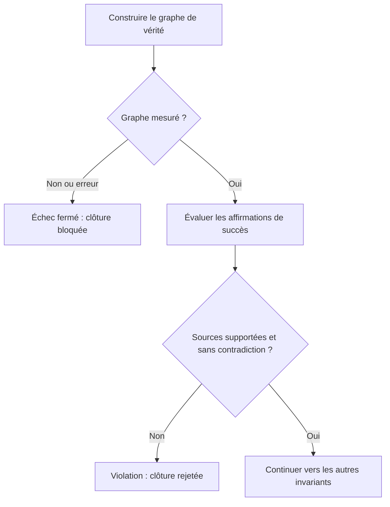

# Contrôle du rapport des workers

La clôture vérifiée d'une barrière de workers exige un graphe de vérité mesuré.
Si sa construction échoue ou si le graphe n'est pas mesuré, le contrôle échoue
avec `MISSION_TRUTH_GRAPH_UNAVAILABLE`. Le runtime ne transforme pas une absence
de mesure en rapport conforme.

Le contrôle examine les affirmations de succès du graphe. Une affirmation dont
la confiance n'est pas `supported`, ou dont les sources contredisent la
proposition, est enregistrée comme violation et rejette la clôture avec
`MISSION_REPORT_GATE_REJECTED`. Les erreurs du vérificateur remontent également
au superviseur, qui bloque la mission. Un rapport partiel garde son statut
partiel ; il n'est pas certifié par ce contrôle de clôture complète.

