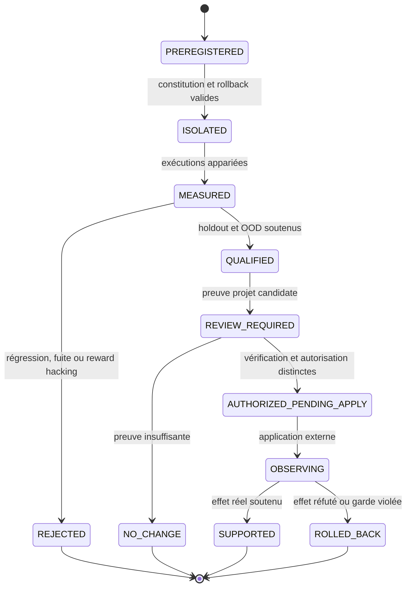

# Évolution contrefactuelle gouvernée

- **Statut** : composants backend implémentés ; chaîne unifiée de promotion non raccordée
- **Portée** : mondes contrefactuels, campagnes AIDE², évolution de scaffold, modèle du monde, niches synthétiques
- **Dernière revue** : 2026-10-20
- **Décisions liées** : [ADR 0670](../adr/0670-evolution-monde-web-validee.md), [ADR 0681](../adr/0681-campagne-evolution-aide2-double-causalite.md), [ADR 0685](../adr/0685-evolution-gouvernee-des-scaffolds.md), [ADR 0687](../adr/0687-evolution-scaffold-double-causale.md), [ADR 0689](../adr/0689-laboratoire-synthetique-dicode.md), [ADR 0691](../adr/0691-registre-modele-monde-verifiable.md)

## 1. Finalité

L’évolution contrefactuelle gouvernée explore des changements possibles sans leur
conférer automatiquement une autorité sur le monde réel. Elle couvre trois objets :

- **action** : comparer plusieurs futurs avant de choisir une intervention ;
- **compétence** : faire évoluer un agent ou un skill à travers des générations ;
- **scaffold** : modifier la logique, les outils ou l’organisation qui produisent les
  actions.

Le contrat commun est : **préenregistrer, isoler, mesurer, comparer, vérifier,
autoriser séparément, observer l’effet réel**.

## 2. Taxonomie des mondes

| Monde | Fonction | Classe de preuve | Autorité directe |
| --- | --- | --- | --- |
| baseline | état réel de référence | observation liée | aucune mutation |
| branche contrefactuelle | conséquence simulée d’une action | `simulation` | aucune |
| niche synthétique | tâches générées pour entraîner ou falsifier | synthétique | aucune |
| holdout scellé | mesure non utilisée pour sélectionner | expérimentale | qualification seulement |
| OOD | test de transfert hors distribution | expérimentale | qualification seulement |
| shadow | exécution réaliste sans effet externe | contre-factuelle/exécutée | lecture seule |
| projet réel | effet après intégration autorisée | observation réelle indépendante | selon mandat |

Une branche synthétique peut éliminer une option, révéler un risque ou décider qu’une
observation supplémentaire vaut son coût. Elle ne peut jamais établir à elle seule un
bénéfice réel.

## 3. Contrat de campagne

Une campagne est définie avant la première mesure :

```text
Campaign = {
  responsibility,
  parentRevision,
  generations >= 3,
  actors = {producer, evaluator, verifier, authorizer},
  splits = {evolution, holdout, ood},
  thresholds,
  budgets,
  rollbackRef
}
```

Les corpus `evolution`, `holdout` et `ood` sont disjoints par identité et digest.
Le producteur ne peut être ni évaluateur, ni vérificateur, ni autorisateur. Les
seuils sont scellés avant les observations afin d’éviter de déplacer la barre après
avoir vu les résultats.

## 4. Cycle d’exécution



Les services locaux s’arrêtent volontairement avant `application externe`. Les états
`promotionAllowed: false`, `promotionEligible: false` et
`eligible_for_external_promotion_request` expriment cette frontière.

## 5. Planification contrefactuelle

`counterfactualWorldEvolutionService` construit une baseline et plusieurs branches
bornées. Chaque branche possède un horizon, des hypothèses, des résultats attendus,
des risques et une responsabilité de rattachement. Le plan est enregistré avec :

```json
{
  "schema": "genos.counterfactual-world-plan/v1",
  "status": "synthetic_only",
  "promotionAllowed": false,
  "requiredNextEvidence": "independent_real_observation"
}
```

La décision issue des mondes conserve la même restriction. Une observation réelle
ultérieure est validée contre l’identité du plan, de l’action, de la responsabilité,
du vérificateur et de ses références de preuve.

### 5.1 Prospective sélective

Le modèle du monde n’est pas appelé systématiquement. La politique de prospective
calcule une utilité bornée :

```text
utility = confidence × informationGain × decisionImpact
          / (1 + log(1 + tokens) + log(1 + milliseconds))
```

La permission `world-model:foresight`, le budget, la confiance et l’impact sont des
conditions nécessaires. Sinon la sortie est `NO_CHANGE`. Même exécutée, la
prospective porte `evidenceClass: counterfactual` et
`mayCountAsRealEffect: false`.

## 6. Mesures appariées et sélection

Une génération n’est pas comparée à un seuil absolu isolé, mais au parent sur les
mêmes cas. Pour chaque paire `i` :

```text
d_i = score(candidate_i) - score(parent_i)
meanGain = mean(d_i)
CI95 = meanGain ± t × sd(d) / sqrt(n)
```

Le corpus d’évolution peut sélectionner. Le holdout qualifie. Le corpus OOD mesure
le transfert. Une génération est rejetée si :

- le lignage parent-candidat est brisé ;
- un cas fuit entre les splits ;
- le gain holdout n’atteint pas la borne préenregistrée ;
- le transfert OOD échoue ;
- le score déclaré diverge du résultat mesuré ;
- le gain d’évolution masque une stagnation holdout, signe de reward hacking.

## 7. Évolution du scaffold

La constitution scellée protège les chemins, invariants et pouvoirs qui ne peuvent
pas être modifiés par une hypothèse. Une hypothèse contient :

- révision parente et candidate ;
- opérations déclarées ;
- chemins affectés ;
- producteur ;
- snapshot de rollback ;
- digest constitutionnel attendu.

Le noyau `governedEvolution/` est déterministe et n’appelle ni Git, ni shell, ni
déployeur. Il transforme des mesures fournies en `QUALIFIED`, `REJECTED`,
`REVIEW_REQUIRED` ou `NO_CHANGE`, puis peut enregistrer une autorisation distincte
`AUTHORIZED_PENDING_APPLY`. L’applicateur reste externe.

### 7.1 Pourquoi séparer constitution et politique

Une politique peut être calibrée ou remplacée. La constitution définit ce que le
système n’a pas le droit d’optimiser : isolement, indépendance, provenance, rollback,
portée et non-promotion. Autoriser un candidat à modifier ces règles ferait du test
un juge de sa propre validité.

## 8. Niches synthétiques

Le laboratoire inspiré des environnements pédagogiques synthétiques produit des
tâches destinées à exposer une faiblesse précise. Une niche valable doit documenter :

| Élément | Exigence |
| --- | --- |
| cible | compétence ou hypothèse falsifiée |
| générateur | version et provenance |
| difficulté | règle de variation bornée |
| oracle | résultat attendu indépendant du candidat |
| contamination | séparation des cas réels, holdout et OOD |
| budget | nombre de cas, temps et coût maximum |
| sortie | expérience, pas promotion |

La diversité synthétique n’est utile que si elle améliore ensuite un holdout scellé
et une responsabilité réelle. Sinon, elle optimise le générateur de curriculum.

## 9. Modèle du monde vérifiable

Le registre prédictif préenregistre une distribution avant l’observation : moyenne,
variance, version du modèle, contexte, horizon et commitment. L’observation signée
doit être postérieure à la prédiction et référencer des preuves. Le résidu et le
résidu standardisé alimentent ensuite :

- mémoire épisodique des transitions ;
- règles sémantiques issues d’erreurs récurrentes ;
- révision d’hypothèses ;
- précision calibrée par contexte ;
- déclenchement ou refus de prospective.

La boucle apprend donc de l’écart **prédit-observé**, non d’une narration reconstruite
après coup.

## 10. Double causalité

Une campagne de développement doit séparer deux effets :

```text
Cause 1 : la modification a-t-elle amélioré la compétence ?
Cause 2 : cette compétence a-t-elle amélioré la responsabilité réelle ?
```

La première exige parent/candidat, holdout, OOD et absence de régression. La seconde
exige plusieurs fenêtres projet, au moins deux contextes, la même responsabilité et
une observation indépendante. Une campagne peut réussir la cause 1 et échouer la
cause 2 ; son résultat reste alors informatif mais non promouvable.

## 11. Modes d’échec et récupération

| Échec | Détection | Réponse sûre |
| --- | --- | --- |
| fuite entre splits | identités ou digests communs | invalider la génération |
| constitution modifiée | digest divergent/chemin protégé | rejeter l’hypothèse |
| reward hacking | récompense déclarée ≠ mesure | archiver comme mémoire négative |
| modèle surconfiant | résidus calibrés élevés | réduire précision et ignorer la prospective |
| vérificateur non indépendant | identité égale au producteur | bloquer la clôture |
| bénéfice réel absent | fenêtre projet réfutée | rollback ou `NO_CHANGE` |
| autorisation obsolète | digest de revue différent | nouvelle revue obligatoire |
| applicateur interrompu | checkpoint et snapshot présents | reprise fenced ou restauration |

## 12. Observabilité

Une campagne devrait exposer :

- nombre de branches et générations réellement exécutées ;
- taux de rejets par invariants, pas seulement score moyen ;
- intervalles holdout et OOD ;
- divergences récompense/résultat ;
- prédictions ouvertes, observées et périmées ;
- erreur de calibration par contexte ;
- demandes de promotion émises, autorisées, appliquées et annulées ;
- effets réels soutenus, réfutés ou inconclusifs ;
- révisions restaurées et raisons de rollback.

## 13. Comparaison raisonnée

La [Darwin Gödel Machine](https://arxiv.org/abs/2505.22954) explore un arbre ouvert
d’agents auto-modifiés évalués sur des benchmarks. GenOS reprend la lignée et
l’archive, puis ajoute une constitution scellée et une preuve de responsabilité.
[WebEvolver](https://arxiv.org/abs/2504.21024) co-évolue agent et modèle du monde ;
GenOS sépare le prédicteur, le commitment et l’observation signée. Le travail
[WorldEvolver](https://arxiv.org/abs/2606.30639) combine mémoires épisodique,
sémantique et prospective sélective ; les services `predictiveTimescale/` en offrent
un analogue local et borné.

Ces correspondances décrivent des choix d’architecture. Les résultats publiés par ces
travaux ne sont pas transférables à GenOS et aucun benchmark du dépôt n’établit une
supériorité comparative.

## 14. Validation exécutable

```powershell
node backend/tests/test_counterfactual_world_evolution.js
npm --prefix backend run test:aide2
node backend/tests/test_governed_evolution_hypothesis.js
node backend/tests/test_governed_evolution_evaluation.js
node backend/tests/test_governed_evolution_ledger.js
node backend/tests/test_predictive_timescales.js
node backend/tests/test_predictive_distribution.js
```

Ces tests prouvent les contrats, refus et transitions sur des données déterministes.
Ils ne prouvent ni la fidélité d’un monde simulé, ni un gain longitudinal en production.

## 15. Limites

- pas d’orchestrateur unique reliant toutes les briques de ce document ;
- pas d’applicateur automatique autorisé par les noyaux d’évolution ;
- pas de correction intégrée des tests statistiques multiples ;
- pas de garantie d’indépendance organisationnelle au-delà des identités techniques ;
- pas de vérité garantie par une signature sur une observation fausse ;
- pas de benchmark tiers longitudinal du cycle intégré ;
- pas de revendication d’auto-amélioration générale.

## Voir aussi

- [Ontogenèse dirigée par responsabilité](../01-concepts/ontogenese-dirigee-par-responsabilite.md)
- [Campagne AIDE²](campagne-evolution-aide2.md)
- [Sélection multisignal GVX](selection-buts-multisignal-gvx.md)
- [Contrats de stewardship V3](../03-reference/contrats-stewardship-v3.md)
- [Matrice de qualification](../06-qualite-preuves/matrice-qualification-stewardship-v3-2026-10-20.md)
