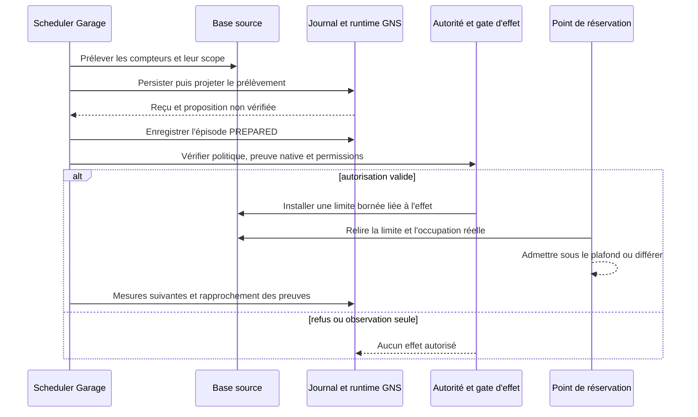

# GNS — Cycle de perception et de régulation opérationnelle

- **Statut** : Implémenté pour le runtime local et le Garage ; qualification de production partielle.
- **Portée** : chaîne d'événements, raccordements, autorité et reprise ; aucune nouvelle topologie.
- **Dernière revue** : 2026-11-02.

La [fiche GNS](../01-concepts/gns.md) expose le modèle. La
[référence runtime](../03-reference/runtime-gns.md) fixe les champs et états.
Ce document suit l'exécution réelle et ses frontières.

## 1. Deux sources, une projection

### Télémétrie persistée

`telemetryPersist` conserve l'événement dans la base source, puis diffère
l'observation GNS. `runtimeBridge` relit la ligne canonique par identifiant et
scope ; le contenu fourni à l'appel ne remplace pas cette ligne. Les événements
supportés deviennent des signaux minimaux. La date de cette voie est
`telemetry_events.created_at`, pas une date de prélèvement reconstruite.

Une panne du pont ne supprime pas la ligne primaire. L'opérateur peut relancer
un rattrapage par curseur. L'ancienneté reste déterminante : un rattrapage ne
renouvelle pas un réflexe périmé.

### Capteur natif du Garage

Le scheduler existant appelle `regulationRuntime.tick`. Les domaines persistés
sont parcourus par lots de 32 avec rotation. `garageSensor` lit dans une
transaction capacité, occupation, requêtes prêtes en attente et âge de la plus
ancienne. Le journal GNS enregistre le prélèvement avant sa projection et impose
la cadence d'une seconde par manager dans sa propre transaction.

Les prélèvements sans `signal_id` sont repris. Leur identifiant et leur date
d'origine restent inchangés. Le signal cite la source native ; il ne fabrique
pas une référence à une ligne de télémétrie absente.

## 2. Régulation locale et propagation

La projection d'un signal produit ensemble l'état par agent, le reçu et les
propositions. Les doublons ne produisent pas une deuxième décision ; une collision
de contenu pour la même identité est refusée.

Le graphe automatique réunit les relations RPE actives et la projection de
mission construite au lancement des workers. Les scopes et rattachements sont
relus depuis SQLite. Une mission implicite RPE n'est retenue que si son
rattachement persistant est non ambigu ; les relations d'un autre scope ou
d'une autre mission ne deviennent pas des arêtes.

Le graphe est scellé dans le signal avant la projection. Deux événements
concurrents du même projet peuvent donc conserver des graphes différents sans
se remplacer. Une reprise n'utilise pas le graphe courant pour réécrire une
décision déjà scellée. Une révocation de relation affecte les observations
suivantes, sans modifier rétroactivement les anciens reçus.

## 3. Rôle des six raccordements

| Raccordement | Chemin réellement appelé | Ce qu'il ne décide pas |
| --- | --- | --- |
| AGOW | `workspaceCycleService` ajoute les candidats GNS avant la compétition. | aucune confiance causale ou permission d'exécution ajoutée |
| Morphogenèse | observation V2 et appelants shadow transmettent des besoins sourcés ; le sous-ensemble d'agents est résolu par mission ou arbre borné. | aucun changement de topologie validé par le seul signal |
| Ontogenèse | contexte développemental, avant dispatch, après intégration/échec/suspension et purge autorisée de l'historique. | aucune attribution causale de la différence avant/après |
| SHEV | capteur `gns-operational` enrôlé ; jobs, initiative, tâche et suivi existants. | aucun contournement du mandat ou d'une signature d'observateur requise |
| RPE | relations actives, types connus, validité temporelle et appartenance relus. | aucun droit d'arrêter, modifier ou contacter arbitrairement un voisin |
| Huit topologies | le lanceur persiste les liaisons ; la lecture reconstruit supervision et dépendances incarnées. | aucune reproduction complète de toutes les structures internes |

### Trinity et morphogenèse

Une alerte dans un worker Trinity peut proposer de surveiller les voisins
admissibles de son graphe. Elle ne choisit pas le monde gagnant et ne remplace
pas les preuves, la comparaison, les budgets ou le gate de promotion Trinity.

La morphogenèse peut recevoir `REEVALUATE_TOPOLOGY` ou `REALLOCATE_WORKERS`.
Ces besoins sont consultatifs. Typage, contraintes, évaluation Pareto, noyau,
gouvernance et transition restent des frontières distinctes. La présence d'un
besoin dans une proposition shadow ne signifie pas qu'une réallocation a eu lieu.

## 4. De la proposition à une limite du Garage

Le mode d'observation n'exécute aucun handler. Le mode `guarded` ne suffit pas
à lui seul : la politique doit être signée sous le mandat SHEV actif du projet,
viser le manager et le scope réels et désigner un acteur autorisé. Les contrôles
d'autorité agent/mission, Cedar et circuit breaker sont relus avant l'effet.

Le signal doit correspondre à un prélèvement natif persisté et à son reçu GNS.
Une pression envoyée dans un prompt ou une télémétrie générale ne remplit pas
cette condition. Une action prédictive requiert `predictiveHold: true`, une
prévision encore valable et une demande native en attente.

La limite d'admission conserve un plafond lié à l'occupation observée. Elle
permet de remplir les places libérées en dessous de ce plafond et respecte
toujours les limites existantes du Garage. Les demandes différées restent en
file. Aucun worker déjà actif n'est tué ou suspendu par cette action.

## 5. État d'exécution et état de preuve

Les propositions GNS possèdent leur propre état (`PROPOSED`, `CLAIMED`,
`EXECUTED_UNVERIFIED`, `UNCERTAIN`…). Les épisodes du régulateur possèdent un
état de suivi différent (`PREPARED`, `RECOVERY_OBSERVED`, `REGRESSED`…).

Une récupération observée clôt le suivi opérationnel de l'épisode. Elle ne
transforme pas l'effet en preuve de correction métier. Le reçu conserve les
références avant/après et le refus d'attribution causale.

Une attente qui s'aggrave au-delà du budget signé conduit à relâcher seulement
la limite de cet effet et à bloquer de nouvelles interventions sous cette version
de politique. Le régulateur ne s'accorde pas une nouvelle signature pour poursuivre.

## 6. Fenêtres de crash et reprise

| Frontière interrompue | État observable | Traitement |
| --- | --- | --- |
| prélèvement enregistré, projection absente | échantillon sans `signal_id` | reprojeter avec son heure d'origine |
| signal accepté, projection inachevée | inbox GNS en attente | transaction de projection reprise sans double reçu |
| épisode préparé, effet non démontré | `PREPARED` sans limite source | conserver la distinction ; ne pas déclarer l'action réalisée |
| claim acquis, limite source persistée, fin non reçue | `CLAIMED` ou `UNCERTAIN`, limite correspondante retrouvée | rapprocher identités/scope/version ; ne pas réexécuter le handler |
| claim acquis sans preuve de limite | `UNCERTAIN` | conserver l'incertitude puis suivi inconclusif si la fenêtre s'écoule |
| capacité modifiée pendant le suivi | base de comparaison différente | verdict inconclusif et contrôles Garage ordinaires conservés |
| politique remplacée, expirée ou autorité explicitement révoquée | ancien bail sans autorité courante | aucune nouvelle action ; ancienne limite non reconduite |
| lecture d'autorité indisponible | absence de conclusion fiable | ne pas inventer une révocation ou un résultat vérifié |

Les bases source et sidecar ne sont pas atomiques ensemble. Les clés d'effet et
les faits persistés permettent la réconciliation ; ils ne constituent pas une
garantie d'exécution exactement une fois sur n'importe quel service externe.

## 7. Vérifier le résultat d'un cycle

Pour auditer une intervention, relier successivement :

1. l'échantillon natif, son manager, son scope et son heure ;
2. le signal normalisé, son reçu, sa version de politique GNS et son graphe ;
3. l'épisode et la version signée de la politique ;
4. l'effet et la limite source correspondante ;
5. les mesures postérieures, la capacité, l'attente et le verdict de suivi.

L'absence d'une pièce reste une absence de preuve. Un `RECOVERY_OBSERVED`
n'autorise ni une promotion Trinity, ni une mutation morphogénétique, ni une
conclusion de réparation métier SHEV hors de sa dimension enrôlée.

## Voir aussi

- [Trinity](topologies/trinity.md) et [son contrat runtime](../03-reference/runtime-trinity.md).
- [Morphogenèse](topologies/morphogenese.md) et [noyau de contrôle](noyau-controle-morphogenetique.md).
- [Référence GNS](../03-reference/runtime-gns.md), [exploitation](../04-exploitation/systeme-nerveux-operationnel.md) et [qualification](../06-qualite-preuves/qualification-gns-2026-11-02.md).
