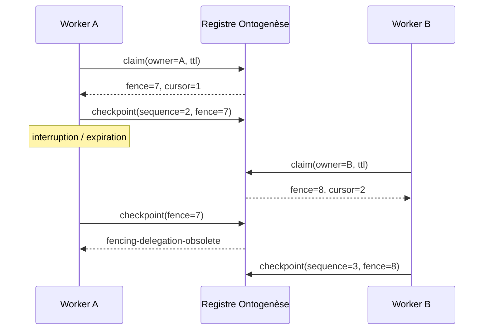

# Ontogenèse : délégation asynchrone et stewardship

- **Statut** : contrats SQLite et politiques locales implémentés ; raccord résident complet partiel
- **Portée** : mandat SHEV, capsule isolée, lease, checkpoints, clôture, dépôt et domaines spécialisés
- **Dernière revue** : 2026-10-20
- **Décisions liées** : [ADR 0683](../adr/0683-delegation-asynchrone-causale-ontogenese.md), [ADR 0688](../adr/0688-intendance-web-preuves-longitudinales.md), [ADR 0693](../adr/0693-responsabilite-coding-persistante.md), [ADR 0695](../adr/0695-responsabilite-produit-post-livraison.md), [ADR 0699](../adr/0699-stewardship-depot-et-effet-projet.md)

## 1. Intention

La délégation asynchrone permet à une responsabilité persistante de survivre à un
processus, un worker ou une session. Elle ne signifie pas « laisser un agent tourner
sans contrôle ». Elle transforme un mandat SHEV en plan scellé, exécuté dans une
capsule isolée, repris par lease et clos uniquement avec des preuves indépendantes.

Le **stewardship** désigne l’intendance continue de la trajectoire. Il relie une
livraison à ses conséquences après intégration : dérive du dépôt, effet produit,
qualité UX, santé d’un site, incidents SRE ou réutilisation d’une compétence.

## 2. Préconditions

Une délégation ne peut être dérivée que si :

- le projet existe ;
- une responsabilité SHEV est active ;
- son étape est `delegated` ;
- sa version de mandat et son `authorityRef` sont présentes ;
- la capsule résolue appartient au répertoire de candidats autorisé ;
- la capsule existe et est un répertoire ;
- une révision de base est fournie.

L’accès au workspace ou la possession d’un outil ne remplace aucune de ces conditions.

## 3. Plan causal scellé

Le plan v1 est dérivé du mandat, pas rédigé librement par le worker :

| Séquence | Checkpoint | Fonction |
| ---: | --- | --- |
| 1 | `scope` | fixer le problème, la portée et les critères d’acceptation |
| 2 | `execute_isolated` | produire dans la capsule sans modifier l’intégration |
| 3 | `independent_verify` | faire statuer un vérificateur distinct |
| 4 | `post_integration_effect` | confirmer l’effet du changement réellement intégré |

Le `planHash` couvre la source, la version du mandat, le but, les critères et l’ordre
des étapes. Rejouer le même `missionId` avec un plan divergent échoue par conflit
d’idempotence.

## 4. Lease et fencing



Le lease protège l’exclusivité temporaire ; le fencing protège le registre contre un
ancien propriétaire qui reprend après expiration. Un terminal
`accepted`, `no_change` ou `human_review` ne peut plus être réclamé.

## 5. Checkpoints

Chaque checkpoint lie :

- `missionId`, séquence et `stepId` ;
- fencing token ;
- état canonique ;
- références de preuve ;
- référence d’artefact optionnelle ;
- digest de l’état.

La séquence doit avancer exactement de un. Un rejeu identique est accepté comme
idempotent ; un rejeu divergent au même rang est refusé. Le curseur est mis à jour
dans la même transaction que le checkpoint.

## 6. Issues terminales

### 6.1 `ACCEPT`

La clôture exige les checkpoints `independent_verify` et
`post_integration_effect`, tous deux dotés de références de preuve. Le vérificateur
doit être différent du producteur, son verdict doit être `accepted`, et les révisions
candidate et intégrée doivent être explicites.

### 6.2 `NO_CHANGE`

`NO_CHANGE` exige la preuve du checkpoint `scope`, une raison, et l’absence du
checkpoint `execute_isolated`. Cela distingue une abstention précoce d’un abandon
après mutation.

### 6.3 `HUMAN_REVIEW`

Une revue humaine exige une raison et une référence de revue. Elle ne simule pas un
succès et libère le lease pour empêcher une poursuite silencieuse.

## 7. Stewardship du dépôt

Le stewardship de dépôt observe les effets d’un changement après sa livraison. Son
contrat distingue :

- règles et invariants du dépôt ;
- baseline et révision candidate ;
- dérive constatée ;
- preuves d’exécution et d’effet ;
- décision `NO_CHANGE`, correction proposée ou revue ;
- autorité de mutation séparée.

Une tâche fermée ou une branche fusionnée n’est pas une preuve de santé durable. Le
service conserve les événements de contrat, proposition et évaluation dans le ledger
Ontogenèse afin de relier le pourquoi, le changement et son résultat.

## 8. Adaptateurs de domaine

| Domaine | Signal externe | Gate spécifique | Sortie consultative |
| --- | --- | --- | --- |
| coding | défaut, régression, dette, test | lease d’écriture + vérification | patch ou `NO_CHANGE` |
| repository | dérive d’invariants, CI, conventions | politique du dépôt | proposition/évaluation |
| website | disponibilité, parcours, métrique | observations longitudinales | candidat borné |
| produit | hypothèse, jury, effet utilisateur | acceptation owner/admin | expérience ou rollback recommandé |
| UX | modalités et évaluateurs pluralistes | désaccord conservé | dossier de changement |
| compétence | réutilisation, rétention, holdout | revue externe | adoption candidate |
| SRE | symptôme, causalité, blast radius | budget de risque et approbation | remédiation bornée |

Ces adaptateurs n’ont pas tous le même stockage ni le même niveau de raccord. Leur
contrat commun est détaillé dans la [référence stewardship](../03-reference/contrats-stewardship-v3.md).

## 9. Initiative endogène

Une initiative endogène n’est pas une action auto-autorisée. SHEV peut produire une
hypothèse depuis des signaux attestés, puis l’admission vérifie :

- fraîcheur et provenance ;
- rattachement à une responsabilité active ;
- coût et risque bornés ;
- permission correspondant au type d’action ;
- existence d’un rollback ou d’une voie de récupération ;
- utilité supérieure à `NO_CHANGE`.

La sortie admise reste un objet à planifier. Elle ne donne pas un accès implicite au
shell, au réseau, au déploiement ou à la promotion.

## 10. Reprise après interruption

1. relire la mission et son état terminal ;
2. attendre ou constater l’expiration du lease ;
3. réclamer avec un nouveau propriétaire ;
4. vérifier le nouveau fencing token ;
5. relire les checkpoints et le curseur ;
6. vérifier les artefacts référencés ;
7. reprendre uniquement l’étape suivante ;
8. interrompre et escalader si l’état externe diverge du checkpoint.

Le worker ne doit jamais reconstruire un curseur depuis sa mémoire locale seule.

## 11. Menaces et réponses

| Menace | Réponse |
| --- | --- |
| double worker après partition | fencing monotone |
| réécriture d’un checkpoint | digest + unicité mission/séquence |
| dérive de mandat | `mandateVersion` et `planHash` |
| vérification auto-produite | identité du vérificateur distincte |
| acceptation sans effet | checkpoint post-intégration obligatoire |
| `NO_CHANGE` opportuniste après mutation | interdit si exécution isolée déjà enregistrée |
| capsule hors périmètre | confinement du worktree candidat |
| effet devenu obsolète | observation longitudinale et nouvelle responsabilité |

## 12. Observabilité

L’exploitation doit pouvoir répondre à :

- qui détient le lease et jusqu’à quand ?
- quel fencing token est courant ?
- quel checkpoint est le dernier durable ?
- quelles preuves et artefacts lui sont liés ?
- quelle version de mandat et quel plan ont été exécutés ?
- pourquoi la mission a-t-elle choisi `NO_CHANGE` ou une revue humaine ?
- quelle révision a été vérifiée puis intégrée ?
- quel effet post-intégration a été observé ?

Les compteurs sans ces identités ne suffisent pas à diagnostiquer une reprise.

## 13. Tests ciblés

```powershell
node backend/tests/test_ontogenesis_async_delegation.js
node backend/tests/test_ontogenesis_repository_stewardship.js
node backend/tests/test_shev_coding_stewardship.js
node backend/tests/test_shev_website_stewardship.js
node backend/tests/test_shev_product_stewardship.js
node backend/tests/test_shev_experience_stewardship.js
node backend/tests/test_gvx_skill_stewardship.js
```

Les tests portent sur l’ordre, l’idempotence, les conflits, le fencing, les refus
d’indépendance et les gates propres à chaque domaine. Ils ne remplacent pas un test
de reprise avec processus tué ni une campagne produit réelle.

## 14. Limites

- la boucle résidentielle ne compose pas encore automatiquement tous les adaptateurs ;
- l’indépendance est contrôlée par identité, pas par gouvernance organisationnelle ;
- la persistance SQLite locale ne fournit pas à elle seule une coordination distribuée ;
- l’effet post-intégration est consommé comme preuve, pas mesuré universellement ;
- certaines initiatives restent des recommandations sans actionneur ;
- aucune durée de stewardship ne constitue un SLA tant qu’elle n’est pas qualifiée.

## Voir aussi

- [Boucle Ontogenèse](ontogenese-boucle.md)
- [Responsabilité de trajectoire](responsabilite-trajectoire.md)
- [SHEV](shev.md)
- [Runbook longitudinal](../04-exploitation/runbook-stewardship-longitudinal.md)
- [Matrice de qualification](../06-qualite-preuves/matrice-qualification-stewardship-v3-2026-10-20.md)
