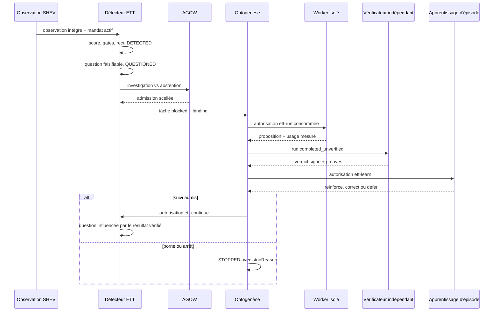

# Pensée endogène bornée — orchestration ETT

- **Statut** : Partiel — chaîne multicycle exécutable et raccord résident fail-closed ; activation serveur de production indisponible
- **Portée** : backend Node, SQLite, SHEV, AGOW, Ontogenèse et scheduler résident
- **Dernière revue** : 2026-10-20
- **Décisions** : [ADR 0626](../adr/0626-protocole-pensee-endogene-bornee.md), [ADR 0627](../adr/0627-execution-cognitive-ett-workers-reels.md), [ADR 0646](../adr/0646-apprentissage-et-execution-ett-reprenables.md), [ADR 0647](../adr/0647-boucle-ett-multicycle-et-questionnement-endogene.md), [ADR 0655](../adr/0655-raccord-resident-ett-fail-closed.md)

Ce document décrit **comment les composants ETT sont orchestrés**. La définition,
le modèle logique et les limites cognitives vivent dans la
[fiche conceptuelle](../01-concepts/endogenous-thought-test.md). Les signatures,
tables et erreurs sont regroupées dans la
[référence runtime](../03-reference/runtime-pensee-endogene.md). La procédure
opérateur se trouve dans le [runbook ETT](../04-exploitation/pensee-endogene.md).

## 1. Responsabilité de la boucle

ETT transforme un signal interne déjà observé en un épisode borné :

```text
observation SHEV
  → question falsifiable
  → décision AGOW
  → tâche Ontogenèse retenue
  → proposition du worker isolé
  → verdict indépendant
  → révision locale
  → suivi ou arrêt
```

La boucle orchestre ces étapes ; elle ne crée pas leur autorité. Le mandat vient
de SHEV, le choix d'investiguer passe par AGOW, le travail est matérialisé par
Ontogenèse, et la classification vient d'un vérificateur indépendant. Un retour
de transport, un texte produit ou un worker terminé ne valent jamais verdict.

### 1.1 Objectifs

- ouvrir un épisode uniquement depuis une observation intègre et dans le mandat ;
- conserver une lignée de reçus append-only pour chaque transition ;
- empêcher toute exécution avant admission et autorisation explicites ;
- isoler le producteur du vérificateur ;
- reconstruire les coûts depuis les reçus persistés après redémarrage ;
- borner la répétition entre un et dix cycles ;
- conserver les abstentions, réfutations, inconclusifs et échecs.

### 1.2 Non-objectifs

- agir sur le réseau ou muter un dépôt ;
- promouvoir automatiquement un résultat ;
- remplacer le scheduler de missions général ;
- fournir un signataire ou un vérificateur de production ;
- démontrer une conscience phénoménale ou une autonomie générale.

## 2. Composants et responsabilités

| Composant | Responsabilité | Ne garantit pas |
| --- | --- | --- |
| `endogenousThoughtDetectionService` | revalider observation et mandat, calculer le score, ouvrir l'épisode, poser la première question | pertinence scientifique de la question |
| `endogenousThoughtAdmissionService` | comparer investigation et abstention via AGOW | autorité d'exécution |
| `endogenousThoughtQueueService` | créer la tâche Ontogenèse `blocked` et son binding | démarrage d'un worker |
| `endogenousThoughtRunnerService` | consommer l'autorisation, réserver, exécuter en sandbox et persister le run | validité de la proposition |
| `endogenousThoughtVerificationService` | vérifier portée, signatures, indépendance et verdict | apprentissage ou promotion |
| `endogenousThoughtLearningService` | appliquer une révision catégorielle et tenter la projection de la croyance vérifiée | succès de la projection mémoire, continuation ou promotion |
| `endogenousThoughtContinuationService` | décider suivi, arrêt, échec et reprise | nouvelle autorité ou budget |
| `endogenousThoughtFollowUpQuestionService` | dériver une question du résultat vérifié précédent | véracité de la nouvelle hypothèse |
| `endogenousThoughtLoopService` | reprendre l'état courant et enchaîner jusqu'à la borne | découverte utile par elle-même |
| `endogenousThoughtResidentSchedulerService` | vérifier les dépendances de production et exécuter un candidat | fourniture de ces dépendances |
| `endogenousThoughtExperimentService` | ordonner les conditions, agréger, persister échecs et cas sans gain | résultat scientifique publiable |

Les alias `endogenousThoughtBeliefService`, `MemoryService`, `SearchService`,
`WakeService`, `RuntimeBridge` et `MemoryRuntimeBridge` pointent vers le pont
mémoire historique. Ils ne constituent pas six moteurs supplémentaires.

## 3. Flux nominal



### 3.1 Détection

Le détecteur est opt-in (`policy.enabled === true`). Il relit l'observation et
son empreinte, le mandat, l'agent, le budget, la fraîcheur, le cooldown et la
limite d'épisodes ouverts. Une décision négative est persistée comme
`rejected`; elle ne disparaît pas du dénominateur expérimental.

Une décision positive crée atomiquement un reçu de détection, un épisode
`DETECTED`, une question scellée et la transition `QUESTIONED`. Le générateur de
question peut être injecté. En son absence, le runtime tente la génération
cognitive seulement si un budget USD positif existe, puis replie explicitement
sur la règle déterministe si le modèle est indisponible.

### 3.2 Admission et file retenue

AGOW compare un candidat d'investigation à un contrôle d'abstention. La décision
`admitted` fait avancer l'épisode ; `abstained` le termine sans erreur. La mise
en file crée ensuite une tâche Ontogenèse `blocked`. Cette retenue est une
frontière de sécurité : aucun sélecteur général ne doit pouvoir démarrer le
worker avant l'autorisation ETT.

### 3.3 Exécution et réservation

Le runner exige :

- une autorisation SHEV `ett-run` valide, liée au projet, à l'épisode, à la
  version, à la tâche et à la politique ;
- un worker ou solveur déclaré ;
- un sandbox conforme à `isolated-read-only` ;
- un compteur externe `usageMeter.snapshot()` ;
- une méthode `sandbox.recover()` pour tout effet ambigu après crash.

La réservation durable précède l'exécution. Les états sont `reserved`,
`running`, `completed`, `failed` ou `cancelled`. Un run `completed` est rejoué
depuis son reçu ; un run resté `running` ne peut être réexécuté sans preuve de
récupération. Le résultat persistant reste `completed_unverified`.

### 3.4 Vérification et apprentissage

Le callback de vérification doit retourner l'autorisation SHEV et
l'attestation Ed25519. Le vérificateur doit différer du producteur et de
l'autorité, par identité et par empreinte de clé. Il signe le run exact, son
contenu, le verdict et les preuves.

Les verdicts sont `supported`, `refuted` ou `inconclusive`. Ils se projettent
respectivement en `reinforce`, `correct` et `defer`. La révision est locale à
l'épisode et ne rend jamais la proposition promotable.

Le reçu d'apprentissage v2 et la projection mémoire sont deux effets distincts.
Le reçu porte donc toujours `productionMemoryMutated: false` : il atteste la
révision de l'épisode, pas l'écriture ultérieure dans `genome_decisions`. Après
ce commit logique, le pont mémoire tente d'enregistrer le document canonique
`genos.EndogenousVerifiedBelief/v1`. Le résultat de l'appel distingue alors :

| Signal | Signification |
| --- | --- |
| `memory.productionMemoryMutated: true` | `storeMemory()` a retourné un identifiant non vide |
| `searchImpact.modified: true` | la mémoire est réellement adressable par cet identifiant |
| `searchImpact.durable: true` | la mémoire existe et le verdict est `supported` |
| `memory.errorCode` | la révision est acquise, mais la projection a échoué |

Une réfutation ou un résultat inconclusif correctement stocké modifie donc la
surface de recherche (`modified: true`) sans devenir une vérité durable
(`durable: false`). La condition `memory_ablated` ne tente aucune écriture.
Une reprise peut retenter la projection à partir du même reçu d'apprentissage ;
l'identifiant mémoire est dérivé du contenu et de la portée, ce qui rend cette
écriture convergente. Cette convergence ne transforme pas les deux effets en
transaction atomique.

### 3.5 Continuation

Après `LEARNED`, la politique choisit `FOLLOW_UP`, `STOPPED` ou `FAILED`. Un
suivi remet décision, tâche et job à `null`, puis scelle une nouvelle question
dont l'hypothèse inclut le résultat vérifié précédent. La limite de cycles est
comprise entre `1` et `10`. Lorsque la borne est atteinte en `LEARNED`, le
runtime persiste `STOPPED` avec `cycle-limit`.

## 4. Matrice d'autorité

| Étape | Autorité requise | Producteur | Preuve de sortie | Effet autorisé |
| --- | --- | --- | --- | --- |
| Détection | mandat SHEV actif | détecteur | reçu de détection | ouvrir/refuser un épisode |
| Admission | politique AGOW | arbitre local | reçu d'admission | choisir investigation/abstention |
| Queue | admission scellée | pont Ontogenèse | binding + tâche `blocked` | matérialiser, pas exécuter |
| Run | signature `ett-run` | worker déclaré | reçu `completed_unverified` + usage | produire en lecture seule |
| Vérification | signature `ett-verify` | vérificateur indépendant | attestation + verdict | classer le run |
| Apprentissage | signature `ett-learn` | service ETT | reçu v2 | réviser l'épisode |
| Continuation | signature `ett-continue` | service ETT | transition de lignée | ouvrir un suivi ou arrêter |

Les ablations n'enlèvent jamais ces frontières. Elles neutralisent une
contribution cognitive, pas une mesure de sécurité.

## 5. Raccord au scheduler résident

`idleTickService.startScheduler()` appelle le raccord ETT après le balayage des
agents idle. La configuration serveur courante passe un objet vide : la réponse
normale est donc :

```json
{ "status": "unavailable", "reason": "disabled", "missing": [] }
```

L'activation exige explicitement :

| Dépendance | Contrat minimal |
| --- | --- |
| `enabled` | exactement `true` |
| `candidateProvider(db)` | retourne `{ organizationId, projectId, episodeId }` ou `null` |
| `authorize(material)` | retourne une signature SHEV valide pour chaque étape |
| `verify(input)` | retourne autorisation et attestation indépendantes |
| `worker` | solveur déclaré ; aucune identité implicite |
| `sandbox` | frontières valides et méthode `recover()` |
| `usageMeter` | méthode `snapshot()` externe au candidat |

Si une dépendance manque, `readiness()` retourne
`production-dependencies-missing` et la liste `missing`. Si aucun candidat
n'est disponible, `runScheduled()` retourne `idle/no-candidate`. Une exception
remontée au scheduler devient `failed`, jamais `completed`.

Le raccord ignore toute consommation annoncée par le candidat. La réponse
retourne `usageSource: 'validated-run-receipts'` parce que la boucle relit et
valide les reçus de runs persistés avant de sommer jetons, USD et secondes.

### 5.1 Pourquoi l'entrée production reste indisponible

Le dépôt ne fournit pas encore de provider serveur de signataire SHEV, de
vérificateur indépendant, de worker isolé récupérable et de compteur d'usage.
Les clés synthétiques de campagne ne doivent jamais être réutilisées. Le raccord
est donc une surface d'intégration testable, pas une capacité production active.

## 6. Reprise et reconstruction

`runAutonomousLoop()` commence par appliquer les migrations, relire l'épisode et
reconstruire l'usage depuis `endogenous_thought_runs`. Chaque reçu est :

1. parsé ;
2. validé par le contrat `EndogenousThoughtRun` ;
3. comparé à son `content_hash` ;
4. reconfiné à l'organisation, au projet et à l'épisode ;
5. additionné avec contrôles de type et de débordement.

Une rupture donne `ENDOGENOUS_LOOP_USAGE_INTEGRITY_FAILED` et bloque la reprise.
La valeur initiale fournie par l'appelant n'est jamais autorisée à réduire la
consommation persistée : le runtime prend le maximum par dimension.

La boucle reprend ensuite selon la tête :

| État relu | Action suivante |
| --- | --- |
| `QUESTIONED` | admission |
| `ADMITTED` | queue |
| `QUEUED` | run ou récupération de réservation |
| `RUNNING` | vérification du run persisté |
| `VERIFIED` | apprentissage depuis la vérification persistée |
| `LEARNED` | continuation ou arrêt |
| `FOLLOW_UP` | génération/rejeu de la question suivante |
| terminal | aucune action supplémentaire |

## 7. Conditions expérimentales

| Condition | Contribution neutralisée | Résultat de développement attendu |
| --- | --- | --- |
| `full` | aucune | chaîne complète si le signal est admissible |
| `planned_control` | initiative endogène | abstention planifiée explicite |
| `curiosity_ablated` | gain d'information dans le score | refus possible `below-threshold` |
| `shev_initiative_ablated` | initiative SHEV | refus `shev-initiative-ablated` |
| `agow_arbitration_ablated` | sélection investigation | `ABSTAINED` |
| `metacognition_ablated` | révision locale | arrêt à `VERIFIED`, `learned: false` |
| `memory_ablated` | continuation fondée sur l'appris | arrêt à `LEARNED`, sans suivi |

Le contrôle et les ablations passent sur les mêmes couples graine/scénario.
Autorité, sandbox, budgets et preuve indépendante restent obligatoires dans
toutes les conditions.

## 8. Intégration applicative

Le raccord est une API de service interne, pas un endpoint HTTP :

```js
const resident = require('./endogenousThoughtResidentSchedulerService');

const state = resident.readiness(config);
if (state.status !== 'ready') return state;
return resident.runScheduled(db, config);
```

Une intégration est recevable seulement si elle documente :

1. la source et la rotation de la clé SHEV ;
2. l'identité, la clé et le processus du vérificateur indépendant ;
3. l'isolation effective du worker et la stratégie de récupération ;
4. la source du compteur de jetons, USD et secondes ;
5. le sélecteur de candidats tenant-scoped ;
6. les plafonds et la politique d'arrêt ;
7. les journaux et alertes pour `unavailable`, `failed` et intégrité d'usage.

## 9. Cas d'échec

| Symptôme | Interprétation | Réponse |
| --- | --- | --- |
| `unavailable/disabled` | raccord volontairement inactif | ne pas traiter comme incident |
| `production-dependencies-missing` | activation partielle | fournir les dépendances listées ou désactiver |
| `idle/no-candidate` | aucun épisode éligible | attendre le prochain cycle |
| `ENDOGENOUS_LOOP_GATES_REQUIRED` | callback d'autorité ou de vérification absent | corriger la configuration, aucun fallback |
| `ENDOGENOUS_RUN_RECOVERY_REQUIRED` | effet ambigu non récupérable | intervention opérateur, ne pas relancer |
| `ENDOGENOUS_LOOP_USAGE_INTEGRITY_FAILED` | reçu/coût incohérent | geler l'épisode et auditer le store |
| `FAILED` | erreur terminale persistée | conserver le reçu et ouvrir un nouvel épisode si autorisé |

## 10. Preuves et maturité

Le test multicycle démontre trois invocations d'un solveur déclaré,
l'indépendance de trois vérifications, l'influence des résultats sur deux
questions de suivi, les coûts cumulés et la reprise après réouverture SQLite.
Le test résident couvre l'indisponibilité par défaut et le chemin totalement
injecté. La campagne de développement couvre les sept conditions et publie ses
échecs et cas sans gain.

Le test d'apprentissage vérifie séparément que le document complet est relu par
la recherche vectorielle et qu'un stockage simulé en échec laisse
`searchImpact.modified` et `searchImpact.durable` à `false`. Cela démontre une
influence récupérable par la couche mémoire, pas encore sa consommation
automatique par tous les raisonneurs GenOS.

Ces résultats qualifient l'orchestration fonctionnelle, pas le bénéfice
scientifique de la pensée autonome. Voir le
[rapport de qualification du 2026-10-20](../06-qualite-preuves/qualification-pensee-endogene-2026-10-20.md).

## Voir aussi

- [Endogenous Thought Test — concept](../01-concepts/endogenous-thought-test.md)
- [Runtime ETT — référence](../03-reference/runtime-pensee-endogene.md)
- [ETT — guide d'exploitation](../04-exploitation/pensee-endogene.md)
- [Benchmark ETT](../../benchmarks/endogenous-thought/README.md)
