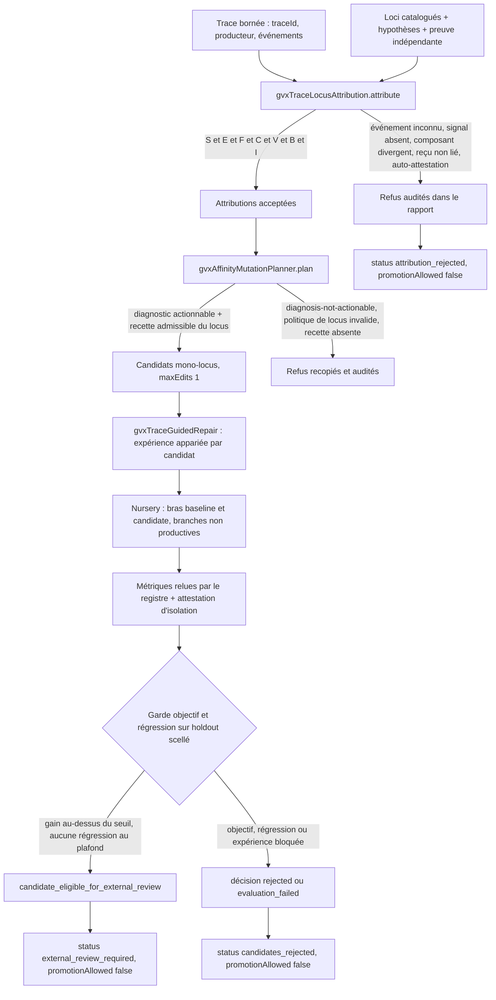
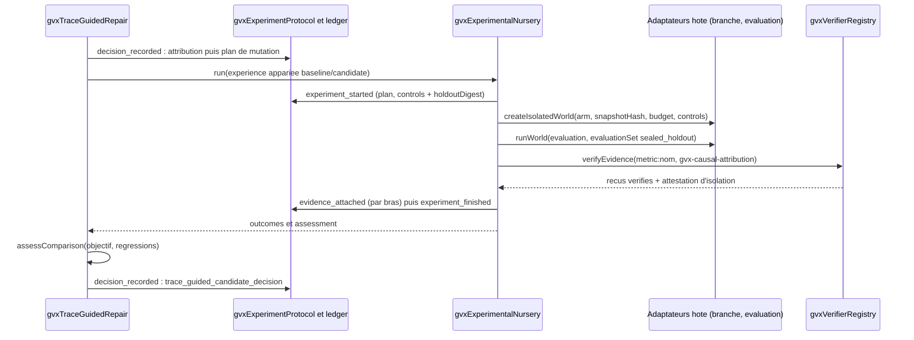

# Réparation GVX guidée par traces

- **Statut** : protocole implémenté par trois services backend Node avec tests
  exécutables. Aucune route REST/gRPC, commande CLI ni outil MCP ne l'expose
  aujourd'hui. Tout verdict reste `promotionAllowed: false`.
- **Portée** : attribution causale vérifiée d'une trace d'échec vers un locus
  catalogué, plan de mutation mono-locus borné issu de la maturation d'affinité
  AEIS, évaluation appariée `baseline/candidate` sur holdout scellé, garde
  objectif/régression déterministe, audit complet dans le ledger GVX.
- **Dernière revue** : 2026-10-19

---

## 1. Définition

La **réparation GVX guidée par traces** relie une défaillance observée à une
expérience réfutable, sans confondre corrélation, mutation et promotion. Elle
enchaîne trois contrats logiciels distincts :

1. une **attribution causale vérifiée** : une hypothèse fournie cite des
   événements fautifs existants d'une trace bornée et un locus catalogué ; un
   vérificateur indépendant du producteur de la trace atteste séparément la
   liaison `traceId/hypothesisId/locusId` ;
2. une **mutation mono-locus bornée** : le diagnostic choisit une mutation AEIS,
   mais seules les recettes déclarées par le locus sont applicables, avec valeur
   scalaire allowlistée, taille sérialisée bornée et `maxEdits: 1` ;
3. une **validation sur holdout scellé** : chaque candidat passe dans la nursery
   GVX en bras `baseline/candidate` appariés, sur deux branches non productives
   distinctes, avec un holdout disjoint de l'entraînement et scellé par hash ;
   les métriques sont relues par le registre de vérificateurs avant la garde
   objectif/régression.

```text
trace bornée
  → hypothèses causales vérifiées indépendamment
  → loci catalogués et recettes allowlistées
  → maturation d'affinité AEIS
  → mutations mono-locus bornées
  → branches baseline/candidate isolées
  → holdout scellé + métriques vérifiées
  → garde objectif/régression
  → revue externe obligatoire
```

### 1.1 Contrat opérationnel

Le chemin complet est exécutable par `gvxTraceGuidedRepair.run(options)` :
validation des datasets et de la politique de décision, attribution, audit du
rapport, plan de mutation, audit du plan, évaluation de chaque candidat dans la
nursery, audit de chaque décision, verdict global :

- `attribution_rejected` : aucune hypothèse n'a survécu à l'attribution ;
- `candidates_rejected` : aucun candidat n'a franchi la garde (ou aucun n'a
  été produit) ;
- `external_review_required` : au moins un candidat est
  `candidate_eligible_for_external_review`.

Aucun verdict ne promeut, n'applique ou ne transfère quoi que ce soit :
`promotionAllowed: false` est renvoyé par l'attribution, chaque candidat du
plan, chaque évaluation et le verdict global. Une amélioration mesurée reste
une **éligibilité à revue externe**, jamais une décision de déploiement.
Comme dans les fiches voisines, « vérifié » désigne ici une acceptation par
une procédure exécutable sur des artefacts concrets (traces fournies, reçus de
vérificateurs enregistrés, branches déclarées, métriques couvertes par des
reçus) : ni preuve causale universelle — le protocole teste l'hypothèse
fournie, il ne cherche pas toutes les causes —, ni garantie de généralisation —
le holdout est scellé, pas représentatif par construction. Voir
[ADR 0652](../adr/0652-reparation-guidee-par-traces-gvx.md) et le concept
[GVX](../01-concepts/gvx.md).

---

## 2. Spécification formelle

Cette section décrit le comportement déterministe des trois services, vérifiable
ligne à ligne dans le code cité. Les fixtures de test n'exécutent que les
invariants listés.

### 2.1 `gvxTraceLocusAttribution` — attribution trace → locus

Fichier : `backend/src/services/gvxTraceLocusAttribution.js`.
Point d'entrée : `attribute(input)`.

| Entrée | Contrat exact | Code de refus |
| --- | --- | --- |
| `trace` | `traceId` non vide, `events` tableau, au plus 256 événements | `trace-required`, `trace-event-limit-exceeded` |
| `trace.producer` | `actorId` et `workspaceId` non vides | `trace-producer-required` |
| `loci` | 1 à 64 loci | `bounded-loci-required` |
| `hypotheses` | 1 à 16 hypothèses | `bounded-hypotheses-required` |
| `verifierRegistry` | registre scellé issu de `gvxVerifierRegistry` | `trusted-control-plane-verifier-registry-required` (Error simple) |
| `artifactReader` | fonction de lecture d'artefacts | `attribution-artifact-reader-required` (Error simple) |

Un **locus** est fourni par l'appelant : `locusId`, `componentRef`, `field`,
`currentValue`, `mutationPolicy` (consommé par le planificateur) et
éventuellement `verificationStrategy`. Il n'existe pas de registre persistant
de loci : le catalogue est l'entrée `loci` de l'appel, versionnée par l'hôte.
Une **hypothèse** porte `hypothesisId`, `statement`, `locusId`, `eventRefs`
(non vide), `diagnosis` et `evidence {artifactRef, verifierId}`.

Chaque hypothèse est vérifiée en sept conditions conjointes : forme
(`hypothesis-identity-required`, `hypothesis-events-required`), existence des
événements et du locus (`hypothesis-event-unknown`, `hypothesis-locus-unknown`),
signal d'échec — au moins un événement cité en
`failed`/`refuted`/`regressed` (`hypothesis-failure-signal-required`) —,
alignement composant (`hypothesis-component-mismatch`), preuve indépendante
vérifiée pour le requirement `gvx-causal-attribution` (constante
`ATTRIBUTION_REQUIREMENT`) après `attribution-evidence-required`, liaison
exacte de la décision du reçu sur `traceId/hypothesisId/locusId`
(`attribution-receipt-binding-mismatch`), et indépendance du
`independentVerifier` du reçu — `actorId` et `workspaceId` non vides
(`attribution-independence-missing`) et distincts du producteur
(`attribution-verifier-not-independent`). Les conditions formelles sont en
§3.1, la table exhaustive des codes en §7.1.

**Sortie** : `{traceId, accepted[], rejected[], promotionAllowed: false}`.
Chaque refus reste dans le rapport (`rejected[].reason`) et, dans le chemin
complet, est reporté dans le ledger. Les refus d'hypothèses ne traversent
jamais d'exception : seules les entrées globales invalides lèvent.

### 2.2 `gvxAffinityMutationPlanner` — plan de mutation d'affinité

Fichier : `backend/src/services/gvxAffinityMutationPlanner.js`.
Point d'entrée : `plan(report, options)`.

**Budget** : `{maxCandidates}` (défaut 4, constante `MAX_CANDIDATES`) ; toute
valeur non entière ou hors `[1, 4]` lève `GVX_MUTATION_BUDGET_INVALID` avant
tout calcul. Seuls les diagnostics `false_positive`, `false_negative` et
`incomplete` (constante `ACTIONABLE_DIAGNOSES`) produisent des candidats ;
`no_error` retourne `{candidates: [], reason: 'diagnosis-not-actionable'}`.

**Maturation AEIS** : le service appelle `affinity.matureStrategy(...)` du
module `backend/src/services/epistemic/affinityMaturationService.js` et
consomme `maturity.mutation` ; le diagnostic est re-dérivé des drapeaux
construits depuis `attribution.diagnosis`, d'où la correspondance vérifiée
(formalisée en §3.2) :

| `diagnosis` | mutation AEIS sélectionnée |
| --- | --- |
| `false_positive` | `narrow_scope` |
| `false_negative` | `add_counterexample` |
| `incomplete` | `deepen_search` |

Le nom de mutation n'a **aucune autorité par lui-même** : le locus doit fournir
la recette correspondante dans `mutationPolicy.recipes[mutation]`, sinon le
refus `targeted-recipe-unavailable`. La stratégie de vérification du locus
(`verificationStrategy`, sinon un défaut à deux pas) n'influence pas la
mutation choisie ; seule la recette du locus est contraignante.

**Politique de locus** (`policyError`) : `field` et `mutationPolicy` présents
avec `allowedValues` tableau (`locus-mutation-policy-required`),
`maxEdits === 1` exactement (`single-edit-policy-required`), `maxCandidates`
entier dans `[1, 4]` (`locus-candidate-budget-invalid`), `maxSerializedBytes`
entier dans `[1, 512]` (`locus-value-budget-invalid`, constante
`MAX_VALUE_BYTES`), `recipes` objet (`locus-mutation-recipes-required`).

**Recette admissible** (`admissibleRecipe`) : `value` scalaire (chaîne, nombre,
booléen ou `null`), différente de `locus.currentValue`, membre de
`allowedValues` par comparaison `Object.is`, sérialisation JSON dans
`maxSerializedBytes` octets. Les recettes non admissibles sont filtrées ;
si aucune ne survit, refus `targeted-recipes-rejected`.

**Enveloppe de candidat** (`mutationEnvelope`) : `candidateId` et
`candidateHash` valent `affinity-<sha256(base)>` / `<sha256(base)>`, où `base`
lie le `traceId` **lu dans le reçu** (décision du vérificateur indépendant),
`hypothesisId`, `diagnosis`, `aeisMutation` et le patch. Le patch est un
`{operation: 'replace', locusId, componentRef, field,
expectedValueHash: sha256(currentValue), value}` unique : `edits` contient un
seul élément et `editCount` vaut 1. `expectedValueHash` permet à un
intégrateur externe de détecter une dérive du parent ; ce service ne fournit
pas cet intégrateur. L'enveloppe porte aussi `expectedEffect`, les
`sourceEventRefs`, l'`attributionReceipt` et `promotionAllowed: false`.

**Sortie** : `{traceId, candidates[], rejected[], maxCandidates,
promotionAllowed: false}`. Les `rejected` du rapport d'attribution sont
recopiés puis complétés par les refus de plan (avec `hypothesisId` et
`locusId`) ; la boucle s'arrête dès que `maxCandidates` candidats sont produits.

### 2.3 `gvxTraceGuidedRepair` — protocole de réparation guidée

Fichier : `backend/src/services/gvxTraceGuidedRepair.js`.
Point d'entrée : `run(options)`.

**Datasets** (`validateDatasets`) : `trainingRefs` et `holdoutRefs` sont des
tableaux non vides d'au plus 128 références, chacune une chaîne de 1 à 500
caractères, dédupliqués (`GVX_REPAIR_DATASETS_REQUIRED`) et disjoints
(`GVX_REPAIR_HOLDOUT_OVERLAP`). Le protocole calcule
`holdoutDigest = sha256(canonical(sort(holdoutRefs)))` ; le contenu et la
provenance des références restent sous la responsabilité de l'hôte. Précision
d'implémentation : les références d'entraînement sont validées et comptées
mais ne sont transmises à aucun adaptateur ; seules celles du holdout
atteignent l'évaluateur.

**Politique de décision** (`validatePolicy`) : `objective {metric, direction
'maximize'|'minimize', minimumDelta}` fini ≥ 0 (`GVX_REPAIR_OBJECTIVE_INVALID`) ;
`regressions` au plus 16 items `{metric, direction, maxRegression}` finis ≥ 0
(`GVX_REPAIR_REGRESSION_POLICY_INVALID`). Les noms de métriques dédupliqués
forment l'allowlist et les requirements `metric:<nom>`.

**Entrées d'exécution** (`GVX_TRACE_REPAIR_INPUT_INVALID`) : `db`, `scope
{organizationId, projectId}`, `entityId`, `snapshotHash` (64 hexadécimales),
`worldBudget` fini > 0, adaptateurs hôte `createCandidateBranch` et
`evaluateWorld` (fonctions).

**Expérience par candidat** (`experimentOptions`) : design `paired` à deux
bras ; `worldId = sha256({experimentId, role})` et
`isolationId = "<experimentId>:<role>"` ; `strategyId` vaut
`candidate.candidateId` pour le candidat et `"parent:<snapshotHash>"` pour la
baseline ; `controls` reçoit le `holdoutDigest` ; `requireAttestation: true`.
L'identifiant d'expérience est
`sha256({traceId, candidateHash, holdoutDigest, controls})` : changer un
contrôle, un candidat ou le holdout change l'expérience.

**Branche** (`isolatedWorldAdapter`) : l'adaptateur hôte reçoit
`{arm, snapshotHash, budget, controls, mutation}` (la mutation n'est passée que
pour le bras candidat) et doit retourner un monde avec `worldId`/`isolationId`
conformes au bras (contrôlés par la nursery), un `branchId` unique entre les
bras et `production: false` ; sinon `GVX_REPAIR_BRANCH_ISOLATION_INVALID`.

**Évaluation** (`worldEvaluationAdapter`) : `evaluateWorld` reçoit le contexte
du monde augmenté de la mutation et d'un `evaluationSet {kind:
'sealed_holdout', digest: holdoutDigest, refs: holdoutRefs}` — seul le hash du
holdout entre dans les contrôles et le ledger, les références sont transmises à
l'évaluateur après construction du candidat. Le monde doit retourner
`{status: 'completed', cost, metrics, evidence[], isolationAttestation}` ;
les métriques hors allowlist sont écartées, chaque métrique conservée doit
être finie et couverte par un reçu vérifié `metric:<nom>`, et l'attestation
d'isolation doit lier bras, processus, snapshot, outils, environnement, scope,
coût et décisions de métriques.

**Garde** (`assessComparison`) : déterministe sur les seules métriques
vérifiées des deux bras (§3.3). Si la nursery ne conclut pas
`ready_for_independent_review`, la décision est `rejected` avec le motif
`experiment-<status>` (`experiment-blocked`, `experiment-inconclusive`). Une
exception pendant l'évaluation produit `evaluation_failed` avec le `code` ou
le message de la cause (refus de la nursery inclus), reste conservée au
ledger et n'interrompt pas les autres candidats.

**Audit** (`appendAudit`) : chaque étape est inscrite dans le ledger GVX
(`gvxDevelopmentLedger.appendEvent`, type `decision_recorded`,
`parentHash = snapshotHash`, `payload.promotionAllowed = false`, identifiant
stable `gvx-trace-repair:<sha256>`) : `trace_locus_attribution`,
`trace_guided_mutation_plan`, puis `trace_guided_candidate_decision` par
candidat avec `holdoutDigest`, `experimentId` et `decision`.

**Verdict** : `run` collecte les décisions
`candidate_eligible_for_external_review` et retourne `{status, attribution,
plan, evaluations, eligible, promotionAllowed: false}`. Les exceptions
d'entrée et d'attribution traversent `run` ; seules les évaluations par
candidat sont interceptées et auditées comme `evaluation_failed`.

---

## 3. Modèle logique et mathématique

Les formules suivantes sont des invariants logiciels contrôlés par le code
cité, pas des théorèmes. Les seuils fournis par l'appelant (`minimumDelta`,
`maxRegression`) sont des paramètres non calibrés ; la discipline de calibrage
empirique est traitée par
[ADR 0620](../adr/0620-calibrage-empirique-profil-et-hysteresis.md).

### 3.1 Attribution causale vérifiée

Pour une trace $\tau$, un catalogue de loci $\mathcal{L}$ et une hypothèse $h$ :

$$\text{accepté}(h) \iff S(h) \wedge E(h) \wedge F(h) \wedge C(h) \wedge V(h) \wedge B(h) \wedge I(h)$$

$$S(h) : h.\text{hypothesisId} \wedge h.\text{statement} \wedge h.\text{locusId} \wedge |h.\text{eventRefs}| \ge 1$$

$$E(h) : \forall r \in h.\text{eventRefs}, \; \exists e \in \tau.\text{events} : e.\text{eventId} = r \;\wedge\; h.\text{locusId} \in \mathcal{L}$$

$$F(h) : \exists e \in h.\text{eventRefs} : e.\text{status} \in \{\text{failed}, \text{refuted}, \text{regressed}\}$$

$$C(h) : \forall e \in h.\text{eventRefs} : e.\text{componentRef} = \lambda(h).\text{componentRef}$$

$$V(h) : \text{reçu}(h.\text{evidence}, \text{gvx-causal-attribution}).\text{verified} = \text{vrai}$$

$$B(h) : d.\text{traceId} = \tau.\text{traceId} \wedge d.\text{hypothesisId} = h.\text{hypothesisId} \wedge d.\text{locusId} = h.\text{locusId}$$

$$I(h) : v.\text{actorId} \neq \tau.\text{producer}.\text{actorId} \wedge v.\text{workspaceId} \neq \tau.\text{producer}.\text{workspaceId}$$

où $\lambda(h)$ désigne le locus catalogué référencé par `h.locusId`, $d$ la
décision métier du reçu et $v$ son `independentVerifier` (dont `actorId` et
`workspaceId` doivent être non vides). Bornes d'entrée :

$$|\tau.\text{events}| \le 256, \quad 1 \le |\mathcal{L}| \le 64, \quad 1 \le |\mathcal{H}| \le 16$$

Anti-surinterprétation : $V \wedge B \wedge I$ attestent une **procédure**
(artefact relu, liaison exacte, identités distinctes). L'identité distincte ne
prouve pas l'indépendance épistémique des méthodes ou des données, et
l'hypothèse acceptée n'est pas démontrée unique cause réelle : le protocole
ne teste que les hypothèses fournies.

### 3.2 Contraintes de mutation mono-locus

Pour un locus $\lambda$ et un candidat $c$ produit pour ce locus :

$$\text{maxEdits}(\lambda) = 1, \quad 1 \le \text{maxCandidates}(\lambda) \le 4, \quad 1 \le \text{maxSerializedBytes}(\lambda) \le 512$$

$$v(c) \in \text{allowedValues}(\lambda) \wedge v(c) \neq \lambda.\text{currentValue} \wedge v(c) \in \{\text{chaîne}, \text{nombre}, \text{booléen}, \text{null}\}$$

$$|\text{JSON}(v(c))|_{\text{octets}} \le \text{maxSerializedBytes}(\lambda), \quad |\text{edits}(c)| = \text{editCount}(c) = 1$$

$$\text{op}(c) = \text{replace}(\lambda.\text{field}), \quad \text{expectedValueHash}(c) = \text{sha256}(\lambda.\text{currentValue})$$

La mutation AEIS est une fonction déterministe du diagnostic :

$$\mu : \text{false\_positive} \mapsto \text{narrow\_scope}, \quad \text{false\_negative} \mapsto \text{add\_counterexample}, \quad \text{incomplete} \mapsto \text{deepen\_search}$$

$$\text{diagnosis} = \text{no\_error} \Rightarrow \text{candidates} = \varnothing \;\;(\text{refus diagnosis-not-actionnable})$$

$$\mu(\text{diagnosis}) \in \text{recipes}(\lambda) \neq \varnothing \;\;\text{sinon refus targeted-recipe-unavailable}$$

Le blast radius est borné par construction : un champ, une valeur allowlistée,
une taille sérialisée, un seul edit par candidat, au plus `maxCandidates`
candidats par locus et 4 candidats demandables par plan. La maturation ne crée
pas une mutation libre : elle ne sélectionne que le nom d'une recette déjà
présente dans `locus.mutationPolicy.recipes`.

### 3.3 Protocole d'évaluation train/holdout

Jeux de données $T$ (entraînement) et $H$ (holdout) :

$$T \cap H = \varnothing, \quad 1 \le |T|, |H| \le 128, \quad |\text{uniq}(T)| = |T|, \quad |\text{uniq}(H)| = |H|$$

$$\forall r \in T \cup H : 1 \le |r|_{\text{caractères}} \le 500, \quad \text{digest} = \text{sha256}(\text{canonique}(\text{tri}(H)))$$

L'expérience est appariée : les bras `baseline` et `candidate` partagent le
même `snapshotHash`, les mêmes `controls` (modèle, outils, environnement) et
le même `worldBudget` ; seul le bras candidat reçoit la mutation. Le holdout
est scellé par hash dans les identifiants :

$$\text{experimentId} = \text{sha256}(\text{canonique}(\{\text{traceId}, \text{candidateHash}, \text{digest}, \text{controls}\}))$$

La garde ne compare que les métriques $m$ couvertes par des reçus vérifiés
des deux bras. Le gain normalisé et l'admissibilité :

$$\Delta(m) = \begin{cases} m_{\text{candidat}} - m_{\text{baseline}} & \text{si direction} = \text{maximize} \\ m_{\text{baseline}} - m_{\text{candidat}} & \text{si direction} = \text{minimize} \end{cases}$$

$$\text{admissible} \iff \Delta(m_{\text{objectif}}) \ge \text{minimumDelta} \;\wedge\; \forall r \in R : \Delta(r.\text{metric}) \ge -r.\text{maxRegression}$$

avec les refus ordonnés : bras manquant (`paired-outcomes-missing`), gain non
fini ou sous le seuil (`objective-not-improved`), régression au-delà du
plafond (`regression-limit-exceeded`). Le statut favorable
`candidate_eligible_for_external_review` est une éligibilité, pas une
promotion. Un holdout scellé protège contre la fuite de sélection pendant la
comparaison ; il ne démontre ni la représentativité du jeu, ni la
généralisation à la distribution réelle des tâches.

---

## 4. Architecture

### 4.1 Rôles

| Composant | Rôle exact | Autorité explicitement absente |
| --- | --- | --- |
| `gvxTraceLocusAttribution.js` | filtre les hypothèses fournies (existence, signal d'échec, alignement composant, preuve indépendante, liaison, indépendance) et produit le rapport accepté/refusé | ne choisit pas de mutation et ne prouve pas la cause unique |
| `gvxAffinityMutationPlanner.js` | applique la maturation AEIS, sélectionne les recettes admissibles du locus et produit des enveloppes mono-locus bornées | n'exécute pas de branche et ne promeut pas |
| `gvxTraceGuidedRepair.js` | orchestrateur : valide datasets/politique/runtime, enchaîne attribution → plan → évaluations nursery, applique la garde, audite chaque étape, rend le verdict non promoteur | ne modifie rien en production ; l'amélioration demande une revue externe |
| `gvxExperimentalNursery.js` | exécute l'expérience appariée : mondes isolés par bras, vérification des preuves par le registre, attestations d'isolation, événements de début/fin | ne garantit pas seule l'isolation système réelle (adaptateur hôte) |
| `gvxVerifierRegistry.js` (+ `gvxVerifierControlPlaneRegistry`, `verifierTrustRegistry`) | relit chaque artefact, calcule son SHA-256, n'accepte que les reçus d'implémentations enregistrées pour le requirement | n'évalue pas la pertinence métier des métriques |
| `epistemic/affinityMaturationService.js` | maturation AEIS : diagnostic → mutation ciblée (source du mapping §3.2) | ne fournit ni recette ni valeur de mutation |
| `gvxDevelopmentLedger.js` | journal append-only par scope avec chaîne de hash et MAC ; conserve attribution, plan, décisions et événements d'expérience | ne rend pas vraie une métrique fournie par un adaptateur |
| Adaptateurs hôte | `createCandidateBranch`, `evaluateWorld`, `artifactReader`, `verifierRegistry`, `db` : l'hôte fournit branches, évaluation, lecture d'artefacts et vérificateurs métier | frontière de confiance explicite ; hors de ces adaptateurs, rien n'est exécuté |

Le vérificateur intégré `artifact-integrity-v1` ne couvre que le requirement
`artifact-integrity` : il ne satisfait ni `gvx-causal-attribution` ni
`metric:<nom>`. L'hôte doit enregistrer des vérificateurs métier pour ces
requirements via `gvxVerifierControlPlaneRegistry.registerVerifierImplementation`
avant la première résolution, qui scelle ensuite le registre (voir les
[adaptateurs GVX runtime](adaptateurs-gvx-runtime.md)).

### 4.2 Flux de bout en bout



### 4.3 Séquence d'évaluation d'un candidat



Les refus de la nursery (budget d'un bras dépassé, isolation non vérifiée,
métrique non liée à son reçu) remontent à `run` comme `evaluation_failed`
audités ; ils n'interrompent pas les autres candidats.

---

## 5. Opérations

| Opération | Service | Entrées | Sorties | Refus typiques |
| --- | --- | --- | --- | --- |
| `attribute(input)` | attribution | trace, loci, hypothèses, registre, lecteur d'artefacts | `accepted[]`, `rejected[]`, `promotionAllowed: false` | `GVX_TRACE_ATTRIBUTION_INVALID`, `hypothesis-*`, `attribution-*` |
| `plan(report, options)` | planificateur | rapport d'attribution, `maxCandidates` 1–4 | `candidates[]`, `rejected[]`, `promotionAllowed: false` | `GVX_MUTATION_BUDGET_INVALID`, `diagnosis-not-actionable`, `single-edit-policy-required`, `targeted-recipe-unavailable` |
| `validateDatasets(datasets)` | réparation | `trainingRefs`, `holdoutRefs` | comptes, `holdoutDigest`, `holdoutRefs` | `GVX_REPAIR_DATASETS_REQUIRED`, `GVX_REPAIR_HOLDOUT_OVERLAP` |
| `validatePolicy(policy)` | réparation | objectif, régressions | politique normalisée | `GVX_REPAIR_OBJECTIVE_INVALID`, `GVX_REPAIR_REGRESSION_POLICY_INVALID` |
| `assessComparison(outcomes, policy)` | réparation | métriques vérifiées des deux bras, politique | décision (`candidate_eligible_for_external_review` ou refus) | `paired-outcomes-missing`, `objective-not-improved`, `regression-limit-exceeded` |
| `appendAudit(options, payload)` | réparation | kind, candidat, décision, `holdoutDigest` | événement `decision_recorded` dans le ledger | `GVX_EVENT_INVALID`, `GVX_EVENT_CONFLICT`, `GVX_LEDGER_CHAIN_INVALID` |
| `run(options)` | réparation | tout ce qui précède + adaptateurs hôte | `{status, attribution, plan, evaluations, eligible, promotionAllowed: false}` | ceux des lignes ci-dessus + `GVX_TRACE_REPAIR_INPUT_INVALID`, `GVX_REPAIR_BRANCH_ISOLATION_INVALID` |

`validateInput`, `structuralRejection`, `boundDecision` (attribution),
`policyError`, `admissibleRecipe`, `mutationEnvelope`, `planAttribution`
(planificateur), `metricNames`, `experimentOptions` (réparation) sont aussi
exportés et consommés par les tests de contrat ; les points d'entrée
opérationnels sont `attribute`, `plan` et `run`.

**Sorties observables** (résultat interne et ledger du scope, sans surface
REST/MCP dédiée) : hypothèses acceptées/refusées par raison, candidats produits
et refus de plan par politique de locus, digest du holdout, métriques
baseline/candidate vérifiées et coût par bras, gain objectif, garde fautive et
statut de chaque décision, identités producteur/vérificateur et workspaces,
et les trois familles d'événements de ledger (§2.3, Audit).

---

## 6. Exécution

Les pas à pas suivants reprennent exactement les fixtures des trois tests de
contrat ; ils ne démontrent que ces invariants, pas une efficacité sur des
agents réels.

### 6.1 Attribution nominale — `test_gvx_trace_locus_attribution.js`

1. trace `trace-1`, producteur `solver`/`producer-world`, un événement
   `event-1` : `componentRef: 'router:v1'`, `status: 'failed'` ;
2. locus `route-policy` : composant `router:v1`, champ `fallbackPolicy`,
   valeur courante `'direct'` ;
3. hypothèse `cause-1` : cite `event-1`, locus `route-policy`, diagnostic
   `false_negative`, preuve `attribution-1` vérifiée par l'implémentation
   `'artifact'` enregistrée pour `gvx-causal-attribution` ;
4. l'artefact lu porte la décision
   `{traceId: 'trace-1', hypothesisId: 'cause-1', locusId: 'route-policy',
   independentVerifier: {actorId: 'reviewer', workspaceId: 'review-world'}}` ;
5. `attribute` accepte l'hypothèse (`accepted.length === 1`, locus
   `route-policy`) et renvoie `promotionAllowed: false`.

Refus couverts par la même fixture : `eventRefs: ['missing']` →
`hypothesis-event-unknown` ; événement rebasé sur `tool:v2` →
`hypothesis-component-mismatch` ; reçu signé par `solver` (l'acteur du
producteur) → `attribution-verifier-not-independent` ; `hypotheses: []` →
exception `GVX_TRACE_ATTRIBUTION_INVALID`.

### 6.2 Plan de mutation — `test_gvx_affinity_mutation_planner.js`

1. attribution acceptée avec diagnostic `false_negative`, reçu vérifié
   (`businessDecision.traceId: 'trace-1'`) et locus `route-policy` portant
   `allowedValues: ['fallback', 'guarded']`, `maxCandidates: 2`,
   `maxSerializedBytes: 64` et les recettes `add_counterexample`
   (`'fallback'` admissible, `'not-allowed'` hors allowlist, `{broad: true}`
   non scalaire), `narrow_scope` (`'guarded'`) et `deepen_search`
   (`'guarded'`) ;
2. AEIS : `false_negative` → `add_counterexample` ; seule la recette
   `'fallback'` survit au filtre `admissibleRecipe` ;
3. `plan(report, {maxCandidates: 2})` produit un candidat :
   `aeisMutation: 'add_counterexample'`, `edits[0].value: 'fallback'`,
   `editCount: 1`, `promotionAllowed: false` ; le `rejected` du rapport est
   recopié (`rejected.length === 1`) ;
4. variantes couvertes : `false_positive` → `narrow_scope` (valeur
   `'guarded'`) ; `no_error` → aucun candidat, `diagnosis-not-actionable` ;
   `maxEdits: 2` → `single-edit-policy-required` ;
5. refus d'entrée : `plan(report, {maxCandidates: 5})` lève
   `GVX_MUTATION_BUDGET_INVALID`.

### 6.3 Réparation complète — `test_gvx_trace_guided_repair.js`

1. base SQLite `:memory:` avec `migrateGvxLedger` ; scope `org`/`project`,
   entité `'agent'`, `snapshotHash` de 64 `a`, `worldBudget: 2`, contrôles
   `model: 'fixed-model'`, `toolsetHash` (64 `b`), `environmentHash` (64 `c`) ;
2. datasets `train:1` / `holdout:1` (disjoints, uniques) ; politique objectif
   `quality` `maximize` `minimumDelta: 0.05`, régression `latency` `minimize`
   `maxRegression: 5` ; `maxCandidates: 1` ;
3. `run` : attribution acceptée (`cause-1` → `route-policy`), plan à un
   candidat `'fallback'` (recette `add_counterexample`), expérience appariée
   sur deux branches `branch:baseline` / `branch:candidate`
   (`production: false`) ;
4. l'évaluateur reçoit `evaluationSet {kind: 'sealed_holdout', refs:
   ['holdout:1']}` et la mutation (`editCount: 1` côté candidat) ; la baseline
   mesure `quality: 0.7, latency: 100`, le candidat `quality: 0.8,
   latency: 102` ;
5. garde : gain objectif $0.8 - 0.7 = 0.1 \ge 0.05$ ; latence
   $100 - 102 = -2 \ge -5$ → décision
   `candidate_eligible_for_external_review` avec `objectiveGain ≈ 0.1` ;
6. ledger : les trois kinds `trace_locus_attribution`,
   `trace_guided_mutation_plan` et `trace_guided_candidate_decision` sont
   présents dans les événements du scope ;
7. verdict : `status: 'external_review_required'`, `eligible.length: 1`,
   `promotionAllowed: false`.

Refus couverts par la même fixture : datasets identiques (`['same']` /
`['same']`) → exception `GVX_REPAIR_HOLDOUT_OVERLAP` ; candidat
`quality: 0.9, latency: 110` contre baseline `0.7 / 100` — le gain objectif
passe ($0.2 \ge 0.05$) mais la latence $100 - 110 = -10 < -5$ →
`assessComparison` rejette avec `regression-limit-exceeded` : un candidat qui
améliore l'objectif en cassant une garde n'est pas admissible.

---

## 7. Erreurs fail-closed

Toutes les erreurs ci-dessous sont vérifiées dans le code ; elles ferment le
chemin avant toute écriture applicative (le protocole n'écrit jamais rien
dans un composant : il ne produit que des candidats et des audits).

### 7.1 Attribution

| Code / raison | Condition exacte |
| --- | --- |
| `GVX_TRACE_ATTRIBUTION_INVALID` (exception, `errors` joints) | entrée globalement invalide : `trace-required`, `trace-event-limit-exceeded` (> 256), `trace-producer-required`, `bounded-loci-required` (0 ou > 64), `bounded-hypotheses-required` (0 ou > 16) |
| `attribution-artifact-reader-required` (Error simple) | `artifactReader` n'est pas une fonction |
| `trusted-control-plane-verifier-registry-required`, `verifier-registry-invalid` (Error simples) | registre absent, non scellé ou incohérent |
| `hypothesis-identity-required` | `hypothesisId`, `statement` ou `locusId` manquant |
| `hypothesis-events-required` | `eventRefs` absent ou vide |
| `hypothesis-event-unknown` | une référence d'événement n'existe pas dans la trace |
| `hypothesis-locus-unknown` | `locusId` hors du catalogue fourni |
| `hypothesis-failure-signal-required` | aucun événement cité en `failed`/`refuted`/`regressed` |
| `hypothesis-component-mismatch` | un événement cité ne cible pas le composant du locus |
| `attribution-evidence-required` | `evidence.artifactRef` ou `evidence.verifierId` manquant |
| `verifier-not-registered`, `artifact-bytes-unavailable`, `verifier-rejected-artifact` | refus du registre de vérificateurs (requirement non couvert, artefact illisible, vérificateur insatisfait) |
| `attribution-evidence-rejected` | repli quand le reçu échoue sans raison exposée |
| `attribution-receipt-binding-mismatch` | la décision du reçu ne lie pas exactement trace/hypothèse/locus |
| `attribution-independence-missing` | `independentVerifier` sans `actorId` ou `workspaceId` |
| `attribution-verifier-not-independent` | acteur ou workspace du vérificateur identique au producteur |

### 7.2 Planificateur de mutation

| Code / raison | Condition exacte |
| --- | --- |
| `GVX_MUTATION_BUDGET_INVALID` (exception) | `maxCandidates` non entier ou hors `[1, 4]` |
| `diagnosis-not-actionable` | diagnostic hors `false_positive`/`false_negative`/`incomplete` |
| `locus-mutation-policy-required` | `field` ou `mutationPolicy` manquant, ou `allowedValues` non tableau |
| `single-edit-policy-required` | `maxEdits !== 1` |
| `locus-candidate-budget-invalid` | `maxCandidates` du locus non entier ou hors `[1, 4]` |
| `locus-value-budget-invalid` | `maxSerializedBytes` non entier ou hors `[1, 512]` |
| `locus-mutation-recipes-required` | `recipes` absent ou non objet |
| `targeted-recipe-unavailable` | aucune recette pour la mutation AEIS sélectionnée |
| `targeted-recipes-rejected` | recettes présentes mais aucune admissible (valeur non scalaire, hors allowlist, égale à la valeur courante ou trop grande) |

### 7.3 Réparation guidée

| Code / raison | Condition exacte |
| --- | --- |
| `GVX_REPAIR_DATASETS_REQUIRED` | `trainingRefs` ou `holdoutRefs` vide, trop long (> 128), références invalides ou dupliquées |
| `GVX_REPAIR_HOLDOUT_OVERLAP` | une référence apparaît dans l'entraînement et le holdout |
| `GVX_REPAIR_OBJECTIVE_INVALID` | objectif sans métrique, direction invalide ou `minimumDelta` non fini/négatif |
| `GVX_REPAIR_REGRESSION_POLICY_INVALID` | plus de 16 régressions ou item invalide |
| `GVX_TRACE_REPAIR_INPUT_INVALID` | scope/`db`/`entityId` incomplets, `snapshotHash` non hex-64, `worldBudget` non > 0, adaptateurs absents |
| `GVX_REPAIR_BRANCH_ISOLATION_INVALID` | monde sans `branchId`, `branchId` déjà vu ou `production !== false` |
| `paired-outcomes-missing` | métriques d'un bras manquantes à la comparaison |
| `objective-not-improved` | gain non fini ou inférieur à `minimumDelta` |
| `regression-limit-exceeded` | une métrique de garde recule au-delà de son `maxRegression` |
| `experiment-blocked`, `experiment-inconclusive` | la nursery ne conclut pas `ready_for_independent_review` (refus `experiment-<status>`) |
| `evaluation_failed` (décision, avec `reason`) | exception pendant l'évaluation d'un candidat : propage le code des sous-services, p. ex. `GVX_NURSERY_BUDGET_EXCEEDED`, `GVX_NURSERY_ISOLATION_UNVERIFIED`, `GVX_NURSERY_METRIC_UNBOUND`, `GVX_NURSERY_SCOPE_MISMATCH`, `GVX_NURSERY_METRIC_SET_INVALID`, `GVX_NURSERY_COST_UNBOUND`, `GVX_NURSERY_CACHED_EVIDENCE_INVALID`, `nursery-isolation-contract-failed`, `GVX_EXPERIMENT_INVALID` |
| `GVX_EVENT_INVALID`, `GVX_EVENT_CONFLICT`, `GVX_LEDGER_CHAIN_INVALID`, `GVX_LEDGER_RETRYABLE` | refus du ledger lors des audits (événement invalide, identifiant déjà utilisé avec un autre contenu, chaîne de hash rompue, contention) |

### 7.4 Diagnostic opérateur

| Symptôme | Vérification recommandée |
| --- | --- |
| toutes les hypothèses sont rejetées | lire `attribution.rejected` et la triade du reçu indépendant |
| aucun candidat produit | vérifier le diagnostic, la politique de locus, la recette AEIS et les valeurs autorisées |
| décision `experiment-blocked` / `experiment-inconclusive` | inspecter l'assessment de nursery et les attestations d'isolation |
| `objective-not-improved` | comparer baseline/candidat et le seuil déclaré |
| `regression-limit-exceeded` | lire la métrique fautive sans neutraliser la garde |
| `evaluation_failed` | inspecter le `reason` (code adaptateur/nursery) ; la preuve est incomplète, pas la conclusion |
| branche refusée | vérifier `production: false` et l'unicité de `branchId` entre les bras |
| holdout refusé | chercher doublon, chevauchement ou référence trop longue |

---

## 8. Relations avec le cycle GVX

La réparation guidée par traces s'inscrit dans la famille « Développement
vérifié GVX » sans fusionner les responsabilités :

- **Nursery expérimentale** ([ADR 0263](../adr/0263-nursery-experimentale-gvx.md)) :
  le protocole consomme `gvxExperimentalNursery` avec ses quatre adaptateurs
  d'hôte (monde isolé, exécution de monde, lecture d'artefacts, registre de
  vérificateurs). L'attestation d'isolation et la relecture des preuves sont
  celles de la nursery ; la réparation ajoute le design apparié, le holdout
  scellé et la garde objectif/régression.
- **Cycle standard AGOW** ([profil d'exécution](profil-execution-gvx.md),
  [ADR 0328](../adr/0328-cycle-standard-gvx-verifie-et-reprenable.md)) : la
  réparation s'arrête à `external_review_required` /
  `candidate_eligible_for_external_review`. L'hypothèse, la prédiction
  SelfTwin, la paire de mesures, l'autorisation externe, l'application
  atomique et le rollback relèvent du cycle standard ; la réparation ne
  déclenche ni n'exécute aucune de ces étapes.
- **Monitoring longitudinal** ([monitoring](monitoring-longitudinal-gvx.md),
  [ADR 0264](../adr/0264-monitoring-longitudinal-somatique.md)) : les fenêtres
  post-application, le rollback sur régression et la maturation
  `mature_somatic_eligible` se greffent après une éventuelle application
  décidée ailleurs ; un candidat admissible ici n'a encore franchi aucune
  fenêtre.
- **Lacunes d'apprentissage et lignées** ([lacunes](lacunes-apprentissage-gvx.md),
  [ADR 0261](../adr/0261-detection-lacunes-apprentissage-gvx.md),
  [ADR 0262](../adr/0262-proposition-mutation-recherche-lignees-gvx.md)) : la
  voie `gvxLearningGapDetector` → `gvxMutationProposer` → `gvxLineageSearch`
  explore des lignées candidates (bornées à huit candidats et au budget
  déclaré) sans attribution causale vérifiée par trace. La réparation guidée
  est l'autre voie : moins de candidats, mais chacun attribué à un locus par
  un reçu indépendant et borné à un edit.
- **Plan de puissance et benchmarks** ([plan de
  puissance](plan-puissance-benchmark-gvx.md),
  [ADR 0266](../adr/0266-plan-puissance-benchmarks-gvx.md)) : la discipline
  train/holdout disjoint et scellé par hash est la même que celle exigée des
  campagnes ; le calcul de puissance (effet attendu, variance, réplicas)
  reste à la charge de la campagne, hors de ce protocole.
- **Adaptateurs et registre de confiance**
  ([adaptateurs](adaptateurs-gvx-runtime.md)) : l'enregistrement des
  implémentations de vérificateurs avant scellement, la construction du
  registre par `gvxVerifierRegistry.fromTrustedRegistry` et la fourniture d'un
  `artifactReader` suivent les mêmes règles que pour le reste de GVX ; un
  binding d'appel ne peut plus injecter de fonction de vérification.

---

## 9. Cas d'usage typiques

1. **Échec de routage récurrent** (le cas des fixtures) : une trace porte des
   événements `failed` sur `router:v1` ; l'hypothèse attribue l'échec au champ
   `fallbackPolicy` (locus catalogué avec allowlist et recettes) ; un reçu
   indépendant lie trace, hypothèse et locus ; le candidat mono-valeur est
   mesuré qualité/latence sur un holdout scellé avant toute revue.
2. **Faux négatif de vérification** : le diagnostic `false_negative` sélectionne
   la mutation AEIS `add_counterexample` ; le locus doit exposer la recette
   correspondante, sinon le plan est refusé et audité — l'échec documente une
   politique de locus incomplète au lieu de produire une mutation décorative.
3. **Faux positif de vérification** : le diagnostic `false_positive` sélectionne
   `narrow_scope` ; la même chaîne holdout s'applique, avec la même garde de
   régression.
4. **Post-mortem d'incident avec contre-expertise** : un vérificateur externe
   (acteur et workspace distincts du producteur) signe la décision
   `traceId/hypothesisId/locusId` avant qu'aucune mutation ne soit même
   planifiée ; l'auto-attestation est refusée.
5. **Refus utile** : une trace sans signal d'échec (aucun événement
   `failed`/`refuted`/`regressed`) ou un reçu non lié produit un rapport
   rejeté et un événement de ledger — la procédure échoue fermé et laisse une
   trace d'audit plutôt qu'un silence.

---

## 10. Quand NE PAS utiliser

| Situation | Pourquoi le protocole est inadapté | Voie alternative |
| --- | --- | --- |
| Pas de traces vérifiables ni de vérificateur indépendant | l'attribution refuse fail-closed (`hypothesis-failure-signal-required`, `attribution-verifier-not-independent`) | investigation manuelle puis nouvelle exécution avec preuve |
| Mitigation d'incident immédiate | le protocole ne promeut ni n'applique jamais ; il exige attribution, plan et expérience | rollback ou runbook de sécurité |
| Mutation multi-locus nécessaire (interaction de champs) | `maxEdits: 1` et une seule recette par candidat ; un locus composite n'a pas de recette | recherche de lignée ([lacunes d'apprentissage](lacunes-apprentissage-gvx.md)) ou conception explicite |
| Pas de holdout disponible | `GVX_REPAIR_DATASETS_REQUIRED` / `GVX_REPAIR_HOLDOUT_OVERLAP` ; sans holdout disjoint, aucune évaluation scellée | différer jusqu'à disponibilité des jeux ; ne pas réutiliser l'entraînement comme holdout |
| Diagnostic `no_error` | aucun candidat n'est produit (`diagnosis-not-actionable`) | rien à réparer par cette voie ; consigner la trace |
| Changement structurel (nouveau composant, refactor, nouveau contrat) | ce n'est pas un locus catalogué avec allowlist et recettes | voie architecture/conception avec ses propres preuves |
| Effet irréversible impossible à isoler hors production | branches non productives exigées ; `production: false` est contrôlé | exécution sous confinement dédié, hors de ce protocole |
| Besoin d'un effet immédiat en production | le protocole ne promeut, n'applique et ne transfère jamais (`promotionAllowed: false` partout) | cycle standard AGOW sous autorisation externe, après revue |

---

## 11. Comparaisons

| Aspect | Auto-repair agents LLM | Genetic improvement classique | SWE-agents de patch | Réparation guidée par traces GVX |
| --- | --- | --- | --- | --- |
| Localisation de la cause | interprétation du modèle, non vérifiée | aucune : la population mute aveuglément | diagnostic du modèle sur le ticket | attribution vérifiée : événements existants + reçu indépendant lié |
| Périmètre de mutation | prompts/code non bornés | génome entier du variant | fichiers libres du dépôt | un locus catalogué, un champ, `maxEdits: 1`, valeur allowlistée |
| Jeu d'évaluation | souvent l'entraînement ou la tâche courante | fitness d'entraînement | tests existants (souvent vus à l'entraînement) | holdout disjoint, scellé par hash, transmis seulement à l'évaluateur |
| Garde de régression | variable, souvent absente | fitness globale unique | suite de tests du dépôt | garde déterministe par métrique avec plafonds déclarés |
| Preuve de mesure | assertion de l'agent | score de fitness | sortie de tests | métriques relues par le registre de vérificateurs + attestation d'isolation |
| Verdict | « réparé » | meilleur score | patch fusionné | `candidate_eligible_for_external_review`, `promotionAllowed: false` |

Pour situer d'autres familles : un A/B testing classique n'a pas d'attribution
trace→locus et s'exécute en production ; une recherche d'hyperparamètres
explore un espace ouvert alors que l'espace GVX est une allowlist mono-locus ;
un fine-tuning automatique modifie des poids de modèle qu'aucun locus GVX ne
couvre ici.

Ce que ce protocole exige de plus : (1) une liaison `trace/hypothèse/locus`
attestée par un acteur distinct du producteur ; (2) un blast radius borné par
construction (locus, allowlist, un edit, ≤ 4 candidats) ; (3) un holdout
disjoint dont seul le hash entre dans les identifiants et le ledger ;
(4) des métriques comparées seulement après relecture par des vérificateurs
enregistrés ; (5) un verdict expressément non promoteur, la décision
d'application relevant d'un autre gate. La contrepartie est un coût
d'installation élevé (catalogue de loci, vérificateurs métier, jeux de
données) et une couverture limitée aux hypothèses et loci fournis par l'hôte.

---

## 12. Limites

### 12.1 Limites structurelles

- Le protocole teste une hypothèse fournie ; il ne prouve pas qu'elle est
  l'unique cause réelle et ne recherche pas automatiquement toutes les causes
  possibles. Les hypothèses et loci doivent être fournis et versionnés par
  l'hôte.
- Un seul champ par candidat : les causes multi-locus et les interactions de
  champs sont hors de portée ; il n'existe pas de mutation composite.
- Les valeurs mutables sont scalaires (chaîne, nombre, booléen, `null`) ;
  les objets, tableaux et patchs structurés sont refusés.
- Bornes d'entrée : 256 événements, 64 loci, 16 hypothèses, 128 références
  par jeu, 16 régressions, 4 candidats par plan.
- Les métriques comparées doivent être numériques et finies ; les métriques
  qualitatives non scalarisées n'entrent pas dans la garde.

### 12.2 Limites de transition

- Les refus d'attribution, de plan et d'évaluation sont audités, mais une
  reprise n'est définie qu'au niveau des bras d'expérience de la nursery
  (revalidation des preuves cachées) : un changement de datasets, de
  contrôles ou de candidat change les identifiants et rouvre l'évaluation.
- Le ledger refuse un identifiant d'événement réutilisé avec un contenu
  différent (`GVX_EVENT_CONFLICT`) ; il n'y a pas de rollback applicatif
  ici, puisque rien n'est appliqué.
- Dans l'état actuel, les références d'entraînement sont validées mais non
  transmises aux adaptateurs ; l'appariement repose entièrement sur le
  holdout. Toute utilisation de l'entraînement pour choisir la mutation
  resterait à la charge de l'hôte, hors de ce protocole.

### 12.3 Limites de ressources

- Chaque candidat exécute deux bras complets (baseline et candidat) : le coût
  double par hypothèse retenue, borné par `worldBudget` par monde
  (`GVX_NURSERY_BUDGET_EXCEEDED` au dépassement, coût contrôlé par
  attestation).
- L'hôte doit provisionner les branches non productives, l'évaluateur, le
  lecteur d'artefacts, les vérificateurs métier et les jeux train/holdout ;
  le protocole ne fournit aucun de ces éléments.

### 12.4 Limites épistémiques

- Le protocole teste une hypothèse fournie ; il ne prouve pas qu'elle est
  l'unique cause réelle.
- La séparation des identités et workspaces est vérifiable, mais ne garantit
  pas l'indépendance des méthodes ou données du vérificateur.
- Le holdout scellé empêche la fuite de sélection pendant la comparaison ;
  il ne prouve ni la représentativité du jeu, ni la généralisation à la
  distribution réelle des tâches ; la provenance et la qualité des datasets
  restent à la charge de l'hôte.
- Les seuils `minimumDelta` et `maxRegression` sont fournis par l'appelant
  et non calibrés empiriquement par ce protocole ; la discipline de calibrage
  est celle de
  l'[ADR 0620](../adr/0620-calibrage-empirique-profil-et-hysteresis.md).
- Les fixtures des trois tests sont synthétiques : elles vérifient les
  contrats, pas une amélioration sur des agents ou modèles réels. Elles ne
  prouvent ni l'isolation OS réelle, ni la qualité d'un holdout métier, ni un
  gain longitudinal en production. La qualification métier demande une
  campagne réelle, des holdouts protégés et des fenêtres longitudinales avant
  toute application somatique.

---

## 13. État d'implémentation

- Services : `backend/src/services/gvxTraceLocusAttribution.js` (110 lignes),
  `backend/src/services/gvxAffinityMutationPlanner.js` (108 lignes),
  `backend/src/services/gvxTraceGuidedRepair.js` (187 lignes), plus les
  dépendances citées en §4.1.
- Maturation AEIS : `backend/src/services/epistemic/affinityMaturationService.js`
  (source du mapping diagnostic → mutation).
- Tests exécutables autonomes (aucun script `npm` dédié n'est câblé ; les
  commandes exactes sont en §14) : les trois fichiers cités passent à la date
  de cette revue.
- Exposition : **aucune**. Une recherche dans `backend/src/routes`, les
  définitions d'outils MCP et les binaires ne trouve aucun consommateur de
  ces trois services en dehors d'eux-mêmes et de leurs tests. Pas de route
  REST/gRPC, pas de commande CLI, pas d'outil MCP, pas de câblage dans
  `backend/package.json`. L'utilisation est programmatique, par un hôte
  fournissant adaptateurs, registre de vérificateurs, base SQLite migrée
  (`migrateGvxLedger`) et jeux de données.
- Non implémenté dans ce périmètre : découverte exhaustive des loci, recettes
  libres, intégrateur d'application du patch, confinement OS, API publique,
  application somatique, rollback de production et qualification
  longitudinale réelle.
- Aucune campagne réelle de réparation guidée n'a été exécutée à ce jour ;
  les seules preuves disponibles sont les fixtures des tests.

---

## 14. Vérification

Commandes exactes (à exécuter depuis la racine du dépôt) :

```bash
node backend/tests/test_gvx_trace_locus_attribution.js
node backend/tests/test_gvx_affinity_mutation_planner.js
node backend/tests/test_gvx_trace_guided_repair.js
```

Sorties de succès attendues, respectivement :

```text
GVX trace-to-locus attribution checks passed.
GVX bounded affinity mutation planner checks passed.
GVX trace-guided repair checks passed.
```

Le troisième test ouvre une base SQLite `:memory:` et applique
`migrateGvxLedger` ; les deux premiers ne nécessitent aucune base. Ces
contrôles valident les refus et invariants décrits ci-dessus ; ils ne
constituent ni une campagne métier, ni une mesure d'efficacité, ni une
promotion.

---

## 15. Références

| Sujet | Référence |
| --- | --- |
| Décision d'architecture de ce protocole | [ADR 0652 — réparation guidée par traces et maturation d'affinité](../adr/0652-reparation-guidee-par-traces-gvx.md) |
| Discipline de calibrage empirique des seuils | [ADR 0620 — calibrage empirique du profil et hystérésis](../adr/0620-calibrage-empirique-profil-et-hysteresis.md) |
| Concept GVX | [gvx.md](../01-concepts/gvx.md) |
| Nursery expérimentale | [nursery-experimentale-gvx.md](nursery-experimentale-gvx.md), [ADR 0263](../adr/0263-nursery-experimentale-gvx.md) |
| Profil d'exécution standard AGOW | [profil-execution-gvx.md](profil-execution-gvx.md), [ADR 0328](../adr/0328-cycle-standard-gvx-verifie-et-reprenable.md) |
| Monitoring longitudinal | [monitoring-longitudinal-gvx.md](monitoring-longitudinal-gvx.md), [ADR 0264](../adr/0264-monitoring-longitudinal-somatique.md) |
| Lacunes d'apprentissage et lignées | [lacunes-apprentissage-gvx.md](lacunes-apprentissage-gvx.md), [ADR 0261](../adr/0261-detection-lacunes-apprentissage-gvx.md), [ADR 0262](../adr/0262-proposition-mutation-recherche-lignees-gvx.md) |
| Plan de puissance et campagnes | [plan-puissance-benchmark-gvx.md](plan-puissance-benchmark-gvx.md), [ADR 0266](../adr/0266-plan-puissance-benchmarks-gvx.md), [ADR 0275](../adr/0275-execution-campagne-gvx.md) |
| Adaptateurs et registre de confiance | [adaptateurs-gvx-runtime.md](adaptateurs-gvx-runtime.md), [ADR 0267](../adr/0267-branchement-runtime-adaptateurs-gvx.md) |
| Épistémologie et gates de preuve | [epistemologie-et-evidence.md](../01-concepts/epistemologie-et-evidence.md) |
| Validation du cycle standard | [validation-cycle-standard-gvx.md](../06-qualite-preuves/validation-cycle-standard-gvx.md) |
