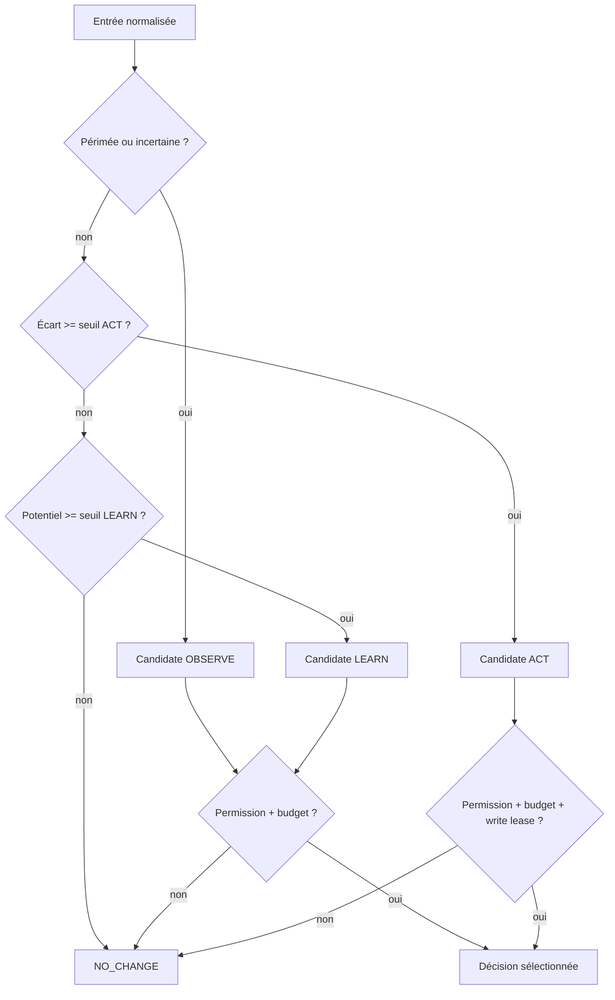

# Responsabilité persistante de trajectoire

- **Statut** : Partiel
- **Portée** : arbitrage, persistance et gate de résultat du control plane Node
- **Dernière revue** : 2026-10-19

## Définition

La responsabilité de trajectoire relie un agent, plusieurs domaines, un mandat,
un objectif externe et une observation. Elle ne demande pas seulement « quelle
tâche exécuter ? », mais « faut-il agir, observer, apprendre ou ne rien faire ? ».
Le biomimétisme est celui de l'**homéorhèse** : préserver une trajectoire viable
malgré les perturbations, plutôt que maintenir une valeur instantanée fixe.

## Contrat d'arbitrage

`trajectoryStewardshipPolicyService` reçoit des scores bornés, l'âge de
l'observation, un budget et des permissions explicites. L'ordre actuel est :

1. observer si l'observation est périmée ou l'incertitude trop élevée ;
2. agir si l'écart à l'objectif dépasse le seuil ;
3. apprendre si le potentiel d'apprentissage dépasse son seuil ;
4. sinon retourner `NO_CHANGE`.

Le mode candidat est conservé quand l'action est bloquée. L'appelant peut donc
distinguer une trajectoire stable d'un refus par budget ou permission. Aucun
objectif endogène n'est produit pour `NO_CHANGE`.

## Persistance et preuve

Une décision actionnable devient une ligne immuable de
`trajectory_stewardship_responsibilities`. Elle contient l'objectif, l'observation,
le propriétaire, le mandat et les domaines. L'identité est déterministe et une
relecture divergente échoue.

La table `trajectory_stewardship_outcomes` conserve ensuite deux preuves :

| Preuve | Sujet obligatoire | Rôle |
| --- | --- | --- |
| Effet projet | référence de l'objectif externe | montrer un changement du projet |
| Apprentissage agent | identifiant de l'agent responsable | montrer une révision interne |

Les références et vérificateurs doivent être distincts. Deux verdicts
`supported` donnent `PROMOTED`, un verdict `refuted` donne `REJECTED`, et les
autres combinaisons donnent `INCONCLUSIVE`. L'autorisation SHEV Ed25519 lie la
responsabilité, les deux références et la politique avant l'écriture atomique.

## Architecture technique

- politique pure :
  [`trajectoryStewardshipPolicyService.js`](../../backend/src/services/trajectoryStewardshipPolicyService.js) ;
- registre durable :
  [`trajectoryStewardshipStoreService.js`](../../backend/src/services/trajectoryStewardshipStoreService.js) ;
- double preuve :
  [`trajectoryStewardshipOutcomeService.js`](../../backend/src/services/trajectoryStewardshipOutcomeService.js) ;
- décision :
  [ADR 0696](../adr/0696-responsabilite-trajectoire-double-preuve.md).

## Machine de décision



L'ordre est normatif. L'action n'est jamais évaluée avant la fraîcheur et
l'incertitude. Les scores invalides, budgets négatifs et plus de seize domaines
échouent avant arbitrage.

## Contrat persistant

L'identité de responsabilité est dérivée du contenu normalisé. Une première écriture
crée une ligne immuable ; une répétition identique peut être relue ; une répétition
divergente sous la même identité échoue. L'isolation s'effectue au minimum par projet,
mandat et agent.

Le résultat atomique conserve la politique, les deux preuves, leurs vérificateurs et
le reçu d'autorité. Un appel concurrent ne doit ni dupliquer une décision, ni écraser
un verdict antérieur.

## Modes d'échec

| Symptôme | Interprétation | Réponse |
| --- | --- | --- |
| `permission-denied:act` | l'écart justifie une action mais le mandat non | `NO_CHANGE`, escalade éventuelle |
| `budget-insufficient:observe` | l'état devrait être rafraîchi mais ne peut l'être | ne pas agir sur la donnée ancienne |
| observation incohérente | provenance ou score invalide | erreur de validation |
| une seule preuve soutenue | causalité partielle | `INCONCLUSIVE` |
| preuve réfutée | bénéfice ou apprentissage contredit | `REJECTED` |
| reçu d'autorité invalide | liaison cryptographique absente | aucune écriture de résultat |

## Observabilité

Journaliser le mode candidat et le mode sélectionné, la raison, les seuils, les
budgets, les références d'observation, la responsabilité et l'identité de l'agent.
Pour le résultat, exposer séparément projet, apprentissage, vérificateurs, décision et
référence d'autorité.

## Validation

```powershell
node backend/tests/test_trajectory_stewardship_policy.js
node backend/tests/test_trajectory_stewardship_store.js
node backend/tests/test_trajectory_stewardship_outcome.js
```

## Limites et non-objectifs

Cette tranche n'est pas encore raccordée à un ordonnanceur, au réveil SHEV ou à
Ontogenèse. Elle ne prouve donc ni une autonomie de bout en bout ni un gain par
rapport à un produit concurrent. Les tests démontrent les contrats locaux, la
persistance, l'isolation et les refus adverses ; une campagne appariée reste
nécessaire pour mesurer l'effet longitudinal.

Voir aussi [Ontogenèse dirigée par responsabilité](../01-concepts/ontogenese-dirigee-par-responsabilite.md),
[Délégation et stewardship](ontogenese-delegation-et-stewardship.md) et les
[contrats de référence](../03-reference/contrats-stewardship-v3.md).
