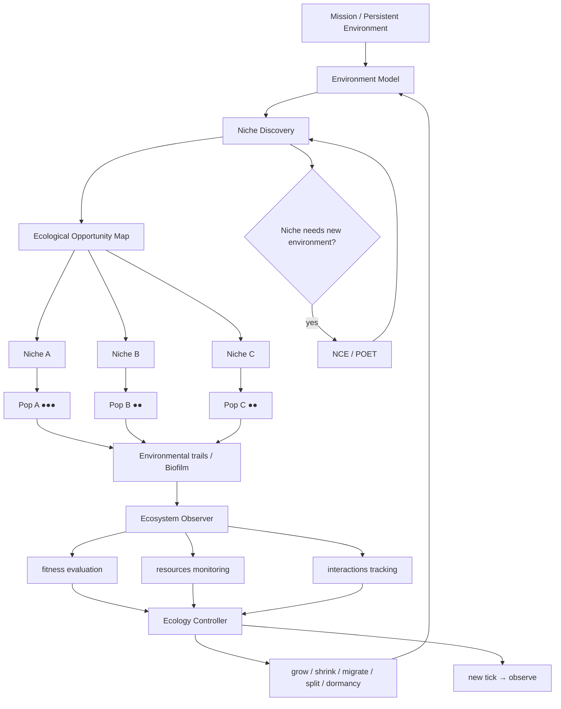

# Biome — Écologie Adaptative de GenOS

- **Statut** : Runtime écologique assemblé ; validation comparative à produire
- **Portée** : onze variantes dans une boucle bornée, transactionnelle et persistante, avec adaptateurs autorisés, comptabilité réelle et gates de preuve.
- **Dernière revue** : 2026-10-16
- **Vérification** : 2026-10-14 — composition 4 rôles OK, suite biome 23/23 PASS, câblage PASS. Réserve : suite `test:workers` incomplète (timeout sur `test_worker_compliance_native_missions.js`).

> *Biome est le protocole de GenOS pour maintenir et faire évoluer un ensemble de populations spécialisées dans un environnement dynamique, sous ressources limitées, lorsque la structure optimale du travail n'est pas connue à l'avance et doit émerger de l'interaction entre niches, populations, ressources et résultats.*

---

## Snapshot d'agent lié à un Biome

La capture optionnelle `topologySnapshot` vérifie l'identité de session du
worker, l'écologie, le biofilm, l'environnement et le journal. Elle scelle les
champs propres aux onze variants. L'agent et l'écologie doivent être inactifs
pour reprendre son workspace ; les ressources collectives ne sont pas
restaurées. Voir la
[référence des snapshots topologiques](../../03-reference/snapshots-topologiques.md).

## Vérification des 4 workers — 2026-10-14

Protocole : `biologicalModeService.compose('biome', mission)` puis
`biomeCoordinationService.composeBiome(mission)` ; `node backend/tests/test_biome_wiring.js` ;
`node backend/tests/run_biome_suite.js` (23 programmes).

Résultat :
- 4 membres présents : `environment_mapper`, `resource_steward`, `population_specialist`, `ecosystem_observer`, chacun avec `runtimeContext.sessionId/biomeId`, `plane = role`, `variant` et mission `BIOME VARIANT …`.
- Manifestes présents : `agents/biomimetique/biome_*.agent.json` pour les 4 rôles.
- Câblage : allocation (74/26, réserve recovery 15/85, compute 80/20), `PATCH_DEPARTURE` + `MIGRATE_AND_EXECUTE_PATCH`, versionnement environnement `v2`, santé écosystème.
- Suite biome : 23/23 PASS (allocation, niches, populations, foraging, ressources, mission-loop, multi-tick, onze variants, restart SQLite/MCP).

Limites : la validation comparative face à un orchestrateur statique reste à produire ; `npm --prefix backend run test:workers` n'a pas abouti (7 sous-tests PASS puis timeout sur `test_worker_compliance_native_missions.js`).

## 1. Définition

### 1.1 Définition formelle

Soit un Biome $B_t$ à l'instant $t$ défini par le tuple :

$$B_t = (E_t, N_t, P_t, R_t, I_t)$$

où :
- $E_t$ est l'état de l'environnement à l'instant $t$
- $N_t = \{N_1, \ldots, N_k\}$ est l'ensemble des niches actives
- $P_t = \{P_1, \ldots, P_k\}$ est l'ensemble des populations
- $R_t = \{R_1, \ldots, R_k\}$ est l'allocation des ressources
- $I_t$ est la matrice d'interactions entre populations

Le Biome est **l'unité d'organisation écologique** de GenOS, distinct d'une simple collection d'agents par sa capacité à faire émerger, maintenir et transformer dynamiquement sa propre structure organisationnelle en réponse aux conditions observées.

### 1.2 Ce que le runtime fait bien

Le dépôt possède déjà des briques réelles et opérationnelles :

| Brique | État | Référence |
|--------|------|-----------|
| Session persistante | ✓ | `biomeCoordinationService.js` |
| Matrice biofilm | ✓ | `biofilmMatrixService.js` |
| 4 rôles génériques | ✓ | `biologicalModeService.js` |
| Allocation proportionnelle | ✓ | `allocateResources()` |
| Foraging Marginal Value Theorem | ✓ | `foragingScoutHarvesterService.js` |
| Pas de Lévy | ✓ | `computeLevyFlightStep()` |
| SearchPatchService | ✓ | `searchPatchService.js` |
| NCE | ✓ | `naturalCreativeEcologyService.js` |
| POET | ✓ | `poetExecutionEngine.js` |
| Plasticité phénotypique | ✓ | `phenotypicPlasticityService.js` |
| Évolution multi-îlots | ✓ | Rust `evolution.rs` |
| Stigmergie | ✓ | `rhizomeCoordinationService.js` |
| Cryptobiose | ✓ | `cryptobiosisSporeService.js` |
| Fossilisation | ✓ | `fossilizationService.js` |
| Curiosité par progrès | ✓ | `curiosityService.js` |
| Organismes procéduraux | ✓ | `proceduralOrganismService.js` |

Les briques sont assemblées par le [Runtime Biome](../../03-reference/runtime-biome.md).
Les services de contrôle restent distincts des populations recrutées et des opérations exécutées.

### 1.3 Boucle écologique persistante

Chaque cycle versionne les observations, découvre les niches, recrute des individus
compatibles, intègre les résultats mesurés, applique la variante et les interactions,
réalloue les ressources, régule la capacité et mesure les effets.
Ces mutations partagent une transaction et une révision ; un échec annule le cycle.

`BiomeRuntime.run` relance les tours avec une entrée fixe ou une fonction asynchrone
d'observation. Les opérations MCP `cycle` et `run` continuent la même session.
La reprise SQLite conserve les limites, le budget consommé, les preuves et l'historique.
Les populations initiales sont vides ; les quatre rôles constituent le plan de contrôle.

Dans le variant Open-Ended, un candidat d'environnement doit porter ses
propres `evidenceRefs` pour ouvrir une niche ; les références globales du cycle
ne lui sont pas transférées. Une réévaluation doit aussi apporter ses propres
références, sans hériter de celles de l'évaluation antérieure. Seule une niche
absente avant le tour compte comme
promotion. Répéter un candidat connu ne réinitialise donc pas la série de tours
sans nouvelle niche. Ces références restent déclarées par l'hôte : leur présence
ne prouve pas à elle seule une évaluation scientifique indépendante (ADR 0432).
Une réévaluation refusée faute de références nouvelles ne modifie pas non plus
`environmentArchive` : son utilité ou son coût non étayés ne peuvent servir de
base à la génération suivante. Une réévaluation munie de ses propres références
et passant les seuils peut actualiser cette archive sans recréer une niche déjà
présente.

L'exécution passe par un adaptateur configuré, une autorisation stricte, une réservation
persistée et un vérificateur indépendant lié à l'empreinte de sortie. Ni l'inactivité,
ni l'entropie, ni un succès de transport ne certifient l'objectif global.
La conception est détaillée dans [ADR 0334](../../adr/0334-biome-boucle-ecologique-transactionnelle.md).

### 1.4 Les 4 rôles ne doivent pas être 4 workers

`biologicalModeService` produit 4 rôles : `environment_mapper`, `resource_steward`, `population_specialist`, `ecosystem_observer`.

Ce modèle est pertinent comme **fonctions écologiques**, mais inadéquat comme composition d'exécution.

L'architecture ultime est :

```text
                        BIOME
                          │
                 Environment Model
                          │
        ┌─────────────────┼─────────────────┐
        ▼                 ▼                 ▼
   Niche: Repo       Niche: Web       Niche: Formal
   population         population       population
    scanners          researchers       solvers
     ● ● ●             ● ●              ● ●
        │                 │                 │
        └────────── ecological links ──────┘
                          │
                   Resource Steward
                          │
                   Ecosystem Observer
```

**1 Environment Model + 1 Resource Regulation Plane + N niches + N populations + N×M individuals + 1 Ecosystem Observer Plane**

### 1.5 La vraie unité fondamentale : la Niche

Une niche n'est pas simplement `domain = security`. Une niche est un **espace de conditions** dans lequel une stratégie ou population est utile.

Définition formelle :

$$\text{Niche} = \begin{cases} \text{nicheId} \\ \text{opportunity} \\ \text{environmentDescriptor} \\ \text{requiredCapabilities} \\ \text{availableResources} \\ \text{entryConditions} \\ \text{survivalConditions} \\ \text{exitConditions} \\ \text{rewardSignals} \\ \text{informationSignals} \\ \text{competitors} \\ \text{mutualists} \\ \text{predators} \\ \text{dependencies} \\ \text{carryingCapacity} \\ \text{occupancy} \\ \text{productivity} \\ \text{novelty} \\ \text{informationGain} \\ \text{uncertainty} \\ \text{stability} \\ \text{disturbanceLevel} \end{cases}$$

Exemples de niches GenOS :
- "chercher la cause dans l'historique Git"
- "explorer la DB pour requêtes lentes"
- "tester l'hypothèse de race condition"
- "chercher une preuve formelle du théorème T"
- "fuzzing de parser avec corpus C"
- "optimisation ILP du schedule S"
- "chercher exemples similaires dans mémoire"

**Une même mission backend peut contenir dix niches distinctes.**

```typescript
// Exemple de définition de niche en TypeScript
interface Niche {
    nicheId: string;
    opportunity: string;           // "Investigate auth latency spike"
    environmentDescriptor: {
        repo: string;
        language: string;
        dependencies: string[];
    };
    requiredCapabilities: string[]; // ["sql", "profiling", "git-history"]
    availableResources: ResourceVector;
    entryConditions: () => boolean;
    survivalConditions: (metrics: EcologicalMetrics) => boolean;
    exitConditions: (metrics: EcologicalMetrics) => boolean;
    rewardSignals: string[];       // ["query_latency_reduced", "root_cause_found"]
    competitors: string[];         // niches en compétition pour mêmes ressources
    mutualists: string[];          // niches synergiques
    predators: string[];           // niches qui consomment ses outputs
    dependencies: string[];        // niches dont elle dépend
    carryingCapacity: number;       // K_i
    occupancy: number;             // population actuelle
    productivity: number;          // rendement marginal actuel
    novelty: number;               // nouveauté des découvertes
    informationGain: number;       // gain d'information attendu
    uncertainty: number;           // incertitude sur l'opportunité
    stability: number;             // stabilité historique
    disturbanceLevel: number;      // niveau de perturbation actuel
}
```

### 1.6 Niche fondamentale vs réalisée

Un agent possède une **niche fondamentale** :

$$\text{FundamentalNiche}(a) = f(\text{DNA}, \text{tools}, \text{model}, \text{skills}, \text{memory}, \text{cognitive recipe})$$

Mais sa **niche réalisée** dépend de l'environnement :

$$\text{RealizedNiche}(a, t) = \text{FundamentalNiche}(a) \cap \text{AvailableResources}(t) \setminus \text{Competition}(t) \cap \text{MissionConstraints}(t)$$

Exemple : un agent avec Python, SQL, debugging en fundamental niche peut voir sa realized niche réduite à "SQL investigation" si Python debugging est saturé par d'autres agents.

Cela rend AgentDNA, phénotype et Biome **extrêmement bien connectés**.

### 1.7 Découverte dynamique de niches

Le modèle traditionnel à la MAP-Elites place des solutions dans des niches selon des dimensions comportementales. MAP-Elites cherche à conserver des solutions **diverses et performantes**, au lieu de ne garder qu'un unique optimum. [[@arxiv:1504.04909]]

Mais une grille fixe a des limites : les dimensions pertinentes ne sont pas connues à l'avance. Des approches ouvertes comme AURORA apprennent ou modifient les descripteurs de niches. [[@arxiv:2406.04235]]

Le Biome doit pouvoir observer et créer de nouvelles niches :

$$\text{NewNiche}(t+1) = \text{DetectOpportunity}(E_t, P_t, R_t) \rightarrow \text{SpawnPopulation}(N_{new})$$

Signaux de découverte :
- large unexplained residual
- new capability discovered
- repeated handoff failures
- novel artifact
- new source
- new failure mode

Exemple : logs population découvre clock drift anomalies → nouvelle niche "distributed-time investigation" → recrutement/création population spécialisée.

C'est fidèle à l'écologie moderne : les organismes ne font pas que s'adapter à une niche statique ; ils peuvent choisir, conformer et modifier leur niche (niche choice, niche conformance, niche construction). [[@nature:s44358-025-00060-x]]

### 1.8 Références

- MAP-Elites : [[@arxiv:1504.04909]]
- AURORA : [[@arxiv:2406.04235]]
- Hutchinson niche concept + Singh et al. 2024 : [[@nature:s44358-025-00060-x]]
- POET : [[@arxiv:1901.01753]]
- XLand : [[@deepmind:generally-capable-agents]]
- TerraLingua : [[@arxiv:2603.16910]]

---

## 2. Écologie, Fitness, Carrying Capacity, Succession

### 2.1 Resources ≠ tokens

`allocateResources()` gère aujourd'hui un simple entier. Le Resource Steward ultime doit gérer un vecteur multidimensionnel :

$$R_i = (\text{Tokens}, \text{Time}, \text{Calls}, \text{GPU}, \text{Memory}, \text{Tools}, \text{Concurrency}, \text{Risk}, \text{Attention})$$

Chaque niche possède une demande différente :
- **Formal proof niche** : high compute, low web, high verification
- **Web research niche** : high browsing, moderate LLM, high provenance
- **Fuzzing niche** : high execution, low LLM

Cela devient une véritable **économie écologique**.

```typescript
interface ResourceVector {
    tokens: number;
    time: number;           // wall-clock seconds
    calls: number;          // LLM API calls
    gpu: number;            // GPU compute units
    memory: number;         // MB
    tools: ToolLease[];     // tool access slots
    concurrency: number;    // parallel workers
    risk: number;           // risk budget
    attention: number;      // context window units
}

// Allocation optimale
function allocateResources(
    niches: Niche[],
    populations: Population[],
    totalResources: ResourceVector
): Allocation {
    // Allocation_i ∝ (MarginalValue × InfoGain × Criticality × LearningProgress × KeystoneValue)
    //                ÷ (Cost × Pressure × Redundancy × Risk)
    const allocations = niches.map(n => {
        const numerator = 
            n.productivity * n.informationGain * n.criticality *
            n.learningProgress * n.keystoneValue;
        const denominator = 
            n.cost * n.resourcePressure * (1 + n.redundancy) * (1 + n.risk);
        return { nicheId: n.nicheId, weight: numerator / denominator };
    });

    // Normaliser avec contraintes R_i ≥ R_min,i et ΣR_i + R_reserve ≤ R
    return applyConstraints(allocations, totalResources);
}
```

### 2.2 Carrying capacity réelle

La documentation mentionne déjà $K$, mais le code ne l'implique pas comme mécanisme vivant.

Chaque niche devrait avoir :

$$K_i = f(\text{resources}, \text{marginal productivity}, \text{contention}, \text{coordination overhead})$$

et :

$$\text{Pressure}_i = \frac{\text{Population}_i}{K_i}$$

Régimes :
- Si $N \ll K_i$ : la niche peut recruter
- Si $N \approx K_i$ : saturée
- Si $N > K_i$ : freeze, reassign, merge, move, terminate

Cela transforme `workerGarage` d'une simple capacité globale en composante d'une écologie de ressources.

### 2.3 Fitness locale et environnementale

Un agent peut être mauvais globalement mais excellent dans une niche rare.

$$\text{Fitness}(a,n,t) = \alpha \cdot \text{Success} + \beta \cdot \text{Evidence} + \gamma \cdot \text{InformationGain} + \delta \cdot \text{NoveltyContribution} + \epsilon \cdot \text{Complementarity} - \zeta \cdot \text{Cost} - \eta \cdot \text{Risk} - \theta \cdot \text{ResourcePressure}$$

Exemple : Agent A avec $\text{fitness}(\text{repo\_scan}) = .91$, $\text{fitness}(\text{web}) = .42$, $\text{fitness}(\text{formal}) = .11$.

Sa fitness moyenne vaut $.48`, mais il possède une niche où il est excellent. **Il ne faut pas le tuer.**

C'est précisément l'esprit Quality-Diversity. [[@arxiv:1504.04909]]

```typescript
function computeFitness(
    agent: Agent,
    niche: Niche,
    tick: number
): number {
    const success = agent.successRate(niche, tick);
    const evidence = agent.evidenceQuality(niche, tick);
    const infoGain = agent.informationGain(niche, tick);
    const novelty = agent.noveltyContribution(niche, tick);
    const complementarity = agent.complementarityScore(niche, tick);
    const cost = agent.resourceCost(niche, tick);
    const risk = agent.riskScore(niche, tick);
    const pressure = niche.resourcePressure;

    return ALPHA * success + BETA * evidence + GAMMA * infoGain +
           DELTA * novelty + EPSILON * complementarity -
           ZETA * cost - ETA * risk - THETA * pressure;
}
```

### 2.4 EcologicalArchive

Chaque niche conserve un petit front de Pareto :
- best performer
- most robust
- cheapest
- most novel
- best verifier
- best stepping stone

Une solution non optimale aujourd'hui peut être utile plus tard.

POET a montré l'intérêt des **stepping stones** : une solution développée dans un environnement peut débloquer un autre environnement. [[@arxiv:1901.01753]]

GenOS possède déjà `cryptobiosisSporeService` et `fossilizationService`. Biome devrait être l'un des principaux consommateurs de ces mécanismes.

### 2.5 Population structurée

Une population n'est pas un rôle singulier. C'est un objet structuré :

$$\text{Population} = \begin{cases} \text{populationId} \\ \text{nicheId} \\ \text{individuals}[] \\ \text{genotypeDistribution} \\ \text{phenotypeDistribution} \\ \text{strategies}[] \\ \text{cognitiveRecipes}[] \\ \text{resourcePool} \\ \text{localMemory} \\ \text{culturalMemory} \\ \text{diversity} \\ \text{productivity} \\ \text{health} \\ \text{birthRate} \\ \text{deathRate} \\ \text{migrationRate} \\ \text{lineage} \end{cases}$$

Les individus peuvent être différents : different model, provider, recipe, toolset, strategy, memory subset. Ils appartiennent à une population parce qu'ils exploitent la même niche.

### 2.6 Stratégies de reproduction

Selon la situation :
- clone best individual
- mutate strategy
- recombine two useful individuals
- spawn specialist
- import individual from another niche
- reactivate dormant spore

Le principe : quand une niche est prometteuse, produire de nouvelles variantes autour de ce qui fonctionne, sans perdre la diversité.

C'est ici que l'évolution multi-îlots actuelle de GenOS peut se brancher directement.

### 2.7 Relations écologiques

| Relation | Traduction GenOS | Exemple |
|----------|------------------|---------|
| **Compétition** | Deux populations consomment même ressource | 2 web-search populations → même sources, même requêtes |
| **Mutualisme** | Chacune augmente productivité de l'autre | Generator population $\leftrightarrow$ Verifier population |
| **Commensalisme** | A bénéficie de B sans effet notable sur B | Read-only observer bénéficie des traces d'exécution |
| **Inhibition** | A produit signal invalide/diminue B | Population A dépose repellent sur niche de B |
| **Prédation** | Population teste/détruit artefacts faibles | Verifier population élimine systématiquement les sorties invalides du Generator |

### 2.8 Détection de redondance fonctionnelle

Deux populations peuvent avoir des rôles différents mais produire le même signal.

$$\text{MarginalContribution}(B|A) = \text{Performance}(A \cup B) - \text{Performance}(A)$$

Si $\text{MarginalContribution}(B|A) \approx 0$ : shrink B, redirect B, ou merge populations.

À l'inverse, une population minoritaire produisant régulièrement des informations uniques doit être **protégée**.

### 2.9 Santé écologique multidimensionnelle

`ecosystemHealth()` fait actuellement essentiellement $\text{entropy}(\text{labels}) \ge .5 \rightarrow \text{resilient}$. Six labels différents peuvent donner une grande diversité sans produire le moindre résultat utile.

La vraie santé écologique doit être multidimensionnelle :

$$H = f(\text{Diversity}, \text{FunctionalCoverage}, \text{Productivity}, \text{ResourcePressure}, \text{DependencyHealth}, \text{RecoveryCapacity}, \text{Redundancy}, \text{Novelty}, \text{Stability})$$

Distinguer :
- **taxonomic diversity** : combien de types différents ?
- **functional diversity** : combien de comportements/capacités différents ?
- **response diversity** : plusieurs façons différentes de remplir la même fonction ?
- **productivity** : valeur réellement produite
- **resilience** : capacité à absorber/recover d'une perturbation

La littérature sur la résilience écologique insiste sur la distinction entre **résistance**, **récupération** et changement de régime. [[@nature:s44185-023-00022-6]]

### 2.10 Succession écologique

Les populations utiles au début d'une mission ne sont pas celles utiles à la fin.

Exemple développement :

```
EARLY SUCCESSION          MID SUCCESSION           LATE SUCCESSION
exploration               architecture             hardening
requirements              implementation           integration
repo mapping              tests                     security
research                  code review               documentation
                          refactoring               performance
```

Les populations doivent apparaître, croître puis **décliner naturellement**. Pas rester vivantes jusqu'à la fin parce qu'elles ont été lancées au départ.

Un Biome mature doit avoir : pioneer populations, established populations, late-stage populations, decomposers/archive workers.

### 2.11 Niche construction

Certaines populations modifient l'environnement lui-même :

$$\text{Environment}_{t+1} = \text{Environment}_t + \text{Artifacts}(\text{populations}_t)$$

Exemple : search population crée index, summary, cache, graph. Test population crée harness automatique. L'environnement de recherche vient de changer.

Le Biome n'est plus seulement "agents adapt to environment" mais **agents $\leftrightarrow$ environment**.

### 2.12 Allocation des ressources

Au lieu de $w_i = \text{demand}_i \times \text{priority}_i$ :

$$\text{Allocation}_i \propto \frac{\text{MarginalValue}_i \times \text{InformationGain}_i \times \text{Criticality}_i \times \text{LearningProgress}_i \times \text{KeystoneValue}_i}{\text{Cost}_i \times \text{ResourcePressure}_i \times \text{Redundancy}_i \times \text{Risk}_i}$$

Contraintes :
- $R_i \ge R_{min,i}$
- $\sum R_i + R_{reserve} \le R$

La **réserve** doit être réelle. Un Biome sans réserve de récupération n'est pas résilient.

### 2.13 Références

- POET stepping stones : [[@arxiv:1901.01753]]
- MAP-Elites : [[@arxiv:1504.04909]]
- Résilience écologique : [[@nature:s44185-023-00022-6]]
- Disturbance/Connectivity : [[@nature:s41598-021-80987-1]]

---

## 3. Foraging, Biofilm, Perturbations, Communication

### 3.1 Foraging : décision optimale

`evaluatePatchYield()` calcule actuellement $\frac{\text{recentInfoGain}}{\text{elapsedTimeSec}}$ vs $\text{envMeanReturnRate}$ fixe. La vraie décision doit tenir compte de :

$$\text{Stay}(p) \iff \text{MarginalReturn}(p) > \text{ExpectedReturn}(\text{alternatives}) - \text{SwitchCost}$$

PATCH_DEPARTURE doit produire un comportement réel : stop exploiting → select new niche/patch → move worker/population → update resource allocation.

### 3.2 Lévy flight : distance dans un espace réel

`computeLevyFlightStep()` retourne LOCAL_INTENSIVE_EXPLOITATION ou LEVY_MACRO_JUMP mais n'exécute rien.

Le stepLength doit être traduit en distance dans un espace :
- capability distance
- semantic distance
- source distance
- strategy distance
- repository graph distance

Sinon le Lévy flight reste une métaphore.

### 3.3 Le biofilm = mémoire environnementale

`biofilmMatrixService` est actuellement un petit key-value store versionné. Bonne fondation.

Le biofilm ultime devrait porter :
- resource gradients
- risk gradients
- evidence deposits
- dead ends
- productive niches
- toxicity/repellent signals
- population density
- dependencies
- artifacts

Exemple :

```text
patch:file-family/auth
    yield = .02
    visits = 8
    repellent = .91

patch:git-history/oauth
    yield = .76
    visits = 2
    attractant = .83
```

Un nouveau worker n'a pas besoin de recevoir un long rapport. Il suit le gradient.

### 3.4 Communication par état environnemental compact

$$\text{agent} \rightarrow \text{environment} \rightarrow \text{agents}$$

Transmettre : pheromone, risk marker, occupancy, yield, claim refs. Réduction massive de tokens vs broadcast everything. C'est l'un des cas où le biomimétisme peut réellement réduire les tokens plutôt que simplement donner des noms biologiques.

### 3.5 Perturbations contrôlées = diagnostic

GenOS peut injecter de petites perturbations :
- remove one worker
- reduce one niche budget
- disable one source
- withhold one tool
- delay one dependency

Mesurer : does ecosystem continue? what compensates? which function collapses? → résistance, temps de récupération, redondance fonctionnelle, keystone populations.

C'est l'équivalent écologique du chaos engineering.

### 3.6 Keystone populations

$$\text{KeystoneImpact}(p) = \text{Performance}(E) - \text{Performance}(E \setminus p)$$

Exemple : dependency auditor produit 2% des artifacts mais sa suppression fait chuter integration success de 94% à 51%.

Le Resource Steward ne doit **jamais regarder uniquement la production brute**.

### 3.7 Détection de tipping points

Biome doit observer les signes annonciateurs de changement de régime :
- rising latency
- increasing retries
- declining marginal yield
- dependency backlog
- resource concentration
- falling diversity
- increased error correlation

$$\text{ECOSYSTEM\_APPROACHING\_TIPPING\_POINT}$$

et agir avant l'effondrement.

### 3.8 Rewiring dynamique des interactions

$A \leftrightarrow B$ n'est pas immuable. Si $B$ cesse de fournir des informations utiles et $C$ devient meilleur voisin $\rightarrow A \leftrightarrow C$.

C'est différent de Rhizome : Rhizome cherche surtout **des routes/capacités**. Biome rewiring vise **les relations écologiques en fonction de leur effet sur la santé et la productivité du système**.

Référence : rewiring écologique (Nature 2026). [[@nature:s44358-026-00159-9]]

### 3.9 XLand : challenge difficulty

L'expérience XLand de DeepMind générait dynamiquement les tâches en fonction de la progression des agents. [[@deepmind:generally-capable-agents]]

Pour GenOS :

$$P(\text{success}) \in [\alpha, \beta]$$

- Trop facile → peu d'info
- Trop dur → resource sink
- Learning frontier → invest resources

Cela rejoint directement le `curiosityService` actuel.

### 3.10 TerraLingua : 4 propriétés centrales

Resource constraints, persistent artifacts, agent turnover, long-lived environment. Produit division du travail, normes coopératives, structures de groupe, lignées d'artefacts. [[@arxiv:2603.16910]]

Ces quatre propriétés devraient être centrales dans le Biome GenOS.

### 3.11 Biome + POET = boucle naturelle

```
Biome
  │
  ├ niche ecology
  ├ resource dynamics
  ├ populations
  │
  └── when environment itself should evolve
          ↓
       NCE / POET
```

Et inversement : POET creates new environment → Biome decides which populations colonize it.

### 3.12 Références

- XLand : [[@deepmind:generally-capable-agents]]
- TerraLingua : [[@arxiv:2603.16910]]
- Rewiring : [[@nature:s44358-026-00159-9]]
- Résilience : [[@nature:s44185-023-00022-6]]
- GovSim : [[@arxiv:2404.16698]]

---

## 4. Variantes, Cas d'usage, Anti-usage, Architecture

### 4.1 Les 11 variantes

| Variant | Caractéristique | Usage |
|---------|-----------------|-------|
| **Resource Biome** | compétition/allocation ressources | budget limité, beaucoup d'agents |
| **Exploration Biome** | niches + foraging + curiosity | recherche, debugging inconnu |
| **Quality-Diversity Biome** | archive niches élites diverses | créativité, optimisation |
| **Successional Biome** | populations changent par phase | gros projets longs |
| **Resilience Biome** | redondance + perturbations + recovery | systèmes critiques |
| **Persistent Biome** | environnement longue durée | repo/project/organization |
| **Open-Ended Biome** | niches/environnements nouveaux | recherche NCE |
| **Adversarial Biome** | populations attaquent/défendent | cybersécurité |
| **Knowledge Biome** | sources = niches, agents = foragers | recherche profonde |
| **Compute Biome** | ressources matérielles | local/cloud/multi-model |
| **Multi-scale Biome** | individus→populations→communautés | très grandes missions |

Les plus importants pour la V1 ultime : **Exploration, Resource, Resilience, Persistent, Quality-Diversity**.

### 4.1.1 Effets runtime livrés et frontières

`genos_topology_session` accepte `operation: "advance_variant"` et `variant_input`. Les opérations `cycle` et `run` assemblent aussi
la boucle complète. Chaque mutation est journalisée et versionnée dans le snapshot.

| Variant | Effet appliqué par le cycle | Frontière actuelle |
| --- | --- | --- |
| Resource | Alloue le vecteur tokens/coût/quota/CPU/GPU/RAM/énergie; calcule starvation depuis les minima de niche; réserve des ressources; marché facultatif avec paiements; expose le rendement pour l'allocation suivante. | Pas d'apprentissage automatique de productivité entre missions. |
| Exploration | Pondère l'information par curiosité et stagnation, foraging, pas de Lévy, archive des patches avec preuves et transfert vers un patch cible. | L'exécution d'un patch reste une requête au worker. |
| Quality-Diversity | Exige une qualité numérique finie, des références de preuve, des descripteurs numériques normalisés dans `[0,1]` et des dimensions cohérentes avec l'archive et les centroïdes. Place chaque candidat dans une cellule de grille ou dans le centroïde CVT le plus proche; conserve la meilleure qualité par cellule, calcule la nouveauté locale et n'ajoute un enfant recombiné à la file que si le candidat devient élite ([ADR 0444](../../adr/0444-enfants-depuis-elites-admises-biome.md)). | Les descripteurs, la qualité mesurée, les références de preuve, les centroïdes et la mutation viennent de l'appelant. Le runtime valide la forme des références mais ne vérifie pas indépendamment les preuves; l'évaluation de fitness et l'exécution des enfants restent externes. |
| Successional | Phases pioneer → specialist → stabilizer; exige preuve, niche colonisée et productivité, puis stabilité pour stabiliser; journalise ressources et références mémoire héritées. | Les mesures de stabilité doivent être fournies ou rester bloquantes. |
| Resilience | Mesure la redondance par niche et le score de keystone; conserve les refuges; n'éteint une population que sur confirmation explicite avec preuve; finance la recolonisation depuis le refuge via la réserve. | Le benchmark perturbation/récupération est à produire. |
| Persistent | Persiste saisons, mémoire, populations, niches, ressources et biofilm; la même `persistence_key` relie des missions; applique la rétention/decay configurée. | Sans clé partagée, la session est persistée isolément; aucun daemon saisonnier. |
| Open-Ended | Génère des environnements enfants bornés, les garde en archive, applique un critère nouveauté/utilité/coût et ouvre une niche sur preuve; suspend la pression après cinq cycles stériles. | Un résultat de vérificateur doit fournir utilité, coût et preuves; pas d'évaluation auto-déclarée. |
| Adversarial | Lie des populations attaquante/défenseuse, compte défis/mitigations, archive les références d'exploits et rejette les payloads/exécutions. | Coévolution sûre de scénarios abstraits; aucun test d'attaque réel. |
| Knowledge | Évalue crédibilité, fraîcheur, duplication, contradiction, épuisement et provenance; forme des niches de sources et pollinise entre sources d'un même thème. | La collecte et la vérification des sources restent externes. |
| Compute | Choisit le fournisseur faisable au coût/latence/énergie les plus faibles, en considérant quotas, CPU/GPU/RAM et coût de migration/localité. Dans `cycle`/`run`, un `computeWork` explicite est comparé à la capacité du fournisseur, puis transmis à un adaptateur autorisé avec réserve et vérification du résultat. | Sans `computeWork`, la sélection est une recommandation. Sans fournisseur faisable, le travail reçoit `abstained/no_feasible_provider`. Le runtime ne déplace pas lui-même le worker. |
| Multi-scale | Remonte les mesures individu/population et communauté; applique des politiques autorisées à quatre niveaux; détecte la formation de communautés et renvoie les contraintes vers le bas. | Pas de génération automatique de topologies imbriquées. |

### 4.1.2 Matrice de décision : cas d'usage des onze variantes

Cette matrice couvre les familles de situations déduites des mécanismes documentés et
des contrôleurs actuels. Les exemples ne sont pas des prédictions de gain. Les
préconditions indiquent ce qu'il faut pouvoir observer ou fournir pour que le
mécanisme propre à la variante soit utile. Une mission peut présenter plusieurs
signaux : les départager exige de préciser son objectif prioritaire et le coût
de transition, puis de vérifier le résultat ; aucune variante n'a une valeur
intrinsèque supérieure aux autres.

| Variante | Cas d'usage concrets | Signaux discriminants | Préconditions pour l'effet recherché | S'abstenir ou préférer une autre variante si… |
| --- | --- | --- | --- | --- |
| **Resource** (`resource`) | Répartir un budget fini entre plusieurs populations concurrentes ; protéger les minima de niches pendant une pénurie ; arbitrer quotas, tokens, coût et ressources matérielles ; comparer une allocation directe à un marché facultatif de ressources. | Demandes supérieures à la capacité ; populations sous leur minimum ; rendement marginal différent selon les niches ; pression sur plusieurs ressources à la fois. | Populations et niches identifiées, vecteurs de ressources disponibles et demandés, budget et réserves définis ; signaux de productivité si l'on veut réallouer d'après le rendement. Le marché exige des offres valides et des soldes. | Le problème est surtout de choisir **où** exécuter un travail sur des fournisseurs hétérogènes : préférer **Compute**. Il faut préserver la capacité après une panne : **Resilience**. Une simple tâche séquentielle sans populations concurrentes ne justifie pas un Biome. |
| **Exploration** (`exploration`) | Diagnostiquer une panne de cause inconnue en parcourant tests, journaux et modules ; prospecter des pistes de recherche ; déplacer des populations entre patches quand le rendement décroît ; transférer une découverte étayée vers un patch voisin. | Forte incertitude sur la localisation de la solution ; plusieurs patches candidats ; stagnation, faible rendement marginal ou information nouvelle attendue ailleurs. | Carte ou liste de patches comparables, historique de rendement, coût de changement et observations d'information ; références de preuve pour archiver et transférer une découverte. L'exécution d'un patch passe par une requête au worker. | Les candidats sont déjà connus et il faut seulement répartir le budget : **Resource**. Il faut générer de *nouveaux environnements* puis évaluer leur utilité : **Open-Ended**. Sans alternatives observables, garder le patch ou demander une observation supplémentaire. |
| **Quality-Diversity** (`quality_diversity`) | Conserver plusieurs familles de correctifs valides ; rechercher des plans créatifs différents ; optimiser sur plusieurs niches comportementales sans éliminer les solutions rares ; faire concourir des candidats dans une grille ou des cellules CVT. | Objectif explicite de couverture/diversité **et** de qualité mesurée ; candidats différents mais comparables dans une même niche ; risque de convergence prématurée. | Qualité numérique finie, descripteur numérique normalisé dans `[0,1]`, dimensions constantes, références de preuve et évaluateur externe ; centroïdes si CVT. La recombinaison requiert des stratégies et deux cellules élites ; l'exécution des enfants reste externe. | La qualité ne peut pas être mesurée, les descripteurs sont instables ou les preuves manquent : ne pas promouvoir d'élite. Si l'on cherche seulement le meilleur fournisseur, préférer **Compute** ; si l'on cherche de nouvelles niches, **Open-Ended**. |
| **Successional** (`successional`) | Passer d'une cartographie initiale à une spécialisation puis à une stabilisation ; conduire une migration ou un refactor par phases ; remplacer progressivement les populations d'un projet long lorsque les niches colonisées deviennent productives. | Phase de travail identifiable ; besoin de transmettre ressources et mémoire ; preuve que la niche est colonisée, productive et suffisamment stable. | Transition demandée explicitement, références de preuve, niche colonisée, productivité positive et stabilité mesurée d'au moins `0.5` dans le contrôleur actuel ; budget et mémoire héritée si nécessaires. | Les phases ne sont pas observables ou la stabilité manque : maintenir la phase. Si seule la durée compte sans succession de rôles, préférer **Persistent** ; si la priorité est la survie à une perturbation, **Resilience**. |
| **Resilience** (`resilience`) | Conserver des refuges avant une perturbation ; mesurer redondance par niche et populations clés ; recoloniser après l'extinction confirmée d'une population ; réserver des ressources pour la reprise d'un service critique. | Panne ou risque de perte de fonction ; redondance insuffisante ; population clé vulnérable ; besoin de délai de récupération et de réserve protégée. | Populations, liens et niches connus ; preuve pour confirmer une extinction ; population source éteinte, individus récupérables, réserve suffisante et preuve pour recoloniser. Le gain de récupération face à une base fixe reste à mesurer. | Il n'y a ni fonction à protéger ni budget de reprise : une réserve peut coûter sans bénéfice. Pour une pénurie ordinaire sans perturbation, préférer **Resource** ; pour un changement de phases planifié, **Successional**. |
| **Persistent** (`persistent`) | Réutiliser l'état d'un dépôt entre missions ; suivre des saisons de maintenance ; conserver les niches, populations et traces environnementales d'un programme durable ; appliquer une politique de rétention ou de vieillissement de la mémoire. | Continuité d'identité entre missions ; connaissances accumulées encore utiles ; besoin d'auditer des changements sur plusieurs sessions. | `persistence_key` stable partagée entre les missions concernées, politique de rétention et état récupérable. Le contrôleur enregistre les saisons quand il est appelé ; aucun daemon saisonnier automatique n'est fourni. | La tâche est unique et courte, ou la mémoire ne doit pas survivre : éviter le coût de persistance. Si le besoin est de changer **les rôles par phase**, préférer **Successional** ; si le besoin porte sur des niveaux organisationnels simultanés, **Multi-scale**. |
| **Open-Ended** (`open_ended`) | Proposer de nouveaux environnements d'entraînement ou d'essai ; créer des niches absentes d'une recherche ouverte ; étendre un espace de problèmes après découverte d'une piste féconde ; archiver puis réévaluer des environnements candidats. | Niches existantes épuisées ; objectif explicite de découverte de nouveaux problèmes ou environnements ; nouveauté démontrable avec utilité supérieure au coût. | Génération autorisée, budget borné, candidats avec nouveauté, utilité, coût et références de preuve **propres à chaque évaluation** ; vérificateur externe pour ces résultats. La pression s'arrête après cinq cycles stériles. | Une simple recherche parmi des patches connus suffit : **Exploration**. Aucune mesure indépendante d'utilité ou de coût n'est disponible : ne pas ouvrir de niche. Ne pas assimiler une hypothèse générée à une réussite vérifiée. |
| **Adversarial** (`adversarial`) | Mettre en concurrence des populations d'attaque et de défense sur des scénarios abstraits ; éprouver une hypothèse de sécurité par contre-exemples ; suivre les défis, mitigations et lignées de stratégies ; documenter les risques non résolus. | Menace, résistance à une stratégie opposée, vulnérabilité potentielle ; besoin d'une réfutation active plutôt que de simples avis concordants. | Deux populations distinctes existantes ; scénario et références de preuve pour chaque défi ; références de mitigation pour compter une défense. Le contrôleur refuse payload, code d'exploit et exécution d'attaque réelle. | Un simple audit de sources ou de crédibilité suffit : **Knowledge**. Aucun défi vérifiable ou aucune frontière de simulation sûre n'est définie : ne pas engager de course adversariale. |
| **Knowledge** (`knowledge`) | Explorer littérature, documentation et dépôts comme niches de sources ; faire une veille sur un sujet mouvant ; comparer corroboration et contradictions ; détecter doublons, sources épuisées et informations périmées. | Le résultat dépend de la provenance, de la fraîcheur et de l'indépendance des sources ; plusieurs corpus traitent un même thème. | Identité et provenance pour chaque source, thème et métriques de crédibilité/fraîcheur ; collecte et vérification des sources réalisées hors du contrôleur. Les sources dupliquées ne comptent pas comme corroboration indépendante. | La question porte surtout sur des patches d'exécution ou de débogage : **Exploration**. On ne dispose d'aucune provenance : ne pas créer une niche de connaissance crédible. |
| **Compute** (`compute`) | Répartir des travaux entre CPU local, GPU et cloud ; choisir un modèle ou fournisseur sous contraintes de quota ; arbitrer coût, latence, énergie et migration ; router un travail matériel explicite vers un adaptateur autorisé. | Plusieurs fournisseurs faisables aux coûts/latences différents ; limites CPU/GPU/RAM/quota ; contrainte de localisation ou de temps. | Fournisseurs et capacités décrits, demande en ressources, limite de latence ; `computeWork` et adaptateur autorisé si l'on veut exécuter plutôt que recommander ; réserve et vérification du résultat dans `cycle`/`run`. | Aucun fournisseur n'est faisable : s'abstenir (`no_feasible_provider`). Une seule ressource globale doit être répartie entre populations : **Resource**. Le contrôleur ne migre pas lui-même un worker. |
| **Multi-scale** (`multi_scale`) | Coordonner individus, populations, communautés et environnement dans un très grand programme ; faire remonter productivité et santé locales ; imposer une contrainte de capacité à tous les niveaux ; détecter la formation de communautés. | Décisions à plusieurs échelles, effets locaux qui modifient la capacité globale, besoin d'une rétroaction ascendante et descendante. | Populations et appartenances communautaires explicites ou déductibles des niches ; contraintes environnementales mesurées ; politiques choisies dans les listes autorisées à chaque niveau. | Les décisions restent à une seule échelle : le coût de coordination peut être inutile. Si l'objectif est d'imbriquer automatiquement d'autres topologies, ce contrôleur ne le fait pas. Pour un suivi simplement durable, préférer **Persistent**. |

Le sélecteur actuel de `variantPolicyService.js` lit des expressions de la mission et
retient le premier signal selon l'ordre **Resilience → Adversarial → Persistent →
Multi-scale → Successional → Knowledge → Quality-Diversity → Open-Ended →
Compute → Exploration → Resource**. Une demande explicite de variante prime.
Sans signal discriminant, il choisit `resource` avec le motif `safe_baseline` et
une confiance de `0.5`. Cette priorité lexicale ne mesure ni adéquation comparative,
ni coût de transition, ni qualité vérifiée ; elle peut donc diverger des critères
de la matrice, notamment lorsqu'une mission cumule plusieurs contraintes. Le
reçu `variantSelection` doit être lu comme une explication de la règle appliquée,
et non comme une preuve d'optimalité.

### 4.1.3 Preuves de bénéfice encore nécessaires

Les références exigées par un contrôleur autorisent une mutation locale ; elles ne
prouvent pas que cette variante améliore la mission complète. Pour qualifier un
choix automatique, comparer chaque variante à `NO_CHANGE` et à sa voisine la plus
simple sur les mêmes tâches, avec budget total, qualité vérifiée, coût, latence et
coût de transition mesurés. Les critères ci-dessous sont des protocoles proposés,
pas des résultats déjà obtenus.

| Variante | Résultat à vérifier sur des missions inédites |
| --- | --- |
| Resource | Moins de niches affamées et meilleure qualité par unité de budget que l'allocation fixe. |
| Exploration | Plus de causes ou pistes vérifiées trouvées par coût de prospection qu'une recherche fixe. |
| Quality-Diversity | Meilleure couverture de solutions distinctes **valides**, sans dégrader la qualité ni cacher le coût de recherche. |
| Successional | Transitions de phase justifiées et meilleure qualité finale que le maintien d'une population stable. |
| Resilience | Fonction préservée et temps/coût de récupération réduits sous perturbations comparables. |
| Persistent | Réutilisation vérifiable de mémoire utile entre missions, après coût de stockage et de rétention. |
| Open-Ended | Nouvelles niches utiles et reproductibles, avec coût de génération et de vérification compté. |
| Adversarial | Défauts supplémentaires confirmés par un vérificateur indépendant, sans confondre nombre de défis et sécurité acquise. |
| Knowledge | Couverture et justesse des conclusions vérifiées, avec indépendance réelle des sources corroborantes. |
| Compute | Qualité maintenue à coût/latence/énergie inférieurs, migration et échecs inclus. |
| Multi-scale | Gain sur les contraintes et objectifs globaux qui compense les échanges et la coordination entre niveaux. |

### 4.2 Cas d'usage typiques

**Bug inconnu** :

```
Environment: repository

Initial niches:          After some ticks:
├ failing tests           ├ yield ↓ → population shrinks
├ logs                    ├ yield ↑ → population grows
├ recent commits          ├ logs discover timing anomaly
├ static analysis         │  └ NEW NICHE: concurrency
└ runtime behaviour       └ concurrency finds race
                             └ verifier population colonizes it
```

**Deep research** : Niches = academic literature, official docs, industry reports, code/repos, community reports, contradictory evidence. Les populations se spécialisent par écosystème de source.

**Optimisation complexe** (Conway 99) : Niches = CP-SAT, ILP, local search, symmetry breaking, constructive heuristics, evolution, formal bounds. Si CP-SAT stagne, budget redirigé. Une solution partielle produite par une niche peut coloniser une autre (stepping stone ecological transfer).

**Cybersécurité** : Niches = attack surface, authentication, permissions, dependencies, fuzzing, configuration, business logic. Une vulnérabilité découverte crée nouvelle niche "exploitability".

**Très gros repo** : Le repo est l'environnement. Les modules deviennent des habitats. Populations se déplacent selon complexity, bug density, change frequency, unknownness, test failure density.

**Compute/model routing** : Habitat = local CPU, local GPU, cloud cheap, cloud frontier, formal solver. Populations = light classifiers, heavy reasoners, code workers, verifiers. Le Steward observe quality/€, quality/token, latency, failure rate et déplace les populations.

### 4.3 Quand NE PAS utiliser Biome

| Situation | Topologie alternative |
|-----------|----------------------|
| 2+2 | direct |
| Simple code patch | direct |
| Known linear workflow | A-Team |
| Three clean alternatives | Trinity |
| Well-known multidisciplinary project | A-Team |
| Shared-state realtime collaboration | Syncytium |

Tests :
- Est-ce que je connais déjà la bonne décomposition ? → **A-Team**
- Est-ce que je compare quelques hypothèses ? → **Trinity**
- Est-ce que la structure de recherche doit changer en fonction de ce qu'on découvre ? → **Biome**

### 4.4 Biome vs Rhizome

**Rhizome** : "Où puis-je faire pousser une nouvelle route/capacité ?"
**Biome** : "Quelles populations doivent vivre où, avec quelles ressources et quelles interactions ?"

Un Biome peut utiliser un Rhizome pour la connectivité interne.

### 4.5 Biome vs Métapopulation

**Biome** = environnement + niches + interactions + ressources
**Métapopulation** = plusieurs populations séparées avec migration, extinction, recolonisation

La métapopulation peut être une structure à l'intérieur d'un Biome :

```text
Biome
  niche = debugging
    metapopulation:
      island A → Python
      island B → JS
      island C → Rust
```

### 4.6 Architecture ultime



### 4.7 Les 10 invariants du vrai Biome

1. No population without a niche
2. No niche without measurable opportunity or necessity
3. No resource allocation without observed marginal value
4. No "resilience" claim from diversity alone
5. No foraging decision without behavioural consequence
6. No ecological mechanism that exists only as metadata
7. No permanent population simply because it existed at t0
8. No consensus interpreted as health
9. No dominant population allowed to erase useful functional diversity without evidence
10. No ecosystem success if local successes produce global collapse

### 4.8 Les 16 mécanismes qui rendent Biome exceptionnel

1. Dynamic niche discovery
2. Quality-diversity
3. Resource metabolism
4. Information foraging
5. Carrying capacity
6. Persistent environmental memory (biofilm)
7. Population birth/death/migration
8. Succession
9. Niche construction
10. Perturbation/resilience
11. Ecological network rewiring
12. POET environment coevolution
13. NCE curiosity
14. AgentDNA/phenotype adaptation
15. Stepping-stone conservation
16. Zero-prompt stigmergic coordination

### 4.9 Objectif final

Face à une tâche dont la structure de recherche est inconnue, **le Biome découvre de meilleures niches, réalloue intelligemment son compute et conserve davantage de pistes utiles qu'un orchestrateur statique, pour un budget total identique.**

C'est à ce moment-là que le biomimétisme de GenOS devient particulièrement convaincant : **la nature n'est plus utilisée comme catalogue de noms ou de solutions ; l'écosystème devient effectivement le processus de recherche.**

### 4.10 Références complètes

- MAP-Elites : [[@arxiv:1504.04909]]
- AURORA : [[@arxiv:2406.04235]]
- POET : [[@arxiv:1901.01753]]
- XLand : [[@deepmind:generally-capable-agents]]
- TerraLingua : [[@arxiv:2603.16910]]
- GovSim : [[@arxiv:2404.16698]]
- Résilience écologique : [[@nature:s44185-023-00022-6]]
- Rewiring : [[@nature:s44358-026-00159-9]]
- Hutchinson + Singh et al. : [[@nature:s44358-025-00060-x]]
- Disturbance/Connectivity : [[@nature:s41598-021-80987-1]]
