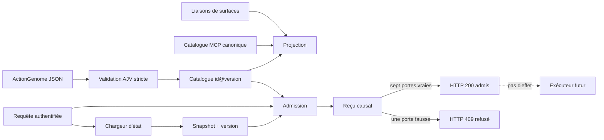
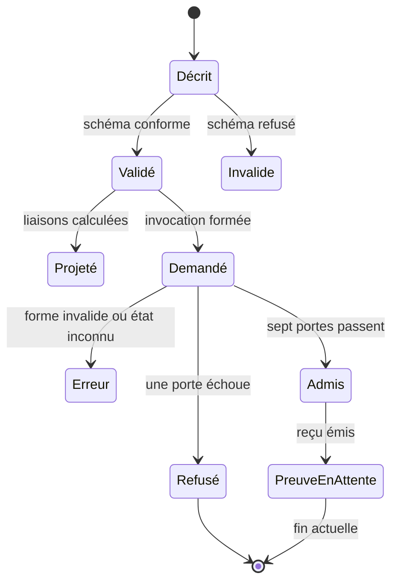

# ActionGenome : contrat canonique, admission causale et surfaces

- **Statut** : implémenté pour la validation, le catalogue, la projection et l'admission
- **Portée** : contrat d'action déclaratif fermé, projections de surface, admission causale et reçu d'invocation
- **Niveau de maturité** : verticale bornée, sans exécuteur d'effet
- **Version du contrat** : `genos.action-genome/v1`
- **Action publiée** : `syncytium.session.events@1.0.0`
- **Dernière revue** : 2026-10-19

---

## 1. Définition

ActionGenome est la membrane contractuelle d'une action GenOS. Il rend explicites
son entrée, sa sortie, l'état observé ou modifié, l'autorité et le budget exigés,
son rayon d'impact et les preuves attendues. Il ne confère aucune autorité et ne
déclenche aucun effet par lui-même.

La verticale livrée s'arrête à l'**admission causale** : une invocation est
comparée à un génome et à un état versionné, puis un reçu déterministe consigne
chaque verdict. `admitted: true` signifie seulement que les préconditions
d'entrée étaient réunies. Cela ne prouve ni l'exécution, ni le résultat, ni la
postcondition, ni la promotion. Un transport réussi n'est pas une preuve.

### 1.1 Problème traité

Sans contrat partagé, une même capacité peut dériver entre REST, MCP, CLI et
workers : paramètres différents, permission implicite, budget absent ou preuve
non comparable. ActionGenome sépare quatre questions :

1. **Description** — que déclare l'action ?
2. **Projection** — quelles surfaces peuvent la présenter ?
3. **Admission** — cette invocation est-elle autorisée sur cet état précis ?
4. **Exécution** — l'effet a-t-il réellement eu lieu et satisfait son contrat ?

L'implémentation couvre les trois premières questions, avec une REST limitée à
l'admission. La quatrième reste sous la responsabilité des exécuteurs et des
portes de preuve existantes.

### 1.2 Principe fondateur

$$\text{ActionGenome} : \text{Action} \mapsto \langle \text{entrée}, \text{sortie}, \text{état}, \text{effets}, \text{autorité}, \text{budget}, \text{impact}, \text{preuves} \rangle$$

Un génome est une déclaration **fermée** : toute propriété inconnue est refusée,
toute section obligatoire absente est refusée. Le contrat décrit ce que l'action
exige ; il ne le réalise pas. La seule opération de décision livrée est
l'admission :

$$\text{Admit} : (G, I, S) \mapsto \text{reçu d'admission}, \qquad \text{jamais} \mapsto \text{effet}$$

où $G$ est un génome validé, $I$ une invocation fermée et $S$ un état versionné
chargé côté serveur. Le résultat est toujours un reçu ; jamais un effet, jamais
une promotion, jamais une preuve d'exécution.

### 1.3 Contrat opérationnel du chemin d'action

Le chemin livré est : **décrire** (schéma fermé) → **publier** (catalogue
`id@version`) → **projeter** (liaisons de surface) → **admettre** (sept portes
sur un état versionné) → **consigner** (reçu causal). Chaque étape est
vérifiable ; aucune ne confère d'autorité, n'exécute d'effet ni ne promeut de
décision. Les étapes suivantes — exécution isolée, vérification des
postconditions, preuve d'effet, promotion — restent à construire (§11, §12).

## 2. Spécification formelle

### 2.1 Sources normatives, rôles et frontières

| Rôle | Élément | Source normative | Responsabilité |
| --- | --- | --- | --- |
| Validateur | Schéma fermé | [`shared/actionGenome.v1.schema.json`](../../shared/actionGenome.v1.schema.json) | forme canonique d'un génome |
| Action publiée | Génome | [`syncytium.session.events.v1.json`](../../shared/actionGenomes/syncytium.session.events.v1.json) | contrat concret versionné |
| Liaisons | Surfaces | [`shared/actionSurfaceBindings.v1.json`](../../shared/actionSurfaceBindings.v1.json) | projection MCP, REST et CLI |
| Catalogue | Catalogue | [`actionGenomeCatalog.js`](../../backend/src/services/actionGenome/actionGenomeCatalog.js) | résolution stricte `id@version` |
| Validation | Admission (forme) | [`actionGenomeValidator.js`](../../backend/src/services/actionGenome/actionGenomeValidator.js) | compilation AJV et erreurs structurées |
| Admission | Admission | [`actionInvocation.js`](../../backend/src/services/actionGenome/actionInvocation.js) | sept portes et refus fermé |
| Chargeur d'état | État | [`catalogActionAdmission.js`](../../backend/src/services/actionGenome/catalogActionAdmission.js) | chargement de la révision Syncytium |
| Reçu | Reçu causal | [`causalReceipt.js`](../../backend/src/services/actionGenome/causalReceipt.js) | empreintes et déclaration d'admission |
| Projection | Surfaces | [`surfaceProjection.js`](../../backend/src/services/actionGenome/surfaceProjection.js) | projection contrôlée vers les surfaces |
| Contrôleur REST | REST | [`actionGenomeController.js`](../../backend/src/controllers/actionGenomeController.js) | identité authentifiée et codes HTTP |
| Routes | REST | [`actionGenomeRoutes.js`](../../backend/src/routes/actionGenomeRoutes.js) | monture sous `/api`, permissions |

Les fichiers JSON partagés visent à servir de source de vérité inter-runtime ;
seul le runtime Node les consomme aujourd'hui (aucune implémentation Rust
n'existe, voir §11.1). Le catalogue les charge au démarrage de son module et les
revalide par `assertActionGenome` à chaque résolution `getActionGenome`. Une
entrée absente du catalogue n'est pas créée implicitement à partir d'une requête.

### 2.2 Schéma racine, sections et identité

Le schéma racine est fermé par `additionalProperties: false` ; chaque section et
chaque définition réutilisable (`jsonSchema`, `predicate`, `paths`,
`nonEmptyStrings`) le sont aussi. La validation compile le schéma une fois avec
AJV `{ allErrors: true, strict: true }` et restitue chaque erreur sous la forme
`{ path, keyword, message }`. Les sections obligatoires :

- `schema` — constante `genos.action-genome/v1` ;
- `identity` — `id` (segmenté, minuscules, ≤ 128), `version` (`x.y.z` strict),
  `description` (1 à 500) ;
- `contract` — voir §2.3 ;
- `authority` — voir §2.4 ;
- `budget` — voir §2.5 ;
- `reversibility` — voir §2.6 ;
- `evidence` — voir §2.7.

L'identité de résolution est le couple `(id, version)`. Une modification
sémantique exige une nouvelle version publiée ; le digest seul ne remplace pas ce
versionnement.

### 2.3 Contrat fonctionnel et notation des prédicats

| Élément | Contrainte |
| --- | --- |
| `inputSchema` / `outputSchema` | `type` explicite parmi `object`, `array`, `string`, `number`, `integer`, `boolean`, `null` |
| `preconditions` / `postconditions` | prédicats fermés `{ path, operator, value }` |
| `state.reads` / `state.writes` | pointeurs uniques ≤ 200, joker `*` autorisé |
| `effects` | `kind` ∈ `read`/`write`/`external`, `target` de 1 à 200 caractères |
| `path` (prédicat) | pointeur ≤ 200, **sans** joker `*` |
| `operator` | `eq`, `neq`, `exists`, `gte`, `lte` |

L'évaluateur actuel ne résout que les préconditions sur `{ input, state }` ; il
n'interprète pas les postconditions sur un résultat d'exécution. Un prédicat ne
peut donc pas dépendre d'un joker : les chemins d'état déclaratifs
(`state.reads` avec `*`) servent la description, pas l'évaluation.

### 2.4 Autorité

`authority.permissions` et `authority.leases` sont des ensembles non vides de
chaînes uniques. L'admission vérifie que l'invocation contient toutes les valeurs
requises. La valeur spéciale `all` satisfait l'ensemble demandé ; elle doit donc
rester réservée à une identité qui possède effectivement cette autorité. Une
permission décrit ce que l'acteur peut demander ; un lease décrit la capacité
temporairement exposée. Les deux portes doivent passer.

### 2.5 Budget

| Champ | Domaine du schéma | Sens à l'admission |
| --- | --- | --- |
| `maxDurationMs` | entier de 1 à 3 600 000 | plafond demandé par l'invocation |
| `maxCostUnits` | nombre positif ou nul | plafond de coût demandé |

Le contrôle compare des plafonds déclarés ; il ne mesure pas une consommation
réelle. La comptabilité d'exécution devra produire sa propre preuve.

### 2.6 Réversibilité et rayon d'impact

Les modes sont `reversible`, `compensatable`, `irreversible` et `not_applicable`.
Les rayons sont `none`, `local`, `workspace`, `tenant` et `external`. Une
compensation est soit nulle, soit une référence `actionId`. Cette section est
descriptive dans la verticale actuelle : elle ne provisionne pas de snapshot et
n'appelle pas automatiquement l'action compensatrice.

### 2.7 Preuves attendues

`evidence.expected` contient au moins un type de preuve. Ces valeurs définissent
l'obligation future de l'exécuteur et du vérificateur. Le reçu d'admission garde
toujours `evidenceStatus: pending_execution`.

### 2.8 Reçus `genos.action-invocation-receipt/v1` et `genos.action-invocation-statement/v1`

Une admission produit un reçu distinct de la réponse HTTP
([`causalReceipt.js`](../../backend/src/services/actionGenome/causalReceipt.js)) :

| Champ | Forme | Source |
| --- | --- | --- |
| `schema` | constante `genos.action-invocation-receipt/v1` | enveloppe |
| `receiptId` | `sha256:<64 hex>` | `digest(statement)` |
| `statement.schema` | constante `genos.action-invocation-statement/v1` | déclaration |
| `statement.action.id` / `.version` | identité du génome | `identity` |
| `statement.action.contractDigest` | `sha256:<64 hex>` | `digest(genome)` complet canonisé |
| `statement.actorId` | chaîne | `invocation.actor.id` |
| `statement.observedStateVersion` | chaîne | version de l'état **chargé** (`state.version`) |
| `statement.inputDigest` | `sha256:<64 hex>` | `digest(invocation.input)`, sans recopier l'entrée |
| `statement.requestedBudget` | objet budget | copie de `invocation.budget` |
| `statement.admitted` | booléen | conjonction des verdicts |
| `statement.verdicts` | exactement sept `{ gate, passed }` | `buildVerdicts` |
| `statement.evidenceStatus` | constante `pending_execution` | statut |

Deux précisions opposables :

1. `statement.observedStateVersion` porte la version de l'état réellement chargé
   côté serveur, **pas** la valeur revendiquée par l'invocation
   (`invocation.observedStateVersion`), qui n'est comparée qu'à la porte
   `state_version` et n'est jamais recopiée.
2. Le reçu ne recopie ni l'entrée (empreinte seulement) ni le snapshot d'état.

```text
canon(v)   : objets → clés triées récursivement ; tableaux → ordre conservé ;
             atomes → inchangés
digest(v)  = "sha256:" + SHA-256(JSON(canon(v)))
receiptId  = digest(statement)
```

L'ordre des tableaux reste significatif. Déterminisme : deux évaluations
identiques produisent le même `receiptId` — vérifié par
[`test_action_genome_invocation.js`](../../backend/tests/test_action_genome_invocation.js).
Le reçu n'est **pas signé** : les empreintes détectent une divergence de contenu
entre deux exécutions, pas une falsification par un tiers.

### 2.9 Invariants de sûreté

1. **Contrat fermé** — les propriétés inconnues du génome sont refusées.
2. **Invocation fermée** — les clés étrangères sont refusées.
3. **Autorité conjointe** — permissions et leases sont séparés.
4. **Identité serveur** — REST dérive l'acteur du contexte authentifié.
5. **État lié** — le reçu porte la version réellement chargée.
6. **Budget borné** — une demande au-dessus du plafond est refusée.
7. **Reçu sans effet** — admission ne signifie jamais exécution.
8. **Preuve en attente** — aucune preuve d'effet n'est synthétisée.
9. **Pas de promotion** — le service ne contourne aucune porte existante.
10. **Projection prudente** — une liaison invalide redevient descriptive.

## 3. Modèle logique de l'admission

### 3.1 Forme générale

Pour un génome `G`, une invocation `I` et un état versionné `S`, l'admission est
la conjonction des sept portes :

```text
Admit(G, I, S) = Input ∧ Permission ∧ Lease ∧ Duration
                 ∧ Cost ∧ Version ∧ Preconditions
```

| Ordre | Porte | Condition |
| ---: | --- | --- |
| 1 | `input_schema` | `I.input` satisfait `G.contract.inputSchema` |
| 2 | `permissions` | toutes les permissions de `G` sont dans `I` |
| 3 | `leases` | tous les leases de `G` sont dans `I` |
| 4 | `budget_duration` | durée demandée ≤ plafond du génome |
| 5 | `budget_cost` | coût demandé ≤ plafond du génome |
| 6 | `state_version` | version observée = version chargée |
| 7 | `preconditions` | tous les prédicats sont vrais sur entrée + snapshot |

### 3.2 Les sept contrôles de `evaluateInvocation`

`evaluateInvocation`
([`actionInvocation.js`](../../backend/src/services/actionGenome/actionInvocation.js))
exécute, dans cet ordre d'écriture : `assertActionGenome(context.genome)` (le
génome est revalidé avant toute porte), `requireShape(context)` (domaine fermé),
`buildVerdicts(genome, context)` (les sept verdicts), puis `issueCausalReceipt`.

Il n'existe **aucun court-circuit entre les portes** : une porte fausse
n'interrompt pas l'évaluation des suivantes et ne masque pas les autres refus.
L'ordre d'écriture va de l'entrée vers les préconditions ; il ne crée aucune
hiérarchie entre les refus. Tous les verdicts sont consignés dans le reçu, sous
la forme exacte `{ gate: <nom>, passed: <booléen> }`.

### 3.3 Sémantique des prédicats et des ensembles

Résolution des pointeurs : `/` désigne la racine
`{ input: I.input, state: S.snapshot }` ; `/a/b` descend dans `racine.a.b` ; une
clé absente résout en `undefined`, et l'opérateur décide alors.

| Opérateur | `passed` si |
| --- | --- |
| `exists` | `(résolu !== undefined) === Boolean(value)` |
| `eq` | `résolu === value` |
| `neq` | `résolu !== value` |
| `gte` | `typeof résolu === 'number'` et `résolu >= value` |
| `lte` | `typeof résolu === 'number'` et `résolu <= value` |
| tout autre | `false` (fermé) |

Ensembles d'autorité :

$$\text{containsAll}(A, R) \;\triangleq\; \texttt{all} \in A \;\vee\; R \subseteq A$$

où `A` est fourni par l'invocation et `R` exigé par le génome. La porte
`input_schema` compile `G.contract.inputSchema` avec une instance AJV
`{ allErrors: true, strict: true }` fraîche à chaque évaluation.

### 3.4 Domaine fermé de l'invocation

Les seules clés acceptées sont `actor`, `budget`, `input`, `leases`,
`observedStateVersion` et `permissions`. `actor.id`, les tableaux de permissions
et leases, le budget et un état possédant une version (chaîne) sont
obligatoires. Toute clé inconnue produit `ACTION_INVOCATION_INVALID`.

### 3.5 Échecs précoces, sans reçu

Trois échecs ferment l'évaluation **avant** la production d'un reçu :

1. génome non conforme au schéma → `assertActionGenome` →
   `ACTION_GENOME_INVALID` (400) ;
2. invocation mal formée (clé inconnue, `actor` sans `id`, permissions ou leases
   non tableaux, budget non objet, état sans `version`) → `requireShape` →
   `ACTION_INVOCATION_INVALID` (400) ;
3. `inputSchema` non compilable → `inputPass` → `ACTION_INVOCATION_INVALID`
   (400) avec détail de compilation.

Un refus de porte, lui, produit toujours un reçu complet à sept verdicts.

### 3.6 Invariants d'identité et de fraîcheur

**Identité serveur.** Sur REST, l'appelant ne fournit jamais `actor` ni
`permissions` dans le corps. Le contrôleur les prend dans `req.user`, alimenté
par l'authentification.

**Fraîcheur.** L'égalité stricte entre `observedStateVersion` (revendiqué par
l'invocation) et `state.version` (chargé) ferme la fenêtre de divergence au
moment de l'admission. Elle ne verrouille pas l'état entre l'admission et un
futur exécuteur. Celui-ci devra revalider ou consommer un jeton d'état
atomique.

## 4. Architecture

Les rôles et modules sont cartographiés au §2.1. Le contrôleur REST assemble
l'invocation depuis le contexte authentifié ; le chargeur d'état accepte une
dépendance `loadState` injectable (le test REST l'utilise pour isoler
l'admission de la persistance réelle).

### 4.1 Flux d'admission



La projection et l'admission sont indépendantes. Une surface peut être décrite
sans exécuter l'action ; une invocation ne devient pas valide parce qu'une
liaison existe.

### 4.2 Cycle de vie



Il n'existe aucun état `executed`, `verified`, `compensated` ou `promoted` dans
ce service.

### 4.3 Menaces et réponses actuelles

| Menace | Réponse actuelle | Résidu |
| --- | --- | --- |
| acteur forgé dans le corps REST | identité prise dans `req.user` | dépend de l'authentification amont |
| capacité non louée | porte `leases` + projection canonique | possession effective externe |
| état périmé | égalité stricte de version | pas de verrou jusqu'à l'effet |
| contrat modifié silencieusement | `contractDigest` | reçu non signé |
| budget excessif | deux portes de plafond | pas de mesure réelle |
| champ inattendu | schémas et invocation fermés | sortie non vérifiée |
| transport pris pour succès métier | statut 409 et verdicts | le client doit lire le reçu |

## 5. Opérations

### 5.1 Opérations REST

Les routes sont montées par `app.use('/api', actionGenomeRoutes)`
([`backend/src/app.js`](../../backend/src/app.js)) :

| Méthode | Route | Permission | Réponse (corps exact) |
| --- | --- | --- | --- |
| `GET` | `/action-genomes` | `read` | `200 { success, actions: [{ id, version, description }] }` |
| `POST` | `/action-genomes/validate` | `read` | `200/400 { success, validation: { valid, errors: [{ path, keyword, message }] } }` |
| `GET` | `/action-genomes/:id/:version` | `read` | `200 { success, genome, projection }` (projection `genos.action-surface-projection/v1`) |
| `POST` | `/action-genomes/:id/:version/evaluate` | `mcp:execute_safe` | `200/409 { success, receipt }` (receipt `genos.action-invocation-receipt/v1`) |

### 5.2 Authentification et autorisation amont

`requirePermission`
([`backend/src/middleware/auth.js`](../../backend/src/middleware/auth.js)) place
l'utilisateur dans `req.user` avant le contrôleur : non authentifié → `401`
`{ error: { code: 'UNAUTHORIZED', ... } }` ; refusé → `403`
`{ error: { code: 'FORBIDDEN', ... } }`. Le repli
`user.permissions.includes('all')` précède la décision IAM.

Le contrôleur `evaluate` lit exactement `input`, `leases`, `budget` et
`observedStateVersion` dans le corps ; `actorId` vient de `req.user.id` et
`permissions` de `req.user.permissions || []`. Les autres clés du corps ne sont
pas lues : un `actor` ou des `permissions` forgés dans le corps sont inertes, et
l'invocation serveur reste dans le domaine fermé du §3.4.

### 5.3 Codes d'erreur

| Code | HTTP | Source | Signification |
| --- | ---: | --- | --- |
| `ACTION_GENOME_INVALID` | 400 | `assertActionGenome` | génome non conforme au schéma fermé |
| `ACTION_INVOCATION_INVALID` | 400 | `requireShape`, `inputPass` | invocation mal formée ou schéma d'entrée non compilable |
| `ACTION_GENOME_UNKNOWN` | 404 | `getActionGenome` | couple `id@version` absent du catalogue |
| `SYNCYTIUM_SESSION_UNKNOWN` | 404 | `defaultStateLoader` | session absente ou d'une autre topologie |
| `UNAUTHORIZED` | 401 | `requirePermission` | authentification requise |
| `FORBIDDEN` | 403 | `requirePermission` / IAM | permission refusée |
| reçu avec `admitted: false` | 409 | `evaluate` | invocation formée, au moins une porte refusée |

Les erreurs lancées suivent l'enveloppe standard
`{ error: { code, message, details } }`
([`backend/src/middleware/errorHandler.js`](../../backend/src/middleware/errorHandler.js)).

### 5.4 Observabilité et diagnostic

Le reçu permet de compter les refus par porte, action et version. Les métriques
suivantes sont pertinentes mais ne sont pas encore exportées par ce module :

- taux d'admission par action/version ;
- distribution des portes de refus ;
- fréquence des conflits `state_version` ;
- budget demandé par rapport au plafond ;
- délai entre admission et exécution ;
- reçus `pending_execution` jamais résolus ;
- divergences entre projection et surface disponible.

L'opérateur doit distinguer erreur de forme (`400`), ressource inconnue (`404`)
et refus contractuel (`409`). Relancer un conflit de version sans relire l'état
reproduit le conflit causal.

## 6. Exécution : cas nominal pas à pas

### 6.1 Action publiée : lecture des événements Syncytium

Le catalogue contient une seule action : `syncytium.session.events@1.0.0`.

| Dimension | Valeur publiée |
| --- | --- |
| Entrée | `session_id: string`, `after_revision: integer >= 0` |
| Sortie | objet JSON |
| Précondition | `/state/revision gte 0` |
| Postcondition déclarée | `/result/sessionId exists true` |
| État lu | `/syncytium/session/*/events` |
| État écrit | aucun |
| Effet | lecture `syncytium.session.events` |
| Permission | `topology_read` |
| Lease | `genos_topology_session` |
| Budget | 5 000 ms, 1 unité |
| Réversibilité | non applicable, rayon `none` |
| Preuve attendue | `topology-session-events-receipt` |

Le chargeur exige une session persistée dont la topologie vaut `syncytium`. Il
expose un snapshot minimal `{ revision, topology }` et une version causale
`revision:<n>`.

### 6.2 Déroulement nominal

Hypothèses : une session `sync-9` de topologie `syncytium` persistée en
révision 9 ; un appelant authentifié `admin-1` porteur de `permissions: ['all']`
et du lease `genos_topology_session` (contexte du test REST, chargeur d'état
injecté équivalent).

**Étape 1 — requête.**
`POST /api/action-genomes/syncytium.session.events/1.0.0/evaluate` avec le corps :

```json
{
  "input": { "session_id": "sync-9", "after_revision": 8 },
  "leases": ["genos_topology_session"],
  "budget": { "maxDurationMs": 1000, "maxCostUnits": 0.5 },
  "observedStateVersion": "revision:9"
}
```

**Étape 2 — autorisation amont.** `requirePermission('mcp:execute_safe')`
résout `req.user` ; sinon `401`/`403`.

**Étape 3 — formation de l'invocation.** Le contrôleur construit l'invocation
fermée : `actor.id = 'admin-1'` et `permissions = ['all']` depuis `req.user` ;
`input`, `leases`, `budget`, `observedStateVersion` depuis le corps.

**Étape 4 — résolution catalogue.** `getActionGenome('syncytium.session.events',
'1.0.0')` renvoie le génome revalidé ; un couple absent produirait
`ACTION_GENOME_UNKNOWN` (404).

**Étape 5 — chargement d'état.** `defaultStateLoader` lit la session via
`topologyStore.load`, exige `topology === 'syncytium'` (sinon
`SYNCYTIUM_SESSION_UNKNOWN`, 404), et retourne
`{ version: 'revision:9', snapshot: { revision: 9, topology: 'syncytium' } }`.

**Étape 6 — admission.** Les sept verdicts :

| Porte | Évaluation | Verdict |
| --- | --- | --- |
| `input_schema` | `{ session_id: 'sync-9', after_revision: 8 }` satisfait l'`inputSchema` | vrai |
| `permissions` | `'all' ∈ ['all']` (§3.3) | vrai |
| `leases` | `['genos_topology_session'] ⊇ { 'genos_topology_session' }` | vrai |
| `budget_duration` | `1000 ≤ 5000` | vrai |
| `budget_cost` | `0.5 ≤ 1` | vrai |
| `state_version` | `'revision:9' = 'revision:9'` | vrai |
| `preconditions` | `/state/revision` → `9`, `gte 0` | vrai |

**Étape 7 — reçu et réponse.** Réponse `200` avec le reçu ci-dessous. Les
empreintes sont celles réellement produites par `evaluateInvocation` pour ce
contexte exact ; la même déclaration produit toujours le même `receiptId`.

```json
{
  "schema": "genos.action-invocation-receipt/v1",
  "receiptId": "sha256:f31c3d48efe1fb56445e9b6391a4d13e229e205f44ab070051633149913a81e2",
  "statement": {
    "schema": "genos.action-invocation-statement/v1",
    "action": { "id": "syncytium.session.events", "version": "1.0.0",
      "contractDigest": "sha256:d2fc01eb3a4e3e5843e5fd6e633af470d231ff184fb31446d5541e22bc68d8d7" },
    "actorId": "admin-1",
    "observedStateVersion": "revision:9",
    "inputDigest": "sha256:8ce61d642a9556e56e91685383d746387d4db81c773f2da8e8f2dd8cb2ab712a",
    "requestedBudget": { "maxDurationMs": 1000, "maxCostUnits": 0.5 },
    "admitted": true,
    "verdicts": [
      { "gate": "input_schema", "passed": true }, { "gate": "permissions", "passed": true },
      { "gate": "leases", "passed": true }, { "gate": "budget_duration", "passed": true },
      { "gate": "budget_cost", "passed": true }, { "gate": "state_version", "passed": true },
      { "gate": "preconditions", "passed": true }
    ],
    "evidenceStatus": "pending_execution"
  }
}
```

**Fin réelle du chemin.** Aucun effet n'est produit : aucun événement n'est lu,
aucun outil MCP n'est appelé, aucune écriture n'a lieu, la session `sync-9`
reste en révision 9. `evidenceStatus` reste `pending_execution`.

### 6.3 Cas de refus (409)

Invocation identique avec `"observedStateVersion": "revision:8"` : la porte
`state_version` est fausse, les six autres restent vraies et consignées. Le reçu
porte la version chargée (`revision:9`), pas la valeur périmée revendiquée ;
tous les autres champs sont identiques au reçu admis du §6.2 :

```json
{
  "receiptId": "sha256:78bc900156d9f94bbcea18b71195b1d1631224ceb7dd515dd057a6b6fe4e23c4",
  "statement": {
    "admitted": false,
    "verdicts": [
      { "gate": "input_schema", "passed": true }, { "gate": "permissions", "passed": true },
      { "gate": "leases", "passed": true }, { "gate": "budget_duration", "passed": true },
      { "gate": "budget_cost", "passed": true },
      { "gate": "state_version", "passed": false },
      { "gate": "preconditions", "passed": true }
    ]
  }
}
```

La réponse est `409 { success: false, receipt: ... }` : un refus d'admission est
une réponse métier explicite, jamais un succès masqué. Le reçu n'est pas un
rollback : aucun état n'a été modifié, donc rien n'est à compenser.

## 7. Surfaces et projections

| Surface | État réel | Mode | Cible |
| --- | --- | --- | --- |
| MCP | câblée dans la projection | `invoke` | `genos_topology_session`, `operation: events` |
| REST | câblée | `admission_only` | route d'évaluation ActionGenome |
| CLI | descriptive | `describe_only` | aucune commande |

### 7.1 Liaisons déclarées

[`shared/actionSurfaceBindings.v1.json`](../../shared/actionSurfaceBindings.v1.json)
est une carte `schema: genos.action-surface-bindings/v1` dont les clés sont
`id@version`. La liaison publiée :

```json
{
  "mcp": { "tool": "genos_topology_session", "fixedArguments": { "operation": "events" } },
  "rest": { "status": "wired", "mode": "admission_only",
    "target": "/api/action-genomes/:id/:version/evaluate" },
  "cli": { "status": "descriptive", "reason": "Aucune commande CLI ActionGenome n'est câblée." }
}
```

### 7.2 Projection MCP

La projection MCP est **calculée** : elle n'est câblée que si l'outil existe
dans le catalogue canonique
[`shared/toolDefinitions.json`](../../shared/toolDefinitions.json) (recherche par
nom) **et** si cet outil figure dans les leases du génome. Sinon elle retombe en
`describe_only` avec un motif explicite (« Aucun outil MCP lié. » ou « La liaison
MCP ne correspond pas au catalogue et au lease canonique. »). Câblée, elle
restitue le schéma d'entrée **de l'outil canonique** (`tool.inputSchema`), pas
celui du génome, et les arguments fixes déclarés. Elle n'appelle jamais l'outil ;
l'invocation d'un outil MCP reste soumise à l'application des leases par les
serveurs MCP ([Outils MCP et leases](outils-mcp.md)).

### 7.3 Projection REST

Pour REST, l'état câblé est **déclaré** (`status: 'wired'`) et restitué tel quel
par la projection. C'est le test
[`test_action_genome_rest.js`](../../backend/tests/test_action_genome_rest.js)
qui vérifie l'existence réelle de la route `POST
/action-genomes/:id/:version/evaluate` et du mode. Le mode `admission_only` est
opposable : la surface REST admet, elle n'exécute pas.

### 7.4 Projection CLI : pourquoi elle reste descriptive

Aucune commande CLI ActionGenome n'existe. La liaison déclare
`status: 'descriptive'` avec son motif, et la projection restitue
`{ surface: 'cli', wired: false, mode: 'describe_only', reason }`. Une
projection n'est annoncée câblée que si une liaison vérifiable vers une surface
existante est fournie (ADR 0651a) ; le champ `mode` est opposable. Le test
vérifie `cli.wired === false` et l'absence de toute surface `a2a`.

### 7.5 Forme `genos.action-surface-projection/v1`

`projectActionGenome` renvoie :

```json
{
  "schema": "genos.action-surface-projection/v1",
  "action": { "id": "syncytium.session.events", "version": "1.0.0",
    "description": "Lit les événements d'une session Syncytium depuis une révision causale observée." },
  "surfaces": [
    { "surface": "mcp", "wired": true, "mode": "invoke", "target": "genos_topology_session",
      "fixedArguments": { "operation": "events" },
      "inputSchema": { "…": "inputSchema de l'outil canonique" } },
    { "surface": "rest", "wired": true, "mode": "admission_only",
      "target": "/api/action-genomes/:id/:version/evaluate" },
    { "surface": "cli", "wired": false, "mode": "describe_only",
      "reason": "Aucune commande CLI ActionGenome n'est câblée." }
  ]
}
```

`action` est l'identité complète du génome. Seules les surfaces `mcp`, `rest` et
`cli` sont émises.

### 7.6 Matrice wired/descriptive

| Liaison | Outil connu | Lease présent | Projection |
| --- | --- | --- | --- |
| absente | — | — | descriptive |
| présente | non | oui/non | descriptive |
| présente | oui | non | descriptive |
| présente | oui | oui | câblée |

Cette règle réduit la dérive, mais ne prouve pas l'équivalence sémantique entre
les schémas ActionGenome et MCP.

## 8. Cas d'usage typiques

1. **Publier une capacité stable sur plusieurs surfaces.** Le génome et ses
   liaisons décrivent la même action pour MCP, REST et CLI sans fusionner les
   permissions des surfaces.
2. **Refuser une invocation fondée sur une révision périmée.** La porte
   `state_version` refuse, avant tout effet, une invocation qui a observé une
   révision dépassée (cas du §6.3).
3. **Comparer autorité et budget à un contrat versionné.** Les plafonds
   `maxDurationMs`/`maxCostUnits` et les ensembles permissions/leases sont
   évalués porte par porte, chaque verdict étant consigné.
4. **Produire une trace déterministe avant exécution.** Le reçu lie acteur,
   contrat (par empreinte), état chargé, entrée (par empreinte) et budget, sans
   exposer l'entrée elle-même.
5. **Préparer un futur exécuteur sans mélanger admission et effet.** L'admission
   livrée est le point d'entrée naturel d'un exécuteur qui devra revalider
   l'état et prouver ses postconditions.

## 9. Quand NE PAS utiliser ActionGenome

ActionGenome ajoute des portes, un état versionné et un reçu ; il n'ajoute
aucune exécution. Il est inadapté lorsque :

| Situation | Pourquoi ActionGenome est inadapté | Alternative |
| --- | --- | --- |
| Calcul déterministe sans état partagé | rien à lier : `state_version` et les préconditions sur snapshot n'ont pas d'objet | outil direct et validation d'entrée |
| Besoin d'un effet immédiat | `admission_only` ne produit jamais d'effet ; un `200` n'est pas un résultat | exécuteurs existants et leurs portes de preuve |
| Validation de forme seule | un `inputSchema` et AJV suffisent ; les sept portes sont un surcoût | `POST /api/action-genomes/validate` ou validation directe |
| Action sans état versionné observable | l'admission exige un état à version (`state.version`) ; sans version, `requireShape` rejette | contrat d'entrée simple |
| Rollback ou annulation attendus | reçu ≠ rollback ; `reversibility.compensation` n'est jamais appelée | concevoir et tester la compensation avant tout câblage (§12.4) |
| Promotion fondée sur le seul reçu | `admitted` n'est ni preuve d'effet ni preuve de promotion | portes de preuve existantes ([Épistémologie et preuve](../01-concepts/epistemologie-et-evidence.md)) |

Question déclenchante :

> « Cette action doit-elle pouvoir être refusée sur un état précis, par une
> autorité précise, avec une trace opposable avant tout effet ? »

- **Non** → un schéma d'entrée et une validation suffisent.
- **Oui** → ActionGenome est le contrat adapté ; prévoir l'état versionné,
  l'autorité et les preuves attendues dès la rédaction du génome.

Anti-usages :

- considérer `admitted: true` comme un résultat d'action ;
- utiliser le reçu comme signature cryptographique ;
- déclarer `reversible` sans compensation testée ;
- injecter des permissions depuis un corps client ;
- contourner un lease parce que l'outil existe ;
- promouvoir une décision à partir du seul reçu d'admission.

## 10. Comparaisons

### 10.1 ActionGenome vs. OpenAPI / JSON Schema seuls

| Aspect | OpenAPI / JSON Schema | ActionGenome |
| --- | --- | --- |
| Décrit | transport : chemins, méthodes, codes, forme des charges | entrée, sortie, état, effets, autorité, budget, impact, preuves |
| Validation | forme des charges | forme + préconditions sur un état versionné |
| Version d'état | absente du standard | porte `state_version` (égalité stricte) |
| Autorité | schémas de sécurité transport | permissions **et** leases par invocation |
| Budget | hors standard | deux plafonds comparés à l'admission |
| Preuve attendue | hors standard | `evidence.expected` (obligation future) |
| Reçu | aucun | reçu déterministe avec verdicts par porte |
| Exécution | décrit des opérations, ne les exécute pas | n'en exécute aucune non plus |

### 10.2 ActionGenome vs. tool schemas MCP

| Aspect | [`shared/toolDefinitions.json`](../../shared/toolDefinitions.json) | ActionGenome |
| --- | --- | --- |
| Décrit | nom, catégorie, risque, `inputSchema` d'un outil | contrat complet d'une action, lié à un état versionné |
| Autorité | leases appliqués par les serveurs MCP (voir [Outils MCP](outils-mcp.md)) | porte `leases` **et** porte `permissions`, verdicts consignés |
| Relation | catalogue canonique des outils | la projection MCP restitue l'`inputSchema` de l'outil si l'outil existe **et** est leased |
| Appel d'outil | oui, via le serveur MCP | jamais : la projection décrit, l'admission refuse ou admet |
| Reçu | aucun | reçu d'admission déterministe |

### 10.3 ActionGenome vs. contrats de commande type tool use

| Aspect | tool use (nom, description, `input_schema`) | ActionGenome |
| --- | --- | --- |
| Contrôle | côté client/modèle : le modèle décide de l'appel ; l'exécuteur valide typiquement les arguments | côté serveur : admission sur entrée + autorité + budget + version d'état |
| État | non lié | porte `state_version` |
| Refus | erreur de transport ou booléen | `409` avec verdicts porte par porte |
| Trace | journal d'appel | reçu déterministe opposable |
| Preuve | aucun standard | `evidence.expected`, `evidenceStatus: pending_execution` |

### 10.4 Ce qu'ActionGenome ajoute — et ce qu'il n'ajoute pas

ActionGenome ajoute à ces contrats : l'**admission causale** (sept portes sur une
invocation et un état versionné précis) et le **reçu déterministe** liant acteur,
contrat, état, entrée et budget. Il n'ajoute ni exécution, ni validation de
sortie, ni signature, ni rollback, ni promotion (voir §11 et §12).

## 11. Limites

### 11.1 Limites structurelles

- **Aucun exécuteur d'effet** : l'admission ne produit jamais d'effet.
- **Postconditions et `outputSchema` déclarés, jamais évalués** : l'évaluateur
  ne résout que les préconditions sur `{ input, state }` ; la sortie n'est pas
  vérifiée.
- **Catalogue statique** : une seule action publiée
  (`syncytium.session.events@1.0.0`), aucune création implicite, aucune
  négociation de version.
- **Snapshot minimal** : `{ revision, topology }`, une seule famille d'état
  (sessions Syncytium persistées).
- **Reçu non signé** : les empreintes SHA-256 détectent une divergence de
  contenu, pas une falsification par un tiers.
- **Aucune compensation automatique** (`reversibility` descriptive), **aucune
  commande CLI**, **aucune parité Rust/Node** : seul le runtime Node consomme
  les fichiers partagés.

### 11.2 Limites de transition

- **Aucun passage** `pending_execution` → preuve terminale.
- **Aucun verrou d'état** entre l'admission et un futur exécuteur : la fenêtre
  de divergence reste ouverte ; l'exécuteur devra revalider ou consommer un
  jeton d'état atomique.
- **Migration progressive** : les actions existantes ne dérivent pas
  automatiquement vers ce contrat.

### 11.3 Limites de ressources

- **Budget déclaré, non mesuré** : seuls des plafonds sont comparés ; aucune
  consommation réelle n'est vérifiée.
- **Métriques non exportées** : la liste du §5.4 reste à implémenter.

### 11.4 Limites épistémiques

- `admitted: true` n'est pas une preuve d'effet ; `evidenceStatus` reste
  `pending_execution`.
- Une projection câblée ne prouve pas l'équivalence sémantique des schémas
  ActionGenome et MCP (§7.6).
- La valeur spéciale `all` satisfait tout ensemble requis ; elle repose sur la
  robustesse de l'identité qui la porte.
- Le service ne contourne aucune porte de preuve ou de promotion existante.

La prochaine étape sûre est de fermer la boucle `admission → exécution isolée →
postconditions → preuve → promotion`. Chaque transition devra rester
fail-closed.

## 12. État d'implémentation

### 12.1 Implémenté et testé

Schéma fermé et validation AJV stricte (`actionGenomeValidator.js`) ; catalogue
`id@version` avec revalidation à chaque résolution (`actionGenomeCatalog.js`) ;
projections MCP, REST et CLI avec rétrogradation descriptive
(`surfaceProjection.js`) ; admission à sept portes sans court-circuit
(`actionInvocation.js`) ; reçu causal déterministe (`causalReceipt.js`) ;
chargeur d'état Syncytium versionné avec `loadState` injectable
(`catalogActionAdmission.js`) ; routes REST `list`, `validate`, `describe`,
`evaluate` avec permissions `read`/`mcp:execute_safe` et refus `409`
(`actionGenomeRoutes.js`, `actionGenomeController.js`).

### 12.2 Partiel

- **Budget** : plafonds comparés, consommation jamais mesurée.
- **Réversibilité** : descriptive, compensation jamais provisionnée ni appelée.
- **Postconditions** : déclarées, jamais évaluées.
- **Snapshot d'état** : minimal, une seule famille (Syncytium).
- **Reçu** : empreintes sans signature.

### 12.3 Non implémenté (proposition)

Exécuteur d'effets ActionGenome ; validation du `outputSchema` et des
postconditions ; transition `pending_execution` → preuve terminale ;
consommation atomique de la version d'état ; signature des reçus ;
compensation ou restauration automatique ; commande CLI ; parité Rust/Node ;
catalogue dynamique ou négociation de version.

### 12.4 Protocole d'ajout d'une action

1. Créer un génome conforme sous `shared/actionGenomes/`.
2. Choisir un identifiant stable et une version SemVer.
3. Déclarer séparément lectures, écritures et effets externes.
4. Définir permissions, leases, budget, impact et preuves attendues.
5. Enregistrer le génome dans `actionGenomeCatalog.js`.
6. Ajouter ses liaisons à `actionSurfaceBindings.v1.json`.
7. Écrire des tests positifs et négatifs pour chaque porte.
8. Garder l'identité REST issue du contexte authentifié.
9. Pour une écriture, concevoir l'atomicité, la compensation et la vérification
   des postconditions avant câblage.
10. Documenter une nouvelle frontière architecturale dans un ADR.

Une liaison ne doit pas être publiée comme opérationnelle si elle ne fait que
décrire une cible. Le champ `mode` est opposable.

## 13. Vérification

| Revendication | Test exécutable | Preuve apportée | Non prouvé |
| --- | --- | --- | --- |
| schéma fermé et catalogue valide | [`test_action_genome_contract.js`](../../backend/tests/test_action_genome_contract.js) | acceptation/refus des contrats | compatibilité future |
| sept portes et reçu déterministe | [`test_action_genome_invocation.js`](../../backend/tests/test_action_genome_invocation.js) | admission et refus ciblés | exécution d'un effet |
| projection prudente | [`test_action_genome_projections.js`](../../backend/tests/test_action_genome_projections.js) | liaison MCP/REST/CLI | disponibilité live |
| identité et codes REST | [`test_action_genome_rest.js`](../../backend/tests/test_action_genome_rest.js) | parcours HTTP et refus | tout le middleware amont |

Commandes exactes, depuis la racine du dépôt, sans serveur ni base live :

```bash
node backend/tests/test_action_genome_contract.js
node backend/tests/test_action_genome_invocation.js
node backend/tests/test_action_genome_projections.js
node backend/tests/test_action_genome_rest.js
python scripts/ci/check_code_quality.py
python scripts/ci/check_adr_index.py
```

Précisions honnêtes sur la couverture : `test_action_genome_invocation.js`
utilise un contexte synthétique sans base de données ;
`test_action_genome_rest.js` injecte un `loadState` de substitution, la
persistance SQLite réelle de `topologySessionStore` n'est pas couverte par ce
test. Les reçus du §6 se recalculent par la même évaluation du contexte exact.

Voir le [rapport de qualification daté](../06-qualite-preuves/qualification-action-genome-remediation-securite-2026-10-19.md)
et la [matrice de cohérence code-docs](../06-qualite-preuves/matrice-coherence-code-docs.md).

## 14. Références

- [ADR 0651a — ActionGenome comme contrat canonique d'action](../adr/0651-action-genome.md)
- [ADR 0651b — Admission MHC et capacités au point d'effet](../adr/0651-admission-mhc-et-capacites-au-point-effet.md)
  (portée distincte : admission d'artefacts d'agents et de secrets, pas
  d'actions de catalogue)
- [API et contrats — section ActionGenome](api-et-contrats.md#actiongenome--contrats-daction-et-admission-causale)
- [Outils MCP et leases](outils-mcp.md)
- [Snapshots d'agent liés à une topologie](snapshots-topologiques.md)
- [Épistémologie et preuve](../01-concepts/epistemologie-et-evidence.md)
- [Matrice de cohérence code-docs](../06-qualite-preuves/matrice-coherence-code-docs.md)
- [Qualification ActionGenome — 2026-10-19](../06-qualite-preuves/qualification-action-genome-remediation-securite-2026-10-19.md)
- Schémas partagés : [`actionGenome.v1.schema.json`](../../shared/actionGenome.v1.schema.json),
  [`actionSurfaceBindings.v1.json`](../../shared/actionSurfaceBindings.v1.json),
  [`syncytium.session.events.v1.json`](../../shared/actionGenomes/syncytium.session.events.v1.json)
