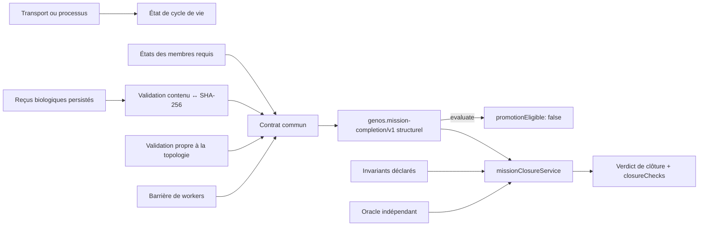
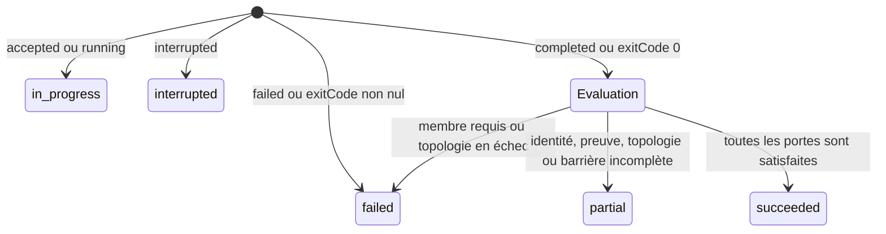

# Contrat commun de complétion de mission

- **Statut** : implémenté pour les consommateurs listés dans ce document
- **Portée** : backend Node, reçus biologiques persistés et clôture de mission
- **Schéma de sortie** : `genos.mission-completion/v1`
- **Dernière revue** : 2026-10-20

Ce contrat transforme un état d'exécution, une liste de membres et des preuves
liées à leur contenu en un verdict de mission. Il ne déduit jamais une réussite
métier d'un transport réussi, d'un PID terminé, d'un dispatch accepté ou d'un
simple champ `completed`.

L'implémentation normative est
[`missionCompletionContract.js`](../../backend/src/services/missionCompletionContract.js).
La gate décisionnelle qui ajoute invariants et oracle indépendant est
[`missionClosureService.js`](../../backend/src/services/missionClosureService.js).
La collecte des reçus persistés est portée par
[`missionCompletionEvidenceService.js`](../../backend/src/services/missionCompletionEvidenceService.js).
La décision d'architecture correspondante est l'[ADR 0654](../adr/0654-contrat-commun-completion-et-preuves-liees.md).

## 1. Frontière de confiance



Le contrat répond à une seule question : les conditions techniques déclarées
pour cette clôture sont-elles toutes présentes et cohérentes dans leur portée ?
Il ne répond ni à la qualité produit, ni à l'utilité de la solution, ni à son
éligibilité à la promotion.

| Signal amont | Ce qu'il établit | Ce qu'il n'établit pas |
| --- | --- | --- |
| Dispatch accepté | Une commande a franchi l'admission | Qu'elle a démarré ou terminé |
| Code de sortie `0` | Le processus s'est terminé sans erreur système déclarée | Que les workers requis ont fourni une preuve valide |
| Membre `completed` | Le membre déclare sa terminaison | Que son reçu est authentique et lié à cette mission |
| Topologie `verified` | Les invariants propres à la topologie ont été relus | Que chaque membre requis est prouvé |
| Verdict structurel `succeeded` | Les portes structurelles de ce contrat sont satisfaites | Les invariants, l'oracle indépendant ou une promotion |
| Verdict de clôture `succeeded` | Structure, workers, preuves, invariants et oracle sont satisfaits | Une promotion effectivement exécutée, une vérité scientifique ou une acceptation métier |

### 1.1 Modèle logique

Pour une mission $m$, soient :

- $L(m)$ : l'exécution est dans l'état terminal `completed` ;
- $R(m)$ : le roster requis est non vide, unique et entièrement observé ;
- $W(m)$ : chaque membre requis est terminé sans état d'échec ;
- $P(m)$ : chaque membre requis possède au moins une preuve admissible ;
- $T(m)$ : la validation propre à la topologie vaut `verified` ;
- $B(m)$ : aucune barrière de workers n'est partielle.

Le succès technique est défini par :

$$
Succeeded(m) \iff L(m) \land R(m) \land W(m) \land P(m) \land T(m) \land B(m)
$$

Cette formule décrit le verdict structurel de `evaluate`. La gate
`closeMission` exige en plus un ensemble non vide d'invariants vrais et un
oracle indépendant dont le reçu est lié à la mission et aux preuves admises :

$$
ClosureSucceeded(m) \iff Succeeded(m) \land Invariants(m)
\land IndependentOracle(m)
$$

Cette conjonction est volontairement stricte. Une condition absente ne devient
pas vraie par défaut. Un échec explicite de membre ou de topologie domine les
conditions incomplètes ; sinon toute condition inconnue ou manquante produit
`partial`.

L'admissibilité d'une preuve $p$ pour une mission $m$ et un membre $w$ est :

$$
Admissible(p,m,w) \iff Exists(p) \land Hash(Content(p))=Ref(p)
\land Mission(p)=m \land Member(p)=w \land Verified(Content(p))
$$

`Hash` désigne ici le digest canonique du service de preuve, préfixé par
`sha256:`. Cette propriété donne une liaison de contenu ; elle ne donne pas une
signature ni une identité cryptographique du producteur.

## 2. Entrée canonique

`evaluate(input)` accepte les champs suivants :

| Champ | Forme | Règle |
| --- | --- | --- |
| `missionId` | chaîne attendue | Identité à retrouver dans chaque preuve ; son absence empêche la collecte durable |
| `topology` | chaîne ou `null` | Portée informative conservée dans le reçu |
| `lifecycleState` | chaîne | `accepted`, `running`, `completed`, `failed` ou `interrupted` sont interprétés explicitement |
| `requiredMemberIds` | tableau de chaînes | Non vide, sans doublon ni identité blanche |
| `members` | tableau | Chaque entrée expose `memberId` ou `workerId`, `status` et `evidenceRefs` |
| `evidenceProofs` | tableau | Objets `{ reference, content }` dont le contenu est adressé par SHA-256 |
| `topologyValidation` | objet | `status` vaut `verified`, `partial` ou `failed`; `reasons` est optionnel |
| `barrierStatus` | chaîne optionnelle | `partial` interdit un verdict de réussite |
| `reason` | chaîne optionnelle | Motif propagé pour une exécution échouée ou interrompue |

`closeMission(input)` accepte en plus :

| Champ | Forme | Règle |
| --- | --- | --- |
| `invariants` | tableau `{ id, passed }` | Non vide, identifiants présents et booléens explicites |
| `oracle` | objet | Statut vérifié, indépendance explicite, vérificateurs uniques, reçu intègre et preuves disponibles |
| `producerId` | chaîne ou `null` | Ne peut pas apparaître parmi les vérificateurs indépendants |

Un appel sans liste valide de membres requis ne peut pas réussir. Ajouter des
membres facultatifs n'affaiblit pas les exigences des membres requis. Deux
entrées de `members` portant la même identité rendent l'identité globale
invalide, même si l'une des deux possède une preuve valide.

## 3. Identité des membres

L'identité d'un membre est lue depuis `memberId`, puis `workerId`. Pour chaque
identifiant requis, le contrat exige exactement une entrée correspondante.

La preuve peut exprimer son identité de mission sous `missionId` ou
`correlation.missionId`. L'identité de membre est recherchée, dans l'ordre,
sous `memberId`, `workerId`, `agentId` ou `correlation.agentId`.

Une preuve valide pour une autre mission, un autre worker ou un agent absent de
la liste requise est rejetée. Une référence de preuve correcte ne permet donc
pas de transférer un succès entre deux missions.

## 4. Liaison cryptographique des preuves

Une référence de preuve doit respecter exactement la forme :

```text
sha256:<64 caractères hexadécimaux>
```

Le backend recalcule l'empreinte canonique du champ `content` avec le même
service que les contrats de preuve. Cette empreinte doit être égale à
`reference`. Le contenu est accepté comme vérifié dans l'un des deux cas :

- `content.state === "verified"` ;
- `content.result.status === "completed"` et
  `content.result.verified === true`.

Le nom du fichier, l'identifiant du reçu ou la présence d'une chaîne ressemblant
à un hash ne suffisent pas. La preuve doit être disponible, décodable, liée au
bon membre et au bon `missionId`, puis porter un état vérifié reconnu.

L'ordre de contrôle est important pour l'audit :

1. indexer uniquement les objets possédant une référence SHA-256 valide ;
2. conserver un seul objet par référence afin qu'un doublon ne puisse pas
   remplacer le contenu déjà indexé ;
3. résoudre chaque référence annoncée par le membre ;
4. recalculer le digest du contenu résolu ;
5. extraire les identités de mission et de membre depuis le contenu ;
6. comparer ces identités à l'entrée de la clôture ;
7. vérifier l'état attesté par le reçu ;
8. n'exposer la référence dans la sortie que si tous ces contrôles passent.

Le contrat applique une règle « toutes les références annoncées sont valides ».
Un membre qui annonce une preuve valide et une preuve introuvable reste donc
incomplet. Cette règle empêche l'ajout d'une référence décorative ou ambiguë à
un dossier autrement valide.

### 4.1 Priorité de la persistance

Quand `missionCompletionEvidenceService.collect` reçoit une base, il ignore les
preuves fournies par l'appelant et relit `biological_worker_receipts`. Le hash
persisté devient la référence `sha256:<payload_hash>` et le JSON est revérifié
par le store biologique. Le reçu le plus récent par membre est retenu.

Sans base, le service accepte les preuves fournies pour les tests et les
adaptateurs en mémoire. Ce mode n'offre pas la garantie de provenance SQLite et
ne doit pas être décrit comme une relecture durable.

## 5. Validation propre à la topologie

La validation des membres ne remplace pas celle de la topologie. Le producteur
doit fournir une décision distincte :

| `topologyValidation.status` | Effet |
| --- | --- |
| `verified` | La porte topologique laisse poursuivre l'évaluation |
| `partial` | Verdict final au plus `partial` |
| `failed` | Verdict final `failed` |
| absent ou inconnu | `partial`, motif `topology_validation_missing` |

Les `reasons` fournis par la topologie sont propagés. En leur absence, le
contrat produit respectivement `topology_validation_partial` ou
`topology_validation_failed`.

Cette séparation permet à Syncytium de vérifier son état partagé, à une mission
biologique de vérifier sa barrière et à un autre runtime de contrôler ses
invariants sans dupliquer les règles d'identité et de preuve.

## 6. Automate et précédence des verdicts



La précédence est stricte : `failed` l'emporte sur `partial`, qui l'emporte sur
`succeeded`. Ainsi, une topologie partielle ne masque pas un worker échoué et
une preuve manquante ne devient pas valide parce que le processus a quitté avec
le code `0`.

`closeMission` conserve cette précédence. Un invariant faux ou un oracle dont
le statut vaut `failed` renforce le verdict en `failed`; un invariant absent,
un reçu d'oracle invalide ou un vérificateur non indépendant produit `partial`.

| État de cycle de vie | Verdict | Motif par défaut |
| --- | --- | --- |
| `accepted`, `running` | `in_progress` | `execution_not_terminal` |
| `failed` | `failed` | `execution_failed` |
| `interrupted` | `interrupted` | `execution_interrupted` |
| `completed` | évalué par les portes | dépend des observations |
| autre | `partial` | `execution_state_unknown` |

`processOutcome(input)` projette une interruption explicite vers
`interrupted`, un `exitCode` non nul vers `failed` et un code zéro vers
`completed`, puis applique toutes les portes. `dispatchAccepted(input)` produit
toujours un état `in_progress`.

## 7. Schéma de sortie

```json
{
  "schema": "genos.mission-completion/v1",
  "missionId": "mission-42",
  "topology": "syncytium",
  "lifecycleState": "completed",
  "verdict": "succeeded",
  "terminal": true,
  "success": true,
  "requiredMemberIds": ["worker-a"],
  "completedMemberIds": ["worker-a"],
  "evidenceRefs": ["sha256:…"],
  "reasons": [],
  "promotionEligible": false
}
```

`success` est dérivé exclusivement de `verdict === "succeeded"`.
`terminal` décrit le cycle de vie (`completed`, `failed`, `interrupted`) et non
la validité du résultat. `completedMemberIds` est un relevé des membres déclarés
terminés ; il ne remplace pas `evidenceRefs`.

La sortie de `closeMission` conserve ce schéma et ajoute :

```json
{
  "promotionEligible": true,
  "closureChecks": {
    "requiredWorkers": true,
    "invariants": true,
    "independentOracle": true,
    "evidence": true
  }
}
```

`promotionEligible: true` signifie uniquement que la gate technique autorise
une étape de promotion ultérieure. Le service n'exécute aucune promotion et ne
confère aucune autorité métier supplémentaire.

## 8. Motifs de refus

| Motif | Cause probable | Action opérateur |
| --- | --- | --- |
| `execution_not_terminal` | Dispatch admis ou run encore actif | Attendre un état terminal ; ne pas forcer la clôture |
| `execution_state_unknown` | État non reconnu | Corriger l'adaptateur de cycle de vie |
| `member_identity_invalid` | Liste requise vide, doublon, identité blanche ou membre dupliqué | Reconstruire le roster canonique |
| `required_member_missing` | Un membre requis n'est pas présent | Réconcilier le dispatch et les membres observés |
| `required_member_failed` | État `failed`, `error`, `cancelled` ou `blocked` | Diagnostiquer le membre ; une preuve ancienne ne l'annule pas |
| `required_member_evidence_invalid` | Référence absente, hash invalide, contenu divergent ou mauvaise corrélation | Relire le reçu biologique et sa portée |
| `topology_validation_missing` | Aucun vérificateur topologique reconnu | Exécuter la validation propre à la topologie |
| `worker_barrier_partial` | Barrière déclarée partielle | Attendre ou résoudre les workers manquants |
| `completion_invariants_missing` | Aucun invariant exploitable n'a été fourni à la gate | Construire les invariants depuis la source autoritative |
| `completion_invariant_failed` | Au moins un invariant explicite est faux | Corriger l'état ou conserver l'échec |
| `independent_oracle_missing` | Oracle absent, non indépendant, mal scellé ou non lié aux preuves | Rejouer le vérificateur autorisé et produire son reçu |
| `independent_oracle_failed` | L'oracle a explicitement rejeté le résultat | Conserver l'échec et diagnostiquer le résultat |
| `required_evidence_missing` | La gate ne dispose pas d'une preuve admise par membre requis | Relire ou produire les reçus manquants |

Les motifs sont cumulatifs. Le tableau `reasons` peut donc contenir plusieurs
causes, même quand une seule suffit à déterminer le verdict final.

## 9. Consommateurs et intégrations

Le contrat structurel est consommé par Syncytium et par la gate commune. Les
clôtures biologiques non-Syncytium, la barrière de preuves workers et A-Team
appellent `closeMission` afin d'ajouter invariants et oracle indépendant. Il est
également utilisé par la
projection de statut terminal des agents et par l'interprétation de sortie de
processus. [`missionEvidenceCollector.js`](../../backend/src/services/missionEvidenceCollector.js)
agrège en plus agents, dossiers workers, runs, télémétrie et homéostasie.

La présence d'une exécution ou d'une télémétrie ne devient pas automatiquement
une preuve de tests. Le collecteur conserve notamment `testsPassed: false` et
`verifierReceiptPresent: false` tant qu'une source qualifiée ne les remplace
pas. Cette règle empêche une trace d'activité de devenir une attestation.

### 9.1 Contrat d'un adaptateur topologique

Une nouvelle topologie ne doit pas modifier `missionCompletionContract` pour y
ajouter ses invariants. Son adaptateur doit :

1. exécuter ses propres oracles sur la source autoritative ;
2. produire `{ status, reasons }` avec un statut parmi `verified`, `partial` et
   `failed` ;
3. construire un roster requis stable et non vide ;
4. transmettre les résultats des membres sans convertir un échec en succès ;
5. faire collecter les preuves depuis la persistance quand une base existe ;
6. choisir explicitement `evaluate` pour un verdict structurel ou
   `closeMission` pour une clôture avec invariants et oracle ;
7. projeter les anciens champs uniquement depuis ce verdict.

Exemple minimal de l'étage structurel :

```javascript
const completion = require('./missionCompletionContract');
const evidence = await completionEvidence.collect({
  db,
  missionId,
  members: workerResults
});

const result = completion.evaluate({
  missionId,
  topology: 'example',
  lifecycleState: 'completed',
  requiredMemberIds: evidence.members.map(member => member.memberId),
  members: evidence.members,
  evidenceProofs: evidence.evidenceProofs,
  topologyValidation: await validateExampleTopology(),
  barrierStatus: 'complete'
});
```

Pour une clôture décisionnelle, transmettre cette même entrée à
`missionClosureService.closeMission` avec `invariants`, `oracle` et
`producerId`. Remplacer ces champs par des constantes positives dans un
adaptateur de production contournerait la gate ; ils doivent provenir des
sources autoritatives de la topologie et du vérificateur.

Un adaptateur ne doit pas marquer `topologyValidation: verified` simplement
parce que les workers sont `completed`. La valeur doit résulter d'une lecture
des invariants et oracles qui appartiennent réellement à cette topologie.

### 9.2 Compatibilité des projections historiques

Les consommateurs historiques peuvent encore lire `complete`, `success` et
`status` sur la sortie biologique. Ces champs sont des projections :

```text
completionContract.verdict == succeeded  → complete=true, success=true, status=completed
completionContract.verdict == failed     → complete=false, success=false, status=failed
completionContract.verdict == partial    → complete=false, success=false, status=partial
```

Un consommateur nouveau doit conserver le reçu `completionContract` complet,
notamment `reasons` et `evidenceRefs`. Lire uniquement `complete` détruit
l'information nécessaire au diagnostic et rend impossible la distinction entre
preuve absente, invariant violé et worker manquant.

## 10. Exemple de rejet attendu

Un processus termine avec `exitCode: 0`, le worker est `completed` et une
référence SHA-256 est fournie. Si le contenu référencé porte un autre
`missionId`, le résultat reste :

```json
{
  "verdict": "partial",
  "success": false,
  "reasons": ["required_member_evidence_invalid"],
  "promotionEligible": false
}
```

Corriger le hash pour qu'il pointe vers le même contenu ne suffit pas si
l'identité interne reste étrangère à la mission. Il faut produire et persister
un nouveau reçu issu du worker concerné.

## 11. Validation et tests

Les contrôles ciblés sont :

```powershell
node backend/tests/test_syncytium_completion_contract.js
node backend/tests/test_common_mission_closure.js
node backend/tests/test_mission_completion_evidence_gate.js
node backend/tests/test_biological_mission_completion.js
node backend/tests/test_syncytium_mission_completion.js
```

Le premier exerce le contrat structurel ; le deuxième falsifie invariants,
oracle et preuves de la gate ; le troisième vérifie la gate ontogénétique ; les
deux derniers couvrent les intégrations biologiques et Syncytium. Un passage de
ces tests qualifie ce périmètre ciblé, pas l'ensemble du dépôt ni les topologies
non appelées.

### 11.1 Matrice de falsification minimale

Tout consommateur ajouté doit au minimum conserver les contre-exemples suivants :

| Mutation injectée | Verdict attendu | Propriété falsifiée |
| --- | --- | --- |
| Roster vide | `partial` | une mission sans worker ne réussit pas vacuement |
| Membre requis absent | `partial` | le roster ne peut pas être réduit après exécution |
| Membre requis `error` | `failed` | une preuve ancienne ne masque pas l'échec courant |
| Référence sans objet | `partial` | la syntaxe du hash n'établit pas l'existence |
| Contenu modifié après calcul du hash | `partial` | l'intégrité est recalculée |
| `missionId` remplacé | `partial` | la preuve n'est pas transférable entre missions |
| `workerId` remplacé | `partial` | la preuve n'est pas transférable entre membres |
| Topologie `partial` avec workers valides | `partial` | la preuve worker ne remplace pas les invariants |
| Topologie `failed` avec preuve valide | `failed` | l'échec topologique garde la précédence |

### 11.2 Observabilité attendue

La sortie commune est elle-même un reçu de décision, mais elle ne remplace pas
les objets qu'elle référence. Les traces et rapports doivent conserver :

- `missionId`, `topology`, `lifecycleState` et `verdict` ;
- le roster requis et les membres déclarés terminés ;
- les `evidenceRefs` admises, sans recopier des secrets éventuels du contenu ;
- tous les `reasons`, même lorsqu'un motif plus fort détermine déjà le verdict ;
- les quatre `closureChecks` lorsqu'une gate de clôture a été appliquée ;
- le reçu topologique source (`stateValidation` pour Syncytium) ;
- la révision du code et les commandes de validation pour une qualification.

La procédure d'exploitation et les requêtes de lecture sont documentées dans
[Clôture des missions : diagnostic et reprise](../04-exploitation/cloture-missions.md).

## 12. Limites et non-objectifs

- Le contrat n'authentifie pas à lui seul le producteur externe d'un reçu.
- SHA-256 lie le contenu à sa référence ; il ne constitue pas une signature.
- `succeeded` ne remplace pas l'oracle métier, la revue humaine ou une gate de
  promotion.
- `evaluate` conserve toujours `promotionEligible: false`; `closeMission` peut
  le rendre vrai uniquement après workers, preuves, invariants et oracle.
- La collecte SQLite lit les reçus biologiques ; les autres familles de preuve
  doivent fournir un adaptateur explicite et conserver leur portée.
- Le contrat n'annule pas un effet externe et ne rend pas une API distante
  transactionnelle.

## Voir aussi

- [API et contrats](api-et-contrats.md#statuts-et-preuves)
- [Épistémologie et evidence](../01-concepts/epistemologie-et-evidence.md)
- [Runtime Syncytium](runtime-syncytium.md)
- [Runbook de clôture](../04-exploitation/cloture-missions.md)
- [Qualification du 2026-10-20](../06-qualite-preuves/qualification-contrat-completion-2026-10-20.md)
- [ADR 0654 — contrat commun de complétion](../adr/0654-contrat-commun-completion-et-preuves-liees.md)
