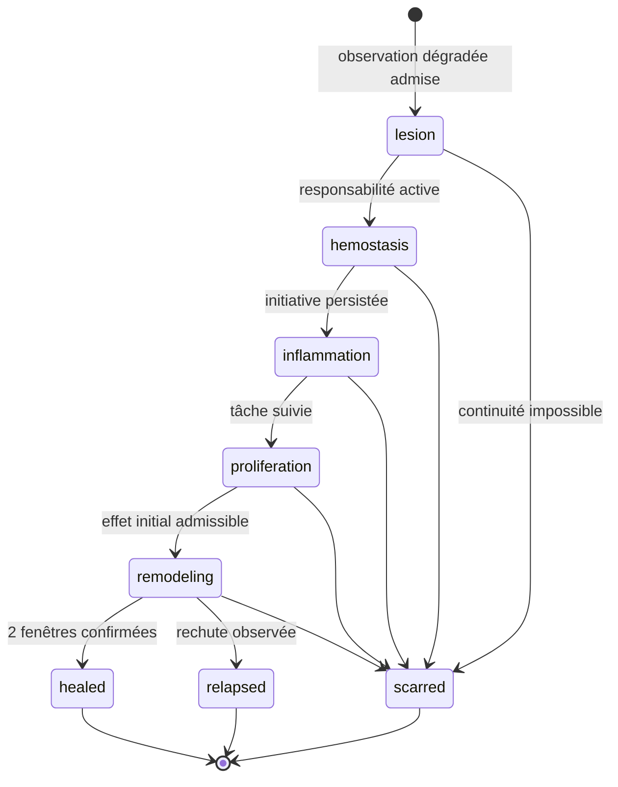

# Exploiter SHEV

- **Statut** : contrats et cycle de cicatrisation implémentés ; fournisseur métier et qualification de terrain à fournir.
- **Portée** : délégation, capteurs, initiatives, effets, réconciliation et dossiers de cicatrisation SHEV.
- **Dernière revue** : 2026-10-19.
- **Architecture** : [SHEV](../02-orchestration/shev.md), [ADR 0333](../adr/0333-boucle-shev-et-reconciliation-durable.md).
- **Qualification** : [campagne ciblée SHEV, GVX et chaîne d'approvisionnement](../06-qualite-preuves/qualification-servicenow-kore-gitlab-2026-10-19.md).

## Prérequis et frontière d’autorité

Le projet existe dans Ontogenèse, ses migrations sont appliquées et son contrôle
est `running`. Le runtime Node dispose des dépendances du backend. La CLI est
administrative et locale : l’accès au compte système et à la base doit être
contrôlé. `authorityRef` documente la délégation initiale ; il n’authentifie pas
un utilisateur distant. Aucun endpoint HTTP ni outil MCP supplémentaire n’est
introduit par cette tranche.

```bash
npm --prefix backend run shev -- --help
node backend/bin/genos-shev.cjs status --input project.json
```

`project.json` contient `{"projectId":"projet-a"}`. Chaque commande lit un
fichier JSON de taille maximale 1 Mio. Utiliser la même configuration de base
que le backend. Conserver les clés privées hors du dépôt et des observations.

## Procédure d’installation

1. `register` : délégation initiale avec `projectId`, `authorityRef`,
   `authorityPublicKey` Ed25519 et `mandate`.
2. `revise` : signature de `mandate-revision`, version attendue, mandat et stade
   `observing`, `assisted` ou `delegated`. Les attentes et critères existants
   doivent être conservés exactement ; des ajouts sont possibles.
3. `enroll-sensor` : inscrire chaque contrat signé sous la version courante.
4. Lancer le tick Ontogenèse habituel, ou `tick` pour un passage opérateur.
5. Consulter `status` et les événements Ontogenèse. Une pause suspend la boucle.

Une révision invalide l’admission des anciens capteurs, tâches et jobs. Inscrire
de nouveaux capteurs sous des identifiants distincts pour le mandat courant ;
ne pas modifier les contrats historiques. Les délégations héritées sans clé
publique requièrent une nouvelle délégation administrative vérifiée.

## Signature canonique

La signature porte sur `JSON.stringify(authorizationPayload(input))`, avec
canonicalisation récursive des détails. Le service construit les mêmes détails
à partir des paramètres de la commande : toute modification invalide la signature.

```js
const { sign, randomUUID } = require('node:crypto');
const { authorizationPayload } = require('./backend/src/services/shev/authorityService');
const payload = authorizationPayload({
  operation: 'sensor-enrollment', projectId: 'projet-a',
  subjectId: 'contract-v2', expectedVersion: 2,
  details: sensorContract(input), nonce: randomUUID(),
  expiresAt: new Date(Date.now() + 3600000).toISOString()
});
input.authorization = {
  nonce: payload.nonce, expiresAt: payload.expiresAt,
  signature: sign(null, Buffer.from(JSON.stringify(payload)), privateKey).toString('base64')
};
```

Dans cet extrait, `sensorContract` est exporté par
`backend/src/services/shev/sensorService.js`, `input` désigne le contrat ci-dessous
et `privateKey` provient du coffre opérateur. Le nonce est consommé une seule fois
dans la transaction. L’expiration ne doit pas être passée.

| Commande | Opération signée | Sujet | Détails |
| --- | --- | --- | --- |
| `revise` | `mandate-revision` | `projectId` | `{mandate, stage}` |
| `enroll-sensor` | `sensor-enrollment` | `id` | `sensorContract(input)` |
| `approve-initiative` | `initiative-approval` | `initiativeId` | `{budget, stopCondition, alternative}` |
| `decline-initiative` | `initiative-abstention` | `initiativeId` | `{reason}` |
| `approve-recovery` | `recovery-approval` | `monitoringId` | plan normalisé persisté |
| `reconcile-recovery` | `recovery-reconciliation` | `monitoringId` | reçu inspecté |
| `approve-development` | `development-approval` | `initiativeId` | `developmentDetails(input)` |
| `reconcile-development` | `development-reconciliation` | `initiativeId` | `{gvxEventId}` du reçu inspecté |
| `register-protocol` | `longitudinal-registration` | `id` | `protocolDetails(input)` |

Les dates normalisées utilisent ISO UTC. Employer les fonctions exportées
`developmentDetails` et `protocolDetails` pour préparer les contrats correspondants.

## Capteurs et racines de lecture

Exemple de corps pour `enroll-sensor`, avant ajout de la signature :

```json
{
  "id": "contract-v2", "projectId": "projet-a", "expectedVersion": 2,
  "adapter": "json-contract", "dimension": "contrat", "intervalMs": 60000,
  "config": {
    "relativePath": "contract.json", "target": "integration",
    "pointer": "/ready",
    "expectedSha256": "b5bea41b6c623f7c09f1bf24dcae58ebab3c0cdd90ad966bc43a45b44867e12b"
  }
}
```

Le hash de l’exemple correspond à la valeur JSON `true`, sérialisée sans espace.
Le seuil et la cible sont liés à la source : la relecture ne peut pas employer
un critère différent pour fabriquer une réussite.

| Adaptateur | Configuration | Mesure et limite |
| --- | --- | --- |
| `json-contract` | chemin, cible, pointeur, `expectedSha256` | Fichier JSON régulier ≤ 1 Mio, valeur comparée par hash. |
| `data-freshness` | chemin, cible, `maxAgeMs` positif | Date de modification ; ne certifie pas le contenu ni le pipeline entier. |
| `web-audit` | `url`, `lighthouse`, `axe` et/ou `journey` | Audits web indépendants avec preuves ; outillage navigateur requis. |
| `production-telemetry` | `eventType`, `deploymentId`, `windowMs`, seuils SLO | Sommaires de requêtes production agrégés sur fenêtre (≤ 5000 événements) : requêtes, erreurs, latence ; idempotence par empreinte de fenêtre. Alimente la [cicatrisation de production](../04-exploitation/cicatrisation-production.md). |

`target: "project"` lit la racine du projet (défaut). `"integration"` lit le
worktree d’intégration géré par Ontogenèse et observe les modifications réellement
intégrées. Les chemins traversants, sensibles et les liens symboliques sont
refusés. Les capteurs locaux ne permettent pas de charger du code arbitraire.
Les hôtes web doivent être autorisés par `GENOS_BROWSER_VERIFICATION_HOSTS` ;
les contrats web sont détaillés dans [ADR 0310](../adr/0310-audits-web-shev-independants.md).

Le tick prélève au plus vingt capteurs courants. Les jobs persistent l’observation
et reprennent cette preuve lors d’un retry, au plus trois tentatives. Les états
inchangés, mesures post-application et contrôles de surveillance n’engendrent pas
de nouvelle initiative. Une alerte existante dirige la reprise vers le circuit
de récupération contrôlée. La responsabilité active empêche la génération d’un
backlog générique de remplissage quand aucun besoin SHEV n’est admissible.

## Actions métier et expériences GVX

L’opérateur installe un module Node de confiance et fixe :

```text
GENOS_SHEV_ACTION_MODULE=<chemin absolu du module>
GENOS_SHEV_ACTION_SHA256=<SHA-256 des octets du module>
```

Le digest est relu avant chargement. Les imports de ce module restent sous la
responsabilité de l’opérateur ; ce mécanisme n’isole pas un processus arbitraire.
Aucune observation ni entrée JSON ne peut choisir un module ou un callback.

| Export | Entrée principale | Sortie attendue |
| --- | --- | --- |
| `performRecovery` | plan, monitoringId, idempotencyKey, signal | `result: applied`, externalReceiptRef, evidenceRefs, spentUsd, seconds |
| `verifyRecoveryReconciliation` | reçu, plan, idempotencyKey | verified, verifierRef, evidenceRefs |
| `performDevelopment` | db, request, scope, budget, idempotencyKey, signal | gvxEventId, evidenceRefs, spentUsd, seconds |
| `verifyProgress` | transfert et fenêtres réservées | verifierRef, trainingManifestHash, cases avec baseline/candidat/direction/régression/preuves |
| `reconcileDevelopment` | db, job, idempotencyKey | reçu d’expérience inspecté, de même forme que performDevelopment |
| `verifyQualitativeReferences` | cas de référence | verified, verifierRef distinct, au moins trois evidenceRefs |
| `verifyLongitudinalReferences` | séries des trois références | verified, verifierRef, evidenceRefs |

Le fournisseur doit honorer l’idempotence et l’annulation, appliquer le plan
borné et vérifier les artefacts hors du contrôle du candidat. Le job GVX est
autorisé par organisation, projet et agent. Le fournisseur conduit les étapes
GVX et produit un événement de transfert vérifié ; un simple callback réussi
ne suffit pas à fabriquer le reçu de progrès.

Les initiatives de risque/opportunité réservent cumulativement jetons, dollars
et secondes à chaque dispatch. Le budget restant et l’échéance limitent les
tentatives suivantes ; aucune dépense inconnue n’est remboursée implicitement.
`on-failed-check` arrête après un échec de vérification. L’alternative est
transmise au harness. Le fournisseur d’action métier doit appliquer la condition
d’arrêt du plan et ne peut traiter une annulation comme une preuve de rollback.

## Récupération, arrêt et rollback

1. Consulter le reçu `regressed` et son artefact, puis proposer le plan avec
   `propose-recovery`.
2. Signer `approve-recovery` après examen du budget, arrêt et alternative.
3. Le tick réclame le job et son token avant l’action. Une interruption laisse
   le résultat inconnu en `executing`.
4. Relire l’état externe par la clé d’idempotence. Signer le reçu inspecté et
   appeler `reconcile-recovery`. Ne pas remettre directement la ligne en `approved`.
5. Une application confirmée programme une nouvelle mesure. Seul ce contrôle
   peut démontrer que la récupération métier a fonctionné.

Une pause Ontogenèse arrête les nouvelles exécutions. La réconciliation d’un
effet déjà produit peut être consignée pendant la pause ; sa surveillance attend
la reprise autorisée. Après `not-applied`, une nouvelle signature est nécessaire
pour réessayer et la limite de tentatives continue de s’appliquer.

Pour le développement, une interruption suit le même principe avec
`reconcile-development`. Le manifeste complet d’entraînement et les contextes
réservés doivent rester inspectables. Aucun reçu expérimental ne remplace un
reçu d’effet sur le projet.

## Calibration et préenregistrement

`calibrate`, `judge` et `disagreement` conservent grille, références, identités,
publics et désaccords. Des notes répétées d’un même évaluateur ne créent pas de
quorum. La commande `disagreement` peut fournir `audience` pour un résumé ciblé.

Avant toute campagne, utiliser `register-protocol` avec `dimension`,
`executionMode: accelerated|field`, `conditions` (modelRef, toolsRef,
permissionsHash, budgetUsd) et `confounders`. `compare` fournit `protocolId`,
les périodes traitées et les trois références préenregistrées. Chaque période
porte `conditionsHash`, `exposure`, `regressions`, `recoveryMinutes`, `costUsd`
et `evidenceRefs`. Le cutoff persistant interdit de transformer des mesures
déjà présentes en campagne préenregistrée par une date déclarative.

## Diagnostic et validation

| Symptôme | Vérification opérateur |
| --- | --- |
| Aucun capteur ne tourne | responsabilité active, mode running, version, date due, claim Ontogenèse |
| Job blocked | champ error, chemin/cible, preuve, comparabilité et configuration fournisseur |
| Signature refusée | clé inscrite, détail normalisé exact, nonce neuf, expiration et version |
| Job executing après interruption | inspection externe puis réconciliation, jamais retry aveugle |
| Récupération applied sans résultat vert | attendre le prélèvement et lire le nouveau reçu de surveillance |
| Effet inconclusif | preuve absente/insuffisante ; corriger le capteur ou son domaine sans assouplir le mandat |
| Transfert refusé | scope, observation source, manifeste, deux cas réservés distincts, preuves vérifiées |

Exécuter `npm --prefix backend run test:shev`, `test:web-audits` et
`test:ontogenesis`, puis les gates globaux du dépôt. Le scénario sur deux domaines
utilise un worker injecté et des opérations Git/SQLite réelles. Les séries
longitudinales des tests sont synthétiques ; elles ne prouvent pas une campagne
de terrain, un gain causal ni la fiabilité d’un fournisseur métier réel.

## Inspection du cycle de cicatrisation

Le tick Ontogenèse ouvre et réconcilie automatiquement un épisode pour chaque
dégradation observée admise sous la version courante du mandat. L'opérateur peut
construire le dossier sans déclencher d'action :

```js
const { getHealingDossier } = require('../../backend/src/services/shev/healingDossierService');

const dossier = await getHealingDossier(db, { projectId, episodeId });
```

Contrôler `timeline`, `evidenceRefs` et `digest` avant toute interprétation. Les
valeurs `claims.causalAttribution = not_claimed` et
`claims.fieldQualification = not_established` sont normatives : une phase
`healed` signifie seulement que le protocole local a reçu un effet initial et
deux fenêtres longitudinales confirmées. Elle ne prouve ni causalité métier, ni
supériorité générale, ni qualification en production.

## Machine d'état du cycle de cicatrisation

La cicatrisation est une projection durable de faits déjà admis par SHEV. Elle
ne remplace ni le mandat, ni l'initiative, ni le reçu d'effet, ni les fenêtres
de surveillance. L'automate autorise les transitions suivantes :

| Phase courante | Transition normale | Sens opérationnel |
| --- | --- | --- |
| `lesion` | `hemostasis` | Une initiative liée à l'observation existe ; le périmètre délégué est figé. |
| `hemostasis` | `inflammation` | L'initiative est en file et sa tâche Ontogenèse existe. |
| `inflammation` | `proliferation` | La tâche est en cours ou terminée ; la réparation isolée est engagée. |
| `proliferation` | `remodeling` | Un effet initial non inconclusif et non régressif est disponible ; la surveillance commence. |
| `remodeling` | `healed` | Deux fenêtres longitudinales confirmées satisfont le protocole local. |
| toute phase non terminale | `scarred` | La continuité est préservée, mais le parcours ne peut plus conclure à une guérison locale. |
| `healed`, `relapsed`, `scarred` | aucune | Les phases terminales sont immuables. Un nouvel épisode exige une nouvelle observation source. |

`relapsed` est une issue terminale réservée à une rechute constatée par les
faits de suivi. Le code n'autorise pas un retour silencieux vers une phase
antérieure : la rechute doit rester visible comme issue du premier épisode et
une nouvelle observation peut ouvrir un nouvel épisode.



## Persistance et invariants SQLite

La migration `147-shev-healing-cycle` crée deux journaux complémentaires :

| Table | Rôle | Invariant principal |
| --- | --- | --- |
| `shev_healing_episodes` | Identité, source, mandat, phase courante et dates de l'épisode. | Un seul épisode par `(project_id, source_observation_id)`. |
| `shev_healing_events` | Historique ordonné des transitions et preuves associées. | Les événements sont append-only. |

Les déclencheurs SQLite refusent la suppression des épisodes et événements. Ils
refusent aussi la modification de l'identité, de l'observation source, de la
version de mandat et de la date d'ouverture. La phase courante est mise à jour
avec une condition optimiste sur la phase attendue : deux réconciliations
concurrentes ne peuvent donc pas consommer la même transition comme si elles
étaient toutes deux premières.

L'identifiant d'épisode est déterministe sur `projectId` et `observationId`.
L'ouverture utilise une insertion idempotente : relancer le tick pour la même
observation ne crée ni second épisode, ni seconde lésion. Cette propriété ne
rend pas l'effet métier idempotent ; elle rend seulement la projection de suivi
rejouable.

## Ouverture et ordre de réconciliation

Un épisode n'est ouvert que si les deux conditions sont simultanément vraies :

1. le projet porte une responsabilité SHEV active sous le mandat courant ;
2. une observation persistée décrit une dégradation admise.

À chaque tick Ontogenèse, la boucle SHEV traite d'abord les capteurs et les
initiatives, puis compile les tâches en attente. La réconciliation de
cicatrisation intervient ensuite, avant le rechargement du contexte du projet.
Elle examine au plus vingt épisodes du projet et applique au plus cinq
transitions par épisode et par passage. Ces bornes empêchent un historique très
long de monopoliser un tick.

La réconciliation ne demande pas au modèle de choisir une phase. Elle dérive la
transition à partir des lignes persistées : initiative, tâche, effet et fenêtres
de surveillance. Une absence de fait laisse l'épisode dans sa phase actuelle ;
elle n'est pas convertie en réussite implicite.

| Transition | Faits minimaux inspectés | Preuve attendue |
| --- | --- | --- |
| `lesion → hemostasis` | initiative liée à l'observation | identifiant de l'initiative |
| `hemostasis → inflammation` | initiative `queued` et tâche Ontogenèse liée | identifiants de l'initiative et de la tâche |
| `inflammation → proliferation` | tâche `doing` ou `done` | identifiant et état de la tâche |
| `proliferation → remodeling` | effet initial reçu, non `inconclusive` et non `regressed` | reçu d'effet et références de preuve |
| `remodeling → healed` | deux fenêtres longitudinales confirmées | références distinctes des deux fenêtres |
| `* → scarred` | impossibilité terminale explicitement constatée | raison et preuves de la cicatrice |

## Contrat du dossier de cicatrisation

`getHealingDossier` construit une vue de lecture stable de schéma
`genos.shev-healing-dossier/v1`. Le dossier contient :

- l'identité de l'épisode et sa phase courante ;
- le contexte de responsabilité, de mandat et d'observation ;
- la chronologie complète des événements ;
- les références de preuve dédupliquées ;
- un digest du contenu canonique ;
- les limites de revendication opposables.

La construction refuse une chronologie incomplète ou incohérente : origine sans
séquence 1 ou avec une source non nulle, trou de séquence, rupture entre la
destination d'un événement et la source du suivant, ou divergence entre la
dernière destination et la phase courante. La légalité des arêtes est imposée
en amont par le service de transition ; le constructeur du dossier ne la
revalide pas. Le digest permet de comparer deux lectures du même dossier ; ce
n'est ni une signature, ni une attestation externe.

Les revendications sont volontairement fermées :

```json
{
  "projectEffect": "<résultat de l'effet ou not_assessed>",
  "longitudinalOutcome": "<phase courante de l'épisode>",
  "causalAttribution": "not_claimed",
  "fieldQualification": "not_established"
}
```

Un consommateur doit traiter ces valeurs comme des bornes, pas comme des notes
facultatives. En particulier, le dossier ne permet pas de conclure que SHEV a
causé l'amélioration ou qu'un fournisseur est qualifié pour la production.

## Procédure opérateur

### 1. Inspecter sans déclencher d'effet

Lire l'état du projet, identifier l'épisode puis construire le dossier par le
service de lecture. Comparer `episode.phase`, la dernière entrée de `timeline`
et le `digest`. Ne jamais éditer les tables pour « débloquer » une phase.

### 2. Réconcilier un épisode immobile

1. identifier la prochaine transition autorisée ;
2. vérifier le fait source attendu dans les tables SHEV/Ontogenèse ;
3. contrôler l'identité de projet, d'observation, d'initiative et de tâche ;
4. réparer ou réconcilier le fait source selon son propre protocole ;
5. relancer le tick ;
6. relire le dossier et vérifier qu'un événement unique a été ajouté.

Une mise à jour directe de `phase` détruirait le lien entre l'état et son
évidence. Elle est hors protocole même si SQLite l'autorise pour le service de
transition.

### 3. Traiter une issue terminale

- `healed` : archiver le dossier avec ses preuves et conserver les limites de
  revendication ; aucune promotion automatique n'en découle.
- `relapsed` : conserver l'épisode comme contre-preuve, qualifier la nouvelle
  observation et ouvrir, si le mandat l'autorise, un nouvel épisode.
- `scarred` : documenter l'impossibilité ou le compromis durable ; ne pas
  réécrire l'historique pour simuler une guérison.

## Diagnostic du cycle

| Symptôme | Cause probable | Action sûre |
| --- | --- | --- |
| Aucun épisode après dégradation | responsabilité inactive, observation non admise ou mauvais projet | vérifier mandat, version et observation ; ne pas insérer manuellement |
| Deux ticks semblent ouvrir le même épisode | concurrence normale | relire l'identifiant déterministe et l'unicité source ; une seule ligne doit subsister |
| Phase bloquée à `hemostasis` | initiative absente ou non liée à l'observation | inspecter la décision d'initiative et son origine |
| Phase bloquée à `proliferation` | tâche sans effet admissible ou réconciliation incomplète | appliquer le protocole d'effet/reprise, puis relancer le tick |
| `remodeling` ne devient pas `healed` | moins de deux fenêtres confirmées, références dupliquées ou résultat négatif | attendre/produire les fenêtres prévues sans réduire le seuil |
| Dossier refusé pour continuité | événement manquant, ordre incohérent ou phase altérée | conserver la base, extraire les lignes et traiter comme incident d'intégrité |
| Digest différent entre deux lectures | données ou ordre modifiés | comparer les événements et la configuration ; le digest n'est pas une signature |
| `healed` mais résultat métier contesté | confusion entre protocole local et causalité | conserver `causalAttribution: not_claimed` et lancer une étude indépendante |

## Sécurité, limites et anti-usages

- La machine d'état ne donne aucune autorité d'exécution supplémentaire.
- Les références de preuve sont des pointeurs ; leur authenticité dépend encore
  du protocole qui les a produites.
- Le dossier n'est pas une preuve cryptographique autonome et ne doit pas être
  exposé comme certification de production.
- Les bornes de réconciliation protègent le tick, mais peuvent nécessiter
  plusieurs passages pour rattraper un historique.
- Un épisode suit une observation source ; il ne fusionne pas plusieurs causes
  supposées en un récit causal.
- La métaphore de cicatrisation structure les phases de contrôle. Elle ne prouve
  aucune équivalence physiologique.

Sont explicitement hors protocole : forcer `healed`, effacer un événement,
réutiliser une fenêtre comme deux confirmations, interpréter une absence
d'erreur comme preuve, ou promouvoir un artefact à partir du seul dossier.

## Vérification exécutable

Les tests ciblés couvrent deux niveaux :

```bash
node backend/tests/test_shev_healing_contract.js
node backend/tests/test_shev_healing_integration.js
```

Le premier vérifie l'automate, la détermination des identifiants, l'idempotence,
les phases terminales, la continuité du dossier et les revendications fermées.
Le second exécute la migration, le tick Ontogenèse et la progression fondée sur
les faits persistés. Ces tests ne remplacent pas les suites globales ni une
campagne terrain ; leurs résultats datés sont consignés dans la
[fiche de qualification du 19 octobre 2026](../06-qualite-preuves/qualification-servicenow-kore-gitlab-2026-10-19.md).
