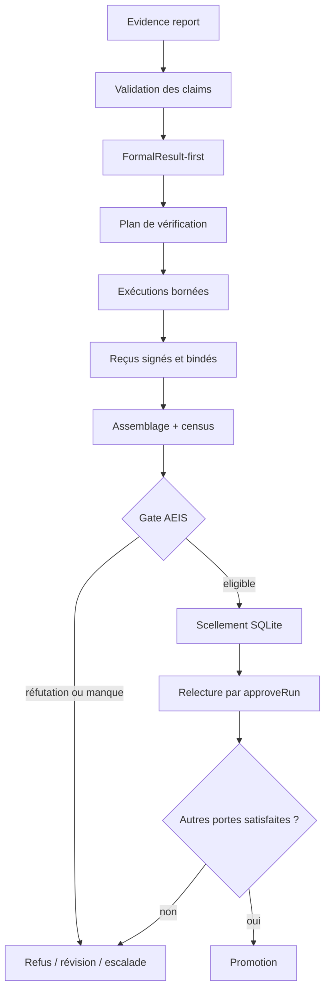

# Runtime AEIS : contrats, preuves, oracles et promotion

- **Type** : référence technique
- **Statut** : implémenté pour les prédicats mécanisables et les domaines d'oracle
  explicitement enregistrés ; partiel pour les jugements sémantiques libres
- **Portée** : backend Node.js, promotion de stratégie, vérificateurs, assemblages,
  mémoire, autorité et oracles natifs
- **Dernière revue** : 2026-10-20

Cette page est la référence opérationnelle de l'Adaptive Epistemic Immune System
(AEIS). La [fiche conceptuelle](../01-concepts/adaptive-epistemic-immune-system.md)
explique le modèle et ses limites ; le présent document décrit les objets, les
interfaces, les états et les refus réellement observables dans le runtime.

## 1. Contrat de service

AEIS ne fournit pas un oracle général. Il transforme un claim mécanisable et ses
preuves en une décision de promotion traçable. La garantie porte sur la procédure :

1. le claim est lié à un `FormalResult` avant la vérification ;
2. les vérificateurs exécutent le prédicat déclaré ;
3. leurs reçus sont signés et liés au résultat, à la preuve et au vérificateur ;
4. l'assemblage est recalculé, scellé et relu avant la promotion ;
5. une réfutation, un binding invalide ou un quorum absent bloque la promotion.

Le chemin nominal est intégré à
[`strategyExecutionService.approveRun()`](../../backend/src/services/strategyExecutionService.js).
Il n'existe pas d'endpoint HTTP AEIS autonome qui rendrait un texte « vrai ».

## 2. Sources normatives et responsabilités

| Couche | Source | Responsabilité |
| --- | --- | --- |
| Contrat de stratégie | `strategyContractService.js` | active les portes de promotion et le budget d'oracle |
| Production du claim | `runtimeClaimProducer.js`, `claimVerificationContract.js` | forme canonique et identité du producteur |
| Résultat formel | `formalResultAdapter.js`, `resultats-formels-messagepack.md` | identité, statement, preuve, domaine de validité |
| Exécution AEIS | `aeisPromotionBridge.js` | binding, exécution des vérificateurs, assemblage |
| Reçus | `epistemicVerifierReceiptService.js` | signature, nonce, binding, indépendance déclarée |
| Registre de confiance | `verifierTrustRegistry.js` | digest stable de l'implémentation autorisée |
| Gate | `epistemicAssurancePolicy.js`, `epistemicAssuranceService.js` | census, quorum, preuves et veto |
| Persistance | `aeisAssemblyStore.js` | scellement HMAC, rétention et relecture |
| Oracle natif | `nativeOracle*.js`, `oracle*Subject.js`, `oracle*Checks.js` | vérité terrain bornée par domaine |
| Mémoire | `immuneMemoryRepository.js`, `immuneMemoryOutcome.js` | rappel tenant-scoped et issue confirmée |
| Autorité | `epistemicAuthorityState.js` | dissonance, restriction et révocation |

## 3. Objets canoniques

### 3.1 Claim

Le runtime manipule plusieurs vues du claim. La vue de planification de
`verificationFabric.validateClaim()` exige au minimum :

```json
{
  "id": "sha256:...",
  "proposition": "npm test exits with code 0",
  "domain": "code",
  "scope": "organization:project:workspace",
  "producer": { "agentId": "agent-a", "runId": "run-a" },
  "assumptions": [],
  "dependencies": [],
  "requestedAssurance": "empirical",
  "evidenceDigest": "sha256:..."
}
```

La vue typée de `claimTypes.js` distingue `factual`, `normative`, `preference` et
`belief`, avec des preuves `observation`, `test_result`, `replay`, `approval`,
`log`, `artifact` ou `reconstruction`. Ces catégories structurent la preuve ;
leurs poids par défaut ne sont pas des probabilités calibrées.

### 3.2 Antigène

`antigenModel.toAntigen()` associe le claim à ses hypothèses, sa preuve, son
domaine de validité, ses dépendances, sa provenance, son producteur et son risque.
Les états admis sont :

```text
unrecognized → tolerated | challenged | quarantined
tolerated    → challenged | quarantined | verified
challenged   → tolerated | quarantined | neutralized | verified
quarantined  → neutralized | verified
```

Une transition non déclarée est un défaut de contrat, pas une décision métier.

### 3.3 FormalResult

Le résultat formel est créé avant les reçus. Le binding opposable est :

```text
antigen.id             = formalResult.resultId
receipt.resultId       = formalResult.resultId
receipt.evidenceDigest = formalResult.evidence.digest
```

Une ressemblance textuelle entre le claim et un test ne remplace jamais ce
binding. Le claim doit exprimer le prédicat exécuté exactement.

### 3.4 Reçu de vérificateur

Un reçu accepté lie notamment :

- `resultId` et `evidenceDigest` ;
- `verifierDigest`, résolu depuis le registre de confiance ;
- `status`, `checkedAt`, `nonce` et `evidenceTypes` ;
- l'identité du producteur et la séparation déclarée du vérificateur ;
- les observations d'exécution nécessaires au domaine concerné.

`independent: true` signifie que les règles procédurales du runtime ont accepté la
séparation d'identité, de workspace ou de stratégie prévue par le contrat. Ce
champ ne démontre pas une indépendance épistémique au sens statistique ou causal.

### 3.5 Assemblage

`aeisAssemblyStore.saveAssembly()` persiste :

- le payload d'évaluation ;
- le manifeste de déploiement et les digests de confiance ;
- une signature HMAC versionnée ;
- `run_id`, `scope_id`, `key_id` et la date de création.

La version courante du scellement lie l'identifiant, le digest du payload, le
digest du manifeste, la clé, le run et la portée. La lecture revalide chaque reçu
et refuse un assemblage rétracté, sauf demande historique explicite.

## 4. Politique de promotion

Les nouveaux contrats de stratégie portent par défaut :

```json
{
  "require_independent_verification": true,
  "require_epistemic_assurance": true,
  "native_verification": {
    "executions": 2,
    "latencyMs": 30000
  },
  "epistemic_verifier_digests": []
}
```

Le tableau suivant sépare les classes de claims :

| Classe | Admission automatique | Ce qui peut être établi |
| --- | --- | --- |
| Commande exacte | oui, si exécution, reçus, census et gate valides | sortie ou code observé dans les réplicas |
| Domaine d'oracle natif | oui, si le sujet, les postconditions et les reçus du domaine sont valides | uniquement la proposition bornée du domaine |
| Claim de domaine avec oracle externe | en attente jusqu'au témoin admissible | portée exacte de cet oracle |
| Jugement sémantique libre | non | provenance et procédure, pas vérité du jugement |

Exemples non promouvables sans politique spécialisée : « ce refactoring est
sain », « ce résumé est fidèle », « cette architecture est la bonne ».

## 5. Pipeline d'exécution



Ordre opposable dans `approveRun()` : autorité du run, état
`awaiting_approval`, rapport d'évidence, preuve humaine si requise, confinement,
évaluation AEIS ou oracle natif, modèle de soi, gate de promotion, dossier de
preuve, réservation puis reprise transactionnelle.

## 6. Vérificateurs et adaptateurs

| Famille | Implémentation | Résultat possible |
| --- | --- | --- |
| test | `runTestAdapter` | `verified`, `refuted`, `inconclusive` |
| artefact/build | `runArtifactAdapter` | succès réel, échec réel ou inconclusif |
| couverture | `runCoverageAdapter` | mesure bornée sur les éléments fournis |
| comportement | `runBehaviorAdapter` | observation structurée, pas jugement général |
| reproducer | `cognitiveEpistemicCheckService` | reproduction observée ou inconclusive |
| schéma | `cognitiveOmegaSchemaCheck` | conforme ou réfuté |
| SMT/Lean | commande explicitement configurée | résultat du toolchain déclaré |
| provider | `epistemicProviderMetapopulation` | revue structurée distincte, jamais vérité par vote |

Sans commande ou adaptateur admissible, la réponse est `inconclusive` ou
`unavailable`. AEIS ne fabrique pas une réussite de remplacement.

## 7. Pression, diversité et recrutement

### 7.1 Pression

`aeis-pressure-routing-v1` calcule un score ordinal à partir de risque,
incertitude, contradiction, nouveauté, déficit de preuve et coût. Les poids
`0.35/0.20/0.20/0.10/0.10/0.05` et les frontières
`0.25/0.50/0.70/0.90` sont des valeurs d'ingénierie non calibrées. Elles routent
l'effort ; elles ne mesurent ni vérité, ni danger réel, ni efficacité.

### 7.2 Diversité

`aeis-observed-diversity-v2` agrège sept composantes descriptives : richesse,
niches, erreurs, outils, providers, stratégies et équilibre de Shannon. La
monoculture par défaut est détectée par trois minima structurels : deux types,
deux niches et deux stratégies. Aucun seuil scalaire n'est appliqué sans politique
calibrée explicite.

### 7.3 Recrutement

Le recrutement d'une niche est borné par le budget par claim. Ajouter un nouveau
type de vérificateur élargit la procédure ; cela ne garantit ni sa qualité ni son
indépendance.

## 8. Oracles natifs

L'oracle natif est une famille de contrats fermés. `nativeOracleDomains` charge un
sujet persistant, construit le claim canonique, lance deux stratégies admises et
produit une attestation scellée. Le budget maximal est de deux exécutions et
30 000 ms.

### 8.1 Domaines directs

| Domaine | Sujet vérifié | Limite essentielle |
| --- | --- | --- |
| `subset_sum` | témoin et somme recalculés | pas de généralisation algorithmique |
| `model_subset_sum` | réponse modèle mesurée sur subset-sum | pas de vérité générale du modèle |
| `code_postconditions` | programme borné et cas déclarés | pas d'exécution JavaScript générique |
| `memory_fidelity` | fidélité d'une mémoire à sa source | la vérité de la source reste hors portée |
| `external_credit` | crédit externe réellement observé | limité au fournisseur et au reçu |
| `worker_artifact` | artefact worker et contrat associé | pas de qualité sémantique générale |

### 8.2 Domaines d'observation

| Domaine | Proposition bornée |
| --- | --- |
| `literal_observation` | correspondances littérales dans des sources scellées |
| `monitor_window` | anomalies numériques selon seuil et échantillons scellés |
| `claim_synthesis` | conservation des sources et signalement des désaccords |
| `declared_causality` | projection des relations causales déclarées |
| `lpt_experiment` | makespan LPT recalculé |
| `procedure_verification` | reçu subset-sum conforme au recalcul |
| `procedure_falsification` | divergence subset-sum reproduite |
| `subset_sum_teaching` | démonstration et paquet de transfert conformes |
| `formal_theorem` | proposition arithmétique fermée acceptée par Lean |
| `checkpoint_recovery` | contenu restauré conforme au checkpoint |
| `sourced_handoff` | dossier et références conservés, sans accusé distant |
| `child_coordination` | délégations du run terminées et liées |
| `adaptive_strategy` | essais LPT et meilleur résultat observé |
| `niche_procedure` | procédure conforme à la niche déclarée |
| `host_procedure` | procédure conforme à la capacité de l'hôte |
| `creative_combination` | produit cartésien déterministe des options |
| `synthetic_case_review` | reprise des considérations d'un cas synthétique |

Chaque domaine publie ses contraintes négatives. Par exemple, la synthèse ne
prouve pas la vérité des sources, la causalité déclarée ne prouve pas une causalité
indépendante et le cas médical synthétique n'est pas une validation clinique.

### 8.3 Cycle de vie d'une attestation native

```text
mission envelope
  → reservation (scope, autorité, sujet, budget, expiration)
  → deux exécutions mesurées
  → reçus avec deux stratégies distinctes
  → assemblage AEIS accepté
  → attestation native
  → acceptance liée aux nonces
  → relecture courante ou historique
```

Une mutation du sujet, du rapport, de l'autorité, de la portée, du coût ou du
binding invalide l'assurance courante. Une décision historique peut rester
auditable sans redevenir valide pour une nouvelle promotion.

## 9. Persistance et rétention

| Table ou journal | Contenu |
| --- | --- |
| `aeis_assurance_assemblies` | assemblages, manifeste, signature, run et scope |
| `aeis_assembly_retractions` | retraits conservés hors purge normale |
| `aeis_provider_reviews` | revues provider par tenant, run et antigène |
| `epistemic_immune_memory_scoped` | mémoire par portée |
| `epistemic_immune_outcomes` | issues confirmées par preuve |
| `aeis_agent_dissonance` | score et niveau d'autorité |
| `aeis_dissonance_events` | événements dédupliqués |
| `verifier_receipt_nonces` | nonces consommés |
| ledger GVX | réservation, attestation et acceptation d'oracle natif |

La purge des assemblages conserve par défaut 90 jours et 10 000 lignes, avec des
bounds internes de 1–3650 jours et 100–100 000 lignes. Les rétractions restent
exclues de la purge automatique prévue par le store.

## 10. Configuration et secrets

| Variable | Usage | Règle |
| --- | --- | --- |
| `GENOS_EPISTEMIC_RECEIPT_SECRET` | signature HMAC des reçus et assemblages | obligatoire pour une preuve opposable |
| `GENOS_EPISTEMIC_RECEIPT_KEY_ID` | identifiant de clé active | `[A-Za-z0-9_-]`, 1 à 64 caractères |
| `GENOS_EPISTEMIC_RECEIPT_PREVIOUS_KEYS` | map JSON des clés de lecture historiques | rotation, jamais écrite dans le dépôt |

La suite de test génère une clé éphémère si la variable n'est pas définie. Ce
comportement de test ne doit pas être confondu avec une configuration de production.

## 11. Refus principaux

| Refus | Cause |
| --- | --- |
| `claim_verification_contract` | claim différent du prédicat exécuté |
| `constraint_census` | obligations ou acteurs insuffisants |
| `proof_verification` | reçu absent, invalide ou non lié |
| `host_veto` | décision hôte défavorable |
| `ORACLE_DOMAIN_UNAVAILABLE` | aucun domaine fermé pour la méthode |
| `ORACLE_BUDGET_INVALID` / `UNAVAILABLE` / `EXCEEDED` | budget invalide, absent ou dépassé |
| `ORACLE_ATTESTATION_REFERENCE_INVALID` | référence d'attestation altérée |
| `ORACLE_ATTESTATION_SCOPE_MISMATCH` | tenant, agent ou run différent |
| `ORACLE_ALLOCATION_BINDING_MISMATCH` | sujet, rapport, autorité ou réservation différents |
| `ORACLE_COMPLETION_RESULT_CHANGED` | résultat ou preuve mutés après vérification |
| `ORACLE_RECEIPT_BINDING_MISMATCH` | reçu incompatible avec le sujet |
| `ORACLE_INDEPENDENT_QUORUM_REQUIRED` | moins de deux stratégies distinctes admises |
| `ORACLE_NONCE_OWNERSHIP_MISMATCH` | nonce absent, rejoué ou étranger |

Les messages d'erreur restent la source exacte pour un diagnostic de version ; ce
tableau regroupe les familles stables, pas tous les codes internes.

## 12. Observabilité

Un dossier d'exploitation doit au minimum conserver :

- l'identifiant du run et sa portée tenant ;
- l'identifiant de l'assemblage AEIS ;
- les digests de vérificateurs et le manifeste de déploiement ;
- le nombre et le statut des reçus ;
- les obligations couvertes et manquantes ;
- les références de réservation, attestation et acceptation natives ;
- les coûts mesurés, délais et processus observés ;
- les refus de gate et les événements de dissonance.

## 13. Cas d'usage adaptés

- vérifier qu'une commande déterministe produit une sortie exacte ;
- confirmer des postconditions bornées sur un artefact de code ;
- refuser un claim dont le test ne couvre pas la proposition ;
- qualifier une restauration de checkpoint ou une passation sourcée ;
- préserver un veto multi-provider sans traiter l'accord comme vérité ;
- réutiliser une issue antérieure uniquement dans la même portée et avec preuve.

## 14. Quand ne pas utiliser AEIS comme arbitre automatique

- jugement architectural ou esthétique sans oracle de domaine ;
- résumé, interprétation ou conseil dont la fidélité n'est pas mécanisée ;
- vérité scientifique ouverte sans protocole expérimental externe ;
- décision normative ou politique ;
- validation clinique, juridique ou financière générale ;
- situation où deux modèles similaires seraient présentés comme indépendants.

AEIS peut alors structurer le dossier, conserver la provenance et imposer une
escalade, mais pas produire seul le verdict final.

## 15. État d'implémentation

### Implémenté et testé

- binding `FormalResult`-first ;
- exécutions réelles par adaptateur et refus inconclusif ;
- reçus signés, trust registry, nonces et assemblages persistés ;
- gate de promotion dans `approveRun()` ;
- mémoire bornée par portée et autorité persistante ;
- ré-arbitration homéostatique et recrutement borné ;
- revues provider en processus distincts ;
- domaines natifs listés en section 8.

### Partiel

- calibration empirique de la pression et de la diversité ;
- indépendance causale ou statistique des providers ;
- couverture de tous les claims métier par un oracle natif ;
- qualification globale de la matrice worker sur le checkout courant.

### Non fourni

- oracle universel de vérité ;
- certification de sécurité du processus enfant comme conteneur ;
- validation sémantique générale par vote de LLM ;
- score public d'efficacité sans corpus et vérité terrain.

## 16. Vérification

```powershell
npm --prefix backend run test:aeis
node backend/tests/test_native_oracle_completion.js
node backend/tests/test_native_code_completion.js
node backend/tests/test_native_memory_budget.js
node backend/tests/test_native_worker_oracle_checks.js
```

Les résultats datés et les limites du checkout sont consignés dans
[la qualification AEIS du 20 octobre 2026](../06-qualite-preuves/qualification-aeis-2026-10-20.md).

## 17. Références

- [Adaptive Epistemic Immune System](../01-concepts/adaptive-epistemic-immune-system.md)
- [Immunité épistémique](../06-qualite-preuves/immunite-epistemique.md)
- [Runbook AEIS](../04-exploitation/aeis.md)
- [ADR 0294 — contrat de preuve](../adr/0294-contrat-de-preuve-aeis.md)
- [ADR 0327 — preuves et autorité persistante](../adr/0327-aeis-preuves-et-autorite-persistante.md)
- [ADR 0642 — bornes des heuristiques](../adr/0642-borner-les-heuristiques-aeis.md)
