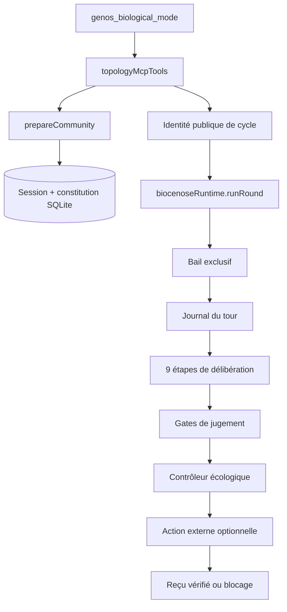

# Runtime Biocénose : contrat de délibération persistante

- **Statut** : Implémenté pour le cycle local et ses douze variants ; dépendances externes et efficacité causale non qualifiées globalement.
- **Portée** : composition, constitution, tours, preuves, reprise, actions écologiques et surface MCP.
- **Dernière revue** : 2026-10-20

Ce document décrit le contrat exécutable de Biocénose. La
[monographie Biocénose](../02-orchestration/topologies/biocenose.md) reste la
référence du modèle de délibération, de ses analogies et de ses cas d’usage.

Le runtime distingue trois résultats qui ne doivent pas être confondus :

1. la communauté a été composée ;
2. un cycle de neuf étapes a été enregistré ;
3. le jugement satisfait ses gates et une éventuelle action externe possède un
   reçu vérifié.

Ni `topology_composed` ni `topology_cycle_recorded` ne signifient qu’une
proposition est vraie ou qu’une action externe a été appliquée.

## 1. Surface publique

Biocénose utilise l’outil MCP `genos_biological_mode` :

```json
{
  "mode": "biocenose",
  "mission": "Évaluer la proposition et conserver les objections matérielles",
  "variant_id": "epistemic_jury",
  "execute_round": true,
  "orchestrator_id": "agent-123"
}
```

`mode` et une `mission` sont requis pour créer une communauté. Le champ
`execute_round` est refusé pour les autres modes. L’identité MCP authentifiée
doit correspondre à `orchestrator_id` et au tenant de l’agent.

Sans `execute_round`, la réponse porte `status: "topology_composed"`. Avec
exécution, elle porte `status: "topology_cycle_recorded"` et expose :

- `communityId`, `variant` et `variantSelection` ;
- `cycleStatus`, `communityStatus` et `followUpStatus` ;
- la révision persistée et le jeton de continuation initial ;
- une empreinte par étape, pas le contenu complet de tous les reçus ;
- le jugement, la décision écologique et le résultat de l’action lorsqu’ils
  existent.

Les erreurs sont retournées sous `status: "tool_error"`, avec `success: false`,
un code et, si disponible, l’identité de la communauté. Le transport de cette
réponse ne transforme pas le refus en succès métier.

## 2. Architecture



`biocenoseService` est la façade de compatibilité. Le chemin public appelle
`prepareCommunity`, puis `biocenoseRuntime.runRound`. Les fonctions unitaires
de la façade permettent aussi de composer, agréger, calibrer ou finaliser sans
passer par MCP ; ces appels ne bénéficient pas automatiquement de l’identité
publique de continuation.

## 3. Composition et constitution

La mission est d’abord classée en `FACTUAL`, `PROBABILISTIC`, `DESIGN`,
`MULTI_CRITERIA`, `NORMATIVE`, `EXPLORATORY` ou `MIXED`. Cette classification
est heuristique et peut être fournie explicitement par l’appelant.

La formation sélectionne les membres disponibles afin de couvrir rôles,
expertises, fournisseurs, stratégies et sources. Sans population fournie, elle
complète avec les gabarits du mode biologique. La composition retourne des
métriques de formation ; elle ne prouve pas l’indépendance réelle des modèles.

La constitution est versionnée, hachée puis liée à la session. Elle fixe
notamment le type de question, le variant, la politique d’agrégation, la limite
de tours et les règles de stabilité. L’exécution refuse :

- une constitution absente ou invalide ;
- une empreinte différente de la constitution persistée ;
- un variant de requête différent du variant engagé ;
- un variant incompatible avec le type de question.

## 4. Variants exécutables

Le registre contient douze politiques :

| Variant | Propriété dominante | Garde spécifique |
| --- | --- | --- |
| `epistemic_jury` | jugement scellé et preuve d’abord | baseline sûre |
| `delphi_community` | retours anonymes et révisions | au moins deux tours |
| `adversarial_assembly` | revue contradictoire | reviewer adversarial requis |
| `forecasting_crowd` | prévisions calibrées | question probabiliste et poids de calibration |
| `argumentation_community` | graphe d’arguments | relations structurées |
| `polycentric_council` | conseils locaux puis fédération | pluralité des clusters conservée |
| `byzantine_resilient_community` | provenance, quorum BFT et quarantaine | hypothèse de fautes vérifiée |
| `minority_preserving_jury` | conservation du dissent | veto sur contre-preuve fiable |
| `representative_community` | panel et pondération | poids d’échantillonnage requis |
| `persistent_community` | réputation longitudinale | historique par domaine |
| `human_ai_deliberation` | pluralisme avec jugement humain | revue humaine obligatoire |
| `hybrid_oracle_community` | oracle déterministe prioritaire | handlers canoniques et reçus liés |

Un variant explicite inconnu est refusé. La sélection automatique choisit le
premier signal compatible selon un ordre fixe. Sans signal discriminant, elle
retombe sur `epistemic_jury` avec `method: "safe_baseline"` et la raison
`NO_DISCRIMINATING_MISSION_SIGNAL`. Le reçu de sélection conserve donc la
méthode, la confiance et les raisons du repli.

## 5. Cycle de neuf étapes

Chaque tour exécute, dans cet ordre :

1. `collect_sealed_judgments` ;
2. `build_claim_graph` ;
3. `review_and_verify` ;
4. `build_argument_graph` ;
5. `collect_belief_revisions` ;
6. `check_independence` ;
7. `aggregate_by_question_type` ;
8. `check_dissent` ;
9. `record_community_judgment`.

Chaque étape s’exécute dans une transaction et doit retourner un résultat. Un
handler absent, un résultat vide ou un statut `BLOCKED`/`FAILED` produit
`BIOCENOSE_RUNTIME_STEP_BLOCKED`. L’échec de l’étape est journalisé sans
fabriquer les étapes suivantes.

Le journal conserve, pour chaque étape, le tour, l’empreinte de la constitution,
le résultat et son hash. À la reprise, l’ordre exact et les empreintes sont
revalidés. Un reçu modifié ou réordonné produit
`BIOCENOSE_ROUND_INTEGRITY_FAILED`.

## 6. Scellement des jugements et preuve

Les jugements initiaux sont engagés avant divulgation. Le store conserve un
hash du contenu canonique et un nonce ; la révélation attend tous les membres
actifs hors facilitateur et revalide les engagements. Ce mécanisme limite
l’influence entre membres, mais ne chiffre pas le contenu SQLite au repos.

La vérification dépend du type de question :

- un fait exige des reçus `VERIFIED` couvrant les claims persistés ;
- une question mixte applique la sémantique de chaque claim ;
- une question normative peut conserver plusieurs perspectives et exige une
  revue humaine lorsque la politique l’impose ;
- un dissent critique appuyé par une preuve fiable peut bloquer la promotion ;
- un contrat statistique hérité ajoute son propre gate.

Le quorum est une métrique de participation et de soutien, pas un oracle de
vérité. De même, un score Brier n’est calculable qu’après résolution externe
et avec une preuve de résolution acceptée.

## 7. Persistance et concurrence

Les données sont réparties entre :

| Famille | Tables principales |
| --- | --- |
| session | `biocenose_communities`, `biocenose_members`, `biocenose_constitutions` |
| délibération | `biocenose_commitments`, `biocenose_claims`, `biocenose_claim_owners`, `biocenose_arguments` |
| évolution | `biocenose_belief_updates`, `biocenose_dissent`, `biocenose_judgments`, `biocenose_calibration` |
| audit | `biocenose_events` |
| exécution publique | `biocenose_runtime_leases`, `biocenose_public_cycle_identity` |

Les événements et la révision de session sont écrits transactionnellement. Le
contrôle de révision optimiste refuse un écrivain périmé. Un bail exclusif est
acquis avant le tour, renouvelé après chaque étape et libéré en `finally`. Un
bail non expiré refuse une seconde exécution avec
`BIOCENOSE_RUNTIME_LEASE_CONFLICT`.

## 8. Reprise publique

La première exécution explicite crée un jeton aléatoire de 32 octets, dont seul
le hash est persisté. Pour continuer une communauté, l’appelant doit fournir :

```json
{
  "mode": "biocenose",
  "community_id": "...",
  "execute_round": true,
  "orchestrator_id": "agent-123",
  "resume_token": "...",
  "expected_revision": 42
}
```

La vérification lie le jeton à l’acteur, la mission, le hash de la question, la
constitution et le variant. La comparaison du token est constante en temps. Une
révision différente produit `BIOCENOSE_PUBLIC_REVISION_CONFLICT`.

Le jeton est remis uniquement à sa création. Il doit être protégé comme un
secret de continuation. La reprise recharge les étapes déjà terminées ; elle
ne rejoue pas les votes ni les effets externes confirmés.

## 9. Décision écologique et effets externes

Après chaque tour, le contrôleur détermine une prochaine action, par exemple une
revue humaine, une expérience Trinity ou une exécution A-Team. Cette décision
est persistée avant l’effet.

L’exécuteur calcule une clé d’idempotence à partir de la communauté, du tour et
de l’action. Il applique les règles suivantes :

- sans adaptateur, `status: "DEPENDENCY_REQUIRED"` ;
- avec adaptateur, un reçu `VERIFIED` doit être lié à `communityId`, à l’action
  et à la clé d’idempotence ;
- une exception ou un reçu invalide produit `BLOCKED` ;
- après crash entre `STARTED` et `COMPLETED`, l’effet n’est pas rappelé ; un
  `actionReceiptResolver` doit retrouver un reçu vérifiable ;
- sans réconciliation fiable, le résultat reste
  `BIOCENOSE_ACTION_OUTCOME_UNCERTAIN`.

Ainsi, une recommandation de transition Morphogenèse n’est pas une transition
exécutée. Seul le reçu de l’adaptateur prouve l’effet ciblé.

## 10. États et interprétation

Les phases comprennent `CONSTITUTION`, `FORMATION`, `SEALED_JUDGMENT`,
`COMMITTED`, `REVIEW`, `DELIBERATION`, `REVISION`, `AGGREGATION`, `DECIDED` et
`ESCALATED`. Les statuts de session sont `ACTIVE`, `DECIDED`, `ESCALATED` et
`CLOSED`.

Le statut de suivi du cycle apporte une information orthogonale :

| `followUpStatus` | Lecture |
| --- | --- |
| `DECISION_RECORDED` | jugement terminal, aucun effet supplémentaire demandé |
| `REVIEW_REQUIRED` | preuve ou arbitrage encore insuffisant |
| `WAITING_FOR_HUMAN` | autorité humaine attendue |
| `ACTION_REQUIRED` | une transition ou collecte externe est proposée |
| `ACTION_COMPLETED` | l’action possède un reçu vérifié |
| `ACTION_BLOCKED` | l’action a échoué ou son résultat est incertain |

Un cycle peut être `COMPLETED` alors que la communauté demande une revue ou que
l’action est bloquée. La complétion procédurale ne doit jamais masquer cet état.

## 11. Snapshot topologique

L’adaptateur de snapshot capture les tables propres au variant et vérifie :

- l’appartenance de l’agent à la communauté ;
- l’intégrité de la constitution ;
- la cohérence entre statut, jugement et reçus ;
- l’absence de bail actif à la frontière de reprise ;
- les registres supplémentaires requis par le variant.

Une communauté non terminale ou un état incomplet n’est pas restaurable comme
un résultat final. Le snapshot ne rejoue ni les interactions de modèles, ni les
actions externes.

## 12. Validation reproductible

Depuis la racine :

```bash
npm --prefix backend run test:biocenose
node backend/tests/run_topology_contracts.cjs --topology=biocenose
node backend/tests/test_topology_snapshot_biocenose.js
```

`run_biocenose_suite.js` découvre tous les fichiers
`test_biocenose_*.js`. Les tests couvrent le store, les douze variants, les
gates, la reprise, les identités publiques, les actions écologiques et le
câblage Morphogenèse. Ils emploient des invocateurs, oracles et reçus contrôlés ;
ils ne certifient pas une délibération LLM en production.

## 13. Erreurs structurantes

| Code | Signification |
| --- | --- |
| `BIOCENOSE_COMMUNITY_UNKNOWN` | communauté absente |
| `BIOCENOSE_CONSTITUTION_UNKNOWN` | constitution absente |
| `BIOCENOSE_CONSTITUTION_INTEGRITY_FAILED` | hash ou identité incohérent |
| `BIOCENOSE_VARIANT_UNKNOWN` | variant explicite inconnu |
| `BIOCENOSE_VARIANT_QUESTION_TYPE_INVALID` | politique incompatible avec la question |
| `BIOCENOSE_VARIANT_CONSTITUTION_MISMATCH` | variant de reprise différent |
| `BIOCENOSE_RUNTIME_LEASE_CONFLICT` | exécution concurrente ou bail perdu |
| `BIOCENOSE_RUNTIME_STEP_BLOCKED` | étape absente, invalide ou en échec |
| `BIOCENOSE_ROUND_INTEGRITY_FAILED` | reçus altérés ou désordonnés |
| `BIOCENOSE_PUBLIC_IDENTITY_MISMATCH` | acteur ou token invalide |
| `BIOCENOSE_PUBLIC_REVISION_CONFLICT` | continuation sur une révision périmée |
| `BIOCENOSE_ACTION_UNVERIFIED` | effet externe sans reçu fiable |

## 14. Limites et non-objectifs

- La classification de question et la sélection automatique du variant sont
  heuristiques.
- Les providers et modèles déclarés ne prouvent pas leur indépendance ; elle
  doit être observée et mesurée.
- Les handlers internes structurent le protocole, mais les invocations de
  modèles, oracles et humains restent des dépendances explicites.
- Le chiffrement au repos n’est pas fourni par le scellement des jugements.
- Le runtime ne garantit pas la vérité par majorité, quorum ou consensus.
- La suite locale ne mesure ni gain causal, ni résistance universelle au
  groupthink, à la collusion ou aux erreurs corrélées.

## Sources

- [Topologie Biocénose](../02-orchestration/topologies/biocenose.md)
- [Contrat commun de complétion](contrat-completion-mission.md)
- [Snapshots topologiques](snapshots-topologiques.md)
- [`biocenoseService.js`](../../backend/src/services/biocenoseService.js)
- [`biocenoseRuntime.js`](../../backend/src/services/biocenose/runtime/biocenoseRuntime.js)
- [`deliberationPlanner.js`](../../backend/src/services/biocenose/runtime/deliberationPlanner.js)
- [`roundJournal.js`](../../backend/src/services/biocenose/runtime/roundJournal.js)
- [`ecologicalActionExecutor.js`](../../backend/src/services/biocenose/runtime/ecologicalActionExecutor.js)
- [`topologyMcpTools.js`](../../backend/src/services/topologyMcpTools.js)

