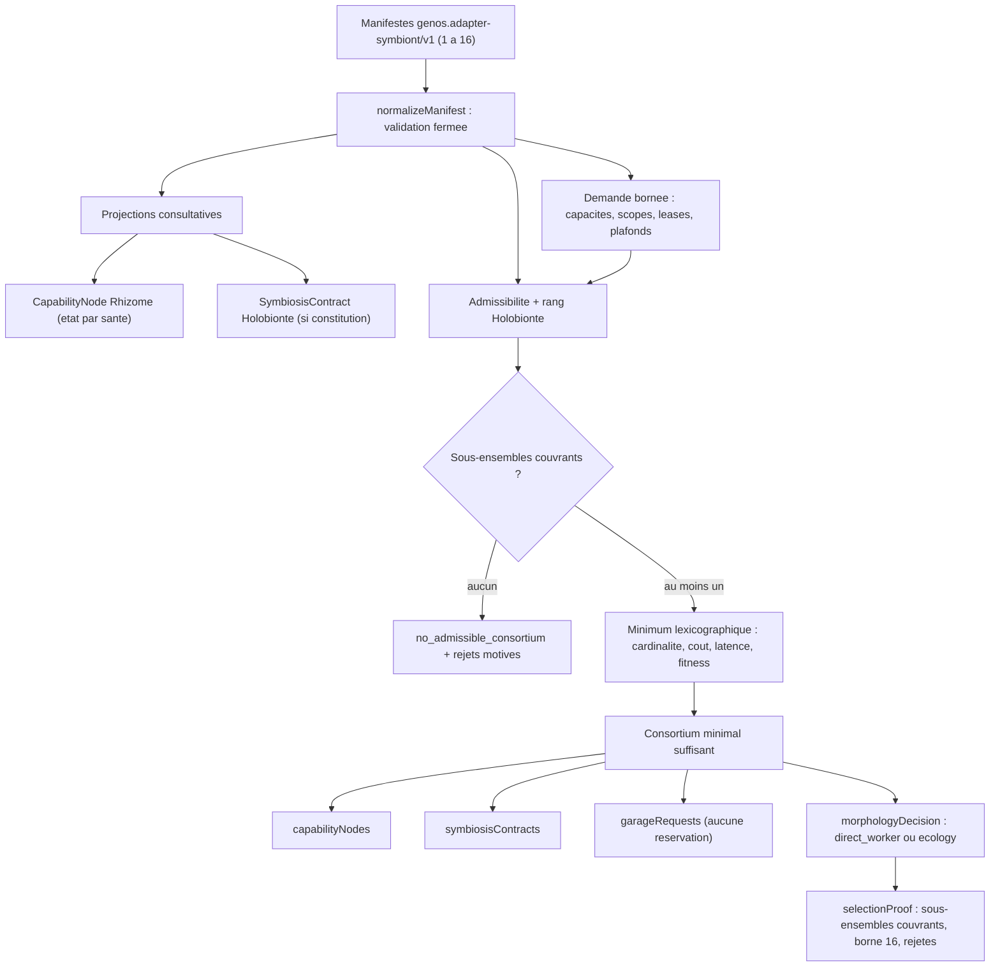
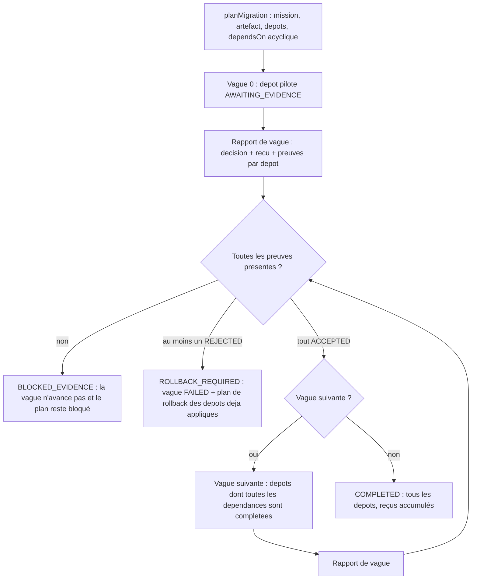
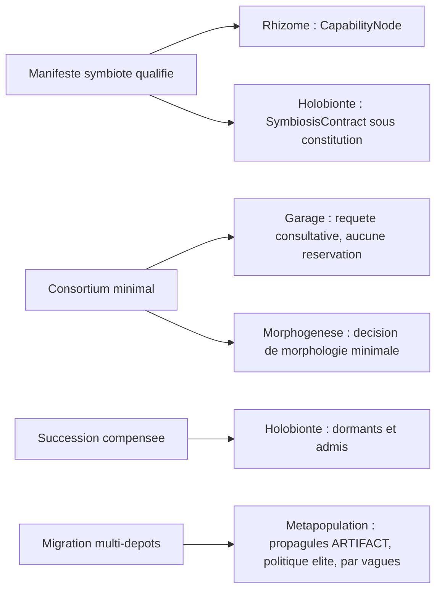

# Runtime d'écologie des adaptateurs

- **Statut** : Implémenté (quatre services, quatre tests au vert) ; surface purement programmatique et consultative — aucune route REST, gRPC, CLI ni outil MCP ne l'expose aujourd'hui (voir §13)
- **Portée** : qualification des intégrations, sélection de consortium minimal, dysbiose et succession compensée, planification multi-dépôts par vagues
- **Dernière revue** : 2026-10-19

> L'écologie des adaptateurs traite une intégration externe comme un **symbiote sélectionnable** : un manifeste qualifié, un consortium minimal suffisant, une succession compensée quand un membre dérive, et une migration de changement par vagues entre dépôts. Une sélection réussie n'est pas une preuve d'exécution ; une requête de réservation n'est pas une réservation ; un plan de rollback n'est pas un rollback accompli.

Le vocabulaire écologique (symbiote, consortium, dysbiose, dème, propagule) désigne des invariants fonctionnels du code : champs validés, bornes, refus fermés et gates de preuve. Il n'y a ni simulation d'écosystème, ni dynamique de population, ni garantie biologique.

---

## 1. Définition

L'**écologie des adaptateurs** est le sous-système qui qualifie les intégrations externes avant toute autre décision : comparer un petit ensemble de candidats, écarter un adaptateur malade, recomposer un consortium suffisant, et planifier un changement entre dépôts par vagues dépendantes. Elle ne démarre aucun provider, ne réserve aucun worker et n'exécute aucune compensation.

### 1.1 Principe fondateur

$$\text{Écologie} : \text{Manifestes qualifiés} \times \text{Demande bornée} \mapsto \text{Consortium minimal suffisant}$$

Le résultat vaut **suffisance minimale prouvée sur les manifestes fournis** : cardinalité minimale, puis coût, latence et fitness déclarés. Il ne vaut ni optimalité sur l'ensemble des intégrations possibles, ni qualité réelle des fournisseurs, ni autorisation d'exécution.

### 1.2 Contrat opérationnel

Quatre opérations, toutes fail-closed, toutes consultatives dans leurs effets :

1. **Qualification** — `normalizeManifest` valide un manifeste `genos.adapter-symbiont/v1` : identité qualifiée, capacités, dépendances (scopes, leases), environnement économique, santé datée, fitness bornée, attestations, compensation. `toCapabilityNode` et `toSymbiosisContract` projettent ce manifeste vers les contrats canoniques Rhizome et Holobionte sans créer de nouvelle autorité.
2. **Sélection** — `selectConsortium` reçoit au plus seize manifestes et une demande (capacités, scopes, leases, plafonds) ; il produit le sous-ensemble admissible de cardinalité minimale qui couvre la demande.
3. **Succession** — `assessConsortium` compare chaque manifeste actif aux observations runtime ; un symptôme déclare une dysbiose. `planSuccession` met en quarantaine les malades, recompose via le sélecteur minimal et produit un plan de compensation. `authorizeCompensation` n'autorise que face aux preuves déclarées.
4. **Migration** — `planMigration` traite chaque dépôt comme un dème et ordonne les vagues par le graphe `dependsOn` acyclique ; `advanceMigration` n'accepte une vague que si chaque dépôt fournit son reçu et toutes ses preuves attendues.

Une requête Garage produite par la sélection est un besoin à réserver. Elle ne vaut ni claim, ni lease, ni preuve d'exécution.

---

## 2. Spécification formelle

### 2.1 Manifeste `genos.adapter-symbiont/v1`

Validé par `backend/src/services/adapterEcology/adapterManifest.js`. Toutes les listes sont dédupliquées et trimées ; l'objet normalisé est gelé (`Object.freeze`).

| Champ | Contrat exact | Refus |
|---|---|---|
| `schema` | doit valoir exactement `genos.adapter-symbiont/v1` | `ADAPTER_SYMBIONT_MANIFEST_INVALID` |
| `adapterId` | texte non vide | idem |
| `version` | semver `major.minor.patch[-prerelease]` (regex `^\d+\.\d+\.\d+(?:-[0-9A-Za-z.-]+)?$`, sans métadonnée de build) | idem |
| `providerKind` | `daemon`, `tool`, `service` ou `runtime` | idem |
| `reference` | texte non vide (référence du provider) | idem |
| `capabilities` | liste **non vide**, sans item `*` | idem / `ADAPTER_SYMBIONT_SCOPE_INVALID` |
| `dataScopes` | liste (vide autorisée), sans item `*` | idem |
| `toolLeases` | liste (vide autorisée), sans item `*` | idem |
| `economics.costUsd` | nombre fini ≥ 0 | idem |
| `economics.latencyMs` | nombre fini ≥ 0 | idem |
| `health.status` | `HEALTHY`, `DEGRADED`, `QUARANTINED` ou `UNKNOWN` | idem |
| `health.checkedAt` | date ISO parsable | idem |
| `health.reliability` | nombre dans [0, 1] | idem |
| `fitness.*` | cinq dimensions dans [0, 1] : `evidenceQuality`, `historicalCompatibility`, `replaceability`, `risk`, `dependencyRisk` ; **défaut 0,5 par dimension absente** | idem |
| `attestationRefs` | liste **non vide**, sans item `*` | idem |
| `compensation.action` | texte non vide | idem |
| `compensation.evidenceRequirements` | liste **non vide** | idem |

Le refus de wildcard porte sur l'item exact `'*'`. Un bail littéral comme `admin.*` est un manifeste valide : c'est la liste d'autorisation de la demande (§2.3) qui le refuse — le test `test_adapter_minimal_consortium.js` démontre ce cas (`TOOL_LEASE_DENIED`).

### 2.2 Projections canoniques

`toCapabilityNode(manifest)` construit un nœud Rhizome canonique :

- `nodeId` = `adapterId@version` ; `kind` = `DAEMON`/`TOOL`/`EXTERNAL_SERVICE`/`PROCEDURE` selon `providerKind` (`daemon`, `tool`, `service`, `runtime`) ;
- `inputs` = `dataScopes`, `requirements` = `toolLeases`, `evidenceRequirements` = `attestationRefs`, `providers` = un provider `{providerId, kind, reference}` ;
- `state` = `AVAILABLE` si la santé est `HEALTHY`, sinon le statut de santé (`DEGRADED` et `QUARANTINED` sont des états Rhizome valides) ; `availability.status` = `UNAVAILABLE` hors `HEALTHY` ;
- `provenance` = `attestationRefs` ; `localContext` = `{version, compensation}`.

Une santé `UNKNOWN` produit un état non énuméré par Rhizome : la projection est refusée par le validateur canonique avec `RHIZOME_CONTRACT_INVALID` (champ `state`). Une santé autre que `HEALTHY` donne donc un nœud indisponible ou refusé — jamais un nœud disponible.

`toSymbiosisContract(manifest, constitution)` applique la constitution Holobionte via `validateContract` : `contractId` = `adapter:adapterId@version`, `authorityScope` = `{level: CAPABILITY, actions: toolLeases}`, `dataAccess` et `privacyBoundary` = `dataScopes` (restriction de la constitution appliquée), `evidenceRequirements` = `attestationRefs`, `immunePolicy` = `{health}`, `adaptationPolicy` = `{compensation}`, `transmissionPolicy` = `REACQUIRE_EACH_GENERATION`, `terminationConditions` = `['lease_revoked', 'health_quarantined']`, `dependencyCeiling` = `fitness.dependencyRisk` (plafond de dépendance de la constitution appliqué), `status` = `ACTIVE`. Ces projections ne démarrent pas le provider.

### 2.3 Contrat de consortium

`selectConsortium(manifestes, demande)` — la borne de seize s'applique à la **liste d'entrée** (manifestes admissibles ou non) :

| Champ de la demande | Contrat | Défaut |
|---|---|---|
| `requiredCapabilities` | liste non vide, dédupliquée | — (requis) |
| `allowedDataScopes` | liste non vide | — (requis) |
| `allowedToolLeases` | liste non vide | — (requis) |
| `maxCostUsd` | fini ≥ 0 | `MAX_SAFE_INTEGER` |
| `maxLatencyMs` | fini ≥ 0 | `MAX_SAFE_INTEGER` |
| `maxHealthAgeMs` | fini ≥ 0 | 300 000 ms (5 min) |
| `now` | date ISO | heure courante |
| `riskTolerance` | `LOW` (0,3), `MEDIUM` (0,6), `HIGH` (1) | `MEDIUM` |
| `maxDependencyPerSymbiont` | [0, 1] | 0,6 |
| `constitution` | constitution Holobionte ou `null` | `null` (aucun contrat en sortie) |

Sorties : `status` (`minimum_sufficient_consortium` ou `no_admissible_consortium`), `adapterIds` (triés), `metrics` (`adapterCount`, `costUsd` sommé, `latencyMs` sommée, `fitness` sommée), `manifests`, `capabilityNodes`, `symbiosisContracts` (uniquement si une constitution est fournie), `garageRequests`, `morphologyDecision`, `selectionProof` (`evaluatedSubsets`, `candidateBound` = 16, `rejectedAdapters`). Un échec de couverture n'est pas une exception : `no_admissible_consortium` avec `rejections` par adaptateur.

### 2.4 Contrat de succession

`assessConsortium(manifestesActifs, observations, politique)` ; `planSuccession({activeManifests, candidateManifests, observations, policy, demand})` ; `authorizeCompensation(plan, evidenceByAdapter)`.

- **Politique** : `now` (date), `maxObservationAgeMs` (défaut 300 000, ≥ 0), `latencyTolerance` (défaut 2, ≥ 1), `costTolerance` (défaut 2, ≥ 1). Hors bornes : `ADAPTER_SUCCESSION_INVALID`.
- **Observation** par adaptateur : `adapterId`, `observedAt`, `status`, `latencyMs`, `costUsd`, `evidenceRefs`. Une observation absente vaut symptôme, pas silence.
- **Plan de compensation** par adaptateur dysbiotique : `action` (du manifeste), `toolLeases`, `attestationRefs`, `requiredEvidence` (= `compensation.evidenceRequirements`), `status: AWAITING_EVIDENCE`. `authorizeCompensation` passe une entrée à `AUTHORIZED` seulement si toutes les preuves déclarées sont fournies ; il n'appelle jamais l'action externe.

### 2.5 Contrat de migration multi-dépôts

Schéma `genos.adapter-ecology.multi-repository-migration/v1` (`multiRepositoryMigrationService.js`).

- **Entrée de mission** : `missionId`, `sourceRepositoryId`, `pilotRepositoryId` (≠ source), `artifactRef`, `lineageRefs` (non vide), `sourceEvidence` (tableau, vide autorisé), `sourceFitness` et `novelty` dans [0, 1] (bornés par le contrat de propagule), `repositories` (**au moins deux**).
- **Dépôt-dème** : `repositoryId` (unique), `adapterId`, `dependsOn` (dépendances **connues et non propres**), `baselineRef`, `rollbackAction`, `evidenceRequirements` (non vide).
- **Propagule** par cible : `propaguleId` = `missionId:repositoryId`, `type: ARTIFACT`, `payloadRef` = `artifactRef`, `migrationReason: 'controlled multi-repository propagation'`, `lineageRefs`, `sourceEvidence`, `provenance` = `{source: 'adapter-ecology', missionId, adapterId, baselineRef}`, `sourceFitness`, `novelty` ; `sourceDemeId` = dépôt source pour le pilote, sinon `dependsOn[0]` (pilote par défaut). Validé par le contrat Métapopulation puis par la politique `elite` (limite 1).
- **Plan** : `status: AWAITING_WAVE_EVIDENCE`, `currentWave: 0`, `waves` (vague 0 `AWAITING_EVIDENCE`, suivantes `PENDING`), `rollbackPlan` par dépôt, `completedRepositoryIds: []`, `receipts: []`, `consultative: true`.
- **Rapport de vague** (`advanceMigration`) : `waveIndex` = vague active, `repositoryOutcomes` couvrant chaque dépôt avec `decision` (`ACCEPTED`/`REJECTED`), `receiptId` (requis) et `evidenceRefs`.

---

## 3. Modèle logique et mathématique

Les formules ci-dessous décrivent le comportement exact du code implémenté ; elles ne portent que sur les manifestes et observations fournis en entrée.

### 3.1 Admissibilité et rang Holobionte

Soit $M = \{m_1, \dots, m_n\}$, $1 \le n \le 16$, et une demande $D = \langle C_{\text{req}}, S_{\text{allow}}, L_{\text{allow}}, K, \Lambda, A, \rho, \delta \rangle$ (capacités requises, scopes et leases autorisés, plafonds de coût et de latence, âge maximal de santé, tolérance de risque, plafond de dépendance).

$$\text{eligible}(m, D) \iff \sigma(m) = \text{HEALTHY} \;\land\; t_{\text{now}} - t(m) \le A \;\land\; S(m) \subseteq S_{\text{allow}} \;\land\; L(m) \subseteq L_{\text{allow}} \;\land\; \text{rang-eligible}(m)$$

Les quatre premiers termes produisent les symptômes `HEALTH_<statut>`, `HEALTH_STALE`, `DATA_SCOPE_DENIED`, `TOOL_LEASE_DENIED`. Le rang est celui du choix de partenaires Holobionte (`partnerChoiceService.rankCandidates`) :

$$\text{score}(m) = \underbrace{0.30\,\text{fit}(m) + 0.15\,r(m) + 0.15\,q(m) + 0.10\,\chi(m) + 0.10\,\eta(m)}_{\text{bénéfices}} - \underbrace{0.05\,\kappa(m) + 0.05\,\rho_r(m) + 0.10\,\delta_r(m)}_{\text{pénalités}}$$

avec $\text{fit}(m) = |C_{\text{req}} \cap C(m)| / |C_{\text{req}}|$ (adéquation de capacités), $r$ la fiabilité, $q$ la qualité de preuve, $\chi$ la compatibilité historique, $\eta$ la remplaçabilité, $\kappa(m) = \min(1, k(m)/K)$ le coût normalisé (dénominateur 1 si $K \le 0$), $\rho_r$ le risque, $\delta_r$ le risque de dépendance. Le score est arrondi à quatre décimales. Le rang rend inéligible : `NO_CAPABILITY_MATCH` (fit nul), `RISK_TOLERANCE_EXCEEDED` ($\rho_r >$ limite de $\rho$ : 0,3 / 0,6 / 1), `DEPENDENCY_CEILING_EXCEEDED` ($\delta_r > \delta$).

### 3.2 Sélection du consortium minimal

Soit $E$ l'ensemble des manifestes admissibles. Les sous-ensembles **couvrants** sont :

$$\mathcal{F}(D) = \left\{ S \subseteq E,\; S \neq \emptyset \;:\; C_{\text{req}} \subseteq \bigcup_{m \in S} C(m) \;\land\; \sum_{m \in S} k(m) \le K \;\land\; \sum_{m \in S} \lambda(m) \le \Lambda \right\}$$

Le consortium choisi minimise l'ordre lexicographique :

$$S^{*} = \arg\min_{S \in \mathcal{F}(D)} \left( |S|, \; \sum_{m \in S} k(m), \; \sum_{m \in S} \lambda(m), \; -\sum_{m \in S} \text{score}(m), \; \mathrm{ids}(S) \right)_{\text{lex}}$$

cardinalité minimale d'abord, puis coût déclaré, puis latence déclarée, puis fitness décroissante, puis l'identifiant joint trié (`localeCompare`) pour un départage total et déterministe. L'énumération est **exhaustive** sur les sous-ensembles non vides d'admissibles ($2^{|E|} - 1$ évalués ; 65 535 à la borne de seize) : dans les bornes de la requête, $S^{*}$ est l'optimum exact de cet ordre parmi les manifestes fournis. Cette optimalité ne dit rien des intégrations non fournies ni de la qualité réelle des fournisseurs. Si $\mathcal{F}(D) = \emptyset$, le résultat est `no_admissible_consortium` avec les rejets, pas une exception.

La **décision de morphologie minimale** jointe au résultat applique la politique Morphogenèse : les cinq niveaux autres que `direct_worker` et `ecology` (`primitive`, `procedure`, `resident_symbiont`, `simple_topology`, `composite_topology`) sont déclarés non suffisants (motif `declared adapter demand requires a qualified provider`), `direct_worker` n'est viable que si le consortium est un adaptateur unique couvrant toute la demande (sinon motif `no single qualified adapter covers the demand`), et `ecology` porte les capacités requises. La preuve des niveaux inférieurs conserve, pour chaque niveau sous le niveau retenu, l'identité du candidat écarté et son motif de refus.

### 3.3 Dysbiose et compensation

Pour chaque manifeste actif $m$ avec observation $o(m)$ et politique $P = \langle t_{\text{now}}, A_{\text{obs}}, \tau_\lambda, \tau_\kappa \rangle$ :

$$\text{symptômes}(m) = \text{MANIFEST}_{\sigma(m) \ne \text{HEALTHY}} \;\cup\; \text{symptômes}(o(m), m, P)$$

| Symptôme | Condition exacte |
|---|---|
| `OBSERVATION_MISSING` | aucune observation pour `adapterId` |
| `OBSERVATION_STALE` | `observedAt` non parsable ou plus ancien que `maxObservationAgeMs` |
| `RUNTIME_<statut>` | statut observation hors `AVAILABLE`/`HEALTHY` (`RUNTIME_UNKNOWN` si absent) |
| `EVIDENCE_MISSING` | `evidenceRefs` absent, non tableau ou vide |
| `LATENCY_DRIFT` | latence observée > latence du manifeste × `latencyTolerance` |
| `COST_DRIFT` | coût observé > coût du manifeste × `costTolerance` |

$$\text{état}(m) = \begin{cases} \text{STABLE} & \text{si } \text{symptômes}(m) = \emptyset \\ \text{DYSBIOTIC} & \text{sinon} \end{cases} \qquad \text{consortium} = \begin{cases} \text{STABLE} & \text{si } \forall m \text{ stable} \\ \text{DYSBIOSIS} & \text{sinon} \end{cases}$$

La recomposition met en quarantaine chaque malade ($\sigma \leftarrow$ `QUARANTINED`, `checkedAt` ← maintenant), ajoute les candidats au pool et rejoue le sélecteur minimal du §3.2 sur ce pool (même borne de seize). La compensation est autorisée si et seulement si :

$$\text{authorized} \iff \text{plan} \neq \emptyset \;\land\; \forall m \in \text{plan} : E_{\text{req}}(m) \subseteq E_{\text{fournis}}(m)$$

Les identifiants Holobionte suivent : `dormantSymbiontIds` = dysbiotiques triés, `admittedSymbiontIds` = admis absents des actifs.

### 3.4 Ordre topologique des vagues de migration

Soient les dépôts $R$, le pilote $p$ et $\text{deps}(r) \subset R$ le graphe `dependsOn` (acyclique, sans dépendance propre, dépendances connues). Les vagues forment un ordre topologique par niveaux :

$$W_0 = \{p\}, \qquad W_{i+1} = \left\{ r \in \text{pending} : \text{deps}(r) \subseteq \bigcup_{j \le i} W_j \right\}$$

chaque vague étant triée par `repositoryId` (`localeCompare`, déterministe). Si $W_{i+1} = \emptyset$ alors que des dépôts restent en attente, le graphe contient un cycle : refus `ADAPTER_MIGRATION_DEPENDENCY_CYCLE`. Un dépôt entre donc dans la vague qui suit l'achèvement de sa dernière dépendance ; chaque vague attend les preuves de **tous** ses dépôts avant d'activer la suivante.

---

## 4. Architecture

| Service (`backend/src/services/adapterEcology/`) | Rôle | Frontières |
|---|---|---|
| `adapterManifest.js` | valider/geler le manifeste ; projections `toCapabilityNode` et `toSymbiosisContract` | réemploie `rhizome/contracts/capabilityNode` et `holobionte/contracts/symbiosisContractService` |
| `minimalConsortiumService.js` | admissibilité, rang, énumération couvrante, choix lexicographique, requêtes Garage, décision de morphologie | réemploie `holobionte/selection/partnerChoiceService` et `morphogenesis/synthesis/minimalMorphologyPolicy` |
| `consortiumSuccessionService.js` | symptômes de dysbiose, quarantaine, recomposition, plan et autorisation de compensation | rejoue `minimalConsortiumService.selectConsortium` |
| `multiRepositoryMigrationService.js` | dèmes, vagues topologiques, propagules `ARTIFACT`, gate de preuve par vague | réemploie `metapopulation/contracts/propaguleContract` et `metapopulation/migration/migrationPolicyService` |

Aucun de ces services n'ouvre de base, ne démarre de provider, ne réserve de worker ni n'écrit dans un dépôt. Les validateurs réutilisés restent l'autorité : une projection refusée par Rhizome ou Holobionte est refusée pour l'écologie.



---

## 5. Opérations

| Opération | Entrées | Sorties | Refus (fail-closed) |
|---|---|---|---|
| `normalizeManifest` | manifeste brut | manifeste normalisé gelé | `ADAPTER_SYMBIONT_MANIFEST_INVALID`, `ADAPTER_SYMBIONT_SCOPE_INVALID` |
| `toCapabilityNode` | manifeste | nœud Rhizome canonique | codes du manifeste ; `RHIZOME_CONTRACT_INVALID` (santé `UNKNOWN`) |
| `toSymbiosisContract` | manifeste + constitution | contrat Holobionte validé | codes du manifeste ; `HOLOBIONT_*` (§7) |
| `selectConsortium` | 1 à 16 manifestes + demande | consortium minimal + preuve + projections + requêtes Garage ; ou `no_admissible_consortium` | `ADAPTER_CONSORTIUM_INVALID` (liste vide/absente/hors borne, demande invalide) |
| `assessConsortium` | manifestes actifs + observations + politique | `STABLE`/`DYSBIOSIS` + symptômes par adaptateur | `ADAPTER_SUCCESSION_INVALID` |
| `planSuccession` | actifs + candidats + observations + politique + demande | plan de succession, quarantaines, contrats dormants/admis, plan de compensation ; ou `stable` / `replacement_unavailable` | codes de l'évaluation + `ADAPTER_CONSORTIUM_INVALID` (recomposition) |
| `authorizeCompensation` | plan + preuves fournies par adaptateur | `AUTHORIZED`/`AWAITING_EVIDENCE` par action + `authorized` global | `ADAPTER_SUCCESSION_INVALID` |
| `planMigration` | mission + artefact + dépôts + dépendances | plan par vagues + propagules + plan de rollback (consultatif) | `ADAPTER_MULTI_REPOSITORY_MIGRATION_INVALID`, `ADAPTER_MIGRATION_DEPENDENCY_CYCLE`, `METAPOPULATION_PROPAGULE_INVALID` |
| `advanceMigration` | plan + rapport de vague | plan avancé / `COMPLETED` / `BLOCKED_EVIDENCE` / `ROLLBACK_REQUIRED` | `ADAPTER_MULTI_REPOSITORY_MIGRATION_INVALID` (rapport incohérent, avance hors `AWAITING_WAVE_EVIDENCE`) |

---

## 6. Exécution

Les cas suivants reprennent les fixtures exactes des quatre tests ; chaque assertion citée est exécutée par le test correspondant.

### 6.1 Qualification et projections (test_adapter_symbiont_manifest.js)

Manifeste `github-code-search` v1.2.0, `providerKind: service`, capacités `code.search` + `repository.read`, scopes `repo:alpha`, bail `github.search`, 0,02 USD / 140 ms, santé `HEALTHY` au 2026-10-19T10:00:00Z (fiabilité 0,98), fitness {0,9 ; 0,8 ; 0,7 ; 0,1 ; 0,2}, attestation `attestation:github:sha256:abc`, compensation `github.detach` exigeant `receipt:detached`.

1. `normalizeManifest` gèle l'objet ; `adapterId` conservé.
2. `toCapabilityNode` produit `kind: EXTERNAL_SERVICE`, `state: AVAILABLE`, un provider `github-code-search`, `provenance` = attestations.
3. `toSymbiosisContract` avec la constitution `{hostId: host-cursor, maxDependencyPerSymbiont: 0.6, privacyPolicy: {restricted: [secrets]}}` produit un contrat `github-code-search` aux baux `['github.search']`, transmission `REACQUIRE_EACH_GENERATION`, compensation exigeant `receipt:detached`.
4. Fail-closed vérifié : bail `'*'` → `ADAPTER_SYMBIONT_SCOPE_INVALID` ; attestations vides → `ADAPTER_SYMBIONT_MANIFEST_INVALID` ; `checkedAt` non parsable → `ADAPTER_SYMBIONT_MANIFEST_INVALID`.

### 6.2 Consortium minimal (test_adapter_minimal_consortium.js)

Demande commune : capacités `code.search` + `issue.write`, scopes `repo:alpha`, coût ≤ 10 USD, latence ≤ 1000 ms, santé ≤ 60 s, maintenant 2026-10-19T10:00:30Z, risque `LOW`, plafond de dépendance 0,5.

**Cardinalité minimale.** Trois manifestes : `search` (code.search), `issues` (issue.write), `complete` (les deux, 5 USD / 200 ms). Cinq sous-ensembles couvrent la demande ; un seul est de cardinalité 1 : `{complete}`, qui gagne avant tout départage de coût ou de latence (les couvrants de cardinalité 2 sont `{search, issues}`, `{search, complete}`, `{issues, complete}`). Résultat : `adapterIds: ['complete']`, morphologie `direct_worker`, une requête Garage. Un adaptateur unique suffisant vaut feuille directe.

**Combinaison.** Sans `complete`, seul `{search, issues}` couvre. Résultat : `adapterIds: ['issues', 'search']` (triés), `metrics.adapterCount: 2`, morphologie `valid: true` de niveau `ecology`, deux nœuds de capacité. La preuve de sélection conserve le nombre de sous-ensembles couvrants, la borne 16 et les rejetés. Extrait exact du résultat produit par ce cas (champs de requêtes Garage compactés) :

```json
{
  "status": "minimum_sufficient_consortium",
  "adapterIds": ["issues", "search"],
  "metrics": { "adapterCount": 2, "costUsd": 2, "latencyMs": 100, "fitness": 1.1 },
  "garageRequests": [
    { "adapterId": "search", "role": "adapter_symbiont",
      "prompt": "Reserve qualified adapter search@1.0.0",
      "requiredCapabilities": ["code.search"], "providerReference": "tool://search",
      "estimatedCost": 1, "toolLeases": ["search.execute"],
      "attestationRefs": ["attestation:search"] }
  ],
  "morphologyDecision": { "valid": true, "status": "minimum_admissible",
    "selected": { "level": "ecology", "candidate": "consortium:issues+search" } },
  "selectionProof": { "evaluatedSubsets": 1, "candidateBound": 16, "rejectedAdapters": [] }
}
```

`evaluatedSubsets: 1` : avec deux admissibles dont aucun seul ne couvre, un seul sous-ensemble non vide couvre. `fitness: 1.1` est la somme des scores de rang déclarés, pas une mesure de production.

**Exclusions.** `stale` (santé `HEALTHY` mais vérifiée à 09:00, soit plus de 60 s) → `HEALTH_STALE` ; `denied` (baux `['admin.*']` hors liste autorisée) → `TOOL_LEASE_DENIED`. Résultat `no_admissible_consortium`, rejets des deux adaptateurs avec leurs motifs.

### 6.3 Dysbiose et succession compensée (test_adapter_consortium_succession.js)

Politique : maintenant 2026-10-19T10:00:30Z, observations ≤ 30 s, tolérances latence et coût ×2.

**Stable.** `search` observé `AVAILABLE` à 10:00:20, latence 100 (≤ 100 × 2), coût 1 (≤ 1 × 2), preuve `health:search` → aucun symptôme → `STABLE`.

**Dysbiose, succession, compensation.** Actifs `search` (code.search) et `issues` (issue.write) ; observation de `search` en `FAILED` → `RUNTIME_FAILED` → `DYSBIOTIC`. `planSuccession` avec le candidat `replacement` (code.search) :

1. quarantaine de `search` (santé `QUARANTINED`, horodatée) ;
2. recomposition sur le pool {search en quarantaine, issues, replacement} → `replacement.adapterIds: ['issues', 'replacement']` ;
3. `holobiontSuccession` : dormants `['search']`, admis `['replacement']` ;
4. plan de compensation : `search.detach` exigeant `receipt:search:detached`, statut `AWAITING_EVIDENCE` ;
5. `authorizeCompensation` avec preuves vides → `authorized: false` ; avec `receipt:search:detached` → `authorized: true`. L'action n'est jamais appelée.

**Preuve manquante isolée.** Une observation sans `evidenceRefs` produit exactement `['EVIDENCE_MISSING']` : l'absence de preuve est un symptôme à part entière.

### 6.4 Migration multi-dépôts (test_adapter_multi_repository_migration.js)

Mission `migration-42`, source `template`, pilote `api`, artefact `artifact:change-set:42`, lignée `lineage:42`, preuve source `test:source:passed`, fitness 0,9, nouveauté 0,4 ; dépôts : `api` (aucune dépendance), `web` (api), `worker` (api), `release` (web + worker).

**Vagues.** `planMigration` produit exactement `[['api'], ['web', 'worker'], ['release']]` : le pilote seul en vague 0, `web` et `worker` ensemble (dépendances complètes, triées), `release` en dernière vague. Le propagule de `web` a pour source `api` (`dependsOn[0]`) ; celui du pilote a pour source `template` (dépôt source, qui n'est pas une cible). Politique `elite`, plan `consultative: true`. Extrait du plan produit par ce cas : chaque entrée `propaguleSources` résume `propagules[i].sourceDemeId -> propagules[i].targetDemeId` et `selectionPolicies` les `selectionPolicy` correspondants ; le plan de rollback est réduit au dépôt `api` (même forme par dépôt) :

```json
{
  "schema": "genos.adapter-ecology.multi-repository-migration/v1",
  "missionId": "migration-42",
  "status": "AWAITING_WAVE_EVIDENCE",
  "currentWave": 0,
  "waves": [
    { "waveIndex": 0, "status": "AWAITING_EVIDENCE", "repositoryIds": ["api"],
      "propaguleSources": ["template->api"], "selectionPolicies": ["elite"] },
    { "waveIndex": 1, "status": "PENDING", "repositoryIds": ["web", "worker"],
      "propaguleSources": ["api->web", "api->worker"], "selectionPolicies": ["elite", "elite"] },
    { "waveIndex": 2, "status": "PENDING", "repositoryIds": ["release"],
      "propaguleSources": ["web->release"], "selectionPolicies": ["elite"] }
  ],
  "rollbackPlan": {
    "api": { "adapterId": "git-api", "action": "git.restore-baseline",
      "baselineRef": "sha:api:before", "evidenceRequirements": ["test:api:passed"] }
  },
  "completedRepositoryIds": [],
  "consultative": true
}
```

`release` dépend de `web` et `worker` : sa source est `web`, première dépendance déclarée (`dependsOn[0]`). Les reçus (`receipts`) sont vides jusqu'à la première vague acceptée.

**Gate de preuve.** Rapport de vague 0 avec `evidenceRefs` vides → `BLOCKED_EVIDENCE`, `currentWave` reste 0, aucun rollback proposé. Un plan bloqué ne peut plus être avancé (son statut n'est plus `AWAITING_WAVE_EVIDENCE`) : l'appelant repart du plan initial avec un rapport complet — c'est ce que fait le test.

**Complétion.** Rapports acceptés vague après vague : `currentWave` 1, puis 2, puis `COMPLETED` avec `completedRepositoryIds: ['api', 'web', 'worker', 'release']` et les reçus accumulés.

**Rejet borné.** Vague 0 acceptée, puis `worker` rejeté en vague 1 → `ROLLBACK_REQUIRED` : la vague est `FAILED`, le plan de rollback couvre exactement `['api', 'web']` (dépôts déjà appliqués ∪ acceptés de la vague fautive), tous `git.restore-baseline`. C'est un plan ; aucun dépôt n'est restauré.

**Cycle.** `web` dépend de `worker` et réciproquement → aucun dépôt prêt → `ADAPTER_MIGRATION_DEPENDENCY_CYCLE`.



---

## 7. Erreurs fail-closed

Codes exacts produits par la tranche ; les états dégradés (`no_admissible_consortium`, `replacement_unavailable`, `BLOCKED_EVIDENCE`, `ROLLBACK_REQUIRED`, `DYSBIOSIS`) sont des résultats typés, pas des exceptions.

| Code | Producteur | Condition |
|---|---|---|
| `ADAPTER_SYMBIONT_MANIFEST_INVALID` | `adapterManifest.js` | tout champ du manifeste invalide (défaut) |
| `ADAPTER_SYMBIONT_SCOPE_INVALID` | `adapterManifest.js` | item `'*'` dans `capabilities`, `dataScopes` ou `toolLeases` |
| `ADAPTER_CONSORTIUM_INVALID` | `minimalConsortiumService.js` | manifestes absents, vides ou > 16 ; demande sans capacités/scopes/leases ; plafonds non finis ou négatifs ; `now` non ISO |
| `ADAPTER_SUCCESSION_INVALID` | `consortiumSuccessionService.js` | politique hors bornes (âge < 0, tolérances < 1, valeurs non finies) ; manifestes actifs absents ; observations non tableau ; plan non tableau |
| `ADAPTER_MULTI_REPOSITORY_MIGRATION_INVALID` | `multiRepositoryMigrationService.js` | champ de mission manquant ; pilote = source ; < 2 dépôts ; identités dupliquées ; pilote inconnu ; dépendance inconnue ou propre ; rapport incohérent (vague, décision, reçu) ; avance hors `AWAITING_WAVE_EVIDENCE` |
| `ADAPTER_MIGRATION_DEPENDENCY_CYCLE` | `multiRepositoryMigrationService.js` | aucune vague prête alors que des dépôts restent (graphe `dependsOn` cyclique) |
| `RHIZOME_CONTRACT_INVALID` | validateur Rhizome (via `toCapabilityNode`) | projection d'un manifeste de santé `UNKNOWN` (état hors énumération Rhizome) |
| `HOLOBIONT_CONTRACT_INVALID` | validateur Holobionte (via `toSymbiosisContract`) | `hostId` manquant ou incohérent avec la constitution, champs requis absents |
| `HOLOBIONT_PRIVACY_VIOLATION` | idem | `dataScope` restreint par la politique de confidentialité de la constitution |
| `HOLOBIONT_DEPENDENCY_CEILING_EXCEEDED` | idem | `dependencyCeiling` (fitness) au-delà du plafond de la constitution |
| `HOLOBIONT_TOOL_LEASE_INVALID` | idem | bail `'*'` (déjà refusé au manifeste ; défense en profondeur) |
| `HOLOBIONT_PARTNER_INPUT_INVALID` / `_SCORE_INVALID` / `_GAP_REQUIRED` | `partnerChoiceService.js` (via le rang) | entrées du rang invalides, score hors [0, 1], demande sans capacité |
| `METAPOPULATION_PROPAGULE_INVALID` | `propaguleContract.js` (via `planMigration`) | `sourceFitness`/`novelty` hors [0, 1], champs du propagule manquants, source = cible |
| `METAPOPULATION_MIGRATION_POLICY_INVALID` | `migrationPolicyService.js` (défensif) | politique non supportée — `elite` est valide sur ce chemin |

---

## 8. Écologie et topologies

L'écologie des adaptateurs **n'est pas** une neuvième topologie. Les huit topologies (Trinity, A-Team, Biome, Biocénose, Holobionte, Syncytium, Rhizome, Métapopulation) décrivent des organisations cognitives ; l'écologie qualifie les intégrations que ces organisations peuvent consommer, et alimente la politique de morphologie minimale dont `ecology` est le niveau le plus élevé.

| Voisin | Relation exacte |
|---|---|
| **Rhizome** | chaque membre du consortium se projette en `CapabilityNode` (capacités, coût, latence, fiabilité, preuves requises) ; la projection ne crée ni session ni graphe, et un état hors énumération est refusé. Voir [runtime-rhizome.md](runtime-rhizome.md). |
| **Holobionte** | le manifeste devient `SymbiosisContract` sous constitution (privacy, plafond de dépendance, transmission `REACQUIRE_EACH_GENERATION`) ; le rang des candidats est celui du choix de partenaires ; la succession nomme dormants et admis. Voir [runtime-holobionte.md](runtime-holobionte.md). |
| **Garage Fabric** | la sélection émet des requêtes `role: adapter_symbiont` (capacités requises, référence provider, coût estimé, baux, attestations) — des besoins à réserver, jamais soumis au dispatcher : rien n'est réservé. Voir [garage-fabric.md](../02-orchestration/topologies/garage-fabric.md). |
| **Métapopulation** | chaque dépôt est un dème ; chaque cible reçoit un propagule `ARTIFACT` validé par le contrat de propagule et sélectionné par la politique `elite` ; le runtime régional persistant reste un chemin distinct. Voir [runtime-metapopulation.md](runtime-metapopulation.md). |
| **Morphogenèse** | `morphologyDecision` applique la politique de morphologie minimale : `direct_worker` si un adaptateur unique couvre, `ecology` sinon ; les cinq autres niveaux sont déclarés non suffisants avec motif explicite. Voir [morphogenese.md](../02-orchestration/topologies/morphogenese.md). |
| **Trinity, A-Team, Biome, Biocénose, Syncytium** | pas de raccordement direct : ces topologies consomment des adapters qualifiés par leurs propres frontières ; l'écologie ne leur impose rien et n'est pas consommée par elles à ce jour. |



---

## 9. Cas d'usage typiques

1. **Choix d'un fournisseur minimal sous plafonds.** Comparer quelques manifestes de fournisseurs (par exemple génération de texte) et obtenir le consortium de cardinalité minimale sous plafonds de coût/latence, avec rejets motivés pour les hors-autorité. Mécanique démontrée par les fixtures de `test_adapter_minimal_consortium.js` — pas par une intégration fournisseur réelle.
2. **Remplacement compensé d'un adaptateur déprécié.** Une intégration dérive (statut, coût, latence, preuves) : quarantaine, recomposition avec les candidats disponibles, plan de compensation autorisé seulement contre les preuves déclarées. Cas exécuté par `test_adapter_consortium_succession.js`.
3. **Propagation d'un changement entre dépôts par vagues.** Un correctif validé à la source doit atteindre des dépôts dépendants : vagues topologiques (`api` → `web`+`worker` → `release`), preuves par dépôt, arrêt à la première preuve absente, rollback borné aux dépôts déjà appliqués en cas de rejet. Cas exécuté par `test_adapter_multi_repository_migration.js`.
4. **Refus d'élargissement d'autorité.** Une intégration demande des scopes ou des baux hors liste d'autorisation de la mission : refus `DATA_SCOPE_DENIED`/`TOOL_LEASE_DENIED`, sans exception silencieuse ni repli sur un wildcard.
5. **Choix de morphologie minimale pour une demande d'adaptateur.** Un adaptateur unique suffisant vaut `direct_worker` ; une couverture composée vaut `ecology` : la décision alimente la politique de morphologie minimale sans créer d'organisation cognitive.

---

## 10. Quand NE PAS utiliser l'écologie des adaptateurs

- **Un seul adaptateur stable, sans alternative ni observation runtime.** La sélection ne peut pas comparer, la succession n'a rien à observer ; la décision de morphologie dira `direct_worker` et le reste de la machinerie n'apporte rien.
- **Un protocole interne sans dépendances entre dépôts.** `planMigration` exige au moins deux dèmes et un pilote distinct de la source ; un changement mono-dépôt n'a pas de vagues à ordonner.
- **Un catalogue non pré-filtré au-delà de seize manifestes.** La borne s'applique à la liste d'entrée, rejetés compris : au-delà, refus `ADAPTER_CONSORTIUM_INVALID`. Le pré-filtrage (par disponibilité, autorité ou fitness) appartient à l'appelant ; la preuve de sélection ne voit que la liste fournie et ne documente pas ce pré-filtrage.
- **Sans pipeline d'observations datées.** Sans observation, chaque adaptateur actif est déclaré `DYSBIOTIC` (`OBSERVATION_MISSING`) : la succession ne mesure rien et dégrade tout. Vérifier d'abord que des observations avec preuves existent.
- **Quand une réservation réelle est requise.** Les requêtes Garage produites sont consultatives : aucune place, aucun bail, aucun claim. Une réservation passe par le dispatcher Garage, pas par ce service.

---

## 11. Comparaisons

| Aspect | Gestionnaires de dépendances (npm, cargo) | Service meshes | Registres d'outils multi-agents | Écologie GenOS |
|---|---|---|---|---|
| Sélection | plages de versions par paquet | instances de services déjà enregistrés | outil par nom/schéma | consortium de cardinalité minimale couvrant la demande |
| Qualification causale | métadonnées déclarées | sondes de transport | déclarations d'outils | attestations requises, santé datée, fitness bornée |
| Autorité générique | scopes génériques courants | configuration du mesh | selon le framework | wildcard `'*'` refusé ; scopes et baux bornés par la demande |
| Panne d'un fournisseur | à la charge de l'utilisateur | détection d'exclusion, re-routage | erreur d'outil | dysbiose, quarantaine, recomposition compensée |
| Changement multi-dépôts | manuel, hors périmètre | hors périmètre | hors périmètre | vagues topologiques, preuves par dépôt, rollback borné |
| Compensation | — | — | — | plan exigé, autorisé seulement contre preuves |

Ce que l'écologie ajoute : une **qualification avant installation** (rien ne démarre), une **sélection expliquée** (ordre lexicographique, preuve d'énumération, rejets motivés), une **succession compensée** gate par preuve plutôt qu'un re-routage silencieux, et une **propagation multi-dépôts** qui distingue transport réussi et décision valide. Les gestionnaires de dépendances résolvent des versions ; les meshes routent du trafic ; les registres exposent des outils. Aucun des trois ne recompose un ensemble suffisant minimal sur observations runtime, ni n'arrête une campagne à la première preuve absente.

---

## 12. Limites

### 12.1 Limites structurelles

- **Bornée à seize manifestes** par sélection, rejetés compris (énumération exhaustive : 65 535 sous-ensembles à la borne) ; le pool de succession (actifs + candidats) compte dans la même borne.
- **Aucun registre durable** : pas de persistance des manifestes, consortiums, observations ni campagnes ; la boucle est sans état entre appels (constat de l'ADR 0648).
- **Sorties consultatives** : requêtes Garage, plan de succession (`consultative: true`) et plan de migration (`consultative: true`) ne réservent, n'exécutent et ne restaurent rien.
- **Aucun endpoint** REST, gRPC, CLI ou MCP n'expose ces services (§13).

### 12.2 Limites de transition

- **Compensation jamais exécutée** : `authorizeCompensation` autorise un plan ; l'appel de l'action externe appartient à une frontière productrice avec ses propres leases.
- **Rollback jamais exécuté** : `ROLLBACK_REQUIRED` produit un plan de rollback des dépôts déjà appliqués ; il ne prétend pas une restauration.
- **Plan bloqué non avançable** : un plan `BLOCKED_EVIDENCE` ne peut plus être avancé (statut ≠ `AWAITING_WAVE_EVIDENCE`) ; la reprise repart du plan initial avec un rapport complet.
- **Santé `UNKNOWN`** : la projection Rhizome est refusée (`RHIZOME_CONTRACT_INVALID`) ; l'appelant doit requalifier le manifeste, pas contourner le validateur.
- **Recomposition sans blocage par compensation** : la recomposition avance même si les compensations restent `AWAITING_EVIDENCE` ; les deux gates sont séparés et le restent.

### 12.3 Limites de ressources

- **Énumération exponentielle** en admissibles ($2^{|E|} - 1$) : la borne de seize est une limite de calcul, pas une propriété du domaine.
- **Coûts et latences agrégés = sommes déclarées** par manifeste, pas des mesures de production (constat de l'ADR 0648).
- **Aucun appel réseau, aucun processus, aucune base** : la tranche ne consomme que ses entrées ; ses coûts d'exécution sont CPU/mémoire de validation et d'énumération.

### 12.4 Limites épistémiques

- **Santé déclarée ≠ mesure** : `health` est une déclaration horodatée, pas une vérification longitudinale indépendante.
- **Attestations = références** : leur signature doit être vérifiée par la frontière productrice appropriée ; cette boucle ne les vérifie pas.
- **Fitness absente = 0,5 par dimension** : un manifeste sans fitness se classe comme un manifeste moyen ; l'absence de donnée n'est pas signalée et influence le rang comme une valeur réelle.
- **Optimalité bornée aux entrées** : $S^{*}$ est exact pour l'ordre lexicographique et les manifestes fournis ; des manifestes incomplets ou biaisés produisent un choix confiant et faux.
- **Aucun claim causal** : le consortium minimal est *suffisant*, pas prouvé supérieur ; la migration `COMPLETED` prouve des acceptations vérifiées par dépôt, pas un bénéfice du changement.

---

## 13. État d'implémentation

État constaté le 2026-10-19 :

- **Services** : quatre fichiers dans `backend/src/services/adapterEcology/` (`adapterManifest.js`, `minimalConsortiumService.js`, `consortiumSuccessionService.js`, `multiRepositoryMigrationService.js`).
- **Tests** : les quatre tests listés au §14 passent (exit 0, message « …tests passed. »), exécutés le 2026-10-19.
- **Aucune exposition** : `grep` sur `backend/src` — les quatre services ne sont importés par aucun module du backend hors leurs tests ; aucune route REST (`backend/src/routes/`), aucun service gRPC, aucune CLI, aucun outil MCP (`shared/toolDefinitions.json` ne contient aucun outil d'écologie) ne les appellent. L'unique consommateur aujourd'hui est la suite de tests.
- **Documentation** : rangée « Écologie des adaptateurs » de la [matrice de cohérence](../06-qualite-preuves/matrice-coherence-code-docs.md) ; décision et limites dans l'[ADR 0648](../adr/0648-ecologie-adaptateurs-symbiotiques.md) (accepté).
- **ADR 0649** (même date) déclare l'ADR 0648 comme lié mais traite des campagnes de remédiation sécurité : le lien est éditorial, pas un raccordement fonctionnel avec cette tranche.

Toute affirmation d'usage opérationnel (sélection en production, réservation Garage dérivée, migration réelle entre dépôts) serait aujourd'hui une affirmation non vérifiée : rien de tel n'est câblé.

---

## 14. Vérification

Depuis la racine du dépôt :

```powershell
node backend/tests/test_adapter_symbiont_manifest.js
node backend/tests/test_adapter_minimal_consortium.js
node backend/tests/test_adapter_consortium_succession.js
node backend/tests/test_adapter_multi_repository_migration.js
python scripts/ci/check_code_quality.py
```

Les quatre tests sont autonomes (aucune base, aucun réseau) et terminent par un message de réussite avec code de sortie 0. Le contrôle de qualité vérifie les bornes de fichiers/fonctions/complexité sur le code modifié ; il ne requalifie pas la documentation.

---

## 15. Références

| Concept | Référence |
|---|---|
| Décision et limites de la tranche | [ADR 0648 — qualifier les adaptateurs comme symbiotes sélectionnables](../adr/0648-ecologie-adaptateurs-symbiotiques.md) |
| ADR lié (remédiation sécurité, lien éditorial) | [ADR 0649](../adr/0649-campagne-immunitaire-remediation-securite.md) |
| Garage Fabric (réservations réelles) | [garage-fabric.md](../02-orchestration/topologies/garage-fabric.md) |
| Runtime Rhizome (nœuds de capacité) | [runtime-rhizome.md](runtime-rhizome.md) |
| Runtime Holobionte (constitutions, contrats de symbiose) | [runtime-holobionte.md](runtime-holobionte.md) |
| Runtime Métapopulation (dèmes, propagules) | [runtime-metapopulation.md](runtime-metapopulation.md) |
| Morphogenèse (niveaux de morphologie minimale) | [morphogenese.md](../02-orchestration/topologies/morphogenese.md) |
| Matrice de cohérence code/docs | [matrice-coherence-code-docs.md](../06-qualite-preuves/matrice-coherence-code-docs.md) |
| Index documentation | [../README.md](../README.md) |
