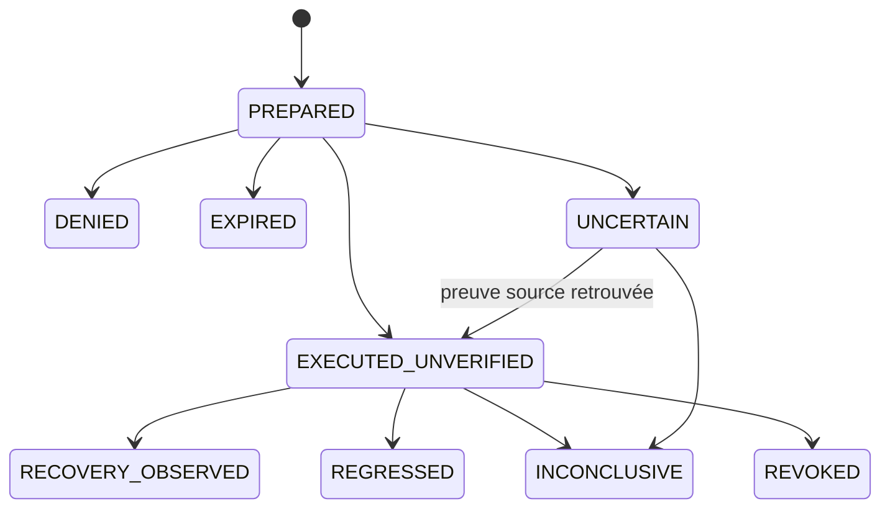

# Runtime GNS — Contrats, états et frontières d'autorité

- **Statut** : Implémenté pour les chemins décrits ; qualification de production partielle.
- **Portée** : runtime Node.js, sidecar SQLite, raccordements et régulation du Garage.
- **Dernière revue** : 2026-11-02.

Cette référence décrit les surfaces réellement présentes dans le dépôt. La
[fiche conceptuelle](../01-concepts/gns.md) expose les modèles ; le
[cycle d'orchestration](../02-orchestration/gns-regulation-operationnelle.md)
explique l'enchaînement. Un reçu GNS ne vaut pas autorisation de promotion.

## 1. Points d'entrée et activation

| Surface | Entrée | Contrat |
| --- | --- | --- |
| Pont de télémétrie | `runtimeBridge.observePersistedEvent(db, event)` | relit la ligne source canonique par identifiant et scope |
| Rattrapage | `runtimeBridge.backfill(db, request)` | `scope`, `afterId`, `limit` ; curseur conservé avant la première ligne non observée |
| Runtime interne | `NervousRuntime.ingest(event, scope, options)` | normalise, scelle les métadonnées internes et projette le signal |
| Lecture consommateur | `consumerContext.readContext(request)` | `db`, `scope`, `agentIds` optionnels, `limit` optionnel |
| Scheduler Garage | `regulationRuntime.tick({ db })` | domaines persistés, lots bornés et reprise de prélèvements |
| Réservation Garage | `garageReservationGuard.assertReservation(db, request)` | contrôle des limites GNS et des claims ordinaires avant la réservation |
| Politique | `regulationPolicy.enroll(db, input)` | contrat signé, scope réel et version attendue |
| Gate d'effet | `effectGate.dispatch(store, request, adapters)` | proposition existante, mode, autorisation exacte, handler et échéance |

Les modules GNS sont sous
[`backend/src/services/nervous/`](../../backend/src/services/nervous/) ; le
[contrôle de réservation](../../backend/src/services/garageReservationGuard.js)
appartient au Garage.
Ces fonctions sont des API internes de confiance, pas des endpoints accessibles
sans contrôle d'identité. Aucun outil MCP GNS dédié ni route REST GNS n'est ajouté
par ces implémentations.

| Configuration | Valeur | Effet |
| --- | --- | --- |
| `GENOS_NERVOUS_ENABLED` | `1` | observation et raccordements GNS actifs |
| `GENOS_NERVOUS_REGULATION` | `guarded` | permet de tenter le régulateur, sous politique valide |
| politique signée absente, refusée ou périmée | — | aucun droit nouveau d'exécuter un effet |
| `predictiveHold` dans la politique | `false` par défaut | prévision consultative ; `true` requiert aussi une demande native en attente |

Les CLI sont destinées à un opérateur local autorisé à la base :

```text
node backend/bin/genos-nervous.cjs status ORG PROJECT
node backend/bin/genos-nervous.cjs effects ORG PROJECT
node backend/bin/genos-nervous.cjs backfill ORG PROJECT [AFTER_ID]
node backend/bin/genos-nervous-regulation.cjs sample MANAGER
node backend/bin/genos-nervous-regulation.cjs episodes MANAGER
node backend/bin/genos-nervous-regulation.cjs calibrate MANAGER
node backend/bin/genos-nervous-regulation.cjs enroll MANAGER SIGNED_POLICY.json
```

La première CLI exige l'activation GNS. `sample` respecte sa désactivation ;
`episodes` est une inspection locale. L'enrôlement n'active pas automatiquement
le mode d'exécution du backend. Les arguments sont validés avant ouverture de
la base ; la CLI ne génère pas une clé privée ou une signature d'autorité.

## 2. Événements et signal canonique

| Canal | Types reconnus |
| --- | --- |
| Nociceptif | `AGENT_FAILED`, `AGENT_RUNTIME_ERROR`, `TOOL_CALL_FAILED` |
| Interoceptif | `TOKEN_ROUND_FAILED`, `TOKEN_ROUND_EVALUATED`, `NERVOUS_RESOURCE_SAMPLE`, `NERVOUS_SENSOR_SAMPLE` |
| Épistémique | `EVIDENCE_REPORT` |
| Proprioceptif | `AGENT_COMPLETED`, `TOOL_CALL_COMPLETED`, `TOPOLOGY_TRANSITION_COMPLETED` |

Les autres types ne deviennent pas des signaux GNS. Les sorties du système
nerveux ne sont pas réingérées par simple ressemblance de nom.

| Champ normalisé | Sens ou validation |
| --- | --- |
| `schemaVersion` | version d'enveloppe, actuellement 1 |
| `id` | digest du scope et de l'identifiant d'événement |
| `eventId`, `agentId` | identifiants validés, pas du texte libre |
| `scope` | `organizationId` et `projectId` obligatoires dans le contexte |
| `kind`, `channel` | type connu et canal dérivé du catalogue fermé |
| `observedAt` | date d'observation ; voie télémétrie : `created_at` source ; voie native : heure du prélèvement |
| `receivedAt` | horloge du runtime à l'admission, sans remplacer `observedAt` |
| `severity` | `info`, `warn`, `warning`, `error` ou `critical`, sinon `info` |
| `pressure`, `coverage` | nombre fini dans [0,1] ou `null` ; une valeur manquante n'est pas remplacée par une santé supposée |
| `reportedOutcome` | issue déclarée `success`, `failure`, `unverified` ou `null` |
| `correlation` | trace W3C valide ou hash d'une corrélation historique |
| `propagationGraph` | graphe normalisé scellé par le runtime |
| `sensorSource` | provenance native éventuelle ; `garage-sqlite-v1` et référence de prélèvement |
| `regulationForecast`, `regulationPolicy` | métadonnées internes éventuelles, vérifiées et scellées à l'ingestion |

Une copie de `regulationForecast` dans le payload d'une télémétrie ne remplace
pas l'option interne de confiance. Les prompts, sorties d'outils, secrets et
champs libres ne sont pas copiés dans le signal minimal. Cette réduction ne
supprime pas les données éventuellement conservées par la télémétrie source.

Le scope du payload, s'il est présent, doit correspondre au contexte. Le pont
de production exige un scope explicite pour retrouver sa ligne source. Ces
contrôles de cohérence ne remplacent pas les droits amont du producteur.

## 3. Projection, doublons et horloges

`append` conserve l'entrée avant sa réduction. La projection suivante écrit
ensemble état, reçu, propositions et marqueur de traitement, sous transaction
SQLite. La reprise d'une entrée déjà traitée retourne le reçu existant.

Une identité identique avec un contenu différent produit `SIGNAL_ID_COLLISION`.
L'heure de réception et le graphe fourni lors d'un nouvel appel ne remplacent
pas le premier graphe scellé d'un doublon. Le graphe durable initial détermine
le rejeu.

| Règle | Comportement |
| --- | --- |
| horodatage invalide ou négatif | refus |
| avance supérieure à 60 s à l'admission générique | refus |
| observation de plus de 30 s ou antérieure à l'état courant | `HISTORICAL`, sans nouveau réflexe ni réécriture de l'état courant |
| mesure expirée dans la vue | pression/couverture inconnues ; source courante absente si aucun état mesuré frais ne la soutient |
| entrée non urgente répétée pendant 5 s | propositions habituées ; observation conservée |
| menace urgente | le réfractaire ne supprime pas l'alerte |

Le contrat générique n'impose pas une synchronisation distribuée des horloges.
Le vérificateur natif du Garage requiert une mesure non future et au plus vieille
de 30 secondes. Les consommateurs d'une prévision respectent en plus son horizon.

## 4. État et reçu

L'état par agent peut être `UNKNOWN`, `ALERT`, `RECOVERY` ou `REST`. Les valeurs
brutes et dates de pression/couverture demeurent distinctes des vues expirées.
Le priming décroît sur cinq minutes et est plafonné à 0,2. Il ne fournit aucune
permission.

Le reçu conserve `schemaVersion`, `signalId`, `disposition`, `decisionTime`,
les identifiants des effets, `stateHash`, `policyVersion`, `graphHash`,
`evidenceStatus` et la corrélation. La politique générique est `gns-1` ; les
métadonnées de régulation ou de prévision utilisent `gns-2`. Ce marqueur ne
remplace pas la version monotone de la politique d'admission signée.

`evidenceStatus: UNVERIFIED` demeure indépendant d'une déclaration d'issue dans
le signal. Le hash d'un état est une liaison de contenu, pas une preuve métier.

## 5. Graphes RPE et topologies

| Limite de propagation | Valeur |
| --- | --- |
| nœuds | 128 |
| arêtes | 512 |
| sauts | 4 |
| voisins par expansion | 8 |
| destinataires | 64 |
| durée d'une onde | 15 s |
| atténuation par saut | facteur 0,6 |

Les graphes cycliques sont parcourus sans boucle infinie ; les voisins sont
ordonnés. Nœuds étrangers au scope, doublons de nœud, arêtes sans extrémité connue
et dépassements de capacité sont refusés. L'union automatique RPE/topologie est
validée et dédupliquée avant scellement.

Les huit noms de mode sont `trinity`, `a_team`, `biocenose`, `syncytium`,
`holobionte`, `metapopulation`, `rhizome`, `biome`. La projection automatique
couvre les workers persistés, la supervision enfant → parent et les dépendances
producteur → consommateur effectivement déclarées. Les mondes conceptuels ou
les liens CRDT non incarnés ne sont pas ajoutés par convention.

Une onde produit `INCREASE_MONITORING`. Elle ne vaut pas accès réseau au voisin,
ni suspension, ni réallocation, ni autorisation de publication.

## 6. Lecture consommateur

`readContext({ db, scope, agentIds, limit })` retourne un statut `AVAILABLE`,
`DISABLED` ou `UNAVAILABLE`, une liste d'agents et un historique de couples
`{ signal, receipt }`. Une indisponibilité ne devient pas un état de repos.

Les identités d'agents sont filtrées avant la limite de lecture. Un scope
consommateur est limité à 128 agents. L'historique est de 100 entrées par défaut,
de 1 à 1 000 au maximum. Une sélection vide ne signifie pas « tous les agents ».

Chaque source courante lie signal, événement ou prélèvement natif, horodatage et
reçu. Les dates de pression, couverture et menace restent nécessaires : une fin
d'outil récente ne renouvelle pas une ancienne mesure. Les références natives
emploient `gns:garage-sample`; les autres sources conservent leur référence
de télémétrie. La lecture ne crée ni mandat ni droit d'exécuter.

## 7. Gate d'effet générique

Les actions reconnues sont `INHIBIT_DISPATCH`, `REQUEST_VERIFICATION`,
`NOTIFY_OPERATOR` et `INCREASE_MONITORING`. La reconnaissance d'une action ne
signifie pas qu'un handler de production est installé.

L'autorisation doit donner `verdict: ALLOW`, l'`effectId` exact, le même scope,
un `decisionId` traçable et un `expiresAt` valide. Le claim SQLite est atomique.
Le handler reçoit une clé d'idempotence égale à l'effet, un signal d'annulation
et l'identité/l'échéance d'autorisation. Le timeout générique est de 5 secondes,
configurable jusqu'à 30 secondes.

| Résultat ou état | Interprétation |
| --- | --- |
| `OBSERVE_ONLY` | mode non exécutant ; proposition conservée |
| `NOT_FOUND`, `DENIED`, `DENIED_OR_UNAVAILABLE` | absence de proposition ou d'autorité exploitable |
| `ALREADY_CLAIMED` | un autre consommateur a acquis le claim |
| `EXPIRED` | échéance dépassée ; selon la frontière, retour sans mutation ou état après claim |
| `CLAIMED` | claim persistant, susceptible de rester après crash |
| `EXECUTED_UNVERIFIED` | handler terminé ou effet natif rapproché après crash ; aucun succès métier certifié |
| `UNCERTAIN` | un effet a pu se produire malgré erreur, timeout ou interruption |

Les refus avant claim ne transforment pas nécessairement le statut stocké de la
proposition. Aucune relance automatique d'un handler incertain n'est autorisée
par cette table de résultats.

## 8. Contrat du régulateur du Garage

La politique signée lie scope, manager, acteur, activation, seuil haut,
`holdMs`, `horizonMs`, `predictiveHold`, budget d'attente et expiration. Elle
scelle aussi la version attendue. Le backend consomme le nonce et augmente
la version dans une transaction source.

| Paramètre | Bornes ou défaut |
| --- | --- |
| `highThreshold` | [0,7 ; 0,95], défaut 0,9 |
| `holdMs` | [1 000 ; 15 000] ms, défaut 5 000 |
| `horizonMs` | [1 000 ; 10 000] ms, défaut 5 000 |
| `predictiveHold` | booléen, défaut `false` |
| `maxQueueWaitMs` | [1 000 ; 60 000] ms, défaut 15 000 |
| `expiresAt` | millisecondes Unix, futur et au plus une heure à l'enrôlement |
| `expectedVersion` | 0 initialement, puis version courante |

La clé du mandat SHEV actif, les droits de contrôle agent, l'autorité de mission,
Cedar et le circuit breaker sont vérifiés. Un breaker ouvert ou non fermé ne
permet pas une action du régulateur. Les observations restent distinctes de
cette permission d'action.

Seul `INHIBIT_DISPATCH` possède ici un handler de régulation installé. Le signal
et le prélèvement natif doivent correspondre, être frais et appartenir au même
manager/scope/version. La limite expire au plus tôt des échéances de politique,
proposition, autorisation d'effet et durée maximale signée.

Le plafond temporaire est `max(1, occupation observée)`. Au point de réservation,
une occupation inférieure permet une nouvelle admission. Une capacité modifiée
invalide la limite GNS ; les plafonds ordinaires restent obligatoires. Les codes
`GNS_ADMISSION_INHIBITED` et `GNS_REGULATION_UNAVAILABLE` sont traités comme une
contre-pression temporaire par le dispatcher de file.

## 9. Épisodes, suivi et calibration

L'épisode et l'effet ont des états séparés :



`RECOVERY_OBSERVED` exige trois nouvelles mesures distinctes de pression ≤0,4,
couvrant au moins une seconde, non futures, fraîches, à capacité identique et
sans aggravation du nombre de demandes en file par rapport à la baseline.
Ce n'est pas une preuve d'absence de toute autre régression.

`REGRESSED` correspond à une attente dépassant le budget signé et aggravée de
plus d'une seconde. La limite propre à cet effet est relâchée et cette version
de politique ne produit plus de nouvelle intervention. La fin de fenêtre, un
changement de capacité ou l'absence de preuve d'effet peuvent rendre le suivi
inconclusif. Une récupération, une régression ou une conclusion inconclusive
relâche la limite de cet effet.

Les verdicts observés ne certifient pas la causalité ou la réussite métier.
La calibration requiert au moins dix épisodes `RECOVERY_OBSERVED` ou `REGRESSED`
compatibles avec la même version/manager/scope, retient au plus vingt résultats
admissibles parmi les cent épisodes lus et propose
au maximum +0,02 de seuil si plus d'un quart ont régressé. La borne reste
[0,7 ; 0,95]. La proposition exige un nouvel enrôlement signé pour être appliquée.

## 10. Persistance et capacités

| Emplacement | Tables et rôle |
| --- | --- |
| base source | `telemetry_events`, agents/workspaces/missions/relations et Garage existants |
| base source | `gns_regulation_policies` : politique courante ; `gns_admission_holds` : limites d'admission liées aux effets |
| sidecar | `nervous_signals`, `nervous_states`, `nervous_receipts`, `nervous_effects` |
| sidecar | `nervous_garage_samples` : mesures et marqueur de projection ; `nervous_regulation_episodes` : suivi, verdicts et refus d'admission |

Le chemin du sidecar vient de `PRAGMA database_list` sur la connexion source
réelle. Une source en mémoire est refusée pour son ouverture de production.
Le driver est `sqlite`/`sqlite3`, avec WAL, clés étrangères, délai busy et
synchronisation complète du store. Les tests peuvent injecter une connexion
réelle `node:sqlite` pour leurs fixtures.

Les limites par défaut sont 100 000 signaux et 100 000 prélèvements natifs,
64 observations du pont en vol et 8 runtimes source ouverts par pont. Le drain
projette 100 signaux par appel par défaut, de 1 à 1 000 sur demande. La lecture
des effets et du suivi est bornée. Aucune purge automatique ou transaction
distribuée source/sidecar n'est fournie.

## 11. Refus et diagnostic

| Famille | Exemples | Lecture correcte |
| --- | --- | --- |
| identité/scope | `SCOPE_MISMATCH`, `CROSS_TENANT_GRAPH`, `GNS_MANAGER_MISMATCH` | corriger le contexte enregistré ; ne pas remplacer le scope par celui d'un prompt |
| capacité | `GRAPH_CAPACITY`, `RUNTIME_CAPACITY`, `NERVOUS_CAPACITY`, `GNS_SAMPLE_CAPACITY` | saturation explicite ; prévoir archivage et dimensionnement |
| entrée native | `GNS_CAPACITY_UNKNOWN`, `GNS_QUEUE_UNKNOWN`, `GNS_MEASUREMENT_UNAVAILABLE` | mesure inexploitable, pas pression nulle |
| politique | `GNS_POLICY_VERSION_CONFLICT`, `GNS_AUTHORITY_REVOKED` | relire version et mandat ; nouvel enrôlement sous autorité |
| effet | `GNS_CIRCUIT_DENIED:*`, `GNS_EFFECT_EXPIRED`, `GNS_EFFECT_AUTHORIZATION_REQUIRED` | refus ou état incertain selon la frontière ; aucune permission implicite |
| reprise | `GNS_HOLD_IDENTITY_MISMATCH`, effet sans preuve source | ne pas transformer le rapprochement manquant en succès |
| pont | `UNAVAILABLE`, `BACKPRESSURE`, `NOT_PERSISTED` | inspecter source, compteurs et curseur ; ne pas conclure à une santé correcte |

Les messages de signature SHEV peuvent être textuels ; ne pas supposer que
tout refus possède un code unique stable. Les runbooks décrivent les procédures
d'inspection et de reprise.

## Sources et exploitation

| Raccordement | Adaptateur | Contrat exécutable |
| --- | --- | --- |
| AGOW | [agowAdapter.js](../../backend/src/services/nervous/agowAdapter.js) | [gnsAgow.test.js](../../backend/tests/nervous/gnsAgow.test.js) |
| Morphogenèse | [morphogenesisAdapter.js](../../backend/src/services/nervous/morphogenesisAdapter.js) | [gnsMorphogenesis.test.js](../../backend/tests/nervous/gnsMorphogenesis.test.js) |
| Ontogenèse | [ontogenesisAdapter.js](../../backend/src/services/nervous/ontogenesisAdapter.js) | [gnsOntogenesis.test.js](../../backend/tests/nervous/gnsOntogenesis.test.js) |
| SHEV | [shevAdapter.js](../../backend/src/services/nervous/shevAdapter.js) | [gnsShev.test.js](../../backend/tests/nervous/gnsShev.test.js) |
| RPE | [rpeAdapter.js](../../backend/src/services/nervous/rpeAdapter.js) | [gnsRpe.test.js](../../backend/tests/nervous/gnsRpe.test.js) |
| Huit topologies | [topologyAdapter.js](../../backend/src/services/nervous/topologyAdapter.js) | [gnsTopologies.test.js](../../backend/tests/nervous/gnsTopologies.test.js) |

- [Contrat des signaux](../../backend/src/services/nervous/contract.js), [physiologie](../../backend/src/services/nervous/physiology.js), [runtime](../../backend/src/services/nervous/runtime.js).
- [Graphe](../../backend/src/services/nervous/propagation.js), [union des sources](../../backend/src/services/nervous/graphContext.js), [store](../../backend/src/services/nervous/store.js).
- [Gate d'effet](../../backend/src/services/nervous/effectGate.js), [politique](../../backend/src/services/nervous/regulationPolicy.js), [point d'admission](../../backend/src/services/nervous/admissionControl.js), [suivi](../../backend/src/services/nervous/regulationVerification.js).
- [Exploitation GNS](../04-exploitation/systeme-nerveux-operationnel.md), [régulation du Garage](../04-exploitation/regulation-gns-du-garage.md), [qualification](../06-qualite-preuves/qualification-gns-2026-11-02.md).
