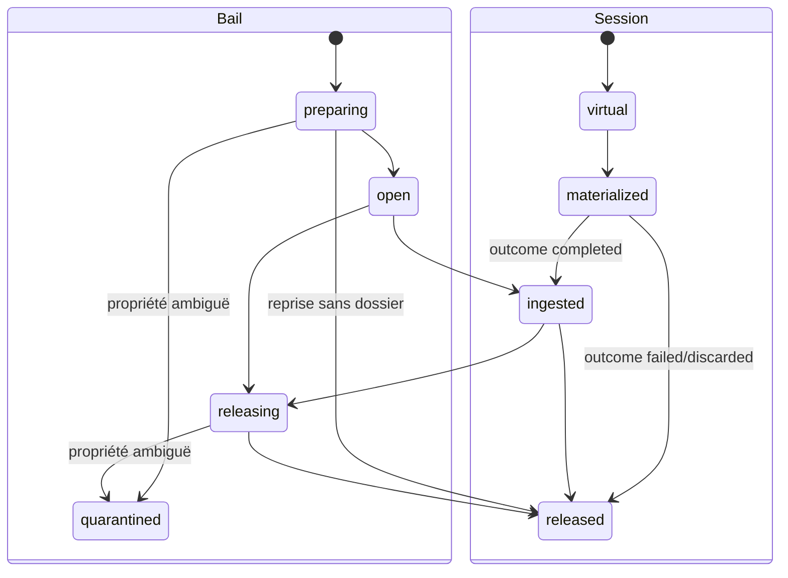

# Runtime GQWF v2 — référence technique

- **Statut** : implémenté partiellement, activation opt-in.
- **Portée** : API Node interne, politiques de mission, schéma durable, matérialiseurs, protocoles et erreurs.
- **Dernière revue** : 2026-10-20.

La surface canonique est exportée par
[`backend/src/services/gqwf/index.js`](../../backend/src/services/gqwf/index.js).
Elle expose `migrateGqwf(db)` et `createFabric(db, options)`. Ce contrat est une
API de service Node ; il ne constitue pas une nouvelle API REST ou MCP publique.

## Construction et dépendances

```js
const { migrateGqwf, createFabric } = require('./services/gqwf');

await migrateGqwf(db);
const fabric = createFabric(db, {
  materializerId: 'auto',
  verifyPromotion,
  verifyWorkerPromotion,
  authorizeReplication,
  authorizeRepair,
  authorizeMetadataRepair
});
```

Les callbacks de vérification ou d'autorisation sont obligatoires sur les
opérations qui les réclament. Leur absence provoque un refus fermé.

| Option | Consommateur | Contrat |
| --- | --- | --- |
| `materializerId` | sélection du backend | ID explicite ou `auto`; défaut `portable-copy-v1` |
| `materializers` | registre de matérialisation | drivers conformes au contrat v1 |
| `requirePortable` | registre de matérialisation | ajoute le fallback portable sauf valeur `false` |
| `verifyPromotion` | `publishCandidate` | retourne un verdict lié à la tête et à la candidate |
| `verifyWorkerPromotion` | `promoteWorkerCandidate` | vérifie le binding et la candidate worker |
| `authorizeReplication` | `replicateRoot` | autorise exactement le plan source/cible |
| `authorizeRepair` | `repairRoot` | autorise exactement le plan de réparation |
| `authorizeMetadataRepair` | `repairMetadata` | autorise le plan de reconstruction SQLite |
| `overlayCacheRuntime` | GC et OverlayFS | adaptateur du cache lower et de ses montages |

Les callbacks reçoivent la demande reconstruite par le service. Ils ne doivent
pas se fier à un booléen fourni par l'appelant ni retourner un succès de
transport en guise d'autorisation.

## Cartographie des modules

| Module | Responsabilité | N'est pas autorisé à faire |
| --- | --- | --- |
| `manifest.js` | normalisation portable et hash canonique | accéder à SQLite ou publier une tête |
| `objects.js` / `metadataStore.js` | I/O CAS et contrôle des fichiers privés | choisir une candidate |
| `roots.js` | import, merge, têtes et publication vérifiée | matérialiser un chemin de travail |
| `views.js` / `storage.js` | projection d'une base et overlay optimiste | contourner `expectedVersion` |
| `leases.js` | cycle physique et réconciliation des baux | promouvoir la racine ingérée |
| `materialization/` | sonde, sélection, capture, libération et reçu | fallback silencieux d'un backend explicite |
| `execution.js` / `missionExecution.js` | sessions virtuelles et raccord mission | publier automatiquement la candidate |
| `workers.js` / `workerPromotion.js` | binding privé et promotion worker | réutiliser un verdict non lié |
| `catalog.js` | checkpoint, maintenance et reconstruction couverte | reconstruire les projections hors catalogue |
| `integrity.js`, `replication.js`, `repair.js` | observer, transporter et restaurer les octets | convertir une réparation en promotion |
| `garbageCollection.js` | inventaire puis suppression liée | collecter à partir d'un aperçu périmé |

## Surface de la fabrique

Les objets d'entrée utilisent toujours `workspaceId` lorsqu'ils touchent un
workspace. Les hashes sont des SHA-256 hexadécimaux sur 64 caractères.

| Méthode | Entrée essentielle | Résultat ou effet |
| --- | --- | --- |
| `importBase` | `workspaceId` | importe le chemin enregistré, retourne `rootHash`, `fileCount` |
| `importLegacySnapshot` | workspace et identité snapshot v1 | lie le snapshot à une racine GQWF |
| `createView` | `workspaceId`, `baseHash` | vue version `0` |
| `listFiles` | `workspaceId`, `viewId` | manifeste projeté et version |
| `readFile` | workspace, vue, `path` | `Buffer` vérifié |
| `writeFile` | workspace, vue, `path`, `content`, `expectedVersion`, `mode?` | version d'overlay suivante |
| `deleteFile` | workspace, vue, `path`, `expectedVersion` | tombstone et version suivante |
| `sealView` | workspace, vue, `expectedVersion` | racine déterministe |
| `mergeRoots` | workspace, `baseHash`, `candidateHash`, `currentHash` | racine fusionnée ou liste de conflits |
| `getHead` | workspace, `name` | `rootHash`, `generation` |
| `initializeHead` | workspace, `name`, `rootHash` | tête génération `0` |
| `publishCandidate` | workspace, nom, hashes attendu/candidat, génération attendue | tête avancée et `evidenceId` |

### Matérialisation et exécution

| Méthode | Contrat |
| --- | --- |
| `inspectMaterializers` | observe disponibilité, capacités et raison d'indisponibilité |
| `inspectMaterialization` | relit le reçu lié à un bail |
| `materializeRoot` | ouvre un bail `preparing`, matérialise sous `lease-<uuid>/root`, puis passe `open` |
| `ingestLease` | capture un bail `open` et retourne une nouvelle racine |
| `releaseLease` | libération idempotente d'un bail connu |
| `reconcileReleasingLeases` | termine jusqu'à 100 libérations ; avec `recoverPreparations: true`, traite aussi les préparations |
| `openExecutionWorkspace` | crée une vue virtuelle sans chemin physique |
| `materializeExecutionWorkspace` | scelle la vue et retourne un descripteur matérialisé |
| `ingestExecutionWorkspace` | capture la candidate d'une session |
| `releaseExecutionWorkspace` | libère le bail et retire le chemin du descripteur |

Le chemin exécutable doit être le conteneur du bail lui-même ou son enfant
exact `root`. Tout autre chemin est refusé.

### Workers, maintenance et résilience

| Méthode | Contrat |
| --- | --- |
| `inspectWorker` | état du binding worker, du bail et de la candidate |
| `inspectWorkerCandidates` | candidats capturés éligibles à une décision |
| `promoteWorkerCandidate` | promotion sous vérificateur dédié |
| `inspectGarbage` / `collectGarbage` | prévisualisation puis collecte liée par hash d'inventaire |
| `scrubIntegrity` | lecture exhaustive non destructive, reçu durable |
| `inspectReplication` / `replicateRoot` | plan puis transfert inter-workspaces même tenant |
| `inspectRepair` / `repairRoot` | plan puis réparation depuis une réplication attestée |
| `checkpointMetadata` | publie l'état racines/têtes/baux dans le CAS de métadonnées |
| `maintainMetadataCatalog` | réconcilie publication et conserve 64 refs |
| `inspectMetadataRepair` / `repairMetadata` | plan puis reconstruction SQLite autorisée |
| `inspectRollout` | synthèse des décisions canari persistées |
| `sealExecutionClosure` | scelle racine, commande, runtime, dépendances et environnement hashé dans le CAS |
| `inspectExecutionClosure` | relit et vérifie une fermeture par son hash, avec état `registered` de l'index |

Les couples `inspect*` / mutation sont intentionnels : l'appel mutateur exige le
hash exact du plan ou de l'inventaire précédemment observé.

## Politique de mission

L'activation explicite est :

```json
{
  "executionPolicy": {
    "gqwfV2": true,
    "gqwfMaterializer": "auto"
  }
}
```

`gqwfMaterializer` accepte `portable-copy-v1`, `native-reflink-v1`,
`linux-overlayfs-v1` ou `auto`. Le champ est refusé si ni `gqwfV2` ni une
affectation canari GQWF ne sont actifs. L'ingress historique
`gqwf_materializer` est normalisé vers ce champ par la couche mission.

Le canari utilise `executionPolicy.gqwfCanary` avec un booléen `enabled`, un
`basisPoints` entier entre 1 et 10 000 et une identité de politique. Le mode
explicite et le canari ne peuvent pas être demandés ensemble. La variable
`GENOS_GQWF_CANARY_DISABLED` sert de coupe-circuit global ; les décisions et
leurs transitions `assigned → prepared → completed|failed` restent durables.

## Matérialiseurs

| Backend | Plateforme | Propriété |
| --- | --- | --- |
| `portable-copy-v1` | toutes | copie complète, référence de compatibilité |
| `native-reflink-v1` | fichiersystems compatibles | clone COW natif lorsqu'il est observé et qualifié |
| `linux-overlayfs-v1` | Linux | lower cache partagé et upper privé, montage requis |
| `auto` | selon sondes | préfère OverlayFS, puis reflink, puis copie portable |

La sélection et ses capacités sont persistées dans
`gqwf_materialization_receipts`; l'ingestion et la libération résolvent le même
backend, elles ne le redétectent pas silencieusement. L'indisponibilité du
backend explicitement demandé est une erreur, pas une permission de fallback.

## Persistance

`migrateGqwf` crée ou fait évoluer les tables suivantes :

| Famille | Tables |
| --- | --- |
| contenu et vues | `gqwf_roots`, `gqwf_views`, `gqwf_changes` |
| publication | `gqwf_heads`, `gqwf_head_events` |
| exécution | `gqwf_leases`, `gqwf_execution_sessions`, `gqwf_worker_bindings`, `gqwf_worker_promotions` |
| compatibilité | `gqwf_legacy_links` |
| rollout | `gqwf_rollout_decisions` |
| preuves d'infrastructure | `gqwf_materialization_receipts`, `gqwf_gc_runs`, `gqwf_integrity_runs` |
| transport et réparation | `gqwf_replication_receipts`, `gqwf_repair_receipts` |
| catalogue | `gqwf_catalog_state`, `gqwf_metadata_repair_receipts` |
| provenance d'exécution | `gqwf_execution_closures` |

Le store physique se trouve sous le workspace enregistré :

```text
.genos/gqwf/
├── blobs/<préfixe>/<sha256>
├── materialized/lease-<uuid>/.genos-gqwf-lease
├── materialized/lease-<uuid>/root/
└── metadata/
    ├── objects/<préfixe>/<sha256>
    └── refs/catalog/<révision-sur-12-chiffres>-<sha256>.ref
```

SQLite est un index transactionnel. Le catalogue CAS protège seulement les
racines, têtes et baux nécessaires à la reconstruction prévue ; les vues,
overlays, sessions, décisions de rollout et reçus ne sont pas reconstruits par
`repairMetadata`.

### Dictionnaire transactionnel

| Table | Clé ou unicité structurante | État mutable |
| --- | --- | --- |
| `gqwf_roots` | `(workspace_id, root_hash)` | aucun contenu après insertion |
| `gqwf_views` | `id`, index workspace | `overlay_version` monotone |
| `gqwf_changes` | `(view_id, path)` | remplacement/tombstone de la vue |
| `gqwf_heads` | `(workspace_id, name)` | `root_hash`, `generation` |
| `gqwf_head_events` | `(workspace_id, name, generation)` | append-only |
| `gqwf_leases` | `id` | statut du bail et chemins gérés |
| `gqwf_execution_sessions` | `execution_run_id`, vue et bail uniques | statut, candidate, résultat, erreur |
| `gqwf_worker_bindings` | `worker_id`, vue et bail uniques | capture, résultat, erreur |
| `gqwf_rollout_decisions` | `execution_run_id` | transition assignée/préparée/terminale |
| `gqwf_catalog_state` | `workspace_id` | révision et hash du dernier checkpoint |

Les tables de reçus possèdent une identité ou un hash unique. Elles servent à
relire une décision déjà prise ; elles ne doivent pas être réécrites pour faire
correspondre a posteriori un état divergent.

## Automates de référence



Une erreur peut être persistée sans changer le statut. L'opérateur doit donc
examiner le statut et le champ d'erreur ; l'absence d'exception lors d'une
lecture ne signifie pas qu'une session est terminale.

### Points de linéarisation

- une mutation de vue se linéarise sur
  `UPDATE ... overlay_version = overlay_version + 1 WHERE ... = expected` ;
- une tête se linéarise dans la transaction qui compare la génération, écrit
  la nouvelle valeur et son événement ;
- un objet CAS devient réutilisable après écriture privée, renommage/copie
  exclusive puis relecture de son hash ;
- une révision de catalogue est utilisable après validation de l'objet et de
  sa ref ;
- un bail est récupérable par son enregistrement SQLite, son marqueur et le
  reçu du matérialiseur ensemble.

## Contrat de manifeste portable

Le manifeste v2 est sérialisé avec cet ordre de propriétés et des fichiers
triés par chemin :

```json
{
  "policy": {
    "version": 2,
    "projection": "workspace-snapshot-v1",
    "paths": "portable-nfc",
    "modes": "sanitized-v1"
  },
  "files": [
    { "path": "src/main.js", "hash": "<sha256>", "size": 42, "mode": 420 }
  ]
}
```

Les chemins sont relatifs, normalisés NFC et comparés aussi sous une forme
insensible à la casse pour détecter les collisions portables. Les segments
réservés Windows, caractères de contrôle, suffixes espace/point, tailles et
modes hors limites sont refusés. Liens symboliques, fichiers spéciaux et
attributs étendus ne font pas partie de cette projection.

## Frontières de crash

| Fenêtre | État observable | Réponse prévue |
| --- | --- | --- |
| SQLite `preparing`, dossier absent | création interrompue tôt | reprise vers `released` |
| dossier présent, marqueur et reçu valides | création/libération interrompue | `recover` du backend enregistré |
| dossier présent sans preuve privée | propriété indécidable | `quarantined` |
| objet catalogue écrit, SQLite stageé, ref absente | crash avant publication | `maintainMetadataCatalog` republie |
| ref future, fork de révision ou chaîne cassée | divergence non réconciliable automatiquement | refus et restauration opérateur |
| plan d'inspection différent de l'état courant | course entre observation et effet | refus `plan changed`, nouvel inspect requis |

## Protocoles durables

| Protocole | Objet |
| --- | --- |
| `gqwf-catalog-v1` | catalogue canonique racines/têtes/baux |
| `gqwf-catalog-ref-v1` | publication append-only d'une révision |
| `gqwf-catalog-maintenance-v1` | résultat de réconciliation/rétention |
| `gqwf-metadata-repair-v1` | plan et reçu de reconstruction SQLite |
| `gqwf-scrub-v1` | inventaire d'intégrité non destructif |
| `gqwf-cas-replication-v1` | plan et reçu de réplication |
| `gqwf-cas-repair-v1` | plan et reçu de réparation |
| `gqwf-execution-closure-v1` | fermeture déclarative liée à une racine et adressée par contenu |

Les JSON sont hashés dans leur sérialisation canonique attendue par le module.
Une ref mal nommée, dupliquée à la même révision, liée à un autre workspace ou
pointant vers un objet corrompu bloque la maintenance.

### Fermeture d'exécution

Entrée minimale :

```js
const closure = await fabric.sealExecutionClosure({
  workspaceId,
  rootHash,
  command: { executable: 'node', arguments: ['tests/run.js'] },
  runtime: { name: 'node', version: '24.18.0', digest: runtimeSha256 },
  dependencies: [
    { name: 'sqlite', version: '5.1.7', digest: packageSha256 }
  ],
  environment: [
    { name: 'NODE_ENV', valueHash: valueSha256 }
  ]
});
```

Les objets `command`, `runtime`, `dependencies` et `environment` refusent tout
champ inconnu. Une dépendance est unique par triplet nom/version/digest et une
variable par nom. Les listes sont bornées à 2 048 entrées, les arguments à 256
et les textes à 1 000 caractères. Tous les digests sont des SHA-256
hexadécimaux sur 64 caractères.

Le résultat expose `closureHash` et l'assurance fixe :

```json
{
  "fileRoot": "content-addressed",
  "externalInputs": "declared-only",
  "sandbox": "not-attested"
}
```

`inspectExecutionClosure` exige `workspaceId` et `closureHash`. Il relit
l'objet CAS, recalcule sa forme canonique et confirme que `rootHash` reste une
racine accessible du workspace. `registered: false` signifie que l'objet reste
valide mais que sa projection `gqwf_execution_closures` a disparu. Cette API ne
réinsère rien et ne constitue pas une réparation de métadonnées. Une ligne
indexée ajoute sa racine aux références protégées par le GC ; le scrub compte
et vérifie les fermetures indexées dans son rapport.

## Concurrence et erreurs attendues

| Situation | Refus |
| --- | --- |
| version de vue obsolète | `GQWF overlay version conflict.` |
| tête déjà créée ou déplacée | tête existante / `head changed before promotion` |
| verdict absent ou mal lié | promotion refusée |
| bail sans marqueur fiable | quarantaine, aucune suppression |
| préparation non résolue | nouvelle matérialisation bloquée |
| inventaire ou plan périmé | nouvelle prévisualisation requise |
| source et cible hors tenant | réplication/réparation refusée |
| catalogue divergent, forké ou corrompu | maintenance/réparation refusée |
| matérialiseur inconnu | `GQWF_MATERIALIZER_POLICY_INVALID` |
| matérialiseur demandé sans GQWF actif | `GQWF_MATERIALIZER_POLICY_INACTIVE` |

Les messages sont stables pour le diagnostic interne, mais les appelants doivent
préférer les codes lorsqu'ils existent et ne pas analyser tous les textes.

## Sécurité et frontières

- les chemins de manifeste sont normalisés et confinés ;
- les blobs et objets de métadonnées doivent être des fichiers privés réguliers ;
- la taille et le mode des fichiers passent par les limites de snapshots ;
- réplication, réparation et reconstruction exigent une autorisation liée au plan ;
- les dossiers de bail ne sont supprimés qu'après vérification du marqueur ;
- une réplication ne traverse pas le tenant ;
- aucun résultat de transport ne remplace un verdict de promotion.

## Compatibilité et évolution

`policy.version`, `contractVersion` des matérialiseurs et noms de protocoles
sont des frontières versionnées. Une évolution qui change la sérialisation, la
sémantique d'un reçu ou le contenu reconstructible du catalogue exige une
nouvelle version et une ADR ; elle ne doit pas réinterpréter les objets v1/v2
existants. Les tables SQLite peuvent évoluer par migration tant que les
anciens reçus restent vérifiables.

Voir le [modèle conceptuel](../01-concepts/gqwf.md), le
[raccord d'orchestration](../02-orchestration/gqwf-v2.md), le
[runbook](../04-exploitation/gqwf.md) et la
[qualification](../06-qualite-preuves/qualification-gqwf-2026-10-20.md).
