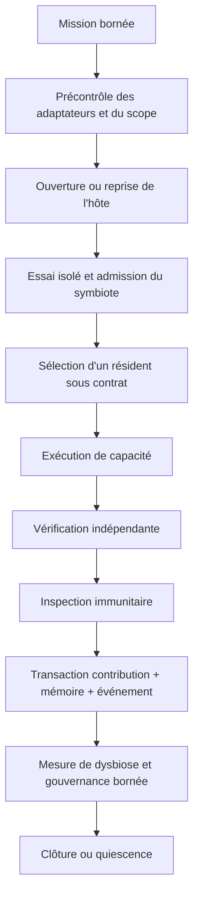
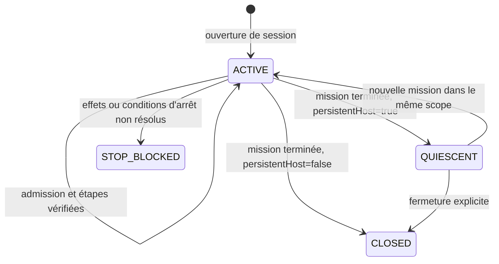

# Runtime Holobionte : contrat d’exécution

- **Statut** : Implémenté pour les missions contractuelles décrites ici
- **Portée** : façade de mission par capacité, admission, adaptateurs, santé et cycle de session
- **Dernière revue** : 2026-10-20

Le point d’entrée est [holobionteService.js](../../backend/src/services/holobionteService.js), qui expose runHolobiontMission, openMissionHost, admitMissionSymbiont et preflightHolobiontMission. Le cycle de capacité reste accessible par holobiontRuntime.runCycle. Voir l’[ADR 0330](../adr/0330-holobionte-missions-contractuelles-verifiees.md), le [guide d'exploitation](../04-exploitation/operer-runtime-holobionte.md) et le [dossier de qualification](../06-qualite-preuves/qualification-holobionte-2026-10-20.md).

## Snapshot topologique

Un snapshot d'agent peut référencer une session Holobionte avec
`topologySnapshot`. L'adaptateur scelle les reçus, le journal, la mémoire et
les champs propres aux douze variants. La reprise attend un hôte quiescent ou
fermé ; elle ne rejoue pas les effets d'outil ou distants. Voir
[snapshots topologiques](snapshots-topologiques.md).

## Exécuter l’exemple

Depuis la racine, après installation des dépendances du backend :

~~~powershell
node examples/holobionte/run-mission.cjs
node backend/bin/genos-holobionte-mission.cjs examples/holobionte/arithmetic-mission.cjs --preflight
npm --prefix backend run test:holobionte
~~~

Le premier exemple ouvre SQLite en mémoire, admet le calculateur, calcule 17 + 4 + 9, compare le résultat à un second calcul indépendant, persiste la contribution et ferme la session. Son adaptateur comptabilise une unité contractuelle de budget par essai et par exécution sous la clé tokens ; ce calcul local ne mesure pas des jetons consommés par un modèle de langage. Le précontrôle vérifie la forme et les adaptateurs ; il n’exécute pas la mission et ne certifie pas ses preuves.

Pour une exécution persistée, la même CLI accepte le chemin relatif d’un module exportant createMissionInput. Elle utilise la base configurée du backend. Un résultat bloqué ou un précontrôle refusé produit un code de sortie non nul. Les chemins absolus, sorties de workspace et liens symboliques interdits restent rejetés par le contrôle de chemins existant.

## Entrées de mission

| Champ | Contrat |
| --- | --- |
| hostId, missionId | Identifiants non vides ; holobiontId permet de viser une session active existante du même hôte. |
| projectId, workspaceId | Périmètre de réutilisation de l’hôte persistant. |
| persistentHost | true conserve l’hôte en quiescence après la mission ; sinon la session est fermée. |
| constitution | Identité, objectifs, invariants et autorité centrale de l’hôte. |
| symbionts | Jusqu’à 32 candidats explicitement fournis avec id et contrat complet. Les résidents existants sont réutilisés. |
| steps | 1 à 32 étapes : capability, request et éventuellement allocation, toolName, dataClasses, changedInvariants. Une capability seule définit une étape. |
| allocation | Politique de ressources et capacité disponible, obligatoire pour chaque étape ou au niveau mission. |
| budget | tokens (10 000 par défaut), latencyMs (60 000), maxSteps (32), positifs. Les essais consomment ce budget. |
| executeCapability | Callback fonctionnel requis, reçoit capacité, résident, contrat, allocation, session, requête et signal. |
| trialCapabilityExecutor | Callback requis pour un nouveau candidat, reçoit le contexte d’essai borné, le contrat et le signal. L’intégrateur fournit l’isolation physique. |
| verifyCapability | Callback fonctionnel requis et indépendant du producteur, reçoit résultat, empreinte, sortie, contrat et signal. Une référence identique ou une implémentation de fonction identique à `executeCapability` est refusée. |
| signal | Annulation externe propagée aux adaptateurs et vérifiée avant la persistance. |
| healthPolicy | `automatic: false` désactive les sanctions automatiques ; `ratio` règle les réductions bornées ; `dysbiosisThresholds` surcharge les seuils documentés ci-dessous. |

Une sortie d’exécution contient result, resourcesConsumed (dont tokens), receiptId et les mesures de contribution. Une sortie d’essai contient result, resourcesConsumed, contributionScore et contractCompliant. Le vérificateur retourne status: VERIFIED, resultHash exactement égal à l’empreinte fournie, verifierId distinct du symbiote et evidenceRefs non vides. Un selfVerified: true est refusé. La preuve doit représenter une vérification réelle effectuée par l’adaptateur.

Le précontrôle refuse séparément un exécuteur, un vérificateur ou un exécuteur d’essai absent ou non fonctionnel. Il calcule pour chaque callback une provenance `genos.holobiont-adapter-provenance/v1` contenant le rôle, l’identifiant déclaré (`adapterId`) ou le nom de fonction, la version déclarée éventuelle, l’empreinte SHA-256 de l’implémentation et l’empreinte du dossier de preuve. Le reçu de mission expose ces dossiers dans `adapterProvenance`. Les reçus d’essai et d’exécution conservent aussi les références de provenance du producteur effectivement appelé et du vérificateur dans `evidenceRefs`; les wrappers de délai restent liés au dossier du callback original.

Cette provenance prouve quelle implémentation de callback le runtime local a liée au rôle. Elle ne certifie pas à elle seule l’identité d’un fournisseur externe, son environnement physique ni la validité du résultat : ces propriétés exigent les preuves propres à l’adaptateur et restent soumises aux gates de résultat et d’isolation.

L’admission finale exige aussi un objet `isolationProof` émis dans la sortie de `trialCapabilityExecutor`. Le runtime fournit à ce callback son dossier `adapterProvenance`; la preuve doit utiliser le schéma `genos.holobiont-isolation-proof/v1`, placer exactement le `proofHash` du rôle `trial` dans `adapterProofHash`, identifier l’isolation et son mécanisme, horodater l’observation, puis attester les frontières `process: ISOLATED`, `workspace: EPHEMERAL|READ_ONLY` et `network: DENIED|RESTRICTED`. Ses `evidenceRefs` doivent toutes être reprises par le vérificateur indépendant. Une preuve absente, non liée à l’adaptateur effectivement appelé ou non couverte par le reçu de vérification provoque `HOLOBIONT_ISOLATION_UNVERIFIED`; aucun symbiote n’est alors admis.

Le helper `examples/holobionte/isolation-proof.cjs` illustre uniquement la forme de ce contrat. Son attestation d’exemple ne crée aucune sandbox système et doit être remplacée en production par les références observables du conteneur, processus ou environnement isolé piloté par l’adaptateur.

## Ordre des gates

1. Validation des adaptateurs, du périmètre et des limites de mission.
2. Constitution et session de l’hôte, puis contrat et admission du candidat.
3. Sélection du résident, contrôle du contrat actif, de l’autorité, des baux et des classes de données.
4. Allocation bornée par le contrat, la disponibilité et les autres allocations.
5. Exécution puis vérification indépendante de la sortie concrète et de sa consommation.
6. Inspection immunitaire de la sortie réelle et décision de l’hôte.
7. Relecture du contrat et transaction atomique contribution, mémoire, événement CAPABILITY_USED.
8. Libération de l’allocation, mesure de santé et sanctions bornées.
9. Clôture de mission ou quiescence de l’hôte persistant, sous conditions d’arrêt.

Une sortie tardive après annulation, une révocation pendant l’exécution ou une panne de mémoire ne peut laisser une contribution promue seule. Une admission rejetée retourne ADMISSION_REJECTED. CAPABILITY_GAP, EXECUTION_REJECTED et STOP_BLOCKED restent distincts de VERIFIED. Les erreurs de contrat ou de preuve sont des erreurs explicites ; elles ne sont pas converties en succès.

## Résultats et limites

Le résultat expose schema: genos.holobiont-capability-mission/v1, les identifiants, admissions, completed, usage, budget, status, stopped et lifecycle. Les résultats vérifiés gardent la sortie, l’empreinte, les preuves, la décision de l’hôte, la mémoire et la santé. Les missions incomplètes ne ferment pas automatiquement l’hôte et doivent être diagnostiquées ou reprises sous son contrat.

Les six signaux de dysbiose sont `resourceConcentration`, `dependencyConcentration`, `harmfulActivity`, `conflictRate`, `immunePressure` et `functionalRedundancy`. Chaque valeur est exposée sous la forme `{ value, status }`, où `status` vaut exclusivement `measured` ou `heuristic`. Une valeur numérique nue et tout signal dérivé du registre sont classés `heuristic` ; un appelant ne peut revendiquer `measured` qu’en le déclarant explicitement sur le signal. Un statut inconnu est refusé.

Le score agrégé et les états `STABLE`, `WATCH`, `ALERT` restent toujours `heuristic`, même si les six entrées sont mesurées. Le reçu expose `measurementStatus: measured` seulement quand toutes les entrées le sont, ainsi que `promotionEligible: false`. Ce score peut orienter une revue ou une action de santé bornée ; il ne constitue jamais, seul, une preuve ni une autorité de promotion.

Les seuils par défaut sont `signalExtreme: 0.70`, `lowRedundancy: 0.25`, `watchScore: 0.35` et `alertScore: 0.60`. Ils acceptent une surcharge partielle dans `healthPolicy.dysbiosisThresholds`; chaque valeur doit être comprise entre 0 et 1 et `watchScore` doit rester strictement inférieur à `alertScore`. Le reçu restitue les seuils effectivement utilisés pour rendre la décision auditable.

Le vecteur de fitness conserve ses dimensions séparées. L’isolation physique, les consommations réelles et la vérification des artefacts dépendent des adaptateurs fournis. Les adaptateurs `executeCapability`, `trialCapabilityExecutor` et `verifyCapability` sont obligatoires ; `verifyCapability` doit être une fonction distincte de `executeCapability`. Les tests de contrat et l’exemple arithmétique ne prouvent aucun gain causal face à un agent isolé ni une campagne de 600 à 1 200 exécutions réelles. Le [benchmark longitudinal](../06-benchmarks/benchmark-longitudinal-holobionte.md) conserve ces limites.

## Architecture d'une mission



La façade de mission coordonne quatre frontières qui restent séparées :

1. le **contrat du symbiote**, qui borne capacités, classes de données,
   ressources et autorité ;
2. l'**adaptateur d'essai**, responsable de l'environnement réellement isolé ;
3. l'**adaptateur d'exécution**, producteur de la sortie et de la consommation ;
4. le **vérificateur**, qui relit la sortie sans être le producteur.

Le runtime peut vérifier la forme, la provenance du callback et les liaisons de
preuve. Il ne peut pas transformer une fonction locale en sandbox système ni
prouver l'indépendance organisationnelle d'un fournisseur externe.

## Cycle de vie de l'hôte et de la mission

Une mission crée un hôte ou réutilise une session active du même `hostId`,
`projectId` et `workspaceId`. Le scope n'est jamais élargi par la réutilisation.
Un hôte persistant revient en quiescence après une mission vérifiée ; un hôte
non persistant est fermé. Une mission bloquée ne force pas la fermeture et
conserve le contexte nécessaire au diagnostic.



La quiescence signifie qu'aucune étape de la mission n'est en cours selon le
journal du runtime. Elle ne prouve pas que tous les effets distants ont été
annulés. La capture topologique exige cette frontière, puis scelle les reçus et
la mémoire sans rejouer les outils à la restauration.

## Admission et essai isolé

L'admission d'un nouveau symbiote est une opération probante, pas un simple
enregistrement. Le candidat doit fournir un contrat complet et réussir un essai
borné. La sortie de l'essai comprend au minimum le résultat, la consommation,
le score de contribution et `contractCompliant`.

La preuve d'isolation doit être corrélée au callback d'essai réellement appelé :

```json
{
  "schema": "genos.holobiont-isolation-proof/v1",
  "status": "VERIFIED",
  "adapterProofHash": "<empreinte de la provenance trial>",
  "isolationId": "<identifiant observable>",
  "mechanism": "container-or-process-boundary",
  "observedAt": "2026-10-20T00:00:00.000Z",
  "boundaries": {
    "process": "ISOLATED",
    "workspace": "READ_ONLY",
    "network": "DENIED"
  },
  "evidenceRefs": ["sha256:…"]
}
```

`workspace` accepte `EPHEMERAL` ou `READ_ONLY`; `network` accepte `DENIED` ou
`RESTRICTED`. Toutes les références doivent réapparaître dans le reçu du
vérificateur. Une attestation déclarative dont le hash vise un autre callback
est refusée, même si ses frontières textuelles paraissent correctes.

## Exécution, atomicité et annulation

Avant chaque étape, le runtime relit la session, le résident, la révision de
contrat, l'autorité, les classes de données et la capacité de ressources.
L'allocation est réservée avant l'appel puis libérée dans tous les chemins
terminaux. La consommation retournée est comparée au budget et à l'allocation ;
une consommation absente ou modifiée pendant la vérification est refusée.

La contribution, la mémoire du symbiote et l'événement `CAPABILITY_USED` sont
persistés ensemble après vérification et décision immunitaire. Une erreur de
persistance ne laisse donc pas une contribution promue sans son journal. Le
signal d'annulation est contrôlé avant les mutations et propagé aux callbacks.
Il appartient néanmoins à l'adaptateur d'interrompre effectivement un effet
externe et d'implémenter sa propre idempotence.

## Vérification indépendante

Le vérificateur reçoit la sortie exacte, son empreinte, le contrat, la
consommation et le signal. Sa réponse doit contenir :

| Champ | Exigence |
| --- | --- |
| `status` | exactement `VERIFIED` |
| `resultHash` | égal à l'empreinte calculée avant l'appel |
| `verifierId` | non vide et distinct de l'identité du symbiote |
| `evidenceRefs` | tableau non vide de références de preuve |
| `selfVerified` | ne doit pas valoir `true` |

Le callback doit aussi être une fonction différente de l'exécuteur, avec une
empreinte d'implémentation différente. Cette garde empêche l'auto-vérification
locale évidente ; elle ne prouve pas qu'une même personne ou organisation ne
contrôle pas les deux adaptateurs.

## Santé, dysbiose et gouvernance

Le runtime mesure six signaux après l'étape et les conserve séparément. Une
politique de santé peut déclencher `WARN`, `THROTTLE`, `REDUCE_RESOURCES` ou
`QUARANTINE`. Ces actions sont bornées par la constitution et ne changent pas
le verdict historique de la capacité déjà vérifiée.

| Signal | Interprétation opérationnelle |
| --- | --- |
| `resourceConcentration` | dépendance excessive à un consommateur de ressources |
| `dependencyConcentration` | dépendance fonctionnelle à trop peu de symbiotes |
| `harmfulActivity` | activité classée nuisible par les observations fournies |
| `conflictRate` | fréquence de conflits avec l'hôte ou les pairs |
| `immunePressure` | intensité des réponses immunitaires |
| `functionalRedundancy` | capacité de remplacement ; une valeur faible augmente le risque |

`automatic: false` conserve le diagnostic sans appliquer les sanctions. Une
mesure `heuristic` ne doit pas être présentée comme un capteur calibré. Même
avec six entrées `measured`, l'agrégat de dysbiose reste heuristique et ne rend
jamais une mission promotable.

## Catalogue des résultats

| Statut | Portée exacte | Reprise recommandée |
| --- | --- | --- |
| `VERIFIED` | Toutes les étapes exécutées et vérifiées, clôture conforme | Consommer le reçu ; appliquer ensuite les gates métier |
| `ADMISSION_REJECTED` | Au moins un candidat n'a pas franchi l'admission | Corriger contrat, essai ou preuve d'isolation |
| `CAPABILITY_GAP` | Aucun résident admissible n'offre la capacité | Ajouter un candidat qualifié ou revoir le plan |
| `EXECUTION_REJECTED` | Sortie, consommation, preuve ou décision immunitaire refusée | Examiner le reçu de l'étape ; ne pas la rejouer aveuglément |
| `STOP_BLOCKED` | La session ne peut pas atteindre une frontière d'arrêt sûre | Résoudre allocations, effets en vol ou état de session |

Le reçu `genos.holobiont-capability-mission/v1` inclut les identités de mission
et d'hôte, les admissions, les étapes terminées, l'usage, le budget, le statut,
la clôture et le cycle de vie. Le consommateur doit conserver les preuves de
chaque étape ; un statut de mission ne remplace pas leurs dossiers.

## Erreurs structurantes

| Code | Cause |
| --- | --- |
| `HOLOBIONT_EXECUTION_INVALID` | Entrée ou sortie d'exécution invalide |
| `HOLOBIONT_EXECUTOR_REQUIRED` | Exécuteur de capacité absent ou non fonctionnel |
| `HOLOBIONT_VERIFIER_REQUIRED` | Vérificateur absent ou non fonctionnel |
| `HOLOBIONT_ADAPTER_PROVENANCE_INVALID` | Dossier de callback absent ou divergent |
| `HOLOBIONT_VERIFIER_NOT_INDEPENDENT` | Vérificateur confondu avec le producteur |
| `HOLOBIONT_SESSION_INACTIVE` | Session fermée ou non active au moment de l'effet |
| `HOLOBIONT_REVISION_CONFLICT` | État de session modifié depuis la lecture |
| `HOLOBIONT_CONTRACT_REVISION_CONFLICT` | Contrat du résident modifié pendant l'étape |
| `HOLOBIONT_PRIVACY_VIOLATION` | Classe de données hors contrat |
| `HOLOBIONT_USAGE_REQUIRED` | Consommation absente ou non mesurable |
| `HOLOBIONT_RESOURCE_OVERRUN` | Budget ou allocation dépassé |
| `HOLOBIONT_EVIDENCE_REQUIRED` | Vérification sans références probantes |
| `HOLOBIONT_TRIAL_EXECUTOR_REQUIRED` | Admission sans exécuteur d'essai |
| `HOLOBIONT_ISOLATION_UNVERIFIED` | Preuve d'isolation absente, divergente ou non couverte |
| `HOLOBIONT_RESULT_CHANGED` | Résultat différent entre production et vérification |
| `HOLOBIONT_USAGE_CHANGED` | Consommation différente entre production et vérification |

## Diagnostic opérateur

1. Exécuter d'abord `preflightHolobiontMission` pour séparer une erreur de
   forme d'un refus probant. Un préflight réussi n'exécute aucune capacité.
2. Sur `ADMISSION_REJECTED`, comparer `adapterProofHash` au `proofHash` de la provenance
   du rôle `trial`, puis vérifier la couverture des `evidenceRefs`.
3. Sur `EXECUTION_REJECTED`, comparer la sortie, son hash, la consommation et
   le reçu du vérificateur avant toute nouvelle tentative.
4. Sur conflit de révision, relire la session et le contrat ; ne pas écraser la
   révision concurrente.
5. Sur `STOP_BLOCKED`, inspecter les allocations et effets en vol. Ne pas
   fabriquer un état `CLOSED` pour permettre un snapshot.
6. Sur dysbiose, distinguer chaque signal mesuré de l'agrégat heuristique et
   journaliser l'action de gouvernance réellement appliquée.

## Campagne causale bornée

Le harnais [`holobiont-causal-campaign`](../../benchmarks/holobiont-causal-campaign/)
compare, dans deux processus dédiés, une somme directe et la même tâche via le
service de mission réel. Un oracle séparé relit les sorties. Cette campagne
falsifie des erreurs de câblage et d'isolation sur trois cas déterministes ;
elle ne démontre pas un avantage causal général. Le protocole complet est
décrit dans [Campagne causale bornée Holobionte](../06-benchmarks/campagne-causale-holobionte.md).

## Validation ciblée

Depuis la racine :

```powershell
node backend/tests/test_holobiont_symbiont_admission.js
node backend/tests/test_holobiont_capability_mission.js
node backend/tests/test_holobiont_variant_mission_execution.js
node backend/tests/test_holobionte_all_variants_mission.js
node backend/tests/test_holobiont_causal_campaign.js
```

Le profil agrégé reste disponible avec :

```powershell
npm --prefix backend run test:holobionte
```

Les tests couvrent les contrats locaux, les refus et les variants exercés par
leurs fixtures. Ils ne qualifient pas un fournisseur externe, une sandbox
système, une campagne métier distribuée ni un gain en coût ou en qualité.

## Références

- [Topologie Holobionte](../02-orchestration/topologies/holobionte.md)
- [Guide d'exploitation](../04-exploitation/operer-runtime-holobionte.md)
- [Qualification du 20 octobre 2026](../06-qualite-preuves/qualification-holobionte-2026-10-20.md)
- [Campagne causale bornée](../06-benchmarks/campagne-causale-holobionte.md)
- [Guide d'exploitation Holobionte](../04-exploitation/operer-runtime-holobionte.md)
- [Qualification Holobionte du 2026-10-20](../06-qualite-preuves/qualification-holobionte-2026-10-20.md)
- [Snapshots topologiques](snapshots-topologiques.md)
- [ADR 0330 — missions contractuelles vérifiées](../adr/0330-holobionte-missions-contractuelles-verifiees.md)
- [ADR 0401 — preuve d'arrêt](../adr/0401-preuve-arret-mission-holobionte.md)
