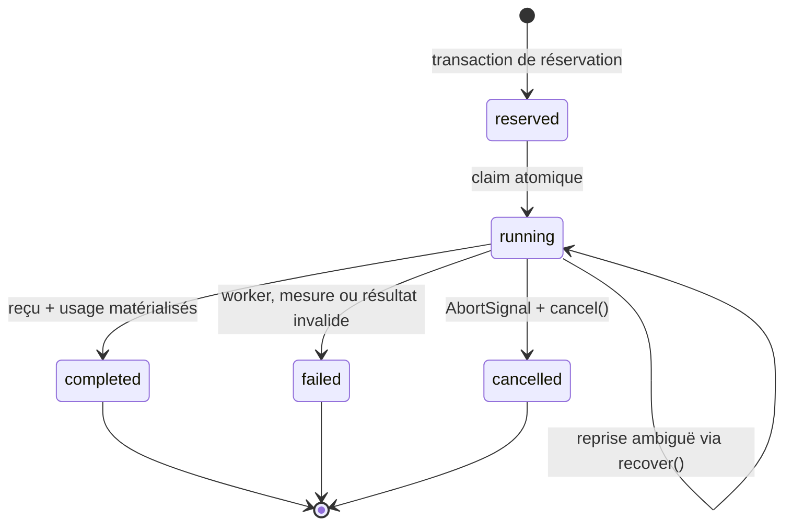

# Runtime ETT — contrats, persistance et erreurs

- **Statut** : Implémenté pour les contrats et services décrits ; raccord production désactivé par défaut
- **Portée** : services Node internes, SQLite, campagne de développement et scheduler résident
- **Dernière revue** : 2026-10-20

Cette référence décrit les surfaces réellement exportées par le runtime de
pensée endogène. Elle ne définit aucun endpoint REST, gRPC, MCP ou CLI : ETT est
actuellement une API de services Node. Le seul binaire public du dossier est le
runner de campagne de développement.

## 1. Points d'entrée

| Module | Export principal | Entrée | Sortie utile |
| --- | --- | --- | --- |
| `endogenousThoughtDetectionService` | `detectAndQuestion(db, input)` | observation, portée, agent, politique, évaluation, budget | `skipped`, `rejected` ou `questioned` |
| `endogenousThoughtAdmissionService` | `admitQuestion(db, input)` | épisode `QUESTIONED`, politique AGOW | `admitted` ou `abstained` |
| `endogenousThoughtQueueService` | `queueAdmittedThought(db, input)` | épisode `ADMITTED`, politique de file | binding, tâche et épisode `QUEUED` |
| `endogenousThoughtRunnerService` | `runQueuedThought(db, input)` | autorisation, worker, sandbox, compteur | run `completed_unverified`, épisode `RUNNING` |
| `endogenousThoughtVerificationService` | `verifyRunningThought(db, input)` | autorisation et attestation indépendante | verdict et épisode `VERIFIED` |
| `endogenousThoughtLearningService` | `learnVerifiedThought(db, input)` | autorisation et politique d'apprentissage | révision et épisode `LEARNED` |
| `endogenousThoughtContinuationService` | `continueLearnedThought(db, input)` | autorisation, usage cumulé, politique | `follow_up` ou `stopped` |
| `endogenousThoughtFollowUpQuestionService` | `questionFollowUp(db, input)` | épisode `FOLLOW_UP`, générateur optionnel | question et épisode `QUESTIONED` |
| `endogenousThoughtLoopService` | `runAutonomousLoop(db, input)` | portes, worker, vérificateur, borne | état terminal, cycles, usage cumulé |
| `endogenousThoughtResidentSchedulerService` | `readiness(input)`, `runScheduled(db, input)` | configuration production injectée | `unavailable`, `idle` ou `completed` |
| `endogenousThoughtExperimentService` | `run(options)` | cas, conditions, protocole, adaptateur | reçu d'expérience non promotable |

Les appels reçoivent une connexion SQLite compatible avec `sqlite`. Ils
appliquent leurs migrations via `ensure()` ou le chemin appelant. Les objets de
portée utilisent toujours `organizationId` et `projectId`.

## 2. Contrat de `runAutonomousLoop`

### 2.1 Champs obligatoires

```js
{
  organizationId,
  projectId,
  episodeId,
  maxCycles,       // entier 1..10
  authorize,       // async ({ stage, ...material }) => signature SHEV
  verify,          // async ({ runReceipt, ... }) => { authorization, verification }
  worker,
  sandbox,
  usageMeter
}
```

`authorize` et `verify` sont obligatoires dès la normalisation. Le runner
valide ensuite `worker`, `sandbox` et `usageMeter`. Aucun objet par défaut ne
transforme une intégration incomplète en succès.

### 2.2 Champs optionnels

| Champ | Défaut | Effet |
| --- | --- | --- |
| `questionGenerator` | générateur cognitif puis repli déterministe | construit les suivis |
| `grantedBy` | `ett-autonomous-loop` | identité déclarée dans les autorisations |
| `nowMs` | `Date.now()` | base temporelle ; les étapes incrémentent cette base |
| `condition` | `full` | sélectionne le comportement expérimental |
| `policies` | politiques `*-v1` activées | surcharge bornée par étape |
| `cumulativeUsage` | zéros | plancher initial, jamais inférieur aux reçus persistés |
| `signal` | absent | annulation transmise au sandbox |

### 2.3 Résultat

```js
{
  status: "stopped" | "abstained" | "failed",
  episode: { episodeId, currentState, currentReceiptId, version, budget, ... },
  cycles: [{ index, admission, queue, run, verification, learning, continuation, question }],
  cumulativeUsage: { tokens, usd, seconds }
}
```

Toutes les propriétés d'une entrée de `cycles` sont optionnelles : lors d'une
reprise, le cycle commence à l'état persisté courant. Le tableau décrit le
travail effectué par cet appel, pas toute l'histoire de l'épisode.

## 3. Contrat du scheduler résident

### 3.1 `readiness(input)`

La réponse est :

```js
{ status: "ready", reason: null, missing: [] }
```

ou :

```js
{ status: "unavailable", reason: "disabled" | "production-dependencies-missing", missing: [] }
```

Les fonctions obligatoires sont `candidateProvider`, `authorize` et `verify`.
S'ajoutent un `worker`, un sandbox reconnu par `validSandbox()`, une méthode
`sandbox.recover()` et `usageMeter.snapshot()`.

### 3.2 `runScheduled(db, input)`

Après readiness, `candidateProvider(db)` retourne un candidat tenant-scoped ou
`null`. Le résultat sans candidat est `{ status: 'idle', reason: 'no-candidate' }`.
Un résultat exécuté contient `episodeId`, `loopStatus`, `cumulativeUsage` et
`usageSource: 'validated-run-receipts'`.

Le scheduler général place cette réponse sous
`state.lastOutcome.endogenousThought`. Sa configuration par défaut est `{}` ;
ETT est donc `unavailable/disabled` sans erreur.

## 4. Politiques par défaut

`runAutonomousLoop()` construit les politiques suivantes :

| Étape | `id` | Champs notables |
| --- | --- | --- |
| admission | `ett-admission-v1` | `enabled: true`, `ttlMs: 60000`, ablation AGOW conservée |
| queue | `ett-queue-v1` | `enabled: true`, `priority: 50` |
| run | `ett-run-v1` | `enabled: true` |
| verification | `ett-verification-v1` | `enabled: true` |
| learning | `ett-learning-v1` | condition propagée |
| continuation | `ett-continuation-v1` | condition propagée |

Les surcharges `input.policies.<étape>` sont fusionnées après les défauts. Une
politique désactivée retourne généralement `skipped/disabled`; la boucle peut
ensuite refuser un état intermédiaire inattendu plutôt que prétendre avoir fini.

## 5. Sandbox et mesure

La politique scellée `SANDBOX_POLICY` vaut :

```js
{
  kind: "isolated-read-only",
  readOnly: true,
  networkAllowed: false,
  mutationAllowed: false,
  externalActionAllowed: false
}
```

Un adaptateur injectable expose `execute(request)`, `recover(request)` et une
mesure alimentée par `usageMeter.snapshot()`. Le worker reçoit la question, le
budget, les frontières, l'identifiant d'exécution et un éventuel `AbortSignal`.
La mesure acceptée contient des jetons entiers, des secondes entières et un coût
USD fini, tous positifs ou nuls et inférieurs au budget de l'épisode.

Une réservation `running` est ambiguë. Le runtime appelle `recover()` ; il ne
réexécute pas `execute()`. La récupération doit répondre
`{ status: 'completed', result }`.

## 6. Reçus versionnés

| Type | Version | Identité parent | Frontière essentielle |
| --- | --- | --- | --- |
| `EndogenousThoughtEpisode` | v1 | épisode + séquence | transition append-only et lignée |
| `EndogenousQuestion` | v1 | épisode | proposition falsifiable, pas une preuve |
| `EndogenousThoughtAdmission` | v1 | question | pas d'autorité d'exécution |
| `EndogenousThoughtTaskBinding` | v1 | décision | worker non démarré |
| `EndogenousThoughtRun` | v1 | binding/tâche | `completed_unverified` |
| `EndogenousThoughtVerification` | v1 | run | vérificateur indépendant |
| `EndogenousThoughtLearning` | v2 | vérification | révision locale ; aucune attestation implicite de la projection mémoire |

Les contrats sont scellés avec une représentation JSON canonique et une
empreinte de contenu. La lecture refuse un type, une version, une signature ou
une empreinte invalide. L'apprentissage lit encore les reçus v1 historiques,
mais écrit uniquement v2.

### 6.1 Projection de croyance vérifiée

Après la persistance du reçu d'apprentissage et le passage à `LEARNED`, le
service appelle `endogenousThoughtMemoryBridge.recordVerifiedBelief()` avec la
même connexion SQLite. Le pont écrit dans `genome_decisions` le JSON canonique
suivant :

```json
{
  "schema": "genos.EndogenousVerifiedBelief/v1",
  "beliefId": "ett_learning_…",
  "verdict": "supported | refuted | inconclusive",
  "revision": {
    "operation": "reinforce | correct | defer",
    "priorStatus": "unresolved",
    "revisedStatus": "…",
    "applied": true
  },
  "claim": {
    "hypothesis": "…",
    "method": "…",
    "falsifier": "…",
    "expectedEvidence": ["…"],
    "sourceRefs": ["…"]
  },
  "verification": {
    "verificationId": "ett_verification_…",
    "verificationRef": "rcpt_…",
    "verifierId": "…",
    "oracleRef": "…",
    "evidenceRefs": ["…"],
    "verifiedAt": "…"
  },
  "provenance": {
    "organizationId": "…",
    "projectId": "…",
    "episodeId": "…",
    "agentId": "…",
    "questionRef": "rcpt_…",
    "runId": "ett_run_…",
    "learnedAt": "…"
  }
}
```

Le contenu, et non une simple étiquette d'épisode, alimente l'embedding. Le
scope organisation/projet est aussi porté par les colonnes de
`genome_decisions`. L'identifiant par défaut vaut
`mem_<sha256(scope, agent, contenu)>` : un rejeu identique converge vers la
même ligne via `INSERT … ON CONFLICT DO UPDATE`. Un identifiant existant dans
une autre portée provoque `MEMORY_SCOPE_CONFLICT`.

| Verdict | Catégorie | Poids initial | `durable` | Révision |
| --- | --- | ---: | --- | --- |
| `supported` | `Experience` | `1.0` | `true` | renforcement provisoire |
| `refuted` | `Failure` | `0.1` | `false` | correction dans la portée |
| `inconclusive` | `UnverifiedExperience` | `0.1` | `false` | aucune révision appliquée |

`searchImpact.modified` n'est vrai que si le pont confirme
`productionMemoryMutated === true` **et** retourne un `memoryId` non vide.
`searchImpact.durable` exige en plus un verdict `supported`. Une exception ou
un identifiant nul donne une structure explicite avec `memoryId: null`,
`productionMemoryMutated: false` et `errorCode`; le service ne fabrique pas de
succès mémoire.

La projection n'est pas dans la transaction du reçu d'apprentissage. Une panne
peut donc laisser l'épisode `LEARNED` sans ligne mémoire. Le rejeu retente
l'écriture de façon convergente. En revanche, aucun outbox ni worker de
réconciliation périodique n'est actuellement fourni : l'intégration hôte doit
surveiller `memory.errorCode` et provoquer une reprise autorisée.

La recherche `vectorMemory.searchMemory()` peut retrouver le document complet,
avec embedding sémantique si un provider est disponible ou repli lexical
déterministe sinon. Cette récupération prouve que la découverte est disponible
pour un raisonnement ultérieur. Elle ne prouve pas que chaque orchestrateur
GenOS consulte automatiquement cette mémoire ; cette consommation reste une
responsabilité explicite de l'appelant.

### 6.2 Réservation d'exécution et frontière de reprise

L'identifiant d'exécution est déterministe :

```text
ett_execution_<sha256(runId NUL requestHash)[0:24]>
```

La transaction `reserveRun()` consomme l'autorisation, passe la tâche de
`blocked` à `doing`, crée le run Ontogenèse `running` et insère la réservation
`reserved` **avant** l'appel au sandbox. La machine de la réservation est :



Une réservation `running` indique que `execute()` a pu produire un effet sans
que le reçu final soit durable. Le runtime appelle uniquement `recover()` avec
le même `executionId`; il n'appelle jamais une seconde fois le worker. Sans
résultat `{ status: 'completed', result }`, il retourne
`ENDOGENOUS_RUN_RECOVERY_REQUIRED` et conserve l'ambiguïté pour intervention.

Le callback ne fait pas autorité sur son coût. Après `execute()` ou `recover()`,
`usageMeter.snapshot()` fournit la mesure acceptée. Les valeurs sont validées
contre le budget avant matérialisation. Une proposition invalide ou une mesure
hors budget ferme la réservation en `failed`, conserve le code d'erreur, marque
le run Ontogenèse `failed` et rebloque la tâche.

L'annulation n'est promise que si `signal` est accompagné de
`sandbox.cancel()`. Le signal et la mesure sont mis en course avec l'abandon ;
un abandon confirmé produit `cancelled`. Cette frontière évite une réussite
fantôme, mais ne garantit pas l'annulation physique si l'adaptateur ment ou si
le système externe ignore `cancel()`.

Le protocole fournit un *at-most-once invocation* du callback à travers la
reprise locale. Il ne garantit pas l'« exactly once » des effets arbitraires
d'un système externe. Un adaptateur autorisé à produire de tels effets doit les
rendre idempotents par `executionId` et offrir une récupération probante. La
politique ETT courante interdit précisément réseau, mutation et action externe.

## 7. États et références

| État | Références actives minimales | Étape suivante normale |
| --- | --- | --- |
| `DETECTED` | mandat, déclencheur | question |
| `QUESTIONED` | `questionRef` | admission |
| `ADMITTED` | question + `decisionRef` | queue |
| `QUEUED` | question + décision + `taskRef` | run |
| `RUNNING` | + `jobRef` | vérification |
| `VERIFIED` | + preuves | apprentissage |
| `LEARNED` | + preuves | suivi ou arrêt |
| `FOLLOW_UP` | preuve précédente, nouvelles références de travail nulles | nouvelle question |
| `STOPPED` | `stopReason` | terminal |
| `ABSTAINED` | `stopReason` | terminal |
| `FAILED` | `stopReason` | terminal |

La matrice exhaustive des transitions est dans la
[fiche conceptuelle](../01-concepts/endogenous-thought-test.md#26-machine-détats-exhaustive)
et le schéma normatif dans
[`spec/cognitive-episode.schema.json`](../../spec/cognitive-episode.schema.json).

## 8. Persistance SQLite

| Table | Clé logique | Contenu | Mutabilité |
| --- | --- | --- | --- |
| `endogenous_thought_episodes` | organisation + projet + épisode | identité, budget, tête, version | identité immuable ; tête CAS |
| `endogenous_thought_receipts` | reçu | transitions ordonnées et lignée | append-only |
| `endogenous_thought_questions` | question | reçu de question | immuable |
| `endogenous_thought_detection_receipts` | détection | score, décision et motif | immuable |
| `endogenous_thought_admission_decisions` | décision | outcome AGOW | immuable |
| `endogenous_thought_task_bindings` | binding | question/décision/tâche | immuable |
| `endogenous_thought_runs` | run | proposition, usage et reçu | immuable |
| `endogenous_thought_run_reservations` | exécution | état du side-effect, sandbox, usage, erreur | transitions contrôlées, jamais supprimée |
| `endogenous_thought_verifications` | vérification | identité/key digest, verdict, preuve | immuable |
| `endogenous_thought_learnings` | apprentissage | verdict, opération et application | immuable |
| `genome_decisions` | mémoire dérivée | document de croyance canonique + embedding | upsert convergent par identifiant et portée |

Les clés étrangères utilisent `ON DELETE RESTRICT`. Les triggers refusent les
updates/deletes des artefacts de preuve. Les index de lecture sont tenant-scoped.

### 8.1 Multiplicité multicycle

Les anciennes tables rendaient les artefacts uniques par épisode. La migration
`migrateEndogenousThoughtCycles.upgradeEpisodeMultiplicity()` reconstruit les
tables concernées sous transaction `BEGIN IMMEDIATE` et retire uniquement cette
contrainte legacy. L'unicité actuelle suit le parent immédiat : décision,
binding, tâche, run ou vérification.

## 9. Store d'épisode

`endogenousThoughtStoreService` exporte :

- `ensure(db)` — applique les migrations de l'agrégat ;
- `startEpisode(db, input)` — exige la transition initiale vers `DETECTED` ;
- `persistQuestion(db, input)` — autorisé depuis `DETECTED` ou `FOLLOW_UP` ;
- `transitionEpisode(db, input)` — avance la tête avec CAS et lignée ;
- `getEpisode(db, input)` — relit et vérifie le reçu de tête ;
- `getQuestion(db, input)` — relit par identifiant ou reçu ;
- `listReceipts(db, input)` — retourne la lignée ordonnée.

Une relecture réussie atteste la cohérence contractuelle et cryptographique des
données attendues ; elle ne réévalue pas la vérité métier du verdict.

## 10. Expériences et campagne

### 10.1 Conditions

`CONDITIONS` contient exactement :

```text
full
planned_control
curiosity_ablated
shev_initiative_ablated
agow_arbitration_ablated
metacognition_ablated
memory_ablated
```

L'ordre est randomisé de façon déterministe par cas et graine. Chaque résultat
porte `caseId`, `condition`, `seed` et `outcome`.

### 10.2 Échec fail-soft

Une exception de l'adaptateur devient un outcome avec :

```js
{
  success: false,
  scientificEvidence: false,
  measurementStatus: "execution_failed",
  failure: { stage: "execution", code, message }
}
```

Les autres cas continuent. `negativeResults.failures` conserve la condition et
le cas ; `noGainAgainstPlannedControl` conserve les paires où `full` ne dépasse
pas le contrôle. Le drapeau `scientificClaimAllowed` reste `false`.

### 10.3 Agrégation

Le résumé par condition expose `runs`, `successes`, `failures`,
`scientificRuns`, `syntheticRuns`, `episodes`, `verifiedDiscoveries`,
`normalizedCost`, `budgetViolations`, `duplicates` et
`meanVerifiedDiscoveriesPerCost`.

`verifiedDiscoveries` et `normalizedCost` valent zéro dans l'agrégat si
`scientificEvidence !== true`. Un résultat synthétique peut avoir un
`developmentUtility` pour tester le harnais, jamais pour alimenter la métrique
scientifique.

### 10.4 Reçu d'expérience

Le reçu contient notamment :

- `experimentId`, `kind`, `createdAt`, `seed`, `holdout`, `caseCount` ;
- les empreintes du snapshot, de l'environnement, du corpus et du protocole ;
- le manifeste d'environnement et le protocole ;
- les résultats, résumés et résultats négatifs ;
- `promotionDecision: null`, `publishable: false` ;
- `evidenceStatus: development_only` ou `replication_required`.

`runReplicationCampaign()` exige au moins trois reçus holdout indépendants et
retourne `descriptive_replication_complete`. Ce statut n'autorise toujours pas
une promotion.

## 11. Familles d'erreurs

| Préfixe | Cause typique | Action |
| --- | --- | --- |
| `ENDOGENOUS_*_REQUIRED` | champ, porte, sandbox ou compteur absent | compléter la configuration |
| `ENDOGENOUS_*_SCOPE_MISMATCH` | organisation/projet/agent divergents | refuser, auditer l'appelant |
| `ENDOGENOUS_*_STATE_CONFLICT` | tête inattendue ou concurrence | relire l'épisode ; ne pas forcer |
| `ENDOGENOUS_*_IDEMPOTENCY_CONFLICT` | même identité, contenu différent | traiter comme corruption/conflit |
| `ENDOGENOUS_*_INTEGRITY_FAILED` | JSON, hash, signature ou lignée invalide | geler l'épisode et auditer le store |
| `ENDOGENOUS_*_AUTHORIZATION_INVALID` | portée, nonce, version ou signature invalide | renouveler par l'autorité légitime |
| `ENDOGENOUS_*_TIMING_INVALID` | ordre temporel ou expiration invalide | ne pas antidater ; relancer un nouvel acte |
| `ENDOGENOUS_RUN_RECOVERY_REQUIRED` | exécution ambiguë sans récupération probante | intervention opérateur, pas de rejeu |
| `ENDOGENOUS_RUN_BUDGET_EXCEEDED` | mesure supérieure au budget | arrêter et conserver le reçu de coût |
| `ENDOGENOUS_VERIFIER_NOT_INDEPENDENT` | identité/clé partagée | sélectionner un autre vérificateur |
| `ENDOGENOUS_MEMORY_NOT_PERSISTED` | le store n'a retourné aucun identifiant | conserver l'apprentissage, retenter la projection |
| `ENDOGENOUS_MEMORY_WRITE_FAILED` | projection mémoire en erreur sans code plus précis | diagnostiquer le store et ne pas annoncer d'impact |
| `MEMORY_SCOPE_CONFLICT` | identifiant mémoire déjà lié à une autre portée | refuser et auditer organisation/projet |

Les codes exacts restent définis par les services. Cette table regroupe les
familles ; elle ne remplace pas la valeur `error.code` observée.

## 12. Sources et tests de référence

| Sujet | Source | Test principal |
| --- | --- | --- |
| agrégat et lignée | `endogenousThoughtStoreService.js` | `test_endogenous_thought_store.js` |
| détection | `endogenousThoughtDetectionService.js` | `test_endogenous_thought_detection.js` |
| admission | `endogenousThoughtAdmissionService.js` | `test_endogenous_thought_admission.js` |
| queue | `endogenousThoughtQueueService.js` | `test_endogenous_thought_queue.js` |
| réservation/worker | `endogenousThoughtRunnerService.js` | `test_endogenous_thought_runner.js` |
| vérification | `endogenousThoughtVerificationService.js` | `test_endogenous_thought_verification.js` |
| apprentissage | `endogenousThoughtLearningService.js` | `test_endogenous_thought_learning.js` |
| projection/recherche mémoire | `endogenousThoughtMemoryBridge.js`, `vectorMemoryService.js` | `test_endogenous_thought_learning.js` |
| réservation/reprise/annulation | `endogenousThoughtRunExecutionService.js` | `test_endogenous_thought_runner.js` |
| boucle/reprise | `endogenousThoughtLoopService.js` | `test_endogenous_thought_cycles.js` |
| scheduler | `endogenousThoughtResidentSchedulerService.js` | `test_endogenous_thought_resident_scheduler.js` |
| expérience | `endogenousThoughtExperimentService.js` | `test_endogenous_thought_experiment.js` |
| campagne | `endogenousThoughtCampaignExecutor.js` | `test_endogenous_thought_campaign.js` |

## Voir aussi

- [Pensée endogène bornée — orchestration](../02-orchestration/pensee-endogene-bornee.md)
- [ETT — guide d'exploitation](../04-exploitation/pensee-endogene.md)
- [Qualification ETT du 2026-10-20](../06-qualite-preuves/qualification-pensee-endogene-2026-10-20.md)
- [Protocole préenregistré](../../benchmarks/endogenous-thought/protocol-v1.json)
