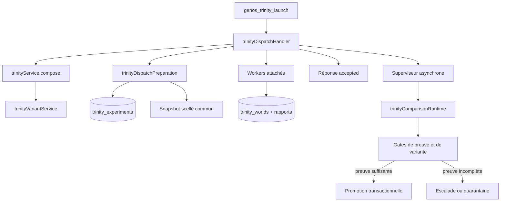

# Runtime Trinity : contrat d’exécution, de comparaison et de promotion

- **Statut** : Partiel — le parcours local est exécutable et protégé par des gates ; aucune campagne post-correctifs ne démontre encore une promotion sur fournisseurs réels.
- **Portée** : composition, scellement, workers isolés, comparaison, variantes, reprise et promotion transactionnelle.
- **Dernière revue** : 2026-10-20

Ce document est la référence opérationnelle du runtime Trinity. La
[monographie Trinity](../02-orchestration/topologies/trinity.md) expose le modèle
épistémique, les formules, les cas d’usage et les douze variants. Ici, une
affirmation n’est retenue que lorsqu’elle correspond à un chemin de code ou à
un test du dépôt.

La frontière essentielle est la suivante :

> une réponse de dispatch `accepted` confirme la prise en charge des mondes ;
> elle ne confirme ni leur comparaison, ni une décision, ni une promotion.

## 1. Points d’entrée

Le point d’entrée MCP public est `genos_trinity_launch`. Son schéma canonique
se trouve dans `shared/toolDefinitions.json` et exige au minimum `mission`.
Il accepte notamment :

| Champ | Rôle | Refus principal |
| --- | --- | --- |
| `mission` | problème commun aux mondes | mission vide |
| `variant_id` | un des douze presets Trinity | variant inconnu ou non exécutable |
| `experimental_design` | composition explicite des huit axes | conflit avec `variant_id` ou combinaison incompatible |
| `trinity_jury` | jury consultatif multi-modèles | configuration ou diversité insuffisante |
| `worker_assignments` | kind, niche et contrat de méthode par rôle | worker ou méthode incompatibles |
| `executionBudget.tokens` | plafond total distribué aux mondes | valeur absente, non entière ou insuffisante |

Le dispatch interne passe par
`backend/src/services/topology/trinityDispatchHandler.cjs`. La composition pure
est exposée par `trinityService.compose(mission, options)`. Le chemin de
production persiste toutefois l’expérience avant de lancer les workers ; appeler
la composition seule ne crée ni snapshot, ni monde, ni preuve.

## 2. Architecture d’exécution



Le lanceur topologique démarre chaque worker avec `detached: false`, ferme les
descripteurs du parent après l’événement `spawn`, puis attend l’événement
`close`. Un code de sortie non nul place le worker encore `idle` en erreur et
interrompt le dispatch. Cette attente empêche qu’un simple PID soit interprété
comme une exécution terminée.

Le superviseur de comparaison constitue une frontière distincte. Il est lancé
en arrière-plan par `trinityMissionSupervisor`, avec `detached: true` et
`stdio: "ignore"`. Son PID et `status: "started"` ne valent donc pas verdict de
mission. Le verdict doit être lu dans l’état persistant, les transitions et les
événements de télémétrie.

## 3. Sélection des variants

Le registre comprend : `controlled`, `heterogeneous`, `adversarial`,
`counterfactual`, `factorial`, `pareto`, `jury`, `recursive`, `adaptive`,
`temporal`, `oracular` et `exploratory`.

Une sélection explicite est stricte : un identifiant inconnu est refusé. Sans
identifiant, le sélecteur recherche des signaux dans la mission :

- un preset exécutable devient `variant: "composed"` et son identité est
  conservée dans `selectedPreset` ;
- une précondition manquante entraîne le baseline `controlled` et conserve le
  preset proposé dans `suggestedVariant` ;
- sans signal discriminant, le baseline contrôlé est retenu avec la raison
  `CONTROLLED_BASELINE`.

Le reçu contient la méthode de sélection, ses raisons, sa confiance, la
maturité compilée, les limites d’exécution, les adaptateurs requis et
`experimentalDesignId`. Le repli automatique est traçable mais ne démontre pas
que le baseline est optimal pour la mission.

Le plan factoriel attend seize mondes. Les autres parcours démarrent avec trois
mondes ; les politiques adaptatives, Quality-Diversity ou récursives peuvent
ensuite ajouter des exécutions bornées par leur configuration.

## 4. Scellement, identité et isolation

Avant le dispatch, `trinityDispatchPreparation.prepare` :

1. calcule la politique de budget ;
2. scelle une copie de la source commune ;
3. calcule l’empreinte du snapshot ;
4. persiste le design, l’isolation et le budget ;
5. associe chaque worker à un workspace privé issu de cette baseline.

L’expérience déclare `sharedMemory: "read-only-snapshot"`,
`communication: "forbidden"` et `provenanceTracking: "full"`. Deux mondes de
la même expérience ne peuvent pas partager le même `workspace_root`.

À la reprise, l’identité de mission, le design, le budget, le répertoire de
snapshot et son empreinte doivent être inchangés. Une réutilisation du même
identifiant avec d’autres entrées produit `TRINITY_EXPERIMENT_ID_CONFLICT` ; un
snapshot modifié produit `TRINITY_SNAPSHOT_MISMATCH`.

Le worker est en outre lié à l’expérience, à l’orchestrateur parent et au même
tenant. Son bail retire les outils de coordination partagée qui violeraient
l’isolement des chambres.

## 5. Budget et capacité

`trinityBudgetPolicy.allocate` exige un nombre entier positif de tokens. Le
budget initial est réparti entre les mondes après réservation :

$$
B_{monde}=\left\lfloor\frac{B_{total}-B_{réservé}}{N_{mondes}}\right\rfloor
$$

Les réplicas et l’enfant récursif réservent leur enveloppe avant le lancement.
La récursion ne peut recevoir plus de 30 % du budget parent et ne réserve plus
de budget au-delà de la profondeur trois. Une enveloppe trop petite est un
refus `TRINITY_BUDGET_REQUIRED`, pas une réduction silencieuse du plan.

Le garage doit disposer de toutes les places initiales requises. Pour le plan
factoriel, cela signifie seize places. Le budget est une autorisation ; il ne
constitue pas à lui seul une mesure de consommation effective.

## 6. Cycle persistant

L’automate de l’expérience est :

```text
designed
  -> sealed_running
  -> sealed_complete
  -> cross_examining
  -> decided
  -> promotion_preparing
  -> promoted | promotion_failed
```

Les branches `rejected` et `escalated` sont terminales. Chaque transition est
enregistrée dans `trinity_experiment_transitions` avec acteur, raison et
référence de preuve. Une transition concurrente ou impossible est refusée.

Les tables structurantes sont :

| Table | Contenu |
| --- | --- |
| `trinity_experiments` | mission, snapshot, design, budget, état et décision |
| `trinity_worlds` | monde, worker, chambre, workspace, état et vecteur de preuve |
| `trinity_experiment_transitions` | journal append-only des changements d’état |
| `trinity_dispatch_configs` | mission et sélection nécessaires à la reprise du superviseur |
| `trinity_jury_calibration` | accord observé entre jury consultatif et décision déterministe |

Le journal d’exécution complète ces tables pour éviter de recalculer des phases
déjà validées. Une reprise ne doit pas redispatcher un monde déjà engagé ni
répéter un débit réservé.

## 7. Rapports et barrière comparative

Le superviseur attend tous les mondes prévus et accepte comme terminal un
ensemble fermé d’états. Un worker dont le run est bloqué uniquement au gate de
promotion peut être classé `completed_unpromoted` si un événement
`AGENT_COMPLETED` substantiel et lié au même run existe.

La comparaison exige ensuite, pour chaque monde :

- un résultat `outcome: "success"` ;
- au moins un claim, un test ou un artefact worker ;
- la corrélation avec le monde et le run attendus ;
- les preuves requises par le variant effectivement compilé.

Un monde silencieux, un rapport vide, un échec de dispatch ou un rapport sans
identité suffisante ne reçoit pas de score neutre. La mission est escaladée.

Les dimensions de l’`evidenceVector` restent inconnues lorsqu’elles ne sont pas
mesurées. Le score, le Pareto, le jury ou l’hypervolume ne peuvent transformer
une dimension absente en preuve positive.

## 8. Promotion et intégrité

La promotion n’est tentée qu’après comparaison. Le candidat est préparé dans
un workspace privé, puis les contrôles d’intégration et les contrôles associés
aux claims sont rejoués. L’empreinte du contenu vérifié est recalculée juste
avant la promotion.

La transaction persistante lie :

- l’artefact candidat ;
- son `contentHash` ;
- la décision et le monde gagnant ;
- une référence AgentGit signée ;
- le cas échéant, la tête GQWF et son événement de preuve.

Une divergence d’empreinte, une signature absente ou une référence GQWF
incohérente transforme la tentative en `promotion_failed`. Le candidat reste
quarantiné ; le système ne convertit pas cet échec en succès de transport.

Le champ `promotionEligible` du contrat commun de complétion reste `false` : la
clôture des workers et la promotion Trinity sont deux décisions distinctes.

## 9. Reprise et diagnostic

Pour diagnostiquer une mission :

1. lire `trinity_experiments.status` et `failure_reason` ;
2. vérifier le nombre et l’état des lignes `trinity_worlds` ;
3. relire `trinity_experiment_transitions` dans l’ordre ;
4. contrôler `trinity_dispatch_configs` ;
5. rechercher `TRINITY_MISSION_COMPLETED`, `TRINITY_MISSION_FAILED` ou
   `TRINITY_SUPERVISION_ALREADY_ACTIVE` dans la télémétrie ;
6. inspecter les rapports liés au même `executionRunId` ;
7. vérifier l’intégrité de l’artefact et de la référence signée avant toute
   conclusion de promotion.

Le timeout du superviseur est borné entre 180 000 et 900 000 ms. Un timeout
produit un échec explicite ; il ne prouve pas que les workers n’ont jamais eu
d’effet externe. Toute reprise d’un adaptateur externe doit donc appliquer son
propre contrat d’idempotence.

## 10. Validation reproductible

Depuis la racine :

```bash
npm --prefix backend run test:trinity
node backend/tests/run_topology_contracts.cjs --topology=trinity
node backend/tests/test_topology_snapshot_trinity.js
```

`run_trinity_suite.js` découvre tous les fichiers `test_trinity_*.js` présents
au moment de l’exécution. Le lanceur transversal ajoute le test de qualification
GQWF, mais n’exécute pas les cinq contrôles de frontière lorsqu’un seul
`--topology` est demandé.

Ces suites utilisent principalement SQLite local, workspaces temporaires,
fixtures et adaptateurs contrôlés. Leur réussite ne certifie ni un fournisseur
LLM distant, ni une plateforme de production, ni un avantage causal de Trinity.

## 11. Erreurs structurantes

| Code ou famille | Signification |
| --- | --- |
| `TRINITY_MISSION_REQUIRED` | mission absente |
| `TRINITY_VARIANT_UNKNOWN` | preset explicite inconnu |
| `TRINITY_DESIGN_CONFLICT` | preset et design explicite fournis ensemble |
| `TRINITY_POLICY_NOT_IMPLEMENTED` | axe conceptuel non exécutable |
| `TRINITY_BUDGET_REQUIRED` | budget absent, invalide ou insuffisant |
| `WORKER_GARAGE_FULL` | capacité initiale insuffisante |
| `TRINITY_EXPERIMENT_ID_CONFLICT` | identité rejouée avec d’autres entrées |
| `TRINITY_WORKER_SCOPE_INVALID` | monde, parent, workspace ou tenant incohérent |
| `TRINITY_SNAPSHOT_MISMATCH` | baseline scellée modifiée |
| `TRINITY_WORLD_EXECUTION_INCOMPLETE` | tous les workers requis ne sont pas réussis |
| `TRINITY_WORLD_EVIDENCE_INCOMPLETE` | rapport substantiel manquant |
| `TRINITY_PROMOTION_INTEGRITY_FAILED` | artefact ou référence promue incohérente |

## 12. Limites et non-objectifs

- Le superviseur reste un processus détaché ; son démarrage n’est pas une
  preuve de fin de mission.
- Le runtime observe l’exécutable et les arguments de lancement, mais une
  attestation `artifact-bytes-before-invocation` ne prouve pas le fournisseur,
  le modèle ni toutes les dépendances réellement utilisés.
- Le jury est consultatif et ne possède pas l’autorité de promotion.
- Les heuristiques de sélection automatique ne sont pas calibrées comme un
  classifieur de performance.
- Les résultats des tests locaux ne remplacent pas une campagne post-correctifs
  avec modèles, outils, réseau, coûts et latences réels.

## Sources

- [Topologie Trinity](../02-orchestration/topologies/trinity.md)
- [Contrat commun de complétion](contrat-completion-mission.md)
- [Snapshots topologiques](snapshots-topologiques.md)
- [Plugins de Morphogenèse](plugins-topologies-morphogenese.md)
- [`trinityDispatchHandler.cjs`](../../backend/src/services/topology/trinityDispatchHandler.cjs)
- [`trinityDispatchPreparation.js`](../../backend/src/services/trinityDispatchPreparation.js)
- [`trinityComparisonRuntime.js`](../../backend/src/services/trinityComparisonRuntime.js)
- [`trinityComparativeBarrier.js`](../../backend/src/services/trinityComparativeBarrier.js)
- [`trinityExperimentStore.js`](../../backend/src/services/trinityExperimentStore.js)

