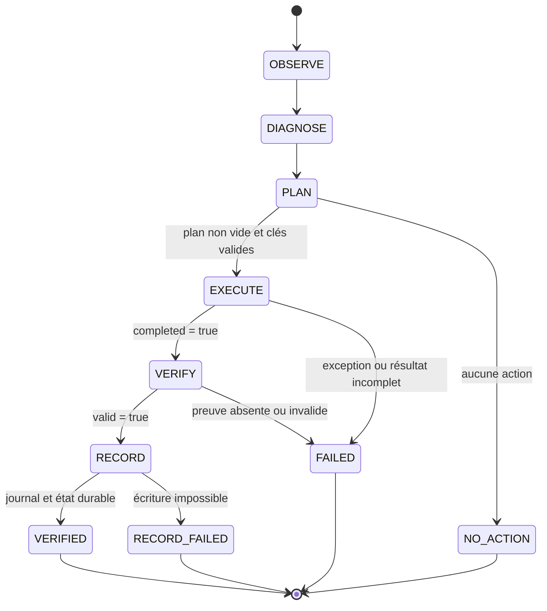

# Variants Metapopulation : registre, actions et preuves

- **Statut** : implémenté pour les seize variants ; qualification externe partielle
- **Portée** : sélection, planification, exécution, vérification et persistance du runtime Node
- **Dernière revue** : 2026-10-20
- **Contrat de référence** : `genos.metapopulation-migration-adapter-idempotency/v1`

Ce document est la référence technique des variants Metapopulation. La
[fiche de topologie](../02-orchestration/topologies/metapopulation.md) explique
le modèle écologique et les cas d'usage ; le
[contrat du runtime](runtime-metapopulation.md) décrit la session et le cycle
régional. Ici, « implémenté » signifie que le registre possède une politique,
un planificateur, un chemin d'exécution et une relecture de preuve pour le
variant. Cela ne démontre pas qu'un moteur externe, un fournisseur ou une
mission distribuée réelle a été qualifié.

## 1. Sources de vérité

| Responsabilité | Source |
| --- | --- |
| Politique, signaux et ordre de sélection | [`metapopulationPolicyService.js`](../../backend/src/services/metapopulation/policy/metapopulationPolicyService.js) |
| Planificateur associé à chaque variant | [`variantRuntimeService.js`](../../backend/src/services/metapopulation/policy/variantRuntimeService.js) |
| Exécuteurs et résolution du runtime | [`variantRuntimeRegistry.js`](../../backend/src/services/metapopulation/runtime/variantRuntimeRegistry.js) |
| Relecture des effets persistés | [`variantRuntimeVerification.js`](../../backend/src/services/metapopulation/runtime/variantRuntimeVerification.js) |
| Maturité calculée | [`metapopulationVariantMaturity.js`](../../backend/src/services/metapopulation/policy/metapopulationVariantMaturity.js) |
| Adaptateurs de migration | [`migrationAdapterRegistry.js`](../../backend/src/services/metapopulation/migration/migrationAdapterRegistry.js) |
| Boucle régionale | [`regionalRuntimeService.js`](../../backend/src/services/metapopulation/runtime/regionalRuntimeService.js) |

Le registre unifié résout les seize identifiants vers un runtime partagé. Les
différences entre variants viennent de leur politique, de leur planificateur et
des actions produites, pas de seize moteurs indépendants. Cette consolidation
évite qu'un exécuteur et son vérificateur dérivent dans des catalogues séparés.
Voir [ADR 0656](../adr/0656-registre-runtime-variants-metapopulation.md).

## 2. Chaîne de résolution


La sélection explicite normalise minuscules, espaces et tirets vers un
identifiant avec `_`. Une valeur inconnue produit
`METAPOPULATION_VARIANT_UNKNOWN`. Sans variant explicite, des expressions
régulières cherchent des signaux dans la mission. Sans signal discriminant,
le choix est `balanced` avec la méthode `safe_baseline` et une confiance de
`0.5`. Cette confiance mesure la règle de sélection, pas la probabilité de
réussite de la mission.

## 3. Matrice des seize variants

Les quatre premières entrées sont des profils transversaux historiques. Les
douze suivantes sont les spécialisations documentées de la topologie.

| Variant | Migration et graphe par défaut | Actions caractéristiques attendues | Preuve ou garde principale |
| --- | --- | --- | --- |
| `balanced` | complementary ; graphe fourni ou initialisé par le contrôleur | `MIGRATE_PROPAGULE` | utilité, corridor, receveur et issue persistée |
| `resilient` | rescue | `MIGRATE_PROPAGULE` | priorité à la reprise, sans contourner fitness et rollback |
| `exploratory` | novelty | `MIGRATE_PROPAGULE` | nouveauté déclarée et validation locale du receveur |
| `conservative` | counterexample | `MIGRATE_PROPAGULE` | quorum `0.7`, contre-exemple et rejet explicite si preuve insuffisante |
| `classic_patch` | founder ; small-world | `VACATE_COLLAPSED_PATCH`, `START_RECOLONIZATION_TRIAL` | extinction probante, deux lignées et essai local viable |
| `island_search` | elite ; ring | `SEARCH_ISLAND`, `TRIGGER_ISLAND_MIGRATION`, `MIGRATE_PROPAGULE` | résultat lié au dème, solveur, problème, seed et `evidenceRef` |
| `heterogeneous_islands` | complementary ; fully-connected | `TRANSFER_CULTURE`, `MIGRATE_PROPAGULE` | diversité fournisseur/algorithme/lignée et compatibilité receveur |
| `source_sink` | rescue ; graphe dirigé source-sink | `ROTATE_SOURCE_SINK_ROLES`, `PROTECT_SOURCE` | rôles persistés et réserve de source respectée |
| `rescue_network` | rescue ; small-world | `RECOVERY_SLA_BREACH`, `ACTIVATE_RESERVE_CORRIDOR`, `DEPLOY_FOUNDER`, `STAGE_FOUNDER_RESERVE` | capacité à risque, réserve relue et recolonisation vérifiée |
| `stepping_stone` | cultural ; stepping-stone | `TRIGGER_STEPPING_STONE_MIGRATION`, `HANDLE_BRIDGE_EXTINCTION` | voisinage effectif et absence de saut hors corridor |
| `anti_synchrony` | novelty ; adaptive | `REGULATE_CORRIDORS`, `RECOVER_FIREBREAKS`, `DIVERSITY_FLOOR_BREACH`, `ALLOW_CONTROLLED_EXTINCTION` | risque corrélé, diversité et couverture régionale |
| `federated` | cultural ; hierarchical | `REJECT_FEDERATED_TRANSFER`, `PROOF_OF_DATA_MINIMIZATION`, `REQUIRE_RECEIVER_ATTESTATION` | contrat, classification, minimisation et attestation correspondants |
| `ephemeral_patch` | elite ; fully-connected | découverte, expiration, rebind, dormance et réactivation | bail du patch, identité et transitions persistées |
| `persistent` | cultural ; small-world | `REGISTER_RESIDENT_DAEMON`, `MAINTAIN_RESIDENT_DAEMON_CYCLE`, `DECAY_DEME_MEMORY`, `INTER_MISSION_MIGRATION` | daemon, bail, dème, workspace et mémoire dans le même scope |
| `evolutionary` | novelty ; ring | `EVOLVE_ISLAND`, `CHECK_SPECIATION` | rapport moteur, génération monotone, fitness et état d'îlot relus |
| `cultural` | cultural ; small-world | `TRANSFER_CULTURE`, `MUTATE_CULTURE`, `BUILD_CULTURAL_PHYLOGENY` | culture versionnée, parents et transfert compatible persistés |

La matrice de maturité retourne actuellement `implemented` pour les seize
entrées. Ce statut vérifie la présence des composants attendus et les tests du
contrat ; il ne remplace pas une qualification sur infrastructure externe.

## 4. Catégories d'actions

Le registre partagé expose les familles suivantes :

| Famille | Exemples | Effet attendu |
| --- | --- | --- |
| Topologie | `APPLY_VARIANT_TOPOLOGY`, `REWIRE_VARIANT_TOPOLOGY` | écrire puis relire le graphe de corridors |
| Cycle de vie | `VACATE_COLLAPSED_PATCH`, `START_RECOLONIZATION_TRIAL`, `DEPLOY_FOUNDER` | transitionner patch/dème sous invariants |
| Migration | `MIGRATE_ISLAND_ELITE`, `INTER_MISSION_MIGRATION` | passer par quarantaine, décision locale et reçu |
| Recherche et évolution | `SEARCH_ISLAND`, `EVOLVE_ISLAND`, `CHECK_SPECIATION` | appeler l'adaptateur configuré et persister son état lié |
| Anti-synchronie | `DIVERSITY_FLOOR_BREACH`, `RECOVER_FIREBREAKS`, extinction contrôlée | modifier les corridors ou états sans supprimer une capacité unique |
| Fédération | minimisation, attestation, rejet | conserver les obligations et refuser en échec fermé |
| Éphémère | création/renouvellement de bail, dormance, réactivation | lier patch, dème et bail courant |
| Résident | enregistrement/maintenance/expiration du daemon, décroissance mémoire | lier daemon, lease, workspace et dème |
| Culture | transfert, rejet, mutation, phylogénie | relire versions et liens parentaux |

Une action planifiée n'est pas une action appliquée. Le contrôleur exécute les
actions, puis le vérificateur relit les lignes, événements, baux, cultures ou
reçus dans le scope exact. Une action inconnue ou un effet non relisible ne doit
pas devenir `VERIFIED`.

## 5. Idempotence des cycles et adaptateurs

Toute action qui atteint `EXECUTE` porte une `idempotencyKey` non vide. Si le
planificateur n'en fournit pas, la boucle dérive une clé SHA-256 à partir de la
session, du numéro de cycle, de la position dans le plan et du contenu de
l'action. Deux actions du même plan ne peuvent partager une clé.

Pour une action, la clé de cycle est la clé de l'action. Pour plusieurs actions,
elle est le SHA-256 de la liste ordonnée des clés. La paire
`(metapopulation_id, idempotency_key)` est protégée par l'index SQLite unique
`idx_cycle_states_idempotency_key`. Un rejeu déjà enregistré produit
`REGIONAL_ACTION_DUPLICATE` avant l'effet.

Les adaptateurs de migration suivent le contrat suivant :

```json
{
  "version": "genos.metapopulation-migration-adapter-idempotency/v1",
  "keyField": "idempotencyKey",
  "operations": ["adapt", "assimilate", "rollback"],
  "scope": "adapter-operation",
  "replayBehavior": "RETURN_ORIGINAL_RECEIPT"
}
```

`assimilate` et `adapt` reçoivent l'identité de migration ; `rollback` reçoit
`rollback:<migrationId>`. L'adaptateur doit retourner le reçu original lors
d'un rejeu identique. La contrainte SQLite empêche le double enregistrement du
cycle ; elle ne peut pas annuler un effet externe déjà appliqué. L'intégrateur
reste responsable d'un stockage idempotent côté système cible.

## 6. Machine à états du cycle



`VERIFIED` porte sur le cycle régional. Il ne certifie ni la mission complète,
ni la qualité scientifique du résultat, ni une promotion. `NO_ACTION` ne crée
pas un nouveau cycle vérifié. `completed` n'est que la terminaison de
l'exécuteur concerné.

## 7. Reprise et concurrence

Le runtime reprend après le dernier état `VERIFIED`. Avec `resume: true`, il
réutilise aussi sa seed et recommence au numéro suivant. Un crash pendant
`EXECUTE` ne fait pas avancer le curseur durable. L'action peut néanmoins avoir
atteint un système externe : l'opérateur doit d'abord interroger ce système par
sa clé d'idempotence, conserver son reçu, puis relancer.

Deux runners ne doivent pas exécuter la même session en concurrence. L'index
unique transforme un double enregistrement en refus, mais ne remplace pas une
autorité de lease sur l'effet externe. Les snapshots exigent une région
quiescente ; un cycle `RESUMED` ou un autre effet en vol provoque
`METAPOPULATION_SNAPSHOT_IN_FLIGHT`.

## 8. Erreurs opposables

| Code | Signification | Réponse attendue |
| --- | --- | --- |
| `METAPOPULATION_VARIANT_UNKNOWN` | identifiant absent du registre | corriger l'entrée, ne pas choisir silencieusement |
| `METAPOPULATION_VARIANT_RUNTIME_UNKNOWN` | runtime non résolu | bloquer le lancement et vérifier le câblage |
| `REGIONAL_ACTION_INVALID` | action sans type valide | corriger le planificateur |
| `REGIONAL_ACTION_IDEMPOTENCY_KEY_REQUIRED` | clé absente ou vide | fournir ou laisser dériver une clé avant validation |
| `REGIONAL_ACTION_IDEMPOTENCY_KEY_DUPLICATE` | doublon dans le plan | séparer les identités des effets |
| `REGIONAL_ACTION_DUPLICATE` | cycle déjà enregistré sous cette clé | relire le reçu existant ; ne pas réappliquer |
| `METAPOPULATION_ADAPTER_IDEMPOTENCY_KEY_REQUIRED` | appel externe sans clé | refuser avant l'adaptateur |
| `REGIONAL_EXECUTION_INCOMPLETE` | exécuteur non terminé | réconcilier l'effet et reprendre |
| `REGIONAL_VERIFY_FAILED` | preuve non valide | conserver l'état en échec et diagnostiquer |
| `METAPOPULATION_SNAPSHOT_IN_FLIGHT` | frontière non quiescente | attendre ou réconcilier les effets |

## 9. Ajouter ou modifier un variant

1. Ajouter ou modifier sa politique dans `VARIANTS` et ses signaux seulement si
   la sélection automatique doit changer.
2. Définir son planificateur dans `VARIANT_PLANNERS`.
3. Ajouter les exécuteurs au registre partagé et la relecture correspondante ;
   ne jamais ajouter une action qui peut être `completed` sans preuve relisible.
4. Mettre à jour les actions attendues et la matrice de maturité.
5. Ajouter les cas nominaux, refus, reprise et rejeu aux tests dédiés.
6. Documenter toute nouvelle frontière d'architecture dans un ADR.
7. Mettre à jour cette référence, la fiche conceptuelle et le runbook si les
   procédures opérateur changent.

Un variant n'est pas déclaré implémenté parce que son nom est sélectionnable.
Il faut au minimum une politique, un planificateur, un effet, un vérificateur,
une persistance et un test qui falsifie une preuve manquante.

## 10. Vérification reproductible

Depuis la racine :

```bash
npm --prefix backend run test:metapopulation
node backend/tests/test_metapopulation_idempotency.js
node backend/tests/test_metapopulation_variants_runtime.js
node backend/tests/test_metapopulation_variant_selection.js
node backend/tests/test_metapopulation_variant_gaps.js
python scripts/ci/check_code_quality.py
```

Le profil Metapopulation contient treize suites. Leur réussite prouve les
contrats exercés par les fixtures locales ; elle ne qualifie pas un provider,
un solveur, un moteur Rust distant ou une API métier externe.

## Voir aussi

- [Runtime Metapopulation](runtime-metapopulation.md)
- [Runbook Metapopulation](../04-exploitation/runbook-metapopulation.md)
- [Qualification du 20 octobre 2026](../06-qualite-preuves/qualification-metapopulation-2026-10-20.md)
- [ADR 0330 — effets durables](../adr/0330-effets-durables-metapopulation.md)
- [ADR 0403 — frontière quiescente](../adr/0403-frontiere-quiescente-metapopulation.md)
- [ADR 0656 — registre runtime](../adr/0656-registre-runtime-variants-metapopulation.md)
