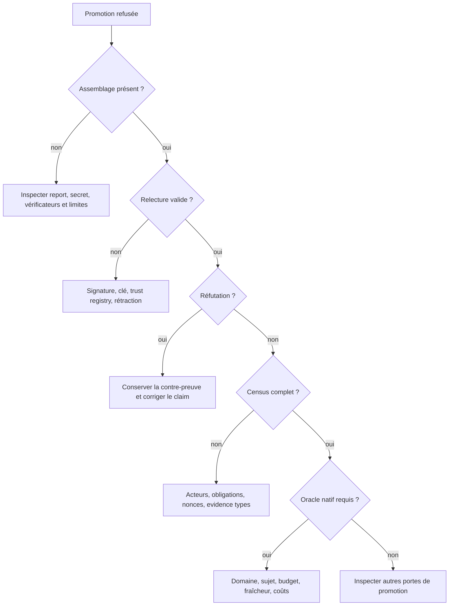

# Exploiter et diagnostiquer AEIS

- **Type** : guide d'exploitation
- **Statut** : applicable au backend Node.js actuel
- **Portée** : activation, secrets, diagnostic, rotation, rétention et reprise
- **Dernière revue** : 2026-10-20

Ce runbook complète la [référence du runtime AEIS](../03-reference/runtime-aeis.md).
Il ne remplace ni les procédures de sauvegarde SQLite ni les politiques de
sécurité du déploiement.

## 1. Préconditions

- Node.js conforme aux prérequis du dépôt ;
- backend initialisé et migrations appliquées ;
- workspace connu et confiné ;
- contrat de stratégie actif ;
- secret AEIS fourni par le gestionnaire de secrets ;
- vérificateurs enregistrés et digests inclus dans le contrat ;
- budget de vérification compatible avec la politique.

Ne stocker ni secret, ni base SQLite, ni artefact de qualification dans Git.

## 2. Configuration minimale

```powershell
$env:GENOS_EPISTEMIC_RECEIPT_SECRET = '<secret fourni hors dépôt>'
$env:GENOS_EPISTEMIC_RECEIPT_KEY_ID = 'production-2026-10'
npm --prefix backend start
```

Le secret doit être stable pendant la durée de validité des reçus. Une clé perdue
rend les assemblages correspondants illisibles ; une clé divulguée impose une
rotation et une analyse d'impact.

## 3. Prévol

### 3.1 Vérifier le contrat

Contrôler dans `promotion` :

```json
{
  "require_epistemic_assurance": true,
  "require_independent_verification": true,
  "native_verification": { "executions": 2, "latencyMs": 30000 },
  "epistemic_verifier_digests": ["sha256:..."]
}
```

Un tableau vide de digests ou un secret absent ne doit jamais être contourné pour
faire passer une promotion.

### 3.2 Vérifier le claim

Avant l'exécution, répondre à quatre questions :

1. le claim exprime-t-il un prédicat exact ?
2. un adaptateur ou un domaine natif sait-il l'exécuter ?
3. la preuve est-elle confinée au workspace attendu ?
4. le verdict demandé dépasse-t-il la portée du test ?

Si la réponse à 1 ou 2 est négative, garder le claim `pending` et prévoir une revue
humaine ou un oracle de domaine. Ne pas reformuler artificiellement le claim pour
le faire entrer dans un test sans rapport.

## 4. Parcours nominal

```text
run awaiting_approval
  → approbation humaine si requise
  → rapport d'évidence présent
  → autorité et confinement relus
  → évaluation AEIS ou oracle natif
  → assemblage persisté
  → autres portes de promotion
  → réservation transactionnelle
  → promotion ou refus durable
```

Le retry de `approveRun()` reprend le journal de promotion. Il ne doit pas
consommer une seconde fois les nonces déjà réservés.

## 5. Contrôles après promotion

Vérifier :

- le statut final du run ;
- `persistedAssemblyId` dans l'évaluation ;
- l'identité du run et du scope dans `aeis_assurance_assemblies` ;
- deux reçus valides lorsque le contrat l'exige ;
- les obligations couvertes ;
- l'absence de refus masqué ;
- la présence du dossier de preuve de promotion ;
- la consommation unique des nonces.

Une promotion sans ces éléments est une anomalie d'intégrité, même si le transport
HTTP ou le processus s'est terminé avec succès.

## 6. Arbre de diagnostic



## 7. Incidents fréquents

### 7.1 `AEIS receipt key unavailable`

Cause probable : secret absent, mauvais `key_id` ou ancienne clé non fournie.

Action :

1. ne pas régénérer une clé sous le même identifiant ;
2. restaurer la clé depuis le gestionnaire de secrets ;
3. si elle est perdue, marquer les assemblages concernés non relisibles ;
4. émettre une nouvelle clé avec un nouvel identifiant.

### 7.2 `claim_verification_contract`

Le claim ne correspond pas au prédicat exécuté. Corriger le contrat ou fournir un
oracle adapté. Ne pas accepter un simple test vert comme preuve d'une proposition
plus large.

### 7.3 `constraint_census`

Le nombre d'acteurs ou la couverture des obligations est insuffisant. Inspecter
les digests, les identités, les obligations et les reçus rejetés. Ajouter un second
processus du même modèle ne prouve pas une indépendance épistémique ; cela peut
seulement satisfaire une règle procédurale si le contrat l'autorise.

### 7.4 `ORACLE_DOMAIN_UNAVAILABLE`

La méthode n'a pas de domaine fermé enregistré. Le comportement correct est le
refus. Ajouter un domaine exige un sujet scellé, une proposition canonique, au
moins deux stratégies de contrôle et des tests de mutation négatifs.

### 7.5 `ORACLE_BUDGET_*`

Vérifier les limites du contrat, la demande, la latence restante et les coûts
persistés. Une réservation incomplète après crash reste une consommation inconnue :
elle ne doit pas être rejouée comme si rien ne s'était passé.

### 7.6 `ORACLE_COMPLETION_RESULT_CHANGED`

Le résultat, le sujet ou le rapport a changé après l'attestation. Recréer un run et
une réservation ; ne jamais réutiliser l'attestation historique pour le nouvel état.

### 7.7 Timeout provider

Un timeout est `inconclusive`, pas `refuted`. Vérifier endpoint, allowlist, délai,
taille de sortie et disponibilité du provider. La promotion reste bloquée si le
quorum contractuel n'est pas atteint.

### 7.8 Test local bloqué par `EACCES` ou `EPERM`

Les tests de round-trip ouvrent des serveurs HTTP locaux ; les tests de frontières
code créent des liens symboliques temporaires. Dans un environnement restreint,
ces opérations peuvent être refusées avant le code testé. Relancer dans un bac à
sable autorisant explicitement ces primitives et consigner cette différence dans
le rapport de qualification.

## 8. Rotation de clé

Procédure :

1. créer une nouvelle clé et un nouvel identifiant ;
2. conserver l'ancienne clé dans la map JSON des clés précédentes ;
3. redémarrer un seul nœud de test ;
4. relire un assemblage ancien et en créer un nouveau ;
5. déployer la même configuration sur tous les nœuds ;
6. retirer une ancienne clé seulement après la fin de sa rétention opposable.

Exemple de forme, sans valeur réelle :

```powershell
$env:GENOS_EPISTEMIC_RECEIPT_KEY_ID = 'production-2026-11'
$env:GENOS_EPISTEMIC_RECEIPT_PREVIOUS_KEYS = '{"production-2026-10":"<ancien-secret>"}'
```

## 9. Rétention et purge

`pruneAssemblies(db, maxAgeDays, maxRows)` applique les bornes suivantes :

| Paramètre | Défaut | Minimum | Maximum |
| --- | ---: | ---: | ---: |
| âge | 90 jours | 1 | 3650 |
| lignes | 10 000 | 100 | 100 000 |

Avant une purge :

- vérifier la politique d'audit du tenant ;
- sauvegarder la base ;
- inventorier les rétractions ;
- vérifier que les dossiers de promotion ne pointent pas vers une preuve à purger ;
- exécuter une relecture d'échantillon après purge.

## 10. Rétraction et preuve historique

Une rétraction empêche l'usage courant d'un assemblage sans effacer son existence.
Le mode historique sert à l'audit, pas à une nouvelle promotion. Toute décision
reposant sur une source retirée doit être réévaluée si elle influence encore une
autorité ou un résultat actif.

## 11. Mémoire immunitaire

La mémoire est indexée par portée. Une entrée rappelée n'est qu'une observation
antérieure. Une issue n'est enregistrée qu'après relecture de l'assemblage et de la
preuve correspondante. En cas de collision de tenant, de scope manquant ou de
preuve non résolue, conserver `pending` et ouvrir un incident d'intégrité.

## 12. Dissonance et autorité

Les seuils de dissonance peuvent réduire l'autorité, mettre en quarantaine puis
déclencher l'apoptose procédurale. Pour tout changement d'autorité, conserver :

- l'événement dédupliqué ;
- le delta appliqué ;
- le score avant/après ;
- l'autopsie éventuelle ;
- les descendants affectés ;
- la décision de restauration ou de maintien.

Ne jamais rétablir l'autorité en supprimant directement les lignes SQLite.

## 13. Vérification locale

### Suite canonique

```powershell
npm --prefix backend run test:aeis
```

La suite comprend les assemblages, le sandbox, les timeouts, les providers, la
mémoire, l'autorité, l'homéostasie, la biocénose, la métapopulation, la stigmergie,
le holobionte et le benchmark local AEIS-EAB.

### Oracles natifs ciblés

```powershell
node backend/tests/test_native_oracle_completion.js
node backend/tests/test_native_oracle_failure_costs.js
node backend/tests/test_native_code_completion.js
node backend/tests/test_native_memory_budget.js
node backend/tests/test_native_worker_oracle_checks.js
node backend/tests/test_worker_observation_oracles.js
node backend/tests/test_worker_structured_oracles.js
node backend/tests/test_model_oracle_route_e2e.js
```

Exécuter les tests de liens symboliques et de serveurs locaux dans un environnement
qui autorise ces primitives. Un test bloqué par l'OS n'est ni un succès ni une
réfutation du comportement applicatif.

## 14. Rollback

Si une régression AEIS bloque toute promotion :

1. conserver les bases, logs et assemblages ;
2. suspendre les promotions, pas les contrôles de lecture ;
3. identifier la dernière version du code et du registre de confiance compatibles ;
4. restaurer code et configuration ensemble ;
5. relire un assemblage ancien avec ses clés historiques ;
6. exécuter la suite canonique ;
7. rouvrir les promotions progressivement.

Ne pas désactiver `require_epistemic_assurance` comme mécanisme de rollback.

## 15. Critères de retour au service

- suite canonique verte dans l'environnement cible ;
- secrets et rotation vérifiés ;
- relecture d'assemblages anciens et nouveaux ;
- nonces non rejouables ;
- scope tenant correct ;
- test de réfutation et test de tamper verts ;
- au moins un refus attendu observé ;
- limites non mécanisables affichées aux opérateurs.

## 16. Références

- [Runtime AEIS](../03-reference/runtime-aeis.md)
- [Fiche conceptuelle AEIS](../01-concepts/adaptive-epistemic-immune-system.md)
- [Immunité épistémique](../06-qualite-preuves/immunite-epistemique.md)
- [Qualification AEIS — 2026-10-20](../06-qualite-preuves/qualification-aeis-2026-10-20.md)
- [Persistance et données](../03-reference/persistance-et-donnees.md)
- [Résilience et reprise](resilience-et-reprise.md)
