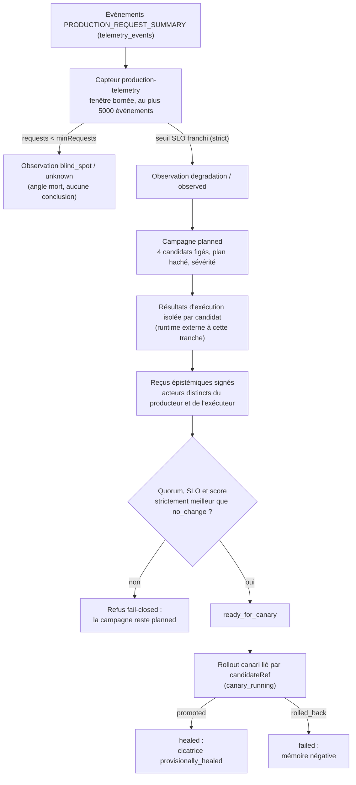
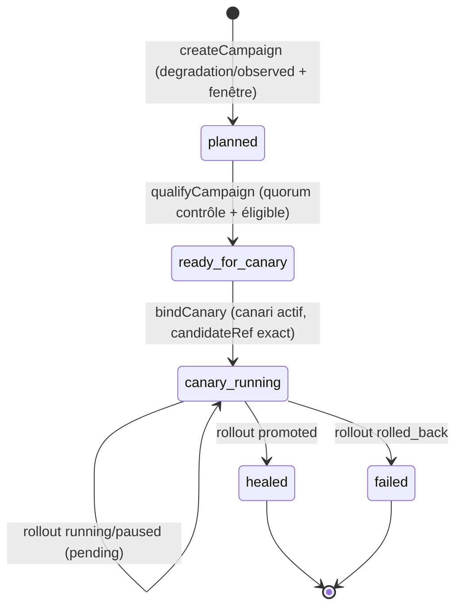

# Cicatrisation de production

- **Statut** : implémenté, tranche verticale bornée ; sans connecteur de déploiement externe.
- **Portée** : nociception de télémétrie production, campagne contrefactuelle à quatre candidats, quorum de reçus épistémiques indépendants, liaison à un rollout canari existant, cicatrice persistée.
- **Dernière revue** : 2026-10-19

> Cette boucle relie une fenêtre de télémétrie agrégée à une campagne
> contrefactuelle, un quorum indépendant et un rollout canari existant. Elle ne
> déploie pas elle-même un patch et ne fournit aucun connecteur Vercel : un
> transport réussi ne prouve pas la validité d'une décision, et même l'issue
> favorable porte `causalClaim: false`.

---

## 1. Définition

La **cicatrisation de production** transforme une dégradation mesurée d'un
service de production en une décision vérifiée, bornée et persistée, sans
confondre la disparition d'une alerte avec une preuve causale. Cinq phases :

1. **Nociception** : le capteur SHEV `production-telemetry` agrège des sommaires
   de requêtes production sur une fenêtre et les compare aux seuils SLO.
2. **Campagne** : une observation `degradation/observed` ouvre au plus une
   campagne par tenant et observation ; le plan fige quatre candidats
   contrefactuels et leurs obligations de preuve.
3. **Exécution et quorum** : chaque candidat fournit une mesure d'exécution
   isolée et deux reçus épistémiques signés par des acteurs distincts du
   producteur et de l'exécuteur.
4. **Canari** : le candidat retenu — meilleur que le contrôle `no_change`
   vérifié — est lié à un rollout canari du moteur de releases par
   `candidateRef` exact.
5. **Cicatrice** : la fermeture relit l'état terminal du rollout ; `promoted`
   produit une cicatrice provisoire, `rolled_back` une mémoire négative.

### 1.1 Contrat opérationnel

La chaîne est un producteur de preuves, pas un exécuteur. Concrètement :

- le plan n'autorise aucune exécution de production
  (`authorizesProductionChange: false`, `coagulation.automaticExecution: false`) ;
- aucun stade n'autorise une promotion : résultat, vérifications, qualification,
  liaison et fermeture renvoient tous `promotionEligible: false` et
  `authorizesPromotion: false` ; la décision terminale du canari vient du
  moteur de release, jamais de la campagne ;
- fenêtres, observations, résultats, vérifications et cicatrices sont immuables
  une fois écrits (triggers SQL de refus d'update et de delete) ;
- chaque écriture est idempotente par empreinte : rejouer une fenêtre, un
  résultat ou un reçu identique ne duplique rien, et une empreinte différente
  sur la même clé est refusée ;
- le contrôle `no_change` doit lui-même être mesuré et vérifié : une amélioration
  spontanée ne peut pas être attribuée à un candidat ;
- tout est scopé : la campagne, ses preuves et son rollout sont liés à
  l'organisation et au projet ; la fenêtre et l'observation au projet.

### 1.2 Distinction avec le cycle de cicatrisation SHEV

Le [cycle de cicatrisation SHEV](../02-orchestration/shev.md) de l'ADR 0650b
(`shev_healing_episodes`, phases `lesion` → `hemostasis` → `inflammation` →
`proliferation` → `remodeling`) projette la récupération d'un projet au tick
Ontogenèse. La présente boucle est distincte : tenant-scopée, liée à un rollout
canari du moteur de releases, sans tables, transitions ni gates partagés avec
les épisodes SHEV. Le vocabulaire biologique (nociception, coagulation,
cicatrice) désigne des phases logicielles, aucun processus physiologique.

---

## 2. Spécification formelle

Les formules et seuils de cette fiche sont des **invariants logiciels**
(contrôlés par du code et des tests) ou des **heuristiques** (règles
déterministes non calibrées) ; aucun n'est un théorème, et les tests démontrent
seulement les cas qu'ils exécutent. La qualification de terrain n'est pas acquise.

### 2.1 Contrat de télémétrie `production-telemetry`

L'enrôlement (`enrollSensor` dans `backend/src/services/shev/sensorService.js`)
exige un identifiant de capteur `^[A-Za-z0-9._:-]{1,128}$`, une dimension inscrite
au mandat de responsabilité actif, un `intervalMs` entier entre 1 000 et
2 592 000 000 ms, et consomme une autorisation `sensor-enrollment`. La
configuration spécialisée est validée par `validateProductionTelemetry` :

| Champ | Règle | Défaut |
| --- | --- | --- |
| `eventType` | `^[A-Z][A-Z0-9_]{2,64}$` | `PRODUCTION_REQUEST_SUMMARY` |
| `windowMs` | entier sûr, 1 000 à 86 400 000 (1 s à 24 h) | obligatoire |
| `maxErrorRate` | fini, 0 à 1 | obligatoire |
| `maxAverageLatencyMs` | fini, ≥ 0 | obligatoire |
| `minRequests` | entier sûr, ≥ 1 | obligatoire |
| `deploymentId` | texte ≤ 128 après trim | absent (aucun filtre) |

Le capteur lit la table partagée `telemetry_events` (flux d'observation du
schéma, `backend/src/db/schema-tables-ops.js`) : événements du projet et du
`eventType`, avec `datetime(created_at) >= datetime(nowMs - windowMs)`, triés
par `id` décroissant, **au plus 5 000 événements** (`MAX_EVENTS`). Un échantillon
est valide si son `payload_json` se parse, si `environment` vaut exactement
`production`, si son `deploymentId` correspond au filtre configuré, et si
`requests`, `errors`, `latencyMsTotal` sont finis et ≥ 0 avec `requests` et
`errors` entiers sûrs et `errors ≤ requests`. Les échantillons invalides sont
ignorés silencieusement : ils ne produisent ni erreur ni observation.

```json
{
  "environment": "production",
  "deploymentId": "dep-123",
  "requests": 1000,
  "errors": 8,
  "latencyMsTotal": 180000
}
```

La classification (`classify`) produit :

- `requests < minRequests` → observation `blind_spot` / `unknown`, résumé
  « La telemetrie de production est insuffisante. », **aucune** référence de
  preuve : l'absence de volume valide augmente l'incertitude, elle ne prouve
  jamais la santé ;
- sinon `state` ou `degradation` / `observed`, avec franchissement **strict**
  (`>`), et jusqu'à vingt références `telemetry-event:<event_id>` (les plus
  récentes de la fenêtre).

L'observation est enregistrée par `recordObservation` avec l'identifiant
`production_telemetry_<sha256>`, le domaine `production-runtime` et la source
`production-telemetry:<sha256(eventType, deploymentId)>`. L'empreinte
d'identité couvre projet, dimension, eventType, fenêtre, seuils, `minRequests`,
`deploymentId`, la classification et la liste triée des identifiants
d'échantillons : deux fenêtres de contenu différent produisent deux
observations distinctes. La responsabilité SHEV doit être active et couvrir la
dimension. La fenêtre est ensuite persistée dans
`production_telemetry_observations` (`metrics_json`, `policy_json`,
`evidence_digest` SHA-256 des trois) ; `INSERT OR IGNORE` puis relecture : un
digest différent sur la même clé lève « Production telemetry window
idempotency conflict. ».

### 2.2 Schémas persistés

Trois schémas versionnés sont écrits, chacun haché par `fingerprint` (JSON
canonique à clés triées, SHA-256 ; `backend/src/services/stateFingerprint.js`) :

- `genos.production-healing-plan/v1` — `sourceObservationId`, `evidenceDigest`
  (celui de la fenêtre), `thresholds` (politique SLO de la fenêtre), les quatre
  hypothèses, les quatre contrats candidats, les cinq stages ;
- `genos.production-healing-result/v1` — `campaignId`, `candidateId`,
  `executorId`, `planHash`, le contrat candidat, l'`outcome` mesurée,
  `promotionEligible: false`, `authorizesPromotion: false` ;
- `genos.production-healing-scar/v1` — voir la section 7.

### 2.3 Reçus épistémiques

Un reçu est émis par `issueReceipt`
(`backend/src/services/epistemicVerifierReceiptService.js`) et signé en HMAC
SHA-256 sur une charge canonique incluant `resultId`, `evidenceDigest`,
`verifierDigest`, `checkedAt`, `nonce`, `status`, `independent`,
`independenceDescriptor`, `coveredObligations`, `evidenceTypes`,
`executionEvidence` et `keyId`. La clé vient du trousseau
`GENOS_EPISTEMIC_RECEIPT_SECRET` (rotation via
`GENOS_EPISTEMIC_RECEIPT_KEY_ID` / `GENOS_EPISTEMIC_RECEIPT_PREVIOUS_KEYS`).
`validateReceipt` exige un `verifierDigest` inscrit au registre central
(`backend/src/services/verifierTrustRegistry.js`, types pré-enregistrés dont
`proof` et `counterexample`) et compare la signature en temps constant (la
variante historique reste acceptée).

Pour être lié à un résultat de campagne, un reçu doit satisfaire
`receiptBound` :

- `resultId` = l'obligation `<campaign-id>:<candidate-id>` ;
- `evidenceDigest` = `sha256:<empreinte du résultat>` ;
- `coveredObligations` contient cette obligation ;
- `status` ∈ `verified`, `refuted`, `inconclusive` ;
- la signature valide.

L'acteur du vérificateur est lu dans `independenceDescriptor.actorId` ; il doit
être non vide et distinct du `producer_id` de la campagne et de l'`executor_id`
du résultat. Un reçu réfuté, altéré ou non lié exclut le candidat.

### 2.4 Liaison `candidateRef`

`releaseCandidateBindingService.validate` accepte une référence opaque
`^[A-Za-z0-9._:/-]{1,256}$` ; `null` signifie l'absence de liaison ; toute autre
valeur est refusée avec `INVALID_CANDIDATE_REFERENCE` (HTTP 400 sur la création
de rollout, `backend/src/controllers/releaseController.js`). Pour une campagne de
cicatrisation, la valeur est construite par `candidateReference` :

```text
production-healing:<campaign-id>:<candidate-id>
```

### 2.5 États exacts de la campagne

| État | Sens opérationnel | Autorité de production |
| --- | --- | --- |
| `planned` | quatre candidats et leurs obligations sont figés ; résultats et vérifications acceptés | aucune |
| `ready_for_canary` | contrôle et candidat ont un quorum signé ; candidat sélectionné par score | aucune |
| `canary_running` | un rollout canari tenant-scopé est lié par `candidateRef` | celle du moteur de release uniquement |
| `healed` | le canari a été promu ; cicatrice provisoire | aucune autorité supplémentaire |
| `failed` | le canari a été rollbacké ; mémoire négative | aucune |

Ces cinq états sont le `CHECK` SQL de `production_healing_campaigns` ; il n'en
existe pas d'autres. Les transitions sont gardées : chaque `UPDATE` filtre sur
l'état attendu, vérifie qu'une ligne a changé (`PRODUCTION_HEALING_CAMPAIGN_CHANGED`
sinon) ; une campagne terminale rejoue sa fermeture sans réécrire la cicatrice
(`replayed: true`). L'identité de la campagne (id, tenant, observation,
producteur, sévérité, plan, hash, création) est immuable par trigger ; seuls
`status`, `selected_candidate_id`, `rollout_id`, `scar_json` et `updated_at`
évoluent, par les services.

---

## 3. Modèle mathématique

### 3.1 Agrégats de fenêtre SLO

Pour la fenêtre d'échantillons valides $S$ (`aggregate` et `classify`) :

$$R=\sum_{s\in S} requests_s \qquad E=\sum_{s\in S} errors_s \qquad L=\sum_{s\in S} latencyMsTotal_s$$

$$ErrorRate=\frac{E}{R} \qquad AverageLatencyMs=\frac{L}{R}$$

La fenêtre est une **dégradation** si $ErrorRate > maxErrorRate$ ou
$AverageLatencyMs > maxAverageLatencyMs$ (comparaison stricte) ; sinon un
**état**. Si $R < minRequests$, elle est un angle mort `unknown` sans conclusion
de santé.

### 3.2 Pression SLO et sévérité

La campagne calcule une pression relative (`severityFor`) :

$$ratio(v,s)=\begin{cases} v/s & s>0\\ +\infty & s=0 \wedge v>0\\ 1 & s=0 \wedge v=0\end{cases}$$

$$pressure=\max\big(ratio(ErrorRate, maxErrorRate),\; ratio(AverageLatencyMs, maxAverageLatencyMs)\big)$$

| Pression | Sévérité | Investigateurs planifiés |
| --- | --- | --- |
| ≥ 4 | `critical` | 3 |
| ≥ 2 | `high` | 3 |
| ≥ 1.25 | `medium` | 2 |
| sinon | `low` | 2 |

`maxCandidateExecutions` vaut 4 (un par candidat). Ces seuils sont des
heuristiques logicielles, pas une calibration statistique.

### 3.3 Conditions de quorum

Un candidat a un **résultat vérifié** (`verifiedResult`) si et seulement si :

1. son résultat existe avec `executionStatus = completed` (une exécution
   `failed` ne se qualifie jamais) ;
2. aucun de ses reçus n'a le verdict `refuted` ;
3. au moins **deux vérificateurs distincts** ont le verdict `verified`.

Le contrôle `no_change` doit lui-même satisfaire ce quorum
(`PRODUCTION_HEALING_CONTROL_QUORUM_REQUIRED` sinon). Un candidat est **dans le
SLO** si $ErrorRate \le maxErrorRate$ et $AverageLatencyMs \le maxAverageLatencyMs$
— comparaison **inclusive**, donc plus permissive que le seuil strict du capteur.

### 3.4 Score comparatif et sélection

Chaque résultat vérifié reçoit un score (`score`) :

$$score(e)=\frac{ErrorRate_e}{\max(maxErrorRate,\;10^{-6})}+\frac{AverageLatencyMs_e}{\max(maxAverageLatencyMs,\;1)}+\frac{\min(costUsd_e,\;100)}{100}$$

Est éligible tout candidat $\ne$ `no_change` vérifié, dans le SLO, et dont le
score est **strictement inférieur** à celui du contrôle vérifié. Les éligibles
sont triés par score croissant ; le premier est sélectionné
(`selected_candidate_id`). Aucun éligible → `PRODUCTION_HEALING_CANDIDATE_QUORUM_REQUIRED`.

### 3.5 Conditions de passage vers le canari et l'issue

- `planned` → `ready_for_canary` : quorum du contrôle + au moins un éligible
  (section 3.3 et 3.4) ;
- `ready_for_canary` → `canary_running` : rollout **canari**, **du même tenant**,
  portant le `candidateRef` exact, et **actif** (`running` ou `paused`) ;
- `canary_running` reste en attente (`pending: true`) tant que le rollout est
  `running` ou `paused` ;
- `canary_running` → `healed` si le rollout est `promoted`, → `failed` s'il est
  `rolled_back` ; tout autre état terminal du rollout est refusé
  (`PRODUCTION_HEALING_ROLLOUT_TERMINAL_INVALID`).

La décision `promoted`/`rolled_back` appartient au moteur de release et suit ses
propres seuils (voir [releases et rollouts](releases-et-rollouts.md)) ; la
campagne ne fait que relire l'état persisté.

---

## 4. Architecture

### 4.1 Rôles

| Composant | Fichier | Responsabilité |
| --- | --- | --- |
| Capteur `production-telemetry` | `backend/src/services/shev/adapters/productionTelemetryAdapter.js` | fenêtre, échantillons valides, agrégats, classification, empreinte d'idempotence |
| Enrôlement et tick des capteurs | `backend/src/services/shev/sensorService.js` | contrat de capteur, validation SLO, dispatch `sampleSensor` |
| Observations SHEV | `backend/src/services/shev/observationService.js` | `shev_observations` immuables, hash de contenu, mandat actif |
| Campagne | `backend/src/services/productionHealingCampaignService.js` | sévérité, plan `v1` à quatre candidats, unicité par tenant et observation |
| Preuves | `backend/src/services/productionHealingEvidenceService.js` | résultats d'exécution, reçus, quorum, qualification, score et sélection |
| Liaison rollout | `backend/src/services/productionHealingRolloutService.js` | `candidateReference`, `bindCanary`, `closeCanary`, cicatrice |
| Validation `candidateRef` | `backend/src/services/releaseCandidateBindingService.js` | référence opaque bornée pour la création de rollout |
| Création de rollout | `backend/src/controllers/releaseController.js` | porte et persiste le `candidateRef` dans `config_json` |
| Reçus épistémiques | `backend/src/services/epistemicVerifierReceiptService.js` + `verifierTrustRegistry.js` | signature HMAC, registre de confiance, validation |
| Empreintes | `backend/src/services/stateFingerprint.js` | JSON canonique trié, SHA-256 (plan, résultat, cicatrice) |
| Migrations | `backend/src/db/migrations/migrateProductionHealingCampaigns.js`, `migrateProductionHealingEvidence.js` | tables, contraintes, triggers d'immuabilité |

### 4.2 Cycle lésion → campagne → quorum → canari → cicatrice



### 4.3 Machine à états de la campagne



---

## 5. Les quatre candidats

Le plan fige exactement ces quatre contrats (`CANDIDATES`), dans cet ordre :

| Candidat | Hypothèse | Action | Rôle | Réversible | Blast radius |
| --- | --- | --- | --- | --- | --- |
| `no_change` | `h-control` | `observe_without_change` | contrôle | oui | `none` |
| `rollback` | `h-deployment` | `rollback_release` | coagulation | oui | `release` |
| `minimal_fix` | `h-local-regression` | `apply_minimal_fix` | cicatrisation | oui | `component` |
| `structural_fix` | `h-systemic-defect` | `apply_structural_fix` | cicatrisation | non | `system` |

Chaque contrat porte `executionAuthorized: false` et exige les mêmes preuves
(`evidenceRequired`) : `isolated-execution-receipt`, `slo-measurements`,
`independent-verifier-quorum`. Chaque hypothèse a un énoncé, une prédiction et
une condition de falsification ; par exemple `h-deployment` : « Le deploiement
courant cause la degradation », prédiction « Le rollback restaure le SLO »,
falsification « Le rollback ne restaure pas le SLO ». Le plan lie `rollback` à
la coagulation (jamais automatique) et `minimal_fix`/`structural_fix` à la
cicatrisation (`status: unverified`).

Les obligations exactes d'un résultat (`recordCandidateResult`) :

- l'exécuteur est identifié et distinct des vérificateurs ;
- l'`outcome` porte `requests` (entier > 0), `errors` (entier ≤ requests),
  `averageLatencyMs`, `costUsd` (défaut 0), finis et ≥ 0, `executionStatus`
  (`completed`, ou `failed` qui disqualifie) et **2 à 20** références de preuve
  uniques de 512 caractères au plus ;
- le résultat est append-only par clé (campagne, candidat) : une empreinte
  différente sur une clé existante est refusée.

Les obligations exactes d'une vérification (`submitVerifications`) :

- **1 à 8 reçus** par soumission, acteurs tous distincts, chacun lié au résultat
  (section 2.3), signé, et distinct du producteur de la campagne et de
  l'exécuteur du candidat ;
- les résultats et vérifications ne sont acceptés qu'en état `planned`.

---

## 6. Liaison au rollout

La création du rollout accepte un `candidateRef` opaque et borné. Pour une
campagne de cicatrisation, sa valeur est :

```text
production-healing:<campaign-id>:<candidate-id>
```

`bindCanary` refuse, avec les codes exacts du code :

- un rollout A/B — ou toute stratégie autre que `canary` — ou une référence de
  candidat différente : `PRODUCTION_HEALING_ROLLOUT_BINDING_INVALID` ;
- un rollout d'un autre tenant : la jointure `release_rollouts` / `releases`
  échoue et lève `PRODUCTION_HEALING_ROLLOUT_NOT_FOUND` ;
- un rollout inactif (ni `running` ni `paused`) :
  `PRODUCTION_HEALING_ROLLOUT_NOT_ACTIVE` ;
- une campagne qui n'est pas `ready_for_canary` :
  `PRODUCTION_HEALING_CAMPAIGN_NOT_READY` ;
- une concurrence sur la transition : `PRODUCTION_HEALING_CAMPAIGN_CHANGED`.

La fermeture (`closeCanary`) relit l'état terminal persisté par le moteur de
release ; elle ne le remplace pas. Tant que le rollout est `running` ou
`paused`, elle répond `pending: true` sans transition. Un état terminal autre
que `promoted` ou `rolled_back` est refusé
(`PRODUCTION_HEALING_ROLLOUT_TERMINAL_INVALID`) ; une fermeture sans liaison
préalable est refusée (`PRODUCTION_HEALING_CANARY_NOT_BOUND`). Avant d'écrire
la cicatrice, elle exige la présence du résultat du candidat sélectionné et
d'au moins deux reçus (`PRODUCTION_HEALING_EVIDENCE_MISSING`).

Le `candidateRef` ne modifie pas la décision du canari : le moteur de release
applique ses propres seuils (voir [releases et rollouts](releases-et-rollouts.md)).

---

## 7. Nature de la cicatrice

La fermeture écrit une cicatrice hachée
(`genos.production-healing-scar/v1`, `scarHash = fingerprint`) :

```json
{
  "schema": "genos.production-healing-scar/v1",
  "campaignId": "healing-…",
  "rolloutId": "rollout-a",
  "selectedCandidateId": "minimal_fix",
  "outcome": "provisionally_healed",
  "maturity": "provisional",
  "rolloutDecision": {"status": "promoted", "selectedVariant": "canary"},
  "candidateResultHash": "…sha256 du résultat candidat…",
  "verifierReceiptHashes": ["…", "…"],
  "causalClaim": false,
  "longitudinalMonitoringRequired": true,
  "recordedAt": "…",
  "scarHash": "…"
}
```

Une promotion produit `outcome: provisionally_healed` et conserve :

- le hash du résultat candidat (`candidateResultHash`) ;
- les hashes des reçus des vérificateurs (`verifierReceiptHashes`, triés par
  vérificateur) ;
- la décision terminale du rollout (`rolloutDecision`) ;
- `causalClaim: false` ;
- `longitudinalMonitoringRequired: true`.

Cette cicatrice prouve que le candidat mesuré et vérifié a franchi le canari.
Elle ne prouve pas encore que ce candidat était l'unique cause de
l'amélioration. Un rollback produit au contraire une cicatrice
`rolled_back` / `negative_memory`, avec `longitudinalMonitoringRequired: false`,
exploitable comme échec historique. Le suivi longitudinal est **exigé** par la
cicatrice provisoire mais aucun gate ne transforme encore cette provisoire en
mémoire causale consolidée : `provisionally_healed` n'est pas une guérison
causale établie.

---

## 8. Exécution — cas nominal pas à pas

Le parcours suivant est celui de la fixture réelle
`backend/tests/test_production_healing_rollout.js` :

1. **Nociception** : un événement `PRODUCTION_REQUEST_SUMMARY` est enregistré
   (`environment: production`, `deploymentId: dep-1`, `requests: 100`,
   `errors: 20`, `latencyMsTotal: 100000`). Le capteur est configuré avec
   `windowMs: 300000`, `maxErrorRate: 0.02`, `maxAverageLatencyMs: 300`,
   `minRequests: 10`. Agrégats : $R=100$, $E=20$, $L=100000$, soit
   $ErrorRate=0{,}2$ (dix fois le seuil) et $AverageLatencyMs=1000$ :
   observation `degradation/observed`, preuve `telemetry-event:prod-1`.
2. **Campagne** : `createCampaign` (org `org-a`, projet `project-a`, producteur
   `producer-a`) → pression $10$ → sévérité `critical` (3 investigateurs), état
   `planned`, quatre candidats `executionAuthorized: false`, plan haché.
3. **Exécution du contrôle** : `no_change` mesuré par un exécuteur dédié
   (`requests: 100`, `errors: 20`, `averageLatencyMs: 1000`, `costUsd: 0.1`),
   puis deux reçus signés par des vérificateurs de types `proof` et
   `counterexample`, acteurs distincts de l'exécuteur et du producteur.
4. **Exécution du candidat** : `minimal_fix` mesuré (`requests: 100`,
   `errors: 1`, `averageLatencyMs: 100`, `costUsd: 0.1`), même quorum de deux
   reçus. Contrôles négatifs de la fixture
   `backend/tests/test_production_healing_evidence.js` : un vérificateur
   confondu avec le producteur est refusé
   (`PRODUCTION_HEALING_VERIFIER_NOT_INDEPENDENT`) et un reçu au statut réécrit
   après signature est refusé (`PRODUCTION_HEALING_RECEIPT_INVALID`).
5. **Qualification** : `qualifyCampaign` → le contrôle est vérifié (quorum) ;
   `minimal_fix` est vérifié, dans le SLO ($0{,}01 \le 0{,}02$ ;
   $100 \le 300$) et de score strictement inférieur
   ($\approx 0{,}83$ contre $\approx 13{,}33$ pour le contrôle) → état
   `ready_for_canary`, `selectedCandidateId: minimal_fix`,
   `authorizesPromotion: false`.
6. **Canari** : création d'un rollout `canary` du même tenant, `running`, avec
   `candidateRef: production-healing:<campaign-id>:minimal_fix` → `bindCanary`
   → `canary_running`.
7. **Attente** : `closeCanary` pendant que le rollout est `running` →
   `pending: true`, aucune transition.
8. **Décision du moteur de release** : la fixture écrit directement `promoted`
   avec `decision_json` (en service, elle vient du moteur de release, sous ses
   propres seuils SLO).
9. **Fermeture** : `closeCanary` relit l'état, rassemble les hashes du résultat
   et des reçus, écrit la cicatrice `provisionally_healed` (`causalClaim:
   false`, `longitudinalMonitoringRequired: true`) et passe la campagne en
   `healed`.
10. **Rejeu** : une seconde fermeture renvoie la cicatrice existante avec
    `replayed: true`, sans réécriture.

La fixture capteur (`backend/tests/test_shev_production_telemetry.js`) couvre
en amont : fenêtre vide → `blind_spot/unknown` ; échantillon sain → `state` ;
échantillon dégradé → `degradation` avec deux références de preuve ; événement
`staging` ignoré ; filtre `deploymentId` respecté.

---

## 9. Erreurs fail-closed

Codes exacts, tels qu'ils apparaissent dans le code :

| Code | Condition |
| --- | --- |
| `PRODUCTION_HEALING_ORGANIZATION_REQUIRED` / `PRODUCTION_HEALING_PROJECT_REQUIRED` / `PRODUCTION_HEALING_PRODUCER_REQUIRED` | champ d'entrée absent ou mal formé (création de campagne) |
| `PRODUCTION_HEALING_OBSERVATION_REQUIRED` | `observationId` absent, ou observation inexistante / pas `degradation/observed` |
| `PRODUCTION_HEALING_OBSERVATION_STALE` | `valid_until` de l'observation dépassé |
| `PRODUCTION_HEALING_WINDOW_REQUIRED` | aucune fenêtre `production_telemetry_observations` pour l'observation |
| `PRODUCTION_HEALING_CAMPAIGN_NOT_FOUND` | campagne inexistante dans le tenant demandé |
| `PRODUCTION_HEALING_CANDIDATE_NOT_FOUND` | candidat hors du plan figé |
| `PRODUCTION_HEALING_CAMPAIGN_REQUIRED` / `PRODUCTION_HEALING_CANDIDATE_REQUIRED` / `PRODUCTION_HEALING_EXECUTOR_REQUIRED` | champs d'entrée absents ou trop longs (preuves) |
| `PRODUCTION_HEALING_RESULT_INVALID` | mesures ou références de preuve invalides |
| `PRODUCTION_HEALING_RESULT_CLOSED` | résultat enregistré hors état `planned` |
| `PRODUCTION_HEALING_RESULT_CONFLICT` | empreinte différente sur une clé de résultat existante |
| `PRODUCTION_HEALING_RESULT_REQUIRED` | vérification sans résultat enregistré |
| `PRODUCTION_HEALING_VERIFICATION_CLOSED` | vérification soumise hors état `planned` |
| `PRODUCTION_HEALING_RECEIPTS_REQUIRED` | moins de 1 ou plus de 8 reçus |
| `PRODUCTION_HEALING_VERIFIER_NOT_INDEPENDENT` | acteur = producteur ou exécuteur |
| `PRODUCTION_HEALING_CORRELATED_VERIFIERS` | deux reçus du même acteur |
| `PRODUCTION_HEALING_RECEIPT_INVALID` | reçu non lié, non signé ou de statut hors liste |
| `PRODUCTION_HEALING_RECEIPT_CONFLICT` | reçu existant d'empreinte différente |
| `PRODUCTION_HEALING_CONTROL_QUORUM_REQUIRED` | contrôle `no_change` sans quorum vérifié |
| `PRODUCTION_HEALING_CANDIDATE_QUORUM_REQUIRED` | aucun candidat dans le SLO et meilleur que le contrôle |
| `PRODUCTION_HEALING_ROLLOUT_NOT_FOUND` | rollout inexistant dans le tenant |
| `PRODUCTION_HEALING_ROLLOUT_BINDING_INVALID` | stratégie ≠ canari ou `candidateRef` différent |
| `PRODUCTION_HEALING_ROLLOUT_NOT_ACTIVE` | rollout ni `running` ni `paused` |
| `PRODUCTION_HEALING_ROLLOUT_TERMINAL_INVALID` | état terminal hors `promoted` / `rolled_back` |
| `PRODUCTION_HEALING_CAMPAIGN_NOT_READY` | liaison hors `ready_for_canary` |
| `PRODUCTION_HEALING_CANARY_NOT_BOUND` | fermeture sans rollout lié correspondant |
| `PRODUCTION_HEALING_EVIDENCE_MISSING` | résultat ou moins de deux reçus pour le candidat sélectionné |
| `PRODUCTION_HEALING_CAMPAIGN_CHANGED` | transition concurrente (garde d'état) |
| `INVALID_CANDIDATE_REFERENCE` (HTTP 400) | `candidateRef` hors `^[A-Za-z0-9._:/-]{1,256}$` |

S'y ajoutent des échecs sans code dédié : conflits d'idempotence (« Production
telemetry window idempotency conflict. », « SHEV observation idempotency
conflict. »), mandat SHEV inactif ou dimension hors mandat, et les refus SQL
d'immuabilité des triggers.

---

## 10. Télémétrie et persistance

Deux migrations idempotentes (`backend/src/db/migrations/lateMigrationRunners.js`) :

- `146-production-healing-campaigns`
  (`migrateProductionHealingCampaigns`) crée
  `production_telemetry_observations` (clé `project_id` + `observation_id`,
  `metrics_json`, `policy_json`, `evidence_digest`, clé étrangère vers
  `shev_observations` en `ON DELETE RESTRICT`) et
  `production_healing_campaigns` (id, tenant, observation, producteur,
  sévérité et statut `CHECK`, `plan_json`, `plan_hash`,
  `selected_candidate_id`, `rollout_id`, `scar_json`, unicité
  `(organization_id, project_id, observation_id)`, index
  `idx_production_healing_scope`). Des triggers interdisent la réécriture de
  l'identité de la campagne et sa suppression (« production healing campaigns
  are durable evidence »).
- `147-production-healing-evidence`
  (`migrateProductionHealingEvidence`) crée
  `production_healing_candidate_results` (clé campagne + candidat,
  `executor_id`, `result_json`, `result_hash`) et
  `production_healing_verifications` (clé campagne + candidat + vérificateur,
  `verdict` `CHECK` `verified|refuted|inconclusive`, `result_hash`,
  `receipt_json`, `receipt_hash`, clé étrangère vers les résultats en
  `ON DELETE RESTRICT`). Les deux tables sont immuables et insupprimables par
  triggers.

Les fenêtres sont elles-mêmes immuables par triggers
(`production_telemetry_observations_no_update` / `_no_delete`). La chaîne lit
`telemetry_events` (schéma partagé) et `shev_observations`, et n'écrit dans
`releases` / `release_rollouts` que via le moteur de release.

---

## 11. Cas d'usage typiques

1. **Dégradation SLO sur un déploiement** : une fenêtre franchit `maxErrorRate` ;
   la campagne compare rollback, correctif minimal et correctif structurel au
   contrôle ; le score départage les vérifiés dans le SLO, sans autoriser de
   promotion pour autant.
2. **Amélioration spontanée** : le contrôle `no_change` vérifié a un meilleur
   score que tout candidat → `PRODUCTION_HEALING_CANDIDATE_QUORUM_REQUIRED` ;
   aucune intervention n'est présentée comme efficace.
3. **Échec de correction** : le candidat retenu échoue au canari (le moteur de
   release le `rolled_back`) → `failed` et mémoire négative consultable pour
   les campagnes suivantes.
4. **Angle mort** : la télémétrie est insuffisante (`blind_spot/unknown`) :
   aucune campagne n'est ouverte sur cette observation ; l'incertitude est
   persistée, pas masquée.

---

## 12. Quand NE PAS utiliser cette chaîne

- **Pas un autoscaler** : aucun signal de capacité, aucune décision de
  dimensionnement ; la chaîne traite des dégradations SLO observées.
- **Pas un rollback automatique** : le candidat `rollback` suit exactement les
  mêmes obligations de preuve que les autres ; `coagulation.automaticExecution`
  est `false`, aucun adaptateur de déploiement n'est implémenté et l'endpoint
  de rollback de release retourne `501 RELEASE_ROLLBACK_UNAVAILABLE`.
- **Pas un connecteur Vercel** (ni Sentry, ni Datadog) : le code n'en contient
  aucun ; le capteur attend des sommaires `PRODUCTION_REQUEST_SUMMARY` déjà
  produits dans `telemetry_events`, pas les requêtes brutes.
- **Pas un détecteur d'anomalies** : la nociception compare des seuils simples
  sur des agrégats ; ni corrélation multivariée ni détection précoce.
- **Pas une autorité de déploiement** : ni la campagne ni la cicatrice ne
  portent l'autorité du moteur de release ; la promotion forcée suit le circuit
  de reçus du moteur, pas cette chaîne.
- **Pas une boucle multi-tenant** : chaque campagne est confinée à une
  organisation et un projet ; il n'existe pas de campagne globale.

---

## 13. Comparaisons

### 13.1 Runbooks classiques

Un runbook documente des étapes humaines sans mémoire vérifiable. Ici, chaque
étape laisse une écriture immuable et hachée, chaque rejeu est détecté par
empreinte ; la contrepartie est le coût d'exécutions isolées réelles.

### 13.2 Auto-remediation

Les systèmes d'auto-remediation agissent dès un seuil franchi (redémarrage,
rollback), en supposant la causalité. Cette chaîne exige davantage : contrôle
`no_change` mesuré et vérifié, quorum de reçus signés d'acteurs distincts du
producteur et de l'exécuteur, score strictement meilleur que le contrôle, puis
canari lié à l'identité exacte du candidat — plus lente, donc, et elle ne
remplace pas les remédiations d'urgence.

### 13.3 AIOps / détection d'anomalies

L'AIOps détecte des déviations, souvent par modèles corrélatifs ; la détection
y est la partie difficile. Ici la détection est volontairement simple (seuils
SLO sur agrégats de fenêtre) et la difficulté est déplacée vers la décision :
aucune amélioration n'est attribuée sans comparaison contrefactuelle vérifiée
et canari ; cette chaîne ne fournit pas de modèle prédictif.

---

## 14. Limites

### 14.1 Limites structurelles

- Les exécutions isolées des candidats viennent d'un runtime externe ; la
  chaîne enregistre et vérifie des résultats, elle ne produit pas les mesures.
- Aucun connecteur de déploiement externe (Vercel, Sentry, Datadog) ; aucun
  adaptateur qui remettrait en service un déploiement antérieur.
- Les services de campagne, de preuve et de liaison sont des API appelées par
  les tests et les intégrations ; pas de route REST dédiée en dehors de la
  création de rollout qui porte le `candidateRef`.

### 14.2 Limites de transition

- Les résultats et vérifications ne sont acceptés qu'en état `planned` ; la
  campagne ne se replanifie pas : une nouvelle observation dégradée ouvre une
  nouvelle campagne.
- Tant que le rollout reste `running` ou `paused`, la fermeture est `pending` ;
  aucun délai d'attente ne force une issue.
- Sans candidat éligible, la campagne reste `planned` avec une erreur explicite ;
  il n'y a pas d'état d'épuisement distinct.

### 14.3 Limites de ressources

- Au plus 5 000 événements par fenêtre (les plus récents) ; au plus vingt
  références de preuve par observation ou résultat ; 1 à 8 reçus par soumission.
- Une seule campagne par tenant et observation (unicité SQL) ; une seule
  exécution mesurée par candidat (clé campagne + candidat).
- Le coût n'entre dans le score que plafonné à 100 USD ; le suivi longitudinal
  n'a pas de budget alloué dans cette tranche.

### 14.4 Limites épistémiques

- `provisionally_healed` n'est pas une guérison causale : la cicatrice porte
  `causalClaim: false` et la qualification de terrain n'est pas acquise.
- Le quorum prouve la cohérence et la liaison des reçus fournis (signature,
  obligation, acteur déclaré), pas l'indépendance réelle des vérificateurs
  au-delà de leurs identités déclarées.
- Les seuils (pression, deux reçus, score) sont des contrats logiciels, pas des optima statistiques.
- Le suivi longitudinal est exigé par la cicatrice mais n'est pas encore le
  gate qui transformerait la provisoire en mémoire causale consolidée.

---

## 15. État d'implémentation

Implémenté et testé dans cette tranche :

- capteur `production-telemetry` (fenêtres, agrégats SLO, angle mort,
  idempotence par empreinte) et enrôlement via les capteurs SHEV ;
- campagne contrefactuelle (sévérité, plan `v1` à quatre candidats, unicité par
  tenant et observation, immuabilité) ;
- preuves indépendantes (résultats append-only, reçus HMAC liés, quorum,
  score, sélection) ;
- liaison au rollout canari (`candidateRef`, refus documentés, fermeture sur
  état terminal) et cicatrice hachée ;
- migrations `146-production-healing-campaigns` et
  `147-production-healing-evidence`, validation HTTP du `candidateRef`.

Non implémenté : connecteur de déploiement externe, exécuteur de candidats,
route REST pour le cycle de campagne, gate longitudinal de consolidation des
cicatrices, recalibrage des seuils. Les états, codes et tables de cette fiche
correspondent à l'état du code ci-dessus ; voir la
[matrice de cohérence code/docs](../06-qualite-preuves/matrice-coherence-code-docs.md).

---

## 16. Vérification

Tests ciblés (standalone, exécutables directement) :

```bash
node backend/tests/test_shev_production_telemetry.js
node backend/tests/test_production_healing_campaign.js
node backend/tests/test_production_healing_evidence.js
node backend/tests/test_production_healing_rollout.js
node backend/tests/test_release_operations.js
```

Ils vérifient respectivement : la fenêtre (angle mort, état, dégradation,
filtres) ; le plan et l'immuabilité des campagnes ; l'indépendance des
vérificateurs et la qualification ; la chaîne complète jusqu'à la cicatrice
`provisionally_healed` ; la décision SLO des rollouts et le refus des
`candidateRef` invalides. Ces fichiers ne sont inclus dans aucune suite plus
large : la vérification de cette tranche passe par les commandes ci-dessus.

---

## 17. Références

- [ADR 0650a — Cicatrisation de production contrefactuelle et vérifiée](../adr/0650-cicatrisation-production-contrefactuelle.md) : choix d'architecture, invariants et alternatives écartées.
- [ADR 0650b — Cycle de cicatrisation SHEV fondé sur les preuves](../adr/0650-cycle-cicatrisation-shev.md) : épisodes de cicatrisation projet (distinct de cette boucle).
- [Releases, rollouts et chargeback](releases-et-rollouts.md) : décisions SLO du canari, `candidateRef` à la création.
- [SHEV — exploitation](../03-reference/exploitation-shev.md) : capteurs (ligne `production-telemetry`), enrôlement, tick.
- [SHEV — orchestration](../02-orchestration/shev.md) : cycle de cicatrisation projet et homéorhèse.
- [Épistémologie et evidence](../01-concepts/epistemologie-et-evidence.md) : gates de preuve et de promotion.
- [Matrice de cohérence code/docs](../06-qualite-preuves/matrice-coherence-code-docs.md) : correspondance code ↔ documentation.

Code source principal : `backend/src/services/shev/adapters/productionTelemetryAdapter.js`,
`backend/src/services/productionHealing{Campaign,Evidence,Rollout}Service.js`,
`backend/src/services/releaseCandidateBindingService.js`,
`backend/src/db/migrations/migrateProductionHealing{Campaigns,Evidence}.js`.
