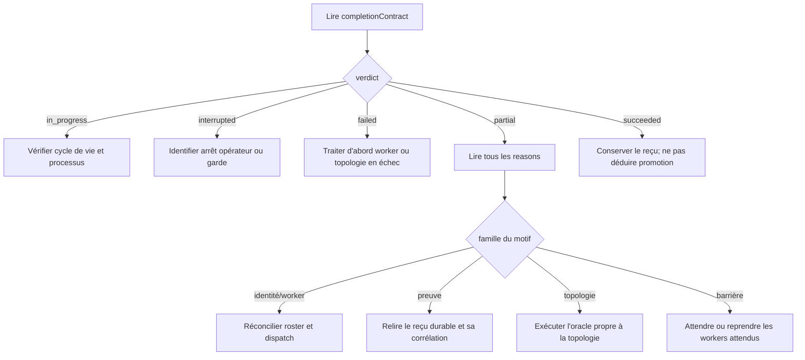

# Clôture des missions : diagnostic et reprise

- **Type** : guide d'exploitation
- **Statut** : applicable aux consommateurs de `genos.mission-completion/v1`
- **Portée** : backend Node, contrat structurel, gate commune, missions biologiques et Syncytium
- **Dernière revue** : 2026-10-20

Ce runbook aide à diagnostiquer une mission `partial`, `failed`, `interrupted`
ou durablement `in_progress`. Il ne fournit aucune procédure pour fabriquer un
reçu, réécrire un hash ou forcer un succès. Toute reprise doit repasser par le
producteur autorisé de l'état ou de la preuve concernée.

Références normatives :

- [Contrat commun de complétion](../03-reference/contrat-completion-mission.md) ;
- [Runtime Syncytium](../03-reference/runtime-syncytium.md#preuve-de-complétion) ;
- [ADR 0654](../adr/0654-contrat-commun-completion-et-preuves-liees.md).

## 1. Préconditions

Avant le diagnostic, collecter sans modifier l'état :

- l'identifiant exact de mission ;
- la topologie et, pour Syncytium, le `sessionId` ;
- la sortie complète contenant `completionContract` ;
- le roster attendu et les statuts observés des workers ;
- les `evidenceRefs`, `topologyValidation`, `stateValidation` et
  `materialization` ;
- les `closureChecks`, invariants et reçu d'oracle lorsque la gate commune est
  utilisée ;
- la base SQLite et la révision de code utilisées par le run ;
- les événements terminaux et les erreurs de dispatch.

Ne pas diagnostiquer à partir du seul booléen `complete`. Il ne permet pas de
distinguer un worker manquant, une preuve invalide et un invariant violé.

## 2. Triage en cinq minutes



Ordre de priorité :

1. état de cycle de vie ;
2. échec explicite d'un worker ou de la topologie ;
3. identité et exhaustivité du roster ;
4. existence, intégrité et corrélation des preuves ;
5. validation propre à la topologie ;
6. barrière de workers.

Le tableau `reasons` est cumulatif. Ne s'arrêter au premier motif que si la
cause racine est déjà démontrée ; les autres motifs peuvent révéler une seconde
anomalie indépendante.

## 3. Lecture du reçu commun

Les champs minimaux à conserver sont :

| Champ | Lecture opérateur |
| --- | --- |
| `lifecycleState` | état d'exécution vu par le contrat |
| `verdict` | décision commune autoritative |
| `terminal` | terminaison du cycle de vie, pas qualité du résultat |
| `requiredMemberIds` | roster qui devait être prouvé |
| `completedMemberIds` | membres déclarés terminés, sans garantie de preuve |
| `evidenceRefs` | références admises après tous les contrôles |
| `reasons` | faits bloquants ou incomplets à diagnostiquer |
| `closureChecks` | résultat des quatre portes additionnelles de `closeMission`, s'il est présent |
| `promotionEligible` | `false` pour le contrat structurel ; éligibilité technique après succès de `closeMission`, jamais preuve d'une promotion exécutée |

Une liste `evidenceRefs` vide avec des workers `completed` indique que leurs
références n'ont pas franchi la validation. Cela ne signifie pas nécessairement
que la table SQLite est vide : le reçu peut être présent mais illisible,
altéré, lié à un autre worker ou non vérifié.

## 4. Inspection en lecture seule des reçus

Les reçus durables utilisés par le collecteur commun résident dans
`biological_worker_receipts`. La requête suivante est un inventaire, pas une
validation cryptographique :

```sql
SELECT receipt_id, run_id, mission_id, payload_hash, length(receipt_json) AS bytes
FROM biological_worker_receipts
WHERE mission_id = ?
ORDER BY rowid DESC;
```

Vérifier ensuite, avec les services du runtime ou les tests ciblés, que :

1. la ligne existe pour le `missionId` exact ;
2. le JSON est décodable ;
3. son digest canonique vaut `payload_hash` ;
4. son identité interne de mission est identique ;
5. son identité de worker appartient au roster requis ;
6. le résultat interne est explicitement vérifié.

Ne jamais corriger directement `receipt_json`, `payload_hash`, `mission_id` ou
un identifiant de worker. Les reçus sont des objets de preuve immuables. Une
anomalie de corrélation exige un nouveau reçu produit par une nouvelle
exécution autorisée.

## 5. Diagnostic par motif commun

| Motif | Vérification | Reprise sûre |
| --- | --- | --- |
| `execution_not_terminal` | Processus, bail et événement terminal encore absents | Attendre le run ou appliquer la procédure d'arrêt normale |
| `execution_state_unknown` | Adaptateur ayant fourni un état non reconnu | Corriger l'adaptateur puis réévaluer ; ne pas traduire arbitrairement en `completed` |
| `member_identity_invalid` | Roster vide, doublon, identité blanche ou membre dupliqué | Reconstruire le roster depuis l'autorité de dispatch |
| `required_member_missing` | Différence entre dispatch et résultats | Retrouver ou reprendre le worker attendu ; ne pas réduire le roster après coup |
| `required_member_failed` | Statut `failed`, `error`, `cancelled` ou `blocked` | Diagnostiquer le worker puis lancer une nouvelle tentative liée |
| `required_member_evidence_invalid` | Existence, digest, mission, worker et état vérifié | Produire un nouveau reçu via le worker autorisé |
| `topology_validation_missing` | Adaptateur ou oracle topologique non exécuté | Exécuter le vérificateur propre à la topologie |
| `worker_barrier_partial` | Couverture ou terminaison incomplète | Attendre/reprendre les workers ; conserver les échecs visibles |
| `completion_invariants_missing` | Invariants absents ou mal formés | Relire l'état autoritatif et reconstruire les invariants |
| `completion_invariant_failed` | Invariant explicite en échec | Corriger l'état si une reprise est autorisée ; sinon conserver l'échec |
| `independent_oracle_missing` | Oracle absent, non indépendant, reçu altéré ou preuves non liées | Rejouer l'oracle autorisé ; ne pas fabriquer son reçu |
| `independent_oracle_failed` | Oracle explicitement négatif | Diagnostiquer le résultat et conserver le verdict `failed` |
| `required_evidence_missing` | Moins de preuves admises que de membres requis | Produire ou relire les reçus manquants |

### 5.1 Lecture de `closureChecks`

Les quatre booléens ne sont pas interchangeables :

| Check | Source | Question |
| --- | --- | --- |
| `requiredWorkers` | roster et membres terminés | tous les workers requis sont-ils présents et terminés ? |
| `evidence` | références admises par le contrat | existe-t-il au moins une preuve admise par membre requis ? |
| `invariants` | adaptateur de topologie | les invariants déclarés sont-ils présents et vrais ? |
| `independentOracle` | reçu d'oracle scellé | le vérificateur est-il indépendant et lié aux preuves admises ? |

Si `completionContract.verdict` est `succeeded` mais qu'un check est faux, la
gate finale doit rester `partial` ou `failed`. Une application qui ignore
`closureChecks` et republie le seul verdict structurel contourne la clôture.

### 5.2 Oracle natif du chemin biologique

Pour les modes biologiques non-Syncytium, chaque reçu worker doit contenir une
référence `genos.native-oracle-receipt-reference/v1` avec attestation,
acceptation et budget satisfait. Le finaliseur agrège ces références dans un
reçu `genos.biological-closure-oracle/v1`.

En cas de `independent_oracle_missing`, vérifier sans modifier :

1. qu'une référence sémantique existe pour chaque membre du roster ;
2. que chaque `hash` et `acceptanceHash` est présent ;
3. que `budgetAssessment.satisfied` vaut explicitement `true` ;
4. que les identifiants de vérificateur sont uniques ;
5. que le reçu agrégé porte le `missionId` attendu ;
6. que son digest correspond à `receiptHash` ;
7. que ses `evidenceRefs` figurent parmi les preuves admises.

## 6. Diagnostic spécifique à Syncytium

### 6.1 Oracle sémantique

Contrôler `semanticValidation.status`, `workerCount` et `coveredWorkers` contre
`expectedCount`. Vérifier aussi le nombre réel de membres, leur statut et
`dispatchFailures`. Un snapshot valide ne compense jamais un oracle incomplet.

### 6.2 Matérialisation

`materialization.status` doit être `verified`. Un statut `skipped` avec
`WORKER_EVIDENCE_INCOMPLETE` signifie que la porte a refusé de figer un état
avant la fin des workers. Un statut `refused` conserve le code du gate.

Pour reprendre : terminer ou corriger d'abord les workers, résoudre les
opérations en attente, puis appeler la surface officielle de matérialisation.
Ne pas insérer manuellement un snapshot et ne pas réutiliser un snapshot dont
`stateVersion` diffère de `shared.totalOps`.

### 6.3 État partagé

| Motif Syncytium | Cause à confirmer | Reprise sûre |
| --- | --- | --- |
| `EMPTY_SHARED_STATE` | aucune opération CRDT engagée | exécuter la mission réelle ; ne pas écrire une opération factice |
| `FAILED_SHARED_INVARIANTS` | reçu d'invariant en échec | appliquer une réparation métier autorisée, puis revalider |
| `MATERIALIZATION_MISSING_OR_STALE` | aucun snapshot à la version courante | matérialiser après stabilisation de l'état |
| `OFFLINE_OPERATIONS_PENDING` | file locale d'un réplica non vide | réconcilier ou traiter explicitement la partition |
| `SESSION_EVIDENCE_UNAVAILABLE` | session absente ou lecture impossible | restaurer l'accès à la source ; ne pas basculer sur une copie non prouvée |

Une violation `FAILED_SHARED_INVARIANTS` produit un échec, pas un résultat
partiel. Les autres absences de preuve restent partielles tant qu'aucun échec
plus fort n'est observé.

## 7. Vérification après reprise

Exécuter les probes ciblés depuis la racine :

```powershell
node backend/tests/test_syncytium_completion_contract.js
node backend/tests/test_common_mission_closure.js
node backend/tests/test_mission_completion_evidence_gate.js
node backend/tests/test_biological_mission_completion.js
node backend/tests/test_syncytium_mission_completion.js
node backend/tests/test_syncytium_materialization_mcp.js
```

Pour une modification de code, ajouter le gate du dépôt :

```powershell
python scripts/ci/check_code_quality.py
```

Un test vert qualifie uniquement son périmètre. Conserver la commande, le code
de sortie, la révision et les éventuelles limitations d'environnement.

## 8. Rollback et irréversibilité

Le contrat de complétion n'exécute aucun effet externe et n'offre pas de
rollback métier. Revenir à une version précédente du code ne retire pas un reçu
déjà persisté et ne révoque pas un effet déjà produit par un worker.

En cas de régression du contrat :

1. arrêter les nouvelles clôtures par la procédure opérateur normale ;
2. conserver la base, les reçus et les sorties fautives ;
3. corriger ou revenir au code applicatif par le mécanisme Git/release prévu ;
4. rejouer les tests de falsification ;
5. réévaluer les missions concernées sans modifier leurs preuves historiques.

## 9. Escalade

Escalader au propriétaire de la topologie lorsqu'un oracle ou un invariant ne
peut être reproduit. Escalader au propriétaire de la persistance lorsqu'un
digest stocké ne correspond plus au JSON. Escalader au propriétaire du runtime
worker lorsqu'un événement terminal et le reçu durable divergent.

Ne jamais transformer une absence de preuve en dérogation silencieuse. Si la
source autoritative demeure indisponible, conserver `partial` ou `failed` et
documenter explicitement le blocage.
