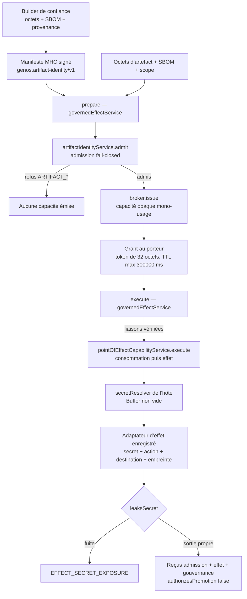

# Gouvernance supply-chain agent-native

- **Statut** : Partiel — primitives locales exécutables, sans API publique
- **Portée** : admission d’artefact avant effet, secret au point d’effet
- **Dernière revue** : 2026-10-19

---

## 1. Définition

La **gouvernance supply-chain agent-native** est le contrat local par lequel un
hôte de confiance refuse tout effet externe d’un agent tant que l’artefact exact
que cet agent transporte — octets, SBOM, provenance, scope, capacités — n’a pas
été admis, puis ne remet aucun secret durable à l’agent : le secret est résolu
uniquement au point d’effet, pour un adaptateur enregistré, sous une capacité
opaque à usage unique.

Le flux empêche un agent d’utiliser un secret de déploiement tant que l’artefact
exact, sa SBOM, sa provenance, son scope et ses capacités n’ont pas été admis.
Il applique deux biomimétismes bornés :

- le **MHC artefactuel** présente une identité de contenu compatible avec le
  « tissu » tenant/environnement cible ;
- la **barrière hémato-agentique** transporte une capacité opaque jusqu’au point
  d’effet sans remettre le secret à l’agent.

Ces termes décrivent les contrats ci-dessous, pas une garantie biologique ou une
preuve de sûreté globale. Une admission positive ne prouve ni la sûreté d’une
dépendance, ni la qualité de l’artefact, ni le succès du déploiement ; elle
prouve seulement que les liaisons déclarées ont été vérifiées par ce contrat
([ADR 0651b](../adr/0651-admission-mhc-et-capacites-au-point-effet.md)).

### 1.1 Contrat opérationnel

Le contrat public se réduit à deux appels sur une instance créée par l’hôte :

- `prepare` : admission du manifeste, puis émission d’une capacité opaque
  liée à l’effet demandé. Un refus d’admission arrête `prepare` avant toute
  émission de capacité.
- `execute` : vérification des liaisons (capacité, token, reçu d’admission),
  consommation de la capacité **avant** l’appel asynchrone, résolution du secret
  côté hôte, exécution par le seul adaptateur enregistré, contrôle de fuite sur
  la sortie, retour de trois reçus non promoteurs.

La clé d’identité, le resolver de secret et les adaptateurs d’effet sont injectés
par l’hôte de confiance lors de la création de l’instance. Ils ne proviennent
jamais d’arguments contrôlés par l’agent.

### 1.2 Invariants logiciels

Les prédicats ci-dessous sont des **invariants logiciels** contrôlés par les
refus exécutables des sections 2 et 6 ; ils ne sont pas des théorèmes, et les
tests ne démontrent que les cas qu’ils exécutent. Avec $H(x)$ le digest
SHA-256 préfixé `sha256:` en hexadécimal minuscule :

$$\text{admissible}(m, b, s, \sigma, C, t) \iff \text{HMAC}_{k}(m) = m.\text{signature} \;\land\; H(b) = m.\text{artifactDigest} \;\land\; H(s) = m.\text{sbomDigest} \;\land\; m.\text{scope} = \sigma \;\land\; C \subseteq m.\text{requiredCapabilities} \;\land\; t \in [m.\text{issuedAt}, m.\text{expiresAt})$$

où $m$ est le manifeste canonique, $b$ les octets de l’artefact, $s$ les octets
de la SBOM, $\sigma$ le scope soumis par l’hôte, $C$ les capacités demandées,
$t$ l’instant d’admission et $k$ la clé HMAC de l’hôte.

$$\text{consommable}(r, e, t) \iff \neg\, r.\text{consumed} \;\land\; t < r.\text{expiresAt} \;\land\; \text{liaisons}(r, e)$$

où $\text{liaisons}(r, e)$ exige l’égalité exacte de l’agent, du scope, de
l’action, de la destination et de l’empreinte d’artefact entre l’enregistrement
$r$ émis et l’exécution $e$ soumise. La consommation ($r.\text{consumed := vrai}$)
précède l’appel asynchrone à l’adaptateur ; elle n’est pas une preuve
d’exécution.

### 1.3 Ce que ce contrat n’est pas

- Ce n’est pas un Dependency Firewall : aucun graphe de dépendances n’est
  résolu, aucune politique de registre appliquée, aucun scanner de
  vulnérabilités invoqué.
- Ce n’est pas un coffre à secrets exposé : aucune lecture, administrative ou
  non, ne remet le secret à un client ; le secret ne quitte l’hôte que vers
  l’adaptateur d’effet.
- Ce n’est pas un chemin de promotion : tous les reçus portent
  `authorizesPromotion: false` et ne remplacent jamais le gate de preuves.
- Ce n’est pas un rollback : aucun service de production n’est restauré.

---

## 2. Spécification formelle

Sources exactes : `backend/src/services/supplyChain/artifactIdentityService.js`
(manifeste et admission), `pointOfEffectCapabilityService.js` (capacité au point
d’effet), `governedEffectService.js` (gate), et
`backend/src/services/stateFingerprint.js` (`canonicalValue`, `fingerprint`).

### 2.1 Manifeste d’identité MHC — `genos.artifact-identity/v1`

Le manifeste est une valeur canonique : `canonicalValue` trie récursivement les
clés des objets, conserve l’ordre des tableaux, rejette les valeurs non JSON
(`TypeError`) et les références circulaires. Chaque champ texte est trimé, non
vide et borné en longueur.

| Champ | Contrainte exacte | Refus à l’émission (`issue`) |
|---|---|---|
| `schema` | constante imposée `genos.artifact-identity/v1` | — (non fourni par l’appelant) |
| `artifactId` | texte ≤ 512 caractères | `ARTIFACT_ID_REQUIRED` |
| `artifactDigest` | `sha256:` + 64 hex minuscules (`/^sha256:[a-f0-9]{64}$/`) | `ARTIFACT_DIGEST_INVALID` |
| `sbomDigest` | même forme que `artifactDigest` | `ARTIFACT_SBOM_DIGEST_INVALID` |
| `provenance` | liste de 1 à 64 identifiants, chacun ≤ 256 caractères, uniques après trim, rendue triée | `ARTIFACT_PROVENANCE_REQUIRED` |
| `requiredCapabilities` | même contrainte de liste que `provenance` | `ARTIFACT_CAPABILITIES_REQUIRED` |
| `scope.organizationId` | texte ≤ 512 caractères | `ARTIFACT_ORGANIZATION_REQUIRED` |
| `scope.projectId` | texte ≤ 512 caractères | `ARTIFACT_PROJECT_REQUIRED` |
| `scope.environment` | texte ≤ 512 caractères | `ARTIFACT_ENVIRONMENT_REQUIRED` |
| `issuerId` | texte ≤ 512 caractères | `ARTIFACT_ISSUER_REQUIRED` |
| `issuedAt` | texte non vide ≤ 512, date finie selon `Date.parse` | `ARTIFACT_ISSUED_AT_REQUIRED`, sinon `ARTIFACT_LIFETIME_INVALID` |
| `expiresAt` | texte non vide ≤ 512, date finie strictement postérieure à `issuedAt` | `ARTIFACT_EXPIRES_AT_REQUIRED`, sinon `ARTIFACT_LIFETIME_INVALID` |
| `signature` | ajoutée par `issue` (§ 2.2), absente de la valeur canonique signée | — |

La SBOM est liée par digest uniquement : son contenu n’est jamais analysé
(limite § 11.1).

### 2.2 Signature HMAC — construction exacte

Dans `artifactIdentityService.js`, `signatureFor(manifest, key)` :

1. la clé doit être un `Buffer` ou une chaîne, sinon
   `ARTIFACT_SIGNING_KEY_REQUIRED` ; elle doit mesurer au moins 32 octets
   (`Buffer.byteLength(key) < 32` → `ARTIFACT_SIGNING_KEY_TOO_SHORT`) ;
2. la signature est
   `crypto.createHmac('sha256', key).update(JSON.stringify(manifest)).digest('hex')`,
   où `manifest` est la valeur canonique du § 2.1 (clés triées) : 64 hex
   minuscules ;
3. `issue` retourne `{ ...manifesteCanonique, signature }`.

À l’admission, `admit` retire le champ `signature`, revalide chaque champ puis
reconstruit le cœur canonique — tout champ inconnu soumis hors de ce cœur est
écarté, la signature doit couvrir le cœur reconstitué — recalcul l’HMAC avec la
clé de l’hôte et compare au moyen de `crypto.timingSafeEqual` sur les 32 octets
décodés de chaque hex. Un opérande qui ne matche pas `^[a-f0-9]{64}$` rend la
comparaison fausse. Échec → `ARTIFACT_SIGNATURE_INVALID`.

La clé est symétrique : l’émetteur du manifeste et l’hôte admetteur partagent la
même clé. La signature prouve la possession de cette clé, pas l’identité d’un
émetteur distinct de l’hôte ; il n’existe ni PKI de builders ni rotation de
clés (limite § 11.1, ADR 0651b).

### 2.3 Admission fail-closed — ordre exact et reçu

`admit(input, key)` applique dans cet ordre, chaque échec fermant l’admission :

1. **manifeste requis** : `input.manifest` absent ou champ invalide → les codes
   d’émission du § 2.1 rejouent (le premier champ validé étant `issuedAt`, un
   manifeste absent refuse sur `ARTIFACT_ISSUED_AT_REQUIRED`) ;
2. **signature** : `ARTIFACT_SIGNATURE_INVALID` (§ 2.2) ;
3. **contenu** : `sha256(input.artifactBytes)` doit égaler
   `manifest.artifactDigest`, sinon `ARTIFACT_CONTENT_MISMATCH` — les octets
   sont relus et hachés par l’hôte, jamais crus depuis le manifeste ;
4. **SBOM** : `sha256(input.sbomBytes)` doit égaler `manifest.sbomDigest`,
   sinon `ARTIFACT_SBOM_MISMATCH` ;
5. **scope exact** : les trois champs `organizationId`, `projectId`,
   `environment` du manifeste doivent égaler ceux soumis à l’admission, sinon
   `ARTIFACT_SCOPE_MISMATCH` ;
6. **capacités demandées** : liste non vide (1 à 64, uniques, triée) sinon
   `ARTIFACT_REQUESTED_CAPABILITIES_REQUIRED` ; chaque capacité demandée doit
   figurer dans `manifest.requiredCapabilities`, sinon
   `ARTIFACT_CAPABILITY_DENIED` ;
7. **fenêtre de validité** : `now ∈ [issuedAt, expiresAt)`, sinon
   `ARTIFACT_IDENTITY_EXPIRED` ; `now` vaut `input.now` si c’est un nombre
   fini, sinon `Date.now()`.

Succès → reçu `genos.artifact-admission-receipt/v1` :

| Champ | Valeur exacte |
|---|---|
| `schema` | `genos.artifact-admission-receipt/v1` |
| `artifactId` | du manifeste |
| `artifactDigest` | du manifeste |
| `identityHash` | `fingerprint(manifeste)` — SHA-256 du JSON canonique du manifeste |
| `scope` | scope admis (trois champs) |
| `admittedCapabilities` | capacités demandées, triées |
| `admittedAt` | ISO de `now` |
| `authorizesPromotion` | `false` |
| `receiptHash` | `fingerprint(corps)` ajouté après calcul |

### 2.4 Capacité au point d’effet — émission, TTL, liaisons

`pointOfEffectCapabilityService.create(options)` exige un `secretResolver`
fonction (`EFFECT_SECRET_RESOLVER_REQUIRED`), copie `options.effectAdapters`
(objet `{ effectId: adaptateur }`) dans une `Map` interne, accepte une horloge
injectable `options.now` (sinon `Date.now`) et tient un registre `records` en
mémoire. L’horloge du broker gouverne la TTL ; l’instant d’admission du § 2.3
est un nombre fourni à `admit`.

Émission (`issue`) — champs exacts :

| Champ | Contrainte exacte | Refus |
|---|---|---|
| `agentId` | texte ≤ 512 caractères | `EFFECT_AGENT_REQUIRED` |
| `scope.organizationId` / `projectId` / `environment` | texte ≤ 512 chacun | `EFFECT_ORGANIZATION_REQUIRED`, `EFFECT_PROJECT_REQUIRED`, `EFFECT_ENVIRONMENT_REQUIRED` |
| `action` | texte ≤ 512 caractères | `EFFECT_ACTION_REQUIRED` |
| `destination` | texte ≤ 2048 caractères | `EFFECT_DESTINATION_REQUIRED` |
| `effectId` | texte ≤ 512 caractères | `EFFECT_ADAPTER_REQUIRED` |
| `secretRef` | texte ≤ 512 caractères | `EFFECT_SECRET_REFERENCE_REQUIRED` |
| `artifactDigest` | `/^sha256:[a-f0-9]{64}$/` | `EFFECT_ARTIFACT_DIGEST_INVALID` |
| `ttlMs` | entier, `1 ≤ ttlMs ≤ MAX_TTL_MS` | `EFFECT_CAPABILITY_TTL_INVALID` |

`MAX_TTL_MS = 300000` (300 000 ms, cinq minutes exactement), exportée par le
module. Aucune capacité ne peut vivre plus de cinq minutes.

Précondition d’adaptateur : l’adaptateur de `effectId` doit être une fonction
enregistrée à la création, sinon `EFFECT_ADAPTER_UNKNOWN` — refus avant toute
création de token. Le token est
`crypto.randomBytes(32).toString('base64url')` (32 octets aléatoires) ;
`capabilityId` vaut `effect-capability-` suivi d’un `crypto.randomUUID()`.
L’enregistrement est stocké sous `sha256(token)` : le registre n’indexe jamais
le token en clair.

Enregistrement interne : `capabilityId`, `agentId`, `scope`, `action`,
`destination`, `effectId`, `secretRef`, `artifactDigest`, `issuedAt` (horloge),
`expiresAt` (`issuedAt + ttlMs`), `consumed` (`false`).

Grant public retourné : `capabilityId`, `capabilityToken`, `agentId`, `scope`,
`action`, `destination`, `artifactDigest`, `expiresAt` (ISO), `singleUse: true`.
Le grant ne contient ni `secretRef` ni `effectId`.

Liaisons vérifiées à l’exécution, dans cet ordre (`assertBinding`) :
`consumed` → `EFFECT_CAPABILITY_ALREADY_USED` ; `now ≥ expiresAt` →
`EFFECT_CAPABILITY_EXPIRED` ; `agentId` → `EFFECT_AGENT_MISMATCH` ; scope (les
trois champs) → `EFFECT_SCOPE_MISMATCH` ; `action` → `EFFECT_ACTION_MISMATCH` ;
`destination` → `EFFECT_DESTINATION_MISMATCH` ; `artifactDigest` →
`EFFECT_ARTIFACT_MISMATCH`. Le token doit être un texte ≤ 256 caractères
(`EFFECT_CAPABILITY_TOKEN_REQUIRED`) dont le hash existe dans le registre, sinon
`EFFECT_CAPABILITY_UNKNOWN`.

### 2.5 Reçus d’exécution et de gouvernance

Reçu d’effet, `genos.point-of-effect-receipt/v1` (schéma exporté
`RECEIPT_SCHEMA` de `pointOfEffectCapabilityService.js`) :

| Champ | Valeur exacte |
|---|---|
| `schema` | `genos.point-of-effect-receipt/v1` |
| `capabilityId` | de l’enregistrement |
| `agentId`, `scope`, `action`, `destination`, `artifactDigest` | de l’enregistrement consommé |
| `effectResultHash` | `fingerprint(sortie canonique)` |
| `consumedAt` | ISO de l’horloge du broker |
| `authorizesPromotion` | `false` |
| `receiptHash` | `fingerprint(corps)` ajouté après calcul |

Reçu de gouvernance, `genos.governed-effect-receipt/v1` (schéma exporté
`RECEIPT_SCHEMA` de `governedEffectService.js`) : `schema`, `capabilityId`,
`artifactDigest`, `admissionReceiptHash`, `effectReceiptHash`, `agentId`,
`scope`, `action`, `destination`, `authorizesPromotion: false`, `receiptHash`.

Aucun des trois reçus ne contient le secret ni `secretRef`. Ils corrèlent des
hashes vérifiés localement ; ils ne constituent ni une preuve d’effet externe,
ni une promotion.

---

## 3. Modèle logique — ordre des vérifications

### 3.1 Manifeste admis avant effet régis

Dans `governedEffectService.js`, `prepare` appelle d’abord
`artifactIdentity.admit`, puis seulement `broker.issue`. Un refus d’admission
arrête `prepare` avant toute émission de capacité : le test
`test_governed_supply_chain_effect.js` vérifie qu’après octets falsifiés, aucun
adaptateur n’a été appelé (`effectCalls === 0`). L’`artifactDigest` transmis au
broker est celui du reçu d’admission, pas une valeur fournie par l’agent.

`execute` exige ensuite la triple liaison : le `capabilityId` doit exister dans
les bindings du gate (`GOVERNANCE_BINDING_UNKNOWN`), le hash du token doit
correspondre (`GOVERNANCE_CAPABILITY_MISMATCH`) et le `receiptHash` du reçu
d’admission soumis doit correspondre (`GOVERNANCE_ADMISSION_RECEIPT_MISMATCH`).
La capacité et le reçu d’admission sont corrélés à l’émission : l’un sans
l’autre est refusé.

### 3.2 Consommation de la capacité avant l’effet asynchrone

Deux consommations précèdent tout `await` :

- `governedEffectService.execute` supprime le binding
  (`bindings.delete(capabilityId)`) avant `await broker.execute(...)` ;
- `pointOfEffectCapabilityService.execute` marque
  `record.consumed = true` avant `await runEffect(...)`.

Conséquences exactes :

- un rejeu pendant l’effet en cours est refusé : `GOVERNANCE_BINDING_UNKNOWN`
  par le gate, `EFFECT_CAPABILITY_ALREADY_USED` en accès direct au broker ;
- toute exécution qui atteint le broker consomme la capacité, y compris si le
  resolver, l’adaptateur ou le contrôle de fuite échoue ensuite — après un refus
  `EFFECT_SECRET_EXPOSURE`, le test constate `EFFECT_CAPABILITY_ALREADY_USED` ;
- les refus de liaison du gate (token, reçu d’admission) précèdent la
  destruction du binding et ne consomment pas la capacité : le test échange le
  token d’une autre capacité, obtient `GOVERNANCE_CAPABILITY_MISMATCH`, puis
  exécute normalement la capacité d’origine.

La consommation **n’est pas** une garantie d’exécution : elle précède l’appel
asynchrone ; son échec laisse la capacité perdue (fail-closed) sans qu’aucun
effet n’ait eu lieu, et aucun reçu n’est émis dans ce cas.

### 3.3 Détection de fuite sur la sortie de l’adaptateur

`runEffect` construit deux candidats — `secret.toString('utf8')` et
`secret.toString('base64')` — puis applique `leaksSecret(output, candidats)` :

- une chaîne fuit si elle contient un candidat en sous-chaîne ;
- un `Buffer` est contrôlé sous ses formes utf8 et base64 ;
- un objet est parcouru récursivement sur ses valeurs ; un cycle détecté
  refuse avec `EFFECT_RESULT_NOT_JSON` ;
- toute fuite refuse avec `EFFECT_SECRET_EXPOSURE`.

Après le contrôle, la sortie est canonisée (`canonicalValue(output || {})`) :
une valeur non JSON (fonction, `undefined`, `NaN`) lève une `TypeError` non
codée — l’appel échoue, aucun reçu n’est émis. Une sortie falsy devient `{}`.
Le `payload` subit la même canonisation avant l’adaptateur.

### 3.4 Zéro-isation du `Buffer` résolu

Le secret résolu est mis à zéro dans un bloc `finally` de `runEffect` :
`secret.fill(0)` s’exécute que l’adaptateur réussisse, échoue ou fasse échouer
le contrôle de fuite. Bornes exactes :

- seul le `Buffer` résolu est mis à zéro ; les copies créées par un adaptateur
  de confiance (chaînes, tranches, journaux) ne le sont pas ;
- le détecteur de fuite matérialise lui-même deux chaînes temporaires du
  secret (utf8, base64) : immuables, elles ne sont pas explicitement effacées ;
- aucune contrainte de garbage collection n’est imposée.

---

## 4. Architecture

### 4.1 Rôles des trois services

- `artifactIdentityService.js` : émission (`issue`) et admission (`admit`) du
  manifeste canonique ; exports `SCHEMA`, `RECEIPT_SCHEMA`, `sha256`, `issue`,
  `admit` ;
- `pointOfEffectCapabilityService.js` : durée, scope, destination,
  consommation et confinement du secret ; exports `RECEIPT_SCHEMA`,
  `MAX_TTL_MS`, `create` ;
- `governedEffectService.js` : ordre obligatoire (admission avant capacité) et
  liaison des reçus ; exports `RECEIPT_SCHEMA`, `create`.

### 4.2 Dépendances injectées par l’hôte

| Dépendance | Rôle | Refus si absente |
|---|---|---|
| `artifactIdentityKey` | clé HMAC des manifestes (≥ 32 octets) | `GOVERNANCE_ARTIFACT_KEY_REQUIRED` |
| `secretResolver` | résout `{ secretRef, scope }` en `Buffer` non vide | `EFFECT_SECRET_RESOLVER_REQUIRED` (à la création du broker) |
| `effectAdapters` | table `{ effectId: adaptateur }` du code hôte | absence d’adaptateur → `EFFECT_ADAPTER_UNKNOWN` à l’émission |
| `now` | horloge injectable du broker (TTL, expiration, reçus) | `Date.now` par défaut |

La clé d’identité, le resolver de secret et les adaptateurs doivent être
injectés par l’hôte de confiance. Ils ne doivent jamais provenir d’arguments
contrôlés par l’agent.

### 4.3 Diagramme



Le secret transite uniquement entre le resolver et l’adaptateur, à l’intérieur
du processus hôte ; l’agent ne manipule qu’un token opaque.

---

## 5. Processus d’exécution

Chemin nominal exact, enrichi des refus possibles à chaque étape :

1. Le builder calcule les digests SHA-256 de l’artefact et de la SBOM (via
   `identity.sha256`), fournit une provenance non vide (liste triée
   d’identifiants uniques, au plus 64 entrées) et émet le manifeste avec une
   clé d’au moins 32 octets. Refus possibles : tous les codes du § 2.1, plus
   `ARTIFACT_SIGNING_KEY_REQUIRED` et `ARTIFACT_SIGNING_KEY_TOO_SHORT`.
2. L’hôte instancie le gate :
   `governedEffectService.create({ artifactIdentityKey, secretResolver,
   effectAdapters, now })`. Refus : `GOVERNANCE_ARTIFACT_KEY_REQUIRED`,
   `EFFECT_SECRET_RESOLVER_REQUIRED`.
3. L’hôte appelle `prepare` avec le manifeste, les octets, la SBOM, le scope,
   les capacités demandées, l’identité de l’agent, l’action, la destination,
   l’`effectId`, le `secretRef`, le `ttlMs` et l’instant d’admission.
4. `prepare` appelle d’abord `admit` (ordre exact au § 2.3). Refus possibles :
   tous les codes d’admission. Un refus arrête `prepare` : aucune capacité
   n’est émise, aucun adaptateur n’est appelé.
5. Si l’admission réussit, `prepare` appelle `broker.issue` avec
   l’`artifactDigest` du reçu d’admission et enregistre la liaison
   `capabilityId → { admissionReceipt, hash du token }`. Refus possibles :
   les codes d’émission du § 2.4, dont `EFFECT_ADAPTER_UNKNOWN`.
6. `prepare` retourne `{ admissionReceipt, grant }`. Le grant porte le token
   opaque (32 octets aléatoires en base64url), l’`expiresAt` ISO et
   `singleUse: true` ; il ne porte ni `secretRef` ni `effectId`.
7. L’agent remet le token opaque, son identité, le scope, l’action, la
   destination et le hash du reçu d’admission à `execute`, avec un `payload`
   JSON. Refus de liaison : `GOVERNANCE_BINDING_UNKNOWN`,
   `GOVERNANCE_CAPABILITY_MISMATCH`, `GOVERNANCE_ADMISSION_RECEIPT_MISMATCH`
   — ces refus ne consomment pas la capacité (§ 3.2).
8. Le gate supprime le binding, puis le broker vérifie les liaisons de
   l’enregistrement dans l’ordre du § 2.4 et marque `consumed = true` avant
   tout appel asynchrone. Refus possibles : `EFFECT_CAPABILITY_TOKEN_REQUIRED`,
   `EFFECT_CAPABILITY_UNKNOWN`, `EFFECT_CAPABILITY_ALREADY_USED`,
   `EFFECT_CAPABILITY_EXPIRED`, `EFFECT_AGENT_MISMATCH`,
   `EFFECT_SCOPE_MISMATCH`, `EFFECT_ACTION_MISMATCH`,
   `EFFECT_DESTINATION_MISMATCH`, `EFFECT_ARTIFACT_MISMATCH`.
9. Le broker résout le secret via le resolver hôte —
   `secretResolver({ secretRef, scope })` doit rendre un `Buffer` non vide,
   sinon `EFFECT_SECRET_UNAVAILABLE` — puis appelle le seul adaptateur
   enregistré pour cet effet avec `{ secret, action, destination,
   artifactDigest, payload }` (payload canonisé).
10. La sortie de l’adaptateur est contrôlée par `leaksSecret`
    (`EFFECT_SECRET_EXPOSURE`, `EFFECT_RESULT_NOT_JSON`), canonisée
    (`TypeError` non codée sur valeur non JSON), puis le `Buffer` est mis à
    zéro dans le `finally` (§ 3.4).
11. Le résultat ne peut pas contenir le secret. Le gate retourne
    `{ output, admissionReceipt, effectReceipt, governanceReceipt }` ; le reçu
    de gouvernance lie les hashes des deux autres reçus.
12. Les trois reçus portent `authorizesPromotion: false` : aucune promotion
    n’est autorisée par ce flux.

Après l’étape 8, toute erreur du resolver, de l’adaptateur ou du contrôle de
fuite laisse la capacité consommée : un nouvel essai avec les mêmes arguments
est refusé (`GOVERNANCE_BINDING_UNKNOWN` par le gate,
`EFFECT_CAPABILITY_ALREADY_USED` en accès direct au broker).

---

## 6. Erreurs fail-closed — codes exacts

Listes complètes vérifiées dans le code. Chaque refus est un `Error` portant
`code` ; aucun code ne correspond à une exécution partielle.

### 6.1 Manifeste — `artifactIdentityService.js`

| Code | Condition exacte |
|---|---|
| `ARTIFACT_ISSUED_AT_REQUIRED` | `issuedAt` absent, non-texte, vide après trim ou > 512 caractères |
| `ARTIFACT_EXPIRES_AT_REQUIRED` | `expiresAt` absent, non-texte, vide après trim ou > 512 caractères |
| `ARTIFACT_LIFETIME_INVALID` | `issuedAt` ou `expiresAt` non parseable en date finie, ou `expiresAt ≤ issuedAt` |
| `ARTIFACT_ID_REQUIRED` | `artifactId` texte invalide (vide/long) |
| `ARTIFACT_DIGEST_INVALID` | `artifactDigest` hors `sha256:` + 64 hex minuscules |
| `ARTIFACT_SBOM_DIGEST_INVALID` | `sbomDigest` hors de cette forme |
| `ARTIFACT_PROVENANCE_REQUIRED` | `provenance` absente, vide, > 64 entrées, entrée invalide ou doublon |
| `ARTIFACT_CAPABILITIES_REQUIRED` | `requiredCapabilities` même contrainte de liste |
| `ARTIFACT_ORGANIZATION_REQUIRED` | `scope.organizationId` texte invalide |
| `ARTIFACT_PROJECT_REQUIRED` | `scope.projectId` texte invalide |
| `ARTIFACT_ENVIRONMENT_REQUIRED` | `scope.environment` texte invalide |
| `ARTIFACT_ISSUER_REQUIRED` | `issuerId` texte invalide |
| `ARTIFACT_SIGNING_KEY_REQUIRED` | clé ni `Buffer` ni chaîne |
| `ARTIFACT_SIGNING_KEY_TOO_SHORT` | `Buffer.byteLength(clé) < 32` |
| `ARTIFACT_SIGNATURE_INVALID` | signature absente, mal formée ou non égale à l’HMAC du cœur canonique |
| `ARTIFACT_CONTENT_MISMATCH` | `sha256(octets)` ≠ `artifactDigest` du manifeste |
| `ARTIFACT_SBOM_MISMATCH` | `sha256(SBOM)` ≠ `sbomDigest` du manifeste |
| `ARTIFACT_SCOPE_MISMATCH` | un des trois champs de scope diffère entre manifeste et admission |
| `ARTIFACT_REQUESTED_CAPABILITIES_REQUIRED` | capacités demandées absentes, vides ou mal formées |
| `ARTIFACT_CAPABILITY_DENIED` | une capacité demandée n’est pas dans `requiredCapabilities` |
| `ARTIFACT_IDENTITY_EXPIRED` | `now` hors `[issuedAt, expiresAt)` |

### 6.2 Capacité au point d’effet — `pointOfEffectCapabilityService.js`

| Code | Phase | Condition exacte |
|---|---|---|
| `EFFECT_SECRET_RESOLVER_REQUIRED` | création | `secretResolver` n’est pas une fonction |
| `EFFECT_AGENT_REQUIRED` | émission | `agentId` texte invalide |
| `EFFECT_ORGANIZATION_REQUIRED` | émission | `scope.organizationId` texte invalide |
| `EFFECT_PROJECT_REQUIRED` | émission | `scope.projectId` texte invalide |
| `EFFECT_ENVIRONMENT_REQUIRED` | émission | `scope.environment` texte invalide |
| `EFFECT_ACTION_REQUIRED` | émission | `action` texte invalide |
| `EFFECT_DESTINATION_REQUIRED` | émission | `destination` texte invalide ou > 2048 caractères |
| `EFFECT_ADAPTER_REQUIRED` | émission | `effectId` texte invalide |
| `EFFECT_SECRET_REFERENCE_REQUIRED` | émission | `secretRef` texte invalide |
| `EFFECT_ARTIFACT_DIGEST_INVALID` | émission | `artifactDigest` hors forme digest |
| `EFFECT_CAPABILITY_TTL_INVALID` | émission | `ttlMs` non entier, < 1 ou > `MAX_TTL_MS` (300000) |
| `EFFECT_ADAPTER_UNKNOWN` | émission | aucun adaptateur fonction enregistré pour `effectId` |
| `EFFECT_CAPABILITY_TOKEN_REQUIRED` | exécution | token absent, non-texte, vide ou > 256 caractères |
| `EFFECT_CAPABILITY_UNKNOWN` | exécution | aucun enregistrement pour le hash du token |
| `EFFECT_CAPABILITY_ALREADY_USED` | exécution | enregistrement déjà consommé |
| `EFFECT_CAPABILITY_EXPIRED` | exécution | `now ≥ expiresAt` |
| `EFFECT_AGENT_MISMATCH` | exécution | `agentId` diffère de l’enregistrement |
| `EFFECT_SCOPE_MISMATCH` | exécution | un des trois champs de scope diffère |
| `EFFECT_ACTION_MISMATCH` | exécution | `action` diffère |
| `EFFECT_DESTINATION_MISMATCH` | exécution | `destination` diffère |
| `EFFECT_ARTIFACT_MISMATCH` | exécution | `artifactDigest` diffère |
| `EFFECT_SECRET_UNAVAILABLE` | exécution | le resolver ne rend pas un `Buffer` non vide |
| `EFFECT_RESULT_NOT_JSON` | exécution | cycle détecté dans la sortie de l’adaptateur |
| `EFFECT_SECRET_EXPOSURE` | exécution | le secret (forme utf8 ou base64) figure dans la sortie |

### 6.3 Gate gouverné — `governedEffectService.js`

| Code | Phase | Condition exacte |
|---|---|---|
| `GOVERNANCE_ARTIFACT_KEY_REQUIRED` | création | `options.artifactIdentityKey` absent |
| `GOVERNANCE_BINDING_UNKNOWN` | exécution | `capabilityId` absent des bindings (jamais émis ou déjà consommé) |
| `GOVERNANCE_CAPABILITY_MISMATCH` | exécution | hash du token différent de celui du binding |
| `GOVERNANCE_ADMISSION_RECEIPT_MISMATCH` | exécution | `admissionReceiptHash` différent du reçu stocké |

Le gate re-surface en outre tous les codes d’admission (à `prepare`) et tous
les codes du broker (à `execute`) : il ne les intercepte pas.

### 6.4 Échecs non codés

Une valeur non JSON (fonction, `undefined`, `NaN`) dans le `payload` ou dans la
sortie de l’adaptateur lève une `TypeError` de `canonicalValue` : l’appel
échoue et aucun reçu n’est émis. Le refus est réel mais le code n’est pas un
code de gouvernance.

---

## 7. Frontières garanties

### 7.1 Aucun endpoint réseau

Aucune route HTTP, aucun service gRPC, aucun middleware, aucun outil MCP et
aucun script CLI ne référence `backend/src/services/supplyChain/` (vérifié par
recherche exhaustive hors `node_modules` le 2026-10-19 : seuls les trois
services et leurs trois tests y réfèrent). Le MVP n’est joignable que par appel
de module dans le processus hôte ; il n’existe donc aucune surface réseau à
attaquer pour ces primitives.

### 7.2 Aucune copie du secret dans le résultat

La sortie de l’adaptateur est contrôlée par `leaksSecret` puis canonisée ; les
reçus ne contiennent ni le secret ni `secretRef`. Les tests vérifient que la
sérialisation JSON du grant et du résultat complet ne contient pas le secret.
Bornes du contrôle : il détecte les sous-chaînes exactes des formes utf8 et
base64 dans la sortie traversable ; il ne prouve pas l’absence d’un canal caché
(encodage transformé, journalisation par l’adaptateur, copie hors du résultat).

### 7.3 Aucune confiance dans l’adaptateur ni dans le porteur

- aucune entrée contrôlée par l’agent ne choisit le code exécuté : `effectId`
  doit désigner un adaptateur enregistré par l’hôte à la création, sinon
  `EFFECT_ADAPTER_UNKNOWN` ;
- aucune entrée contrôlée par l’agent ne choisit le secret : `secretRef` est
  résolu par le resolver hôte, au point d’effet seulement ;
- la sortie de l’adaptateur n’est jamais crue : contrôle de fuite, canonisation,
  et seule son empreinte (`effectResultHash`) entre dans le reçu ;
- l’adaptateur reste du code hôte de confiance : ce contrat ne prouve pas
  l’absence de canal caché dans cet adaptateur (ADR 0651b, limite § 11.1).

---

## 8. Cas d’usage typiques

Contrats locaux que le MVP exécute déjà ; chaque cas se ramène aux chemins
couverts par les trois tests. Aucun n’implique un endpoint réseau.

1. **Worker qui pousse un artefact d’agent** : le builder calcule les digests
   des octets et de la SBOM, signe le manifeste MHC avec provenance et
   capacités ; l’hôte n’émet de capacité qu’après admission des octets exacts.
   Un octet falsifié refuse à `ARTIFACT_CONTENT_MISMATCH` sans effet.
2. **Daemon qui exécute un effet externe régis** : au nom d’un agent, le daemon
   déclenche un effet de déploiement vers une destination interne (`action`,
   `destination` fixes) ; l’agent ne reçoit qu’un token opaque à usage unique,
   le secret durable ne quitte jamais l’hôte vers l’agent.
3. **Hôte multi-tenant** : l’effet est lié à un scope exact
   (organisation/projet/environnement) ; toute dérive de projet ou
   d’environnement refuse à `ARTIFACT_SCOPE_MISMATCH` (admission) ou
   `EFFECT_SCOPE_MISMATCH` (exécution).
4. **Opérateur exigeant une SBOM liée** : la SBOM et la provenance sont liées
   par digest à l’admission sans être analysées ; l’effet ne peut pas ignorer
   une SBOM remplacée (`ARTIFACT_SBOM_MISMATCH`).
5. **Audit local corrélé** : les trois reçus (admission, effet, gouvernance)
   relient un effet observé à un artefact, une admission vérifiée et une
   capacité consommée, sans que l’auditeur manipère le secret.

---

## 9. Quand NE PAS utiliser ce flux

- **Mutations locales simples sans secret** : écrire un fichier local, mettre à
  jour un état interne — le coût du contrat (manifeste, capacité, reçus)
  n’apporte rien ; utiliser directement les services locaux concernés.
- **Déploiements couverts par les permissions REST existantes** : si le flux de
  release et ses permissions suffisent (voir
  [releases et rollouts](releases-et-rollouts.md)), ce MVP n’ajoute aucun
  endpoint et ne remplace pas ces routes.
- **Besoin d’un Dependency Firewall, d’une analyse de SBOM ou d’une politique
  de registre** : non implémentés (§ 11.1) ; ce flux lie la SBOM par digest
  sans la lire.
- **Besoin d’un rollback de production** : non implémenté ; l’endpoint de
  rollback de release retourne `501 RELEASE_ROLLBACK_UNAVAILABLE`.
- **Effets devant survivre à un redémarrage** : les capacités sont volatiles,
  locales au processus Node ; un redémarrage les détruit (fail-closed, sans
  journal de reprise).
- **Agent devant lire lui-même le secret** : par conception, jamais ; le secret
  n’est remis qu’à un adaptateur hôte au point d’effet.

---

## 10. Comparaisons

Comparaisons factuelles, sans valeur d’architecture cible : chaque système
cité résout un problème différent ; le MHC du MVP compose des éléments que
chacun traite séparément.

| Système | Ce qu’il apporte | Ce qu’il n’apporte pas de lui-même |
|---|---|---|
| sigstore / cosign | signature d’artefacts et d’attestations, journal de transparence, vérification d’origine et d’intégrité | capacité mono-usage au point d’effet, liaison à une destination d’effet, confinement du secret hors du porteur |
| coffres à secrets classiques | secret au repos, contrôle d’accès, identifiants dynamiques parfois limités en usage et en durée | admission des octets d’un artefact (digest + SBOM + provenance) avant délivrance ; remise exclusive à un adaptateur au point d’effet — une lecture administrative peut encore remettre la valeur au client |
| OAuth 2.0 / jetons porteurs | autorisation de transport vers un serveur de ressources, scopes déclaratifs | empreinte d’artefact, admission de contenu avant effet, usage unique strict ; le jeton réutilisable est présenté par le porteur au secret |

Ce que le MHC du MVP ajoute, localement et sans API publique :

- une **admission fail-closed** des octets, de la SBOM, de la provenance, du
  scope, des capacités et de la fenêtre de validité **avant** toute capacité
  (§ 2.3) ;
- une **capacité mono-usage** de TTL ≤ 300 000 ms liée à l’agent, au scope, à
  l’action, à la destination et à l’empreinte d’artefact (§ 2.4) ;
- un **secret résolu seulement au point d’effet**, jamais en possession de
  l’agent, mis à zéro après usage (§ 3) ;
- des **reçus corrélés non promoteurs** (`authorizesPromotion: false`, § 2.5).

---

## 11. Limites et non-objectifs

### 11.1 Structurelles

- Aucun graphe de dépendances n’est résolu et aucune politique de registre
  n’est appliquée : ce n’est pas un Dependency Firewall.
- La SBOM est liée par digest mais son contenu n’est pas analysé.
- La clé HMAC est symétrique ; une PKI de builders et la rotation de clés
  restent à construire (ADR 0651b).
- Les adaptateurs d’effet sont du code hôte de confiance : la détection de fuite
  ne prouve pas l’absence de canal caché (encodage transformé, journal,
  exfiltration hors résultat).
- La détection de fuite est bornée aux formes exactes utf8 et base64 dans la
  sortie traversable ; le détecteur matérialise deux chaînes temporaires du
  secret qu’il n’efface pas (§ 3.4).
- La zéro-isation ne couvre que le `Buffer` résolu, pas les copies d’un
  adaptateur.

### 11.2 De transition

- Aucun endpoint réseau (HTTP, gRPC, MCP) ne raccorde ces primitives aux
  releases ; aucun câblage n’existe à requalifier.
- Les capacités sont volatiles et locales au processus Node : perdues au
  redémarrage (fail-closed), sans journal de reprise.
- Les trois tests ne sont invoqués par aucun script npm du dépôt ; ils
  s’exécutent en invocation directe (§ 13).

### 11.3 De ressources

- Les registres sont en mémoire : les enregistrements consommés ne sont pas
  expurgés et les liaisons jamais exécutées ne sont pas libérées ; la mémoire
  des `Map` croît avec les émissions pendant la vie du processus.
- La TTL est bornée à `MAX_TTL_MS = 300000` ms : un effet plus long que cinq
  minutes ne peut pas être couvert par une seule capacité.
- Les reçus ne sont pas persistés par ces services : ils sont retournés à
  l’appelant, qui décide de leur conservation.

### 11.4 Épistémiques

- L’admission ne prouve ni la sûreté d’une dépendance, ni la qualité de
  l’artefact, ni le succès du déploiement ; seulement que les liaisons
  déclarées ont été vérifiées (ADR 0651b).
- La consommation de la capacité avant l’effet n’est pas une garantie
  d’exécution : elle interdit le rejeu, elle n’atteste ni le début ni la fin
  de l’effet externe.
- La signature HMAC prouve la possession de la clé symétrique, pas l’identité
  d’un émetteur distinct de l’hôte.
- Les reçus lient des hashes vérifiés localement ; ils ne constituent ni une
  preuve d’effet externe, ni une promotion (`authorizesPromotion: false`).
- Aucun rollback de service de production n’est réalisé par ce flux.

---

## 12. État d’implémentation

MVP local exécutable, déterministe, sans API publique :

- trois services Node sous `backend/src/services/supplyChain/` :
  `artifactIdentityService.js` (exports `SCHEMA`, `RECEIPT_SCHEMA`, `sha256`,
  `issue`, `admit`), `pointOfEffectCapabilityService.js` (exports
  `RECEIPT_SCHEMA`, `MAX_TTL_MS`, `create`), `governedEffectService.js`
  (exports `RECEIPT_SCHEMA`, `create`) ;
- canonisation et empreintes par `backend/src/services/stateFingerprint.js`
  (`canonicalValue`, `fingerprint`) ;
- horloges injectables (`options.now` du broker, `input.now` de l’admission) :
  les trois tests sont déterministes sans `Date.now` réel ;
- aucun endpoint HTTP/gRPC/MCP, aucun câblage aux releases, aucune
  interface ; l’usage est réservé à un hôte de confiance dans son processus ;
- les messages de succès exacts des tests sont
  `Artifact identity and fail-closed admission checks passed.`,
  `Point-of-effect secret capability checks passed.` et
  `Governed supply-chain effect gate checks passed.`

La [matrice de cohérence code/docs](../06-qualite-preuves/matrice-coherence-code-docs.md)
résume les mêmes invariants (TTL ≤ 5 min, consommation avant effet, aucun
endpoint réseau).

---

## 13. Vérification

```bash
node backend/tests/test_artifact_identity_admission.js
node backend/tests/test_point_of_effect_capability.js
node backend/tests/test_governed_supply_chain_effect.js
python scripts/ci/check_code_quality.py
```

- Chaque test affiche son message de succès ci-dessus et sort avec le code 0 ;
  un refus attendu y est toujours un `assert.throws`/`assert.rejects` sur le
  code exact.
- Ces trois fichiers ne sont appelés ni par `npm test` ni par un autre script
  npm du dépôt (vérifié le 2026-10-19) : l’invocation directe est requise.
- Les cas négatifs couvrent la falsification des octets et de la SBOM, la
  signature, le scope tenant, une capacité hors manifeste, l’expiration, le
  rejeu, la dérive de destination, l’échange de tokens et la copie du secret
  dans le résultat.
- Frontière réseau, à revérifier après tout futur câblage :

```bash
rg -l "supplyChain|governedEffect|pointOfEffect|artifactIdentity" --glob '!node_modules' --glob '!target' .
```

Résultat attendu aujourd’hui : uniquement les trois services, les trois tests
et des fichiers de documentation ; aucune route, aucun middleware, aucun outil
MCP.

---

## 14. Références

- [ADR 0651a — ActionGenome comme contrat canonique d’action](../adr/0651-action-genome.md)
- [ADR 0651b — Admission MHC et capacités au point d’effet](../adr/0651-admission-mhc-et-capacites-au-point-effet.md)
- [Sécurité et gouvernance, § 3.3.4 « Capacités de secrets au point d’effet »](../05-securite-gouvernance/securite.md)
- [Releases, rollouts et chargeback](releases-et-rollouts.md)
- [Matrice de cohérence code/docs](../06-qualite-preuves/matrice-coherence-code-docs.md)
- [Qualification ciblée SHEV, GVX et chaîne d'approvisionnement](../06-qualite-preuves/qualification-servicenow-kore-gitlab-2026-10-19.md)
