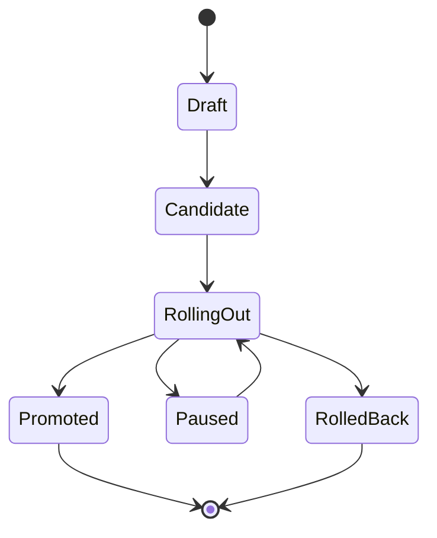

# Releases, rollouts et chargeback

- **Statut** : Partiel
- **Portée** : cycle de release, promotion, rollout canary/A-B, métriques et coûts.
- **Dernière revue** : 2026-09-18

## 1. Cycle de vie



Une promotion directe en production exige un rollout réussi, sauf override
explicite, autorisé et justifié. L'endpoint de rollback de release retourne
actuellement `501 RELEASE_ROLLBACK_UNAVAILABLE` : l'adaptateur qui remettrait en
service un déploiement antérieur n'est pas implémenté. Un rollback de décision
de rollout marque la release `rolled_back`, sans prétendre restaurer un service
de production.

## 2. Stratégies

- **Canary** : expose progressivement une variante candidate ;
- **A/B** : compare plusieurs variantes sur une population configurée ;
- **Rollback** : remet la release précédente après une décision négative.

Pour un A/B personnalisé, `candidateVariant` doit désigner explicitement la
variante proposée à la promotion. La configuration par défaut utilise
`candidate`; si les noms sont personnalisés, l'API refuse la création sans ce
champ. L'ordre des variantes n'attribue pas le rôle de candidat.

Les variantes sont enregistrées dans `release_rollout_metrics` avec requêtes, erreurs,
latence, tokens et coût.
La création de l'enregistrement de rollout et des lignes de variantes est atomique.

## 3. Décision mathématique

Pour la variante candidate, la décision calcule le taux d'erreur et la latence
moyenne à partir des métriques cumulées :

\[
ErrorRate_v=\frac{errors_v}{max(requests_v,1)}
\]

Chaque variante comparée doit atteindre `slo.minRequests`; sinon le rollout reste
en pause avec `insufficient_comparison_sample`. Le candidat doit ensuite
respecter `slo.maxErrorRate` et `slo.maxAverageLatencyMs`, puis être la variante
la mieux classée. Le classement utilise le taux d'erreur, puis la latence
moyenne :

\[
Promote(candidate)=Requests_{candidate}\geq minRequests
\land ErrorRate_{candidate}\leq maxErrorRate
\land AverageLatency_{candidate}\leq maxAverageLatencyMs
\land Winner=candidate
\]

Une violation SLO ou la victoire du contrôle ferme le rollout en `rolled_back` ;
un échantillon candidat insuffisant le laisse en pause. Le coût est enregistré
dans le ledger de chargeback, mais n'est pas un seuil de cette décision. Aucun
gate d'évidence supplémentaire n'est exécuté par cette route. Ces seuils ne
constituent pas des garanties statistiques absolues.

## 4. Routes

| Méthode | Route | Fonction |
| --- | --- | --- |
| `GET` | `/api/releases` | liste les releases |
| `POST` | `/api/releases` | crée une release |
| `POST` | `/api/releases/:id/promote` | promeut |
| `POST` | `/api/releases/:id/rollback` | rollback |
| `POST` | `/api/releases/:id/rollouts` | crée un rollout |
| `POST` | `/api/releases/rollouts/:rolloutId/metrics` | enregistre des métriques |
| `POST` | `/api/releases/rollouts/:rolloutId/decide` | décide le résultat |
| `GET` | `/api/releases/chargeback` | agrège l’usage et les coûts |

## 5. Exemple

```json
{
  "strategy": "canary",
  "candidateVariant": "canary",
  "variants": [
    {"name":"stable","traffic":95},
    {"name":"canary","traffic":5}
  ],
  "slo": {"maxErrorRate":0.02,"maxAverageLatencyMs":1200,"minRequests":100}
}
```

Puis une métrique :

```json
{
  "variant":"candidate",
  "requests":1000,
  "errors":8,
  "latencyMs":420,
  "tokens":180000,
  "costUsd":2.40
}
```

`latencyMs` est la latence moyenne par requête reçue; le contrôleur la multiplie
par `requests` pour agréger le total. Le corps de création est plat, sans objet
`config` imbriqué. La stratégie canary peut omettre `candidateVariant` lorsque la
variante s'appelle `canary`; avec des noms personnalisés, il faut déclarer le
candidat.

## 6. Rollback et chargeback

Une décision négative ferme le rollout et empêche la promotion associée. Les métriques
acceptées alimentent le ledger d’usage, ce qui permet de relier coût, organisation,
projet, release et variante. Ce ledger ne signifie pas que le coût a influencé la
décision SLO.

## 7. Limites

Un faible taux d’erreur ne détecte pas une régression non observée ou un biais de
population. Les décisions doivent conserver la configuration, les seuils, les
métriques et la justification dans l’audit.
