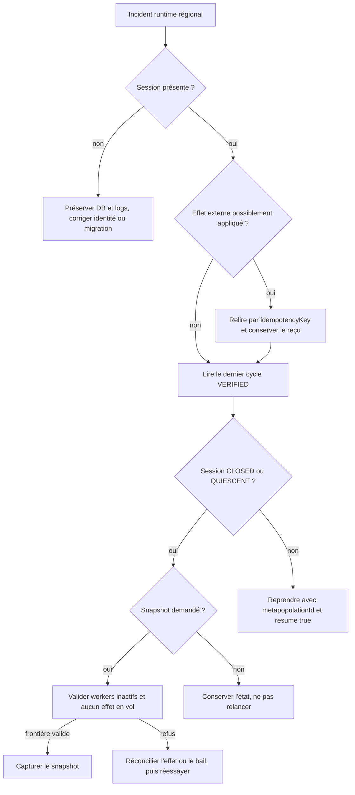

# Runbook Metapopulation

- **Statut** : procédure opérateur implémentée et testée localement
- **Portée** : runtime régional Node, SQLite, adaptateurs externes et snapshots topologiques
- **Dernière revue** : 2026-10-20

Ce runbook couvre l'arrêt, la reprise et la mise en quiescence d'une session
Metapopulation. Il ne décrit pas la restauration générale d'un workspace ni le
WAL global d'orchestration ; voir le [runbook général](runbook-recovery.md).
Une reprise technique réussie ne prouve pas que la mission est correcte.

## 1. Préconditions

Avant toute action, conserver :

- la révision Git et la version du backend ;
- le chemin de la base SQLite et ses sidecars `-wal` et `-shm` ;
- `metapopulationId`, `missionId`, variant et scope ;
- les logs du runner et les reçus des systèmes externes ;
- les clés d'idempotence observées ;
- l'identité de l'opérateur et l'heure de l'incident.

Arrêter les nouveaux writers ou ouvrir une fenêtre de maintenance avant une
copie de base. Ne jamais supprimer uniquement un fichier WAL/SHM. Utiliser une
copie cohérente ou l'API SQLite de backup.

## 2. Triage initial

### 2.1 État de la session

```sql
SELECT id, mission_id, variant, scope, status, revision, generation,
       created_at, updated_at
FROM metapopulation_sessions
WHERE id = :metapopulation_id;
```

| Statut | Lecture opérateur |
| --- | --- |
| `ACTIVE` | des cycles peuvent être lancés ; vérifier qu'un seul runner possède l'autorité |
| `RECOVERING` | une reprise est en cours ; ne pas lancer un second runner |
| `DEGRADED` | la région existe mais une capacité ou un effet demande une intervention |
| `ESCALATED` | la décision est remontée ; préserver les preuves avant toute mutation |
| `QUIESCENT` | les nouveaux cycles sont arrêtés ; admissible au snapshot si aucun effet ne reste en vol |
| `CLOSED` | terminal pour le runtime ; ne pas réactiver en modifiant la ligne à la main |

### 2.2 Derniers cycles

```sql
SELECT state_id, cycle, status, idempotency_key, seed, created_at
FROM metapopulation_cycle_states
WHERE metapopulation_id = :metapopulation_id
ORDER BY cycle DESC, created_at DESC
LIMIT 20;
```

Seuls les cycles `VERIFIED` font avancer le curseur durable. Un état
`RESUMED` décrit un effet en vol ou à réconcilier. `FAILED` conserve un échec ;
il ne doit pas être promu manuellement.

### 2.3 Journal régional

```sql
SELECT sequence, revision, type, actor, occurred_at
FROM metapopulation_events
WHERE metapopulation_id = :metapopulation_id
ORDER BY sequence DESC
LIMIT 50;
```

La séquence doit être contiguë et sa dernière révision doit correspondre à la
session avant un snapshot. Un écart demande une sauvegarde et une analyse ; ne
pas reconstruire silencieusement les numéros.

## 3. Arbre de décision



## 4. Reprise après interruption pendant EXECUTE

### 4.1 Règle

Le runtime repart après le dernier cycle `VERIFIED`. Un cycle interrompu avant
VERIFY/RECORD ne fait pas avancer le numéro. Avec `resume: true`, la seed du
dernier cycle vérifié est réutilisée.

### 4.2 Procédure

1. Sauvegarder la base et les logs.
2. Identifier le dernier cycle `VERIFIED` avec la requête de la section 2.2.
3. Rechercher l'éventuel effet externe du cycle interrompu par sa
   `idempotencyKey`.
4. Si l'effet est déjà appliqué, obtenir le reçu original. Ne pas inventer un
   reçu et ne pas réappliquer sous une autre clé.
5. Corriger ou terminer la réconciliation selon le contrat de l'adaptateur.
6. Relancer le runtime avec `metapopulationId` et `resume: true`.

Exemple interne, avec une connexion déjà migrée :

```javascript
const api = require('./backend/src/services/metapopulationCoordinationService');

const result = await api.runAutonomousRegionalRuntime({
  metapopulationId: '<id-session>',
  resume: true,
  maxCycles: 1
}, { db });
```

`sessionId` reste accepté comme alias de compatibilité, mais émet
`DEP_METAPOPULATION_SESSION_ID`. Les procédures nouvelles doivent utiliser
`metapopulationId`.

### 4.3 Verdict

| Résultat | Action |
| --- | --- |
| `LIMIT_REACHED` avec un cycle `VERIFIED` | cycle borné terminé ; inspecter preuves et portée |
| `NO_ACTION` | aucune action planifiée ; ne pas déclarer la mission réussie |
| `STOPPED` | vérifier session, signal et budget avant reprise |
| `HALTED` | lire `reason`, cycle et événement d'échec |
| `FAILED` | corriger la cause ; conserver l'état et les reçus |
| `RECORD_FAILED` | l'effet peut exister sans journal final ; réconcilier avant tout rejeu |

## 5. Réconciliation des effets externes

Le contrat d'adaptateur impose `idempotencyKey` à `adapt`, `assimilate` et
`rollback`. L'adaptateur doit retourner le reçu original pour un rejeu
identique. SQLite protège uniquement la paire
`(metapopulation_id, idempotency_key)` enregistrée ; il ne rend pas un service
tiers transactionnel.

Checklist :

1. vérifier le scope de la clé et l'opération concernée ;
2. interroger le système cible sans créer une nouvelle identité ;
3. comparer payload, source, cible et provenance ;
4. récupérer le reçu original ou conclure explicitement « non appliqué » ;
5. pour un rollback, utiliser `rollback:<migrationId>` ;
6. conserver la décision locale du receveur et ses preuves ;
7. reprendre seulement après résolution de l'ambiguïté.

Une réponse réseau perdue n'est pas une preuve d'absence d'effet. Un transport
réussi n'est pas une preuve d'assimilation valide.

## 6. Quiescence et snapshot

`quiesceForSnapshot({ db, sessionId, agentId, workspaceId })` vérifie la liaison
session–mission–agent–workspace–dème, rend la session `QUIESCENT` sous contrôle
de révision et capture une frontière. Le résultat attendu contient
`boundaryVerified: true` et `missionVerified: false`.

La capture refuse :

- un agent absent, actif ou avec `runtime_pid` ;
- une session fermée pour l'opération de quiescence ;
- un variant ou une politique différente du registre ;
- un dème non lié de manière unique au workspace ;
- une séquence d'événements absente, discontinue ou d'une autre révision ;
- plus de 10 000 enregistrements dans un groupe de référence ;
- une migration `QUARANTINED` ;
- une colonisation `IN_TRIAL` ou `COMPLETING` ;
- un cycle `RESUMED` ;
- un bail éphémère ou résident encore actif ;
- une mutation concurrente pendant la capture.

### 6.1 Procédure

1. arrêter l'admission de nouveaux cycles ;
2. attendre la fin des workers et supprimer tout PID runtime devenu obsolète par
   la procédure autorisée du worker ;
3. réconcilier migrations, colonisations et cycles en vol ;
4. expirer ou clôturer proprement les baux qui ne doivent plus rester actifs ;
5. appeler `quiesceForSnapshot` ;
6. conserver `boundaryHash`, révision, séquence d'événements et manifeste ;
7. vérifier le snapshot par son contrat avant toute restauration de workspace.

`METAPOPULATION_SNAPSHOT_IN_FLIGHT` provoque un rollback transactionnel de la
transition temporaire vers `QUIESCENT`. Corriger la cause, puis recommencer ; ne
pas forcer le statut en SQL.

## 7. Diagnostic par erreur

| Code | Cause probable | Action opérateur |
| --- | --- | --- |
| `METAPOPULATION_CONTEXT_REQUIRED` | DB ou identifiant absent | corriger l'appel et vérifier les migrations |
| `REGIONAL_ACTION_DUPLICATE` | clé déjà enregistrée | relire le cycle et le reçu, ne pas réappliquer |
| `REGIONAL_VERIFY_FAILED` | effet non prouvé | inspecter le vérificateur et les lignes persistées |
| `METAPOPULATION_QUIESCENCE_WORKERS_ACTIVE` | worker actif, absent ou PID présent | arrêter/attendre les workers et relire la mission |
| `METAPOPULATION_QUIESCENCE_CONFLICT` | révision avancée | identifier le writer concurrent |
| `METAPOPULATION_SNAPSHOT_IN_FLIGHT` | effet ou bail actif | réconcilier la table indiquée dans le message |
| `METAPOPULATION_SNAPSHOT_FRONTIER_MISMATCH` | événement et session divergent | préserver DB et diagnostiquer la transaction |
| `METAPOPULATION_SNAPSHOT_CONCURRENT_CHANGE` | mutation pendant capture | arrêter le writer puis reprendre la capture |
| `METAPOPULATION_SNAPSHOT_DEME_MISMATCH` | frontière workspace/dème invalide | corriger l'attachement, pas le manifeste |

## 8. Recovery par variant

| Variant | Vérification supplémentaire avant reprise |
| --- | --- |
| `classic_patch` | état du patch, essai de colonisation et deux lignées distinctes |
| `island_search` | solveur/problème/seed et `evidenceRef` du dernier incumbent |
| `source_sink` | rôles persistés et réserve de la source |
| `rescue_network` | réserve de fondateurs, SLA et reçus fitness/rollback |
| `anti_synchrony` | corridors gelés, couverture régionale et seuil de diversité |
| `federated` | contrat, classification, preuve de minimisation et attestation |
| `ephemeral_patch` | bail, expiration, dème dormant et identité du patch |
| `persistent` | daemon, lease, workspace propriétaire et mémoire du dème |
| `evolutionary` | génération non régressive et rapport du moteur configuré |
| `cultural` | version, parents, transmission et phylogénie |

## 9. Migration de schéma et retour arrière

Avant déploiement, sauvegarder la base avec ses sidecars et appliquer les
migrations du backend. L'idempotence des cycles ajoute `idempotency_key` et
l'index unique partiel `idx_cycle_states_idempotency_key`.

```sql
PRAGMA table_info(metapopulation_cycle_states);
PRAGMA index_list(metapopulation_cycle_states);
PRAGMA integrity_check;
```

Si la migration échoue, arrêter les writers, conserver la base fautive et les
logs, puis restaurer la sauvegarde cohérente. Ne pas supprimer l'index pour
faire passer un doublon : cela retire une garde de non-réexécution.

## 10. Vérification après reprise

```bash
npm --prefix backend run test:metapopulation
node backend/tests/test_metapopulation_crash_recovery.js
node backend/tests/test_metapopulation_idempotency.js
node backend/tests/test_metapopulation_snapshot_lifecycle.js
python scripts/ci/check_code_quality.py
```

Pour une instance réelle, ajouter une sonde de l'adaptateur externe et vérifier
les reçus côté cible. Les fixtures locales ne qualifient pas ce système.

## 11. Dossier d'incident minimal

Enregistrer :

- session, mission, variant, scope et révision ;
- dernier cycle `VERIFIED` et éventuel cycle en vol ;
- clés d'idempotence et reçus externes ;
- copie cohérente de la base et résultat d'intégrité ;
- logs du runner et code d'erreur ;
- action de réconciliation ;
- commande de reprise et résultat ;
- tests post-reprise ;
- portée exacte de la conclusion : frontière, cycle ou mission.

## 12. Anti-patterns

- modifier `status` ou `cycle` directement pour contourner un refus ;
- générer une nouvelle clé afin de « débloquer » un effet ambigu ;
- supprimer WAL, index unique, bail ou reçu avant analyse ;
- considérer `accepted`, `started` ou `completed` comme `VERIFIED` ;
- prendre `boundaryVerified` pour une certification de mission ;
- relancer deux runners sur la même session ;
- déclarer une recolonisation réussie avant l'épreuve locale.

## Voir aussi

- [Runtime Metapopulation](../03-reference/runtime-metapopulation.md)
- [Variants Metapopulation](../03-reference/variants-metapopulation.md)
- [Qualification du 20 octobre 2026](../06-qualite-preuves/qualification-metapopulation-2026-10-20.md)
- [Snapshots topologiques](../03-reference/snapshots-topologiques.md)
- [ADR 0403 — frontière quiescente](../adr/0403-frontiere-quiescente-metapopulation.md)
