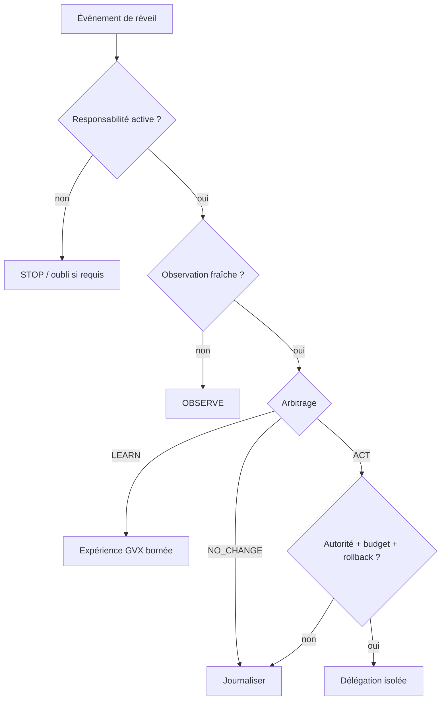

# Runbook — stewardship longitudinal

- **Statut** : procédure opérateur pour les briques V3 locales
- **Portée** : observation, arbitrage, délégation, reprise, preuve, rollback et retrait
- **Dernière revue** : 2026-10-20
- **Prérequis** : backend configuré, migrations appliquées, autorité et stockage disponibles

## 1. Objectif opératoire

Ce runbook sert à exploiter une responsabilité qui dépasse une mission ponctuelle.
Son but n’est pas de maintenir un agent actif en permanence, mais de garantir que
chaque réveil, abstention, action et apprentissage reste explicable et récupérable.

La règle d’urgence est : **si le mandat, la fraîcheur, l’autorité, le budget, le lease
ou la preuve ne peuvent pas être établis, ne pas agir**.

## 2. États à distinguer

| État observé | Interprétation | Action opérateur |
| --- | --- | --- |
| responsabilité absente | aucune intendance autorisée | créer un mandat, ne pas lancer |
| responsabilité inactive | consentement retiré ou cycle clos | vérifier oubli et arrêter les réveils |
| observation périmée | connaissance insuffisante | collecter sous consentement |
| `NO_CHANGE` | abstention justifiée | journaliser, attendre un signal utile |
| initiative proposée | hypothèse non exécutée | vérifier admission et autorité |
| mission `running` | lease actif attendu | contrôler owner, fence et expiration |
| mission `interrupted` | reprise possible | réclamer un nouveau lease |
| `human_review` | décision externe requise | traiter la référence de revue |
| `accepted` | clôture locale soutenue | suivre l’effet longitudinal |
| preuve réfutée | trajectoire ou apprentissage invalidé | rollback/retirer la promotion |

## 3. Prévol

### 3.1 Vérifier le runtime

```powershell
npm --prefix backend start
```

Contrôler ensuite `/healthz`, `/readyz` et `/livez`. Un transport sain ne prouve pas
que la responsabilité ou la mission est admissible.

### 3.2 Vérifier les éléments de contrôle

- tenant, organisation, projet et entité attendus ;
- responsabilité courante, version et statut `active` ;
- propriétaire et mandat ;
- catégories d’observation consenties ;
- budget de tokens, temps, coût et risque ;
- permissions `observe`, `learn`, `act` et lease d’écriture ;
- référence de rollback ou révision saine ;
- vérificateur indépendant disponible ;
- destination des notifications et escalades.

### 3.3 Refuser un prévol ambigu

Ne jamais déduire une permission d’un accès technique. Ne jamais réutiliser une
observation d’un autre tenant ou une autorisation liée à un ancien digest.

## 4. Démarrer une responsabilité

1. enregistrer la portée et l’objectif externe ;
2. définir les domaines, métriques, direction et critères de fin ;
3. sceller la politique de fraîcheur et les budgets ;
4. enregistrer la référence d’autorité ;
5. définir révocation, oubli et expiration ;
6. collecter une baseline indépendante ;
7. vérifier la relecture de la révision courante ;
8. seulement ensuite autoriser les réveils.

Une baseline absente rend toute affirmation d’amélioration postérieure fragile. Dans
ce cas, limiter la première mission à `OBSERVE`.

## 5. Traiter un réveil



Pour chaque réveil, conserver l’événement, la responsabilité, l’observation, les
scores, le candidat, le mode sélectionné et la raison. Un `NO_CHANGE` sans contexte
est inexploitable.

## 6. Admettre une initiative

Vérifier dans cet ordre :

1. provenance et intégrité du signal ;
2. fraîcheur de l’observation ;
3. rattachement à la responsabilité ;
4. risque et blast radius ;
5. coût estimé et réserve ;
6. permission correspondant exactement à l’action ;
7. chemin de rollback ;
8. gain attendu par rapport à `NO_CHANGE` ;
9. absence de conflit avec une mission active.

Si une étape échoue, produire un refus structuré. Ne pas « réduire » silencieusement
une action d’écriture en action différente sans refaire l’admission.

## 7. Exploiter une délégation

### 7.1 Création

La responsabilité SHEV doit être au stade `delegated`. Dériver la mission avec une
capsule candidate confinée et une révision de base. Archiver le `planHash` et la
version du mandat dans le ticket ou dossier d’exploitation.

### 7.2 Claim

Le worker réclame la mission avec un owner stable et un TTL borné. Relever :

- fencing token ;
- expiration ;
- curseur ;
- statut.

Un second worker recevant `bail-delegation-actif` doit attendre ou escalader ; il ne
doit pas forcer une écriture parallèle.

### 7.3 Checkpoints

À chaque étape, enregistrer l’état et les preuves avant de passer à la suivante.
Vérifier que les fichiers ou résultats référencés existent encore. Un rejeu identique
est normal après perte de réponse ; un conflit d’idempotence est un incident.

### 7.4 Clôture

- `ACCEPT` : exiger vérificateur distinct, révision candidate, révision intégrée et
  preuve d’effet post-intégration ;
- `NO_CHANGE` : seulement avant la mutation, avec preuve de scope et raison ;
- `HUMAN_REVIEW` : raison et référence d’escalade obligatoires.

## 8. Reprendre une mission interrompue

### Symptômes

- lease expiré ;
- processus disparu ;
- statut `interrupted` ;
- checkpoint durable mais réponse client perdue ;
- worker ancien tentant d’écrire avec un fence inférieur.

### Procédure

1. lire la ligne de mission et les checkpoints en base ;
2. vérifier que la mission n’est pas terminale ;
3. confirmer l’expiration du lease ou l’interruption explicite ;
4. réclamer avec un nouvel owner ;
5. comparer le fence obtenu au dernier checkpoint ;
6. vérifier le `planHash`, le mandat et la capsule ;
7. vérifier que l’état externe n’a pas dérivé ;
8. reprendre à `cursor + 1` ;
9. refuser toute écriture du worker précédent.

Si l’état externe a changé sans checkpoint, arrêter et ouvrir `HUMAN_REVIEW`.

## 9. Gérer les preuves

### 9.1 Classes

| Classe | Peut éliminer ? | Peut promouvoir seule ? |
| --- | ---: | ---: |
| simulation | oui | non |
| test synthétique | oui | non |
| holdout/OOD | oui, qualifie la compétence | non pour l’effet projet |
| vérification indépendante | oui | non sans effet réel |
| observation réelle | oui | non sans apprentissage agent |
| double preuve soutenue | oui | seulement via gate externe |

### 9.2 Fraîcheur

Une référence valide mais trop ancienne ne doit pas alimenter une action. Relancer une
observation ou choisir `NO_CHANGE`. Ne pas modifier manuellement l’horodatage.

### 9.3 Révocation

Quand un consentement ou une source est révoqué :

1. identifier les observations concernées ;
2. exécuter l’oubli prévu ;
3. marquer les décisions dérivées comme non réutilisables ;
4. invalider les initiatives non exécutées ;
5. réévaluer les responsabilités actives ;
6. conserver une trace de révocation sans conserver la donnée interdite.

## 10. Rollback

Déclencher un rollback lorsque :

- l’effet projet est réfuté ;
- une garde de sécurité est violée ;
- la révision intégrée ne correspond pas à la révision vérifiée ;
- la dérive dépasse le seuil du mandat ;
- l’autorité est retirée avant la fin ;
- le modèle ou la compétence cause une régression holdout.

Procédure :

1. suspendre les nouvelles initiatives de la responsabilité ;
2. conserver les observations et digests nécessaires ;
3. vérifier la cible de rollback scellée ;
4. appliquer par l’actionneur autorisé ;
5. vérifier la révision restaurée ;
6. observer l’effet de restauration ;
7. enregistrer la cause dans la mémoire négative ;
8. décider maintien, amendement ou retrait de la responsabilité.

Un message « rollback terminé » sans vérification de révision et d’effet est
insuffisant.

## 11. Diagnostic par symptôme

### `permission-denied:*`

Comparer la permission demandée au mode candidat et à la portée. Pour `ACT`, vérifier
également `explicitWriteLease`. Ne pas compenser par un budget plus grand.

### `budget-insufficient:*`

Réduire la portée, collecter une observation moins coûteuse ou attendre une nouvelle
allocation. Ne pas sous-déclarer le coût.

### `fencing-delegation-obsolete`

Arrêter immédiatement le worker concerné. Relire owner, fence, expiration et dernier
checkpoint. Ce refus indique généralement une reprise réussie par un autre worker.

### `checkpoint-delegation-idempotence-conflit`

Comparer les deux payloads sans écraser la base. Ouvrir une revue : soit l’appelant a
réutilisé une identité, soit l’état a divergé après une réponse perdue.

### `NO_CHANGE` fréquent

Vérifier séparément : observation trop ancienne, incertitude haute, seuils trop
stricts, absence d’autorité, budget nul, candidats mal sourcés ou trajectoire réellement
stable. Le taux seul ne permet pas de choisir.

### prédictions toujours ignorées

Inspecter permission, budgets, confiance calibrée, gain d’information, impact sur la
décision et erreurs passées. Une précision réduite après erreurs est un comportement
attendu.

## 12. SRE causal

Pour une guérison de production :

1. enregistrer symptôme et fenêtre ;
2. produire plusieurs hypothèses causales ;
3. borner blast radius et budget de risque ;
4. préférer une sonde ou simulation à une mutation ;
5. exiger rollback avant remédiation ;
6. appliquer sous autorité ;
7. observer l’effet dans une fenêtre post-action ;
8. distinguer disparition du symptôme et cause traitée ;
9. conserver les hypothèses réfutées.

Le détail est dans [Guérison SRE causale](guerison-sre-causale.md).

## 13. Fin de responsabilité

Une responsabilité se termine par expiration, objectif atteint, retrait du
consentement, transfert ou impossibilité durable. À la fermeture :

- arrêter les réveils et claims ;
- révoquer les permissions dédiées ;
- traiter les missions non terminales ;
- appliquer la politique d’oubli ;
- compiler les décisions et preuves durables ;
- transférer explicitement le propriétaire si nécessaire ;
- ne pas présenter une fermeture administrative comme succès causal.

## 14. Validation après incident

```powershell
node backend/tests/test_ontogenesis_async_delegation.js
node backend/tests/test_trajectory_stewardship_policy.js
node backend/tests/test_trajectory_stewardship_outcome.js
node backend/tests/test_ambient_observation_consent.js
node backend/tests/test_sre_healing_policy.js
node backend/tests/test_sre_healing_store.js
```

Ajouter le test du domaine concerné. Les résultats doivent être associés au commit et
au contexte d’incident ; un test vert sur une autre révision n’est pas une preuve.

## 15. Checklist de relève

- responsabilité, mandat et propriétaire identifiés ;
- état du consentement vérifié ;
- mission, owner, fence, curseur et expiration relevés ;
- dernier checkpoint et artefacts accessibles ;
- budget restant connu ;
- révision de base et rollback connus ;
- prochaine étape unique et autorisée ;
- vérificateur indépendant identifié ;
- critères d’effet projet et d’apprentissage agent séparés ;
- escalade documentée en cas d’ambiguïté.

## 16. Limites d’exploitation

- SQLite local n’est pas un consensus distribué ;
- les tests ciblés ne constituent pas un chaos test multiprocessus complet ;
- les observations restent dépendantes de la qualité des adaptateurs ;
- la signature garantit l’intégrité, pas la véracité ;
- les seuils par défaut doivent être calibrés sur le domaine ;
- le cycle intégré n’a pas encore de SLO longitudinal qualifié.

## Voir aussi

- [Contrats de stewardship V3](../03-reference/contrats-stewardship-v3.md)
- [Exploitation SHEV](../03-reference/exploitation-shev.md)
- [Ontogenèse : délégation et stewardship](../02-orchestration/ontogenese-delegation-et-stewardship.md)
- [Matrice de qualification](../06-qualite-preuves/matrice-qualification-stewardship-v3-2026-10-20.md)
