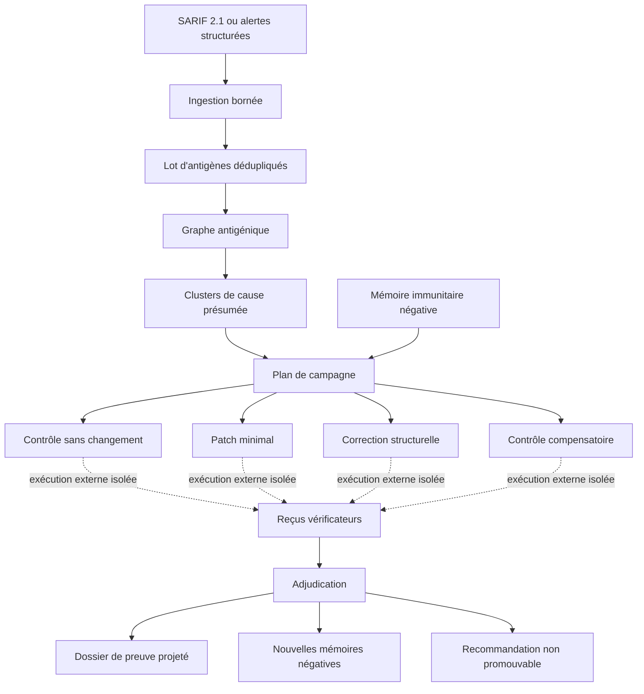

# Remédiation de sécurité immunitaire

- **Statut** : implémenté comme verticale synthétique bornée
- **Portée** : ingestion, regroupement, planification, vérification et adjudication
- **Promotion** : toujours interdite dans cette verticale
- **Exécution de correctifs** : non implémentée par ces services
- **Dernière revue** : 2026-10-19

La remédiation immunitaire transforme des alertes de sécurité en antigènes
canoniques, formule des hypothèses de cause partagée, prépare plusieurs familles
de réponse et sélectionne une recommandation sur la base de reçus indépendants.

Le biomimétisme est précis mais limité : l'antigène est une représentation
canonique d'un signal, le cluster une hypothèse de cause, la campagne une
diversité de réponses et la mémoire négative un mécanisme d'évitement des
rechutes. Aucun de ces termes ne signifie qu'une vulnérabilité réelle a été
exploitée, corrigée ou promue.

---

## 1. Définition

### 1.1 Principe fondateur

Une alerte de scanner qui **disparaît** après une modification ne démontre ni
la cause, ni l'absence de régression, ni la supériorité du correctif. Un scanner
qui se tait peut être satisfait d'un contournement cosmétique ; un patch qui
supprime le signal peut casser un invariant fonctionnel ou ouvrir un nouveau
danger. La disparition d'un symptôme est donc une **observation à comparer**,
jamais une preuve :

$$\text{RemediationCampaign} : \text{Alertes} \times \text{Contrôle non traité} \times \text{Reçus indépendants} \mapsto \text{Recommandation non promouvable}$$

### 1.2 Contrat opérationnel

Un scanner produit souvent une liste plate d'alertes ; une correction naïve
peut traiter chaque symptôme séparément, répéter une stratégie déjà réfutée
ou supprimer le signal tout en introduisant une régression. La verticale
impose :

1. une ingestion bornée et reproductible ;
2. une hypothèse explicite de regroupement ;
3. un contrôle non traité ;
4. trois familles d'intervention différentes ;
5. une vérification indépendante à quorum ;
6. une recommandation sans promotion automatique ;
7. une mémoire des stratégies rejetées.

Elle ne provisionne pas les environnements qu'elle décrit. Elle consomme des
reçus produits par un harnais externe ou un test synthétique.

### 1.3 Vocabulaire biomimétique opposable

| Concept | Objet logiciel | Ce qu'il ne faut pas en déduire |
| --- | --- | --- |
| antigène | alerte canonique et hashée | vérité sur l'exploitabilité |
| épitope causal | CWE/frontière/source/puits ou règle | causalité démontrée |
| clone de réponse | candidat d'une famille | patch réellement produit |
| témoin | candidat `control` | environnement de production |
| anticorps | intervention proposée | protection déployée |
| mémoire négative | stratégie rejetée + contexte | interdiction globale de cette famille |
| quorum immunitaire | vérificateurs distincts | indépendance organisationnelle prouvée |

Cette table protège la documentation contre une dérive fréquente : donner à la
métaphore un niveau de réalité supérieur aux contrats exécutables.

---

## 2. Spécification formelle : contrats

Tous les objets sont émis par les quatre services de
[`backend/src/services/securityRemediation/`](../../backend/src/services/securityRemediation/)
et portent `promotionEligible: false`. Les empreintes (`antigenHash`,
`causeHash`, `clusterHash`, `graphHash`, `campaignHash`, `receiptHash`,
`adjudicationHash`, `projectionHash`) sont des SHA-256 sur JSON canonique à
clés triées ([`stateFingerprint.js`](../../backend/src/services/stateFingerprint.js)) ;
ce sont des empreintes d'intégrité, pas des signatures.

| Schéma | Émetteur | Contenu principal |
| --- | --- | --- |
| `genos.security-antigen/v1` | `securityAlertContract.js` | alerte canonique unique |
| `genos.security-antigen-batch/v1` | `securityAlertContract.js` | lot dédupliqué et trié |
| `genos.security-antigen-graph/v1` | `antigenGraphService.js` | clusters et arêtes `shares_root_cause` |
| `genos.security-remediation-campaign/v1` | `remediationCampaignPlanner.js` | candidats et politique d'exécution |
| `genos.security-remediation-verifier-receipt/v1` | `campaignAdjudicator.js` | observation d'un vérificateur |
| `genos.security-remediation-adjudication/v1` | `campaignAdjudicator.js` | issues, raisons, recommandations |
| `genos.security-remediation-evidence-projection/v1` | `campaignAdjudicator.js` | claims et preuves projetés |

### 2.1 Antigène canonique `genos.security-antigen/v1`

| Champ | Origine ou contrainte |
| --- | --- |
| `source` | chaîne non vide, 64 caractères maximum |
| `externalId` | identifiant scanner, 256 maximum |
| `ruleId` | règle de détection, 256 maximum |
| `severity` | chaîne normalisée en minuscules, défaut `warning` |
| `message` | chaîne non vide, 2 048 maximum |
| `location.path` | chemin relatif normalisé, 512 maximum |
| `location.line` | nombre ramené à un minimum de 1 |
| `cwes` | chaînes nettoyées, uniques et triées |
| `trustBoundary` | chaîne optionnelle, 256 maximum, sinon `null` |
| `sourceKind` | type de source optionnel, 256 maximum, sinon `null` |
| `sinkKind` | type de puits optionnel, 256 maximum, sinon `null` |
| `antigenHash` | empreinte du corps canonique |
| `promotionEligible` | toujours `false` |

### 2.2 Lot `genos.security-antigen-batch/v1`

`sourceCount` (signaux avant déduplication), `alerts` (ensemble canonique trié
par `antigenHash`), `duplicateCount` (différence entre les deux),
`promotionEligible: false`.

### 2.3 Graphe `genos.security-antigen-graph/v1` et clusters

Chaque cluster porte `id` (`antigen-cluster-<causeHash[0:16]>`), `causeHash`,
`basis`, `antigenHashes` (triées), `paths` (uniques, triées), `severities`
(uniques, triées), `clusterHash`, `alertCount` et `promotionEligible: false`.
Le graphe porte `batchAlertCount`, `clusters` (triés par `id`), `edges` (une
arête `{from: antigenHash, to: cluster.id, relation: 'shares_root_cause'}`
par antigène) et `graphHash`.

### 2.4 Campagne `genos.security-remediation-campaign/v1` et candidats

La campagne lie `antigenGraphHash`, `sourceDigest`, `producerId`, les candidats
(`4 × nombre de clusters`) et `executionPolicy` :

```text
isolatedWorkspaceRequired       = true
independentVerificationRequired = true
realExploitExecutionAllowed     = false
```

Chaque candidat porte `id` (`security-candidate-<empreinte[0:20]>`), `clusterId`,
`causeHash`, `producerId`, `family`, `intervention`, `purpose`, `status`
(`planned` ou `blocked_by_negative_memory`), `negativeMemorySignature`, son
contrat d'isolation, ses preuves exigées et `promotionEligible: false` :

```text
mode                    = copy_on_write
workspaceId             = capsule-<candidateId>
sourceDigest            = empreinte fournie
network                 = disabled
liveTargetAccess        = false
exploitPayloadExecution = false
allowedOperations       = [ edit_workspace_copy, run_local_tests,
                            run_static_analysis, run_safe_reproduction_fixture ]
requiredEvidence        = [ scanner_outcome, safe_path_reproduction,
                            functional_invariants, new_hazard_scan ]
```

Ces champs sont une **politique attendue**, pas une preuve de provisionnement.

### 2.5 Reçu `genos.security-remediation-verifier-receipt/v1`

`createVerifierReceipt(input)` exige un objet unique (pas deux arguments) avec :

- `candidateId`, `verifierId`, `status`, `evidenceRef` : chaînes non vides ;
- `status` parmi `verified`, `refuted`, `inconclusive` ;
- `checks.scannerOutcome`, `checks.safePathReproduction`,
  `checks.functionalInvariants`, `checks.newHazards` : chaînes libres à la
  création ; seules des valeurs exactes qualifient à l'adjudication (voir
  [5.2](#52-états-et-dispositions-exacts)) ;
- `checks.metrics` : `remainingAlerts`, `invariantFailures`, `newHazards`,
  `diffLines`, nombres finis positifs ou nuls ;
- `promotionEligible: false` et `receiptHash` recalculable du corps.

Le producteur du candidat ne peut pas être son vérificateur. Un hash altéré,
un candidat inconnu ou une auto-vérification sont refusés. Le hash protège
l'intégrité logique dans le pipeline, mais n'est pas une signature : il
n'établit ni identité externe, ni horodatage de confiance.

### 2.6 Adjudication et projection

L'adjudication `genos.security-remediation-adjudication/v1` lie `campaignHash`,
les `outcomes` (une par candidat), les `recommendations` (au plus une par
cluster), `requiresExistingPromotionGate: true` et `promotionEligible: false`.
La projection `genos.security-remediation-evidence-projection/v1` est décrite
en [12](#12-projection-du-dossier-de-preuve).

---

## 3. Modèle logique

### 3.1 Regroupement causal par base

`buildAntigenGraph` calcule une base de cause pour chaque antigène :

$$\text{CauseBasis}(a) = \begin{cases} \langle \text{cwes}, \text{trustBoundary}, \text{sourceKind}, \text{sinkKind} \rangle & \text{si au moins un champ sémantique existe} \\ \langle \text{ruleId} \rangle & \text{sinon (repli)} \end{cases}$$

Deux alertes rejoignent le même cluster si et seulement si leurs bases
canoniques sont égales (donc même `causeHash = SHA256(CauseBasis)`) :

$$\text{cluster}(a_1) = \text{cluster}(a_2) \iff \text{CauseBasis}(a_1) \equiv \text{CauseBasis}(a_2)$$

Conséquences exactes : des alertes de scanners différents mais de même
CWE/frontière/source/puits sont regroupées ; de même règle mais de CWE
différents, séparées ; en repli, le regroupement est par `ruleId` littéral,
donc par scanner. À contenu canonique identique, tri et empreintes produisent
le même graphe indépendamment de l'ordre d'entrée (`graphHash` identique au
rejeu) — ce déterminisme permet la comparaison de campagnes. Un CWE partagé
reste un indice de cause commune, pas sa démonstration ; `shares_root_cause`
est une relation de travail falsifiable, jamais une preuve causale.

### 3.2 Conditions d'adjudication

Le quorum effectif vaut au moins deux, même si l'appelant demande moins :

$$Q = \max(2, \text{option.quorum ou } 2)$$

Seuls des `verifierId` distincts comptent pour l'indépendance.
L'implémentation ne prouve pas que ces identifiants correspondent à des
organisations, modèles ou processus réellement indépendants.

**Baseline valide.** Le contrôle d'un cluster constitue une baseline valide si
et seulement si : le quorum distinct est atteint ; chaque reçu est `verified`
avec invariants `passed` et nouveaux dangers `none` ; chaque reçu déclare
`scannerOutcome: present` ; chaque reçu déclare `safePathReproduction:
reachable`. Sinon le contrôle est rejeté (`verified_control_baseline_required`)
et aucune intervention du cluster ne peut être qualifiée.

**Intervention qualifiée.** Pour un candidat `c` et le contrôle `b` de son
cluster, avec `R_c` l'ensemble de ses reçus :

$$\text{Qualified}(c) \iff \underbrace{|\text{Verif}(c)| \ge Q}_{\text{quorum}} \land \underbrace{\text{AllVerified}(c)}_{\text{statut + invariants + dangers}} \land \underbrace{\text{ScannerCleared}(c)}_{\forall r : \text{cleared}} \land \underbrace{\text{SafePathBlocked}(c)}_{\forall r : \text{blocked}} \land \text{Baseline}(b) \land \underbrace{\bar{m}_{\text{alerts}}(c) < m_{\text{alerts}}(b)}_{\text{mieux que le contrôle}}$$

où $\bar{m}(c) = \frac{1}{|R_c|}\sum_{r \in R_c} r.\text{checks.metrics}.\text{remainingAlerts}$.
Détail exact du code : la référence du contrôle est le champ `remainingAlerts`
du **premier reçu** du contrôle (pas sa moyenne), avec `-1` comme valeur
absente — rendant la condition impossible sans contrôle valide. Un seul reçu
`refuted` disqualifie le candidat (`verification_failed`).

### 3.3 Ordre de recommandation : formule exacte

Par cluster, la recommandation est le **minimum lexicographique** des candidats
qualifiés, sur les moyennes de leurs reçus, avec départage déterministe par
identifiant ([`campaignAdjudicator.js`](../../backend/src/services/securityRemediation/campaignAdjudicator.js),
`selectRecommendations`) :

$$\text{rec}(k) = \arg\min_{c \,\in\, \text{Qualified}(k)}^{\text{lex}} \Big\langle \bar{m}_{\text{alerts}}(c),\; \bar{m}_{\text{hazards}}(c),\; \bar{m}_{\text{invariants}}(c),\; \bar{m}_{\text{diff}}(c),\; \text{candidateId}(c) \Big\rangle$$

Le comparateur exact du code est :

```text
a.remainingAlerts - b.remainingAlerts
  || a.newHazards    - b.newHazards
  || a.invariantFailures - b.invariantFailures
  || a.diffLines     - b.diffLines
  || left.candidateId.localeCompare(right.candidateId)
```

Ce classement n'est pas une optimisation de Pareto complète : un meilleur
premier critère domine toujours les suivants. Un cluster sans candidat
qualifié ne produit aucune recommandation.

### 3.4 Invariants fail-closed

1. **Borne d'entrée** — jamais plus de 25 signaux par lot.
2. **Confinement lexical** — aucun chemin absolu ou remontant.
3. **Canonisation** — déduplication et ordre déterministes.
4. **Contrôle obligatoire** — pas de qualification sans baseline valide.
5. **Pluralité des réponses** — trois interventions plus un témoin.
6. **Séparation producteur-vérificateur** — auto-vérification interdite.
7. **Quorum minimal** — deux identités distinctes au minimum.
8. **Régression interdite** — invariants et nouveaux dangers sont bloquants.
9. **Amélioration relative** — l'intervention bat le contrôle.
10. **Aucune promotion implicite** — tous les objets restent non éligibles.
11. **Pas d'exploit réel** — politique de reproduction sûre seulement.
12. **Mémoire contextuelle** — seule une répétition exacte est bloquée.

---

## 4. Architecture

### 4.1 Rôles

| Composant | Source | Responsabilité |
| --- | --- | --- |
| Contrat d'alerte | [`securityAlertContract.js`](../../backend/src/services/securityRemediation/securityAlertContract.js) | SARIF/structuré, confinement, déduplication |
| Graphe antigénique | [`antigenGraphService.js`](../../backend/src/services/securityRemediation/antigenGraphService.js) | hypothèses de cause et clusters |
| Planificateur | [`remediationCampaignPlanner.js`](../../backend/src/services/securityRemediation/remediationCampaignPlanner.js) | contrôle, interventions et politique d'isolation |
| Adjudicateur | [`campaignAdjudicator.js`](../../backend/src/services/securityRemediation/campaignAdjudicator.js) | reçus, quorum, qualification, classement |
| Mémoire | [`immuneMemoryService.js`](../../backend/src/services/immuneMemoryService.js) | signatures d'échec et refus des répétitions exactes |
| Tests | [`backend/tests/`](../../backend/tests/) | quatre suites ciblées |

Il n'existe actuellement ni route REST, ni outil MCP, ni commande CLI dédiée à
ce pipeline ; ses seuls consommateurs sont les quatre suites de test (voir
[14](#14-état-dimplémentation)). Son API publique est le module JavaScript.

### 4.2 Pipeline complet



Les flèches pointillées marquent la frontière non implémentée : création de la
copie, modification, scanner, tests et reproduction sûre.

---

## 5. Opérations

### 5.1 Étapes du pipeline

1. **Ingestion** — `ingestSecurityAlerts(input, options)` accepte
   `input.sarif` (document `2.1.0` exact, tableau `runs`, propriétés fusionnées
   règle puis résultat, `externalId` = `guid` ou
   `fingerprints.primaryLocationLineHash` ou `ruleId:index`) ou `input.alerts`
   (liste structurée, `source` par défaut `structured`), confine les chemins
   (séparateurs Windows convertis en `/`, normalisation POSIX, refus des
   chemins absolus, de `..` et des préfixes `../`, sans résolution des liens
   symboliques), borne à 25 (`maxAlerts` peut abaisser, jamais augmenter),
   déduplique par `antigenHash` et trie par empreinte.
2. **Graphe** — `buildAntigenGraph(batch)` vérifie le lot, calcule les bases de
   cause, regroupe par `causeHash` et émet clusters et arêtes.
3. **Plan** — `planRemediationCampaign(graph, options)` exige `sourceDigest`
   et `producerId` non vides (`campaignSeed` par défaut
   `default-security-campaign`), interroge la mémoire négative fournie
   (`options.immuneMemories`) et déclare quatre candidats par cluster.
4. **Reçus** — le harnais externe exécute chaque candidat non bloqué en
   isolation et produit des reçus via `createVerifierReceipt`.
5. **Adjudication** — `adjudicateCampaign(campaign, receipts, options)` vérifie
   chaque reçu (liaison, hash, non-auto-vérification), juge les contrôles puis
   les interventions, calcule les recommandations.
6. **Projection et mémoire** — `evidenceDossierProjection(adjudication)`
   projette claims et preuves ; `enrollRejectedCandidates(organism,
   adjudication)` inscrit les rejetés hors contrôle dans la mémoire négative
   avec `preferredResponse: 'replace_strategy'`.

### 5.2 États et dispositions exacts

Les valeurs suivantes sont les littéraux du code ; les dispositions sont
**calculées à chaque adjudication** (fonctions pures), pas des états persistés.

| Objet | Champ | Valeurs exactes |
| --- | --- | --- |
| candidat | `status` | `planned` \| `blocked_by_negative_memory` |
| reçu | `status` | `verified` \| `refuted` \| `inconclusive` |
| issue (outcome) | `disposition` | `baseline` \| `rejected` \| `qualified` \| `blocked` |
| recommandation | `recommended` | `true` (sur l'élu du cluster uniquement) |

Valeurs de `checks` qui qualifient à l'adjudication (toute autre chaîne
échoue) :

| Check | Contrôle valide | Intervention qualifiée |
| --- | --- | --- |
| `scannerOutcome` | `present` | `cleared` |
| `safePathReproduction` | `reachable` | `blocked` |
| `functionalInvariants` | `passed` | `passed` |
| `newHazards` | `none` | `none` |

Raisons de rejet, littéraux exacts :

| Raison | Condition falsifiée |
| --- | --- |
| `independent_quorum_missing` | moins de `Q` vérificateurs distincts |
| `verification_failed` | un reçu non `verified`, invariants non `passed` ou dangers non `none` |
| `scanner_not_cleared` | un reçu sans `scannerOutcome: cleared` |
| `safe_reproduction_not_blocked` | un reçu sans `safePathReproduction: blocked` |
| `control_baseline_missing` | contrôle du cluster non `baseline` |
| `not_better_than_control` | pas strictement moins d'alertes restantes que le contrôle |
| `verified_control_baseline_required` | contrôle rejeté (raison dédiée au témoin) |
| `negative_memory` | candidat bloqué à la planification |

### 5.3 Mémoire immunitaire négative

Pour chaque intervention hors contrôle (le contrôle n'est jamais bloqué), le
planificateur calcule une signature à partir de :

```text
failureCategory = security-remediation
strategy        = famille du candidat
context         = causeHash du cluster
```

Une mémoire signalant exactement cette signature interdit la répétition
exacte — pas une stratégie sur une autre cause, ni une stratégie différente
sur la même cause. Après adjudication, les candidats rejetés **hors contrôle**
sont inscrits avec `preferredResponse: 'replace_strategy'` ; les candidats
bloqués (`disposition: blocked`) ne sont **pas** réinscrits. Le mécanisme
évite la rechute ; il ne choisit pas automatiquement la stratégie de
remplacement.

---

## 6. Exécution : cas nominal pas à pas

Ce parcours est celui de la suite de bout en bout
[`backend/tests/test_security_remediation_e2e.js`](../../backend/tests/test_security_remediation_e2e.js),
avec ses fixtures réelles. L'entrée est un lot **structuré** de deux alertes
partageant une CWE (la voie SARIF est couverte par la suite d'ingestion, voir
[6.6](#66-variante-sarif-de-la-suite-dingestion)).

### 6.1 Ingestion

```javascript
const batch = ingestSecurityAlerts({ alerts: [
  { externalId: 'sql-a', ruleId: 'codeql/sql', cwes: ['CWE-89'],
    trustBoundary: 'http-to-db', sourceKind: 'request', sinkKind: 'sql',
    message: 'Unsafe SQL flow.', location: { path: 'src/users.js', line: 8 } },
  { externalId: 'sql-b', ruleId: 'semgrep/sql', cwes: ['CWE-89'],
    trustBoundary: 'http-to-db', sourceKind: 'request', sinkKind: 'sql',
    message: 'Unsafe SQL flow.', location: { path: 'src/orders.js', line: 12 } }
] });
```

Deux scanners différents (`codeql/sql`, `semgrep/sql`), deux fichiers
différents, même base sémantique `CWE-89 / http-to-db / request / sql` :
2 antigènes canoniques, 0 doublon.

### 6.2 Graphe

`buildAntigenGraph(batch)` produit **un** cluster (bases identiques → même
`causeHash`) : `alertCount: 2`, `paths: ['src/orders.js', 'src/users.js']`,
deux arêtes `shares_root_cause`.

### 6.3 Plan

```javascript
const campaign = planRemediationCampaign(graph, { sourceDigest: 'sha256:fixture-revision',
  producerId: 'patch-producer', campaignSeed: 'e2e' });
```

Quatre candidats pour l'unique cluster : `control` (`no_change`),
`minimal_patch` (`smallest_local_change`), `structural_fix`
(`repair_shared_boundary`), `compensating_control` (`add_defense_in_depth`),
tous `planned` (aucune mémoire fournie), réseau désactivé, aucun payload
d'exploitation.

### 6.4 Reçus (quorum de 2)

Le harnais produit huit reçus — deux vérificateurs (`verifier-a`,
`verifier-b`, tous deux distincts du producteur `patch-producer`) par
candidat, avec `evidenceRef` de la forme
`test://safe-fixture/<candidateId>/<verifierId>` :

| Candidat | `scannerOutcome` | `safePathReproduction` | `remainingAlerts` | `diffLines` | `status` |
| --- | --- | --- | --- | --- | --- |
| `control` | `present` | `reachable` | 2 | 0 | `verified` |
| `minimal_patch` | `cleared` | `blocked` | 0 | 4 | **`refuted`** |
| `structural_fix` | `cleared` | `blocked` | 0 | 12 | `verified` |
| `compensating_control` | `cleared` | `blocked` | 0 | 20 | `verified` |

`functionalInvariants: passed` et `newHazards: none` partout.

### 6.5 Adjudication et suite

1. Le contrôle est une baseline valide (quorum 2, reçus `verified`, scanner
   `present`, reproduction `reachable`).
2. `minimal_patch` est **rejeté** : un seul reçu `refuted` suffit
   (`verification_failed`) — sa disparition d'alerte ne lui sert de rien.
3. `structural_fix` et `compensating_control` sont **qualifiés** (six
   conditions, alertes restantes 0 < 2).
4. Le classement lexicographique tranche à égalité parfaite sur les trois
   premiers critères (0, 0, 0) ; `diffLines` décide : 12 < 20.
   **Recommandation : `structural_fix`**, `promotionEligible: false`,
   `requiresExistingPromotionGate: true`.
5. `evidenceDossierProjection` produit 1 claim (« Candidate … remediates
   antigen cluster … under safe fixture verification. ») et 2 éléments de
   preuve, `policy.minIndependentVerifiers: 2`.
6. `enrollRejectedCandidates` inscrit `minimal_patch` dans la mémoire négative
   (`preferredResponse: replace_strategy`) : 1 entrée `failedStrategies`,
   stratégie `minimal_patch`.
7. Un reçu forgé (`receiptHash` remplacé) est refusé :
   `SECURITY_VERIFIER_RECEIPT_INVALID`.

### 6.6 Variante SARIF de la suite d'ingestion

La suite d'ingestion couvre la voie SARIF avec sa propre fixture : document
`2.1.0`, règle `js/sql-injection` portant `cwe: ['CWE-89']`,
`trustBoundary: 'http-to-database'`, `sourceKind: 'request.query'`,
`sinkKind: 'sql.execute'`, résultat `guid: 'alert-1'`, niveau `error`,
`src/search.js:19`. Elle vérifie la canonisation, le déterminisme de
`antigenHash` entre deux ingestions, la déduplication (2 entrées identiques →
1 antigène, `duplicateCount: 1`), le refus de `../secret.env`
(`SECURITY_ALERT_PATH_OUTSIDE_WORKSPACE`) et d'un SARIF `2.0.0`
(`SECURITY_ALERT_SARIF_2_1_REQUIRED`).

---

## 7. Erreurs fail-closed

Table complète des 26 codes lancés par les quatre services. Les consommateurs
doivent conserver `error.code`, pas analyser `error.message`.

| Service | Code | Déclencheur exact |
| --- | --- | --- |
| `securityAlertContract.js` | `SECURITY_ALERT_SARIF_2_1_REQUIRED` | SARIF absent, version ≠ `2.1.0` ou `runs` non tableau |
| `securityAlertContract.js` | `SECURITY_ALERT_LIST_REQUIRED` | voie structurée et `alerts` non tableau |
| `securityAlertContract.js` | `SECURITY_ALERTS_REQUIRED` | lot vide après normalisation |
| `securityAlertContract.js` | `SECURITY_ALERT_LIMIT_EXCEEDED` | plus d'alertes que la borne effective |
| `securityAlertContract.js` | `SECURITY_ALERT_SOURCE_REQUIRED` | `source` absent, vide ou > 64 |
| `securityAlertContract.js` | `SECURITY_ALERT_ID_REQUIRED` | `externalId` absent, vide ou > 256 |
| `securityAlertContract.js` | `SECURITY_ALERT_RULE_REQUIRED` | `ruleId` absent, vide ou > 256 |
| `securityAlertContract.js` | `SECURITY_ALERT_MESSAGE_REQUIRED` | `message` absent, vide ou > 2 048 |
| `securityAlertContract.js` | `SECURITY_ALERT_PATH_REQUIRED` | chemin absent ou non textuel |
| `securityAlertContract.js` | `SECURITY_ALERT_PATH_OUTSIDE_WORKSPACE` | chemin absolu, `..` ou préfixe `../` |
| `securityAlertContract.js` | `SECURITY_ALERT_TRUST_BOUNDARY_INVALID` | `trustBoundary` fourni mais vide ou > 256 |
| `securityAlertContract.js` | `SECURITY_ALERT_SOURCE_KIND_INVALID` | `sourceKind` fourni mais vide ou > 256 |
| `securityAlertContract.js` | `SECURITY_ALERT_SINK_KIND_INVALID` | `sinkKind` fourni mais vide ou > 256 |
| `antigenGraphService.js` | `SECURITY_ANTIGEN_BATCH_REQUIRED` | lot absent, mauvais schéma ou `alerts` vide |
| `antigenGraphService.js` | `SECURITY_ANTIGEN_INVALID` | alerte sans schéma `genos.security-antigen/v1` ou sans `antigenHash` textuel |
| `remediationCampaignPlanner.js` | `SECURITY_ANTIGEN_GRAPH_REQUIRED` | graphe absent, mauvais schéma ou sans clusters |
| `remediationCampaignPlanner.js` | `SECURITY_CAMPAIGN_SOURCE_DIGEST_REQUIRED` | `sourceDigest` absent ou vide |
| `remediationCampaignPlanner.js` | `SECURITY_CAMPAIGN_PRODUCER_REQUIRED` | `producerId` absent ou vide |
| `campaignAdjudicator.js` | `SECURITY_REMEDIATION_CAMPAIGN_REQUIRED` | campagne absente, mauvais schéma ou `candidates` non tableau |
| `campaignAdjudicator.js` | `SECURITY_VERIFIER_CHECKS_REQUIRED` | `checks` absent ou non objet |
| `campaignAdjudicator.js` | `SECURITY_VERIFIER_CANDIDATE_REQUIRED` | `candidateId` absent ou vide |
| `campaignAdjudicator.js` | `SECURITY_VERIFIER_ID_REQUIRED` | `verifierId` absent ou vide |
| `campaignAdjudicator.js` | `SECURITY_VERIFIER_STATUS_REQUIRED` | `status` absent ou vide |
| `campaignAdjudicator.js` | `SECURITY_VERIFIER_EVIDENCE_REQUIRED` | `evidenceRef` absent ou vide |
| `campaignAdjudicator.js` | `SECURITY_VERIFIER_RECEIPT_INVALID` | statut hors `{verified, refuted, inconclusive}`, métrique non finie ou négative, hash altéré, `promotionEligible` ≠ `false`, mauvaise liaison de candidat, ou vérificateur = producteur |
| `campaignAdjudicator.js` | `SECURITY_VERIFIER_CANDIDATE_UNKNOWN` | reçu référençant un candidat hors campagne |

---

## 8. Télémétrie et persistance

**Rien n'est persisté par ces services.** Vérifié dans le code :

- les quatre services sont des fonctions pures qui retournent de nouveaux
  objets ; aucune écriture SQLite, aucun export OTel, aucun journal, aucune
  route n'est émis par eux ;
- les reçus ne sont pas stockés : ils vivent le temps de l'appel
  `adjudicateCampaign` et sont retournés dans les `outcomes` ;
- la mémoire négative vit dans un **organisme en mémoire** retourné par
  `enrollRejectedCandidates(organism, adjudication)` (ajout à
  `memory.failedStrategies` : signature, `prohibitedExactRetry`, réponse
  préférée, date) ; la persistance de cet organisme relève de l'appelant ;
- les mémoires consultées à la planification sont fournies par l'appelant
  (`options.immuneMemories`), jamais chargées depuis un dépôt.

Les objets retournés permettent de dériver, sans exporteur dédié : ratio
signaux/antigènes uniques, taille des clusters, part sémantique contre le
repli `ruleId`, candidats bloqués, taux de quorum, motifs de rejet, delta
d'alertes contre le contrôle, taille des diffs recommandés. Les quatre suites
ne mesurent ni les performances, ni la qualité sur corpus réel, ni les faux
regroupements, ni le taux de faux correctifs.

---

## 9. Distinction AEIS : antigène-alerte vs antigène-claim

Le mot « antigène » désigne ici un **cluster d'alertes de sécurité** ; il doit
être distingué de l'**antigène-claim** du
[système immunitaire épistémique adaptatif](../01-concepts/adaptive-epistemic-immune-system.md)
(ADR 0649). Ce sont des objets distincts qui partagent la métaphore, pas le
registre ni les preuves :

| | Antigène-alerte (cette chaîne) | Antigène-claim (AEIS) |
| --- | --- | --- |
| Unité | alerte de scanner canonisée | affirmation épistémique |
| Reconnaissance | base de cause (CWE, frontière, repli règle) | épitopes (hypothèses, preuves, domaine) |
| Réponse | campagne contrefactuelle à quorum | pression d'assurance, quarantaine, neutralisation |
| Reçu | `genos.security-remediation-verifier-receipt/v1` | reçus AEIS de confiance |

**Les reçus de campagne ne sont pas des reçus AEIS de confiance.** Trois
raisons exactes : (1) leurs métriques sont déclarées par un harnais externe,
pas produites par les vérificateurs d'un dossier admis ; (2) leur hash
d'intégrité n'est pas une signature ; (3) l'adjudication et la projection
portent `promotionEligible: false` et `requiresExistingPromotionGate: true` —
la projection est *compatible avec* un dossier ultérieur, pas un dossier déjà
admis par l'AEIS. Le lien réel avec l'AEIS est le **partage du service de
mémoire négative** : la même mécanique de signature
(`failureCategory: 'security-remediation'`, stratégie, contexte) empêche la
répétition exacte d'une stratégie rejetée.

---

## 10. Cas d'usage typiques

### 10.1 Dépôt multi-scanners avec signaux redondants

CodeQL et Semgrep signalent chacun une injection SQL sur des fichiers
différents ; même base `CWE-89 / http-to-db / request / sql` → un cluster, une
campagne unique au lieu de deux corrections séparées. Condition : la base
sémantique doit être renseignée par les propriétés SARIF, sinon le repli
`ruleId` sépare les scanners.

### 10.2 Arbitrage entre diff minimal et réparation structurelle

Un patch local de 4 lignes et une réparation de frontière de 12 lignes
suppriment tous deux l'alerte ; à égalité sur alertes restantes, dangers et
invariants, le classement lexicographique tranche par `diffLines` — sur des
preuves, pas sur la plausibilité du patch.

### 10.3 Détection d'un correctif cosmétique

Un patch fait taire le scanner mais le chemin dangereux reste exécutable :
`scannerOutcome: cleared` sans `safePathReproduction: blocked` → rejet
(`safe_reproduction_not_blocked`). La disparition du symptôme n'est pas une
preuve de cause.

### 10.4 Évitement de rechute après échec

`minimal_patch` a déjà été rejeté pour cette cause : la planification suivante
marque le candidat `blocked_by_negative_memory` (raison `negative_memory`) et
l'adjudication propose `replace_strategy`.

### 10.5 Préparation d'un dossier avant une porte de promotion existante

Une équipe veut défendre un correctif devant la porte AEIS/promotion de
GenOS : la projection fournit claims, preuves et falsifications avec
`requiresExistingPromotionGate: true` ; la décision finale reste à la porte.

---

## 11. Quand NE PAS utiliser cette chaîne

- **Corriger directement un dépôt** — sans harnais isolé, la chaîne s'arrête
  au plan : aucune capsule provisionnée, aucun scanner exécuté, aucun patch
  appliqué par ces services.
- **Traiter un volume d'alertes** — la borne est de 25 signaux par lot ; la
  sélection amont n'est pas traitée ici.
- **Exiger une preuve d'indépendance organisationnelle** — le quorum compte des
  `verifierId` distincts ; deux identifiants peuvent masquer un même acteur
  (en fabriquer deux pour un même vérificateur est un anti-usage explicite).
- **Utiliser `recommended` comme autorisation de merge** — la recommandation
  est `promotionEligible: false` et exige la porte existante.
- **Présenter un cluster comme une causalité démontrée** — le regroupement est
  une hypothèse falsifiable ; aucun graphe causal appris n'est fourni.
- **Lancer un exploit réel ou viser une cible live** — la politique interdit
  `exploitPayloadExecution` et `liveTargetAccess`.
- **Remplacer AEIS** — les reçus de campagne ne sont pas des reçus AEIS de
  confiance (voir [9](#9-distinction-aeis--antigène-alerte-vs-antigène-claim)).
- **Traiter un hash de reçu comme une signature** — il détecte une altération
  dans le pipeline, pas une identité externe.

---

## 12. Projection du dossier de preuve

`evidenceDossierProjection` transforme chaque recommandation en : un claim
disant que le candidat remédie au cluster sous fixture sûre ; des éléments de
soutien issus des reçus (`kind: supporting`, `status: verified`,
`sourceRef`/`sourceHash` liés) ; des falsifications décrivant les alternatives
rejetées ; `policy: { minIndependentVerifiers: 2, requireFalsification: true }` ;
et les deux drapeaux interdisant la promotion directe. Cette structure facilite
une ingestion ultérieure, mais elle ne crée aucun reçu AEIS de confiance et ne
doit pas être présentée comme un dossier déjà admis par le système
épistémique.

---

## 13. Comparaisons

| Approche | Ce qu'elle fait typiquement | Ce que cette chaîne exige de plus |
| --- | --- | --- |
| Ingestion SARIF classique (plateformes de scanning) | normalise, dédoublonne, suit les alertes, qualifie leur disparition de « résolue » | un **contrôle non traité** par cluster : la disparition est mesurée contre une baseline vérifiée, pas décrétée |
| Agents de correctif automatique | produisent et appliquent un patch sur preuve de règle ou de dépendance | **quatre familles comparées** sous les mêmes oracles, et un **quorum de vérificateurs distincts** du producteur |
| Agents LLM de patch | produisent un diff plausible ; la preuve est souvent le silence du scanner | reproduction sûre **bloquée**, invariants **passés**, aucun **nouveau danger**, et alertes restantes **strictement inférieures au contrôle** |
| Cette chaîne | planifie, adjudique, recommande — sans exécuter | tout gain est contrefactuel et borné ; les échecs alimentent la **mémoire négative** ; la promotion reste à la porte existante |

Deux conséquences honnêtes : la chaîne est plus coûteuse (quatre exécutions
isolées par cluster, deux vérificateurs par candidat) et plus lente qu'un
pipeline d'application directe — c'est le prix du contrôle contrefactuel et du
quorum indépendant. En retour, elle ne confond jamais un transport réussi avec
une décision valide.

---

## 14. État d'implémentation

État vérifié dans le code au 2026-10-19 :

- **verticale synthétique bornée** : les quatre services sont consommés
  uniquement par les quatre suites de test ; aucune route REST, aucun outil
  MCP, aucune commande CLI, aucun câblage d'orchestrateur ;
- **capsules déclarées, jamais provisionnées** : le planificateur décrit les
  obligations d'isolation ; la matérialisation d'un GQWF n'appartient pas à
  cette tranche (ADR 0649) ;
- **aucun scanner externe lancé** : les métriques des reçus sont fabriquées
  par le harnais ou le test ;
- **aucune persistance** (voir [8](#8-télémétrie-et-persistance)) ; **reçus
  non signés** (hash d'intégrité uniquement) ;
- **aucune promotion ni application de correctif** : tous les objets portent
  `promotionEligible: false`.

### 14.1 Ce que l'harnais externe doit faire

**Avant** : lier un `sourceDigest` immuable, limiter le lot et conserver le
SARIF original, charger les mémoires négatives pertinentes, attribuer un
producteur distinct des futurs vérificateurs.

**Pendant** : créer une copie isolée par candidat non bloqué, réseau et accès
live désactivés, fixture sûre sans payload d'exploitation, **mêmes oracles**
sur le contrôle et les interventions, preuves archivées sous `evidenceRef`,
deux identités distinctes minimum par candidat.

**Après** : examiner les raisons des rejets, enrôler les échecs réutilisables,
transmettre la recommandation à la porte AEIS/promotion existante, et ne jamais
appliquer un correctif sur le seul booléen `recommended`.

---

## 15. Vérification

Depuis la racine du dépôt :

```bash
npm --prefix backend run test:security-remediation
```

Le script (`backend/package.json` → `test:security-remediation`) enchaîne :

```text
node tests/test_security_remediation_ingestion.js
  && node tests/test_security_antigen_graph.js
  && node tests/test_security_remediation_campaign.js
  && node tests/test_security_remediation_e2e.js
```

Chaque suite peut aussi être lancée directement (les `require` sont relatifs
au fichier de test, indépendants du répertoire courant), par exemple
`node backend/tests/test_security_remediation_e2e.js` depuis la racine.

Sorties attendues (littéraux des suites) :

```text
Security alert ingestion produces bounded canonical antigens.
Antigen graph groups scanner findings by shared causal structure.
Security remediation campaign plans isolated counterfactual candidates.
Synthetic security campaign closes with independent evidence and negative memory.
```

### 15.1 Matrice de qualification

| Revendication | Test | Preuve | Non prouvé |
| --- | --- | --- | --- |
| ingestion bornée et confinée | `test_security_remediation_ingestion.js` | SARIF, structuré, dédup et refus | qualité du scanner |
| clusters déterministes | `test_security_antigen_graph.js` | regroupement et hashes | causalité réelle |
| quatre familles et mémoire | `test_security_remediation_campaign.js` | plan et blocage exact | création des workspaces |
| quorum, contrôle et recommandation | `test_security_remediation_e2e.js` | campagne synthétique complète | correction d'un dépôt réel |

Voir le [rapport de qualification daté](../06-qualite-preuves/qualification-action-genome-remediation-securite-2026-10-19.md)
et la [matrice de cohérence code-docs](../06-qualite-preuves/matrice-coherence-code-docs.md).

---

## 16. Références

- [ADR 0649 — Campagne immunitaire de remédiation sécurité](../adr/0649-campagne-immunitaire-remediation-securite.md) — décision d'architecture de cette verticale
- [ADR 0648 — Qualifier les adaptateurs comme symbiotes sélectionnables](../adr/0648-ecologie-adaptateurs-symbiotiques.md) — décision liée (ADR 0649, « Lié à ») : même famille de sélection fail-closed sous preuves
- [Système immunitaire épistémique adaptatif](../01-concepts/adaptive-epistemic-immune-system.md) — antigène-claim, distinction de vocabulaire
- [Sécurité](securite.md) §3.3.5 « Remédiation immunitaire bornée » — ancrage de cette fiche dans le référentiel sécurité
- [Épistémologie et preuve](../01-concepts/epistemologie-et-evidence.md) — portes de preuve et de promotion
- [Rapport de qualification du 2026-10-19](../06-qualite-preuves/qualification-action-genome-remediation-securite-2026-10-19.md)
- [Matrice de cohérence code-docs](../06-qualite-preuves/matrice-coherence-code-docs.md)
