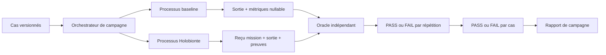

# Campagne causale bornée Holobionte

- **Statut** : harnais local exécutable, qualification limitée à trois cas arithmétiques
- **Portée** : comparaison appariée entre un témoin direct et le service réel de mission Holobionte
- **Dernière revue** : 2026-10-20

Le harnais [`benchmarks/holobiont-causal-campaign/`](../../benchmarks/holobiont-causal-campaign/)
ferme un premier manque de preuve : il exécute réellement un témoin isolé et le
runtime Holobionte, répète les deux bras, les soumet à un oracle séparé et
conserve un rapport falsifiable. Il ne transforme pas cette petite campagne en
preuve de supériorité ou de causalité générale.

## 1. Question expérimentale

Pour un même cas `bounded-sum`, avec les mêmes entrées et la même valeur
attendue :

1. le témoin direct produit-il la sortie correcte ?
2. une mission Holobionte réelle, incluant admission, isolation déclarée,
   exécution, vérification et clôture, produit-elle la sortie correcte ?
3. les deux sorties restent-elles correctes à chaque répétition ?

Le contraste mesure uniquement l'exactitude dans ce domaine déterministe et la
capacité du harnais à observer les deux chemins. Il ne mesure pas l'utilité
causale d'une topologie sur une tâche ouverte.

## 2. Architecture du harnais



Le processus parent charge les cas et l'oracle. Pour chaque bras de chaque
répétition, il lance `arm-worker.cjs` avec `execFileSync`. Le worker reçoit son
cas par entrée standard JSON et retourne une seule sortie JSON. Le bras
Holobionte ouvre une base SQLite `:memory:` propre et appelle
`runHolobiontMission`; le témoin ne charge pas le runtime Holobionte.

Cette séparation garantit des PID différents et l'absence de session SQLite
partagée. Elle n'est pas une isolation hostile : les processus s'exécutent sur
la même machine, sous le même compte et depuis le même dépôt.

## 3. Cas livrés

Le fichier [`cases.json`](../../benchmarks/holobiont-causal-campaign/cases.json)
porte le schéma `genos.holobiont-causal-cases/v1`.

| Cas | Entrée | Attendu | Intention |
| --- | --- | ---: | --- |
| `positive-integers` | `[1, 2, 3, 4]` | `10` | chemin nominal positif |
| `signed-integers` | `[-8, 3, 12, -2]` | `5` | signe et annulation partielle |
| `empty-input` | `[]` | `0` | identité de l'addition |

L'oracle accepte uniquement l'opération `bounded-sum` et des entiers sûrs
JavaScript. Les identifiants doivent être non vides et uniques. La valeur
`expected` déclarée est elle-même recalculée : modifier simultanément un runner
et la fixture ne suffit donc pas à obtenir un PASS si la somme devient fausse.

## 4. Bras comparés

### 4.1 Témoin direct

`baseline-runner.cjs` additionne les valeurs par une boucle locale. Il retourne
`isolated-direct-baseline/v1`, la sortie, la durée et une référence de preuve.
Il ne simule pas les propriétés qu'il ne possède pas :

```json
{
  "tokenUsage": null,
  "admissionCount": null,
  "sessionClosed": null
}
```

Ces valeurs nulles sont des observations conservées, pas des zéros. Les
remplacer par `0` ferait croire à une mesure et biaiserait une analyse future.

### 4.2 Mission Holobionte

`holobiont-runner.cjs` exécute `real-holobiont-mission/v1`. Chaque répétition :

1. crée un hôte et un identifiant de mission dédiés ;
2. propose un symbiote `bounded-sum` avec contrat et budget ;
3. exécute un essai d'admission ;
4. lie la preuve `genos.holobiont-isolation-proof/v1` au hash du rôle `trial` ;
5. exécute la capacité et la vérifie ;
6. ferme la session éphémère ;
7. retourne statut, preuve d'admission, hash d'adaptateur et métriques.

La consommation est une unité contractuelle égale à `1` pour l'essai et `1`
pour l'étape. Elle n'est pas un relevé de tokens LLM.

## 5. Oracle indépendant

`independent-oracle.cjs` est chargé par le parent, séparément des deux runners.
Il recalcule la somme depuis les entrées et ne lit ni le statut Holobionte, ni
le reçu d'admission, ni le résultat du vérificateur interne.

Pour chaque bras, il conserve :

| Champ | Signification |
| --- | --- |
| `oracleId` | `holobiont-bounded-sum-oracle/v1` |
| `expected` | somme recalculée par l'oracle |
| `observed` | valeur du runner, ou `null` si absente |
| `declaredExpectedMatches` | cohérence entre fixture et calcul indépendant |
| `observedMatches` | cohérence entre sortie et calcul indépendant |
| `status` | `PASS` seulement si les deux comparaisons réussissent |

L'oracle est structurellement distinct des runners, mais appartient au même
dépôt et à la même autorité de développement. Une qualification plus forte
exigerait un oracle versionné et opéré indépendamment.

## 6. Règle de décision

La décision est conjonctive :

- un bras est `PASS` si son oracle est `PASS` ;
- une répétition est `PASS` si les deux bras sont `PASS` ;
- un cas est `PASS` si toutes ses répétitions sont `PASS` ;
- la campagne est `PASS` si tous les cas sont `PASS`.

Aucune moyenne ne peut masquer un échec. La durée et les consommations sont
conservées mais ne participent pas au verdict. Il n'existe ni seuil de gain, ni
test de significativité, ni gate de promotion dans cette version.

## 7. Bornes fail-closed

| Paramètre | Minimum | Maximum | Défaut |
| --- | ---: | ---: | ---: |
| cas | `1` | `20` | `3` |
| répétitions | `1` | `10` | `3` |
| délai par exécution | `1 ms` | `10 000 ms` | `10 000 ms` |
| taille de sortie worker | — | `1 MiB` | `1 MiB` |

Le défaut représente `3 × 3 × 2 = 18` exécutions de bras. Le test de
qualification utilise deux répétitions, soit douze exécutions. Une borne
invalide, un cas hors domaine, un JSON invalide, un timeout ou une isolation de
processus incohérente fait échouer la campagne ; le harnais ne saute pas le cas.

## 8. Schéma du rapport

Le rapport porte `genos.holobiont-causal-campaign/v1` :

```text
campaignId
generatedAt
bounds
  cases, repetitions, totalArmRuns, perRunTimeMs
provenance
  cases.path, cases.sha256
  oracle.id, oracle.path, oracle.sha256
  worker.path, worker.sha256
status
cases[]
  caseId, status
  repetitions[]
    index, status
    arms.baseline
    arms.holobiont
```

Chaque bras conserve son `runnerId`, sa sortie, ses métriques, ses preuves et
son observation d'isolation. Le bras Holobionte ajoute `missionStatus`, la
preuve d'isolation d'admission et le hash de provenance du rôle d'essai.

La provenance SHA-256 couvre la fixture, l'oracle et le worker de dispatch.
Elle ne couvre pas encore tout le graphe de dépendances Node, la version de
Node, le système d'exploitation ou le commit Git ; ces éléments doivent être
capturés par l'opérateur pour une publication scientifique.

## 9. Exécution reproductible

Depuis la racine du dépôt :

```powershell
node benchmarks/holobiont-causal-campaign/run-campaign.cjs `
  --output target/holobiont-causal-report.json `
  --repetitions 3 `
  --timeout-ms 10000
```

Un corpus alternatif peut être fourni avec `--cases`, dans les mêmes bornes :

```powershell
node benchmarks/holobiont-causal-campaign/run-campaign.cjs `
  --cases benchmarks/holobiont-causal-campaign/cases.json `
  --output target/holobiont-causal-report-2.json `
  --repetitions 2
```

Le dossier de destination est créé si nécessaire. Le fichier est ouvert avec
le mode exclusif `wx`; une preuve existante n'est jamais remplacée. Choisir un
nouveau chemin ou archiver explicitement l'ancien rapport.

La CLI retourne un résumé sur la sortie standard. Elle termine avec `1` si le
rapport est `FAIL` ou si la campagne ne peut pas être exécutée.

## 10. Validation du harnais

```powershell
node backend/tests/test_holobiont_causal_campaign.js
```

Le test couvre trois familles de falsification :

1. campagne réelle : les douze exécutions passent, les PID sont distincts, la
   mission est `VERIFIED`, la preuve d'isolation vise le bon adaptateur et les
   métriques absentes du témoin restent `null` ;
2. oracle négatif : un runner Holobionte volontairement faux échoue alors que
   le témoin passe ;
3. bornes : zéro répétition et une valeur au-dessus du maximum sont refusés.

Un succès du test indique que les propriétés assertions sont observées dans ce
harnais. Il ne garantit pas qu'un corpus externe ou un adaptateur modifié sera
correct.

## 11. Catalogue des échecs

| Code ou symptôme | Cause probable | Action |
| --- | --- | --- |
| `HOLOBIONT_CAUSAL_OUTPUT_REQUIRED` | `--output` absent | fournir un nouveau chemin de rapport |
| `EEXIST` à l'écriture | rapport déjà présent | conserver l'ancien et choisir un autre nom |
| `HOLOBIONT_CAUSAL_CAMPAIGN_INVALID` | bornes, cas ou identifiants invalides | corriger la configuration sans relever les plafonds silencieusement |
| `HOLOBIONT_CAUSAL_ORACLE_DOMAIN_INVALID` | opération ou nombre hors domaine | versionner un oracle adapté avant d'ajouter le cas |
| `HOLOBIONT_CAUSAL_ARM_INVALID` | nom de bras inconnu | utiliser `baseline` ou `holobiont` |
| `HOLOBIONT_CAUSAL_ISOLATION_FAILED` | PID identique, type absent ou base non éphémère | corriger le runner ; ne pas publier le rapport |
| timeout ou sortie trop grande | worker bloqué ou non borné | préserver l'erreur, diagnostiquer le bras et relancer sous une nouvelle identité |
| statut global `FAIL` | au moins un oracle a échoué | examiner le premier cas et les deux sorties ; ne pas moyenner l'échec |

## 12. Lecture correcte des métriques

`durationMs` est une durée locale informative. Elle mélange le coût du runtime,
SQLite, le démarrage du processus et la charge de la machine. Comparer les deux
durées comme un benchmark de performance demanderait échauffement, ordre
randomisé, environnement contrôlé et analyse statistique.

`tokenUsage` n'est comparable que si les deux bras mesurent la même unité. Ici,
le témoin vaut `null` et le bras Holobionte expose une unité contractuelle :
aucun ratio économique ne doit être calculé.

`admissionCount` et `sessionClosed` décrivent le travail de gouvernance du bras
Holobionte. Leur absence côté témoin n'est ni un échec ni un avantage.

## 13. Claims autorisés et interdits

La campagne autorise les affirmations suivantes :

- les deux bras sont réellement lancés dans des processus distincts ;
- le bras Holobionte appelle le service de mission et ferme sa session ;
- l'oracle détecte une sortie Holobionte volontairement fausse ;
- les valeurs manquantes sont conservées comme `null` ;
- le rapport est borné, versionné et non écrasé silencieusement.

Elle n'autorise pas à affirmer :

- qu'Holobionte améliore la qualité, le coût ou la vitesse ;
- que la preuve d'isolation déclarée équivaut à une sandbox de production ;
- que trois cas déterministes donnent une puissance statistique ;
- que le témoin représente un agent isolé général ;
- que l'oracle est indépendant au sens organisationnel ;
- que le PASS autorise une promotion de runtime.

## 14. Extension vers une campagne probante

Le niveau suivant doit conserver ce contrat et ajouter :

1. un corpus métier versionné, avec catégories, difficultés et seeds ;
2. une baseline réellement comparable en modèles, outils, budgets et contexte ;
3. une randomisation de l'ordre des bras ;
4. des mesures sourcées de coût, durée, qualité et incidents ;
5. un oracle externe ou un quorum de juges indépendants ;
6. un plan de puissance et un nombre de répétitions justifié ;
7. des échecs, timeouts et valeurs nulles conservés sans imputation ;
8. un manifeste d'environnement et le commit Git ;
9. une reproduction sur stockage persistant et après crash ;
10. une décision de promotion séparée du rapport expérimental.

Le [benchmark longitudinal](benchmark-longitudinal-holobionte.md) définit une
matrice à douze bras pour cette étape. Il reste un protocole tant qu'une
campagne complète et ses artefacts n'ont pas été exécutés et publiés.

## Références

- [Runtime Holobionte](../03-reference/runtime-holobionte.md)
- [Guide d'exploitation](../04-exploitation/operer-runtime-holobionte.md)
- [Qualification du 20 octobre 2026](../06-qualite-preuves/qualification-holobionte-2026-10-20.md)
- [Benchmark longitudinal](benchmark-longitudinal-holobionte.md)
- [Protocole d'exécution](protocole-execution-holobionte.md)
