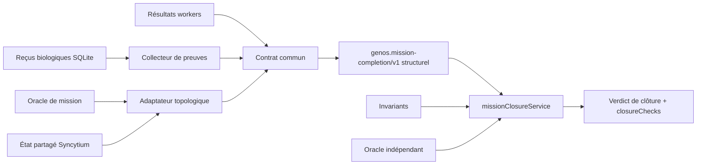

# Qualification du contrat commun de complétion — 2026-10-20

- **Type** : preuve de qualification ciblée
- **Statut** : PASS sur le périmètre décrit ; aucune qualification globale du dépôt
- **Révision structurante** : `e8cb0cc4` (`[FIX] Renforcer les preuves de clôture Syncytium`), ancêtre du checkout de qualification.
- **Checkout observé** : HEAD `b2422f22`, avec modifications concurrentes explicitement distinguées ci-dessous.
- **Portée** : contrat structurel, gate de clôture, collecte des reçus, adaptateur Syncytium, matérialisation et benchmark biologique
- **Environnement** : Windows, Node.js et Python du workspace local

Ce rapport qualifie la séparation entre validation topologique et complétion
commune. Il ne certifie ni une campagne LLM, ni la convergence distribuée de
Syncytium, ni l'éligibilité à une promotion.

## 1. Exigences vérifiées

| ID | Exigence | Critère opposable |
| --- | --- | --- |
| C01 | Séparation des autorités | Le contrat commun ne connaît aucun invariant Syncytium |
| C02 | Validation topologique explicite | Absence ou statut inconnu produit `partial` |
| C03 | Roster non vide | Une mission sans membre requis ne peut pas réussir |
| C04 | Existence de la preuve | Une référence SHA-256 sans objet résolu est refusée |
| C05 | Intégrité du contenu | Le digest du contenu doit correspondre à la référence |
| C06 | Liaison à la mission | Une preuve d'un autre `missionId` est refusée |
| C07 | Liaison au worker | Une preuve d'un autre membre est refusée |
| C08 | Source durable prioritaire | Avec SQLite, les preuves fournies par l'appelant ne remplacent pas la table |
| C09 | Matérialisation Syncytium | Le snapshot doit porter la version courante de l'état partagé |
| C10 | Convention unique | `success` est vrai si et seulement si le verdict vaut `succeeded` |
| C11 | Précédence des échecs | `failed` domine `partial`, qui domine `succeeded` |
| C12 | Promotion structurelle séparée | `evaluate` conserve `promotionEligible: false` |
| C13 | Gate décisionnelle | `closeMission` exige workers, preuves, invariants et oracle indépendant avant toute éligibilité technique |

## 2. Architecture soumise au test



Fichiers normatifs :

- `backend/src/services/missionCompletionContract.js` ;
- `backend/src/services/missionClosureService.js` ;
- `backend/src/services/missionCompletionEvidenceService.js` ;
- `backend/src/services/biologicalMissionCompletionService.js` ;
- `backend/src/services/syncytiumMissionCompletionService.js` ;
- `backend/src/services/topology/biologicalConditions.cjs`.

La décision est décrite par l'[ADR 0654](../adr/0654-contrat-commun-completion-et-preuves-liees.md).

## 3. Protocole

Les tests ont été lancés directement depuis la racine du dépôt. Un succès est
retenu uniquement quand le processus a rendu le code de sortie `0`. Les sorties
intermédiaires sans terminaison ne sont pas comptées comme PASS.

### 3.1 Tests discriminants

```powershell
node backend/tests/test_syncytium_completion_contract.js
node backend/tests/test_common_mission_closure.js
node backend/tests/test_biological_mission_completion.js
node backend/tests/test_mission_completion_evidence_gate.js
node backend/tests/test_syncytium_mission_completion.js
node backend/tests/test_syncytium_materialization_mcp.js
node backend/tests/test_biological_benchmark_runner.js
```

### 3.2 Suites de non-régression élargies

```powershell
npm run test:biology
npm --prefix backend run test:quality
python scripts/ci/check_code_quality.py
```

## 4. Résultats observés

| Commande | Résultat terminal | Couverture principale |
| --- | --- | --- |
| `test_syncytium_completion_contract.js` | PASS, code `0` | roster vide, preuve absente, contenu altéré, mauvaise mission et mauvais worker |
| `test_common_mission_closure.js` | PASS, code `0` | workers, preuves, invariants, oracle indépendant et dossier durable |
| `test_biological_mission_completion.js` | PASS, code `0` | clôture générique, oracle natif, échec worker et branches Rhizome |
| `test_mission_completion_evidence_gate.js` | PASS, 3 assertions, code `0` | collecte de preuve et refus fail-closed |
| `test_syncytium_mission_completion.js` | PASS, code `0` | agrégation sémantique/état et verdict final |
| `test_syncytium_materialization_mcp.js` | PASS, code `0` | matérialisation durable et reçus liés à la mission |
| `test_biological_benchmark_runner.js` | PASS, code `0` | distinction `syncytiumReady`/complétion et oracle de campagne |
| `npm run test:biology` | PASS, 8/8, code `0` | autorité durable, reçus workers, restart et audit |
| `npm --prefix backend run test:quality` | PASS, 12 tests, code `0` | non-régression des contrats qualité |
| `check_code_quality.py` | PASS, 7 061 fichiers, 0 nouvelle violation, code `0` | gate structurel du workspace courant |

Les deux lignes ajoutées pour la gate et l'intégration biologique qualifient la
copie de travail au 2026-10-20. Elles complètent le relevé basé sur `e8cb0cc4`
sans réattribuer rétroactivement leur comportement à ce commit.

## 5. Contre-preuves exercées

### 5.1 Hash syntaxiquement valide, objet absent

Une référence conforme à `sha256:<64 hex>` sans objet correspondant produit
`required_member_evidence_invalid`. Elle ne rejoint pas `evidenceRefs` et le
verdict reste `partial`.

### 5.2 Contenu altéré

Modifier le contenu après calcul de la référence fait diverger le digest. Le
contrat refuse la preuve avant même d'utiliser son état déclaré.

### 5.3 Preuve transférée entre missions

Remplacer le `missionId` interne par celui d'une autre mission conserve un
objet éventuellement intact, mais détruit sa corrélation. Le verdict reste
`partial`.

### 5.4 Preuve transférée entre workers

Une preuve valide du worker A ne couvre pas le worker B. Le roster requis est
évalué membre par membre.

### 5.5 Mission sans worker

Un tableau `requiredMemberIds` vide produit `member_identity_invalid`. Le
contrat ne permet donc pas une réussite par vérité vacante.

### 5.6 État partagé non matérialisé

Une session Syncytium sans snapshot à la version courante produit
`MATERIALIZATION_MISSING_OR_STALE`. La preuve des workers ne remplace pas cette
porte topologique.

## 6. Interprétation

Le périmètre testé établit que :

1. la validation Syncytium peut être vérifiée ou refusée indépendamment du
   contrat transversal ;
2. le contrat transversal exige un roster, les résultats terminaux et des
   preuves résolues ;
3. la persistance SQLite est relue quand elle est disponible ;
4. le digest, la mission, le worker et l'état vérifié sont tous nécessaires ;
5. la sortie utilise une convention commune de verdict.
6. la gate décisionnelle ajoute des contrôles d'invariants et d'oracle sans
   charger le contrat structurel de sémantique topologique.

Le périmètre ne permet pas d'affirmer que :

- les 53 missions proposées du benchmark Syncytium ont été exécutées ;
- tous les producteurs externes de reçus sont authentifiés cryptographiquement ;
- SHA-256 constitue une signature ;
- l'état partagé converge sous toute partition ou tout transport ;
- un verdict structurel `succeeded` autorise une promotion ;
- `promotionEligible: true` prouve qu'une promotion a réellement été exécutée ;
- les autres topologies non exercées possèdent déjà des adaptateurs complets.

## 7. Limites du relevé

Le checkout contenait des modifications concurrentes hors du périmètre du
contrat. Les cinq tests discriminants dont les fichiers étaient propres ont été
retenus comme preuves principales. Les résultats des suites élargies indiquent
l'absence de régression observée dans cette copie de travail, sans attribuer
tous leurs comportements au seul commit `e8cb0cc4`.

Une invocation élargie de `test:syncytium` a produit des sorties PASS pour de
nombreuses suites mais n'a pas rendu de code terminal dans la fenêtre de
capture de ce relevé ; elle n'est donc pas comptée comme preuve globale ici.
Le présent rapport préfère une preuve ciblée terminale à une extrapolation.

## 8. Critères pour élargir la qualification

La qualification pourra être étendue lorsque :

1. chaque topologie raccordée publiera son adaptateur et ses contre-tests ;
2. une campagne propre rejouera les suites globales sur une révision scellée ;
3. les producteurs externes auront un contrat d'authenticité explicite ;
4. les 53 cas Syncytium auront des manifestes, oracles et reçus conservés ;
5. les résultats globaux Node et Rust seront terminaux dans l'environnement de
   qualification retenu.

## Voir aussi

- [Contrat commun de complétion](../03-reference/contrat-completion-mission.md)
- [Architecture de clôture biologique](../02-orchestration/cloture-missions-biologiques.md)
- [Runtime Syncytium](../03-reference/runtime-syncytium.md)
- [Protocole des missions Syncytium](../02-orchestration/topologies/protocole-missions-syncytium.md)
- [Runbook de clôture](../04-exploitation/cloture-missions.md)
