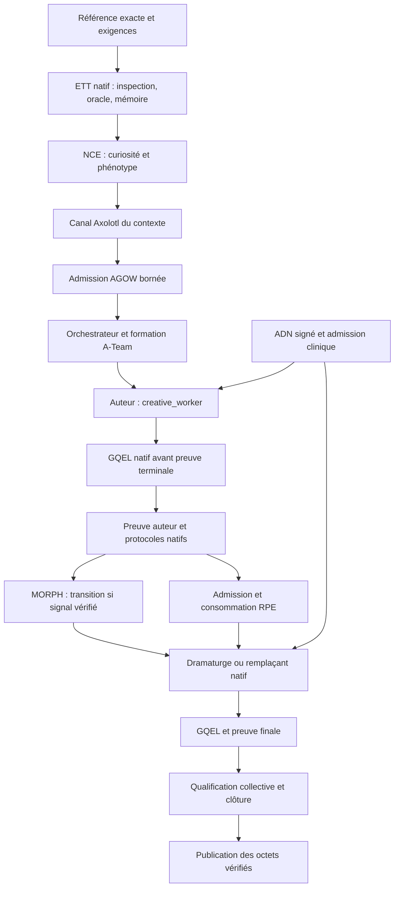

# Le Dernier Sas — raccords natifs et relance du 4 novembre 2026

- **Statut** : Partiel — douze corrections implémentées ; relance finale refusée par les gates.
- **Portée** : Corrections, exécutions locales et comparaison descriptive avec la référence du 2 novembre.
- **Dernière revue** : 2026-11-04.

Ce dossier distingue les raccords implémentés des mécanismes effectivement
qualifiés par une mission. Aucun texte, transport ou reçu isolé n'autorise la
promotion collective. Les artefacts bruts restent hors Git, sous
`D:/GenOS-runs/`, conformément aux règles du dépôt.

## Corrections versionnées

| Point | Commit | Effet vérifiable |
|---|---|---|
| ADN et clinique | `f31d2f040` | Sélection `.dna` canonique, signature et tenant revalidés ; véritable scan clinique lié au run et à son autorité. |
| ETT | `937b60967` | Inspection native en lecture seule, oracle distinct, apprentissage durable et contexte relu jusqu'à `STOPPED`. |
| RPE | `81b38b211` | Admission du handoff canonique, reçu authentifié, consommation par son destinataire et ACK natif exigé. |
| Génération et GQEL | `aa0af1142` | Réparation structurelle avant revue sémantique, plan et scènes natifs, matérialisation exacte, citations bornées au texte. |
| Mission intégrée | `d380246b4` | Préparation mission-owned, références immuables et invariant collectif vérifiant les mécanismes requis. |
| Transport structuré | `9609c1ff3` | Réponse JSON complète pour les étapes GQEL ; usage estimé et fin absente toujours refusés. |
| Métrologie et contenu invalide | `c4410d18b` | Une erreur du JSON intérieur ne masque plus les compteurs fournisseur présents dans l'enveloppe HTTP. |
| Métadonnées créatives | `eee3d88b6` | Listes d'affirmations et de contexte bornées ; candidat complet conservé et sources/ACK toujours contrôlés. |
| Matérialisation et réparation | `df6e95e00` | Constante dans la propriété de schéma ; réparations de format bornées et usage mesuré compté une fois, sans substitution du texte. |
| Format des dialogues | `64fa875dd` | Le prompt natif précise le format de réplique déjà exigé ; paroles en prose toujours refusées par le même gate. |
| Lease du runner | `336a20039` | Heartbeat pendant les workers attendus ; renouvellement SQLite atomique sous token, révision et expiration encore valides. |
| Délai HTTP du modèle | `14d1d1b64` | Délais d'en-tête et de corps alignés sur l'appel autorisé ; dispatcher configuré, timer absolu et annulation conservés. |

Les autres modifications du checkout partagé ne sont pas attribuées à ces
commits. Les manifestes enregistrent la révision, le diff et les empreintes des
fichiers locaux à chaque lancement. Les dernières tentatives utilisent une copie
immuable de l'exécutable Rust dans leur dossier externe.

Le champ d'artefact `sourceChangesDuringRun` compare les empreintes du lancement
avec l'état relu lors de la collecte. Il ne date pas chaque modification et ne
permet pas d'attribuer toutes ces différences à la période d'exécution seule.

## Placement dans le runtime

La topologie demandée est un pipeline A-Team auteur → dramaturge. Les deux
lecteurs GQEL utilisent également `llama3.1:8b` ; ce sont des routes de revue sous
le run du worker, pas deux workers indépendants ni deux familles de modèles.

Les protocoles EVIDENCE, CONTINUITY, OMEGA, SYNAPSE, ALLOSTASIS et GQWF sont
vérifiés sur les runs achevés. MORPH est vérifié sur la transition du graphe
collectif, avec snapshot, décision native, commit AgentGit et finalisation durable.
Une configuration `WATCHING` n'est pas cette transition. Le contrat de cette
campagne exige une transition réelle avant la clôture.

La nosologie intervient par le scan immunitaire et l'état clinique réellement
lus avant l'admission du worker, puis revalidés sous son autorité d'exécution.
GCIR-Omega fournit le programme cognitif typé admis et exécuté par OMEGA ;
ce raccord n'est pas une preuve de raisonnement artistique correct. La
qualification GVX vérifie la chaîne du registre et son MAC pour chaque worker
achevé. Ces contrôles restent distincts de la qualité du scénario.

## Protocole de comparaison

La référence est `scripts/experiments/scenario_gqel_execution_report.json`, session
`gqel-session-1793643196888-63352b`. Ses trois digests et ses scores V1
`20 → 30 → 75` sont reproduits exactement avec le détecteur historique. Son
meilleur texte compte 702 mots ; la promotion était refusée, en environ 87,42 s.
Les tokens historiques ne sont pas connus.

Les relances conservent le brief initial puis ajoutent un contrat de scénario
complet : 1 200 mots utiles, cinq à sept scènes, dialogues, fiches et note
dramaturgique. Elles utilisent une enveloppe native, deux lecteurs du même modèle,
des contrôles positifs et négatifs, le seuil GQEL 80 et une comparaison dans les
deux ordres. Le budget global est de 1 200 000 tokens et deux heures ; le budget
GQEL par contrat est de 500 000 tokens, 80 appels et trois itérations.

La température exprimée par les ADN est 0,45, contre 0,7 dans le script historique.
La limite de sortie passe de 1 500 tokens historiquement à 7 000, puis 16 000 après
un refus de troncature observé. Ces différences empêchent toute attribution
causale d'une variation au seul runtime. Le score V1 réappliqué est un contrôle
de format ; il n'est pas directement comparable au score sémantique V2.

ETT utilise des programmes fixes d'inspection structurelle et aucun appel LLM
supplémentaire. Ses mesures dépendent du format de scènes et dialogues convenu.
NCE utilise curiosité et phénotype ; ses autres moteurs écologiques ne sont pas
exécutés. La panne du canal Axolotl est explicitement exercée et concerne le
transport du contexte de cette mission. Elle ne prouve pas une panne spontanée
ou le remplacement d'un worker LLM.

## Tentatives conservées

| Dossier externe | Observation terminale |
|---|---|
| `dernier-sas-integrated-repaired-20261104` | Refus de découverte du modèle avant le premier contrôle lecteur. |
| `…-attempt2` | Refus de provisionnement pour nom de projet déjà utilisé ; aucune mission lancée. |
| `…-attempt3` | Huit contrôles lecteurs réussis, refus structurel du premier texte, deux plans et leurs revues ; première scène refusée faute de métrologie et fin observées. |
| `…-attempt4` | JSON de contenu invalide au premier appel ; anciennes mesures perdues par le parseur, conservées comme inconnues. |
| `…-attempt5` | Sortie tronquée à 7 000 tokens, désormais mesurée : 7 102 tokens d'entrée et 7 000 de sortie ; aucun candidat recevable. |
| `…-attempt6` | Sortie tronquée à 16 000 tokens : 145 affirmations, aucun `workerArtifact` ; 7 104 tokens d'entrée et 16 000 de sortie. |
| `…-attempt7` | Cinq scènes enregistrées ; matérialisation refusée pour modification du candidat exact. Deux textes de scène distincts seulement, répétés dans les cinq emplacements. |
| `…-attempt8` | Matérialisation exacte acceptée ; candidat de sept scènes et 2 587 mots refusé pour `DIALOGUE_MISSING`. Refus OMEGA en dernière itération, puis lease du runner expirée. Processus terminé avec code 1 après 1 546,462 s ; A-Team restée `RUNNING` sans clôture. 193 448 tokens mesurés, un appel à usage inconnu. |
| `…-attempt9` | Configuration de relance incorrecte : endpoint de compatibilité incompatible avec la limite de contexte native. Aucun candidat ; clôture `FAILED`, code 1 après 252,922 s. Le registre marque une tentative fournisseur à usage inconnu ; ce flag ne prouve pas un appel HTTP envoyé. |
| `…-attempt10` | API native et huit contrôles lecteurs passés. Première scène au format de dialogue attendu. Deuxième scène interrompue par `fetch failed`, puis OMEGA `recovery_required`. Clôture `FAILED`, code 1 après 741,379 s ; 17 tentatives enregistrées, 55 733 tokens mesurés et un appel à usage inconnu. |
| `…-attempt11` | Clôture `FAILED`, code 1 après 793,311 s. Les 16 appels totalisent 75 477 tokens mesurés sans estimation ni usage inconnu. Première scène tronquée à 16 000 tokens de sortie : `GQEL_TRUNCATED_OUTPUT`. Aucun livrable accepté. |

Le contenu brut de la tentative 6 établit le défaut de génération : augmenter
le plafond seul ne suffit pas lorsqu'une liste de métadonnées n'a pas de borne.
Le correctif borne cette liste, sans fabriquer le scénario ou les acquittements.
Les anciens refus restent des refus et leurs mesures ne sont pas réinventées.

La tentative 8 apporte un progrès de transport et de construction, pas une
amélioration artistique démontrée : le second candidat atteint 2 587 mots et
sept scènes, contre 702 mots pour la référence. Il contient seulement quatre
textes de scène distincts (`S2 = S4 = S6`, `S5 = S7`). Des paroles sont présentes
dans la prose, mais sans le format de réplique requis. Alain meurt dès la
première scène et réapparaît ensuite vivant. Ce constat de lecture est distinct
d'une note GQEL : le gate structurel refuse `DIALOGUE_MISSING`, donc aucun score
sémantique V2 recevable n'est produit pour ce candidat.

Son reçu de préparation est authentifié : ETT termine son inspection et son
apprentissage sans tokens LLM supplémentaires ; NCE, le rétablissement déclaré
du canal Axolotl et l'admission AGOW ont des traces réelles. Cela ne qualifie
pas les workers incomplets, le handoff RPE, la transition MORPH ou la clôture.
Le renouvellement de lease corrigé ensuite ne répare pas rétroactivement les
états de cette tentative.

La tentative 10 montre que la consigne de dialogue atteint le modèle : la
première scène emploie bien des noms en majuscules sur une ligne dédiée. Son
refus terminal reste un refus de transport et de métrologie, pas une note
artistique. Un test HTTP retardé a ensuite reproduit un délai interne plus
court que l'appel autorisé ; le correctif conserve les refus sur annulation
et échéance. La cause interne de l'ancienne erreur `fetch failed` n'étant pas
présente dans sa trace, ce test n'exclut pas une panne indépendante d'Ollama.

Les scripts locaux `run.cjs`, `collect.cjs` et `compare-repaired.cjs` se trouvent
dans `D:/GenOS-runs/dernier-sas-integrated-repaired-20261104/`. Chaque tentative
conserve requête, manifeste, journaux, preuve par worker, reçus de préparation,
qualification, tours et registre fournisseur, comparaison JSON et texte.

## Résultat de la relance finale

La mission `mission_baaf0395-e50f-46fe-b83e-a1080bfacb16`, A-Team
`ateam_2186090fe6c207c49c859c8124065c05`, utilise la révision `14d1d1b64`
avec le diff local conservé. L'empreinte de l'exécutable Rust reste identique
entre lancement et collecte. Les preuves finales se trouvent dans
`D:/GenOS-runs/dernier-sas-integrated-repaired-20261104-attempt11/`.

| Observation | Référence du 2 novembre | Relance finale |
|---|---|---|
| Candidat retenu pour inspection | 702 mots | Candidat initial de 702 mots, non accepté |
| Détecteur historique V1 | Meilleur score 75/100 | 75/100 réappliqué ; aucun gain de ce détecteur |
| Évaluation sémantique V2 recevable | Non utilisée | Aucun score recevable |
| Durée | 87,42 s | 793,311 s |
| Tokens | Inconnus | 75 477 mesurés, dont 52 112 d'entrée et 23 365 de sortie |
| Promotion | Refusée | Refusée |

Les huit contrôles lecteurs passent. Deux plans et leurs revues sont exécutés,
puis `write:S1` consomme 6 110 tokens d'entrée et 16 000 de sortie avant
`finishReason: length`. Le texte brut de 53 926 caractères contient 262
occurrences exactes de la phrase « Je vais essayer de trouver une autre
solution. ». Cette observation est conservée dans
`proof/truncated-scene-observation.json`, avec les empreintes et identifiants
du tour. Ce fragment n'est ni réparé manuellement ni livré comme scénario.

| Mécanisme | Observation dans cette mission |
|---|---|
| Orchestrateur | Contrôle de mission, formation et clôture A-Team effectifs ; aucun appel LLM du contrôleur. |
| ETT, NCE, Axolotl, AGOW | Préparation authentifiée et vérifiée ; ETT termine son cycle structurel avec zéro token LLM supplémentaire. |
| ADN et nosologie | Incarnation signée et admission clinique liées au run de l'auteur. L'ADN observé concerne ce worker, pas le contrôleur. |
| GVX | Chaîne de l'auteur valide, trois événements, MAC du plan de contrôle vérifié. |
| GCIR-Omega et GQEL | Appels natifs et métrologie observés ; sortie tronquée refusée par GQEL. |
| Dramaturge et RPE | Dramaturge bloqué ; aucune admission ou consommation de handoff. |
| MORPH et qualification des sept protocoles | MORPH reste `WATCHING`, sans transition engagée ; qualification collective refusée. |

La qualification renvoie `MISSION_MECHANISMS_WORKER_INCOMPLETE` et la clôture
`promotionEligible: false`. Les raccords sont implémentés et testés, mais cette
exécution ne démontre ni une intégration complète qualifiée sur la mission,
ni une amélioration artistique par rapport à la référence.

## Validation logicielle

Les vingt-trois suites d'intégration de l'inventaire passent ensemble après
le raccord HTTP (`inventory-after-http.log`, code 0), ainsi que les régressions
de schéma, génération, transport HTTP et SSE. Les réponses synthétiques de ces tests ne sont
pas présentées comme une mesure artistique. Les suites ETT, ADN/clinique et RPE
exécutent leurs vrais services, SQLite et sous-processus natifs.

Le dernier contrôle global a vérifié 9 057 sources sans violation
(`quality-after-http.log`, code 0). Un contrôle intermédiaire du checkout
partagé avait rencontré deux violations dans des fichiers hors de ces raccords ;
elles ne figurent plus dans le dernier état contrôlé. Les douze commits de
correction ont chacun passé leur gate sans modification de la baseline.

La première suite Rust globale a rencontré deux refus dans les fixtures de
missions dynamiques ; leur relance ciblée passe 7/7. Des reprises globales ont
ensuite rencontré le verrou Windows de l'exécutable pendant des tests natifs
concurrents. La reprise `cargo-workspace-serialized.log` a franchi les suites de
missions CLI, puis échoué dans un test de délégation hiérarchique du crate
`genos-orchestrator` : `NATIVE_LLM_TRANSPORT_OUTCOME_UNKNOWN` (166/167).
La relance isolée du même test, avec l'exécutable exact de cette suite, passe
1/1 en 33,02 s (`cargo-hierarchy-exact.log`). Cela ne transforme pas la suite
globale interrompue en réussite.

La suite `npm test` a effectivement été exécutée après obtention de son verrou.
Elle s'est arrêtée dans `test_mission_protocols_actions.js` sur une échéance de
routage avant fournisseur. La relance ciblée de cette fixture passe après
l'ajustement de son budget de temps dans le checkout partagé. Une réussite de
ces contrôles ciblés ne vaut pas une suite globale intégralement réussie.
La reprise après le correctif HTTP est également refusée au préflight parce
qu'une autre suite possède le verrou (`npm-after-http.log`, PID 2576).
