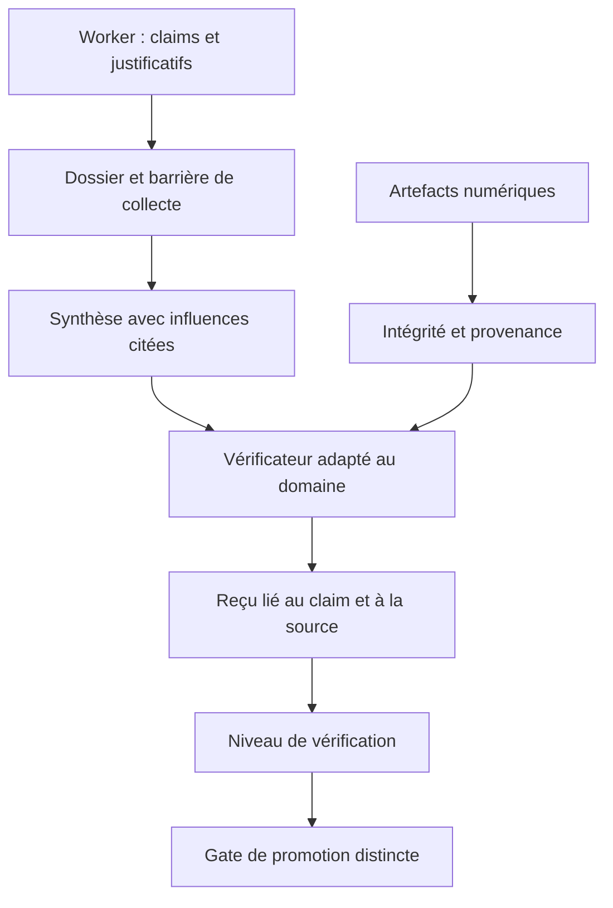
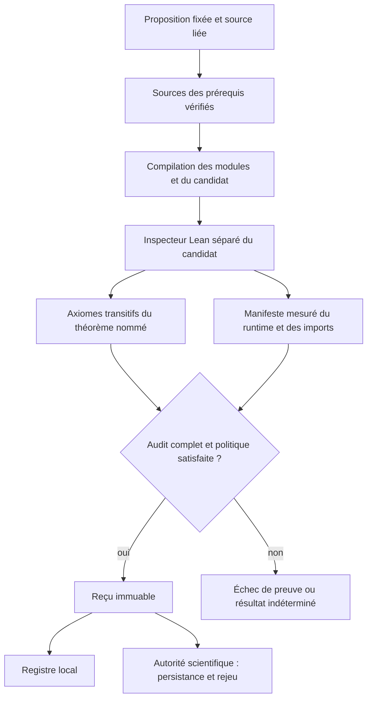
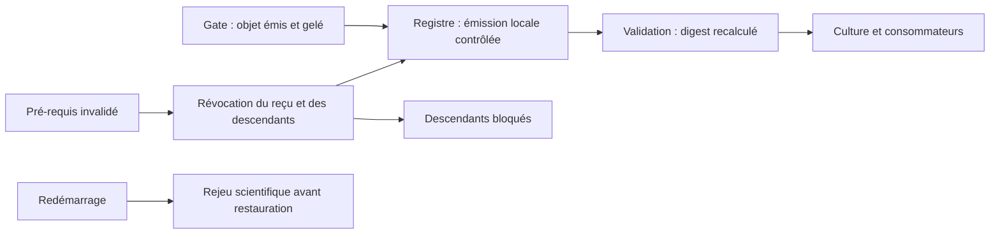

# Vérification Lean, Omega et gestion des preuves

- **Statut** : Implémenté pour les théorèmes simples et les tactiques bornées ; limites d'isolation et de formalisation ci-dessous.
- **Dernière revue** : 2026-10-30.
- **Décision** : [ADR 0758](../adr/0758-verification-lean-et-recus-lies.md).

## Responsabilités

Une déclaration, un artefact intact, une vérification exécutée et une autorisation
de promotion sont distincts. Les dossiers workers collectent les contributions.
Les vérificateurs produisent des résultats liés à leur sujet. Les gates de
promotion ajoutent leurs propres conditions.



`hasDecisionEvidence()` détecte un contenu utilisable pour le contrôle de
l'orchestration, y compris un échec documenté. Il n'exécute pas le justificatif
et n'authentifie pas sa source. `evidenceScore()` ne constitue pas un verdict
de vérité. Les répétitions d'une chaîne, les objets dont seul l'ordre des clés
change et les duplications entre claims ne multiplient plus sa contribution.

## Contrat Lean

La source commence par des imports simples éventuels, puis un en-tête
`theorem nom : proposition := ...`. Ce sous-ensemble correspond aux sources
de `FormalizationArtifact`. Les paramètres doivent figurer dans la proposition,
par exemple `∀ n : Nat, ...`.
La liaison conserve les espaces internes et les points de code Unicode : les
normaliser à l'intérieur d'une chaîne Lean pourrait changer la proposition.

Le contrôle lexical lie cette proposition à l'en-tête. Un inspecteur séparé
importe le module compilé et contrôle l'existence du théorème et ses axiomes
transitifs. Les placeholders `sorry`, `admit` et `sorryAx` sont interdits dans
les chemins de validation ; l'audit reste nécessaire pour les axiomes importés.



L'exécuteur rapporte les axiomes utilisés ; la gate et Omega appliquent la liste
autorisée, vide par défaut. `sorryAx` ne peut jamais être autorisé. Un axiome
autorisé reste une hypothèse explicitement conservée. Un axiome déclaré mais
inutilisé ne doit pas être attribué au théorème cible.

Le manifeste couvre le binaire Lean, les bibliothèques `libleanshared` présentes
et les fichiers `.olean`, `.olean.private` et `.olean.server` des imports chargés.
Il inclut également le code de l'inspecteur utilisé.
Les modules des prérequis matérialisés sont liés séparément par leurs sources
et les digests de reçus. Une version abrégée ou une empreinte arbitraire est refusée.

## CHECK Omega

Le descripteur fournit `type: "lean"`, `source`, `canonicalStatement` (ou
`statement`), la version complète `toolchainVersion` et éventuellement
`environmentDigest`, `leanExecutable`, `timeoutMs` et `allowedAxioms`.
La proposition peut venir du contexte ou du candidat structuré ; la source
seule ne suffit pas à établir une obligation de vérification extérieure.

| Observation | Résultat Omega |
| --- | --- |
| Théorème lié, compilation et audit complets, axiomes autorisés | `verified` |
| Placeholder ou énoncé différent | `inconclusive` |
| Binaire absent, version différente, timeout ou audit absent | `inconclusive` |
| Tactique échouée ou erreur de compilation | `inconclusive` |
| Axiome transitif interdit | `inconclusive` |

Un échec de démonstration n'est pas un contre-exemple. La réfutation nécessite
une preuve de la négation ou un contre-exemple adapté au domaine.

## Reçus et invalidation



Un objet portant seulement un statut et un digest ne peut pas s'enregistrer.
Modifier le nœud, les énoncés liés, la source, l'environnement, les axiomes,
les dépendances ou la raison invalide le digest. La transmission culturelle
recontrôle le reçu pour éviter de retransmettre un résultat révoqué comme fait.
Le résultat vérifié est gelé récursivement et la vue `ProofArtifact` conserve
une liaison privée à ce résultat. Une substitution de contenu ou d'objet ne
peut pas transformer une preuve existante en preuve d'un autre énoncé.

Le producteur scientifique publie actuellement des preuves directes sans
dépendance. La matérialisation des prérequis appartient à la gate incrémentale ;
ce producteur ne propose pas leur restauration scientifique durable.

## Recherche mathématique

Les stratégies prises en charge produisent des tactiques bornées distinctes,
par exemple `simp`, `ring`, `omega` ou une induction élémentaire. Une tactique
nécessitant une bibliothèque échoue si elle n'est pas importée. Une stratégie
sans producteur donne `proof_strategy_unavailable`. Sans formalisation
enregistrée, le résultat reste `UNFORMALIZED`. Cette boucle ne constitue pas
une autoformalisation ou une recherche générale de preuves.

## Vérification et limites

```powershell
$env:GENOS_LEAN_EXECUTABLE = 'chemin/vers/lean.exe'
npm run test:lean
```

Les régressions réelles couvrent un succès valide, `sorry`, `sorryAx`, un axiome
importé, la liaison à l'énoncé, les échecs de compilation, un faux reçu soumis au
rejeu scientifique, un environnement différent et un prérequis matérialisé.
Le test échoue si Lean est absent. Les tests avec exécuteur injecté vérifient
les contrats et ne certifient pas le noyau Lean.

Relevé local du **2026-10-30**, sous Windows avec **Lean 4.34.0** :

| Vérification exécutée | Résultat |
| --- | --- |
| `npm run test:lean` | Réussite des contrats et des régressions avec Lean réel |
| `node backend/tests/test_math_kernel_e2e.js` | Preuve réelle, liaison et transmission culturelle réussies |
| `node backend/tests/qualify_scientific_lean_live.cjs` | Publication valide, refus du faux résultat, rejeu après redémarrage et altération refusée |
| Suites Omega et scheduler épistémique | Réussite |
| 16 suites mathématiques hors noyau réel | Réussite |
| `cargo test --workspace` | Réussite |

La validation globale du checkout reste distincte : `npm test` a rencontré
un échec dans `test_biological_worker_restart.js`, également reproduit en
rechargeant en mémoire les versions HEAD des services modifiés par cette tâche.
Le gate qualité global a signalé de la dette hors du périmètre ; le contrôle
ciblé des sources et tests de cette correction est réussi. Ces résultats ne
qualifient pas l'ensemble des autres modifications en cours dans le checkout.

Le manifeste mesure des fichiers locaux ; il n'est pas une attestation matérielle.
Les sous-processus reçoivent un environnement minimal sans héritage des secrets
du backend. Le délai par sous-processus est configurable, à 90 secondes par
défaut dans l'exécuteur ; les limites d'une mission restent distinctes.
Le toolchain doit être protégé et l'isolation OS adaptée au contexte. Le timeout
et le répertoire temporaire ne constituent pas cette isolation. Les plugins
natifs et dépendances système hors manifeste ne sont pas attestés. L'équivalence
entre sens humain et proposition formelle nécessite une revue indépendante.
Les reçus n'autorisent aucune promotion à eux seuls.
