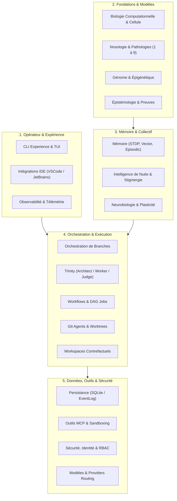
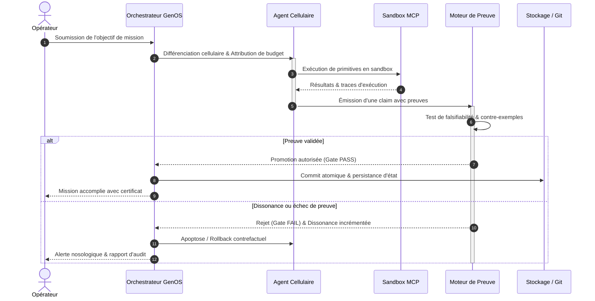
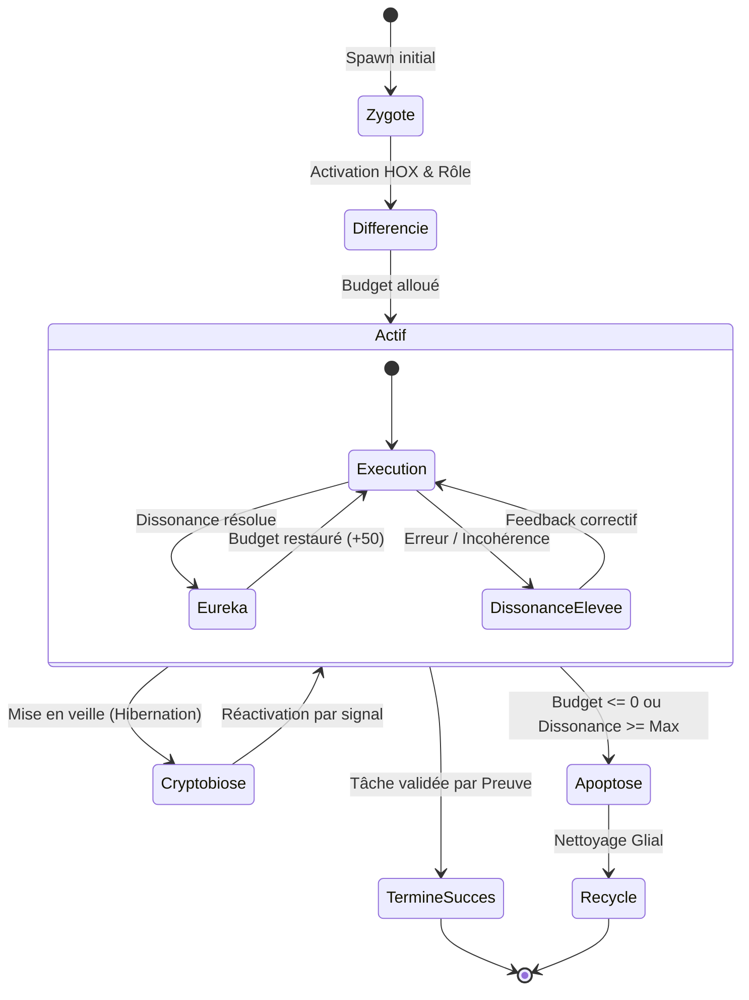

# Documentation GenOS

- [Endogenous Thought Test — ETT v1](01-concepts/endogenous-thought-test.md) — chaîne fonctionnelle bornée, reçus durables, autorité SHEV, arbitrage AGOW, vérification indépendante et apprentissage d'épisode.
- [ADR 0626 — Protocole de pensée endogène bornée](adr/0626-protocole-pensee-endogene-bornee.md) — détection, exécution, vérification et révision de croyance non promotable.
- [ADR 0565 — Unifier les contrats de variants topologiques](adr/0565-unifier-les-contrats-de-variants-topologiques.md) — identité canonique, baseline `default`, maturité exécutable, snapshots liés au worker et dispatch commun des sessions.
- [ADR 0573 — Porte appariée P2 avant commit adaptatif](adr/0573-porte-appariee-p2-avant-commit-adaptatif.md) — six bras obligatoires, shadow/holdout disjoints, bootstrap apparié corrigé et refus de toute autorité implicite.
- [ADR 0602 — Runner durable P3 pour les campagnes appariées](adr/0602-runner-durable-p3-campagnes-appariees.md) — reçus immuables, reprise idempotente, scellement shadow/holdout et adaptateurs de processus externes fail-closed.
- [ADR 0606 — Socle durable V2 de l’Ontogenèse](adr/0606-socle-durable-ontogenese.md) — journal d’opérations, registre d’artefacts, outbox et migration fail-closed.
- [ADR 0607 — Reprise exhaustive et fail-closed de l’Ontogenèse](adr/0607-reprise-exhaustive-ontogenese.md) — réconciliation sous bail, reçus immuables et escalade des effets ambigus.
- [ADR 0608 — Confiner l’Ontogenèse avec les Job Objects Windows](adr/0608-confiner-ontogenese-job-objects-windows.md) — création suspendue, limite mémoire du job, terminaison de l’arbre et échec fermé.
- [ADR 0609 — Basculer l’Ontogenèse vers un hôte toujours disponible](adr/0609-bascule-ontogenese-hote-toujours-disponible.md) — bascule froide, génération monotone, lease et reprise explicite sans partage SQLite concurrent.
- [ADR 0610 — Purger les traces et worktrees de l’Ontogenèse](adr/0610-purge-complete-traces-worktrees-ontogenese.md) — purge confirmée, confinée et attestée des contenus opérationnels d’un projet arrêté.
- [ADR 0611 — Frontière de livraison d’Ontogenèse](adr/0611-frontiere-livraison-ontogenese.md) — commit local vérifié, push et fusion explicitement hors autorité.
- [ADR 0616 — Hystérésis transactionnelle et adaptateurs externes signés](adr/0616-hysteresis-transactionnelle-et-adaptateurs-signes.md) — budget par mission consommé atomiquement et preuves Ed25519 des exécutions externes.
- [ADR 0635 — Scrubber explicitement le store GQWF](adr/0635-scrub-integrite-store-gqwf.md) — inventaire non destructif, détection durable des corruptions et base de la future réparation authentifiée.
- [ADR 0636 — Répliquer les racines GQWF par contenu](adr/0636-replication-cas-gqwf.md) — plan CAS scellé, reprise par déduplication, isolation tenant et reçu de destination.
- [ADR 0639 — Réparer GQWF depuis une réplique authentifiée](adr/0639-reparation-authentifiee-gqwf.md) — provenance de réplication, quarantaine et preuve d'intégrité avant/après.
- [ADR 0643 — Adresser le catalogue GQWF et unifier les runtimes opt-in](adr/0643-catalogue-cas-et-runtimes-deterministes-gqwf.md) — catalogue CAS reconstructible, réparation SQLite autorisée et routage déterministe/in-process.
- [ADR 0566a — Autorité Rust et snapshot durable de morphogenèse](adr/0566-autorite-rust-et-snapshot-durable-de-morphogenese.md) — commit de production signé, snapshot durable et rollback des processus, workspaces, baux et budgets.
- [ADR 0527 — Rotation de confiance des clés de fossilisation](adr/0527-rotation-confiance-cles-fossiles.md) — chevauchement des clés approuvées, retrait sans réécriture des attestations et vérification ciblée du corpus.
- [ADR 0528 — Vérifier la révocation clinique avant l'application Rust](adr/0528-verifier-revocation-clinique-cli.md) — validation tenant-scopée en ligne avant toute mutation clinique du journal.
- [ADR 0531 — Recevoir les entrées sensorielles et neuro-gliales dans le backend](adr/0531-entrees-sensorielles-et-neurogliales-backend.md) — routes HTTP tenant-scopées, signatures producteurs, persistance sensorielle immuable et limites d'autorité CLI.
- [ADR 0533 — Raccorder la boucle causale aux reçus de stratégie](adr/0533-raccorder-la-boucle-causale-aux-recus-strategie.md) — apprentissage causal réservé aux runs vérifiés et aux preuves de qualité signées, liées au run et au tenant.
- [ADR 0535a — Persistance et reprise idempotente de l’apprentissage causal](adr/0535-persistance-reprise-apprentissage-causal.md) — outbox transactionnel, retries à clé stable et rappel de souvenirs après revalidation de la preuve.
- [ADR 0557 — Mémoire négative vérifiée des issues terminales](adr/0557-memoire-negativement-verifiee-des-issues-terminales.md) — preuve de défaite signée et liée au run, mémoire négative idempotente et séparée des scores de promotion.
- [ADR 0538 — Inventaire opérationnel workers/daemons pour la morphogenèse](adr/0538-inventaire-operationnel-workers-daemons-morphogenese.md) — proposition de résolution consultative fondée sur l’état runtime, les leases et la provenance.

- [Comparaison locale entre un agent Codex et un worker GenOS](06-benchmarks/comparaison-agent-codex-worker-genos-2026-10-15.md) — même mission MCP, résultat de sécurité, métriques observées et distinction entre verdict et promotion.

- [Qualification de release](06-qualite-preuves/qualification-release.md) — portes automatiques, rapport reproductible et écarts bloquant l'exploitabilité complète.

- [ADR 0428 — Oracle subset_sum pour l'exécuteur procédural](adr/0428-oracle-subset-pour-executeur-procedural.md) — mission procédurale vérifiée et limites du reçu canonisé.

- [Douzième vague des variants et de la morphogenèse](02-orchestration/topologies/plan-implementation-variants.md#douzième-vague--2026-10-12) — identité interne du graphe préparé, panel représentatif scellé, archive Open-Ended et réserve fondatrice persistée ; [ADR 0465](adr/0465-preuve-des-reevaluations-open-ended-biome.md) à [0468](adr/0468-scellement-panel-representatif-biocenose.md).

- [Onzième vague des variants et de la morphogenèse](02-orchestration/topologies/plan-implementation-variants.md#onzième-vague--2026-10-12) — graphe préparé lié aux workers, quorum Expert Committee, vérificateurs Holobionte indépendants et reçus Rhizome liés à la session ; [ADR 0460](adr/0460-quorum-lie-aux-membres-expert-committee.md) à [0463](adr/0463-lier-workers-au-graphe-prepare-morphogenese.md).

- [Génération locale de propositions de code worker](adr/0464-generation-locale-de-propositions-de-code-worker.md) — bail d’écriture, budget parent et limite de qualification au reçu biologique.

- [Dixième vague des variants et de la morphogenèse](02-orchestration/topologies/plan-implementation-variants.md#dixième-vague--2026-10-12) — manifeste snapshot scellé, quiescence Métapopulation, résolution Forecasting Crowd et monde promu Trinity ; [ADR 0445](adr/0445-refus-des-champs-non-scelles-snapshot-topologique.md) à [0448](adr/0448-liaison-monde-promu-candidat-trinity.md).

- [Neuvième vague des variants et de la morphogenèse](02-orchestration/topologies/plan-implementation-variants.md#neuvième-vague--2026-10-12) — atomicité du reçu consultatif, route Rhizome courante, révision speculative Syncytium et filiation Quality-Diversity Biome ; [ADR 0441](adr/0441-atomicite-recu-consultatif-morphogenese.md) à [0444](adr/0444-enfants-depuis-elites-admises-biome.md).

- [Issue des missions : qualification du but](06-qualite-preuves/qualification-issue-mission.md) — obligations, oracle, falsification et limites ; [ADR 0420a](adr/0420-contrat-issue-mission.md).

- [Cinquième vague des variants et de la morphogenèse](02-orchestration/topologies/plan-implementation-variants.md#cinquième-vague--2026-10-11) — fermeture du commit V2, sous-runs A-Team, qualification Trinity, consentement Syncytium et reçus Biocénose ; [ADR 0423](adr/0423-fermeture-mode-commit-v2-morphogenese.md) à [0427](adr/0427-recus-signes-hybrid-oracle-biocenose.md).

- [Quatrième vague des variants et de la morphogenèse](02-orchestration/topologies/plan-implementation-variants.md#quatrième-vague--2026-10-11) — reçus Rust consultatifs, frontières Biome et Holobionte, transitions Rhizome et preuve du solveur Métapopulation ; [ADR 0418](adr/0418-fermeture-commit-morphologie-et-recu-rust.md) à [0422](adr/0422-liaison-des-resultats-solveur-metapopulation.md).

- [Qualification P1 des consommateurs mémoire au 2026-10-10](06-qualite-preuves/qualification-p1-consommateurs-memoire-2026-10-10.md) — recherche REST/gRPC, ingestion attribuée, retraits d’accès et fallback de prompt ; [ADR 0389](adr/0389-autorite-des-consommateurs-memoire-rest-et-grpc.md).

- [Qualification P1 mémoire négative et stdio au 2026-10-10](06-qualite-preuves/qualification-p1-l22-2026-10-10.md) — scopes, résultats métier Node/Rust, leases et contre-épreuves ; [ADR 0388](adr/0388-portee-memoire-negative-et-parite-stdio-reelle.md).

- [Qualification P1 avec V3 au 2026-10-10](06-qualite-preuves/qualification-p1-v3-2026-10-10.md) — nursery/replay, projection évaluateur, Lean réel et reproduction ; [ADR 0387](adr/0387-pont-nursery-replay-et-projection-evaluateur.md).

- [Studio : essai sur cinq niveaux de missions](06-qualite-preuves/studio-essai-cinq-niveaux.md) — parcours réels, vérifications persistées et limites d'autonomie et de production.

- [Obstacle 4 : communication et consolidation scientifique](06-qualite-preuves/obstacle-4-communication-consolidation-scientifique-2026-10-10.md) — revue actualisée de GQWF v2, Garage Fabric, Signal Plane, preuves et G-CIR Ω ; [ADR 0377](adr/0377-consolidation-scientifique-par-references-versionnees.md).

- [Studio : cible unifiée](03-reference/studio-contrat-directeur.md) — contrat STUDIO-TARGET-V1, trois sources de besoins, zones et parcours ; [ADR 0360](adr/0360-studio-cible-unifiee-et-zones-de-livraison.md).
- [ADR 0361 — Studio : socle requêtes, actions et brouillons](adr/0361-studio-socle-requetes-actions-et-brouillons.md) — étape B, commits atomiques et qualification bornée.
- [ADR 0362 — Studio : parcours pilote borné](adr/0362-studio-parcours-pilote-borne-et-dependances.md) — étape C, services réels, dépendances et limites de généralisation.
- [Studio : rejouer le pilote](04-exploitation/studio-parcours-pilote.md) — procédure P03 bornée, critères exécutables, captures et diagnostic.
- [ADR 0363 — Parcours GenOS structurants](adr/0363-studio-parcours-genos-structurants.md) — étape D, destinations canoniques et frontières de preuve.
- [ADR 0364 — Mécanismes spécialisés Studio](adr/0364-studio-mecanismes-specialises.md) — étape E, calculs bornés et analyses provisoires.
- [ADR 0365 — Boucle de production locale](adr/0365-studio-boucle-production-locale.md) — étape F, version figée, adaptateur local et reprise sous CAS.
- [ADR 0388 — Studio organisé par tâches](adr/0388-studio-vues-centrees-sur-les-taches.md) — une tâche visible, opérations séparées, inspecteur de nœud et accessibilité.
- [Studio : boucle de production locale](04-exploitation/studio-boucle-production.md) — guide opérateur F01–F03, observations et limites.
- [Studio : mécanismes spécialisés](04-exploitation/studio-mecanismes-specialises.md) — procédures E01–E05, autorités, pagination et qualification.
- [Studio : utiliser les parcours GenOS](04-exploitation/studio-parcours-genos.md) — procédures et qualification D01–D04, avec limites explicites.

- [Socle P1 : suivi](06-qualite-preuves/suivi-p1-socle-2026-10-07.md) — manifeste, cycle des claims et provenance runtime ; [115 obligations de clôture](06-qualite-preuves/obligations-cloture-p1.md).

- [Trois pilotes comparatifs P0](06-qualite-preuves/qualification-trois-pilotes-comparatifs-2026-10-07.md) — données versionnées, baselines, ablations, budgets et reproduction ; [ADR 0348](adr/0348-trois-pilotes-comparatifs-reproductibles.md).

- [Studio : programme de parité](06-qualite-preuves/studio-parite-plan.md) — capacités, critères, jalons et limites du programme validé.
- [Studio : suivi de parité](06-qualite-preuves/studio-parite-suivi.md) — base isolée, commits, tests et écarts non masqués.
- [ADR 0350 — Studio, parité et navigation](adr/0350-studio-parite-et-navigation-versionnee.md) — frontières de session, routes et rendu.

- [Studio : parcours et acceptation](03-reference/studio-parcours-et-acceptation.md) — livraison en huit lots et [ADR 0348](adr/0348-studio-modulaire-et-parcours-operateur.md).

- [Studio : exploitation native](04-exploitation/studio-exploitation.md) et [qualification](06-qualite-preuves/studio-qualification.md) — parcours Windows exécutés et écarts restants.

- [Lot 2 Trinity : identités, capsules et profils](06-qualite-preuves/lot-2-trinity-identites-capsules-et-profils.md) — bootstrap corrélé, reprise vérifiée et critères de lancement des workers.

- [Lot 1 Trinity : contrats et traces](06-qualite-preuves/lot-1-trinity-contrats-et-traces.md) — entrées scellées, registre historique et vérifications de L1.

Ce dossier centralise la documentation technique, fonctionnelle et de gouvernance de GenOS.
L'objectif est d'offrir une lecture homogène du système, du concept jusqu'à l'exploitation,
sans jamais présenter une métaphore biologique comme une fonctionnalité prouvée.

> Règle de fond : les termes biologiques servent à organiser des invariants, pas à masquer
> une absence de preuve. Un transport réussi n'est pas une décision valide.

---

## Comment lire cette documentation

La documentation est organisée selon quatre usages (inspirés de Diátaxis). Choisissez
votre porte d'entrée, puis suivez la famille correspondante.

| Usage | Vous voulez… | Où commencer |
| --- | --- | --- |
| **Tutoriel** | apprendre le système pas à pas | [Parcours « comprendre en une heure »](#pour-comprendre-le-système-en-une-heure) |
| **Concept / explication** | comprendre *pourquoi* et *comment* | [Familles 1 à 3](#1-concepts-et-fondations) |
| **Référence** | consulter un contrat, un schéma, un catalogue | [Famille 5](#5-référence-technique) |
| **Guide / exploitation** | exécuter une tâche (opérer, déployer, réparer) | [Famille 6](#6-exploitation-et-opérations) |

Les conventions de rédaction, de nommage et de liens sont décrites dans
[CONVENTIONS.md](CONVENTIONS.md). Les décisions d'architecture sont indexées dans
[adr/README.md](adr/README.md).

---

## Modèle de rédaction des fiches de concepts

Les fiches de **concepts** (familles 1 à 3) suivent un canevas commun, avec des variantes
selon le domaine :

1. Définition du domaine
2. Modèle mathématique ou logique
3. Analogies biologiques et limites réelles
4. Cas d'usage et objectifs métier
5. Exemples concrets
6. Schéma ou diagramme
7. Architecture technique
8. Processus d'exécution ou de validation
9. Comparaison avec le marché
10. Limites, garde-fous, non-objectifs

Ce canevas n'est **pas** imposé aux documents de référence, d'exploitation ou d'ADR, qui
suivent leur propre structure. Chaque fiche doit distinguer explicitement ce qui est
implémenté, ce qui est partiel et ce qui relève du cadre conceptuel.

---

## Cartographie par familles

### 1. Concepts et fondations

Index : [01-concepts/README.md](01-concepts/README.md)

Fondations conceptuelles, runtime, génome, mémoire et épistémologie.

- [inventaire-canonique-actuel.md](01-concepts/inventaire-canonique-actuel.md) — état actuel des 23 sections de concepts, comptes de registres, maturité et limites.
- [biologie-computationnelle.md](01-concepts/biologie-computationnelle.md) — biomimétique, embryogenèse, HOX, budgets.
- [genome-et-epigenetique.md](01-concepts/genome-et-epigenetique.md) — génome, chromatine, mutation, stabilité.
- [runtime-agentique.md](01-concepts/runtime-agentique.md) — runtime agentique, états, garde-fous.
- [physique-computationnelle.md](01-concepts/physique-computationnelle.md) — acquisition bornée, coûts physiques des plans et profils appris persistants dans le runtime Rust.
- [ontogenese.md](01-concepts/ontogenese.md) — orchestrateur résident de projet, missions bornées et vérifiées.
- [gvx.md](01-concepts/gvx.md) — développement vérifié : transformations, preuves, interoception, plasticité et transmission.
- [epistemologie-et-evidence.md](01-concepts/epistemologie-et-evidence.md) — preuves, croyance, succès ≠ vérité.
- [natural-search-control-plane.md](01-concepts/natural-search-control-plane.md) — contrôle de pression et de progrès causal, ledger d'hypothèses, reprise atomique SQLite des phases 6–12 et transmission culturelle sous preuve.
- [savoir-et-epistemologie.md](01-concepts/savoir-et-epistemologie.md) — savoir, croyance, Gettier, inférence, vérité et épistémologie sociale.
- [conscience-esprit-mental.md](01-concepts/conscience-esprit-mental.md) — taxonomie de la conscience, de l'esprit et du mental.
- [esprit.md](01-concepts/esprit.md) — notion d'esprit, pas d'implémentation comme substance.
- [mental.md](01-concepts/mental.md) — ensemble des états et processus mentaux, pas une fonctionnalité GenOS.
- [conscience.md](01-concepts/conscience.md) — conscience phénoménale, pas une propriété logicielle vérifiable.
- [conscience-operationnelle.md](01-concepts/conscience-operationnelle.md) — régulation cognitive (dissonance, budget, Eurêka, apoptose).
- [conscience-fonctionnelle.md](01-concepts/conscience-fonctionnelle.md) — indicateurs fonctionnels type conscience (attention, modèle de soi, métacognition).
- [attention.md](01-concepts/attention.md) — fovéation, active sensing, bancs causaux et sondes.
- [perception.md](01-concepts/perception.md) — bridge perception-mémoire, observation canonique.
- [interoception.md](01-concepts/interoception.md) — signaux homéostatiques internes et planificateur allostatique.
- [reflexion.md](01-concepts/reflexion.md) — auto-surveillance de la confiance et des erreurs.
- [metacognition.md](01-concepts/metacognition.md) — ECE, Brier, AUC type-2, surconfiance sur l'historique d'attributions.
- [calibration.md](01-concepts/calibration.md) — mise à jour lissée de la confiance, ECE, Brier.
- [etats-de-conscience.md](01-concepts/etats-de-conscience.md) — niveaux fonctionnels, pas états de conscience phénoménale.
- [limites-metrique-experience.md](01-concepts/limites-metrique-experience.md) — séparation score fonctionnel ≠ expérience subjective.
- [indicateurs-fonctionnels.md](01-concepts/indicateurs-fonctionnels.md) — suivi des indicateurs fonctionnels : implémentation, statut, limites.
- [plan-validation-indicateurs.md](06-qualite-preuves/plan-validation-indicateurs.md) — audit des indicateurs et programme de couverture fonctionnelle et de validation causale.
- [suivi-validation-indicateurs.md](06-qualite-preuves/suivi-validation-indicateurs.md) — suivi d'exécution et résultats des contrôles.
- [reprise-validation-conscience-2026-10-04.md](06-qualite-preuves/reprise-validation-conscience-2026-10-04.md) — inventaire vérifié au HEAD et protocole pilote GWT-3.
- [matrice-preuves-indicateurs.md](06-qualite-preuves/matrice-preuves-indicateurs.md) — matrice finale des preuves, limites et commandes de reproduction.
- [instinct.md](01-concepts/instinct.md) — circuits innés, Patrons d'Action Fixes, modulation hormonale.
- [agent-dna-runtime.md](01-concepts/agent-dna-runtime.md) — format binaire AgentDNA et opérations.
- [neurobiologie-et-plasticite.md](01-concepts/neurobiologie-et-plasticite.md) — plasticité synaptique, dendrites, dissonance.
- [memoire-et-apprentissage.md](01-concepts/memoire-et-apprentissage.md) — mémoire épisodique/sémantique, vector search, STDP.
- [intelligence-de-nuee.md](01-concepts/intelligence-de-nuee.md) — phéromones, consensus, quorum, stigmergie.
- [fossilisation.md](01-concepts/fossilisation.md) — archive stratigraphique terminale des lignées.
- [evolution-gouvernee-agent.md](01-concepts/evolution-gouvernee-agent.md) — évolution des logiques/scaffolds sans auto-promotion, sous constitution et preuve de transfert.
- [philosophie-des-mathematiques.md](01-concepts/philosophie-des-mathematiques.md) — objets mathématiques, fondements, infini et preuve.
- [adaptive-epistemic-immune-system.md](01-concepts/adaptive-epistemic-immune-system.md) — système immunitaire épistémique adaptatif : mémoire et autorité persistantes, quorum exécutable, niches dynamiques, workers provider isolés et qualification de `approveRun()`.
- [organes-vitaux-agents.md](01-concepts/organes-vitaux-agents.md) — systèmes 6-10 : sensorium, métabolisme, résilience, développement, symbiontes procéduraux ; boucle morphogénétique unifiée.

### 2. Biomimétisme spécialisé

Index : [01-concepts/biomimetisme/README.md](01-concepts/biomimetisme/README.md)

- [web-foraging.md](01-concepts/biomimetisme/web-foraging.md) — foraging de Charnov, fovéation, navigation active (GAIA).
- [axolotl.md](01-concepts/biomimetisme/axolotl.md) — régénération partielle et cognitive sous preuves, métamorphose et coûts du runtime natif.
- [cellulaire-specialise.md](01-concepts/biomimetisme/cellulaire-specialise.md) — spécialisations balistiques, électriques, osmotiques, acaryotes.
- [sens-animaux.md](01-concepts/biomimetisme/sens-animaux.md) — les 5 super-sens animaux.
- [primitives-controle-animal.md](01-concepts/biomimetisme/primitives-controle-animal.md) — comportements animaux compilés en primitives de controle vérifiables.

### 3. Nosologie computationnelle

Index : [01-concepts/nosologie/README.md](01-concepts/nosologie/README.md)

- [catalogue-runtime.md](01-concepts/nosologie/catalogue-runtime.md) — 28 conditions, 9 familles, 48 opérateurs et contrats de preuve.
- [ADR 0326](adr/0326-catalogue-nosologique-et-preuve-application.md) — catalogue nosologique et preuve d’application.
- [vue-ensemble.md](01-concepts/nosologie/vue-ensemble.md) — synthèse des 9 familles, pharmacopée, feuille de route.
- [pathologie-et-medecine.md](01-concepts/nosologie/pathologie-et-medecine.md) — nosologie, statut clinique, nosocomiales, iatrogènes.
- [01-auto-immunes.md](01-concepts/nosologie/01-auto-immunes.md) · [02-degeneratives.md](01-concepts/nosologie/02-degeneratives.md) · [03-infectieuses.md](01-concepts/nosologie/03-infectieuses.md) · [04-genetiques.md](01-concepts/nosologie/04-genetiques.md) · [05-cancers.md](01-concepts/nosologie/05-cancers.md) · [06-metaboliques.md](01-concepts/nosologie/06-metaboliques.md) · [07-cardiovasculaires.md](01-concepts/nosologie/07-cardiovasculaires.md) · [08-psychiatriques.md](01-concepts/nosologie/08-psychiatriques.md) · [09-environnementales.md](01-concepts/nosologie/09-environnementales.md)

### 4. Orchestration et topologies

Index : [02-orchestration/README.md](02-orchestration/README.md)

**Exécution**

- [AGOW](02-orchestration/agow.md) — workspace cognitif actif, candidats, compétition, frames récurrents, broadcasts et requêtes attentionnelles.
- [Système prédictif multi-échelles](02-orchestration/systeme-predictif-multi-echelles.md) — états T0–T6, plasticité graduée et erreurs persistantes.
- [Lacunes d'apprentissage GVX](02-orchestration/lacunes-apprentissage-gvx.md) — détection multi-signal et buts bornés soumis à autorité.
- [Nursery expérimentale GVX](02-orchestration/nursery-experimentale-gvx.md) — exécution de bras isolés avec artefacts vérifiés indépendamment.
- [Monitoring longitudinal GVX](02-orchestration/monitoring-longitudinal-gvx.md) — suivi multi-contextes, arrêt sur régression et éligibilité de maturité.
- [Plan de puissance benchmark GVX](02-orchestration/plan-puissance-benchmark-gvx.md) — réplication dérivée de l'effet minimal et de la variance attendue.
- [Adaptateurs GVX runtime](02-orchestration/adaptateurs-gvx-runtime.md) — cycle standard AGOW, bridge outcome et adaptateurs personnalisés.
- [Profil d’exécution GVX](02-orchestration/profil-execution-gvx.md) — profils opérateur épinglés, évaluateur fixe, application, suivi et reprise.
- [environnement-hote.md](03-reference/environnement-hote.md) — mesures de la machine, choix du disque et régulation des ressources.
- [orchestration.md](02-orchestration/orchestration.md) — branches, preuve avant validation, survivants, fan-out.
- [shev.md](02-orchestration/shev.md) — responsabilité, capteurs signés, boucle surveillée, récupération et transfert vérifié.
- [exploitation-shev.md](03-reference/exploitation-shev.md) — commandes opérateur, signatures, fournisseurs et diagnostic de SHEV.
- [g-cir.md](02-orchestration/g-cir.md) — interface cognitive résiduelle, registre d'obligations, visibilité, validation et limites.
- [architecture-survie.md](02-orchestration/architecture-survie.md) — état de survie mesurable et politiques de continuité bornées.
- [regulation-multi-boucles.md](02-orchestration/regulation-multi-boucles.md) — régulation multi-boucles, signaux et arbitrage.
- [theorie-du-soi-orchestrator.md](02-orchestration/theorie-du-soi-orchestrator.md) — modèle de soi calculé, calibration et garde-fous décisionnels.
- [ontogenese-boucle.md](02-orchestration/ontogenese-boucle.md) — boucle Observer → réévaluer : sélection, autorisation, réveils, notifications.
- [topologies-et-capacites.md](02-orchestration/topologies-et-capacites.md) — contrat de capacités (8 modes, 20 organisations Node, 51 capacités), leases effectifs.
- [morphogenese-strategie-adaptative.md](02-orchestration/morphogenese-strategie-adaptative.md) — stratégie consultative de sélection dynamique, frontières d'activation et protocole de qualification.
- [politique-morphogenetique-conditionnelle.md](02-orchestration/politique-morphogenetique-conditionnelle.md) — politique consultative réévaluable reliant diagnostic, représentation, recette, travailleurs, preuves et budget.
- [primitives-executables.md](02-orchestration/primitives-executables.md) — primitives formelles, contrats, budgets, promotion.
- [workflows-et-jobs.md](02-orchestration/workflows-et-jobs.md) — workflows, jobs, graphes d'états, transitions.
- [workspaces-contrefactuel.md](02-orchestration/workspaces-contrefactuel.md) — snapshots, bisection, restore, blast radius.
- [GQWF v2](02-orchestration/gqwf-v2.md) — racines et catalogue adressés par contenu, vues privées, réparation SQLite et matérialisation opt-in multi-runtime.
- [git-agents.md](02-orchestration/git-agents.md) — transposition de Git aux états d'agents.
- [reproduction-et-replication.md](02-orchestration/reproduction-et-replication.md) — mitose, budding, méiose, clonage.
- [dossiers-agents-et-conscience.md](02-orchestration/dossiers-agents-et-conscience.md) — dossiers de preuves et conscience opérationnelle.
- [contrats-strategie-et-execution.md](02-orchestration/contrats-strategie-et-execution.md) — contrats versionnés et exécution.
- [meristeme-epistemique.md](02-orchestration/meristeme-epistemique.md) — expériences discriminantes et couverture vérifiée.
- [spirale-de-deblocage.md](02-orchestration/spirale-de-deblocage.md) — déblocage par différence d'intervention, d'échelle ou de preuve.
- [chronotaxie-aperiodique.md](02-orchestration/chronotaxie-aperiodique.md) — observation déphasée et couverture des phases.
- [cambium-contre-exemples.md](02-orchestration/cambium-contre-exemples.md) — témoins et contre-exemples des procédures.
- [infini-sous-contrat.md](02-orchestration/infini-sous-contrat.md) — conservation du risque statistique dans une lignée.
- [relations-inter-agents.md](02-orchestration/relations-inter-agents.md) — relations typées entre agents (29 types, 6 classes, persistance, fiches et schémas par type).
- [physiologie-relationnelle.md](02-orchestration/physiologie-relationnelle.md) — noyau déterministe de contraintes relationnelles et raccord ciblé au routage de communication.
- [communication.md](02-orchestration/communication.md) — écologie communicationnelle : 7 types, schémas par type, grounding, coûts, shadow et apprentissage.

**Modes de composition (topologies)** — index : [02-orchestration/topologies/README.md](02-orchestration/topologies/README.md)

- [variants-morphologiques.md](02-orchestration/topologies/variants-morphologiques.md) — guide vers les cas d'usage et limites de sélection des 95 variants canoniques.
- [ADR 0563](adr/0563-selection-des-variants-par-cas-d-usage.md) — présélection morphogénétique par cas d'usage, repli explicite et calibration encore nécessaire.
- [ADR 0564](adr/0564-charger-les-issues-verifiees-dans-la-continuation.md) — chargement durable des issues appariées vérifiées dans la continuation standard.
- [ADR 0566](adr/0566-lier-les-issues-appariees-aux-transitions.md) — dérivation d'issues à partir de deux exécutions et d'une transition scellée, avec reçus indépendants obligatoires.
- [trinity.md](02-orchestration/topologies/trinity.md) — orchestration comparée, baseline à trois mondes et variants expérimentaux à fan-out contrôlé.
- [a-team.md](02-orchestration/topologies/a-team.md) — équipe multidisciplinaire d'agents.
- [runtime-a-team.md](03-reference/runtime-a-team.md) — clôture canonique, preuves, accusés et reprise A-Team ; conformité globale partielle.
- [biome.md](02-orchestration/topologies/biome.md) — orchestration par environnement et populations.
- [runtime-biome.md](03-reference/runtime-biome.md) — cycles transactionnels, ressources mesurées, adaptateurs et reprise Biome.
- [biocenose.md](02-orchestration/topologies/biocenose.md) — orchestration communautaire.
- [holobionte.md](02-orchestration/topologies/holobionte.md) — orchestration hôte-symbionte.
- [syncytium.md](02-orchestration/topologies/syncytium.md) — état partagé, 13 variants et limites de preuve des missions.
- [protocole-missions-syncytium.md](02-orchestration/topologies/protocole-missions-syncytium.md) — budget, matrice des 53 cas et preuves attendues.
- [rhizome.md](02-orchestration/topologies/rhizome.md) — missions par capacités, croissance vérifiée, budgets et routage borné.
- [metapopulation.md](02-orchestration/topologies/metapopulation.md) — populations semi-indépendantes, migrations vérifiées et reprise régionale.
- [garage-fabric.md](02-orchestration/topologies/garage-fabric.md) — garage adaptatif des workers, leases et admission multi-stratégies.

### 5. Référence technique

Index : [03-reference/README.md](03-reference/README.md)

- [experiences-nce.md](03-reference/experiences-nce.md) — procédures apprises, phénotypes, POET et ablations exécutables.
- [types-de-workers.md](03-reference/types-de-workers.md) — catalogue des types de workers, profils Node et limites d’intégration.
- [types-de-daemons.md](03-reference/types-de-daemons.md) — catalogue des daemons : archétype, organelles, 10 phénotypes et schémas par type.
- [api-et-contrats.md](03-reference/api-et-contrats.md) — REST, gRPC, MCP, CLI, compatibilité, erreurs.
- [snapshots-topologiques.md](03-reference/snapshots-topologiques.md) — contrat de capture et de reprise pour les huit topologies et chaque variant.
- [contrat-mission-comparative.md](03-reference/contrat-mission-comparative.md) — schéma versionné des missions multi-populations et frontières entre runtime, topologie et banc d’essai.
- [outils-mcp.md](03-reference/outils-mcp.md) — catalogue d'outils, leases, gating, permissions.
- [axolotl-regeneration.md](03-reference/axolotl-regeneration.md) — contrat des primitives, persistance, états, budgets et limites d’admission.
- [delegation-biscuit.md](03-reference/delegation-biscuit.md) — jetons attenués des sous-orchestrateurs.
- [capsules-transport.md](03-reference/capsules-transport.md) — transport chiffré des capsules.
- [traces-otlp.md](03-reference/traces-otlp.md) — traces filtrées après persistance.
- [persistance-et-donnees.md](03-reference/persistance-et-donnees.md) — SQLite, tables, intégrité, stockage.
- [runtime-syncytium.md](03-reference/runtime-syncytium.md) — contrats Node/MCP, causalité, réplicas et preuve de complétion.
- [resultats-formels-messagepack.md](03-reference/resultats-formels-messagepack.md) — contrat canonique, preuves, provenance et encodage binaire des résultats.
- [registre-philosophique.md](03-reference/registre-philosophique.md) — concepts, relations, mappings, maturité et garde-fous.
- [contrats-philosophiques-ontogenese.md](03-reference/contrats-philosophiques-ontogenese.md) — raccord des 420 contrats philosophiques au plan de mission et au runtime harness Ontogenèse.
- [runtime-holobionte.md](03-reference/runtime-holobionte.md) — missions contractuelles, preuves indépendantes, quotas et clôture Holobionte.
- [modeles-et-providers.md](03-reference/modeles-et-providers.md) — providers, routing, coûts, local/remote.
- [integrations-ide.md](03-reference/integrations-ide.md) — contrat IDE `genos.ide/v1`.
- [notifications-et-alertes.md](03-reference/notifications-et-alertes.md) — préférences et alertes tenant-scoped.
- [preuves-produit-et-safe-debugging.md](03-reference/preuves-produit-et-safe-debugging.md) — preuves backend et safe debugging.
- [contrat-produit-et-completude.md](03-reference/contrat-produit-et-completude.md) — périmètre livré, statuts de maturité, critères de preuve et environnements supportés.
- [pont-rust-et-hallucinations.md](03-reference/pont-rust-et-hallucinations.md) — bridge REST vers `genos-cli`.
- [runtime-metapopulation.md](03-reference/runtime-metapopulation.md) — API, adaptateurs, persistance, reprise et validation des dix suites dédiées.
- [plugins-topologies-morphogenese.md](03-reference/plugins-topologies-morphogenese.md) — câblage des 8 topologies au runtime morphologique.
- [runtime-rhizome.md](03-reference/runtime-rhizome.md) — contrat runtime, providers, preuves, limites et CLI Rhizome.
- [ontogenese-contrats.md](03-reference/ontogenese-contrats.md) — contrats stables V2 de l'Ontogenèse : durabilité, reprise, états, claims, intégrateur et CLI.
- Spécifications normatives : [`../spec/AGENT_DNA_SPEC.md`](../spec/AGENT_DNA_SPEC.md), [`../spec/GENOME_SPEC.md`](../spec/GENOME_SPEC.md).

### 6. Exploitation et opérations

Index : [04-exploitation/README.md](04-exploitation/README.md)

- [deploiement.md](04-exploitation/deploiement.md) — modèles de déploiement, Docker, Windows.
- [cli-et-experience-operateur.md](04-exploitation/cli-et-experience-operateur.md) — CLI, TUI, parcours opérateur.
- [ontogenese.md](04-exploitation/ontogenese.md) — ontogenèse : exploitation locale, mémoire, reprise, diagnostic, rollback.
- [observabilite.md](04-exploitation/observabilite.md) — traces, diagnostics, logs, métriques, audit.
- [resilience-et-reprise.md](04-exploitation/resilience-et-reprise.md) — reprise sur crash, cohérence, reconstitution.
- [runbook-recovery.md](04-exploitation/runbook-recovery.md) — runbook d'exploitation et reprise (EN).
- [releases-et-rollouts.md](04-exploitation/releases-et-rollouts.md) — releases, rollouts, rollback et chargeback.

### 7. Sécurité et gouvernance

Index : [05-securite-gouvernance/README.md](05-securite-gouvernance/README.md)

- [securite.md](05-securite-gouvernance/securite.md) — authentification, réseau, secrets, CORS, endpoints, audit.
- [identite-et-autorite.md](05-securite-gouvernance/identite-et-autorite.md) — identités, autorité, scopes tenants, rôles.
- [conformite-et-gouvernance.md](05-securite-gouvernance/conformite-et-gouvernance.md) — gouvernance, conformité, supervision.
- [sandbox-execution-code.md](05-securite-gouvernance/sandbox-execution-code.md) — sandbox, isolation, limites.
- [service-verificateur-gvx.md](05-securite-gouvernance/service-verificateur-gvx.md) — service séparé, reçus Ed25519 et capteurs GVX alimentés.
- [gestion-projet-multi-tenant.md](05-securite-gouvernance/gestion-projet-multi-tenant.md) — gestion de projet et multi-tenant.
- [sso-oidc-saml.md](05-securite-gouvernance/sso-oidc-saml.md) — fédération OIDC/SAML.
- [approbations-platform.md](05-securite-gouvernance/approbations-platform.md) — approbations et contrôles platform.

### 8. Qualité, preuves et positionnement

Index : [06-qualite-preuves/README.md](06-qualite-preuves/README.md) · [07-positionnement/README.md](07-positionnement/README.md)

- [audit-affirmations-operationnelles.md](06-qualite-preuves/audit-affirmations-operationnelles.md) — audit code/documentation des contrats, routes, MCP, sécurité, persistance et reprise.
- [plan-maturite-principes-fondateurs-95.md](06-qualite-preuves/plan-maturite-principes-fondateurs-95.md) — six phases de fermeture transverse vers 95/100, sans promotion avant preuve courante.
- [qualification-workers.md](06-qualite-preuves/qualification-workers.md) — critères C0–C4 et campagnes de missions workers avec preuves et limites ; [ADR 0399](adr/0399-oracles-observation-workers-bornes.md), [ADR 0400](adr/0400-oracles-workers-deterministes-structures.md), [ADR 0401](adr/0401-oracle-formel-lean-borné.md) et [ADR 0402](adr/0402-oracles-workers-recuperation-et-passation.md).
- [plan-implementation-gvx.md](06-qualite-preuves/plan-implementation-gvx.md) — avancement des lots GVX et état des preuves attendues.
- [validation-cycle-standard-gvx.md](06-qualite-preuves/validation-cycle-standard-gvx.md) — tests exécutés au commit `ac3423cb` et limites de leur portée.

- [evaluation-qualite.md](06-qualite-preuves/evaluation-qualite.md) — évaluation, qualité, tests générés et exécutés.

- [validation-nosologie.md](06-qualite-preuves/validation-nosologie.md) — résultats ciblés du 2026-10-06 et limites des vérifications globales.
- [tests-et-validation.md](06-qualite-preuves/tests-et-validation.md) — validation du dépôt et suites de test.
- [tests-des-contrats-recents.md](06-qualite-preuves/tests-des-contrats-recents.md) — validation des contrats récemment documentés.
- [comparaison-agent-codex-worker-genos-2026-10-15.md](06-benchmarks/comparaison-agent-codex-worker-genos-2026-10-15.md) — expérience locale sur la deny-list MCP, métriques asymétriques et gate de promotion GenOS.
- [benchmark-ateam.md](06-benchmarks/benchmark-ateam.md) — protocole apparié A-Team, ablations et limites des résultats.
- [qualite-diversite-organisations.md](06-benchmarks/qualite-diversite-organisations.md) — archive Pyribs et tâche Shinka bornée.
- [Bancs AgentDojo et BrowserGym](../integrations/agent_benchmarks/README.md) — évaluation indépendante des attaques et de la navigation.
- [Exécution Wasmtime bornée](../integrations/wasmtime/README.md) — score WebAssembly sans import hôte.
- [Worker développeur OpenHands SDK](../integrations/openhands_sdk/README.md) — candidat de patch en espace isolé.
- [Reprise Temporal expérimentale](../integrations/temporal/README.md) — réconciliation des effets externes.
- [Notes partagées Automerge](../integrations/automerge/README.md) — fusion de notes sans autorité.
- [Propagation Differential Dataflow](../integrations/differential_dataflow/README.md) — expérience de deltas de dépendances.
- [Sonde Cap'n Proto](../integrations/capnproto/README.md) — mesure de transport exploratoire.
- [Sonde DoWhy](../integrations/dowhy/README.md) — attribution causale exploratoire des interventions SHEV.
- [Comparaison DGM / GVX](../integrations/dgm_comparison/README.md) — lignées et budgets identiques.
- [LeanDojo-v2 et Dafny](../integrations/formal_proofs/README.md) — traces de preuve et invariants formels.
- [Commandes XGrammar](../integrations/xgrammar/README.md) — grammaire compacte et autorité distincte.
- [Couverture des 24 dépôts](06-qualite-preuves/couverture-24-depots.md) — correspondance des vingt lots et limites de preuve.
- [benchmark-longitudinal-holobionte.md](06-benchmarks/benchmark-longitudinal-holobionte.md) — protocole apparié Holobionte à douze bras, sans campagne réelle exécutée.
- [protocole-execution-holobionte.md](06-benchmarks/protocole-execution-holobionte.md) — budgets, temps, topologies, workers, nosologie, échanges, graphe relationnel et télémétrie.
- [matrice-coherence-code-docs.md](06-qualite-preuves/matrice-coherence-code-docs.md) — registre de cohérence code↔documentation.
- [morphogenese-gates-2026-09-26.md](06-qualite-preuves/morphogenese-gates-2026-09-26.md) — gates d'exécution morphogenèse, protocole et limites.
- [locomo.md](06-qualite-preuves/benchmarks/locomo.md) — résultats officiels LoCoMo.
- [swe-bench-lite.md](06-qualite-preuves/benchmarks/swe-bench-lite.md) — résultats officiels SWE-bench Lite.
- [panorama-concurrentiel.md](07-positionnement/panorama-concurrentiel.md) — comparaison avec le marché.
- [economie-et-scalabilite.md](07-positionnement/economie-et-scalabilite.md) — analyse économique et scalabilité.

### 9. Décisions d'architecture (ADR)

- [ADR 0517 — Lier les reçus métaboliques aux identités de commande](adr/0517-lier-les-recus-metaboliques-aux-identites-de-commande.md) — aligne les opérations backend/Rust sur la même mission, cellule, commande et clé de rejeu.
- [ADR 0474 — Invariants d'homéostasie liés aux reçus Rust de division](adr/0474-contrats-homeostasie-recus-rust-division.md) — constate une division Rust exacte sans la confondre avec une preuve de worker.
- [ADR 0475 — Invalider les préférences après transition d'organisation](adr/0475-invalider-preferences-apres-transition-organisation.md) — purge le classement des survivants après le commit du changement d'organisation.
- [ADR 0476 — Préflight des variantes et gates d’évidence Trinity](adr/0476-preflight-et-gates-des-axes-trinity.md) — rejette les variantes incompatibles avant dispatch et lie les gates aux reçus vérifiés.
- [ADR 0477 — Refuser le dispatch si le préflight d’exécution est non vérifié](adr/0477-refuser-dispatch-preflight-non-verifie.md) — bloque les lancements sans capacités d’exécution admises.
- [ADR 0478 — Lier l’idempotence HTTP au corps de requête](adr/0478-lier-idempotence-http-au-corps-de-requete.md) — bloque le rejeu sur corps divergent et attend le reçu SQLite avant un 2xx.
- [ADR 0479 — Refuser la préemption Garage des sessions topologiques](adr/0479-refuser-la-preemption-garage-des-sessions-topologiques.md) — conserve les sessions collectives hors du thaw tant que Garage ne sait pas les continuer.
- [ADR 0481 — Autorité et reçu pour les overrides de promotion en production](adr/0481-autorite-et-recu-des-overrides-production.md) — exige une permission distincte et un reçu atomique pour forcer une promotion en production.
- [ADR 0482 — Atomicité entre mesures et décision de rollout](adr/0482-atomicite-mesures-et-decision-rollout.md) — sérialise les métriques avec la décision pour refuser les écritures tardives.
- [ADR 0483 — Fonder la promotion du rollout sur le candidat](adr/0483-promotion-rollout-fondee-sur-le-candidat.md) — exige un échantillon candidat suffisant et interdit de promouvoir lorsque le contrôle gagne.
- [ADR 0484 — Identifier explicitement le candidat du rollout](adr/0484-identifier-explicitement-le-candidat-du-rollout.md) — lie le candidat A/B à son nom déclaré, sans dépendre de l'ordre des variantes.
- [ADR 0485 — Cohérence des métriques et de l'état du rollout](adr/0485-atomicite-creation-rollout-et-variantes.md) — valide les métriques et exige un échantillon suffisant pour chaque variante comparée.
- [ADR 0486 — Frontière de confiance du transfert HGT](adr/0486-frontiere-de-confiance-du-transfert-hgt.md) — propose un émetteur indépendant, une vérification runtime et une garde commune à tous les chemins de transfert.
- [ADR 0487 — Reçus de communication inter-agents](adr/0487-recus-communication-inter-agents.md) — persiste les destinataires effectifs et les transitions disponible, lu et acquitté avant toute affirmation de relation entre workers.
- [ADR 0487b — Votes électrocytaires signés et rejouables](adr/0487-votes-electrocytaires-signes-et-rejouables.md) — lie la mission, la proposition, l'échéance, la cellule et le vote à une signature Ed25519 vérifiée contre la configuration de confiance.
- [ADR 0488 — Borner les recherches de provenance MCP](adr/0488-borner-les-recherches-de-provenance.md) — limite les résultats et signale les réponses lineage tronquées.
- [ADR 0500 — Revalider la preuve avant réutilisation](adr/0500-revalider-la-preuve-avant-reutilisation.md) — revalide la preuve persistée d'un résultat avant de le réutiliser comme champion.
- [ADR 0504 — Exiger le snapshot courant, même vide](adr/0504-exiger-le-snapshot-courant-meme-vide.md) — distingue un snapshot de dépendances absent d'un snapshot explicitement sans dépendances.
- [ADR 0507 — Échouer si la phase diff/replay n'est pas applicable](adr/0507-echouer-si-la-phase-diff-replay-nest-pas-applicable.md) — interdit de traiter une phase de comparaison sans contexte comme une réussite.
- [ADR 0508 — Refuser une intersection vide de lease](adr/0508-refuser-une-intersection-vide-de-lease.md) — une contrainte de focus sans outil commun laisse la mission sans outil.
- [ADR 0509 — Borner la lease MCP par le budget de mission](adr/0509-borner-la-lease-mcp-par-le-budget-de-mission.md) — transmet au serveur MCP l'échéance de mission la plus stricte.
- [ADR 0622 — Qualification contrefactuelle liée aux preuves](adr/0622-qualification-contrefactuelle-liee-aux-preuves.md) — lie branches, replays, diff causal et reçus indépendants sans autoriser directement la promotion.
- [0331-syncytium-rejeu-causal-et-preuve-de-completion.md](adr/0331-syncytium-rejeu-causal-et-preuve-de-completion.md) — causalité, mutations atomiques, réplication isolée et preuve de complétion Syncytium.

Index : [adr/README.md](adr/README.md)

- [ADR 0372 — Fondation des garages hiérarchiques et plafond projet](adr/0372-fondation-garages-hierarchiques-et-plafond-projet.md).
- [ADR 0374 — Registre durable des domaines Garage](adr/0374-registre-durable-des-domaines-garage.md).
- [ADR 0376 — Plafond projet sur l'ascendance Garage](adr/0376-plafond-projet-sur-ascendance-garage.md).
- [ADR 0379 — Octroi borné de délégation au sous-orchestrateur](adr/0379-octroi-borne-delegation-sous-orchestrateur.md).
- [ADR 0375 — Portabilité des snapshots mémoire](adr/0375-portabilite-snapshots-memoire.md).
- [ADR 0377 — Consolidation scientifique par références versionnées](adr/0377-consolidation-scientifique-par-references-versionnees.md) — contrat proposé, sans flux complet implémenté.
- [ADR 0383 — Économie de tokens conditionnée aux preuves](adr/0383-economie-tokens-conditionnee-aux-preuves.md) — contexte réversible, mémoire historique bornée et routage sans étiquette de transport.
- [ADR 0385 — Contrat de vérification des snapshots topologiques](adr/0385-contrat-snapshot-topologique.md) — frontière et prévalidation propres à chaque topologie et variant.

- [ADR 0348 — Élimination de la dette historique de qualité](adr/0348-elimination-dette-historique-qualite.md).

- [0332-rhizome-execution-verifiee-et-telemetrie-reelle.md](adr/0332-rhizome-execution-verifiee-et-telemetrie-reelle.md) — complétion Rhizome, sorties signées, croissance atomique et télémétrie réelle.

- [0330-holobionte-missions-contractuelles-verifiees.md](adr/0330-holobionte-missions-contractuelles-verifiees.md) — mission commune, preuve indépendante, quotas et persistance atomique Holobionte.

Décision NCE : [ADR 0294 — contrats de preuve des chemins runtime](adr/0294-fermeture-runtime-nce.md).

Décision Natural Search : [ADR 0323 — reprise atomique](adr/0323-reprise-atomique-natural-search.md).

Complément NCE : [ADR 0323 — procédures et preuves exécutables](adr/0323-nce-procedures-et-preuves-executables.md).

- [0001-agent-dna-binary-format.md](adr/0001-agent-dna-binary-format.md) — format héréditaire binaire `AgentDNA`.
- [0002-agentdna-innovation-loop.md](adr/0002-agentdna-innovation-loop.md) — boucle d'innovation et promotion sous gate.
- [0003-fossilization-stratigraphic-archive.md](adr/0003-fossilization-stratigraphic-archive.md) — fossilisation stratigraphique.
- [0004-instinct-innate-circuits.md](adr/0004-instinct-innate-circuits.md) — instinct, circuits innés et hérédité verrouillée.
- [0005-reorganisation-arborescence-documentaire.md](adr/0005-reorganisation-arborescence-documentaire.md) — réorganisation de l'arborescence documentaire.
- [0014-theorie-du-soi-operationnelle.md](adr/0014-theorie-du-soi-operationnelle.md) — modèle de soi calculé et contraintes de décision.
- [0015-convergence-organisme-cognitif-composite.md](adr/0015-convergence-organisme-cognitif-composite.md) — convergence mesurable et posture d'action contrôlée.
- [0016-effets-runtime-philosophiques-controles.md](adr/0016-effets-runtime-philosophiques-controles.md) — effets philosophiques séparés et contrôlés.
- [0017-philosophie-politique-et-gouvernance.md](adr/0017-philosophie-politique-et-gouvernance.md) — philosophie politique, mappings et gouvernance prudente.
- [0018-gouvernance-registre-philosophique.md](adr/0018-gouvernance-registre-philosophique.md) — séparation concepts, relations, mappings et services.
- [0018-execution-cognitive-via-client-mcp.md](adr/0018-execution-cognitive-via-client-mcp.md) — exécution cognitive via le client MCP (`caller_mcp`, précurseur ADR 0036).
- [0019-socle-epistemique-du-savoir.md](adr/0019-socle-epistemique-du-savoir.md) — socle épistémique du savoir (index complet : voir [adr/README.md](adr/README.md), notamment 0020–0028, 0030, 003x).
- [0029-resultat-formel-messagepack.md](adr/0029-resultat-formel-messagepack.md) — contrat canonique, empreintes et transport binaire des résultats formels.
- [0036-harness-compatibility-layer.md](adr/0036-harness-compatibility-layer.md) — harness remplaçable, registre et routage par capacités.
- [0103-routage-fiable-du-thalamus.md](adr/0103-routage-fiable-du-thalamus.md) — messages conversationnels préservés, routage fournisseur explicite et cache privé opt-in.
- [0177-routage-cognitif-plasticite-et-selections-relationnelles.md](adr/0177-routage-cognitif-plasticite-et-selections-relationnelles.md) — routage des signaux cognitifs, poids de plasticité persistés et sélecteurs relationnels runtime.
- [0178-recus-biologiques-et-autorite-homeostatique.md](adr/0178-recus-biologiques-et-autorite-homeostatique.md) — reçus d'exécution biologique et transitions homéostatiques durables, versionnés et vérifiables.
- [0180-workspace-global-chemin-mission.md](adr/0180-workspace-global-chemin-mission.md) — consommation du workspace global pendant la planification.
- [0181-copie-efference-outils-mcp.md](adr/0181-copie-efference-outils-mcp.md) — correlation des effets d outils MCP avec les predictions d efference.
- [0182-planification-allostatique-mesuree.md](adr/0182-planification-allostatique-mesuree.md) — consommation des mesures interoceptives dans le plan de mission.
- [0204-recu-biologique-durable-rust-backend.md](adr/0204-recu-biologique-durable-rust-backend.md) — contrat d'ingestion idempotent des reçus Rust et limites de corrélation des identités.
- [0205-parcours-aeis-et-causalite-procedurale.md](adr/0205-parcours-aeis-et-causalite-procedurale.md) — branchement runtime AEIS et persistance des parcours causaux bornés.
- [0296-rejeu-causal-sous-bail.md](adr/0296-rejeu-causal-sous-bail.md) — checkpoints et résultats causaux sous bail, avec journal chaîné.
- [0299-capacites-transversales-morphogenese.md](adr/0299-capacites-transversales-morphogenese.md) — cinq capacités opt-in de recherche, observation, mémoire et risque statistique.
- [0206-decision-evidence-binding.md](adr/0206-decision-evidence-binding.md) — liaison transactionnelle des décisions à leurs références de preuve et à leur reçu de provenance.
- [0270-control-plane-de-verification-gvx.md](adr/0270-control-plane-de-verification-gvx.md) — control plane séparé, signatures Ed25519 et preuves métier GVX.
- [0272-execution-cycle-developpemental-gvx.md](adr/0272-execution-cycle-developpemental-gvx.md) — dispatch du cycle AGOW → GVX par adaptateurs épinglés.
- [0328-cycle-standard-gvx-verifie-et-reprenable.md](adr/0328-cycle-standard-gvx-verifie-et-reprenable.md) — cycle standard AGOW, crédit après suivi, application atomique et reprise.
- [0277-workflows-persistants-holobionte.md](adr/0277-workflows-persistants-holobionte.md) — orchestration bornée, reçus par étape et état partiel explicite des workflows Holobionte.
- [0278-simulation-ecologique-bornee.md](adr/0278-simulation-ecologique-bornee.md) — simulation fitness/dysbiose séquentielle avec preuve par cycle et borne de vingt cycles.
- [0279-calibration-immunitaire-decisionnelle.md](adr/0279-calibration-immunitaire-decisionnelle.md) — calibration qui bloque les décisions en sur-réaction et mémoire de lot persistée dans les reçus.
- [0280-simulations-temporelles-regeneration-sync.md](adr/0280-simulations-temporelles-regeneration-sync.md) — trajectoires de dommage et lots de synchronisation séquentiels, bornés et audités.
- [0281-selection-remplacement-partenaire.md](adr/0281-selection-remplacement-partenaire.md) — sélection sans effet, suivie d'une autorisation de remplacement à portes indépendantes.
- [0282-lifecycle-admission-procedurale.md](adr/0282-lifecycle-admission-procedurale.md) — workflow procédural relié aux services de contrat, d'essai et d'admission existants.
- [0283-validation-schema-outils.md](adr/0283-validation-schema-outils.md) — profil JSON Schema récursif, refus fermé des mots-clés inconnus et contrôle des sorties après exécution.
- [0284-routage-missions-variants.md](adr/0284-routage-missions-variants.md) — priorités d'intention explicites et traçabilité des règles de sélection concordantes.
- [0294-executeurs-deterministes-workers.md](adr/0294-executeurs-deterministes-workers.md) — exécution réelle, bornée et vérifiée des méthodes procédurales et des preuves Lean élémentaires.
- [0300-affectation-niches-et-contrats-hotes.md](adr/0300-affectation-niches-et-contrats-hotes.md) — niche persistée des spécialistes et autorité Host explicite des symbiotes.
- [0301-falsification-deterministe-red-worker.md](adr/0301-falsification-deterministe-red-worker.md) — contre-exemple déterministe et verdict borné du red worker.
- [0302-benchmark-rival-autogen-local.md](adr/0302-benchmark-rival-autogen-local.md) — mesure LPT AutoGen local avec validation indépendante de l'affectation.
- [0303-mesure-bornee-experimental-worker.md](adr/0303-mesure-bornee-experimental-worker.md) — expérience LPT exécutée avec mesure et reçu.
- [0304-synthese-structuree-des-desaccords.md](adr/0304-synthese-structuree-des-desaccords.md) — conservation des positions contradictoires et de leurs sources.
- [0336-cycle-resident-et-verification-des-daemons.md](adr/0336-cycle-resident-et-verification-des-daemons.md) — cycle complet, reprise durable et vérification de réparation.
- [0305-fenetre-observation-resident-daemon.md](adr/0305-fenetre-observation-resident-daemon.md) — détection de dépassements dans une fenêtre bornée et référencée.
- [0306-reconstruction-causes-declarees-forensic-worker.md](adr/0306-reconstruction-causes-declarees-forensic-worker.md) — reconstruction prudente des liens d'incident déclarés et référencés.
- [0307-observation-litterale-scout-cell.md](adr/0307-observation-litterale-scout-cell.md) — détection littérale dans un corpus fourni, avec références et limites explicites.
- [0308-transfert-subset-sum-teaching-worker.md](adr/0308-transfert-subset-sum-teaching-worker.md) — transmission d'une procédure exécutée et vérification d'un témoin d'apprentissage.
- [0309-evaluation-isolee-variants-a-team.md](adr/0309-evaluation-isolee-variants-a-team.md) — évaluation optionnelle des contrats A-Team, distincte de l’exécution des sous-runs.
- [0329-cloture-verifiable-runs-a-team.md](adr/0329-cloture-verifiable-runs-a-team.md) — clôture des runs A-Team sur preuve, reprise et états du graphe.
- [0310-audits-web-shev-independants.md](adr/0310-audits-web-shev-independants.md) — audits Lighthouse, axe-core et Playwright reliés aux observations et effets SHEV.
- [0311-autorisation-cedar-agents.md](adr/0311-autorisation-cedar-agents.md) — politique Cedar pour les missions et le contrôle des agents, sans permission implicite par relation.
- [0323-biscuit-delegation-workers.md](adr/0323-biscuit-delegation-workers.md) — jetons de délégation bornée des sous-orchestrateurs.
- [0324-capsules-secretstream-transport.md](adr/0324-capsules-secretstream-transport.md) — flux authentifié pour capsules transportables.
- [0328-laboratoire-qualite-diversite.md](adr/0328-laboratoire-qualite-diversite.md) — protocole de laboratoire qualité-diversité et évolution bornée.
- [0037-ecosysteme-agentique-11-15.md](adr/0037-ecosysteme-agentique-11-15.md) — écosystème agentique : environnement/niches, substrat cognitif natif-first, physiologie collective, plan de gouvernance, interoception collective.
- [0038-boucle-controle-cognitif-morphogenese.md](adr/0038-boucle-controle-cognitif-morphogenese.md) — boucle de contrôle cognitif de la morphogenèse.
- [0039-systemes-vitaux-agents-6-10.md](adr/0039-systemes-vitaux-agents-6-10.md) — systèmes vitaux 6-10 : sensorium, métabolisme, résilience, développement, symbiontes procéduraux.
- [0040-morphogenese-git-contrefactuel.md](adr/0040-morphogenese-git-contrefactuel.md) — morphogenèse versionnée Git et contrefactuelle.
- [0041-medecine-immunite-graduee.md](adr/0041-medecine-immunite-graduee.md) — médecine graduée et immunité proportionnée.
- [0042-qpu-organe-specialise.md](adr/0042-qpu-organe-specialise.md) — QPU comme organe spécialisé et sélection quantum-inspired.
- [0043-runtime-worker-phenotypes.md](adr/0043-runtime-worker-phenotypes.md) — runtime worker commun et phenotypes composables.
- [0044-matrice-autorite-gates-double-runtime.md](adr/0044-matrice-autorite-gates-double-runtime.md) — matrice d'autorité unifiée, gates de provenance et d'observabilité, double runtime.
- [0045-noyau-controle-morphogenetique.md](adr/0045-noyau-controle-morphogenetique.md) — noyau de contrôle morphogénétique de l'orchestrateur Rust.
- [0183-mesures-workspace-physique-computationnelle.md](adr/0183-mesures-workspace-physique-computationnelle.md) — décision initiale sur les mesures et profils par mission.
- [0327-mesures-et-calibration-physique.md](adr/0327-mesures-et-calibration-physique.md) — contrat livré : mesures sourcées, coûts observés et chargement automatique des profils.
- [0046-routage-minimal-memoire-resultats.md](adr/0046-routage-minimal-memoire-resultats.md) — routage minimal suffisant des requêtes et mémoire des meilleurs résultats (réutilisation, champion, validité).
- [0047-sessions-persistantes-metapopulation.md](adr/0047-sessions-persistantes-metapopulation.md) — contrats, sessions persistantes et journal régional de Métapopulation.
- [0330-effets-durables-metapopulation.md](adr/0330-effets-durables-metapopulation.md) — effets durables, preuves locales et reprise vérifiée des cycles régionaux.
- [0293-persistance-des-variants-metapopulation.md](adr/0293-persistance-des-variants-metapopulation.md) — états régionaux, mémoire des dèmes et cultures durables vérifiés par variant.
- [0294-candidats-morphogenetiques-du-catalogue.md](adr/0294-candidats-morphogenetiques-du-catalogue.md) — génération de candidats parmi les 95 variants canoniques avec compatibilité topologie/variant.
- [0295-transitions-morphologiques-avec-jugement-et-verification.md](adr/0295-transitions-morphologiques-avec-jugement-et-verification.md) — refus des transitions sans jugement ni vérification explicites.
- [0296-erreurs-explicites-de-cleavage.md](adr/0296-erreurs-explicites-de-cleavage.md) — propagation des échecs de mitose par l'API Rust.
- [0296-capacites-transversales-morphogenese.md](adr/0296-capacites-transversales-morphogenese.md) — première tranche des cinq capacités transversales de morphogenèse.
- [0297-campagnes-biocenose-avec-sorties-verifiables.md](adr/0297-campagnes-biocenose-avec-sorties-verifiables.md) — rapports de campagnes réelles sans verdicts fabriqués.
- [0297-g-cir-generation-hypotheses-trinity.md](adr/0297-g-cir-generation-hypotheses-trinity.md) — contrat G-CIR et reçus pour les hypothèses candidates Trinity.
- [0323-frontieres-preuve-execution-omega.md](adr/0323-frontieres-preuve-execution-omega.md) — autorisations MMU, liaison candidat/preuve/émission, isolation des fixtures et limites de complétude Omega.
- [0298-physiologie-relationnelle-executable.md](adr/0298-physiologie-relationnelle-executable.md) — restrictions relationnelles déterministes et filtrage de filiation dans le routage.
- [0294-contrat-de-preuve-aeis.md](adr/0294-contrat-de-preuve-aeis.md) — lie l'énoncé AEIS au prédicat exécuté et à deux réplicas réellement séparés.
- [0295-memoire-immunitaire-portee-et-oracle.md](adr/0295-memoire-immunitaire-portee-et-oracle.md) — persiste l'apprentissage AEIS sous portée tenant après résolution d'un oracle scellé.
- [0296-revue-multi-fournisseur-aeis.md](adr/0296-revue-multi-fournisseur-aeis.md) — exige deux revues structurées distinctes quand le contrat active la vérification croisée.
- [0297-budget-et-retroaction-aeis.md](adr/0297-budget-et-retroaction-aeis.md) — borne les vérifications et relie le feedback AEIS à la ré-arbitration de promotion.
- [0298-cycle-de-vie-des-recus-aeis.md](adr/0298-cycle-de-vie-des-recus-aeis.md) — versionne les signatures et borne la rétention des assemblées AEIS.
- [0327-aeis-preuves-et-autorite-persistante.md](adr/0327-aeis-preuves-et-autorite-persistante.md) — preuves exécutées, mémoire négative rappelable, dissonance persistée et révocation runtime.
- [0299-liaison-des-assemblages-aeis-au-run.md](adr/0299-liaison-des-assemblages-aeis-au-run.md) — lie les assemblées signées au run et à la portée de mémoire.
- [0299-capsule-prompt-utf8-direct.md](adr/0299-capsule-prompt-utf8-direct.md) — transport UTF-8 direct des prompts et lecture des anciennes capsules DNA.
- [0300-checkpoint-communication-fin-mission.md](adr/0300-checkpoint-communication-fin-mission.md) — évaluation de la communication après une fin de mission autorisée.
- [0301-msgpack-sans-repli-json-illisible.md](adr/0301-msgpack-sans-repli-json-illisible.md) — refus des écritures MsgPack invalides et lecture des anciens BLOB JSON.
- [0302-autorite-actions-recepteurs.md](adr/0302-autorite-actions-recepteurs.md) — autorité de projet vérifiée avant les actions des récepteurs du Signal Plane.
- [0299-admission-relationnelle-transactionnelle.md](adr/0299-admission-relationnelle-transactionnelle.md) — admission SQLite ciblée des signaux RPE et idempotence durable.
- [0299-registre-obligations-g-cir.md](adr/0299-registre-obligations-g-cir.md) — registre versionné et graphe de dépendances des adaptateurs G-CIR.
- [0294-cloture-de-continuite-de-mission.md](adr/0294-cloture-de-continuite-de-mission.md) — appartenance durable, transitions sûres, reprise après crash et réparation bornée des missions.
- [0300-scellement-spores-biome.md](adr/0300-scellement-spores-biome.md) — chiffrement des spores Biome et autorisation explicite au dégel.
- [0294-persistance-des-registres-biomimetiques.md](adr/0294-persistance-des-registres-biomimetiques.md) — réhydratation et persistance des registres de handlers.
- [0295-registre-des-recepteurs-du-signal-plane.md](adr/0295-registre-des-recepteurs-du-signal-plane.md) — récepteurs déterministes durables par projet.
- [0296-file-cognitive-du-signal-plane.md](adr/0296-file-cognitive-du-signal-plane.md) — tâches cognitives durables et reprises sous bail.
- [0297-reprise-des-wake-handlers.md](adr/0297-reprise-des-wake-handlers.md) — réarmement des workers inactifs au démarrage.
- [0298-boite-de-reception-signaux.md](adr/0298-boite-de-reception-signaux.md) — lecture et ACK des signaux sous contrôle de périmètre.
- [0299-resultats-actions-signaux.md](adr/0299-resultats-actions-signaux.md) — résultat des actions fondé sur leurs effets réels.
- [0301-expiration-des-buffers-de-signaux.md](adr/0301-expiration-des-buffers-de-signaux.md) — expiration des buffers supprimés et anti-rejeu.
- [0086-branche-rhizome-morphogenese.md](adr/0086-branche-rhizome-morphogenese.md) — branche Rhizome acceptée dans un graphe Morphogenèse, avec budget et gate de preuve.
- [0087-branche-trinity-morphogenese.md](adr/0087-branche-trinity-morphogenese.md) — branche Trinity proposée dans un graphe Morphogenèse, avec trois chambres scellées et budget dédié.
- [0070-syncytium-variant-code.md](adr/0070-syncytium-variant-code.md) — état de code partagé, détection des ruptures de symboles et portée de l'analyse lexicale.
- [0170-specialisation-workers-variants-syncytium.md](adr/0170-specialisation-workers-variants-syncytium.md) — rôles spécialisés selon le variant Syncytium, affectés par capacités.
- [0078-syncytium-variant-graphe.md](adr/0078-syncytium-variant-graphe.md) — nœuds, arêtes, références valides et contrôle d'acyclicité.
- [0071-morphogenese-fractale-et-controle-local.md](adr/0071-morphogenese-fractale-et-controle-local.md) — délégation locale bornée, contrôle à trois échelles et pression morphologique.
- [0076-runtime-morphogenese-v2.md](adr/0076-runtime-morphogenese-v2.md) — Rust comme autorité de décision et Node comme runtime sémantique et opérateur.
- [0063-contrats-worker-autorite-bornee.md](adr/0063-contrats-worker-autorite-bornee.md) — autorité de promotion et plafonds de spawn/délégation des workers.
- [0064-registre-workerkind-node-et-dispatch.md](adr/0064-registre-workerkind-node-et-dispatch.md) — registre canonique Node et propagation du type au dispatch.
- [0089-gates-decision-biocenose.md](adr/0089-gates-decision-biocenose.md) — gates de preuve, veto minoritaire et quarantaine au point de finalisation Biocénose.
- [0090-variants-executables-biocenose.md](adr/0090-variants-executables-biocenose.md) — politiques de variant liées à la constitution et appliquées par le runtime.
- [0132-runtime-des-variants-biome.md](adr/0132-runtime-des-variants-biome.md) — contrôleurs comportementaux des onze variants Biome.
- [0133-graphe-morphologique-executable-et-plugins-topologies.md](adr/0133-graphe-morphologique-executable-et-plugins-topologies.md) — graphe exécutable, opérateurs réels et plugins des 8 topologies.
- [0100-controle-ecologique-biocenose.md](adr/0100-controle-ecologique-biocenose.md) — observation du tour et décisions écologiques append-only, reliées aux handoffs Morphogenèse.
- [0128-mecanismes-argumentatifs-et-polycentriques-biocenose.md](adr/0128-mecanismes-argumentatifs-et-polycentriques-biocenose.md) — évaluation explicite des arguments, clusters polycentriques et statistiques Delphi.
- [0130-runtime-comportemental-des-variants-rhizome.md](adr/0130-runtime-comportemental-des-variants-rhizome.md) — comportements vérifiables, persistance, confidentialité et preuve des variants Rhizome.
- [0108-branchement-topologies-fail-closed.md](adr/0108-branchement-topologies-fail-closed.md) — dispatch commun des huit topologies et migrations refusées sans adaptateur testé.
- [0116-execution-fiable-communication.md](adr/0116-execution-fiable-communication.md) — mode shadow sans effet, audience vérifiée et publication refusée si la persistance échoue.
- [0117-enveloppe-canonique-communication.md](adr/0117-enveloppe-canonique-communication.md) — métadonnées versionnées partagées entre signaux et messages d'organisation.
- [0119-actions-metier-et-detection-de-collapse.md](adr/0119-actions-metier-et-detection-de-collapse.md) — exclusion des événements internes et critères probants d'arrêt du Sentinel.
- [0097-calibration-immunitaire-holobionte.md](adr/0097-calibration-immunitaire-holobionte.md) — mesurer les faux positifs et faux négatifs immunitaires avec des preuves indépendantes.
- [0113-benchmark-avec-sans-genos.md](adr/0113-benchmark-avec-sans-genos.md) — benchmark apparié avec / sans GenOS, campagne v1 sur runner A-Team.
- [types-de-workers.md](03-reference/types-de-workers.md) — catalogue des 19 types et état d'intégration.

---

## Parcours de lecture recommandés

### Pour comprendre le système en une heure

1. [biologie-computationnelle.md](01-concepts/biologie-computationnelle.md)
2. [orchestration.md](02-orchestration/orchestration.md)
3. [topologies-et-capacites.md](02-orchestration/topologies-et-capacites.md)
4. [workspaces-contrefactuel.md](02-orchestration/workspaces-contrefactuel.md)
5. [epistemologie-et-evidence.md](01-concepts/epistemologie-et-evidence.md)
6. [securite.md](05-securite-gouvernance/securite.md)

### Pour opérer le runtime

1. [deploiement.md](04-exploitation/deploiement.md)
2. [cli-et-experience-operateur.md](04-exploitation/cli-et-experience-operateur.md)
3. [observabilite.md](04-exploitation/observabilite.md)
4. [runbook-recovery.md](04-exploitation/runbook-recovery.md)
5. [resilience-et-reprise.md](04-exploitation/resilience-et-reprise.md)

### Pour développer ou intégrer

1. [api-et-contrats.md](03-reference/api-et-contrats.md)
2. [outils-mcp.md](03-reference/outils-mcp.md)
3. [integrations-ide.md](03-reference/integrations-ide.md)
4. [git-agents.md](02-orchestration/git-agents.md)
5. [modeles-et-providers.md](03-reference/modeles-et-providers.md)
6. [persistance-et-donnees.md](03-reference/persistance-et-donnees.md)

### Pour évaluer la sûreté et la preuve

1. [epistemologie-et-evidence.md](01-concepts/epistemologie-et-evidence.md)
2. [securite.md](05-securite-gouvernance/securite.md)
3. [sandbox-execution-code.md](05-securite-gouvernance/sandbox-execution-code.md)
4. [conformite-et-gouvernance.md](05-securite-gouvernance/conformite-et-gouvernance.md)
5. [evaluation-qualite.md](06-qualite-preuves/evaluation-qualite.md)

---

## Schémas directeurs

### Architecture globale des domaines GenOS

### Cycle de vie et boucle de gouvernance de mission

### Matrice des états d'un agent dans l'écosystème

---

## Positionnement de la documentation

La documentation GenOS cherche à faire la différence entre :

- ce qui est un cadre conceptuel de modélisation ;
- ce qui est réellement implémenté dans le dépôt ;
- ce qui est seulement une approximation ou métaphore biologique ;
- ce qui relève d'un opérateur, d'un intégrateur, ou d'un évaluateur de sécurité.

Depuis l'[ADR 0005](adr/0005-reorganisation-arborescence-documentaire.md), les documents
sont rangés par familles et nommés en `kebab-case`. Les chemins restent des identifiants
de provenance (`source_doc`) : tout déplacement futur doit être traité comme une
migration, selon [CONVENTIONS.md](CONVENTIONS.md).

---

## Fichiers clés du dépôt

- [../README.md](../README.md) — vue d'ensemble du projet et point d'entrée principal.
- [../Cargo.toml](../Cargo.toml) — configuration du workspace Rust.
- [../backend/README.md](../backend/README.md) — backend Node.js et API de contrôle.
- [../strategies.md](../strategies.md) — catalogue des stratégies et de leurs familles.
- [../arch_snapshot.json](../arch_snapshot.json) et [../arch_agent.json](../arch_agent.json) — snapshots architecturaux.

---

## À retenir

La documentation du dépôt est pensée comme un système cohérent :

- architecture technique ;
- preuve et vérité ;
- mémoire et évolution ;
- sécurité et autorité ;
- opérabilité et reprise ;
- intégration avec les outils et l'IDE.

Tout l'édifice est conçu pour éviter le faux « succès », où un transport ou un état
technique positif masquerait une absence d'évidence réelle.

- [runtime-agow.md](03-reference/runtime-agow.md) — contrats exécutables et exploitation AGOW.

- [campagne-agow-cloture.md](06-qualite-preuves/campagne-agow-cloture.md) — protocole, résultats et limites du banc local AGOW.

- [ADR 0334 — Ontogenèse : pilotage, reprise et rétention](adr/0334-ontogenese-pilotage-reprise-et-retention.md).

- Biologie computationnelle : [validation](06-qualite-preuves/validation-biologie-computationnelle.md) et [ADR 0324](adr/0324-biologie-execution-et-autorite-durable.md).

### Exécution des cinq capacités transversales

Voir [ADR 0332 — runtime et provenance](adr/0332-capacites-morphogenese-runtime.md)
et les cinq guides : [Méristème](02-orchestration/meristeme-epistemique.md),
[Spirale](02-orchestration/spirale-de-deblocage.md),
[Chronotaxie](02-orchestration/chronotaxie-aperiodique.md),
[Cambium](02-orchestration/cambium-contre-exemples.md),
[Infini sous contrat](02-orchestration/infini-sous-contrat.md).

### Qualification réelle de Trinity

[Campagne du 6 octobre 2026](06-qualite-preuves/qualification-trinity-2026-10-06.md)
— missions du document fourni, contrôles indépendants, réussites de livrables et
limites de promotion. [ADR de délégation](adr/0332-delegation-workspaces-scelles-trinity.md).

[Tentatives du 14 octobre 2026](06-qualite-preuves/qualification-trinity-2026-10-14.md)
— 0 mission aboutie sur 5 lancements `dispatch_trinity` : disque plein, chemins
Windows > 260 caractères, sceau sur repo vivant, scope budgétaire parent jamais
lié (blocage systémique), correctifs proposés.

- [ADR 0344 — Refactorings de qualité et frontières de contrôle](adr/0344-refactorings-qualite-et-frontieres-de-controle.md).
- [ADR 0352 — Composition Studio et inspecteurs de preuves](adr/0352-studio-composition-et-inspecteurs-de-preuves.md).
- [Studio — refonte visuelle et qualification](06-qualite-preuves/studio-refonte-visuelle.md).
- [Studio — surfaces dominantes et qualification du 10 octobre](06-qualite-preuves/studio-surfaces-dominantes.md).
- [ADR 0355 — Clôture native par oracles budgétés et nonces liés](adr/0355-cloture-native-par-oracles-budgetes-et-nonces-lies.md).
- [ADR 0356 — Oracle mémoire de promotion et contrôle de lecture](adr/0356-oracle-memoire-de-promotion-et-controle-de-lecture.md).
- [ADR 0357 — Rétraction des assemblées et mémoires dérivées](adr/0357-retraction-des-assemblees-et-memoires-derivees.md).
- [ADR 0358 — Vérification mémoire native sous budget durable](adr/0358-verification-memoire-native-sous-budget-durable.md).
- [ADR 0359 — Coûts durables des oracles refusés et interrompus](adr/0359-couts-durables-des-oracles-refuses-et-interrompus.md).
- [ADR 0360 — Oracle code borné sur artefact scellé](adr/0360-oracle-code-borne-sur-artefact-scelle.md).
- [ADR 0361 — Rejeu apparié avec aléas adressés](adr/0361-rejeu-apparie-avec-aleas-adresses.md).
- [ADR 0366 — Manifeste de snapshot d'organisme](adr/0366-manifeste-snapshot-organisme.md).
- [ADR 0367 — Sections durables des snapshots d'organisme](adr/0367-sections-durables-snapshot-organisme.md).
- [ADR 0368 — Reprise du curseur de mission et frontières runtime](adr/0368-reprise-curseur-mission-et-frontieres-runtime.md).
- [ADR 0375 — Portabilité des snapshots mémoire](adr/0375-portabilite-snapshots-memoire.md).
- [ADR 0378 — Référence GQWF dans un snapshot d'organisme](adr/0378-reference-gqwf-dans-snapshot-organisme.md).
- [ADR 0383 — Restauration opt-in depuis une racine GQWF](adr/0383-restauration-opt-in-racine-gqwf-organisme.md).
- [ADR 0390 — Fork d’agent depuis un snapshot scellé](adr/0390-fork-agent-depuis-snapshot-scelle.md).
- [ADR 0391 — Substitution ponctuelle AgentDNA candidate](adr/0391-mutation-ponctuelle-agentdna-candidate.md).
- [ADR 0392 — Archive héritée vérifiable pour un agent forké](adr/0392-archive-heritee-fork-agent.md).
- [ADR 0393 — Budget délégué du sous-orchestrateur natif](adr/0393-budget-delegue-sous-orchestrateur-natif.md)
- [ADR 0394 — Préflight vérifiable de restauration d'organisme](adr/0394-preflight-restauration-organisme.md)
- [ADR 0395 — Workspaces privés pour les capsules de workers](adr/0395-workspaces-prives-pour-capsules-de-workers.md).
- [ADR 0396 — Frontière corporelle et provenance du soi agentique](adr/0396-frontiere-corporelle-agent-et-provenance.md).
- [ADR 0396 — Observer les workers supervisés pendant leur mission](adr/0396-observation-continue-des-workers-supervises.md).
- [ADR 0397 — Perception native et révision du prompt local](adr/0397-perception-des-workers-natifs-et-revision-locale.md).
- [ADR 0397 — Reçus corporels et limites de provenance](adr/0397-recus-corporels-et-limites-de-provenance.md).
- [ADR 0398 — Capacité MCP et écritures directes](adr/0398-capacite-mcp-et-ecritures-directes.md).
- [ADR 0399 — Reçu de promotion GQWF lié aux octets](adr/0399-liaison-recu-promotion-gqwf.md).
- [ADR 0400 — Promotion Trinity vers GQWF opt-in](adr/0400-promotion-trinity-gqwf-opt-in.md).
- [ADR 0399 — Commit versionné et profil morphologique](adr/0399-commit-versionne-et-profil-morphologique.md).
- [ADR 0400 — Autorité et quiescence des sessions Biome](adr/0400-autorite-et-quiescence-des-sessions-biome.md).
- [ADR 0401 — Preuve d’arrêt de mission Holobionte](adr/0401-preuve-arret-mission-holobionte.md).
- [ADR 0402 — Exécution publique explicite Biocénose](adr/0402-execution-publique-explicite-biocenose.md).
- [ADR 0403 — Frontière quiescente Métapopulation](adr/0403-frontiere-quiescente-metapopulation.md).
- [ADR 0404 — Liaison mission et snapshot Rhizome](adr/0404-liaison-mission-et-snapshot-rhizome.md).
- [ADR 0405 — Matérialisation Syncytium et preuve de clôture](adr/0405-materialisation-syncytium-preuve-de-cloture.md).
- [ADR 0406 — Frontières de preuve des variants Trinity](adr/0406-frontieres-preuves-variants-trinity.md).
- [ADR 0407 — Frontière post-mission de Morphogenèse](adr/0407-frontiere-post-mission-morphogenese.md).
- [ADR 0408 — Frontière de preuve multiteam A-Team](adr/0408-frontiere-preuve-multiteam-a-team.md).
- [ADR 0410 — Reprise publique liée à la communauté Biocénose](adr/0410-reprise-publique-liee-a-la-communaute-biocenose.md).
- [ADR 0411 — Appelant lié à la session Syncytium](adr/0411-appelant-lie-session-syncytium.md).
- [ADR 0412 — Pont Rust de Morphogenèse en lecture seule](adr/0412-pont-rust-morphogenese-lecture-seule.md).
- [ADR 0413 — Préparation durable des sous-runs A-Team](adr/0413-preparation-durable-sous-runs-a-team.md).
- [ADR 0414 — Approbation liée à l'action Human–AI Syncytium](adr/0414-approbation-liee-a-laction-human-ai-syncytium.md).
- [ADR 0415 — Qualification nominale Trinity sur traces durables](adr/0415-qualification-nominale-trinity-sur-traces-durables.md).
- [ADR 0416 — Propositions Rust liées au snapshot de morphologie](adr/0416-propositions-rust-liees-snapshot-morphologie.md).
- [ADR 0417 — Liaison des reçus Hybrid Oracle Biocénose](adr/0417-liaison-recus-hybrid-oracle-biocenose.md).
- [ADR 0420 — Contrat d'issue de mission](adr/0420-contrat-issue-mission.md).
- [ADR 0428 — Journal des tentatives modèle](adr/0428-journal-des-tentatives-modele.md).
- [ADR 0429 — Réutilisation procédurale validée](adr/0429-reutilisation-procedurale-validee.md).
- [ADR 0430 — Devis prudent des coûts d'action](adr/0430-devis-prudent-des-couts-d-action.md).
- [ADR 0431 — Réservation atomique des budgets modèle](adr/0431-reservation-atomique-des-budgets-modele.md).
- [ADR 0432 — Exécution explicite des cycles de communication](adr/0432-execution-explicite-des-cycles-de-communication.md).
- [ADR 0433 — Apprentissage du routeur sur verdicts AEIS](adr/0433-apprentissage-routeur-sur-verdicts-aeis.md).
- [ADR 0434 — Qualification indépendante des missions workers](adr/0434-qualification-independante-des-missions-workers.md).
- [ADR 0436 — Contrôleur commun de décision en observation](adr/0436-controleur-commun-decision-shadow.md).
- [ADR 0444 — Exécution attestée du contrôleur de mission](adr/0444-execution-attestee-du-controleur-de-mission.md).
- [ADR 0445 — Pont preuve de mission vers apprentissage du routeur](adr/0445-pont-preuve-mission-vers-apprentissage-routeur.md).
- [ADR 0446 — Sélection du contexte par obligations ouvertes](adr/0446-selection-contexte-obligations-ouvertes.md).
- [ADR 0447 — Portée de budget modèle parent et workers](adr/0447-portee-budget-modele-parent-et-workers.md).
- [ADR 0448 — Observation des coûts modèle dans le reçu worker](adr/0448-observation-couts-modele-dans-recu-worker.md).
- [ADR 0449 — Checkpoint de communication et coûts par agent](adr/0449-raccord-checkpoint-communication-et-couts-par-agent.md).
- [ADR 0450 — Liaison entre sortie modèle et oracle indépendant](adr/0450-liaison-sortie-modele-oracle-independant.md).
- [ADR 0451 — Budget modèle du runtime local en sous-processus](adr/0451-portee-budget-modele-runtime-local-sous-processus.md).
- [ADR 0452 — Exécution de procédure en mission](adr/0452-execution-procedure-mission.md).

- [ADR 0545 — Racine de confiance hôte pour le quorum électrocytaire](adr/0545-racine-de-confiance-hote-electrocyte.md).

- [ADR 0453 — Budget partagé des runtimes modèles externes](adr/0453-budget-partage-des-runtimes-modeles-externes.md).
- [ADR 0454 — Oracle natif pour réponse modèle mesurée](adr/0454-oracle-natif-pour-reponse-modele-mesuree.md).
- [ADR 0455 — Refus du budget partagé Codex CLI sans reçu USD](adr/0455-refus-budget-partage-codex-cli-sans-recu-usd.md).
- [ADR 0456 — Transport natif et comparaison des cycles de communication](adr/0456-transport-natif-et-comparaison-cycles-communication.md).
- [ADR 0457 — Ingestion du routeur après clôture vérifiée du worker](adr/0457-ingestion-routeur-cloture-worker-verifiee.md).
- [ADR 0396 — Crédit externe mesuré pour la régulation des workers](adr/0396-credit-externe-regulation-workers.md).
- [ADR 0397c — Relecture bornée des preuves de workers terminés](adr/0397-relecture-preuve-worker-termine.md).
- [ADR 0610 — Protocole P0 du commit morphogénétique](adr/0610-protocole-p0-commit-morphogenetique.md).
- [ADR 0620 — Calibrage empirique du profil et de l'hystérésis](adr/0620-calibrage-empirique-profil-et-hysteresis.md).
- [ADR 0627 — Frontière entre claims fonctionnels et phénoménaux](adr/0627-frontiere-claims-fonctionnels-et-phenomenaux.md) — vocabulaire machine, preuves requises et refus des conclusions phénoménales.
- [ADR 0642 — Borner les heuristiques et les garanties AEIS](adr/0642-borner-les-heuristiques-aeis.md) — statut non calibré, diversité descriptive, portée mécanisable et indépendance.
