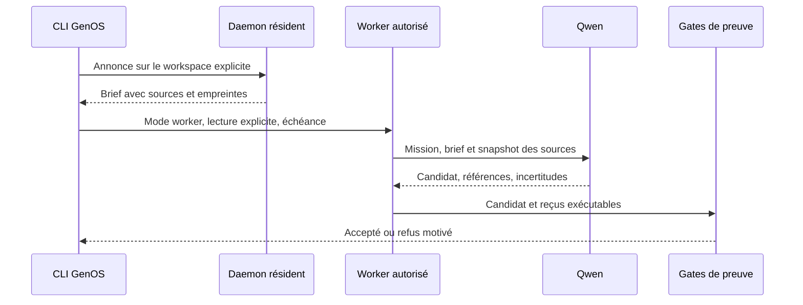

# ADR 0756 — Handoff résident pour les workers directs

- **Statut** : accepté
- **Date** : 2026-10-30

## Contexte

Le lancement direct d'un worker n'utilisait pas le pont territorial employé par
l'orchestrateur. Un daemon actif pouvait indexer le territoire sans que son brief
atteigne le worker. L'absence de territoire reste un cas opérationnel acceptable.

## Décision

Avant la construction du contrat du worker direct, annoncer la mission au pont
de production pour le workspace demandé. Récupérer le brief identifié par le
signal, puis l'ajouter au prompt comme contexte non fiable à vérifier. La
consommation suit le cycle existant du handoff. Sans territoire ni brief, le
prompt original est conservé.
Le workspace doit correspondre explicitement au territoire ; aucun territoire
du dépôt GenOS n'est utilisé comme repli pour un autre workspace.

L'option explicite `readOnlyWorkspaceEvidence` est transmise au runtime local ;
elle donne accès aux extraits et à leurs références SHA-256, sans autoriser de
modification du workspace. Le comportement par défaut reste sans extrait.

Le constructeur `buildWorkerMission` conserve cette option et l'échéance
`executionDeadlineAt`, puis fixe `executionMode` à `worker`. Au bootstrap, le mode
vient de l'identité persistée autorisée. La classification du prompt utilise ce
mode : le mot `orchestrator` dans l'identifiant du worker ne doit pas supprimer
les extraits du workspace.

## Limites et vérification

Le brief n'autorise aucune action et ne remplace aucun gate de preuve. Le test
`test_daemon_direct_worker_handoff.js` couvre le handoff et l'absence de territoire.
Un essai isolé doit aussi vérifier le signal, le statut consommé, le prompt du
worker et le verdict terminal ; un appel modèle ne suffit pas à prouver la mission.
Pour le worker direct, les reprises portent l'échéance de la tentative initiale ;
une reprise ne démarre pas après cette échéance et son timeout est limité au temps
restant. Les missions anciennes sans échéance explicite conservent leur politique.
`test_worker_read_only_workspace_evidence.js` traverse le constructeur réel,
la liaison SHA-256 et le prompt avec un identifiant contenant `orchestrator`.
`test_worker_recovery_redispatch.js` vérifie qu'une reprise durable expirée
termine en `exhausted`, sans allocation de capsule ni nouveau lancement modèle.
