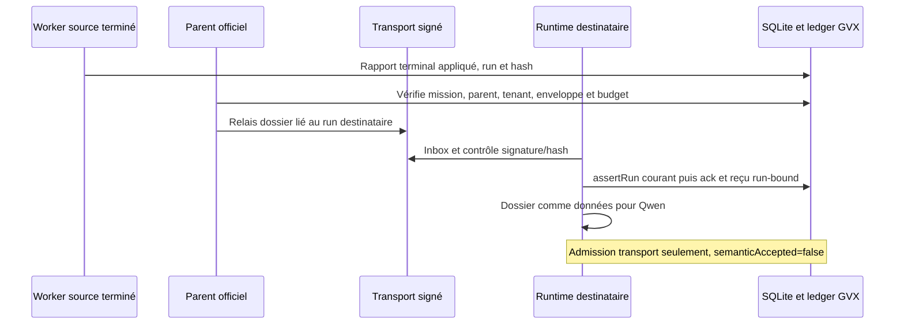

# ADR 0758 — Relais de dossier et admission persistante du destinataire

Date : 2026-10-30. Statut : accepté et implémenté.

## Contexte

La mission Qwen 11 produisait un dossier de liaison local. Une phrase du modèle
annonçant une transmission ou un accusé de réception ne prouve pas que le
destinataire existe, ait reçu le dossier ou soit autorisé à le lire. Le producteur
terminé ne doit pas être réactivé ni remplacé par une identité empruntée.

## Décision

Le paramètre interne `handoffFromRunIds` demande au parent officiel de relayer au
nouveau worker jusqu'à cinq dossiers de runs terminés. `workerDossierHandoffService`
utilise le transport d'organisation existant : signal `plasmid`, enveloppe signée,
inbox validée et accusé de réception persistant. Aucune route réseau ni nouvelle
permission MCP n'est ajoutée.

`workerDossierHandoffValidation` impose un rapport réussi provenant d'un événement
terminal appliqué et d'un run dont l'enveloppe d'exécution est vérifiée. Source et
destinataire doivent appartenir à la même mission, au même parent orchestrateur et
au même tenant. Le dossier contient le hash du rapport, le run source et le run
destinataire. Le producteur conserve son identité ; le parent signe le relais.

Le destinataire doit avoir un run encore actif et une autorité courante. Dans une
transaction SQLite, le runtime valide l'enveloppe de transport et le dossier,
revérifie l'autorité, persiste l'ack et inscrit un événement GVX lié au run
destinataire. Une révocation ou une altération refuse l'admission. Une source ayant
un budget modèle doit avoir consommé le même scope persistant que le destinataire.
Le relais ne crée aucun nouveau plafond.

Le prompt reçoit ensuite le dossier comme données et une référence
`genos://dossier-admission/<run-destinataire>/<message>`. Le rapport final contient
les `transportHandoffs` fournis par le runtime ; toute valeur du modèle dans ce
champ est remplacée. Le reçu indique `acknowledgment: runtime_admission` et
`semanticAccepted: false` : il prouve l'admission du transport, jamais la validité
sémantique ni la promotion des affirmations.

## Conséquences

Le relais fonctionne pour les workers locaux avec dossier terminal réussi. Il
refuse les sources externes à la mission, les scopes budgétaires nouveaux ou
altérés, les destinataires terminaux et les autorités révoquées. Le destinataire
peut ensuite échouer ; son ack déjà persisté continue seulement à prouver une
admission antérieure. Le dossier n'est ni fusionné ni promu globalement.

Le supplément `benchmarks/qwen-worker-missions/relay-11.cjs` attend une campagne
terminée sans run actif et ajoute un destinataire dans la DB originale de la
mission 11. Il archive les inspections et hashes avant/après dans un nouveau
dossier sur D:, réutilise le scope source et conserve les événements existants.
Les dossiers 03/10 importés comme fichiers ne deviennent pas des identités de
workers de cette mission. Le code source de la campagne initiale reste figé.

## Alternatives

* Accepter un ack textuel du modèle : absence de preuve de transport.
* Publier sous l'identité du producteur terminé : usurpation d'un run clos.
* Copier silencieusement la DB pour la livraison : ambiguïté de monde et de
  provenance. Le supplément ajoute des événements au monde source arrêté.

## Validation

`node backend/tests/test_worker_dossier_handoff_transport.cjs` exécute les services
réels, SQLite et un provider modèle simulé : source locale, réception dans un vrai
run aval, ack persistant et remplacement d'un faux ack modèle. Les sondes refusent
mission/parent/budget étrangers, hash altéré et révocation sans ack. Cette sonde
ne constitue pas une exécution Qwen ; le supplément figé mesure séparément Qwen.
