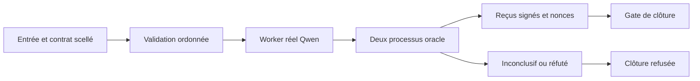

# ADR 0761 — Découpage qualité et frontières de preuve

Statut : accepté.

## Contexte

Le contrôle global refuse des fonctions trop complexes et des interfaces internes
à plus de trois paramètres. La dette est dispersée dans le contrôle des workers,
les validations MCP, AgentGit, l'ontogenèse et les harnesses de benchmark.

## Décision

Les interfaces concernées reçoivent un objet nommé. Les expressions et étapes
sont extraites dans des modules adjacents. Les captures mutables restent des
accès à la liaison d'origine. Les étapes distinguent la poursuite normale d'un
retour anticipé, y compris lorsque la valeur retournée est absente. Les fonctions
asynchrones conservent leurs points d'attente. Les validations MCP restent
ordonnées : un premier refus empêche toute validation ou exécution ultérieure.

Les expressions régulières de réparation sont des constantes privées. Les
opérations globales concernées sont des remplacements ou des recherches de
chaînes, qui ne partagent pas un curseur de test entre deux appels.

Les modules extraits sont ajoutés explicitement au manifeste d'implémentation
des vérificateurs. Le digest couvre leurs octets ; une extraction ne soustrait
donc pas de code au périmètre signé.

Aucun seuil, baseline, quorum, nonce, bail, confinement de chemin ou condition de
promotion n'est relâché. Les fichiers générés de campagne restent sur D:.

## Validation

Le test `test_quality_control_flow.js` couvre le nombre de tentatives, le refus
d'un chemin hors du parent de capsule, la répétition et l'idempotence des
réparations. Les suites AgentGit, ontogenèse, qualité, npm et Cargo complètent
ces contrôles. Les régressions oracle et replay sont inscrites dans npm.

